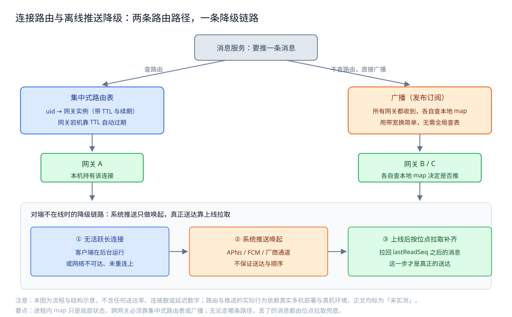
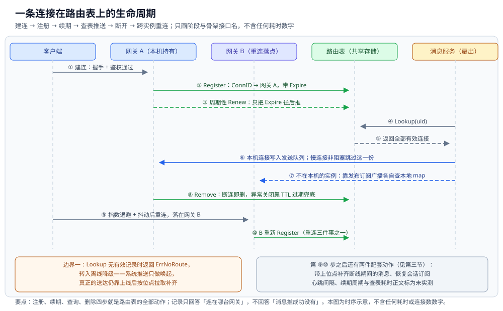
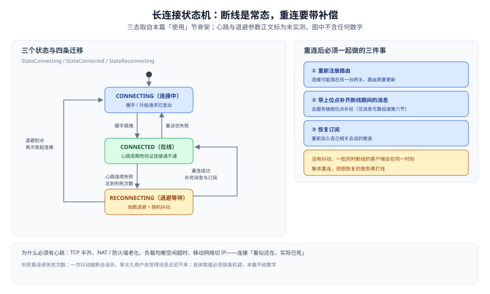

# 在线状态与推送

> 长连接接入（WebSocket 与自定义二进制协议的取舍）、**连接路由**（用户到网关实例的映射放哪、
> 为什么不能只靠进程内 map）、心跳与断线重连、多端在线、离线推送降级（APNs / FCM / 厂商通道），
> 以及跨节点**扇出复用发布订阅**。
>
> 内容整理自个人学习笔记，素材见 [素材清单](../../../素材清单.md)。

---

## 一、长连接该选 WebSocket 还是自定义二进制协议？

**本节要点**：这是**"标准与穿透"和"省流量与可控"之间的取舍**——
WebSocket 赢在到处都是中间设施都认它，自定义二进制协议赢在协议头完全由自己说了算。

### 1.1 两者的本质差异

| 维度 | **WebSocket** | **自定义二进制 TCP** |
|---|---|---|
| 标准与生态 | RFC 标准，各语言、各代理、CDN 普遍支持 | 私有协议，只有自己的端和服务端认 |
| 报文开销 | 有帧头与握手，协议头相对固定 | **协议头可压到最小**（自己定字段） |
| 穿透与中转 | 走 HTTP 升级，**易穿过企业代理与负载均衡** | 非标准端口/协议**常被中间设备拦或限** |
| 实现成本 | 有成熟库，直接可用 | 要自己处理**粘包、半包、心跳帧** |
| 可观测 | 抓包工具普遍能解 | 需要自备解码工具 |

### 1.2 怎么选

- **默认选 WebSocket**：除非有明确的省流量或可控协议需求，标准协议在"穿透中间设施"这件事上省下的麻烦远大于它的报文开销。
- **选自定义二进制**：当**端侧可控且流量成本敏感**（如海量常驻连接），并且团队愿意自己维护协议栈与解码工具时。
- **混合**：先用 WebSocket 建立连接，再在应用层换成自定义的**紧凑二进制载荷**——
  拿到"能穿透"和"省载荷"两头的好处。这就是很多客户端在做的事。

🔗 本节的选型判据已由协议篇的共用图承担，同型不重画：[协议设计-序列化选型与自研决策树.svg](../../../02-计算机基础/网络/应用层/images/协议设计-序列化选型与自研决策树.svg) —— 该图 B 栏问的正是「端侧可控 + 流量成本敏感 + 有团队维护」三条是否同时成立：成立才自研自定义二进制（并写明「LB / CDN / 抓包工具不认私有协议」这条代价），不成立就「WebSocket 承载 + 应用层成熟序列化」。**分工**：那张图是**协议设计视角**（选型怎么判），本节是**接入视角**（选定之后长连接怎么活）。

> ⚠️ **未实测**：本节不给两种协议的"每连接内存"或"单机连接数"数字。
> 原因：这类数字高度依赖内核参数、网关实现与机器规格，本机单进程环境测不出有意义的结论。

## 二、连接路由：用户到网关实例的映射该放哪？

**本节要点**：连接是**有状态的**（一条 TCP 连接只能活在某一个网关进程里），
而一次消息推送要找到"用户连在哪台网关"——**这份映射不能只放在网关自己的进程内 map 里**。

### 2.1 为什么进程内 map 不够

进程内 map（`uid → 本机的连接`）只在**单机**成立。一旦网关是多台的：

- 用户在网关 A 建立了长连接，映射只在 **A 的内存**里；
- 消息服务收到一条发给该用户的消息，它**不知道用户在 A**；
- 如果消息服务把消息交给网关 B，B 的内存里没有这个连接，**消息就推不出去**。

**根因**：映射是"全局知识"，却被存成了"局部状态"。要么把它**集中起来**，要么**广播给所有人**。

### 2.2 两种可行解法

| 方案 | 做法 | 代价 |
|---|---|---|
| **集中式路由表** | 把 `uid → 网关实例` 存到共享存储（如 Redis），网关注册、续期、断开时删除 | 每次推送多一次查表；路由表要处理过期与脑裂 |
| **广播（不查路由）** | 消息直接广播给**所有网关**，每个网关查自己的进程内 map，**有连接才推** | 用带宽换简单：N 台网关就广播 N 份，但**没有全局查表** |

**判据**：**在线连接数大、网关多 → 集中式路由表更省带宽**；
**网关规模中等、消息量不大、想少一份共享状态 → 广播更简单可靠**。
真实系统常**两者都有**：本机持有的连接直接推，跨节点的靠广播兜。

### 2.3 路由表的三个必备性质

1. **带 TTL 与续期**：网关每隔一段时间续期一次；网关宕机后记录能**自动过期**，不至于永久指向一台死机器。
2. **断连即删**：连接正常关闭时显式删除；异常关闭靠 TTL 兜底。
3. **多连接**：一个用户可能多端在线，值是**实例集合**而不是单个实例（见第四节）。



> ⚠️ **未实测**：本节是设计判据，不含"路由表查询耗时"或"广播放大倍数"的实测数字。
> 原因：需要真实多网关部署才能测，本机单进程无法复现。

### 2.4 一条连接从建立到迁移的完整时序

把上面三条性质串起来，一条连接在路由表上依次经过六个阶段。下表只用本篇「使用」节骨架里的**接口名与字段名**
（`Register` / `Renew` / `Lookup` / `Remove`，`Route{UID, Gateway, ConnID, Expire}`），
不含心跳间隔、续期周期与查询耗时——那些依赖真实多机与真机，上文已标未实测。

| 阶段 | 谁发起 | 做什么 | 路由表上的变化 |
|---|---|---|---|
| **建连** | 客户端 → 网关 | 握手与鉴权通过后，本机 map 里多出一条连接 | `Register` 写入一条 `uid + connID → 网关` 的记录，带 `Expire` |
| **续期** | 网关周期触发 | 隔一段时间续一次，防止记录被当成死连接 | `Renew` 只把 `Expire` 往后推，不改归属 |
| **推送前查表** | 消息服务 | 要推消息，先查这个人现在连在哪些实例上 | `Lookup` 返回**全部有效连接**，顺手删掉已过期记录 |
| **本机与跨节点** | 网关 | 本机持有的连接写进发送队列；不在本机的那份交给广播 | 无变化（记录只用来定位，不记录"推没推成功"） |
| **断开** | 客户端 / 网关 | 正常关闭显式删除，异常关闭等它自己过期 | `Remove`；网关宕机时靠 `Expire` 兜底 |
| **重连到别处** | 客户端 | 退避后重连，可能落在另一台网关 | 新实例重新 `Register`，旧记录由删除或过期清理 |

两个边界情况也走同一条时序：`Lookup` 查不到任何有效连接时返回 `ErrNoRoute`，此时按第五节降级到系统推送；
慢连接的发送队列写满时**非阻塞跳过这一份**，不能让它阻塞同一用户的其他连接。



图怎么读：五条生命线是「客户端 → 网关 A（本机持有连接）→ 网关 B（重连后的落点）→ 路由表（共享存储）→ 消息服务（扇出）」。
时序为 ① 建连（握手 + 鉴权通过）→ ② `Register` 写入 `ConnID → 网关 A` 且带 `Expire` → ③ 周期性 `Renew` 只推后过期时间 →
④ 消息服务 `Lookup(uid)` → ⑤ 返回该用户全部有效连接（多端在线时不止一条）→ ⑥ 本机连接写入发送队列，
慢连接非阻塞跳过 → ⑦ 不在本机的实例靠发布订阅广播各自查本地 map → ⑧ 正常关闭 `Remove`，异常关闭靠 TTL 过期 →
⑨ 客户端退避重连落在网关 B，B 重新 `Register`——这正是第三节「重连后三件事」的第一件。
底部左块是表格末尾那个边界情况：`Lookup` 无有效记录时返回 `ErrNoRoute`，转入第五节的降级链路；
右块补齐第 ⑨⑩ 步之后的两件配套动作（带上位点补消息、恢复订阅）。本图只给阶段与接口名，
心跳间隔、续期周期与查询耗时一律未实测，图中不含任何数字。

## 三、心跳与断线重连怎么设计？

**本节要点**：**长连接不会主动告诉你它断了**——网络抖动、NAT 老化、负载均衡空闲超时都会让连接
"看似还在、实际已死"。心跳的唯一目的就是**把"死亡"变成可检测的事件**。

### 3.1 为什么必须有心跳

| 场景 | 没有心跳的后果 |
|---|---|
| **TCP 半开** | 一端进程已死，另一端仍以为连接可用，消息发出去石沉大海 |
| **NAT / 防火墙老化** | 中间设备把空闲连接的表项清掉，两端却都不知道，直到下次发包才暴露 |
| **负载均衡空闲超时** | 网关侧连接被 LB 单方面关闭，客户端还以为是好的 |
| **移动网络切换** | 从 Wi-Fi 切到蜂窝，IP 变了，旧连接实际已失效 |

心跳的作用是**周期性制造流量**，让"连接还能不能通"这件事每隔一段时间就被验证一次。

### 3.2 心跳的三个参数

- **间隔**：多久发一次。太勤费电费流量，太懒断线发现慢；
- **超时**：多久没收到对方的响应就算这次心跳失败；
- **判死次数**：连续失败几次才判定连接不可用。

判死不能只失败一次就断（一次抖动会误杀），也不能等太久（用户会觉得"消息迟迟不来"）。
**具体取值必须按真机与网络环境调**，本篇不给数字。

### 3.3 断线重连的两条硬要求

1. **指数退避加抖动**：重连间隔按倍数增长并叠加随机抖动。
   没有抖动，一批同时断线的客户端会在**同一时刻**集体重连，把刚恢复的服务再打挂。
2. **重连后做三件事**：
   - **重新注册路由**（这台连接在网关 B 上，路由表要更新）；
   - **带上自己的位点**去服务端**补齐断线期间的消息**（见 [消息可靠投递.md](消息可靠投递.md) 第六节）；
   - **恢复订阅**（重新加入自己相关会话的推送）。

> ⭐ 一句话：**重连不是"把连接接回去"就完了，而是"接回去 + 补消息 + 恢复订阅"三件事一起做**。



图怎么读：三态取自本篇「使用」节骨架。CONNECTED 进入 RECONNECTING 的条件是「心跳连续失败、达到判死次数」——一次抖动不能断；RECONNECTING 按「指数退避 + 随机抖动」退避到点后回到 CONNECTING 再次发起，重连成功、补完消息与订阅才回到 CONNECTED。右侧列出重连后必须一起做的三件事：① 重新注册路由、② 带上位点补齐断线期间的消息、③ 恢复订阅。心跳与退避参数正文标为未实测，图中不含任何数字。

## 四、多端在线怎么处理？

**本节要点**：多端在线把"一个用户一条连接"变成**"一个用户一组连接"**，
路由表与扇出的粒度都要从"用户"落到"连接"，但**已读这类共享状态仍要合并**。

### 4.1 两种策略

| 策略 | 行为 | 适用 |
|---|---|---|
| **允许多端同时在线** | 一个用户可有手机、桌面、平板多条连接 | 现代 IM 的主流选择 |
| **互踢（单点登录）** | 新登录踢掉旧连接 | 安全敏感或强一致场景 |

**主流是允许多端在线**，代价是扇出要把消息推给**该用户的所有连接**（本机的直接推，跨网关的靠广播）。

### 4.2 路由表的粒度

| 粒度 | 路由表存什么 | 扇出怎么做 |
|---|---|---|
| **按用户** | `uid → 网关集合` | 一个用户多条连接在同一网关时，网关内部再选连接 |
| **按连接** | `连接 ID → 网关`，并维护 `uid → 连接 ID 集合` | 每端独立可寻址，粒度更细、状态更多 |

粒度越细，能做的事越多（比如"只推给桌面端"），但**路由表的状态量也越大**——
后者随**连接数**增长，前者随**在线用户数**增长。

🔗 本节「一组连接」的查表与推送形态已由同目录两张共用图承担，同型不重画：
[在线状态与推送-连接在路由表上的生命周期时序.svg](images/在线状态与推送-连接在路由表上的生命周期时序.svg) 的 Lookup 一步返回的是**该 uid 的全部有效连接**（本机命中的写发送队列、慢连接非阻塞跳过），正是上面"按用户 / 按连接"两种粒度落地后的查询语义；
[会话与未读-多端已读收敛时序与未读反弹.svg](images/会话与未读-多端已读收敛时序与未读反弹.svg) 则画了 4.3 说的那个交叉点——上报是多端往服务端取 max、同步是服务端往多端广播、接收位点每端自推，三个方向规则相反。
**分工**：本节讲"粒度从用户落到连接"带来的代价（状态量、扇出对象），那两张图分别讲"一次连接的一生"与"一份共享状态怎么被多端改写"。

### 4.3 多端与已读的交叉点

多端不只是"多发几份消息"，它还让**已读位点变成被多端共享改写的状态**：
任一端上报已读，都要广播给该用户的其他端并按规则收敛。
这部分规则见 [会话与未读.md](会话与未读.md) 第四节——**多端在线是"已读收敛"这个问题存在的原因**。

## 五、离线推送怎么降级到系统通道？

**本节要点**：**长连接推不到时，只能改走操作系统的推送通道**；
但它**只保证"提醒到达"，不保证"消息送达"**——真正的消息可靠性仍必须靠上线后按位点拉取。

### 5.1 什么时候降级

降级的触发点是"**这个用户当前没有可用的活跃长连接**"：

- 客户端没在前台运行，长连接被系统回收；
- 网络不可达，长连接已断且没重连上；
- 用户主动退出登录（此时通常不推或只推有限的系统通知）。

### 5.2 三条系统通道

| 通道 | 平台 | 定位 |
|---|---|---|
| **APNs** | iOS | 苹果统一通道，送达行为由系统与用户设置共同决定 |
| **FCM** | Android（海外为主） | 谷歌统一通道 |
| **厂商通道** | 国内 Android 各厂商 | 各厂商各自的长连接推送，需逐家接入 |

**为什么要"厂商通道"**：国内很多设备上没有稳定的 FCM，只能接各厂商自建的推送服务，
于是变成一个**多通道适配**的问题——同一台设备可能同时要按品牌走不同通道。

### 5.3 系统推送能保证什么、不能保证什么

| 保证 | 不保证 |
|---|---|
| 尽量把"有新消息"这个提醒送达 | **不保证一定送达**（系统可能延迟、合并、丢弃） |
| 可以携带少量展示信息 | **不保证顺序**，也**不等于对端读了消息** |

**判据**：**系统推送只做"唤起"，不做"投递"**。
真正的消息由客户端上线后按 `lastReadSeq` 从服务端拉取补齐（[消息可靠投递.md](消息可靠投递.md) 第六节）。
把系统推送当投递通道，会把"没收到通知"变成"消息丢了"。

🔗 本节三级降级链已由同目录共用图承担，同型不重画：[连接路由与离线推送降级.svg](images/连接路由与离线推送降级.svg) —— 该图下半画的正是上面三段：「① 无活跃长连接（客户端在后台运行、或网络不可达未重连上）」→「② 系统推送唤起：APNs / FCM / 厂商通道，不保证送达与顺序」→「③ 上线后按位点拉取补齐：拉回 lastReadSeq 之后的消息，这一步才是真正的送达」。**分工**：那张图给出降级在链路里的**位置**（路由查不到才走它），本节给三条通道的**平台差异**与保证边界。

> ⚠️ **未实测**：本节不附任何"送达率"数字。
> 原因：系统通道的送达依赖真实设备、系统版本、厂商账号与用户设置，本机根本无法复现。

## 六、跨节点扇出怎么复用发布订阅？

**本节要点**：跨网关推消息，**和弹幕系统是同一个手法**——用发布订阅把消息广播给所有网关，
每个网关只推自己持有的连接；区别在于 **IM 不能丢**，所以广播之外必须配一条拉取兜底。

### 6.1 复用弹幕的扇出手法

```text
消息服务 PUBLISH 一条消息到某个主题
        ↓
所有网关都订阅该主题，各自收到
        ↓
每个网关查自己的进程内 map（本机持有哪些连接）
        ↓
只推给本机持有的、属于该用户的所有连接
```

这正是 [README.md](../弹幕系统/README.md) 第 4 层"用 Redis 发布订阅打通分布式节点"的同一套做法。

### 6.2 与弹幕的关键差异：能不能丢

| 维度 | 弹幕 | IM |
|---|---|---|
| 丢失容忍 | **可以丢**，走内存 Pub/Sub 即可 | **不能丢**，必须落库且可补齐 |
| 广播的地位 | 就是投递本身 | 只是**实时路径**，丢了靠拉取补 |
| 补偿机制 | 无（丢了就丢了） | **必须有**：按位点拉取补齐 |

**结论**：IM 的扇出要写成"**广播推实时 + 位点拉兜底**"。
广播让消息"尽快出现"，拉取保证"一条不少"。这套组合也是 [消息可靠投递.md](消息可靠投递.md)
里"至少一次投递 + 去重"在连接层的样子。

### 6.3 发布订阅本身不保留消息

发布订阅（如 Redis Pub/Sub）**不保留历史消息**：网关在订阅之前发的消息收不到，
断线期间的消息也收不到。所以**订阅必须常驻**，且**断线重连后仍要回退到位点拉取**——
**不能假设"订阅上了就一条不落"**。

🔗 本节广播扇出的形态已由同目录共用图承担，同型不重画：[连接路由与离线推送降级.svg](images/连接路由与离线推送降级.svg) —— 该图右支画的正是 6.1 那段四步：「广播（发布订阅）：所有网关都收到，各自查本地 map」「网关 A 本机持有该连接、网关 B / C 各自查本地 map 决定是否推」，并写明「用带宽换简单，无需全局查表」。**分工**：那张图是**路由视角**（查表与广播两条路并存），本节是**语义视角**（IM 的广播只是实时路径，丢了要靠位点拉取补，见 6.2 与弹幕的差异）。

## 使用：连接路由与推送的最小骨架

**本节要点**：把"路由表（注册 / 续期 / 查询 / 删除）+ 连接状态 + 扇出"落成**可编译的最小骨架**；
涉及真实长连接与多机的部分标注未实测。

```go
package im

import (
	"errors"
	"sync"
	"time"
)

// Route 是一条连接在路由表里的记录。
//
// TTL 的意义：网关宕机时来不及显式删除，让记录自己能过期，
// 否则路由表会永久指向一台死机器。
type Route struct {
	UID     string
	Gateway string
	ConnID  string
	Expire  time.Time
}

// RouteTable 是「用户 + 连接 → 网关实例」的映射。
//
// ⚠️ 未实测：本机实现是进程内 map，仅用于验证接口与语义。
// 生产必须放到共享存储（如 Redis）上，否则多网关各自为政，路由表不成立。
type RouteTable interface {
	Register(r Route) error
	Renew(uid, connID string, ttl time.Duration) error
	Lookup(uid string) ([]Route, error)
	Remove(uid, connID string) error
}

var ErrNoRoute = errors.New("no route")

// MemoryRouteTable 是 RouteTable 的进程内实现（示意，仅单机成立）。
type MemoryRouteTable struct {
	mu    sync.Mutex
	byUID map[string]map[string]Route // uid -> connID -> Route
}

func NewMemoryRouteTable() *MemoryRouteTable {
	return &MemoryRouteTable{byUID: map[string]map[string]Route{}}
}

func (t *MemoryRouteTable) Register(r Route) error {
	t.mu.Lock()
	defer t.mu.Unlock()
	if t.byUID[r.UID] == nil {
		t.byUID[r.UID] = map[string]Route{}
	}
	t.byUID[r.UID][r.ConnID] = r
	return nil
}

func (t *MemoryRouteTable) Remove(uid, connID string) error {
	t.mu.Lock()
	defer t.mu.Unlock()
	if m := t.byUID[uid]; m != nil {
		delete(m, connID)
	}
	return nil
}
```

查询要把**已过期**的记录一并清掉——TTL 既是防死连接，也是清理依据。

```go
// Lookup 返回该用户当前有效的所有连接（多端在线时不止一条）。
func (t *MemoryRouteTable) Lookup(uid string) ([]Route, error) {
	t.mu.Lock()
	defer t.mu.Unlock()
	now := time.Now()
	out := make([]Route, 0, len(t.byUID[uid]))
	for connID, r := range t.byUID[uid] {
		if r.Expire.Before(now) {
			delete(t.byUID[uid], connID) // 过期即视为已断开
			continue
		}
		out = append(out, r)
	}
	if len(out) == 0 {
		return nil, ErrNoRoute
	}
	return out, nil
}
```

连接状态机与重连退避：**重连必须带抖动**，避免同时断线时集体重连。

```go
// State 是连接的三个状态：重连不是一步到位，要经过 CONNECTING。
type State int

const (
	StateConnecting State = iota
	StateConnected
	StateReconnecting
)

// Backoff 给出第 attempt 次重连应等待的时长：指数增长并叠加抖动。
//
// ⚠️ 未实测：base 与 cap 是占位值，真实取值必须按真机与网络环境调。
// 抖动（jitter）是必须的：没有它，一批同时断线的客户端会同时重连，二次打挂服务。
func Backoff(attempt int, base, cap time.Duration, jitter func(time.Duration) time.Duration) time.Duration {
	d := base
	for i := 0; i < attempt; i++ {
		d *= 2
		if d >= cap {
			d = cap
			break
		}
	}
	return d + jitter(d)
}

// Fanout 把一条消息推给「本机持有的该用户全部连接」。
//
// ⚠️ 未实测：本骨架不接真实 WebSocket 与发布订阅。
// 本机持有的连接直接推；跨网关那部分由发布订阅广播完成（见第六节）。
type Fanout struct {
	routes RouteTable
	conns  map[string]chan []byte // connID -> 该连接的发送队列（示意）
	mu     sync.Mutex
}

func (f *Fanout) PushToUser(uid string, payload []byte) (int, error) {
	rs, err := f.routes.Lookup(uid)
	if err != nil {
		return 0, err
	}
	f.mu.Lock()
	defer f.mu.Unlock()
	sent := 0
	for _, r := range rs {
		if ch, ok := f.conns[r.ConnID]; ok {
			select {
			case ch <- payload:
				sent++
			default:
				// 慢连接：非阻塞丢弃，交给位点补偿兜底（不能阻塞其他连接）。
			}
		}
	}
	return sent, nil
}
```

> ⚠️ **未实测**：以上代码只做静态编译校验（`gofmt` 通过）。
> 未运行 `go test` 的原因：路由、心跳、多端扇出与离线降级都必须依赖
> **真实长连接、多台网关、真机与厂商推送账号**，本机单进程无法复现，给出运行结果即为编造。

## 延伸追问

- **为什么连接路由不能只靠进程内 map？** → 因为"用户连在哪台网关"是**全局知识**，而进程内 map 只是**局部状态**。多网关下，别的网关看不到这台机器的 map，消息就会推给没有该连接的机器，等于推丢。
- **广播和查路由表，该选哪个？** → 看规模：**网关多、连接密 → 查集中式路由表更省带宽**；**规模中等、想少一份共享状态 → 广播更简单**。两者都可行，代价方向相反（一个多查表，一个多带宽）。
- **心跳间隔是不是越短越好？** → 不是。太短费电费流量，还可能触发中间设备的限流；太长则断线发现慢、用户觉得"消息不来"。取值必须按真机调，本篇不给数字。
- **为什么离线推送不能当投递？** → 系统通道**不保证送达、不保证顺序**，还可能被系统合并或延迟。它只适合"唤起用户"，真正一条不少要靠上线后按位点拉取。
- **多端在线最容易被忽略的坑？** → 扇出粒度。消息要推给该用户的**每一条连接**，但**已读位点要在这些端之间合并**（取 max）。推是"复制到多端"，已读是"多端收敛成一份"，两个方向的规则正好相反。

## 关联

- [通信链路与协议栈.md](通信链路与协议栈.md) — 分层总纲：一条消息跨哪三条路径、本篇在第几条路径上、跨路径怎么衔接。
- [协议设计.md](协议设计.md) — 心跳、ACK、能力协商这些控制类报文的具体帧格式与字段。
- [消息可靠投递.md](消息可靠投递.md) — 长连接上的 ACK、断线补齐与"至少一次 + 去重"如何配合。
- [会话与未读.md](会话与未读.md) — 多端在线的已读收敛规则，正是本篇第四节引出的问题。
- [README.md](README.md) — 本篇在 IM 四个硬问题里的位置与阅读顺序。
- [README.md](../弹幕系统/README.md) — 跨节点扇出用发布订阅的同一手法，但弹幕可以丢。
- [README.md](../../分布式/README.md) — 负载均衡与故障转移等零件原理。
- [消息队列选型对比.md](../../../03-数据与中间件/中间件/消息队列/消息队列选型对比.md) — 跨节点广播通道的组件选型与语义。
> 反向引用（本篇被下列文档引到）：[存储全景.md](存储全景.md)、[总体设计.md](总体设计.md)、[机器人与开放平台.md](机器人与开放平台.md)、[群聊.md](群聊.md)、[跨地域多活.md](跨地域多活.md)、[限流与防刷.md](限流与防刷.md)、[音视频信令.md](音视频信令.md)
