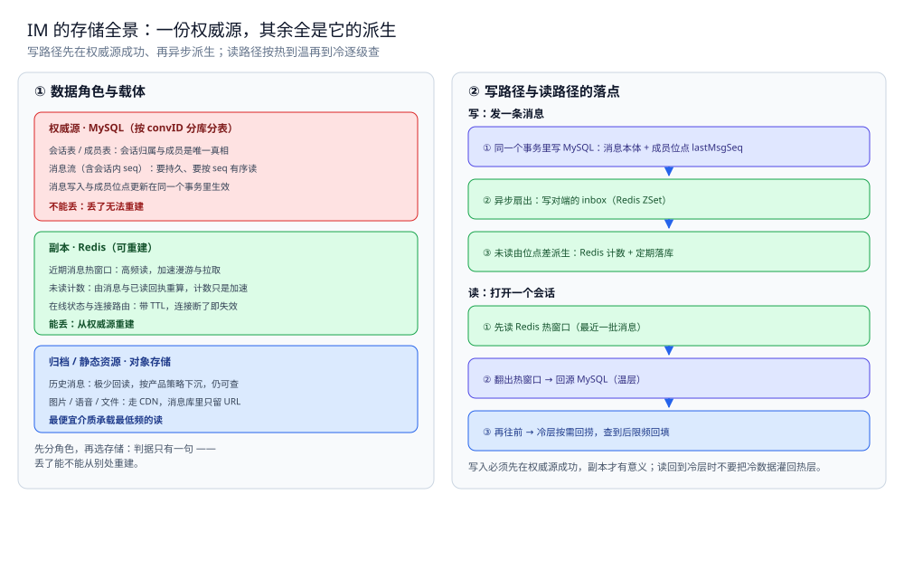
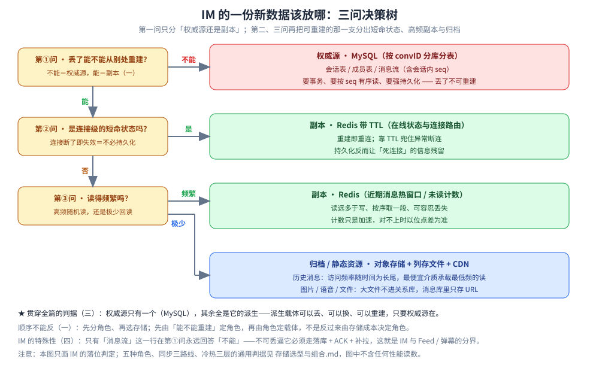

# 存储全景

> IM 系统的数据都存哪：每份数据是什么角色、放哪个载体、怎么同步、哪些能丢哪些不能。
> 本篇只回答「这份数据放哪」——通用判据（角色 / 同步 / 冷热）见 [存储选型与组合.md](../../../03-数据与中间件/数据存储/存储架构与场景/存储选型与组合.md)，
> 本篇不重复判据，只把判据落到 IM 上。
>
> 内容整理自个人学习笔记，素材见 [素材清单](../../../素材清单.md)。

---

## 一、IM 里数据扮演哪几种角色？

**本节要点**：先分角色，再选存储。判据只有一句——**丢了能不能从别处重建**；不能重建的是权威源，能重建的是副本。

| 数据 | 角色 | 载体 | 理由 |
|---|---|---|---|
| 会话表 / 成员表 | 权威源 | MySQL（按 convID 分库分表） | 会话归属与成员是唯一真相，丢了不可重建 |
| 消息流（含会话内 seq） | 权威源 | MySQL（按 convID 分库分表） | 消息是唯一真相，要持久、按 seq 有序读 |
| 近期消息（热窗口） | 缓存 | Redis | 高频读，加速漫游与拉取；可从消息流重建 |
| 历史消息（长期） | 归档 / 冷数据 | 对象存储 + 列存文件 | 极少回读，按产品策略下沉；仍可查 |
| 在线状态与连接路由 | 缓存 | Redis（带 TTL） | 临时状态，连接断了即失效，重建即重连 |
| 未读数 | 副本 | Redis 计数 + 定期落库 | 由消息与已读回执重算 |
| 图片 / 语音 / 文件 | 归档 / 静态资源 | 对象存储 + CDN | 体积大、走 CDN，消息库里只存 URL |

⭐ 判据：会话与消息不能重建 → 权威源；在线状态 / 未读 / 图片是可重算或本身就是短命状态 → 副本 / 归档。

## 二、读和写的路径分别走哪条链？

**本节要点**：同一份数据在写路径和读路径上的落点不同——写路径决定「谁先落库、谁异步派生」，读路径决定「先查热层、回源温层、下沉冷层」。

### 2.1 写路径

```text
发消息
│
├─ ① 会话与消息落 MySQL（权威源，事务写入）
├─ ② 更新成员表 lastMsgSeq（同一事务，见 消息可靠投递.md）
├─ ③ 异步扇出：写对端 inbox（Redis ZSet）
├─ ④ 图片 / 语音：先传对象存储，拿到 URL 再写消息体
└─ ⑤ 若开启检索：CDC 同步到检索副本（见 搜索与历史.md）
```

### 2.2 读路径

```text
打开会话
│
├─ ① 读 Redis 热窗口（最近 N 条）
├─ ② 按消息 ID 批量回填内容本体（MySQL / 已缓存）
└─ ③ 翻到热窗口之外 → 回源 MySQL（温）→ 冷层按需回捞
```

⭐ 判据：**写入必须先在权威源成功，副本才有意义**；读路径按热 → 温 → 冷逐级查，不要把冷数据灌回热层。



图怎么读：左栏先分角色——红色是权威源（MySQL，存会话表 / 成员表 / 消息流），绿色是副本（Redis，存近期消息热窗口、未读计数、带 TTL 的在线状态与连接路由），蓝色是归档与静态资源（对象存储，存历史消息与图片语音文件）。右栏是两条链：写路径先把消息本体与成员位点放进同一个事务，再异步扇出对端 inbox、由位点差派生未读；读路径先取 Redis 热窗口，翻出去就回源 MySQL 的温层，再往前才到冷层按需回捞。整张图的判据只有一句：**权威源只有一个，其余全是它的派生**——派生载体可以丢、可以换、可以重建。图为存储落点示意，不含任何性能读数。

## 三、为什么这样分配？

**本节要点**：每个角色选中它的载体，都有结构上的理由，不是拍脑袋。

| 数据 | 为什么是它 |
|---|---|
| 会话 / 消息落 MySQL | 需要事务（消息写入 + 成员位点更新要一起生效）、需要按 seq 有序读、需要强持久化 |
| 近期消息放 Redis | 读远多于写、按序取一段、可容忍丢失——是典型的「可重建副本」 |
| 历史消息下沉对象存储 | 访问频率随时间为长尾，用最便宜的介质承载最低频的读 |
| 在线状态放 Redis 带 TTL | 连接断了就该失效，靠 TTL 兜住异常断连——不需要持久化 |
| 未读数用 Redis 计数 | 高频读，但要能以位点差为准重算，计数器只是加速 |
| 图片走对象存储 + CDN | 大文件不适合放进关系库，CDN 承担分发压力 |

⭐ 一条贯穿全篇的判据：**权威源只有一个（MySQL），其余全是它的派生**——派生载体可以丢、可以换、可以重建，只要权威源在。



图怎么读：这是一棵**判定顺序树**，不是第一、三节两张表的另一种排版——表回答「谁在哪」，这棵回答「来了一份新数据，按哪几个问题问下去能落到哪」。第①问就是第一节的判据「丢了能不能从别处重建」：答「不能」直接收到红色权威源叶子（MySQL 按 convID 分库分表，存会话表 / 成员表 / 消息流含 seq，理由是第三节那一行「要事务、要按 seq 有序读、要强持久化」）；答「能」才往下问。第②问切出「连接级短命状态」这一支——在线状态与连接路由，特征是连接断了即失效、重建即重连，所以是 Redis 带 TTL 而不做持久化（持久化反而让「死连接」的信息残留）。第③问按读频再切两刀：频繁随机读、且能从消息与位点重算的（近期消息热窗口、未读计数）落 Redis 副本；极少回读或体积大的（历史归档、图片 / 语音 / 文件）落对象存储 + 列存文件 + CDN。三条分支标签「不能 / 是 / 频繁」与「否 / 极少」是判据的两值出口，不引入新内容。与同目录 [IM存储角色与读写路径.svg](images/IM存储角色与读写路径.svg) 的分工：那张是**静态落点图**（角色 × 载体 + 读写两条链的落点），这张是**决策路径图**（先问什么、后问什么），顺序反了就会出现「用存储成本倒推角色」的错判。底部灰字声明：通用判据（五种角色、同步三路线、冷热三层）在 [存储选型与组合.md](../../../03-数据与中间件/数据存储/存储架构与场景/存储选型与组合.md)，本图不含任何性能读数。

## 四、IM 的特殊性在哪？

**本节要点**：IM 的存储和 Feed / 弹幕 / 推荐的最大差别是「**消息不可丢**」。

| 对比项 | IM | Feed 流 | 弹幕 |
|---|---|---|---|
| 消息可丢吗 | ❌ 不能丢，必须落库 + ACK + 补拉 | ⚠️ 时间线副本可丢，内容本体不可丢 | ✅ 弹幕可丢，走内存 Pub/Sub |
| 权威源 | MySQL（会话 + 消息） | MySQL（内容本体） | MySQL（视频元数据） |
| 热副本 | Redis（近期消息） | Redis ZSet（时间线） | Redis（弹幕池） |
| 同步方式 | 写时同步扇出 + 断线补拉 | 写扩散 / 读扩散（推拉结合） | 内存广播 + 异步归档 |
| 是否需要补拉 | ⭐ 必须（按 lastSeq 补） | 按需（翻页时回源） | 不需要（丢了就丢了） |

⭐ 一句话：弹幕的「可丢」让它能用最轻的方案；IM 的「不可丢」逼它必须走「落库 + ACK + 补拉」三件套。

## 使用：一次完整链路的存储落点

**本节要点**：把「用户按下发送」到「对端看到」的全过程，标出每一步的存储落点。

| 步骤 | 数据 | 落在哪 |
|---|---|---|
| ① 客户端发消息 | 上行报文 | 网关内存（路径 ①） |
| ② 网关调消息服务 | gRPC 请求 | 无持久化（路径 ②） |
| ③ 消息服务去重 | 去重键 | Redis SET NX（带 TTL） |
| ④ 分配 seq | 会话内序号 | MySQL 事务内 |
| ⑤ 消息落库 | 消息本体 | MySQL（权威源） |
| ⑥ 更新成员位点 | lastMsgSeq | MySQL（同事务） |
| ⑦ 返回 SendAck | ACK 报文 | 无持久化 |
| ⑧ 异步扇出 | 对端 inbox | Redis ZSet |
| ⑨ 对端在线 → 推送 | Push 报文 | 网关内存 |
| ⑩ 对端离线 → 系统推送 | APNs / FCM | 系统通道 |
| ⑪ 对端上线 → 补拉 | 按 lastSeq 拉 | MySQL + Redis 热窗口 |
| ⑫ 已读上报 | lastReadSeq | MySQL（成员表，取 max 收敛） |

⭐ 三个关键落点：**消息本体与位点在 MySQL（权威源）**；inbox 在 Redis（副本）；未读在 Redis + 定期落库。

## 延伸追问

- **为什么消息不直接写 Redis 当权威源？** → Redis 可能丢（RDB 是周期性快照、AOF 也可能只落盘到最后一次 fsync），且单位容量成本远高于磁盘。消息是唯一真相，必须落 MySQL。
- **为什么在线状态不需要持久化？** → 它是临时状态——连接断了它就该失效，重建就是重连。持久化反而会让「死连接」的信息残留。
- **未读数既然能重算，为什么还存一份 Redis 计数？** → 只为加速读。位点差是权威算法，计数器是加速器；两者对不上时以位点差为准（见 [会话与未读.md](会话与未读.md) 第三节）。
- **历史消息下沉到对象存储后怎么查？** → 靠统一查询层：上层按 convID + seq 查，下层按「Redis → MySQL → 对象存储」逐级找，冷层查到后限频回填，避免污染热层。
- **如果 IM 也要做全文检索（搜聊天记录）怎么办？** → 加一个检索副本（Elasticsearch / OpenSearch），从消息流 CDC 同步，作为派生副本，不改变权威源；权限过滤与冷热分层见 [搜索与历史.md](搜索与历史.md)。判据与 Feed 加检索一致，见 [存储选型与组合.md](../../../03-数据与中间件/数据存储/存储架构与场景/存储选型与组合.md) 第四节。

## 关联

- [存储选型与组合.md](../../../03-数据与中间件/数据存储/存储架构与场景/存储选型与组合.md) — 通用判据：五种角色、同步三路线、冷热三层——本篇是它在 IM 上的落地。
- [消息可靠投递.md](消息可靠投递.md) — 消息落库、seq 分配、幂等去重、位点补拉的详细语义。
- [会话与未读.md](会话与未读.md) — 成员表两个位点、未读派生、已读取 max 收敛。
- [在线状态与推送.md](在线状态与推送.md) — 在线状态与连接路由为什么要放 Redis、为什么带 TTL。
- [搜索与历史.md](搜索与历史.md) — 检索副本怎么建、权限过滤与冷热分层。
- [README.md](README.md) — 本目录导读：IM 的四个硬问题与阅读顺序。
- [数据同步方式选型对比.md](../../../03-数据与中间件/数据存储/数据同步/数据同步方式选型对比.md) — 通用篇的同步路线：CDC / 双写 / 定时全量怎么选。
> 反向引用（本篇被下列文档引到）：[总体设计.md](总体设计.md)
