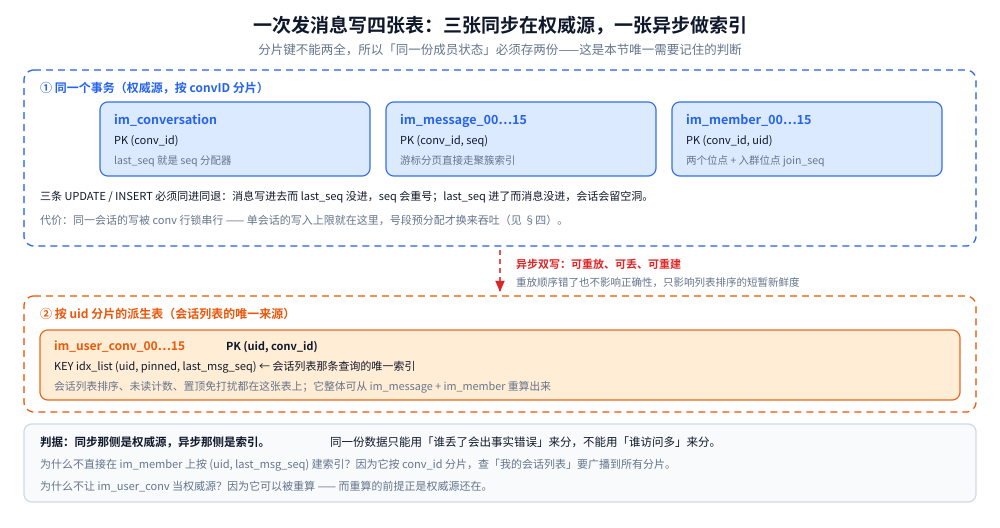
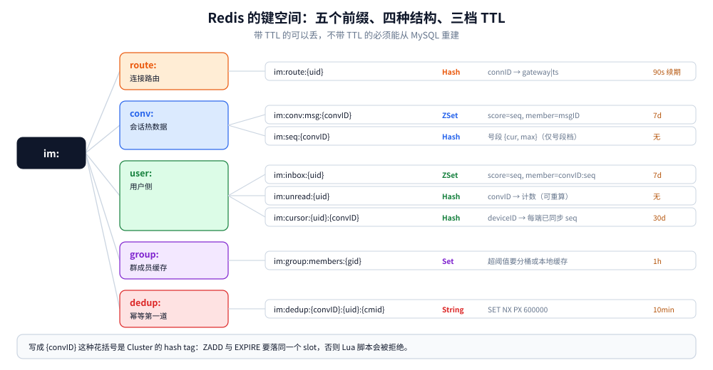
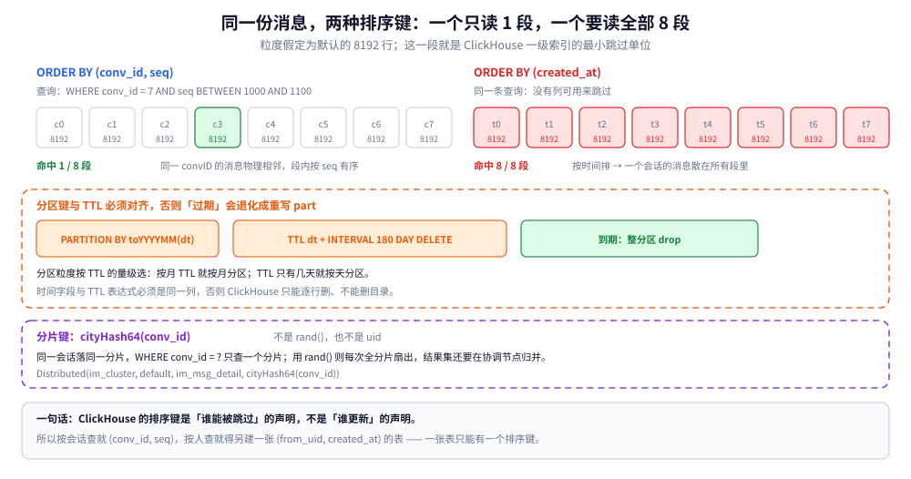
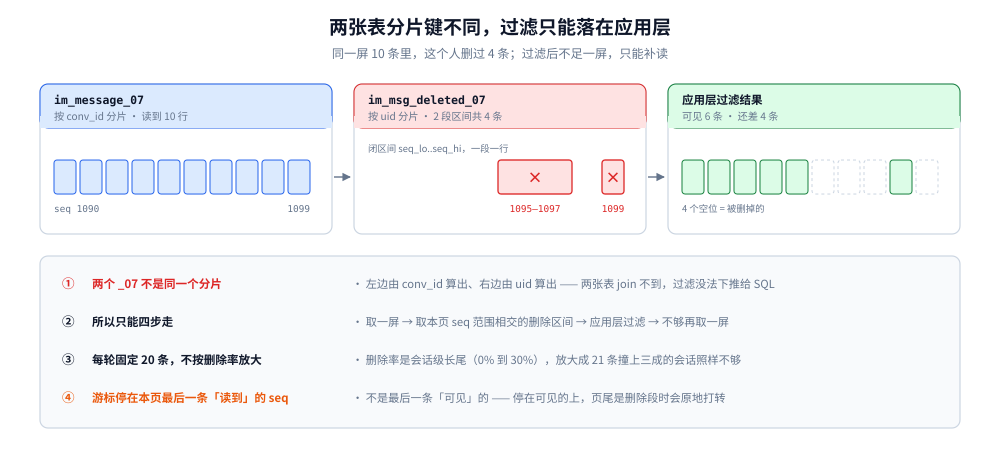

# 存储结构设计

> 覆盖：IM 三份存储的**物理结构**——MySQL 六张表的 DDL 与分片键、四条主查询各自走哪个索引与落在哪张分表、seq 与位点怎么进同一个事务、单端删除怎么落成一张按 `uid` 分片的区间表、Redis 八个 key 各解决什么问题与哪八个请求在读、ClickHouse 表与排序键。
>
> 不覆盖：**「这份数据为什么要放这个载体」** 见 [存储全景.md](存储全景.md)（角色判定与读写路径）；未读派生、已读收敛的语义见 [会话与未读.md](会话与未读.md)；seq / msgID / 幂等的协议语义见 [消息可靠投递.md](消息可靠投递.md)；撤回与编辑的业务语义、时间窗与幂等键见 [消息类型与业务语义.md](消息类型与业务语义.md) 第三节。本篇只回答「同一套语义，落成什么 DDL」。
>
> ✅ **实测口径**：第一节至第八节的 DDL 已在真实实例建表，四条主查询、事务语义与三处关键断言都有读数。第九节（单端删除）的表是后补的，**未在本机实例上建表**——DDL 只做语法核对，区间合并/拆分与补读算术由脚本实测（见 9.2 与 9.3）。
> 环境为 Docker 三容器——`mysql:8.0.46`、`redis:8`、`clickhouse/clickhouse-server:26.3-alpine`，单机单分片；
> 数据量：`im_message_07` 5.3 万行（其中单会话 3251 条）、`im_user_conv_07` 3 万行、ClickHouse 明细 10 万行。
>
> ⚠️ **读数边界**：绝对吞吐与耗时受 Docker Desktop 虚拟磁盘影响（每次 `COMMIT` 一次 fsync，实测约 6 ms/事务），
> 只用于**比较两组之间的比值**与**索引命中形态**，不可外推成生产容量；未跑到的项仍标「⚠️ 未实测」。

---

## 一、三份存储各守哪一段？

**本节要点**：三份存储不是「同一份数据存三遍」，而是三种**不同的查询形状**——各答一种，谁也不替谁。

| 存储 | 答哪种查询 | 写入方式 | 能容忍什么 |
|---|---|---|---|
| **MySQL** | 按 `conv_id + seq` 取一段；按 `msg_id` 取一条；按 `uid` 取会话列表 | 同步，事务 | 什么都不能容忍——它是权威源 |
| **Redis** | 按 `uid` 取「有哪些新消息」；按 `conv_id` 取最近一段；连接路由 | 写时回填 + 读时回填 | 可丢、可重建；只影响延迟 |
| **ClickHouse** | 跨会话、按人、按时间、按类型的**聚合**查询 | 异步（CDC / 双写） | 可延迟数秒到数分钟；可整表重建 |

⭐ 判据一句话：**能不能用「旧数据 + 全表扫」回答**。能，就往下游放；不能，就只能留 MySQL。

这也是为什么「消息存储为什么不用 ClickHouse 当权威源」不是一个口味问题：它没有事务、没有唯一约束、单行 `UPDATE` 是异步 Mutation——三条都直接撞在 IM 的硬需求上（详见第六节末）。

## 二、MySQL：六张表怎么切、主键怎么定？

**本节要点**：六张表里有**四张按 `conv_id` 分片、两张按 `uid`**——分片键决定了「哪些查询是单分片、哪些要扇出」，这一节全部围绕这一点展开。

先看四张表在写入侧怎么咬合、第五张派生表为什么必须单独放：



图怎么读：上半的虚线框是「同一个事务」，框里三张表（会话、消息、成员）**都用 `conv_id` 做分片键**，所以一次发消息只碰一个分片、一次行锁、一次提交；三条语句必须同进同退——消息写进去而 `last_seq` 没进会让下一条消息重号，`last_seq` 进了而消息没进会在会话里留一个永久空洞。中间那根红色虚线是唯一一处跨分片的写：异步双写到按 `uid` 分片的 `im_user_conv`，它可以重放、可以丢、可以从上半三张表整体重算。底部灰框给出这条设计的判据——**用「谁丢了会出事实错误」分权威与派生，不能用「谁访问多」分**；顺带回答两个必然被问到的问题：为什么不在成员表上直接按 `(uid, last_msg_seq)` 建索引（那要广播到所有分片），以及为什么不让派生表当权威源（它的可重算性正是建立在权威源还在之上）。图为结构示意，不含任何容量或耗时读数。

### 2.1 会话表：`last_seq` 就是 seq 分配器

```sql
CREATE TABLE im_conversation (
  conv_id      BIGINT UNSIGNED NOT NULL COMMENT '会话 ID，含类型位，全局唯一',
  conv_type    TINYINT UNSIGNED NOT NULL COMMENT '1 单聊 2 群聊 3 系统会话',
  owner_uid    BIGINT UNSIGNED NOT NULL DEFAULT 0 COMMENT '群主；单聊与系统会话为 0',
  last_seq     BIGINT UNSIGNED NOT NULL DEFAULT 0 COMMENT '会话内已分配到的 seq 上限：事务档等于最大 seq，号段档会超前',
  last_msg_id  BIGINT UNSIGNED NOT NULL DEFAULT 0 COMMENT '最新一条消息的 msg_id，用于会话列表展示',
  member_count INT UNSIGNED NOT NULL DEFAULT 0 COMMENT '群成员数；单聊恒为 2',
  created_at   DATETIME(3) NOT NULL DEFAULT CURRENT_TIMESTAMP(3),
  updated_at   DATETIME(3) NOT NULL DEFAULT CURRENT_TIMESTAMP(3) ON UPDATE CURRENT_TIMESTAMP(3),
  PRIMARY KEY (conv_id)
) ENGINE = InnoDB DEFAULT CHARSET = utf8mb4 COLLATE = utf8mb4_0900_ai_ci;
```

⭐ `last_seq` 这一列就是总纲里「seq 在 MySQL 事务内分配」那一档的物理落点——分配器不是独立服务，而是**会话行上的一个自增列**。它带来两个必然后果：

- **同一会话的写入被行锁串行**。这是单会话吞吐的天然上限，也是「大群发消息比单聊慢」的第一个原因（不是扇出，扇出是后面的事）。
- **不同会话完全并行**。因为锁在 `conv_id` 这一行上，不是表锁，也不是全局计数器。

写的时候用 `LAST_INSERT_ID(expr)` 可以省掉一次查询——它在更新列的同时把值记到会话变量里：

```sql
UPDATE im_conversation
   SET last_seq = LAST_INSERT_ID(last_seq + 1), last_msg_id = ?
 WHERE conv_id = ?;
-- 同一连接内紧接着：
SELECT LAST_INSERT_ID();
```

⚠️ 这是**连接级**变量，必须同一个连接、同一个事务，连接池换连接就丢。实测：同一连接内 `UPDATE` 后立刻读得 `3252`，换一个客户端进程（即换连接）读得 **`0`**。不喜欢这种隐式状态就用 `SELECT last_seq ... FOR UPDATE` + `UPDATE`，多一次往返但显式。

⭐ 这条设计还有个容易忽略的前提：**`last_seq` 必须不小于 `MAX(seq)`**。造数时我把它设成 3250 而表里最大 `seq` 已是 3251，下一条分配出来的 seq 就直接撞主键——`ERROR 1062 Duplicate entry '7-3251' for key 'im_message_07.PRIMARY'`。而且报错的只是 INSERT，前面那条 `UPDATE` 已经生效，结果是 `last_seq` 前进、消息没进去，会话里留一个洞。所以「切换数据源 / 重建表 / 从备份恢复到某时间点」这三件事做完，第一件事都是把 `last_seq` 校正回 `MAX(seq)`。

### 2.2 消息表：主键 `(conv_id, seq)` 就是分页索引

按 `conv_id` 哈希分 16 张表（分多少张见第八节），每张表结构相同：

```sql
CREATE TABLE im_message_00 (
  conv_id       BIGINT UNSIGNED NOT NULL COMMENT '会话 ID',
  seq           BIGINT UNSIGNED NOT NULL COMMENT '会话内单调递增，允许有洞',
  msg_id        BIGINT UNSIGNED NOT NULL COMMENT '服务端生成的全局唯一 ID（雪花）',
  from_uid      BIGINT UNSIGNED NOT NULL COMMENT '发送人id',
  msg_type      TINYINT UNSIGNED NOT NULL COMMENT '1 文本 2 图片 3 语音 4 视频 5 文件 6 系统',
  body          JSON NULL COMMENT '明文消息体；E2EE 会话存密文，此列为 NULL',
  body_cipher   VARBINARY(4096) NULL COMMENT '密文消息体，与 body 二选一',
  body_text     VARCHAR(2048) NOT NULL DEFAULT '' COMMENT '审核与预览用摘要；E2EE 会话为空串',
  client_msg_id VARCHAR(64) NULL DEFAULT NULL COMMENT '客户端临时 ID，重传幂等用；NULL 不参与唯一约束',
  status        TINYINT UNSIGNED NOT NULL DEFAULT 0 COMMENT '0 正常 1 撤回 2 已被管理员删除',
  created_at    DATETIME(3) NOT NULL,
  PRIMARY KEY (conv_id, seq),
  UNIQUE KEY uk_conv_msgid (conv_id, msg_id),
  UNIQUE KEY uk_conv_client (conv_id, from_uid, client_msg_id),
  KEY idx_conv_time (conv_id, created_at)
) ENGINE = InnoDB DEFAULT CHARSET = utf8mb4 COLLATE = utf8mb4_0900_ai_ci;
```

四个键各自守一条查询，缺一条就有一种操作要全表扫：

| 键 | 守的查询 | 不建会怎样 |
|---|---|---|
| `PRIMARY KEY (conv_id, seq)` | 拉一屏：`WHERE conv_id=? AND seq<? ORDER BY seq DESC LIMIT 20` | 每条消息都要 filesort 排序，深翻页直接退化 |
| `UNIQUE uk_conv_msgid` | 撤回 / 引用 / 已读回执定位一条消息（只带 `msg_id`，不带 `seq`） | 只能按 `conv_id` 扫全会话找那一条 |
| `UNIQUE uk_conv_client` | 重传幂等的**最终防线** | Redis 的去重键一丢就双写 |
| `KEY idx_conv_time` | 按时间范围导出 / 审核抽样 | 该查询走主键但在非 seq 维度上全扫；**只有真需要这个维度才建，否则白占空间** |

⭐ 这四棵树不是记在配置里，是记在磁盘上。实测 `im_message_07`（6.3 万行）的 `information_schema.TABLES` 读数：

| 指标 | 读数 | 折成每行 |
|---|---|---|
| `DATA_LENGTH`（聚簇索引叶子＝整行） | 10.52 MB | **174.5 字节/行** |
| `INDEX_LENGTH`（另外三棵二级索引树） | 8.55 MB | **141.8 字节/行** |

**索引体积是数据的 81%**。而且这是 `body_text` 只存十来个字符的短消息——真实 IM 消息体更长时，分子涨得比这个比例快，但结论方向不变：**一张表加三个二级索引，等于把写入量、磁盘、缓冲池压力各乘以 1.8 左右**。这就是「单表索引控制在 5~6 个」那条经验背后的算术，不是拍出来的。

三个容易写错的点：

- ⭐ **主键必须带 `conv_id`**。虽然按 `conv_id` 分了表，一张表里仍有多个会话（哈希碰撞到同一张表），只写 `PRIMARY KEY (seq)` 会在不同会话间撞主键。
- ⭐ **`client_msg_id` 必须可空**。MySQL 唯一索引对 `NULL` 不生效，这样「不传这个字段的消息」不会互相撞；写成 `NOT NULL DEFAULT ''` 会让第二条空串消息直接报唯一键冲突。实测两张结构相同的表：可空版连插 3 条 `NULL`，**3 条全部成功**；`NOT NULL DEFAULT ''` 版插第 2 条空串就报 `ERROR 1062 Duplicate entry '1-2-' for key 'uk'`。
- ⭐ **`uk_conv_msgid` 是用来定位的，不是用来去重的**。全局唯一性由雪花 `msg_id` 自己保证；这个唯一键的价值是「给定 `msg_id` 能直接落到那一行」。

⭐ `status` 这一列只装「对所有成员成立」的状态（撤回、管理员删除）。用户自己删掉一条消息**不能写这一列**——那等于替所有人删了它；单端删除另立一张按 `uid` 分片的表，见第九节。

**这就是「游标分页不用 offset」的物理原因**：InnoDB 的聚簇索引按主键排序，`(conv_id, seq)` 相邻意味着**同一会话的消息物理上连续存放**。所以 `WHERE conv_id=7 AND seq<1100 ORDER BY seq DESC LIMIT 20` 是沿着索引反向走 20 行就停——不是「找出前 1080 条再丢掉」。

实测这条查询（`im_message_07` 5.3 万行，`conv_id=7` 有 3250 条，`seq` 从 1 到 3251 且中间缺 251）：

```text
EXPLAIN          type=range  key=PRIMARY  key_len=16  rows=1098  Extra=Using where; Backward index scan
EXPLAIN ANALYZE  -> Limit: 20 row(s)  (actual time=0.069..0.087 rows=20 loops=1)
                   -> Index range scan on PRIMARY over (conv_id = 7 AND seq < 1100) (reverse)
                      (cost=220 rows=1098) (actual time=0.030..0.044 rows=20 loops=1)
```

四处值得记住：

- **`Backward index scan`** 就是「倒着走索引」，`ORDER BY seq DESC` 因此**不出 filesort**。少了它，同一条查询会变成「读出 1098 行再排序」。
- **`rows=1098` 是优化器的估算，`actual rows=20` 才是真的读了 20 行**。这两个数在游标分页上是不同含义：优化器不知道 `LIMIT` 会提前停，它算的是「这个范围里有多少行」。看 `EXPLAIN` 的 `rows` 判断「索引选得对不对」，看 `ANALYZE` 的 `rows` 判断「实际扫了多少」。
- 顺带验证了估算准不准：这个 1098 **正好等于范围内真实行数**（`seq` 1–250 共 250 条，252–1099 共 848 条，合计 1098，中间那个 251 是空洞）。range 估算在这个形状上是准的，所以「估算 1098 而实读 20」不是估算错，是 `LIMIT` 提前停了——这正是游标分页想要的行为。
- 只取 `conv_id, seq` 两列时 `Extra` 会多一个 `Using index`——聚簇索引的叶子就是整行，主键查询天然覆盖（对照见 [索引设计与EXPLAIN.md](../../../03-数据与中间件/数据存储/关系型/MySQL/索引设计与EXPLAIN.md) 1.5）。

### 2.3 会话成员表：两个位点，以及为什么不能逐成员更新

```sql
CREATE TABLE im_member_00 (
  conv_id       BIGINT UNSIGNED NOT NULL COMMENT '会话 ID',
  uid           BIGINT UNSIGNED NOT NULL COMMENT '用户 ID',
  role          TINYINT UNSIGNED NOT NULL DEFAULT 0 COMMENT '0 成员 1 管理员 2 群主',
  join_seq      BIGINT UNSIGNED NOT NULL DEFAULT 0 COMMENT '入群位点：小于它的历史不可见',
  last_read_seq BIGINT UNSIGNED NOT NULL DEFAULT 0 COMMENT '我读到哪',
  last_msg_seq  BIGINT UNSIGNED NOT NULL DEFAULT 0 COMMENT '我已同步到哪（多端各自一份的「每端位点」另存，见 §五）',
  muted_until   DATETIME NULL DEFAULT NULL COMMENT '禁言截止',
  joined_at     DATETIME(3) NOT NULL COMMENT '加入群聊的时间',
  PRIMARY KEY (conv_id, uid),
  KEY idx_uid_conv (uid, conv_id) COMMENT '查「我加入了哪些群」'
) ENGINE = InnoDB DEFAULT CHARSET = utf8mb4 COLLATE = utf8mb4_0900_ai_ci;
```

⭐ **`join_seq` 是这一节最容易被漏掉的字段**。群聊篇里「入群看不看历史」是一个产品决策，落到结构上就是这一列：拉消息时统一加 `seq >= join_seq`，未读计算也只数 `seq > max(last_read_seq, join_seq-1)` 的部分。没有它，这个产品决策只能靠应用层记一份「谁什么时候进群」的日志表去 join。

⚠️ **`last_msg_seq` 不要每条消息都更新所有成员行**。千人群一条消息就是一千次 `UPDATE`，这不是「慢一点」的问题——它把单会话的行锁热点扩散成一千行热点，和扇出叠加。正确的分工是：

| 位点 | 谁维护 | 什么时候更新 |
|---|---|---|
| `last_read_seq` | 客户端上报 | 用户真的读了（低频，人手一次） |
| `last_msg_seq` | 服务端 | **不在每条消息时更新**；只在用户拉取成功时按 `max()` 推一次 |
| 未读数 | 派生 | 按位点差算，或由 Redis 计数加速（[会话与未读.md](会话与未读.md) 第三节） |

这也解释了为什么第六节的 ClickHouse 里有「按会话日聚合」：**消息条数这种「每条都要 +1」的统计，不该在事务路径上做**，交给列存异步算。

### 2.4 用户会话列表：按 `uid` 分片的派生副本

```sql
CREATE TABLE im_user_conv_00 (
  uid           BIGINT UNSIGNED NOT NULL COMMENT '用户 ID',
  conv_id       BIGINT UNSIGNED NOT NULL COMMENT '会话 ID',
  conv_type     TINYINT UNSIGNED NOT NULL COMMENT '1 单聊 2 群聊 3 系统会话',
  last_msg_seq  BIGINT UNSIGNED NOT NULL DEFAULT 0 COMMENT '排序主键：会话里最新到哪',
  last_read_seq BIGINT UNSIGNED NOT NULL DEFAULT 0 COMMENT '我读到哪',
  unread_count  INT UNSIGNED NOT NULL DEFAULT 0 COMMENT '加速用，与位点差对不上时以位点差为准',
  pinned        TINYINT UNSIGNED NOT NULL DEFAULT 0 '是否置顶：0 否 1 是（列表排序优先按此字段倒序）',
  muted         TINYINT UNSIGNED NOT NULL DEFAULT 0 COMMENT '是否免打扰：0 否 1 是（全局静音）',
  draft         VARCHAR(200) NOT NULL DEFAULT '' COMMENT '草稿，多端同步的常见需求',
  updated_at    DATETIME(3) NOT NULL,
  PRIMARY KEY (uid, conv_id),
  KEY idx_list (uid, pinned, last_msg_seq)
) ENGINE = InnoDB DEFAULT CHARSET = utf8mb4 COLLATE = utf8mb4_0900_ai_ci;
```

⭐ `idx_list` 是「打开 App 第一屏」的唯一索引：

```sql
SELECT conv_id, last_msg_seq, unread_count, pinned, muted
  FROM im_user_conv_07
 WHERE uid = ?
 ORDER BY pinned DESC, last_msg_seq DESC
 LIMIT 20;
```

索引三列都是升序，`ORDER BY` 两列都是降序——MySQL 8.0 可以**反向扫描**整棵索引，方向一致反转不产生 filesort。反过来写 `ORDER BY pinned ASC, last_msg_seq DESC` 就一定会 filesort，因为两列方向不一致。

实测这对写法（`im_user_conv_07`，3 万行、每个 uid 10 个会话）：

| 写法 | key | Extra |
|---|---|---|
| `ORDER BY pinned DESC, last_msg_seq DESC` | `idx_list` | `Backward index scan`（**无 filesort**） |
| `ORDER BY pinned ASC, last_msg_seq DESC` | **退回 `PRIMARY`** | `Using filesort` |

⭐ 注意第二行连索引都没用上：方向不一致时优化器判断「顺着 `idx_list` 读也拿不到顺序」，索性改走主键取 10 行再排序。数据量是每个用户十来个会话时，这次 filesort 只要 0.2 ms，看不出问题；但这个查询是**每次打开 App 都跑**的第一条 SQL，等会话数涨到几百、并发涨到几万，它就是最先冒烟的那根。方向写一致，是零成本的修法。

⚠️ 这张表是**派生**的，所以它的写入必须允许重放：同一 `(uid, conv_id)` 的重复写用 `INSERT ... ON DUPLICATE KEY UPDATE last_msg_seq = GREATEST(last_msg_seq, new.last_msg_seq)`——用 `GREATEST` 而不是直接覆盖，是因为异步双写会乱序，旧值不能把新值冲回去。这与已读位点「单调不减」是同一个道理。

> 语法坐标：`INSERT ... VALUES (...) AS new` 这种行别名写法是 **MySQL 8.0.20 起**推荐的形态；老写法 `VALUES(col)` 自 8.0.20 起被标为 deprecated（仍可用，但会告警）。本篇统一用 `new.col`。

### 2.5 群表与群已读

```sql
CREATE TABLE im_group (
  conv_id     BIGINT UNSIGNED NOT NULL COMMENT '会话 ID',
  group_no    VARCHAR(32) NOT NULL COMMENT '对外群号，可搜索',
  name        VARCHAR(64) NOT NULL COMMENT '群名称',
  member_count INT UNSIGNED NOT NULL DEFAULT 0 COMMENT '入退群同事务维护，允许漂移、需能重算',
  max_member  INT UNSIGNED NOT NULL DEFAULT 200 COMMENT '群容量上限',
  join_policy TINYINT UNSIGNED NOT NULL DEFAULT 0 COMMENT '0 自由加入 1 需审批 2 禁止加入',
  PRIMARY KEY (conv_id),
  UNIQUE KEY uk_group_no (group_no)
) ENGINE = InnoDB DEFAULT CHARSET = utf8mb4 COLLATE = utf8mb4_0900_ai_ci;

-- 小群：逐人位点已在 im_member，不需要这张表
-- 大群：只记「这条消息有多少人读了」，因为逐人回执存不下也传不动
CREATE TABLE im_group_read_stat (
  conv_id  BIGINT UNSIGNED NOT NULL,
  seq      BIGINT UNSIGNED NOT NULL,
  read_cnt INT UNSIGNED NOT NULL DEFAULT 0,
  PRIMARY KEY (conv_id, seq)
) ENGINE = InnoDB DEFAULT CHARSET = utf8mb4 COLLATE = utf8mb4_0900_ai_ci;
```

⭐ `member_count` 与 `im_group_read_stat.read_cnt` 都是**计数器**，两者都会漂移，判据一致：**必须能重算，不能只能增加**。`read_cnt` 的去重要靠「一次已读上报只 +1」保证——落库前用 Redis 的 `SET NX` 按 `(conv_id, seq, uid)` 挡一次，否则重传会把已读数刷高。

## 三、四条主查询各走哪个索引、落在哪张表？

**本节要点**：MySQL 只承担**会话内按 seq** 这一条维度。任何「按人 / 按时间 / 按内容」的跨会话查询都不该压在它身上——这不是索引没建对，是它在结构上不适合。

| # | 查询 | 落在哪张表 | SQL 形状 | 走哪个键 | 关键点 | `EXPLAIN` 实测 |
|---|---|---|---|---|---|---|
| ① | 拉一屏消息 | `im_message_NN`（按 `conv_id` 分 16 张，2.2） | `WHERE conv_id=? AND seq<? ORDER BY seq DESC LIMIT 20` | `PRIMARY KEY (conv_id, seq)` | 反向范围扫 20 行；`seq` 上有洞也不影响 | `type=range`，`Backward index scan`，估算 1098 行、实读 20 行 |
| ② | 会话列表首屏 | `im_user_conv_NN`（按 `uid` 分片，2.4） | `WHERE uid=? ORDER BY pinned DESC, last_msg_seq DESC LIMIT 20` | `idx_list` | 两个 DESC 靠反向扫，不 filesort | `type=ref`，`Backward index scan`，无 filesort |
| ③ | 按 ID 定位一条 | `im_message_NN` | `WHERE conv_id=? AND msg_id=?` | `uk_conv_msgid` | 撤回 / 引用 / 回执都走它；只带 `msg_id` 时必须先知道 `conv_id` | `type=const`，`ref=const,const`，`Rows fetched before execution` |
| ④ | 取会话状态 | `im_user_conv_NN` | `WHERE uid=? AND conv_id=?` | `PK (uid, conv_id)` | 进会话时读未读、置顶、免打扰 | `type=const`，`key_len=16` |

⭐ ③④ 变成 `type=const` 是唯一索引 + 全等值的效果：优化阶段就把那一行取出来了，执行阶段不再有「扫描」。这也意味着**它的代价与表大小基本无关**——5 万行还是 5000 万行，都是同一棵树里走三到四层。

对照一下 ③ 写错时会发生什么：只带 `msg_id` 不给 `conv_id`，同一条查询变成 `type=ALL`、估算 63201 行（当时表里实际 53000 行，InnoDB 统计本身就是估算值）。这就是「`msg_id` 必须能反推出 `conv_id`」那条设计约束在数据库侧的代价。

⭐ 「落在哪张表」这一列才是分表真正买到的东西：表名里的 `NN` 由 `WHERE` 里的路由键算出（`conv_id` 或 `uid` 哈希后 `% 16`，第八节），所以**四条查询各只碰一张表**，没有一条要广播到 16 张再归并。反过来说，路由键一旦不在 `WHERE` 里，`NN` 就算不出来——③ 只带 `msg_id` 时除了索引退化成 `type=ALL`，还得把这条 SQL 撒给 16 张表（补救办法见延伸追问「分表之后按 `msg_id` 查一条怎么办」）。表里写 `_07` 是因为实测数据集中在 7 号分表。⚠️ 但两组的 `NN` 不是同一个数：`im_message_07` 的 07 由 `conv_id` 算出，`im_user_conv_07` 的 07 由 `uid` 算出，两张表的 7 号之间没有任何对应关系——看到都叫 `_07` 别误读成「同一分片」。

三条**不该**在 MySQL 上做的查询，以及它们该去哪：

| 查询 | 为什么 MySQL 不行 | 去哪 |
|---|---|---|
| 「张三上周发了多少条」 | 跨会话、无 `conv_id`，要扫全部分表 | ClickHouse `im_msg_by_user` |
| 「最近三天全站消息量趋势」 | 同上，且是聚合 | ClickHouse `im_conv_daily` |
| 「搜聊天记录里的关键词」 | `body` 是 JSON，`LIKE '%kw%'` 无法走索引 | Elasticsearch 检索副本（[搜索与历史.md](搜索与历史.md)） |

⭐ 判据：**索引只能覆盖「建索引时想到的那条路径」**。`idx_conv_time` 能答「这个会话在某时间段的消息」，答不了「某个人在所有会话的消息」——后者要么另建一份按人排的表（第六节 `im_msg_by_user`），要么接受全扫。

⚠️ 但「不该做」不等于「做不了」，实测里有个容易看走眼的现象：`WHERE created_at >= ?`（不带 `conv_id`）在 8.0 上**不会报错、也不会退回全表扫**，它走的是

```text
key=idx_conv_time  type=range  rows=21064  Extra=Using where; Using index for skip scan
```

**skip scan**（8.0.13 起的优化）：前导列 `conv_id` 没有条件，它就对索引里**每个不同的 `conv_id`** 各做一次 `created_at` 的范围查找。本例 200 个不同 `conv_id` × 约 105 行 ≈ 21064，正好对上那个估算。它能返回正确结果，也确实避开了全表扫，但代价随「前导列的基数」线性增长——分表后每个分表里都有几十万个 `conv_id`，这条路就走不通了。**判断这类查询该不该搬到 ClickHouse，看的不是 MySQL 能不能出结果，而是它的 `rows` 估算与要读的行数是不是一个量级。**

## 四、seq 与位点怎么写进一个事务？

**本节要点**：一次发消息在 MySQL 上是**固定三条语句、一个事务**；顺序不能换，换了两条都不对。

```sql
START TRANSACTION;

-- ① 分配 seq：行锁从这里开始，到 COMMIT 结束
UPDATE im_conversation
   SET last_seq = LAST_INSERT_ID(last_seq + 1)
 WHERE conv_id = ?;

-- ② 写消息本体（seq 取自上一步）
INSERT INTO im_message_07 (conv_id, seq, msg_id, from_uid, msg_type, body, body_text, client_msg_id, created_at)
VALUES (?, LAST_INSERT_ID(), ?, ?, ?, ?, ?, ?, NOW(3));

-- ③ 推自己的位点：自己发的消息自己已读，用 GREATEST 防回退
UPDATE im_member_07
   SET last_msg_seq = GREATEST(last_msg_seq, LAST_INSERT_ID()),
       last_read_seq = GREATEST(last_read_seq, LAST_INSERT_ID())
 WHERE conv_id = ? AND uid = ?;

COMMIT;
```

⚠️ **第三步只更新发送者自己那一行**。不要在这里循环更新所有成员——那是把事务长度乘以成员数，行锁持有时间跟着涨，同一会话的下一条消息全被堵在外面。

顺序为什么不能换：

- **先分配 seq 再插消息**：反过来的话，插入时还没有 seq，只能先插再改，中间那段时间别的连接可能已经用了同一个 seq。
- **位点更新必须在同一事务**：否则消息已可见、位点还是旧的，客户端下一次补拉会重复拿到这条（幂等能兜，但白费一次往返）。

**这条事务的上限在哪**：`UPDATE im_conversation` 的行锁把同一会话的发送串起来，单会话的写入吞吐 ≈ `1 / 事务持锁时间`。实测把这句量化了——两个连接各发 500 条、每条一个事务（三条语句全跑）：

| 场景 | 1000 条耗时 | 吞吐 |
|---|---|---|
| 两个连接抢**同一个** `conv_id` | 6.14 s（三轮 6.01 / 6.18 / 6.21） | 163 条/s |
| 两个连接各写**不同** `conv_id` | 3.79 s（三轮 3.58 / 3.61 / 4.17） | 264 条/s |

**比值 1.62×**，而不是 2×。差额来自 `COMMIT` 的 fsync（本机约 6 ms/事务）：换会话能并行的是「锁等待」，换不掉的是「磁盘刷盘」。换个角度看更清楚——让连接 A 开着事务改 `conv_id=7` 睡 3 秒，连接 B 去改同一行，**等了 2.62 s**；B 改 `conv_id=8`，**只等 0.21 s**。锁确实钉在行上，不是表上。所以「单会话吞吐上限」在生产里通常由两件事共同决定：行锁串行 + 组提交效率，只调其中一个不会有线性收益。

总纲里「号段预分配」那一档换的就是这里——把「每次分配一次行锁」变成「每 N 条分配一次」：

```sql
-- 号段档：一次锁分配 N 个 seq，进程内慢慢发
UPDATE im_conversation
   SET last_seq = LAST_INSERT_ID(last_seq + 100)
 WHERE conv_id = ?;
-- 本次拿到 (LAST_INSERT_ID()-99 .. LAST_INSERT_ID()) 这 100 个
```

实测返回值：`last_seq` 从 3251 变 3351，读回 `LAST_INSERT_ID()` 得 `3351`、减 99 得 `3252`，正好是本次可用区间的两端。

代价是 **seq 开始有洞**（进程崩溃就丢掉没用完的那段）。能接受，因为 seq 只要求「会话内单调且不重复」，不要求连续；游标分页也不受影响。**这是总纲「跳号无害、回退致命」那句判断在 DDL 层的落点**——真正不能接受的是「回退」（已发的 seq 被重新分配），而号段只会跳号，不会回退。

⚠️ 号段档还有一个连带影响，很容易漏：`last_seq` 不再等于「最新一条消息的 seq」，而是「已分配上限」。任何拿它算未读、算「会话最新一条」的地方都会多算。两条出路——要么实时 `SELECT MAX(seq)`（贵），要么另加一列 `max_published_seq`，只在消息真正落库后推进。这就是「号段换来吞吐，代价是放弃一个便利性质」的具体形态。

## 五、Redis：键空间怎么分、结构怎么选？

**本节要点**：键名里必须带**分片维度**，结构必须匹配访问形状，TTL 必须能区分「可丢」与「不可丢」。



图怎么读：左侧 `im:` 下分五个前缀，每个前缀对应一类**生命周期相同**的数据：
- `route:` 是连接路由（90 秒续期，连接断了就被 TTL 清掉）
- `conv:` 是会话热窗口与号段（7 天或不设 TTL）
- `user:` 是待拉取收件箱、未读加速与每端位点（7 天 / 不设 / 30 天）
- `group:` 是成员缓存（1 小时）
- `dedup:` 是幂等第一道（10 分钟）。

右侧每一行列出一个具体 key：名称、结构类型（Hash / ZSet / Set / String 彩色标出）、放什么、TTL。四种结构的分工是这张图的主线——**要按分数取范围的用 ZSet**（热窗口、收件箱都按 seq 取），**要按字段读一个值的用 Hash**（路由、未读），**只要成员判定的用 Set**（群成员），**只挡一次重传的用 String**（`SET NX PX`）。底部一句是这套键名在 Cluster 下必须成立的前提：花括号里的 `convID` 是 hash tag，多 key 操作要落同一个 slot。图为键空间结构示意，TTL 是量级参考、不是实测最优点。

| key 模式 | 结构 | 放什么 | TTL | 谁写 |
|---|---|---|---|---|
| `im:route:{uid}` | Hash | `connID → gateway\|ts`，多端就是多个 field | 90s，心跳续 | 网关连接建立 / 心跳 |
| `im:conv:msg:{convID}` | ZSet | `score=seq, member=msgID`，最近一屏 | 7d | 写消息时回填 |
| `im:seq:{convID}` | Hash | 号段 `{cur, max}`（仅号段档用） | 无 | 分配器 |
| `im:inbox:{uid}` | ZSet | `score=seq, member=convID:seq` | 7d | 扇出时写 |
| `im:unread:{uid}` | Hash | `convID → 计数`（可重算） | 无 | 写消息 +1 / 已读清零 |
| `im:cursor:{uid}:{convID}` | Hash | `deviceID → 每端已同步到的 seq` | 30d | 客户端拉取成功后写 |
| `im:group:members:{gid}` | Set | 成员 uid | 1h | 读时回填（miss 再查库） |
| `im:dedup:{convID}:{uid}:{cmid}` | String | `SET NX PX 600000` 占位 | 10min | 收到消息第一件事 |

这张表只回答了「放什么、谁写、多久过期」。真正决定要不要留这个 key 的是另外两个问题——**它解决的是哪个请求的什么问题**，以及**不存它，那个请求会退化成什么样**。分开两节说：5.1 按 key 问，5.2 按请求问。

### 5.1 每个 key 解决什么问题，不存它会退化成什么

判据不是「这份数据重不重要」，而是**不存它，哪个请求会退化、退化到什么程度**。退化到「不可恢复」的才配进 MySQL；退化到「慢一点」或「多一次重连」的才放这里。

| key | 解决的问题 | 不存它，请求会退化成什么 | 它影子里的那条查询 |
|---|---|---|---|
| `im:route:{uid}` | 要投给某人的消息，得知道他的连接挂在哪台网关 | 广播问遍所有网关「他在你这时吗」，N 次 RPC 换一个可能已经过期的答案 | 无——纯运行态，MySQL 里没有对应物 |
| `im:conv:msg:{convID}` | 打开会话的首屏，读远多于写，且只要最近 200 条 | 每翻一屏都扫一次 MySQL 主键范围；热门群的首屏 QPS 全压在主库上 | `WHERE conv_id=? ORDER BY seq DESC LIMIT 30`，正是消息表主键顺序 |
| `im:seq:{convID}` | 序号要会话内单调不重复，但分配它不该让同会话的写入排队（仅号段档；单机档直接由 MySQL 的 `LAST_INSERT_ID` 分配） | 每条消息一次单行 `UPDATE last_seq+1`，同会话写入被行锁串行（第四节实测：抢同一会话比各写各的慢 1.62 倍） | `UPDATE im_conversation SET last_seq=last_seq+1` |
| `im:inbox:{uid}` | 写扩散下对端可能不在线，消息得先寄存在他名下 | 上线时逐个扫「我参与的 N 个会话」的分表，找出没收到的 | `im_message` 与 `im_member.last_msg_seq` 的差集 |
| `im:unread:{uid}` | 会话列表要一次显示几十个会话的未读数 | 每个会话算一次位点差（成员表 join 消息表），首屏变成 N 次查询 | 同上，只是把差集换成「`last_read_seq` 到 `last_seq` 之间数条数」 |
| `im:cursor:{uid}:{convID}` | 多端各同步到哪，决定这条要不要推给这一端 | 每端上线都从头拉；或每次推送前查一次库 | `im_member.last_read_seq` 只存共享已读位点，每端位点 MySQL 里根本没有 |
| `im:group:members:{gid}` | 扇出与权限判定要成员集合，而它几乎不变 | 每条群消息扇出前 `SELECT` 一次成员表（大群 10 万行） | `SELECT uid FROM im_member_NN WHERE conv_id=?` |
| `im:dedup:{convID}:{uid}:{cmid}` | 重传会把同一条消息送到两次 | 每次重传先写库再撞唯一键，多一次失败的写 + 一次回滚 | `uk_conv_client` 唯一键 `(conv_id, from_uid, client_msg_id)`——三个字段一个都不能少 |

表里只列了八类 key 模式。同前缀下还有一类 `im:dedup:{convID}:{seq}:{uid}`——群已读回执的去重（见 2.5），维度是「会话 + 序号 + 人」，与消息去重不是一回事，本节不单列。

八条有同一个骨架：**它们存的是「让某个请求不必去问 MySQL」的索引，不是数据本身**。所以全部可以丢、可以重建、可以换载体，唯一的悬念是重建代价——`route:` 丢了是一次重连，`conv:msg:` 丢了是一次回源，`unread:` 丢了是一次重算，`dedup:` 丢了是一次唯一键冲突。反过来，丢了补不回来的那几样（消息本体、seq、位点、成员关系），一条都没搬上来。

⭐ 顺带说清一个最容易想错的地方：`im:conv:msg:{convID}` 的 member 是 `msgID` 而不是正文，所以它是**索引缓存**。命中之后仍要回 MySQL 取正文——它省的是「哪些 msgID 构成这一屏」和主库的读 QPS，不是回表本身。把正文也塞进来确实能省掉回表，代价是单条从实测的 **97 字节**涨到一条消息的大小——500 字中文按 UTF-8 约 1.5 KB，是十几倍（这一句是按字符数算的，不是实测）。200 条的热窗口从 19 KB 涨到几百 KB，再乘在线人数就是内存账。判据落在「正文要不要参与过滤」：首屏还要拼发送者昵称、撤回状态、单端删除过滤（第九节），这些都得回表拿最新值，缓存正文只是多一层失效要处理——所以这里选索引缓存，正文一个字都不进 Redis。

### 5.2 八个请求各读哪几个 key

上面是「key → 问题」，反过来问一次「请求 → key」，才能在上线后反查：某个 key 挂了，哪几个请求会退化；某个请求变慢，它到底在读谁。发消息整条链的读写顺序在「使用」一节，这里只列它需要读的那一步。

| 请求 | 触发方 | 读什么 | 读它是为了解决什么 | 读不到时 |
|---|---|---|---|---|
| 连接建立 / 断线重连 | 客户端 | `route:` | 覆盖同一端的旧 field，避免一台设备两条连接被双推 | 直接写新 field，可能出现双推 |
| 心跳（30 s） | 客户端 | 不读值，只续 TTL | 让「在线」这件事自带到期时间 | `EXPIRE` 返回 0 说明路由已失效，直接重连 |
| 发消息去重 | 服务端 | `dedup:`（`SET NX`） | 在写库之前挡住重传 | 落到 MySQL 的 `uk_conv_client` |
| 推送扇出 | 服务端 | `route:`（收件人）、`group:members:`（群） | 投到哪台网关、投给哪些人 | 判离线 → 离线推送，等上线补拉 |
| 打开会话 / 上滑一屏 | 客户端 | `conv:msg:` | 先拿到这一屏的 msgID 与 seq 边界 | 回源 MySQL 主键范围查 |
| 上线补拉 | 客户端 | `cursor:`、`inbox:` | 从哪个 seq 开始、有哪些还没收到 | 位点差（成员表 + 消息表） |
| 会话列表刷新 | 客户端 | `unread:`（一次 `HGETALL`） | 几十个会话的未读数一次取回 | 逐会话算位点差 |
| 已读上报 | 客户端 | `cursor:`（其他端位点） | 判断其他端要不要一起已读 | 以 `last_read_seq` 单调推进兜底 |

⭐ 八条里六条由客户端请求触发，两条在服务端内部跑（去重、扇出）。差别在**失败后能不能让用户重试**：客户端那几条失败了可以返回错误、让用户再点一次；服务端那两条没有重试的入口——去重退到 MySQL 唯一键，扇出退到上线补拉。这正是「`dedup:` 丢了不影响正确性」的原因，也是它敢只留 10 分钟的依据。

还有一条容易漏的对应关系：**键名里的分片维度必须等于请求的入口**。`im:unread:{uid}` 的入口是「当前登录用户」，`im:conv:msg:{convID}` 的入口是「当前打开的会话」，`im:inbox:{uid}` 的入口是「刚上线的这个人」。键名换了维度，就一定有人得扫全量 key——`SCAN 0 MATCH im:route:*` 这类写法在千万级在线的键空间里就是一次全库扫描，而它恰恰会出现在「这人到底连在哪」这种排障时刻。

### 5.3 结构必须匹配访问形状

五个必须写对的细节：

- ⭐ **`ZSet` 而不是 `List`**。热窗口要「取 seq 落在某区间的 N 条」，`ZRANGEBYSCORE` 一次到位；`List` 只能按下标，而按下标就退回了 offset 分页的老问题（新消息前插会让下标全偏）。
- ⭐ **`route:` 的 TTL 是判活的唯一手段**。网关进程崩了不会有人来删 key，靠 90 秒到期自动消失；心跳续期必须比 TTL 短，否则健康连接也会被清掉。
- ⭐ **`unread` 不设 TTL**，因为它必须在离线很久之后仍然正确；而它可以重算，所以真丢了也只是「下一次算得慢一点」。
- ⚠️ **大群成员 Set 是典型大 key**。几十万人的群，一个 Set 的量级是几 MB（实测 10 万人 **3.68 MB**，见下），`SMEMBERS` 会阻塞单线程。做法是按 uid 取模分桶（`...:{gid}:{bucket}`）或干脆放本地缓存 + 定期刷新。
- ⚠️ **去重键的维度必须与唯一键逐字段对齐**。`uk_conv_client` 是 `(conv_id, from_uid, client_msg_id)`，键名因此也得是 `{convID}:{uid}:{cmid}`。少一个 `uid`，两个用户在同一会话里用了同一个客户端临时 ID（设备内自增序号就是这种，不是 UUID），后到的那个会被当成前一个的重传**直接丢掉，且不报错**。这和 5.2 末尾「键名维度要等于请求入口」是一回事的两面：那边防止扫全表，这边防止认错人。

**实测：四种结构长什么样、每条多大**（redis 8，单机）

| key | `OBJECT ENCODING` | 判据 |
|---|---|---|
| `im:conv:msg:{7}`（3 条） | `listpack` | 小 ZSet **不是**跳表 |
| 同一个 key 加到 129 条 | `skiplist` | 阈值 `zset-max-listpack-entries=128`；实测 128 条仍是 `listpack`，第 129 条转 `skiplist` |
| `im:route:{10001}`（2 个 field） | `listpack` | Hash 同阈值 |
| `im:group:members:{9}`（3 个整数） | `intset` | 全整数走 intset |
| 同一集合涨到 10 万人 | `hashtable` | 阈值 `set-max-intset-entries=512` |

⭐ 第一行纠正一个常见偏差：**「跳表」不是 Redis 里 ZSet 的唯一形态**。几百条的热窗口是 `listpack`——一块连续内存、线性扫，比跳表更快也更省。只有超过 128 条才转真正的跳表。所以「ZSet 慢在跳表」这种说法，对热窗口这个量级根本不成立。

三个能直接进容量账的读数：

- **热窗口 200 条**（`ZREMRANGEBYRANK 0 -201` 截断后）`MEMORY USAGE = 19394` 字节 → 约 **97 字节/条**（含 member 串与分数）。这个数乘上「在线用户数 × 人均热窗口条数」就是第八节③那本账。
- **1 万 member 的 ZSet**：`MEMORY STATS` 的 `dataset.bytes` 从 523,432 涨到 1,251,440，增量 **728,008 字节**（约 711 KiB）→ 约 **72.8 字节/member**。
- **10 万人的成员 Set**：单 key `MEMORY USAGE = 3,861,854` 字节（**3.68 MB**），约 38.6 字节/人。

⚠️ 顺手证伪一个想当然：**分桶不省内存**。同样 10 万个整数，拆成 10 个桶后合计 `4,255,755` 字节（**4.06 MB**），比单 key **多 10%**——每个桶都有自己的哈希表头与 key 元数据。分桶治的是**阻塞**，不是**内存**。

阻塞有多大，用 `SLOWLOG` 可以直接读到（`slowlog-log-slower-than 0`，单位为微秒）：

```text
SMEMBERS  bigset（10 万元素）   10448 µs      ← 主线程被占住 10.4 ms，还要吐出 589,895 字节的响应
SISMEMBER bigset 99999             25 µs
SCARD     bigset                    4 µs
SMEMBERS  s:small（3 元素）          6 µs
```

⭐ 对比最后两行与前两行：**同一份数据，判定一个成员只要 25 µs，全量拉出来要 10.4 ms，差 400 倍**。所以「群成员放 Set」本身没问题，问题只在「谁在什么时候 `SMEMBERS`」——判定走 `SISMEMBER`，需要全员时走分桶或本地缓存，永远不要在消息路径上 `SMEMBERS` 一个大群。

> TTL 的取值（路由 90 s、去重 600 s、每端位点 30 d）在本次实例里都能正常读写与续期，但**具体数值仍是量级参考、非实测最优值**——最优值取决于心跳间隔、产品保留期与内存预算，单机空跑测不出来。

## 六、ClickHouse：排序键为什么必须是 `(conv_id, seq)`？

**本节要点**：ClickHouse 的 `ORDER BY` 不是「排序偏好」，而是 **「哪些数据块可以被跳过」的声明**。选错它，索引就形同不存在。



图怎么读：左右两边是**同一份消息数据、同一条查询**（`WHERE conv_id = 7 AND seq BETWEEN 1000 AND 1100`），只把排序键换了一次。左边 `ORDER BY (conv_id, seq)`：每个小方块是一段 8192 行的粒度，段内按 seq 有序、同一会话的消息落在相邻段里，所以 8 段只命中 1 段。右边 `ORDER BY (created_at)`：会话 7 的消息被时间打散在全部 8 段里，只能全读。下半两张框是配套的两件事——**分区键要与 TTL 对齐**（按月 TTL 就按月分区，到期直接 drop 整个目录，而不是逐行删再重写 part），**分片键要用 `cityHash64(conv_id)`**（同一会话落同一分片，`WHERE conv_id=?` 只查一个分片；用 `rand()` 就每次全分片扇出再归并）。底部一句是全节的收口：排序键声明的是「谁能被跳过」，不是「谁更新得多」。

**实测同一份数据、同一条查询，只换排序键**（10 万行、100 个会话，8192 行/granule → 15 个 granule）：

| 表 | 排序键 | `EXPLAIN indexes = 1` 的 PrimaryKey 段 |
|---|---|---|
| `im_msg_detail` | `(conv_id, seq)` | `Granules: 4/15`、`Search Algorithm: binary search` |
| `im_msg_by_time`（同数据，只改建表排序键） | `(created_at)` | `Condition: true`、`Granules: 15/15` |

⭐ 第二行的 `Condition: true` 是「索引形同不存在」最准确的写法：主键索引的过滤条件恒真，一个 granule 都跳不过，15 段全读。这个差距不是「快几倍」，是**有没有**的区别。图为示意（8 段），实测是 15 段；比例方向一致，绝对值取决于数据量与 `index_granularity`。

### 6.1 消息明细表

```sql
CREATE TABLE im_msg_detail (
   conv_id    UInt64 COMMENT '会话 ID',
   seq        UInt64 COMMENT '会话内单调递增序号，允许有洞',
   msg_id     UInt64 COMMENT '服务端生成的全局唯一 ID（雪花算法）',
   from_uid   UInt64 COMMENT '发送人 ID',
   conv_type  UInt8 COMMENT '会话类型：1 单聊 2 群聊 3 系统会话',
   msg_type   LowCardinality(String) COMMENT '消息类型：文本/图片/语音/视频/文件/系统',
   body_len   UInt32 COMMENT '消息体字节长度（只存长度不存正文，极大节省空间）',
   created_at DateTime('Asia/Shanghai') COMMENT '消息产生时间',
   dt         Date DEFAULT toDate(created_at) COMMENT '分区日期（根据 created_at 自动推导）'
) ENGINE = MergeTree
-- 1. 引擎与排序键设计
-- 使用 MergeTree，ORDER BY 决定了稀疏索引的物理顺序。
-- 将 (conv_id, seq) 作为排序键，保证同一个会话的消息物理相邻，
-- 且查询 `WHERE conv_id=? AND seq BETWEEN ...` 时能直接跳过无关数据块（Granule）。
ORDER BY (conv_id, seq)

-- 2. 分区设计
-- 按月分区。与 180 天的 TTL 同量级。
-- 这样做的好处是：数据过期时，可以直接 Drop 整个分区目录，不需要逐行删除。
PARTITION BY toYYYYMM(dt)

-- 3. 生存时间（TTL）设计
-- 数据写入 180 天后自动删除。
TTL dt + INTERVAL 180 DAY DELETE

-- 4. 其他设置
-- 8192 是 ClickHouse 稀疏索引的默认粒度，即每 8192 行记录一条索引标记（Mark）。
-- 查询时，先定位 Mark，再解压该 Granule 块的数据。
SETTINGS index_granularity = 8192;
```

每个决策点的理由：

| 决策 | 选择 | 理由 |
|---|---|---|
| 排序键 | `(conv_id, seq)` | IM 的查询九成带 `conv_id`；seq 在会话内有序，与 MySQL 主键同构，两边能对上 |
| 分区键 | `toYYYYMM(dt)`（月） | 与 180 天 TTL 同量级，到期整分区 drop |
| TTL | `dt + INTERVAL 180 DAY DELETE` | 归档期由产品定；表达式里的列必须与分区键同源 |
| `msg_type` | `LowCardinality(String)` | 取值只有十来个，字典编码后体积远小于裸 String |
| 不用 `Nullable` | 全部非空 | 每个 Nullable 列多一个 `.null.bin`，且不能进排序键 |

⭐ **分区粒度必须跟 TTL 量级走**，这是官方明写的建议：TTL 是「天/周」级就按天分区，是「月/年」级就按月分区。对一个 180 天 TTL 的表按小时分区，会得到四千多个分区目录，合并线程先被拖垮。

实测这张表在 `26.3` 上原样建成功（含 `LowCardinality(String)`、`TTL dt + INTERVAL 180 DAY DELETE`、`SETTINGS index_granularity = 8192` 三处），灌 10 万行后的实际形态：

| 指标 | 读数 |
|---|---|
| 磁盘体积 | **859.32 KiB** → 约 **8.8 字节/行**（`body_len` 只是数字列，正文不在这张表里） |
| part / mark | 4 个 part、19 个 mark |
| 分区 | `202606` / `202607` / `202609` / `202611` 四个（8 月没有数据，就没有那个目录） |

⭐ 最后一行值得单独看一眼：**分区是按需产生的，不是按月预建**。没有数据的月份不会留下空目录，所以「4000 多个分区目录」这种担忧只在你真的每天都有数据时成立。反过来，`system.parts` 里数分区数就是判断分区粒度是否过细最直接的办法。

### 6.2 按人查的表：一张表只能有一个排序键

```sql
CREATE TABLE im_msg_by_user (
    from_uid   UInt64 COMMENT '发送人 ID',
    created_at DateTime('Asia/Shanghai') COMMENT '消息产生时间',
    conv_id    UInt64 COMMENT '会话 ID',
    seq        UInt64 COMMENT '会话内序号',
    msg_type   LowCardinality(String) COMMENT '消息类型（字典编码，极致压缩）',
    body_len   UInt32 COMMENT '消息体长度',
    dt         Date DEFAULT toDate(created_at) COMMENT '分区日期（根据 created_at 自动推导）'
) ENGINE = MergeTree

-- ⭐ 核心设计：为什么要换排序键？
-- 明细表 im_msg_detail 按 (conv_id, seq) 排，是为了「按群聊查」。
-- 这张表是为了「按人查」（比如：审核员查张三今天发了什么）。
-- 如果把 from_uid 放第一位，查询 WHERE from_uid = ? AND created_at BETWEEN ... 
-- 就能精准命中数据块。反之，如果继续用 conv_id 排，按人查就会变成全表扫描。
ORDER BY (from_uid, created_at)

-- 分区与明细表保持完全一致，方便对齐和统一管理
PARTITION BY toYYYYMM(dt)
TTL dt + INTERVAL 180 DAY DELETE;


-- =====================================================================
-- 物化视图（Materialized View）
-- =====================================================================
-- ⭐ 核心原理：ClickHouse 的物化视图本质是一个「插入触发器（Insert Trigger）」。
-- 它监听源表（im_msg_detail）的数据插入，只要源表有新数据进来，
-- 它就会自动执行下面的 SELECT 语句，并把结果写入目标表（im_msg_by_user）。
-- 这样应用层就不需要写双份代码去同步这两张表，完全省掉了一次 CDC 落地。
--
-- ⚠️ 致命坑点：物化视图只处理「建视图之后」的新数据。
-- 如果源表里已经有 10 万条历史数据，你建了这个视图，目标表里依然是 0 条。
-- 必须手工执行一次回填：INSERT INTO im_msg_by_user SELECT ... FROM im_msg_detail;

CREATE MATERIALIZED VIEW im_msg_by_user_mv TO im_msg_by_user AS
SELECT
    from_uid,
    created_at,
    conv_id,
    seq,
    msg_type,
    body_len,
    dt
FROM im_msg_detail;
```

⚠️ **物化视图只对「建视图之后写入源表的数据」生效**，历史数据要手工回填一次：

```sql
INSERT INTO im_msg_by_user
SELECT from_uid, created_at, conv_id, seq, msg_type, body_len, dt FROM im_msg_detail;
```

实测这三步的顺序与结果，一步不差：

```text
① 源表已有 10 万行 → 此时建 MV → 查 MV 表          0 行（历史一行都没进来）
② 手工 INSERT ... SELECT 回填                     100000 行
③ 源表再插 2 行                                  100002 行（这 2 行是 MV 自己接住的）
```

⭐ 这里最容易踩的坑不是语法，是**上线顺序**：先建表灌历史、后建视图，第一次查分析报表会是空的，而监控上看不出任何错误。正确顺序是「建视图 → 灌历史 → 建 MV」做不到（视图依赖源表），所以实际做法只能是「建 MV → 立刻回填 → 记录回填位点」，并且把回填做成可重跑的（`WHERE seq > 已回填最大 seq`），因为回填期间源表还在写。

这张表也顺手验证了「一张表只能有一个排序键」的代价——同一张 `im_msg_by_user`，两种查询：

| 查询 | PrimaryKey 段命中 |
|---|---|
| `WHERE from_uid = 10500 AND created_at >= ...`（排序键前缀） | **1/15 段**，只碰 1 个 part（`Parts: 1/4`） |
| `WHERE conv_id = 7`（不在排序键里） | **14/14 段**，全读 |

⭐ 所以「按人查一张、按会话查一张」不是冗余设计，是排序键只能有一个的必然结果。两份数据都从 `im_msg_detail` 派生，靠 MV 维护，而不是让应用双写。

### 6.3 会话日聚合：为什么不能用 `SummingMergeTree`

```sql
CREATE TABLE im_conv_daily (
   dt         Date COMMENT '日期（分区主键）',
   conv_id    UInt64 COMMENT '会话 ID',
   msg_cnt    UInt64 COMMENT '当天该会话的消息总数（可加指标）',
    -- ⭐ 核心玄机：这列不存具体的数字，存的是一段“二进制状态”（State）
    -- 因为“活跃人数”不可加，不能直接存整数。ClickHouse 会存一段由哈希算法生成的去重中间状态。
   active_uid AggregateFunction(uniqExact, UInt64) COMMENT '活跃人数中间状态（不可加指标，需用 uniqExactMerge 解包）',
   body_bytes UInt64 COMMENT '当天该会话的消息体总字节数（可加指标）'
) ENGINE = AggregatingMergeTree

-- 按月分区，方便过期直接 Drop
PARTITION BY toYYYYMM(dt)

-- ⭐ 排序键必须是 (维度1, 维度2...)
-- 这样在底层合并数据（Merge）时，相同的 (dt, conv_id) 才能被相邻聚拢，从而触发状态合并。
ORDER BY (dt, conv_id);


-- =====================================================================
-- 物化视图：负责生成“聚合状态”
-- =====================================================================
-- 每次源表 im_msg_detail 插入新数据，这里就会算出增量结果。
-- ⚠️ 注意函数后缀：count() 直接出数字，但 uniqExact 必须加 State 后缀，生成“中间状态”。

CREATE MATERIALIZED VIEW im_conv_daily_mv TO im_conv_daily AS
SELECT
    dt,
    conv_id,
    count()                  AS msg_cnt,       -- 普通计数，直接存数字
    uniqExactState(from_uid) AS active_uid,    -- ⭐ 生成去重状态（把发消息的人写入状态块）
    sum(body_len)            AS body_bytes     -- 普通求和，直接存数字
FROM im_msg_detail
GROUP BY dt, conv_id;


-- =====================================================================
-- 查询语句：负责合并“聚合状态”
-- =====================================================================
-- 因为底层可能存了多块状态（比如昨天的、今天的、或者不同数据导入批次），
-- 必须用对应的 Merge 组合子把状态合并，才能拿到最终的真实结果。

SELECT
    dt,
    conv_id,
    sum(msg_cnt) AS msg_cnt,            -- 普通指标照常 sum

    -- ⭐ 用 uniqExactMerge 把底层的状态块（State）合并，计算出最终的去重 UV
    uniqExactMerge(active_uid) AS dau
FROM im_conv_daily
GROUP BY dt, conv_id;
```

⭐ 这里的坑是：`SummingMergeTree` 只会把数值列**相加**，而「活跃人数」是去重计数、**不可加**——两部各 10 人活跃，合并起来不是 20 人。所以要么用 `AggregatingMergeTree` + `uniqExactState / uniqExactMerge`（上面这版），要么接受 `uniqCombined` 的近似误差。选 `SummingMergeTree` 存一个已经算好的 `active_uid` 数，在分区合并后数字会翻倍，且不报错。

这个「不报错」需要真跑一遍才看得见。同一个会话同一天，两批数据是同一批 3 个人发的（2 条 + 4 条）：

```text
SummingMergeTree 存 (active_uid=3, msg_cnt=2) 与 (active_uid=3, msg_cnt=4)
  未合并（SYSTEM STOP MERGES）  2 行：3 / 2，3 / 4
  OPTIMIZE FINAL 后              1 行：active_uid=6，msg_cnt=6
                                        ↑ 真实值是 3，翻了一倍
AggregatingMergeTree（uniqExactState） 同一份数据：msg_cnt=6，dau=3；OPTIMIZE FINAL 后仍是 6 / 3
```

⭐ 两行结果的差别就在「可加性」：`msg_cnt` 相加是对的（2+4=6），`active_uid` 相加是错的（3+3=6，真值 3）。**而且它不会报错、不会告警，只在合并发生后悄悄变大**——这种错最难查，因为它不是「挂了」，是「报表数字慢慢不对」。判据很简单：**这一列在业务上能不能「把两个分组的结果相加得到合并分组的结果」**，能才放 `SummingMergeTree`。

### 6.4 分布式表

```sql
CREATE TABLE im_msg_detail_all AS im_msg_detail
ENGINE = Distributed(im_cluster, default, im_msg_detail, cityHash64(conv_id));
```

⭐ 分片键用 `cityHash64(conv_id)` 而不是 `rand()`：同一个会话永远落同一个分片，`WHERE conv_id=?` 只下发到那一个分片；用 `rand()` 每条消息随机落片，同一个会话的消息散在所有分片上，每次查都要全片扇出再归并。

⚠️ 这条 DDL 有个前置依赖容易漏：`im_cluster` 必须先在 `remote_servers` 里定义过，否则建表直接报 `Unknown cluster`。实测本机只有默认的单分片集群（`system.clusters` 里只有一行 `default`），把第一段参数换成 `default` 后原样建成，`SELECT count()` 经分布式表返回 `100008` 行——**单分片下 Distributed 表只是转发，不产生「扇出再归并」**，所以这个 DDL 能在单机验证语法，但验证不了分片裁剪是否如预期。

### 6.5 为什么它不能当权威源

| 缺什么 | 具体后果 |
|---|---|
| 没有事务 | 「写消息 + 推位点」无法同进同退，崩在中间就是永久不一致 |
| 没有唯一约束 | `msg_id` 无法靠数据库去重，重放一定会写出重复行 |
| 单行 UPDATE 是异步 Mutation | 撤回一条消息后，`SELECT` 立即可见的仍是旧值（要等 Mutation 跑完） |
| 点查代价高 | 按主键取一行要先定位 mark 再解压整个粒度块（默认 8192 行），不是 InnoDB 那种页内命中 |
| 没有二级索引 | 除排序键前缀外，任何过滤都是全扫（跳数索引只能减少、不能定位） |

⭐ 一句话：**它擅长「读很多行算一个数」，不擅长「按一个键取一行」。** IM 的写路径恰恰是后者。

三条实测，都是「建表时想当然、跑起来才发现」的那种：

- **没有唯一约束**：同一 `(conv_id, seq, msg_id)` 连插两次 → `count() = 2`。想靠 `ReplacingMergeTree` 补，实测要这样看：停掉后台合并时是 **2 行**，`OPTIMIZE FINAL` 后变 **1 行**。也就是说「去重」是**最终**的，查询时你不加 `FINAL` 就会看到重复行——重放一次就多读一份点击数。
- **点查要先解压整个 granule**：`WHERE conv_id = 7 AND seq = 150` 取一行，`EXPLAIN` 显示 PrimaryKey 命中 **2/15 段**。这已经是排序键完全命中的情况，它仍然要定位 mark、解压 8192 行那个块，再从块里挑一行。InnoDB 是「页内二分 + 链表」，这里是「整块解压」——**这就是「按主键取一行」在两边代价差一个量级的原因**。
- **索引只有排序键这一套**：同一张表按 `from_uid` 过滤，`Condition: true`、**13/13 段全读**。加跳数索引（`minmax` / `set`）只能减少读的量，不能「定位」到某一行，这也决定了它替代不了 MySQL 的点查。

## 七、三份存储之间怎么同步？

**本节要点**：只有一条方向——**权威 → 副本**。副本永远不回写权威源；任何一个副本整表删掉，系统都能重建它。

| 链路 | 方式 | 幂等依据 | 延迟可容忍 |
|---|---|---|---|
| MySQL → Redis（热窗口） | 写消息时同步回填（`ZADD` 在事务提交后） | `score=seq` 重复写只是覆盖 | 秒级 |
| MySQL → Redis（未读） | 事务后 `HINCRBY`，定期与位点差对账 | 位点差是权威算法 | 秒级 |
| MySQL → ClickHouse | CDC（Canal / Flink CDC）订阅 binlog | `msg_id` 去重；或排序键带 `msg_id` + `ReplacingMergeTree` | 分钟级 |
| MySQL → Elasticsearch | 同上，走检索副本 | 文档 `_id = msg_id`，覆盖写 | 分钟级 |

三条工程约束：

- ⚠️ **Redis 回填必须在事务提交之后**。放在事务内会出现「回填成功、事务回滚」——Redis 里多了一条数据库里不存在的消息，读路径会返回幽灵消息。
- ⚠️ **CDC 要能重放**。binlog 位点回退、任务重启、全量重同步都会导致重复投递，所以 ClickHouse 侧的去重不能靠「上游保证只发一次」。
- ⭐ **对账要能跑**。派生数据一定会漂移，必须有定时任务按权威源重算一小部分（按 `conv_id` 取模抽样），比对差异并修复——这是 `unread_count`、`member_count` 这类计数器的唯一保险。

## 八、分表数、保留期、容量怎么落到表上？

**本节要点**：这一节给的是**算法**，不是数字。所有具体阈值都必须用你自己的消息量、硬件与备份窗口算一遍。

三本账，按顺序算：

```text
① 单表行数上限 → 分表数
   日增消息数 × MySQL 保留天数 ÷ 单表行数上限 = 需要的表数（向上取到 2 的幂）

② 单表体积 → 备份与 DDL 窗口
   单表行数 × 单行字节数 = 单表体积
   单表体积决定：一次备份要多久、加一个索引要多久、DDL 会不会把从库拖崩

③ 热窗口 → Redis 内存
   在线用户数 × 人均热窗口条数 × 单条 Redis 开销 = 热窗口内存
```

⭐ 分表数**取 2 的幂**（16 / 64 / 256）不为好看，是为了将来扩容时「一拆二」只需要搬一半数据、路由函数从 `% 16` 变 `% 32` 时老数据仍在原位或平移到 `+16`。非 2 的幂扩容要全量重分布。

保留期三档，与 [存储全景.md](存储全景.md) 的分层一一对应：

| 层 | 载体 | 保留期由谁定 | 落到结构上是什么 |
|---|---|---|---|
| 热 | Redis | 产品「打开会话能立刻看到多少」 | ZSet 的 `ZREMRANGEBYRANK` 截断 + TTL |
| 温 | MySQL 分表 | 产品「能往回翻多久」 | 定时任务按 `created_at` 删旧分区 / 删旧行 |
| 冷 | ClickHouse / 对象存储 | 合规「必须留多久」 | `TTL ... DELETE` / 生命周期规则 |

⚠️ **MySQL 侧的删旧数据不要用 `DELETE FROM ... WHERE created_at < ?`**：大事务会长时间持锁、把 undo 撑爆、从库延迟飙升。按 `conv_id` 分表的结构下，正确做法是「小批量、按主键范围、限速删」，或者干脆用分区表按时间做 `DROP PARTITION`。上面 DDL 用的是分表而非分区，所以移除路径只能是批量删——这也是**「分表和分区只能选一个」的真实代价**，MySQL 的分区表最多 8192 个分区、且分区键必须进主键，与 `(conv_id, seq)` 主键不兼容。

三本账要的输入值，本篇已实测过其中三个，可以拿来做标定：

| 账 | 输入 | 本篇实测值 | 条件 |
|---|---|---|---|
| ② | MySQL 单行占用 | **174.5 B 数据 + 141.8 B 索引** | 正文十余字符、三个二级索引 |
| ② | ClickHouse 单行占用 | **8.8 B** | 该表只存 `body_len`，不存正文 |
| ③ | Redis 热窗口单条 | **97 B** | `member` 是 msgID、`score` 是 seq |

⚠️ 前两行**不能相减得出「列存省了 30 多倍」**：ClickHouse 那张表本来就不存消息正文，MySQL 存了 `body` 与 `body_text`。要比就得让两边存同样的列——这也是「明细表只留 `body_len`」这个设计的另一面：省下来的空间不是压缩比，是**根本没存**。

## 九、一个人删掉一条消息，别人为什么还能看到？

**本节要点**：单端删除（delete for me）的难点不在「删」，在三个结构性冲突——共享行放不下私有状态、跨分片键的过滤不能下推、删完的位点与未读不能不管。

### 9.1 先把三种「删除」分开

| 动作 | 谁能看到 | 落在哪 | 谁有权 | 可逆 |
|---|---|---|---|---|
| 撤回 | 所有人都看不到原文，留「已撤回」占位 | `im_message.status = 1`，原地改共享行 | 发送者，时间窗内 | 不可逆 |
| 管理员 / 风控删除 | 所有人都看不到，原文留证 | `im_message.status = 2` | 群主、平台 | 不可逆 |
| **单端删除** | **只有操作者看不到，其他成员的视图一点没变** | 不能动 `im_message` | 任何成员 | 可逆 |

⭐ 判据：**一行被 N 个人共读，就不能在它上面存只对其中一个人成立的状态**。`status` 是共享状态，写进去等于替所有人做决定——撤回之所以能改 `status`，是因为它对所有人生效；单端删除不能，因为它的可见范围只有一个人。这不是实现口味，是「一行只装得下一种可见性」。

反例很常见：在 `im_message` 上加一列 `deleted_uids JSON`。群里 500 人、50 人删过，每次删除都要 `UPDATE` 同一行且整列重写（JSON 没有局部更新），删得越多这行越大，而它恰好躺在最热的会话分片上。代价不是磁盘，是**把 N 份私有状态压进一行**。

### 9.2 表：按 `uid` 分片的区间记录

```sql
CREATE TABLE im_msg_deleted_00 (
  uid        BIGINT UNSIGNED NOT NULL COMMENT '谁删的；分片键',
  conv_id    BIGINT UNSIGNED NOT NULL COMMENT '哪个会话',
  del_type   TINYINT UNSIGNED NOT NULL DEFAULT 0 COMMENT '0 单条 1 区间（清空或批量）',
  seq_lo     BIGINT UNSIGNED NOT NULL COMMENT '闭区间下界；单条时 = seq_hi',
  seq_hi     BIGINT UNSIGNED NOT NULL COMMENT '闭区间上界',
  deleted_at DATETIME(3) NOT NULL COMMENT '删除时刻，多端增量同步用',
  PRIMARY KEY (uid, conv_id, seq_lo),
  KEY idx_uid_time (uid, deleted_at) COMMENT '本人其他设备增量拉：WHERE uid=? AND deleted_at>?'
) ENGINE = InnoDB DEFAULT CHARSET = utf8mb4 COLLATE = utf8mb4_0900_ai_ci;
```

四个决定各自的理由：

| 决定 | 理由 |
|---|---|
| 分片键是 `uid`，不是 `conv_id` | 写侧一次删除只碰一个人的分片；读侧更关键——拉一屏前要先拿「我这个人在这个会话里删过哪些 seq」，这条查询的入口是 `uid`。按 `conv_id` 分，它就得先扫该会话全量再按 uid 过滤，而那个量正是要避开的 |
| 主键带 `seq_lo`，不存 `msg_id` | 过滤发生在「按 seq 翻页」这条路径上。存 `msg_id` 的话一屏 20 条要先做 20 次 `msg_id → seq` 点查；存 `seq` 则一次取出该会话全部区间，应用层做区间比较 |
| 存区间，不逐条 | 清空 2 万条：逐条 2 万行（粗算约 859 KB），换区间 1 行、约 44 B |
| `del_type` 只作观测与审计 | 过滤一律按 `seq_lo..seq_hi` 走；让它参与判定就是两套规则，迟早不一致 |

⭐ 区间合并不是 SQL 能做的事（MySQL 没有区间类型），只能在应用层算。四个边界本轮用脚本各跑了一遍：

```text
t1 重复删同一条 3 次           → [(120, 120)]（1 个区间）
t2 连删 5 条相邻              → [(100, 104)]（合并成 1 段）
t2 再删 [11,20]（与 [1,10] 相接）→ [(1, 20)]
t2 删已被覆盖的 [5,8]         → [(1, 20)]（不变）
t3 从 [100,200] 恢复 150      → [(100, 149), (151, 200)]
t4 恢复左端点 → [(101, 200)]；右端点 → [(100, 199)]；单点区间 → []
t4 对照：不判 lo <= seq-1 会写出 [(100, 99)]（lo > hi 的空区间）
```

第四行是重点：**删之前必须先做覆盖判定**（`WHERE seq_lo <= ? AND seq_hi >= ?`），否则清空会话后再点一次删除，会插出一条被包住的冗余区间，行数随点击次数涨。第二行说明相邻要并——判据是 `lo <= 已有 hi + 1`，写成 `lo <= hi` 会留下 `[1,10]` 与 `[11,20]` 两行，过滤结果一模一样，**这类 bug 不报错，只让表慢慢变胖**。

### 9.3 读路径：两张表 join 不了，只能应用层过滤

**这是单端删除唯一真正难的地方。**



图怎么读：三栏是同一屏的三种视角——左栏是从消息表读到的 10 行，中栏是这个人在删除表里的两段区间（1095–1097 与 1099），右栏是过滤后剩下的 6 条和 4 个缺口。两个 `_07` 后缀不是同一个分片，所以这条过滤不能下推成 SQL join；底部四行是补读的四条约束，最后一条（游标按「读到的」seq 退）是最容易写错的那条。图为结构示意，10 条是为画得下而缩小的样本，不是实测读数。

`im_message_NN` 按 `conv_id` 分 16 张，`im_msg_deleted_NN` 按 `uid` 分 16 张。两个 `_07` 后缀不是一回事（2.4 结尾提醒过同一种误读）。所以「拉一屏并排除我删掉的」在物理上是**跨分片 join**：

| 做法 | 为什么不行 |
|---|---|
| `LEFT JOIN im_msg_deleted` 交给 SQL | 两张表不同分片键、不同表，join 不到；即便同库，20 行消息也要逐行去删除表探一次，等于 20 次点查 |
| 把删除标记冗余进消息行 | 回到 9.1 的反例 |
| **先取一段 → 取这段的删除区间 → 应用层过滤 → 不够补读** | 可行；代价是「一次翻页可能读两段」 |

补读的循环只有几行，但有两个坑：

```text
n   = 20                                # 想给客户端几条可见消息
cur = 上一页最后一条「读到的」seq        # 不是最后一条「可见」的 seq
while True:
    查一屏 → WHERE conv_id=? AND seq<cur ORDER BY seq DESC LIMIT n
    为空 → 结束
    取本页删除区间 → WHERE uid=? AND conv_id=? AND seq_hi>=页下界 AND seq_lo<=页上界
    可见 = 本页里不在任何区间内的行
    cur = 本页最后一条「读到」的 seq      # 游标按读到的退
    够 n 条或没有更多 → 返回
```

- ⚠️ **游标必须停在本页最后一条「读到」的 seq**。停在最后一条「可见」的 seq 上，若页尾恰好是一段被删的消息，下一页会从同一位置重新开始，客户端表现是「上滑卡住、同一批消息反复出现」。
- ⚠️ **不要把 `n` 按平均删除率放大成 `n/(1-p)` 一次取完**。删除率是会话级长尾：多数会话是 0，个别「清理过」的会话能到三成。按全局 1% 放大到 21 条，撞上三成的会话照样不够。固定 `n` 循环补读，最坏退化成「多读几个 n」，而不是「一次读三倍」——后者在删除率高的会话上顺带把缓冲池冲掉。

补读的期望代价就是个除法：

```text
删除率  1%：取 20 条平均 19 条可见，凑够 20 条要取 21 条
删除率  5%：取 20 条平均 19 条可见，凑够 20 条要取 22 条
删除率 20%：取 20 条平均 16 条可见，凑够 20 条要取 25 条
```

（这组数按 `20 / (1-p)` 向上取整算的，不是数据库实测。）

⭐ 区间取数那句 `WHERE uid=? AND conv_id=? AND seq_hi>=? AND seq_lo<=?` 里，**索引只帮到一半**：`(uid, conv_id, seq_lo)` 上只有 `seq_lo <= 页上界` 这一段能定范围，`seq_hi >= 页下界` 只能回表过滤。这是「区间表的索引天生只能按一个端点定位」的代价——想让两个端点都快，就得把区间拆成点存，又回到行数爆炸。⚠️ 本条按索引结构推断，未跑 `EXPLAIN`。

### 9.4 删除即已读：位点与未读一起收敛

删掉一条未读消息之后，未读数怎么办？

| 做法 | 后果 |
|---|---|
| 不动位点 | 消息没了、未读还在，用户看到「红点 5、点进去只有 2 条」 |
| 重算未读（数一遍被删区间里的条数） | 每次删除多一条 count 查询，并发下还要防抖 |
| **把 `last_read_seq` 推到 `max(现有值, seq_hi)`** | 未读自然减少，一个 `GREATEST` 解决 |

⭐ 选第三条，语义上也站得住：**能删一条消息的前提是你能看到它，看到即已读**。落成语句：

```sql
START TRANSACTION;
INSERT INTO im_msg_deleted_07 (uid, conv_id, del_type, seq_lo, seq_hi, deleted_at)
VALUES (?, ?, 0, ?, ?, NOW(3));

UPDATE im_member_07
   SET last_read_seq = GREATEST(last_read_seq, ?)   -- ? = seq_hi
 WHERE conv_id = ? AND uid = ?;
COMMIT;
```

⚠️ 必须同一个事务。分开提交会出现「删了、位点没推」，而未读数只按位点差算，没有任何任务会去修它（对账修的是派生计数，位点本身就是权威）。

⚠️ 副作用要认：**位点前进不等于已读回执**。`im_group_read_stat.read_cnt` 只由已读上报 +1，删除不写它——若服务端把「位点推进」当成「已读上报」的触发条件，群里的「已读人数」会莫名跳一下。2.3 里这是两列，2.5 里这是两种写入，别在删除这条路径上把它们合并。

多端同步顺手就有了：删除记录按 `uid` 存，本人其他设备按 `idx_uid_time` 增量拉 `WHERE uid=? AND deleted_at>?` 即可。**删除事件是用户级的，不进会话广播**——其他成员根本不需要知道，这也是它不塞进消息流的原因。

### 9.5 恢复一条，以及三个容易写错的边界

恢复 = 从区间里挖掉一段，挖中间会变成两段。先取到那一段的端点，再删、再补：

```sql
-- ① 取覆盖它的那一段（行锁住，避免与并发的删除动作打架）
SELECT seq_lo, seq_hi FROM im_msg_deleted_07
 WHERE uid=? AND conv_id=? AND seq_lo<=? AND seq_hi>=? FOR UPDATE;

-- ② 整段删掉
DELETE FROM im_msg_deleted_07
 WHERE uid=? AND conv_id=? AND seq_lo<=? AND seq_hi>=?;

-- ③ 按需补回左右两段（判了端点才插，可能只插 0 条或 1 条）
INSERT INTO im_msg_deleted_07 (uid, conv_id, del_type, seq_lo, seq_hi, deleted_at)
VALUES (?,?,1,?,?,NOW(3)), (?,?,1,?,?,NOW(3));
```

左右两段都要判端点：`lo <= seq-1` 才插左段，`seq+1 <= hi` 才插右段。不判就写出 `(100,99)` 这种 `lo > hi` 的空区间——不报错，但让区间数虚高、读路径多一次无用比较（脚本 t4 那行就是这条的反证）。

两个更隐蔽的边界：

- **与 `join_seq` 取交集**。2.3 的入群位点让「入群前的消息不可见」，而被删区间可能有一半落在 `join_seq` 之前——那些消息他本来就没见过。合并后这段区间会一直留着，等他被移出又拉回、`join_seq` 更新，就会连新可见的消息一起吞掉。落库前先 `lo = max(lo, join_seq)`，`lo > hi` 就不落。
- **删除记录不进对账**。行数、区间数都没有「必须能重算」的要求，因为它是用户意图的原文，没有第二个源能推出它。这一条与 `unread_count`、`member_count` 相反：**计数器要能重算，意图记录不能**。

### 9.6 另外三份存储要不要跟着删？

| 载体 | 存不存 | 理由 |
|---|---|---|
| Redis 热窗口 `im:conv:msg:{convID}` | 不存 | 它是会话级共享的，一个人删了不能动它；要按 uid 另建 key，而删除区间通常个位数行，MySQL 一次范围扫比多一份副本便宜——副本只多一个不一致来源 |
| ClickHouse `im_msg_detail` / `im_msg_by_user` / `im_conv_daily` | 不存 | 它们回答「发生过什么」，不回答「某人现在还能看到什么」；报表口径按发送量算，不按可见量算 |
| Elasticsearch 检索副本 | 可选存 | 只有「搜索结果也要排除我删掉的」才需要。做法是查询时用 `must_not` 带一组 range 过滤，**不是删文档**——删文档会把别人的命中一起删 |

⭐ 一句话：**单端删除是读时过滤，不是写时销毁**。真正需要写时销毁的只有撤回与管理员删除（`status`），因为它们对所有成员同时生效。

收口：这条链上只有两步不能省——「按 `uid` 另立一张表」决定别人还能不能看到，「游标按读到的 seq 退」决定客户端会不会卡在翻页上。区间合并、位点推进、副本策略，都是可以换的实现细节。

## 使用：一条消息从进入到三份存储的完整语句

**本节要点**：把前面的碎片拼成一条可照抄的序列，标出每步落在哪份存储、失败会怎样。

> ✅ 序列里的 ①②③ 都已逐步跑通（`SET NX` 第二次返回 nil、三语句事务、`ZADD` + `ZREMRANGEBYRANK` 截断到 200 条）；
> ④ 的扇出与双写用单条语句验证过语义（`GREATEST` 抗乱序），未做并发压测；⑤ 的 CDC 未实测。

```text
① SET im:dedup:{convID}:{uid}:{clientMsgID} NX PX 600000  → 返回 0 就是重传，直接回上一条 ACK
② START TRANSACTION
     UPDATE im_conversation SET last_seq = LAST_INSERT_ID(last_seq+1) WHERE conv_id=?
     INSERT INTO im_message_NN (... seq=LAST_INSERT_ID() ...)
     UPDATE im_member_NN SET last_msg_seq=GREATEST(...), last_read_seq=GREATEST(...)
   COMMIT                                              → 权威源落地，此后消息不可能丢
③ ZADD im:conv:msg:{convID} {seq} {msgID}              → 热窗口，失败只是首屏慢
   ZREMRANGEBYRANK im:conv:msg:{convID} 0 -201         → 只留最近 200 条
④ 扇出：对每个收件人
     ZADD im:inbox:{uid} {seq} {convID}:{seq}
     HINCRBY im:unread:{uid} {convID} 1
   双写 im_user_conv_NN（按 uid 分表）：
     INSERT ... VALUES (...) AS new
       ON DUPLICATE KEY UPDATE last_msg_seq = GREATEST(last_msg_seq, new.last_msg_seq)
⑤ 异步：CDC → ClickHouse im_msg_detail；检索副本 → ES
```

每一步失败时的后果，差得很远：

| 步 | 失败后果 | 能不能补 |
|---|---|---|
| ① | 无影响（只是没挡住） | 靠 `uk_conv_client` 兜底 |
| ② | ⭐ 消息真的丢了 | 不能补——客户端只收到失败，需要重发 |
| ③ | 首屏从 MySQL 读，慢一点 | 能，读 miss 时回填 |
| ④ | 对端收不到推送，下次上线靠 inbox / 位点补拉 | 能，位点差是权威算法 |
| ⑤ | 分析报表缺一段 | 能，binlog 重放 |

⭐ 这张表就是「为什么只有 ② 在事务里」的答案：**只有它失败会造成不可恢复的语义损失**，其余都可以从它重建。

## 延伸追问

- **为什么消息表按 `conv_id` 分表，而不是按 `uid`？** → 消息的头号查询是「这个会话的一段」，按 `conv_id` 分让这条查询落单表；按 `uid` 分则一条群消息要写到 N 个用户的分片（写扩散），只有确定走读扩散且允许消息副本时才可能。
- **分表之后「按 `msg_id` 查一条」怎么办？** → 两条路：把 `conv_id`（或它的哈希）编进 `msg_id` 的非时间位，收到 `msg_id` 能直接算出分表号；或者维护一张 `msg_id → conv_id` 的映射表。都做不到就只能广播到所有分表——这就是「`msg_id` 由谁生成、带不带路由信息」必须在第一天定死的原因。
- **`body` 用 JSON 还是拆列？** → 只做透传和展示用 JSON；要被索引 / 被聚合 / 被强类型校验的字段拆成独立列。JSON 列不能直接建索引，要建索引得靠生成列（`GENERATED ALWAYS AS (...) STORED`）再加索引，多一层维护。
- **Redis 热窗口为什么要截断到固定条数？** → 不截断就等于用最贵的内存存全量历史，且 `ZRANGEBYSCORE` 的返回体越来越大。截断的条数取「一屏 + 一点余量」，翻过这个界限就回源 MySQL。
- **ClickHouse 里为什么不给 `msg_id` 建索引？** → 排序键只能有一套；`msg_id` 是随机分布的，进排序键会让 `conv_id` 的局部性消失。要按 `msg_id` 点查就回 MySQL。
- **`ON DUPLICATE KEY UPDATE` 和 `REPLACE INTO` 差在哪？** → `REPLACE` 是先删后插，会重置没在 `SET` 里出现的列（比如 `pinned`、`muted`），还会触发额外的删除标记；派生表双写一律用 `ON DUPLICATE KEY UPDATE` 逐列收敛。

## 关联

- **上游/总纲**：[架构与选型.md](架构与选型.md) — 六个数字推三条硬约束、四层切法、五组选型判据；本篇是「消息存储」「seq 分配」两组选型的物理落地
- [存储全景.md](存储全景.md) — 角色与载体的判定（本篇只讲结构，不讲「为什么放这」）
- [消息可靠投递.md](消息可靠投递.md) — seq / msgID / ACK / 幂等的协议语义（本篇讲它们落成什么键）
- [消息类型与业务语义.md](消息类型与业务语义.md) 第三节 — 撤回的时间窗、幂等键与「追加一条命令报文」的语义（本篇第九节只讲它落成哪个字段）
- [会话与未读.md](会话与未读.md) — 位点、未读派生、已读收敛的算法
- [群聊.md](群聊.md) — 成员表建模判据（行存 / 位图 / 分片键）与写扩散转读扩散
- [搜索与历史.md](搜索与历史.md) — 检索副本与冷热分层
- [数据建模.md](../../../03-数据与中间件/数据存储/关系型/MySQL/数据建模.md) — 范式、字段类型、JSON 列的一般判据
- [索引设计与EXPLAIN.md](../../../03-数据与中间件/数据存储/关系型/MySQL/索引设计与EXPLAIN.md) — 索引为什么能被用上、`EXPLAIN` 怎么读
- [分表与路由.md](../../../03-数据与中间件/数据存储/关系型/MySQL/分表与路由.md) — 分表键的四个条件、路由方案、成倍扩容
- [数据模型与表设计.md](../../../03-数据与中间件/数据存储/列式数据库/ClickHouse/数据模型与表设计.md) — 建表三要素、排序键与分区键、建表 checklist
- [数据类型.md](../../../03-数据与中间件/数据存储/NoSQL/Redis/数据类型.md) — 结构选型的依据（ZSet 的底层与复杂度）
- [淘汰策略.md](../../../03-数据与中间件/数据存储/NoSQL/Redis/淘汰策略.md) — 内存吃紧时哪些 key 会先被淘汰

> 反向引用（本篇被下列文档引到）：[存储全景.md](存储全景.md)、[架构与选型.md](架构与选型.md)（第五节分工表与读序 A）
