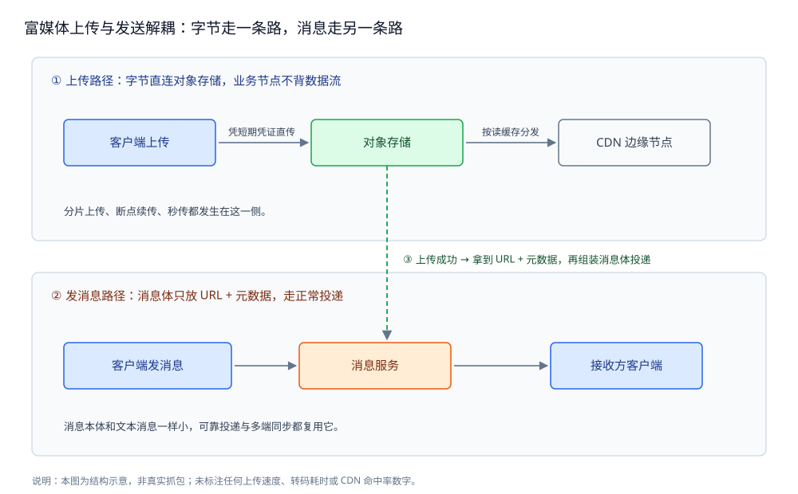
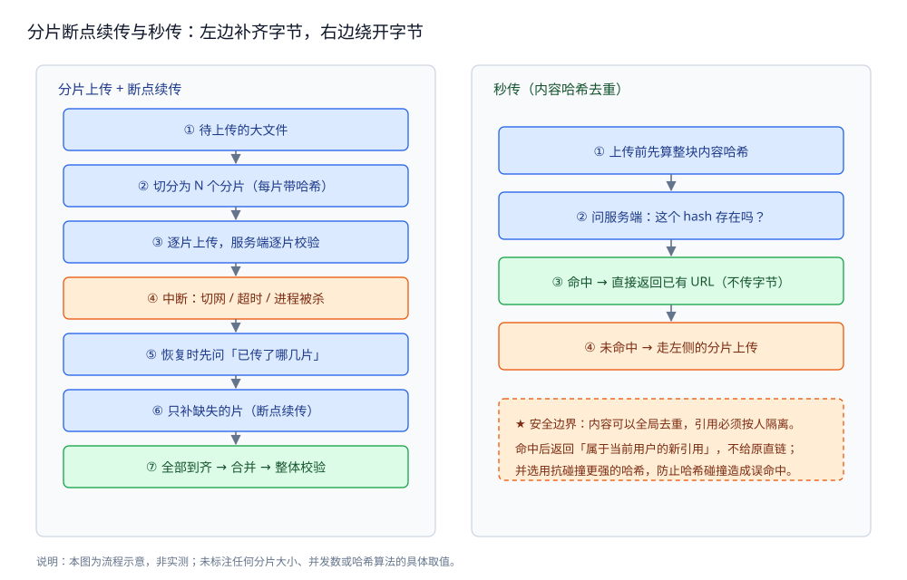

# 富媒体消息

> 图片 / 语音 / 视频 / 文件这类**大体积消息**怎么走完「上传 → 存 → 送达 → 展示」；
> 核心一句话：**上传与发消息解耦**——消息只搬指针，字节走另一条路。
>
> 本篇是**内容层**：讲消息体里装的是什么、二进制放在哪、附带的元数据与处理链路。
> 报文怎么装进帧、怎么切边界见 [协议设计.md](协议设计.md)；
> 消息怎么不丢不重有序地送达见 [消息可靠投递.md](消息可靠投递.md)；
> 各类型消息的语义差异见 [消息类型与业务语义.md](消息类型与业务语义.md)；
> 会话状态与历史分层见 [会话与未读.md](会话与未读.md)。
>
> 内容整理自个人学习笔记，并参考 对象存储与内容分发网络的公开文档；素材见 [素材清单](../../../素材清单.md)。
>
> ⚠️ 实测口径：本篇未做实测，不给出任何上传速度、转码耗时或 CDN 命中率读数。
> 原因：直传、转码与 CDN 分发都依赖真实对象存储与边缘节点，本机单进程环境无法复现；
> 凡未实际运行验证的结论，一律标注「⚠️ 未实测」。

---

## 一、富媒体消息和纯文本差在哪？

**本节要点**：文本消息的「体」就是消息本身，一条报文带走；富媒体的「体」是**另一个系统里的对象**，
消息只是**指向它的指针**——这一个差别派生出本篇后面全部设计。

### 1.1 文本消息：体即消息

一条纯文本消息的全部内容，就是那串字符。它的生命周期只有一条：
**进报文 → 落库 → 推送**。体积小、可直接进消息表、可直接进推送通道，**不需要第二个系统参与**。

### 1.2 富媒体：体在别处

一段视频动辄几十上百 MB，不可能塞进一条消息报文里。于是它被拆成**两个对象**：

| 对象 | 放哪 | 体积 | 谁关心 |
|---|---|---|---|
| **二进制本体** | 对象存储 | 大 | 上传链路、CDN 分发 |
| **消息（引用 + 元数据）** | 消息表 / 推送通道 | 小 | 投递链路、会话展示 |

⭐ 关键：**消息里放的不是字节，是「去哪取字节」的地址**（URL），
外加「取回来怎么显示」的元数据（宽高 / 时长 / 大小 / 哈希）。
消息本体因此和文本消息一样小，可以走同一套投递与同步机制。

### 1.3 由此得到的三个结论

1. **上传与发消息必须解耦**：上传慢、可能失败、可断点续传；发消息要快、要可靠、要走正常投递。
   两件事的失败语义完全不同，硬绑在一起会让「发一条图片消息」变成一次长事务。
2. **消息体只放引用**：二进制不进消息表、不进推送通道，否则存储与带宽都会被拖垮。
3. **转码必须异步**：原图能立刻发出去，但缩略图、清晰度档位要等后台处理；
   **消息不能等**转码完成。

> ⚠️ **未实测**：本节只给结构化取舍，不含任何体积或耗时数字。
> 原因：「多大算大」取决于真实产品与网络，本机单进程给不出可复现的读数。



## 二、文件该走直传还是服务端中转？

**本节要点**：直传把**数据流**从业务节点上摘掉，中转把**控制权**留在业务节点；
取舍点是带宽成本、鉴权复杂度与「上传后还要不要立刻处理」。

### 2.1 两条路径

| 维度 | **直传**（客户端 → 对象存储） | **中转**（客户端 → 业务服务 → 对象存储） |
|---|---|---|
| 数据流向 | 客户端**直连**对象存储 | 客户端先发给业务服务，再由服务转发 |
| 业务节点带宽 | 只走控制流，**不背数据流** | 数据流**穿业务节点**，带宽与连接被占 |
| 鉴权 | 服务端签发**短期凭证**，存储侧校验 | 服务端自己校验，凭证不必下发 |
| 上传后可处理 | 需靠**回调**或轮询触发后续处理 | 转发时**顺手就能处理**（如加密封存） |
| 适合 | 大文件、公开读、成本敏感 | 需要强管控、需要服务端先处理再落库 |

⭐ 判据：**业务节点只做计算，数据一律中心化**——这正是 [文件存储与上传架构.md](../文件存储与上传架构.md)
反复强调的那条原则；直传是它在「上传」这一步的具体落地。

### 2.2 直传凭什么安全：预签名 URL 与上传凭证

直传的核心矛盾是：**客户端不能持有长期密钥，却要直接写存储**。解法是**服务端签发，存储侧校验**：

- 服务端用**自己的密钥**签发一个**短期凭证**（预签名 URL / STS 临时凭证）；
- 凭证里**写死**了允许的动作与范围：**写哪个 key、是否限定大小、几分钟内有效**；
- 客户端拿着凭证直连对象存储上传，**凭证过期或越界即被拒绝**。

这样密钥始终不出服务端，客户端拿到的是**一次性的、受限的**许可。

> ⚠️ **未实测**：本节不附签名算法细节与有效期数字。
> 原因：签名与有效期由所选对象存储产品的规格决定，本机未接真实存储，任何数字都是编造。

### 2.3 怎么选

- **大文件、上传量大、希望省带宽** → 优先**直传**；
- **上传后必须由服务端立即处理**（例如先过一遍审核再落库，见 [内容审核与合规.md](内容审核与合规.md)）
  → 用**中转**或「直传到隔离区 + 服务端搬运」；
- 现实中常见**混合**：默认直传，敏感类型走中转。

对象存储本身的选型与用法，见 [README.md](../../../03-数据与中间件/中间件/对象存储/README.md)。

## 三、分片、断点续传与秒传怎么做？

**本节要点**：大文件必须**分片**，分片才能**断点续传**；
而**秒传**是把「传」这件事本身绕过去——用**内容哈希**先问再传。

### 3.1 分片上传

把一个大对象切成若干**分片**（part），逐片上传，最后由服务端**按序合并**：

- 每片有**独立的编号与校验值**，单片的成败互不影响；
- 单片失败只重传那一片，**不必从头再来**；
- 合并时才产生「完整的对象」，合并前存储里只有一堆碎片。

⭐ 分片不只是为了并行，更是为了让「失败」这件事**局部化**。

### 3.2 断点续传：先问「已经传了哪几片」

中断（切网、杀进程、超时）之后恢复时，**不要盲目从头传**，而是：

1. 客户端先问服务端：**这个上传任务已经收到了哪几片**；
2. 服务端返回**已存在的分片清单**；
3. 客户端**只补缺失的片**，全部到齐后再合并。

这就是断点续传的全部逻辑——它依赖「**分片清单**」这份服务端可信状态。



### 3.3 秒传：用内容哈希绕开传输

⭐ 秒传的本质是**内容寻址去重**：

1. 客户端在上传前**先算整块内容的哈希**；
2. 拿哈希问服务端：**「这个内容已经存在吗？」**
3. **存在（命中）** → 服务端直接返回**已有对象的 URL**，客户端**一个字节都不用传**；
4. **不存在（未命中）** → 走正常的分片上传。

这条路径把「重复内容」的传输成本压到接近零，也天然带来**存储去重**
（同一份内容只存一份，多处引用它）。

### 3.4 秒传的安全边界

秒传省下的成本，换来两个必须正视的风险：

| 风险 | 说明 | 常见的应对方向 |
|---|---|---|
| **哈希碰撞** | 不同内容算出同一哈希，会**误命中原对象**，用户拿到别人的文件 | 用抗碰撞更强的哈希；命中后仍需按权限决定能否复用 |
| **越权命中** | 秒传是**跨用户**去重的，命中别人的对象不能直接给 URL | 命中后返回**属于当前用户的新引用**，而不是原对象的直链 |

⭐ 判据：**内容可以全局去重，但引用必须按人隔离**——
「同一份字节」和「谁能拿到它」是两件事，秒传只解决前者。

### 3.5 两级校验

- **每片校验**：上传该片时带上该片哈希，服务端比对，错片立即重传；
- **整体校验**：全部合并后再算一次整体哈希，与秒传阶段算出的整体哈希比对。

两级校验分别拦住「单片传坏」与「合并出错/顺序错」两类问题。

> ⚠️ **未实测**：本节不给出分片大小、并发片数与哈希算法的具体取值。
> 原因：这些取值取决于对象存储规格与真实网络，本机未接存储，给出即为编造。

## 四、上传完之后这条消息怎么发出去？

**本节要点**：**先上传、后发消息**——上传拿到 URL 与元数据，再把这些装进一条**小消息**，
走正常的投递链路（[消息可靠投递.md](消息可靠投递.md)）。

### 4.1 顺序不能反

必须**先上传成功、再发消息**。反过来会出现两种坏情况：

- 消息先发出去，对端拿到的 URL **还不存在**，点开是 404；
- 上传失败但消息已成「已发送」，用户以为发出去了，实际永远取不到。

所以正确顺序是：**上传拿到稳定引用 → 组装消息体 → 投递**。

### 4.2 消息体里到底装什么

| 字段 | 用途 |
|---|---|
| **URL / 对象 key** | 去哪取字节（**不放二进制**） |
| **类型** | 图片 / 语音 / 视频 / 文件，决定渲染方式 |
| **大小** | 展示与限流判断 |
| **宽高 / 时长** | **预先占位**，避免图片加载时的布局跳动 |
| **内容哈希** | 去重、校验、秒传复用 |
| **缩略图 URL** | 首屏先用小图，点开再加载原图 |

⭐ 关键在于**宽高 / 时长这类元数据必须在发消息时就带上**：
它们让客户端在字节还没下载完时，就能**按正确比例占好位**，
这是「富媒体消息体验不跳」的核心，也是为什么元数据不能等转码完成才补。

### 4.3 客户端怎么维护「上传中」的状态

客户端本地要为每条尚未落地的消息维护一个**上传状态**，常见取值：

| 状态 | 用户看到 | 下一步 |
|---|---|---|
| **待上传** | 灰底占位 + 进度圈 | 开始分片上传 |
| **上传中** | 进度条 / 百分比 | 逐片推进；可暂停 |
| **上传成功** | 正常气泡 | 组装消息体、投递 |
| **上传失败** | 感叹号 + 重试入口 | 用户点重试 → 回到「待上传」 |

这些状态**只活在客户端本地**：服务端只知道「消息有没有发进来」，
不知道「字节传到第几片」。**上传的进度是本地的，投递的进度才是服务端的**。

> ⚠️ **未实测**：本节不给出重试次数、退避策略的具体参数。
> 原因：退避与重试上限取决于真实网络与存储的失败率，本机无法观测。

## 五、图片和视频还要做什么处理？

**本节要点**：处理链路（缩略图、转码、多档清晰度）是**异步**的，
消息**不能等**它——发出去的是原文件，处理结果是**事后补上**的。

### 5.1 缩略图

原图可能几 MB，但会话列表里只需要一张小图。做法是**上传后异步生成缩略图**，
消息体里**同时带原图 URL 与缩略图 URL**：列表先加载缩略图，点开再加载原图。

### 5.2 异步转码：为什么消息不能等

视频要转成客户端能播的编码与封装，这需要时间，而且**可能失败**。若让消息等转码：

- 发送方要一直挂着，进度不确定；
- 转码失败时消息该不该发出去，语义变得很别扭。

正确做法是**先发原文件、后台转码**：转码完成后更新对象（或补一条「可播放」标记），
客户端按「有没有可播放版本」决定能否直接播。**发送不阻塞在转码上**。

### 5.3 格式与清晰度档位

同一段视频按不同**分辨率 / 码率**转出多档，客户端按网络与屏幕选档播放。
这就是「同一份内容、多个派生对象」——每个派生对象有自己的 URL，消息体指向原文件，
派生关系由服务端维护。

### 5.4 CDN 分发

富媒体是典型的**读多写少、可缓存**内容：一次上传、无数次下载。
所以分发走 **CDN**，让边缘节点就近返回，回源只发生在未命中时。

⭐ 判据：**「这份内容是不是人人看到的一样」**——是，就可以缓存、走 CDN；
需要按人裁剪的内容（如带权限的直链）要额外签时效，不能当公共资源缓存。

相关的内容分发与存储分层，见 [文件存储与上传架构.md](../文件存储与上传架构.md)
与 [README.md](../../../03-数据与中间件/中间件/对象存储/README.md)。

> ⚠️ **未实测**：本节不给出转码档位、CDN 命中率或回源比例的任何数字。
> 原因：档位与命中率取决于真实内容分布与部署，本机跑不出真实分布。

## 六、语音消息特殊在哪？

**本节要点**：语音是「**一段时长 + 一条波形**」，生命周期比别的富媒体多出
**录制中 / 取消 / 播放 / 已听**四个状态，而时长是它最关键的元数据。

### 6.1 时长是第一元数据

语音气泡的宽度、播放进度、是否显示「转文字」都依赖**时长**。
所以录制结束时**第一件事就是拿到时长**，并把它装进消息体——和图片带宽高同理。

### 6.2 波形

语音常要画一条**波形**（音量随时间的变化），让用户能「看一眼」就找到想听的位置。
波形数据由**录制端在采集时算好**并随消息上传，服务端不必重新解码音频去算。

### 6.3 「按住说话」的录制与取消

- **按住即录**：开始采集，实时算时长与波形；
- **松手即发**：停止采集、上传、组装消息；
- **上滑取消**：识别为手势取消，**丢弃本地录制**，不上传、不发消息。

⭐ 要点：**取消必须发生在「上传之前」**。一旦开始上传再取消，
就得处理「已传部分怎么清理」——把取消放在上传前是最省事的边界。

### 6.4 自动播放与已听未听

语音常支持**自动连着播**下一条，也常带**播放/已听**状态：

- **未听 / 已听**是**用户级状态**，不是消息本体属性——同一段语音，A 听过不代表 B 听过；
- 因此这个状态挂在**「用户 × 消息」**上，和已读回执同源（见 [会话与未读.md](会话与未读.md)）。

> ⚠️ **未实测**：本节不给出采样率、码率或波形点数。
> 原因：音频参数由所选编码与采集设备决定，本机未采集真实音频。

## 使用：分片上传与秒传的骨架

**本节要点**：把「秒传命中 → 分片切分 → 断点跳过 → 合并校验」编排成一个
**可编译的最小骨架**；依赖真实对象存储的部分均标注未实测。

```go
package im

import (
	"crypto/sha256"
	"encoding/hex"
	"errors"
	"fmt"
)

// ObjectStore 是对象存储的最小抽象：签发上传凭证、按哈希查重、合并分片。
//
// ⚠️ 未实测：本骨架仅做静态编译校验（gofmt 通过），未接真实对象存储。
// 原因：直传与分片合并都必须由真实存储服务执行，本机单进程无法复现，
// 给出任何运行读数即为编造。
type ObjectStore interface {
	// PresignPut 为一个分片签发短期上传凭证：
	// 把「写哪个 key、第几片、多久有效」写死在凭证里，客户端凭它直连上传。
	PresignPut(key string, part int) (string, error)
	// Exists 用内容哈希询问：这个对象是否已存在（秒传的判据）。
	// 命中时返回已有对象的引用 URL（注意：真实系统要按用户生成新引用，不能给直链）。
	Exists(contentHash string) (bool, string, error)
	// Complete 把已上传的分片按序合并为一个完整对象。
	Complete(key string, parts []int) error
}

// ErrHashMismatch 表示某一片的哈希与登记值不符，需要重传该片。
var ErrHashMismatch = errors.New("part hash mismatch")

// ContentHash 计算整块内容的哈希，作为秒传与整体校验的唯一依据。
//
// 注意：这里读整块只为讲清判据；真实系统对超大文件会改用
//「分片哈希 + 分片清单的哈希」组合，避免每次校验都读完整个文件。
func ContentHash(data []byte) string {
	sum := sha256.Sum256(data)
	return hex.EncodeToString(sum[:])
}
```

秒传与分片的主流程：**先问哈希、命中即止；未命中再切片补齐、最后合并**。

```go
// Upload 承载「秒传 → 分片 → 断点续传 → 合并」的编排。
type Upload struct {
	store ObjectStore
}

// SecureUpload 返回可直接写进消息体的 URL。
//
// ⚠️ 未实测：无真实对象存储与网络，无法验证命中率、并发与重试行为。
func (u *Upload) SecureUpload(key string, data []byte, partSize int) (string, error) {
	// ① 先算整块内容哈希，问服务端有没有。
	h := ContentHash(data)
	ok, url, err := u.store.Exists(h)
	if err != nil {
		return "", fmt.Errorf("exists: %w", err)
	}
	if ok {
		// ② 命中即秒传：不传字节，直接复用已有对象。
		return url, nil
	}
	// ③ 未命中：切分片、逐片上传；断点续传时只补缺失的片。
	parts := splitParts(data, partSize)
	uploaded := map[int]bool{} // 真实系统改用「问服务端已传了哪几片」
	for i, p := range parts {
		if uploaded[i] {
			continue // 断点续传：跳过服务端已有的分片
		}
		if _, err := u.store.PresignPut(key, i); err != nil {
			return "", fmt.Errorf("presign part %d: %w", i, err)
		}
		// 真实实现：凭凭证上传 p，并比对本片哈希；不符则返回 ErrHashMismatch 重传。
		uploaded[i] = true
	}
	// ④ 全部到齐后合并，并做整体校验（合并后再算一次 ContentHash 比对）。
	if err := u.store.Complete(key, partIndexes(len(parts))); err != nil {
		return "", fmt.Errorf("complete: %w", err)
	}
	return key, nil
}
```

两个纯函数：**切分**与**生成分片序号**，它们不依赖存储，可独立验证。

```go
// splitParts 把内容按 partSize 切成若干片；partSize <= 0 时视为单片。
func splitParts(data []byte, partSize int) [][]byte {
	if partSize <= 0 {
		partSize = len(data)
	}
	var out [][]byte
	for off := 0; off < len(data); off += partSize {
		end := off + partSize
		if end > len(data) {
			end = len(data)
		}
		out = append(out, data[off:end])
	}
	return out
}

// partIndexes 生成 [0, n) 的分片序号，供合并时按序取片。
func partIndexes(n int) []int {
	idx := make([]int, n)
	for i := range idx {
		idx[i] = i
	}
	return idx
}
```

> ⚠️ **未实测**：以上代码**只做静态编译校验**（`gofmt` 通过）。
> 未运行 `go test` 的原因：直传、分片合并与秒传命中都依赖真实对象存储与网络，
> 本机无法复现；给出运行结果就是编造。

## 延伸追问

- **为什么消息体里不直接放二进制？** → 二进制体积大，进消息表会撑爆存储、进推送通道会拖垮带宽；把字节放对象存储、消息里只留引用，消息就能和文本一样小、走同一套投递与同步。
- **直传会不会不安全？** → 关键在**凭证**：服务端签发短期、限范围的凭证，客户端凭它直连，密钥不出服务端。凭证过期或越界即被拒——安全边界从「谁持有密钥」变成「谁持有受限许可」。
- **秒传命中了，直接把别人的文件给我行吗？** → 不行。秒传是**内容级**去重，命中只说明「这份字节存在」；能不能拿到还取决于**权限**。正确做法是命中后返回**属于当前用户的新引用**，而不是原对象的直链。
- **上传失败但消息已经显示了，怎么办？** → 说明顺序做反了。必须**先上传成功再发消息**；上传中的进度只算客户端本地状态，服务端不感知分片进度，所以「上传态」和「投递态」要分开维护。
- **为什么缩略图、转码都要异步，不一次做完？** → 因为消息的时效性优先：用户要立刻看到「消息已发出」，而处理链路慢且可能失败。把处理挪到异步、结果事后补上，发送路径就不会被处理耗时与失败率绑架。

## 关联

- [通信链路与协议栈.md](通信链路与协议栈.md) — 分层总纲：富媒体走的上传路径与消息路径各在哪一层。
- [协议设计.md](协议设计.md) — 富媒体消息体在报文里怎么装、字段怎么表达「引用 + 元数据」。
- [消息可靠投递.md](消息可靠投递.md) — 上传成功后，这条小消息怎么不丢不重有序地送达。
- [会话与未读.md](会话与未读.md) — 语音的「已听未听」与已读回执同源，都挂在「用户 × 消息」上。
- [消息类型与业务语义.md](消息类型与业务语义.md) — 图片 / 语音 / 文件之外，还有哪些消息类型与各自语义。
- [内容审核与合规.md](内容审核与合规.md) — 富媒体上传后为什么常要先过审核再对端可见。
- [文件存储与上传架构.md](../文件存储与上传架构.md) — 直传 vs 中转、有状态与无状态，上传链路的通用讲法。
- [README.md](../../../03-数据与中间件/中间件/对象存储/README.md) — 对象存储的选型与常用能力（预签名、分片、去重）。
- [README.md](README.md) — 本篇在 IM 目录里的位置与阅读顺序。
> 反向引用（本篇被下列文档引到）：[机器人与开放平台.md](机器人与开放平台.md)、[端到端加密.md](端到端加密.md)、[限流与防刷.md](限流与防刷.md)
