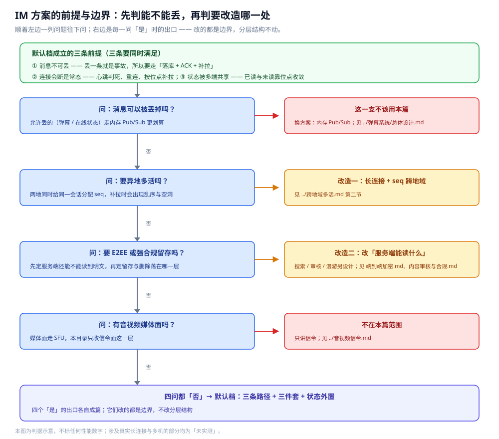

# 总体设计

> 覆盖：**即时通讯（IM）**这道系统设计题的**整体方案** —— 分几层 / 几部分、各干什么、怎么配合、核心取舍在哪、
> 一次完整消息走哪几步、这套方案的前提与边界，以及落地时的组件清单、容量与成本口径、端口与协议、一次链路的配置。
>
> 不覆盖：**各部分的细节**在零件篇里，**数据落点**在 [存储全景.md](存储全景.md) 里，**篇目清单与阅读顺序**在 [README.md](README.md) 里；
> 分层主线五篇各自成篇 ——
> [通信链路与协议栈.md](通信链路与协议栈.md)（三条路径 / 协议栈分层 / 跨路径衔接）、
> [协议设计.md](协议设计.md)（帧格式 / 报文类型 / 粘包半包 / 版本演进）、
> [在线状态与推送.md](在线状态与推送.md)（长连接 / 连接路由 / 心跳重连 / 离线降级）、
> [消息可靠投递.md](消息可靠投递.md)（seq / ACK / 扩散 / 幂等 / 补偿）、
> [会话与未读.md](会话与未读.md)（会话模型 / 未读数 / 多端收敛 / 游标分页）；
> 另有十篇业务能力篇（消息类型 / 群聊 / 富媒体 / 搜索 / 加密 / 审核 / 限流 / 多活 / 音视频信令 / 机器人），见 [README.md](README.md) 第二节。
>
> 内容整理自个人学习笔记，素材见 [素材清单](../../../素材清单.md)。
>
> 📎 **实测口径**：本篇是「整体方案」，**不引入新读数**；零件篇的投递骨架只给可编译骨架，
> 涉及真实长连接与多机路由的部分均标注「⚠️ 未实测」，本篇不复述任何吞吐或延迟数字。
> 第 7.2 节的容量口径给的是**算式骨架 + 明确标注的示意代入值**（不是本机实测，也不是任何线上系统的读数），
> 第 7.3 / 7.4 节的端口与配置项给的是**默认值与相对关系**，同样不是实测占用；凡未实测处均就地标注。

---

## 一、系统的整体形态是什么？

**本节要点**：IM 整体是**三层分工 + 一条端到端链路**——接入层（网关）持有长连接、逻辑层（消息服务）分配 seq 与存储转发、存储层落权威源与副本，三者由三条路径横切串起来。消息只是「走完这条路」的载荷，难点在连接、顺序与共享状态。

一句话概括：**先把一条消息要跨的三段拆成三条路径，再用"编号 + 确认 + 去重"三件套把端到端可靠性夹起来，最后用一份共享的位点把状态同步到多端。**


图怎么读：这张图是本目录共用的总体架构图，这里要当**"哪一层持有哪份状态"**看——接入层的网关 A/B/C 各自持有若干长连接，是**连接知识**的唯一持有者（谁在哪台网关只有它知道）；消息服务在路径②被调、分配会话 seq，并把消息本体与成员位点写进路径③的 MySQL（权威源）；推送通道跨节点扇出时，网关订阅、各自推给自己持有的连接，对端不在线才降级到 APNs / FCM 这类只保证"到达提醒"的系统通道。四个硬问题就分别压在四条边上——**谁在线**（连接路由）、**怎么不丢**（存储转发 + ACK）、**怎么有序去重**（seq + 消息 ID）、**多端怎么同步**（位点与已读收敛）。图里的网关与存储节点数均为示意，不标任何性能数字。

按角色，整个系统分**两层持状态的服务 + 一层存储 + 一条推送通道**：

| 部分 | 干什么 | 关键判据 | 细节在哪 |
|---|---|---|---|
| **接入层（网关）** | 持有公网长连接、心跳判死、连接路由、推送落地 | 它是**连接知识**的唯一持有者 | [在线状态与推送.md](在线状态与推送.md) |
| **逻辑层（消息服务）** | 分配会话 seq、去重、存储转发、扇出决策、未读派生 | 业务节点要**无状态**，状态都外置 | [消息可靠投递.md](消息可靠投递.md) |
| **存储层** | MySQL 存权威源（会话 / 消息 / 位点）、Redis 存副本（热窗口 / 在线状态 / 未读）、对象存储存富媒体与冷历史 | **权威源只有一个，其余都是它的派生** | [存储全景.md](存储全景.md) |
| **推送通道** | 发布订阅跨节点扇出；对端离线降级 APNs / FCM | 系统通道**只保证到达提醒**，真消息靠上线补拉 | [在线状态与推送.md](在线状态与推送.md) |

⭐ 三条路径（客户端 ↔ 网关 / 网关 ↔ 逻辑服务 / 逻辑服务 ↔ 下游）是**横切**这些部分的一条线：分层说的是"哪一层负责什么"，三条路径说的是"一条消息沿哪几段网络走、每一段的协议栈长什么样"（见 [通信链路与协议栈.md](通信链路与协议栈.md)）。

---

## 二、核心取舍在哪？

**本节要点**：三个取舍决定了这套方案的长相——**三条路径分开不合成一根管子、"可靠"落在端到端而非单跳、有状态的收拢到网关而共享状态选一份权威**。它们分别钉住"连接会断""投递会重""状态被多端同时改"这三件 IM 绕不开的事。

### 2.1 取舍一：三条路径分开，不合成一根管子

一条消息从"按下发送"到"对端看到"，跨的是**三段而不是一根管子**：

```text
客户端 ↔ 网关        公网 / 双向推 / 连接长(秒~小时) / 失败=掉线 / 客户端发版慢
网关 ↔ 逻辑服务      内网 / 请求-响应 / 连接短 / 失败=5xx / 后端灰度快
逻辑服务 ↔ 下游      内网 / 异步事件 + 同步 KV / 可靠性由具体下游定
```

⭐ 一句话：**三段各有各的「最难」，硬合成一根管子，就要用最严的一段（客户端发版难）去限制另外两段（后端本可天级灰度）**。分开之后，报文要向前兼容、连接要有心跳重连、投递要自造 seq——每段的优化目标互不牵连。细节见 [通信链路与协议栈.md](通信链路与协议栈.md)。

### 2.2 取舍二：「可靠」是端到端的，不是单跳的

⭐ 这是 IM 与弹幕最大的分水岭：弹幕**允许丢**，可以走内存 Pub/Sub；IM **不允许丢**，链路上任何一跳都不能单方面保证。只能靠**编号 + 确认 + 去重**三件套把不确定性夹起来：

| 手段 | 防什么 | 谁做 | 落点 |
|---|---|---|---|
| **编号**（seq / 消息 ID） | 排序、断线补齐、去重的依据 | 消息服务分配，装进帧传到客户端 | [消息可靠投递.md](消息可靠投递.md) |
| **确认**（ACK / 已读回执） | 送达与已读是否达成 | 客户端回执，逐跳上报 | [消息可靠投递.md](消息可靠投递.md) |
| **去重**（按消息 ID 幂等） | 重传与补拉补多 | 消费端按消息 ID 判重 | [会话与未读.md](会话与未读.md) |

只要有一项缺位，用户看到的就是"消息丢了"或"未读不清零"。⚠️ "恰好一次"最贵，工程上通常选**至少一次 + 消费端幂等**（见 [消息可靠投递.md](消息可靠投递.md) 第五节）。

### 2.3 取舍三：有状态的收拢到网关，共享状态选"以哪一份为准"

连接状态是**有状态**的，而逻辑层要**无状态可水平扩展**——矛盾就落在"这份状态放进程内 map 还是放共享存储"这一个决定上：

```text
长连接（有状态）───► 收拢到网关这一层 ───► 连接路由放 Redis(带 TTL)
逻辑服务（无状态）──► 随意扩缩容、天级灰度
```

同理，未读是一份被多端同时改的**共享可变状态**，没法每次强一致，只能定"**以哪一份为准**"再让它最终一致——工程上以**位点差**为权威算法、计数器只做加速，多端已读**单调不减**地收敛。两处状态归属见 [在线状态与推送.md](在线状态与推送.md) 第二节与 [会话与未读.md](会话与未读.md) 第四节。

---

## 三、各部分怎么配合？

**本节要点**：五篇分层主线零件按关注层依赖成一条链，ACK / seq / 连接表 / 位点是把它们缝起来的接缝。

### 3.1 分层主线的依赖链

```text
通信链路与协议栈.md   分层总纲：一条消息跨哪三条路径、各自协议栈
        ↓
协议设计.md           报文层：帧格式 / 报文类型 / 粘包半包 / 版本演进
        ↓
在线状态与推送.md     连接层：谁在线、消息往哪推、推不到怎么降级
        ↓
消息可靠投递.md       投递层：seq / ACK / 扩散 / 幂等 / 离线补偿
        ↓
会话与未读.md         状态层：会话列表 / 未读数 / 多端收敛 / 游标分页
```

### 3.2 接缝在哪

| 接缝 | 谁与谁 | 为什么必须一起看 |
|---|---|---|
| **ACK 是一种报文** | [协议设计.md](协议设计.md) ↔ [消息可靠投递.md](消息可靠投递.md) | 确认要靠报文承载，先有帧格式与报文类型，才谈得上"发 ACK" |
| **seq 要装进帧** | [协议设计.md](协议设计.md) ↔ [消息可靠投递.md](消息可靠投递.md) | seq 是投递概念，却必须序列化进帧里才传得到客户端 |
| **推送路由靠连接表** | [在线状态与推送.md](在线状态与推送.md) ↔ [消息可靠投递.md](消息可靠投递.md) | 扇出前要知道对端在哪台网关，这份知识只有连接层持有 |
| **未读依赖位点** | [消息可靠投递.md](消息可靠投递.md) ↔ [会话与未读.md](会话与未读.md) | 未读是"投递位点差"的派生，投递侧的 seq 与已读回执是它的算法来源 |

### 3.3 与相邻系统怎么分工

| 相邻 | 关系 |
|---|---|
| [总体设计.md](../弹幕系统/总体设计.md) | 同为长连接扇出，但弹幕**允许丢**、本目录**不允许丢**，取舍差正源于此 |
| [总体设计.md](../社交互动系统/总体设计.md) | 那边的"未读数 / 计数 / 关系"与本篇"未读收敛"是同类共享状态问题 |
| [README.md](../../分布式/README.md) | 那边给零件原理（一致性 / 故障转移 / 负载均衡），本篇把它们拼成"一条消息的完整生命周期" |

### 3.4 本篇与目录内零件篇怎么分工

**本节要点**：同一批知识不重复讲——本篇只回答「谁持状态、权威源只有一个、一次链路怎么配」，算法与读写路径一律落在零件篇。

| 想回答的问题 | 看哪篇 |
|---|---|
| 整体分几层、三个取舍、一次消息走哪几步、容量怎么估 | 本篇 |
| seq 怎么分配、ACK 怎么回、写扩散与读扩散怎么选、幂等与补偿怎么写 | [消息可靠投递.md](消息可靠投递.md) |
| 每份数据存在哪个载体、谁是权威源、副本怎么同步、冷热怎么分层 | [存储全景.md](存储全景.md) |
| 连接怎么被路由、心跳多快判死、离线怎么降级到系统通道 | [在线状态与推送.md](在线状态与推送.md) |
| 未读怎么算、多端怎么收敛、历史消息怎么分页拉取 | [会话与未读.md](会话与未读.md) |

⭐ 一条判据：**本篇出现的每个机制，都要能在零件篇里找到完整落点**；反过来，零件篇里"这条消息最后落到哪张表、哪份副本"的问题一律回链到 [存储全景.md](存储全景.md)。本篇与投递篇的切口最需要说清：**本篇只给"三件套把不确定性夹起来"这一层判断，seq / ACK / 幂等的具体算法与失败矩阵在投递篇**。

---

## 四、一次完整消息走哪几步？

**本节要点**：以「用户 A 给用户 B 发消息」为例，端到端串成十步，帮助定位"某一步该看哪一节"。

| # | 步骤 | 做什么 | 落点 |
|---|---|---|---|
| ① | 客户端 → 网关 | Send 报文（convID + clientMsgID + 内容），尚未分配 seq | [协议设计.md](协议设计.md) |
| ② | 网关 → 消息服务 | gRPC 调 SendMessage，带上用户身份与来源网关 | [通信链路与协议栈.md](通信链路与协议栈.md) |
| ③ | 消息服务 | 去重（按 clientMsgID）+ 分配会话 seq + 落库 + 更新成员位点 | [消息可靠投递.md](消息可靠投递.md) |
| ④ | 消息服务 → 网关 | 返回 SendAck（msgID + seq） | [协议设计.md](协议设计.md) |
| ⑤ | 网关 → 客户端 | SendAck 报文，客户端显示"已发送" | [协议设计.md](协议设计.md) |
| ⑥ | 异步扇出 | 查在线状态 → 对端在线推网关 / 离线落收件箱或走系统推送 | [在线状态与推送.md](在线状态与推送.md) |
| ⑦ | 网关 → 对端客户端 | Push 报文（对端在线时） | [在线状态与推送.md](在线状态与推送.md) |
| ⑧ | 对端客户端 | 回 PushAck | [消息可靠投递.md](消息可靠投递.md) |
| ⑨ | 网关 → 消息服务 | gRPC 调 ReportDelivered | [消息可靠投递.md](消息可靠投递.md) |
| ⑩ | 收尾 | 更新送达位点；对端上线后按 lastSeq 补拉 | [会话与未读.md](会话与未读.md) / [存储全景.md](存储全景.md) |

```text
Send → 去重 & 分 seq & 落库 → SendAck("已发送")
                              └► 异步扇出 → Push → PushAck → 送达位点
                                            └► 离线：落收件箱 / 系统通道 → 上线按 lastSeq 补拉
```

⚠️ 三个常见误区：① 把"发送成功"（SendAck，落库即回）当成"对方收到"——它只证明消息落库了；② 把"系统推送成功"当成"消息已送达"——APNs / FCM 只保证"到达提醒"；③ **忘了补拉**——系统推送唤起 App 后，真消息仍要按 seq 拉取补齐，光有推送不算送达。

🔗 本节十步的调用时序图已由同目录共用图承担：[通信链路-一条消息跨三条路径的十步流程.svg](images/通信链路-一条消息跨三条路径的十步流程.svg) —— 该图按路径①②③三条泳道画的正是上表的 ①~⑩ 步，seq 在哪条路径产生、在哪条路径消费可直接对照 [通信链路与协议栈.md](通信链路与协议栈.md) 第四节，本篇不重画。

---

## 五、这套方案的前提与边界是什么？

**本节要点**：这套"三条路径 + 三件套 + 状态外置"的方案，成立的前提是"**消息不可丢、且连接会断是常态**"；跳出这个前提，答案可以大幅简化或整个换掉。

| 场景 | 这套方案 | 为什么 |
|---|---|---|
| **消息不可丢**（即时通讯、群聊） | ✅ 适用 | 落库 + ACK + 补拉三件套正是为"不可丢"而生 |
| **连接会断是常态**（公网长连接、弱网） | ✅ 适用 | 心跳判死 + 重连 + 按位点补拉是默认设计 |
| **状态被多端共享**（多端在线、已读） | ✅ 适用 | 位点权威 + 单调收敛，容忍最终一致 |
| **允许丢**（弹幕 / 在线状态） | ❌ 不适用 | 不必上"落库 + ACK + 补拉"，内存 Pub/Sub 更划算 |
| **异地多活** | ⚠️ 要改造 | 长连接与 seq 唯一性要一起重新设计（见 [跨地域多活.md](跨地域多活.md)） |
| **要求 E2EE** | ⚠️ 要改造 | 服务端搜索 / 审核 / 多端漫游都要另设计（见 [端到端加密.md](端到端加密.md)） |
| **音视频媒体面**（WebRTC / SFU） | ❌ 不在本篇 | 本目录只讲信令面（见 [音视频信令.md](音视频信令.md)） |

依赖的外部条件：

- **公网长连接能力**：WebSocket 或自定义二进制协议，且协议要向前兼容（见 [协议设计.md](协议设计.md)）。
- **内网 RPC**：网关 ↔ 逻辑服务的请求-响应、deadline 与 metadata 传递（见 [通信链路与协议栈.md](通信链路与协议栈.md)）。
- **权威源存储**：MySQL 存会话 / 消息 / 位点；Redis 存热窗口 / 在线状态 / 未读；对象存储 + CDN 承载富媒体与冷历史（见 [存储全景.md](存储全景.md)）。
- **异步扇出通道**：MQ 削峰与跨节点扇出，载荷要带 trace id 与幂等键。
- **系统推送通道**：APNs / FCM 作为离线降级，**只保证到达提醒**，不保证消息送达。

> ⚠️ **读数口径**：本目录**未做本机实测**——零件篇的投递骨架只给**可编译骨架**，涉及真实长连接与多机路由的部分**均标注「⚠️ 未实测」**，不编造任何吞吐或延迟数字。图里的网关与存储节点数也都是示意，要记的是结构与趋势。

**多端与离线的边界条件**：这套方案里有几条边界经常被当成"想当然成立"，但它们各自都有明确条件，不满足时故障现象也各不相同。

| 边界条件 | 满足时的做法 | 不满足时的现象 |
|---|---|---|
| **同一账号多端在线** | 连接路由按「用户 + 设备」存多条连接，发送方自己那份也要扇出 | 只有一端可见、另一端"未读不清零" |
| **对端离线** | 落收件箱（要有留存上限）+ 走系统通道提醒，上线后按 `lastSeq` 补拉 | 消息只到"提醒"没到"送达"，点开后内容为空 |
| **系统通道可用** | 只把它当**到达提醒**用，真消息仍靠补拉 | 把"推送成功"当"已送达"，出现"通知有、消息没有" |
| **异地多活** | 长连接与 seq 唯一性一起重新设计（见 [跨地域多活.md](跨地域多活.md)） | 两地同时分配同一会话的 seq，补拉时出现乱序与空洞 |
| **合规留存 / E2EE** | 先定"服务端还能不能读到明文"，再定留存与删除落在哪一层（见 [端到端加密.md](端到端加密.md)、[内容审核与合规.md](内容审核与合规.md)） | 上了 E2EE 才发现搜索与审核都依赖服务端明文，功能要推倒重来 |



⭐ 图怎么读：图上半是**默认档**成立的三条前提（消息不可丢 / 连接会断是常态 / 状态被多端共享）；左下那一支说明"前提不成立"时不是改造而是**换方案**（允许丢的走内存 Pub/Sub）；右侧四个 ⚠️ 分支是"前提基本成立、但要改造"的四种情况——**改的都是边界，分层结构不动**：异地多活改的是"长连接与 seq 怎么跨地域"，E2EE 改的是"服务端还能不能读明文"，合规留存改的是"留存与删除落在哪一层"，音视频媒体面则是**不在本篇范围**（本篇只收信令面）。四条分支各自成篇，点开见图中的零件篇链接。

---

## 六、应用场景

**本节要点**：同一套「三条路径 + 三件套 + 状态外置」落在不同产品形态上，**改的是同一批旋钮**——连接规模、扇出倍数、顺序要求、留存边界；档位一变，成本和风险的落点就换地方。

| 档位 | 连接与扇出特征 | 相对本篇默认形态，关键差异在哪 | 落到哪篇 |
|---|---|---|---|
| **社交单聊 / 小群** | 一对一或十来人，扇出小 | 就是本篇的默认档：写扩散成本可忽略，按 `convID` 分片足够 | [消息可靠投递.md](消息可靠投递.md) |
| **大群（数百 ~ 数千人）** | 一次发送的扇出倍数 = 群成员数 | 写扩散被放大成灾，必须**从写扩散转读扩散**，未读改按位点差算 | [群聊.md](群聊.md)、[消息可靠投递.md](消息可靠投递.md) |
| **企业 IM** | 组织架构大、文件与审计重 | 消息量不大，但**合规留存与检索**变成硬约束，权威源要撑得住审计 | [内容审核与合规.md](内容审核与合规.md)、[搜索与历史.md](搜索与历史.md) |
| **直播互动 / 弹幕式聊天** | 峰值连接与消息量高出常态一个量级 | 允许丢的部分走内存 Pub/Sub，只有不可丢的（订单 / 礼物）才走三件套 | [通信链路与协议栈.md](通信链路与协议栈.md)、[限流与防刷.md](限流与防刷.md) |
| **客服 / 机器人会话** | 会话短、参与方固定、消息可被系统改写 | 多出「消息归属与可见性」的边界：客服与机器人看到的不是同一份会话 | [机器人与开放平台.md](机器人与开放平台.md) |
| **移动弱网 / 多端** | 一台设备多条连接、断线频繁 | 连接路由与补拉策略不变，但**多端已读收敛**与离线补拉成为主要体验点 | [在线状态与推送.md](在线状态与推送.md)、[会话与未读.md](会话与未读.md) |

⭐ 判据：**档位只改「旋钮值」，不改分层结构**——无论哪种形态，持状态的仍然只有网关（连接）与存储（数据），权威源仍然只有一个。真正的结构分叉只有两处：**扇出方式**（写扩散 ↔ 读扩散，由群规模决定，见 [群聊.md](群聊.md)）和**消息可不可丢**（不可丢才有"编号 + 确认 + 去重"三件套，见第五节）。

---

## 七、具体使用

**本节要点**：把整体方案落成可对照的四张清单——组件角色与部署形态（7.1）、容量与成本口径（7.2）、端口与协议（7.3）、一次链路的配置（7.4）。**7.2 的数值是设计估算与示意代入，7.3 / 7.4 给的是默认值与相对关系，都不是实测读数。**

### 7.1 组件角色与部署形态

**本节要点**：把整体方案涉及的组件按角色与部署形态列成清单，供落地时对照。

| 组件 | 承担什么 | 部署形态 | 数据角色 |
|---|---|---|---|
| **网关**（接入层） | 持有公网长连接、心跳判死、连接路由、推送落地 | 无状态横向扩展；连接路由放 Redis（带 TTL） | 连接知识（唯一持有者） |
| **消息服务**（逻辑层） | 分配 seq、去重、存储转发、扇出决策、未读派生 | 无状态服务、多副本 | 无（业务逻辑） |
| **MySQL** | 会话表 / 成员表 / 消息流（含 seq） | 按 convID 分库分表 | **权威源** |
| **Redis** | 热窗口 / 在线状态（带 TTL）/ 未读计数 / 对端 inbox | 主从 + 集群 | 副本（可从权威源重建） |
| **MQ** | 异步扇出、削峰 | 集群 | 传输通道（非权威源） |
| **APNs / FCM** | 离线推送降级通道 | 第三方系统通道 | 只保证"到达提醒" |
| **对象存储 + CDN** | 富媒体文件与冷历史消息 | 对象存储 + CDN 分发 | 归档 / 静态资源 |
| **Elasticsearch**（可选） | 检索副本，从消息流 CDC 同步 | 集群 | 派生副本（可从消息流重建） |

⭐ 这份清单的判据只有两条：**持状态的只有网关（连接）与存储（数据），逻辑层必须无状态**；**权威源只有一个（MySQL），其余全是它的派生**。各角色的完整落点见 [存储全景.md](存储全景.md)。

### 7.2 容量与成本口径

**本节要点**：容量从三个乘式来——连接数、消息量、扇出倍数；三笔账里**扇出倍数最容易被低估**，大群是它的极端值。成本落点也由这三笔账决定。

| 量 | 算式骨架 | 示意代入（⚠️ **示意值，非实测**） |
|---|---|---|
| **峰值在线连接数** | 日活设备数 × 峰值同时在线比例 | 例：`1 亿 × 20% = 2000 万` 条长连接 |
| **峰值上行消息 QPS** | 峰值在线连接数 × 人均发送速率 | 例：`2000 万 × 1 条/分钟 ÷ 60 ≈ 33 万` QPS |
| **扇出倍数** | 单聊 ≈ 1；小群 = 成员数 − 1；大群改读扩散后 ≈ 1 | 例：`500` 人群走写扩散，一次发送放大成 `500` 次投递 |
| **单网关承载上限** | 由 fd 上限、每连接内存、心跳开销三项决定 | ⚠️ 本篇**不给数值**：这是必须压测的输入，估算替代不了 |
| **存储增长** | 日均消息数 × 每条字节（头 + 载荷 + 索引与副本放大）× 留存天数 | 例：`100 亿 × 200 B × 30 天 ≈ 60 TB` |

⚠️ 上表「示意代入」列的数字**只用来演示算式怎么乘**，既不是本机实测，也不是任何线上系统的读数；真实取值必须以压测与线上监控为准。成本落点随之确定：**连接数决定网关与内存，扇出倍数决定 MQ 与推送通道的规模，留存天数决定存储容量与冷热分层的分界**（冷热分层见 [存储全景.md](存储全景.md)）。

### 7.3 端口与协议清单

**本节要点**：三层各自只谈「对外协议」与「谁能直连」——**公网只暴露接入层的长连接入口，逻辑层与存储层一律内网**。

| 层 | 对外协议 / 默认端口 | 谁能连 | 注意 |
|---|---|---|---|
| 接入层（网关） | WebSocket（`ws` / `wss`，默认 `80` / `443`）或自定义二进制长连接 + TLS | 公网客户端 | 端口就一个，**向前兼容**靠帧格式与能力协商（见 [协议设计.md](协议设计.md)） |
| 逻辑层（消息服务） | gRPC over HTTP/2（内网端口由部署定），带 deadline 与 metadata | 仅网关与内部服务 | 不暴露公网；trace id 与用户身份靠 metadata 传（见 [通信链路与协议栈.md](通信链路与协议栈.md)） |
| 存储层 | MySQL（`3306`）、Redis（`6379`）、MQ（各实现默认端口） | 仅逻辑层 | 一律内网；连接要池化，并设超时与最大连接数 |
| 系统通道 | APNs / FCM 的 HTTPS 接口（`443` 出网） | 推送服务出网 | 只保证到达提醒；证书与配额属运维项 |

⚠️ 表中端口是各协议的**默认值**，不是本机实测；生产以实际部署的端口与网络策略为准。

### 7.4 一次链路的配置清单

**本节要点**：以「用户 A 给用户 B 发一条文本消息」这一次链路为例，把沿途要设的**超时 / 上限 / 开关**列成对照表——判据是「每一项都能说清超了会怎样」。

| 位置 | 配置项 | 设成什么 | 超了 / 漏了会怎样 |
|---|---|---|---|
| 客户端 → 网关 | 心跳间隔、重连退避上限 | 心跳间隔 **小于**网关判死阈值 | 判死太早 → 频繁重连；判死太晚 → 消息滞留（见 [在线状态与推送.md](在线状态与推送.md)） |
| 网关 | 单连接发送队列上限 | 有限队列 + 背压 | 无上限 → 一个慢客户端拖垮网关内存 |
| 网关 → 消息服务 | gRPC deadline | **小于**客户端等待上限 | 不设 → 请求悬挂，连接与协程一起涨 |
| 消息服务 | 会话内 seq 分配 | 唯一且单调、按会话串行分配 | 不唯一 → 补拉时乱序、出空洞（见 [消息可靠投递.md](消息可靠投递.md)） |
| 消息服务 | 幂等窗口（按 `clientMsgID`） | **覆盖**客户端重传窗口 | 窗口太短 → 重传被当成两条新消息（见 [消息可靠投递.md](消息可靠投递.md)） |
| 异步扇出 | MQ 保留时长与重试上限 | **不小于**最长离线时间 | 保留太短 → 离线久的对端上线后补不全 |
| 存储层 | 热窗口 TTL、冷历史转存阈值 | 按读写比与成本定 | 热窗口太长 → Redis 内存成本失控（见 [存储全景.md](存储全景.md)） |
| 离线降级 | 收件箱留存上限、系统通道开关 | 有上限、可关（可灰度） | 无上限 → 骚扰与成本；没有开关 → 出问题只能改代码 |

⚠️ 这张表给的是**判据与相对关系**（"小于谁""不小于谁""覆盖谁"），**不给具体数值**——数值必须按业务压测，本篇不编造。

---

## 延伸追问

- **为什么不让客户端直连逻辑服务，省掉网关？** → 长连接是**有状态**的，而逻辑服务要求**无状态可水平扩展**；网关把这份"有状态"单独收拢，逻辑服务才能随意扩缩容（见 2.3）。
- **为什么说"可靠"不能靠单跳保证？** → 链路上任何一跳（TCP、MQ、网关）都只能保证自己那一段，端到端的"不丢不重有序"只能靠**编号 + 确认 + 去重**把不确定性夹起来（见 2.2）。
- **为什么 IM 必须落库，弹幕却可以内存广播？** → 可靠性等级不同：弹幕丢几条无所谓，IM 丢一条就是事故，所以必须走"落库 + ACK + 补拉"三件套（见 2.2 与 [存储全景.md](存储全景.md) 第四节）。
- **多端已读为什么不做强一致？** → 一份状态被多端同时改，强一致代价过高；工程上以**位点差**为权威算法、计数器只做加速，多端已读**单调不减**地收敛即可（见 2.3）。
- **一次发送里，客户端在哪一步才算"对方收到了"？** → 都不是 SendAck（那是"已落库"）；对端回 PushAck 或上线按 lastSeq 补拉后，才算真正送达（见 第四节）。
- **同一套方案落在社交单聊 / 大群 / 企业 IM 上，各自要改哪一处？** → 改的是**旋钮值不是结构**：单聊按 `convID` 分片就够；大群必须把写扩散转成读扩散（否则扇出倍数等于成员数）；企业 IM 消息量不大，但**合规留存与检索**从"可选项"变成硬约束（见第六节与 [群聊.md](群聊.md)）。
- **在线连接数、扇出倍数、存储增长这三笔账怎么估？** → 三张乘式：连接 = 日活设备数 × 峰值在线比例；上行 QPS = 峰值连接数 × 人均发送速率；存储 = 日均条数 × 每条字节 × 留存天数。其中**扇出倍数最容易被低估**（小群近似 1、大群等于成员数），见 7.2。
- **多端同时在线时，已读以哪一端为准？** → 不以任何一端为准，而以**位点**为准：每端上报自己的已读位点，服务端取**单调不减**的收敛结果（见 2.3 与 [会话与未读.md](会话与未读.md) 第四节）。
- **上了 E2EE 之后，搜索与审核怎么办？** → 服务端拿不到明文，检索只能退化成端侧索引，审核要靠客户端上报或成员举报；这是"要改造"分支里最伤现有功能的一项（见第五节图与 [端到端加密.md](端到端加密.md)）。

## 关联

- **上游/总纲**：[README.md](README.md) — 目录导读：核心问题 / 篇目清单 / 阅读顺序 / 目录分工。
- **对照/互补**：[存储全景.md](存储全景.md) — 横切篇：IM 的数据都存哪、谁是权威源、怎么同步。
- **下游机制**：[通信链路与协议栈.md](通信链路与协议栈.md) — 分层总纲：三条路径 / 各自协议栈 / 跨路径衔接。
- **下游机制**：[协议设计.md](协议设计.md) — 报文层：帧格式 / 报文类型 / 粘包半包 / 版本演进 / 能力协商。
- **下游机制**：[在线状态与推送.md](在线状态与推送.md) — 连接层：长连接 / 连接路由 / 心跳重连 / 离线降级。
- **下游机制**：[消息可靠投递.md](消息可靠投递.md) — 投递层：seq / ACK / 写扩散与读扩散 / 幂等 / 补偿。
- **下游机制**：[会话与未读.md](会话与未读.md) — 状态层：会话模型 / 未读数 / 多端收敛 / 游标分页。
- **对照/互补**：[总体设计.md](../弹幕系统/总体设计.md) — 同为长连接扇出的姊妹场景，可容忍丢失，与本目录对照取舍。
- **对照/互补**：[总体设计.md](../社交互动系统/总体设计.md) — 计数与关系类共享状态的另一套讲法。
- **上游/总纲**：[README.md](../../分布式/README.md) — 本目录所用零件（一致性 / 故障转移 / 负载均衡）的原理线。
- **上游/总纲**：[存储选型与组合.md](../../../03-数据与中间件/数据存储/存储架构与场景/存储选型与组合.md) — 通用视角：数据角色、权威源与副本、冷热分层与多存储同步。
- **对照/互补**：[消息队列选型对比.md](../../../03-数据与中间件/中间件/消息队列/消息队列选型对比.md) — 离线消息、异步投递、写扩散常借 MQ 削峰，选型与语义在那边。
