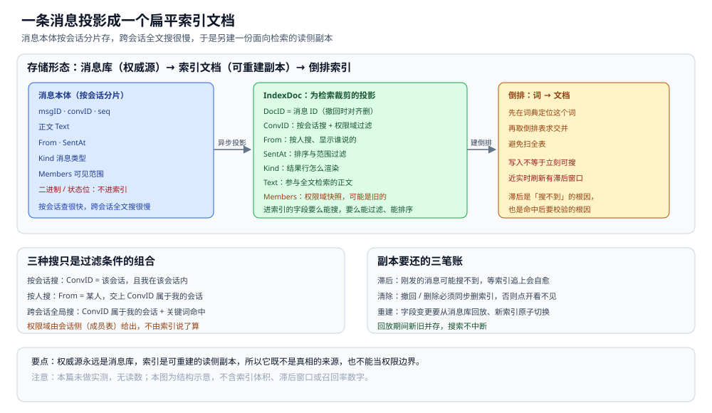
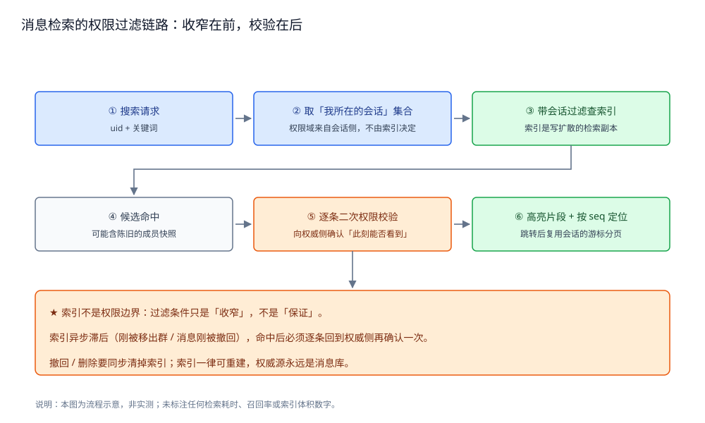
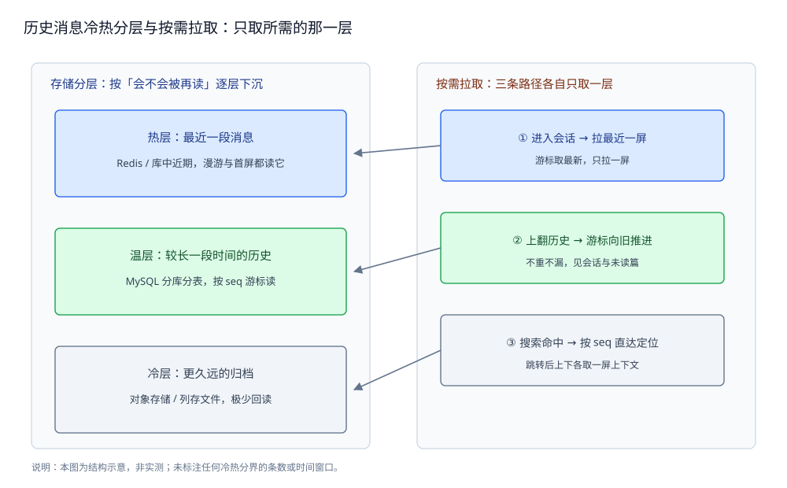

# 搜索与历史

> IM 的**消息检索**：全文搜索、按会话搜、按人搜、结果高亮与定位，
> 以及历史消息的**冷热分层与按需拉取**。
> 核心一句话：**搜索结果必须再做一次权限校验**——索引不是权限边界。
>
> 本篇是**检索层**：讲「消息怎么被搜到、历史怎么按需取回」。
> 会话模型与游标分页见 [会话与未读.md](会话与未读.md)；
> 消息的 seq 与漫游位点见 [消息可靠投递.md](消息可靠投递.md)；
> 消息类型决定哪些字段可搜，见 [消息类型与业务语义.md](消息类型与业务语义.md)。
>
> 内容整理自个人学习笔记，并参考 全文检索与搜索引擎的公开文档；素材见 [素材清单](../../../素材清单.md)。
>
> ⚠️ 实测口径：本篇未做实测，不给出任何检索耗时、索引体积或召回率的读数。
> 原因：全文检索依赖真实的搜索集群与真实语料，本机单进程无法复现；
> 凡未实际运行验证的结论，一律标注「⚠️ 未实测」。

---

## 一、IM 搜索和通用搜索差在哪？

**本节要点**：通用搜索优化的是**相关性**，IM 搜索的第一约束却是**权限**——
**只能搜到你所在的会话**；这一条压过了排序、分词等所有其他考虑。

### 1.1 权限是硬约束，不是过滤器

在网页搜索里，搜不到只是「不相关」；在 IM 里，搜到了**不该搜到的内容就是事故**。
所以 IM 搜索的过滤条件里，**「我参与过哪些会话」是一个必须前置的、不可省的条件**，
而不是事后可选的相关性加权。

### 1.2 三条现实约束

| 约束 | 表现 | 影响 |
|---|---|---|
| **权限过滤** | 结果必须限定在我所在会话内 | 索引里要能按会话 / 成员过滤 |
| **近实时 vs 归档** | 刚发的消息希望**立刻**能搜到 | 索引写入与消息写入**异步**，天然有滞后 |
| **中文分词** | 中文没有空格，直接按字切不准 | 需要专门的分词器，且要支持同义与多音 |

### 1.3 与「历史拉取」的关系

搜索解决的是「**不知道在哪，帮我找**」，历史拉取解决的是「**知道在哪，帮我取回来**」。
两者在「命中后定位」这一步汇合：搜索结果要能**跳到那条消息所在的位置**，
这就要借用会话的游标分页（见 [会话与未读.md](会话与未读.md)）。

> ⚠️ **未实测**：本节不给出索引滞后窗口或分词效果的量化数字。
> 原因：滞后取决于写入链路与刷新间隔，分词效果取决于真实语料，本机都没有。

## 二、全文搜索的索引怎么写？

**本节要点**：做法是把「**一条消息**」投影成「**一个扁平的索引文档**」——
这本质上是**读扩散**：写入时把消息推到搜索索引，读时才能一次查出。

### 2.1 为什么会变成读扩散

消息本体按会话分片存在消息库里（见 [消息可靠投递.md](消息可靠投递.md)），
**按会话查很快，跨会话全文搜很慢**。所以另建一份**面向检索的副本**：
把消息**写扩散**成索引文档，让「任意关键词 → 消息」变成一次查询。

⭐ 这与 [README.md](../../../03-数据与中间件/数据存储/搜索与分析/Elasticsearch/README.md)
里「写少读多、数据量大、要快」的选型判据一致——搜索索引是**典型的读侧副本**。

### 2.2 索引文档的字段设计

| 字段 | 角色 | 说明 |
|---|---|---|
| **DocID** | 主键 | 用**消息 ID**，便于撤回 / 删除时对齐 |
| **ConvID** | 过滤 | 按会话搜、以及**权限域**过滤 |
| **From** | 过滤 / 展示 | 按人搜、结果里显示「谁说的」 |
| **SentAt** | 排序 | 结果按时间排序与范围过滤 |
| **Kind** | 过滤 / 展示 | 文本 / 图片 / 文件……决定如何渲染结果行 |
| **Text** | 检索 | 参与全文检索的正文（富媒体的可搜说明文字） |
| **Members** | 过滤 | **权限域快照**：这条消息对哪些人可见 |

⭐ 关键：**索引文档是「为检索裁剪过的投影」，不是消息本体的复制**。
二进制、状态位这些不必进索引；进索引的字段，要么**能搜**，要么**能过滤**，要么**能排序**。



图怎么读：从左到右是三层形态。**消息本体（按会话分片）**带着 msgID · convID · seq、正文 Text、From · SentAt、
Kind 消息类型、Members 可见范围，以及**二进制 / 状态位：不进索引**；经「异步投影」得到 **IndexDoc：为检索裁剪的投影**
（DocID = 消息 ID（撤回时对齐删）、ConvID：按会话搜 + 权限域过滤、From：按人搜、显示谁说的、SentAt：排序与范围过滤、
Kind：结果行怎么渲染、Text：参与全文检索的正文、**Members：权限域快照，可能是旧的**）；再「建倒排」得到
**倒排：词 → 文档**——先在词典定位这个词、再取倒排表求交并，避免扫全表，同时写明「写入不等于立刻可搜，近实时刷新有滞后窗口」。
下方两块补充：三种搜只是同一套字段的过滤组合（权限域由会话侧给出，不由索引说了算），以及副本要还的三笔账
（滞后 / 清除 / 重建，回放期间新旧并存、搜索不中断）。本图为结构示意，不含索引体积或滞后窗口数字。

### 2.3 近实时与倒排索引

搜索引擎靠**倒排索引**把「词 → 文档」建起来，查询时先在词典定位、再取倒排表求交并，
避免扫全表。倒排索引的结构、词典与倒排表的组成，见
[索引原理.md](../../../03-数据与中间件/数据存储/搜索与分析/Elasticsearch/索引原理.md)。

⭐ 近实时意味着：**写入 ≠ 立刻可搜**。消息刚落库、索引还没刷新时，搜不到是**正常现象**，
不是丢消息——这正是下一节「权限要二次校验」和第六节「一致性代价」的根源。



图怎么读：这是一条从左到右的判定流水线，标题就是本节的口径——「收窄在前，校验在后」。
六步依次是：「① 搜索请求（uid + 关键词）→ ② 取『我所在的会话』集合（权限域来自会话侧，不由索引决定）→
③ 带会话过滤查索引（索引是写扩散的检索副本）→ ④ 候选命中（可能含陈旧的成员快照）→
⑤ 逐条二次权限校验（向权威侧确认『此刻能否看到』）→ ⑥ 高亮片段 + 按 seq 定位（跳转后复用会话的游标分页）」。
②③⑤ 三步分别对应 3.2「权限域从哪来」与 3.3「索引不是权限边界」，底部三条说明原文照抄：
「★ 索引不是权限边界：过滤条件只是『收窄』，不是『保证』」；
「索引异步滞后（刚被移出群 / 消息刚被撤回），命中后必须逐条回到权威侧再确认一次」；
「撤回 / 删除要同步清掉索引；索引一律可重建，权威源永远是消息库」。
本图为流程示意、非实测，未标注任何检索耗时、召回率或索引体积数字。

## 三、按会话、按人、跨会话怎么搜？

**本节要点**：三种搜索的区别只是**过滤条件的组合不同**，排序都以时间为准；
而三种搜索**都必须先落到「我所在的会话集合」这个权限域里**。

### 3.1 三种查询的过滤条件

| 查询 | 过滤条件 | 排序 |
|---|---|---|
| **按会话搜** | `ConvID = 该会话`（且我在该会话内） | 按时间 |
| **按人搜** | `From = 某人` ∩ `ConvID ∈ 我的会话` | 按时间 |
| **跨会话全局搜** | `ConvID ∈ 我的会话`（且关键词命中正文） | 按时间 / 相关性 |

⭐ 注意：**「按人搜」不等于「搜这个人的所有消息」**——只能搜到**我和他共同所在的会话**里的消息。

### 3.2 权限域从哪来

权限域 = 「我参与的所有会话」这个集合，它由**会话侧**（成员表）给出，
不是搜索索引自己说了算。流程是：

1. **先向会话侧要「我所在的会话集合」**；
2. 把这个集合作为**过滤条件**带进检索请求；
3. 检索发生在索引里，但**过滤域由会话侧裁定**。

### 3.3 索引不是权限边界

⭐ 最重要的一条：**过滤条件只是「收窄」，不是「保证」**。原因是：

- 索引**异步滞后**：我可能**刚被移出群**，索引里还留着那时的成员快照；
- 消息可能**刚被撤回**，索引还没来得及删；
- 索引的 `Members` 快照可能是**旧的**。

所以：**命中之后必须逐条再做一次权限校验**——向权威侧确认「当前这一刻，这个人还能不能看到这条消息」。
**索引负责「找得快」，权威侧负责「给不给看」**，两者不能混。

> ⚠️ **未实测**：本节不给出过滤 + 校验的性能开销数字。
> 原因：开销取决于索引规模与校验的批量化程度，本机无真实集群。

## 四、结果怎么高亮与定位？

**本节要点**：搜索要给的不只是「命中了哪些消息」，还要「**命中的是哪几个字**」和
「**这条在会话里的什么位置**」——前者靠高亮，后者靠定位。

### 4.1 高亮片段

结果行不能只给「这个会话里有这个词」，要给出**命中的上下文片段**并把关键词标出来：

- 关键词**前后各截一段**（片段），而不是整条消息；
- 命中词在片段里**加标记**，前端据此渲染高亮；
- 片段由检索侧生成，避免把整条长文传给客户端再自己截。

### 4.2 命中消息在会话里的定位

点开一条搜索结果，要**跳到它在会话里的位置**，并加载**前后上下文**：

1. 结果里带上该消息的 **seq**（会话内序号）与 **ConvID**；
2. 客户端进入该会话，**以这个 seq 为锚点**；
3. 用**双向游标分页**取锚点前后的各一屏。

这正是 [会话与未读.md](会话与未读.md) 讲的「先定锚点、再各取一屏」——
**搜索复用会话已有的游标分页，而不是另造一套**。

### 4.3 分页与深分页

搜索结果也要分页，但要**避免深分页**：翻到很后面时，`offset` 式翻页要扫过前面所有命中。
消息检索的常见做法是**以时间 / 序号为游标**，只取「某个边界之后的 N 条」。
深分页为什么慢、以及索引变更的相关坑，见
[深分页与索引变更.md](../../../03-数据与中间件/数据存储/关系型/MySQL/深分页与索引变更.md)。

> ⚠️ **未实测**：本节不给出高亮片段长度或分页大小的取值。
> 原因：取值取决于真实语料与交互，本机给不出。

## 五、历史消息怎么按需拉取？

**本节要点**：历史消息**不是一次全给**，而是**按冷热分层存放、按需逐层取**——
热的在缓存、温的在库、冷的在归档；**进入会话只拉最近一屏**。



图怎么读：标题「只取所需的那一层」就是本节口径。上半是存储分层，按「会不会被再读」逐层下沉，三行与 5.1 的表一一对应：
「热层：最近一段消息（Redis / 库中近期，漫游与首屏都读它）」「温层：较长一段时间的历史（MySQL 分库分表，按 seq 游标读）」
「冷层：更久远的归档（对象存储 / 列存文件，极少回读）」。
下半是按需拉取的三条路径，各自只取一层，对应 5.2 的表：
「① 进入会话 → 拉最近一屏（游标取最新，只拉一屏）」「② 上翻历史 → 游标向旧推进（不重不漏，见会话与未读篇）」
「③ 搜索命中 → 按 seq 直达定位（跳转后上下各取一屏上下文）」。
本图为结构示意、非实测，未标注任何冷热分界的条数或时间窗口。

### 5.1 冷热分层

| 层 | 存哪 | 内容 | 访问特征 |
|---|---|---|---|
| **热** | Redis / 库中近期 | 最近一段消息 | 频繁读，漫游与首屏都靠它 |
| **温** | MySQL 分库分表 | 较长一段时间的历史 | 偶尔回看，按 seq 游标读 |
| **冷** | 对象存储 / 列存文件 | 更久远的归档 | 极少回读，成本最低 |

⭐ 判据与 [消息可靠投递.md](消息可靠投递.md) 一致：**「保留多久」由产品预期决定，再由它倒推分层**，
不是反过来由存储成本决定。

### 5.2 三种拉取路径

| 路径 | 触发 | 取哪一层 |
|---|---|---|
| **拉最近一屏** | 进入会话 | 热层优先，不足则回退到温层 |
| **上翻历史** | 用户向上滚动 | 按游标从温层取更旧的页 |
| **搜索命中直达** | 点搜索结果 | 直接按 seq 定位，可能落到温层或冷层 |

**共同点**：**都只取所需的那一部分**，绝不在进入会话时把全部历史拉下来。

### 5.3 为什么必须按需

- **首屏体验**：进会话要立刻看到最近的消息，不能被「拉全部历史」拖住；
- **成本**：绝大多数历史消息**永远不会被再读**，全量拉回是纯浪费；
- **一致性**：冷层只是**下沉**，不是删除——真要回读时仍能取到。

具体到游标怎么定、怎么保证「上翻不重不漏」，见 [会话与未读.md](会话与未读.md)。

### 5.4 下沉不是删除

冷层只是**把副本换到更便宜的介质**，并不改变「这条消息存在」这个事实。
所以设计时要分开看两件事：

- **消息还在不在**（业务语义）——由产品策略决定「用户能看到多久」；
- **消息存在哪种介质上**（成本优化）——才轮到按成本选择热 / 温 / 冷。

⭐ 判据：**不要用存储成本去替产品决定历史可见范围**。
先定语义，再定介质，顺序反了就会出现「为了省钱悄悄丢掉了用户以为还在的历史」。

> ⚠️ **未实测**：本节不给出冷热分界的条数或时间窗口。
> 原因：分层阈值取决于真实产品策略与存储成本，本机给不出。

## 六、搜索的代价与取舍在哪？

**本节要点**：搜索索引是**异步副本**，它买到的是「查得快」，付出的是
**一致性滞后 + 删除要追着清 + 重建成本**这三笔账。

### 6.1 一致性与滞后

**消息落库**与**写入索引**是两条链：一般是消息先落库，再**异步**推给索引。
好处是发送路径不被索引拖慢；代价是**索引可能暂时落后于消息库**：

- 刚发的消息**可能立刻搜不到**（索引还没刷）；
- 这类「搜不到」多数会**自愈**——等索引追上即可，不是数据丢失。

### 6.2 删除与撤回要从索引清掉

消息一旦被**撤回 / 删除**，索引里的那份**也必须清掉**，否则会「搜到一条点开看不见」的消息。
所以撤回链路除了改消息库，还要**同步触发索引删除**——这正是「**命中后二次权限校验**」为什么重要的第二层理由：
即使清索引迟到，二次校验也能兜住。

### 6.3 重建索引

字段设计变了（比如新增一个可过滤字段），要**重建索引**。常见做法是：

1. 从消息库**回放**消息，重新生成索引文档；
2. 在新索引上构建，完成后**原子切换**；
3. 回放期间新旧索引**并存**，避免搜索中断。

⭐ 这也是把索引当作**可重建副本**的理由——**权威源永远是消息库**，索引丢了能重建，
所以它不该被当作权限或真相的来源。

### 6.4 三笔账的取舍

| 得到 | 付出 |
|---|---|
| 跨会话、按人、全文都能查 | 一份额外的索引存储 |
| 查询快、有高亮 | 写入链路上多一跳、有一致性滞后 |
| 冷热分层、成本可控 | 删除 / 撤回要追着清、字段变更要重建 |

> ⚠️ **未实测**：本节不给出索引滞后时长、重建耗时等数字。
> 原因：这些量取决于真实集群规模与语料，本机单进程无法测出。

## 使用：把消息写入搜索索引的骨架

**本节要点**：把「消息 → 索引文档」的投影、以及「命中后二次权限校验」编排成
一个**可编译的最小骨架**；依赖真实搜索引擎的部分均标注未实测。

```go
package im

import (
	"context"
	"fmt"
)

// IndexDoc 是「一条消息 → 一个索引文档」的扁平化投影。
//
// 关键：索引文档不是消息本体的复制，而是「为检索裁剪过的投影」——
// 只放能搜、能过滤、能排序的字段。二进制与状态位不进索引。
type IndexDoc struct {
	DocID   string   // = 消息 ID，撤回/删除时用它对齐删除
	ConvID  string   // 过滤维度：按会话搜
	From    string   // 过滤 / 展示：按人搜、结果里显示「谁说的」
	SentAt  int64    // 排序维度：结果按时间排、按时间过滤
	Kind    string   // 消息类型：文本 / 图片 / 文件……决定结果行怎么渲染
	Text    string   // 参与全文检索的正文（富媒体为它的可搜说明文字）
	Members []string // ★ 权限域快照：这条消息对哪些人可见（会被用来收窄过滤）
}

// Indexer 把消息投影写入搜索索引。
//
// ⚠️ 未实测：本骨架仅做静态编译校验（gofmt 通过），未接真实搜索引擎。
// 原因：近实时刷新、中文分词与高亮都由真实搜索引擎提供，本机跑不了，
// 给出任何检索耗时读数即为编造。
type Indexer interface {
	Index(ctx context.Context, doc IndexDoc) error
	// Delete 必须在消息撤回 / 删除时同步调用，否则会「搜到一条点开看不见」。
	Delete(ctx context.Context, docID string) error
}

// SearchRequest 是一次检索请求：关键词 + 权限域 + 可选过滤条件。
type SearchRequest struct {
	UID    string   // 发起人
	Convs  []string // 我所在的会话集合（权限域，由会话侧给出，不由索引自己说了算）
	Query  string   // 关键词
	From   string   // 可选：只看某个人发的
	ConvID string   // 可选：只搜某个会话
}
```

检索编排：**先用权限域收窄 → 命中后逐条二次校验 → 只返回通过的**。

```go
// Searcher 执行检索并做命中后的权限校验。
type Searcher interface {
	// Search 只在「权限域 + 可选过滤」范围内找，返回候选命中。
	Search(ctx context.Context, req SearchRequest) ([]IndexDoc, error)
	// VerifyAccess 是命中后的二次权限校验：向权威侧确认「此刻还能不能看到」。
	// 索引不是权限边界：它可能滞后（刚被移出群、消息刚被撤回）。
	VerifyAccess(ctx context.Context, uid string, doc IndexDoc) (bool, error)
}

// Search 是「收窄 → 校验」的编排。
//
// ⭐ 过滤条件（req.Convs）是「收窄」不是「保证」：
// 索引里的 Members 快照可能是旧的，所以命中后必须再校验一次。
func Search(ctx context.Context, s Searcher, req SearchRequest) ([]IndexDoc, error) {
	cands, err := s.Search(ctx, req)
	if err != nil {
		return nil, fmt.Errorf("search: %w", err)
	}
	out := make([]IndexDoc, 0, len(cands))
	for _, d := range cands {
		ok, err := s.VerifyAccess(ctx, req.UID, d)
		if err != nil {
			return nil, fmt.Errorf("verify access: %w", err)
		}
		if ok {
			out = append(out, d)
		}
	}
	return out, nil
}
```

> ⚠️ **未实测**：以上代码**只做静态编译校验**（`gofmt` 通过）。
> 未运行 `go test` 的原因：检索正确性、权限校验与近实时行为都必须接真实搜索引擎与真实会话数据，
> 本机单进程无法复现；给出运行结果就是编造。

## 延伸追问

- **为什么不能只靠索引里的成员字段做权限？** → 因为索引是异步副本，成员快照可能已经过期：刚被移出群、消息刚被撤回时，索引里还留着旧状态。索引只保证「找得快」，能不能看必须回到权威侧问一次。
- **刚发的消息搜不到，是丢了吗？** → 通常不是。索引是异步写入的，存在近实时滞后；等索引刷新后一般能搜到。真正要防的是相反的错误——**搜到了不该看到的**。
- **「按人搜」能搜到我和他所有会话里的消息吗？** → 不能。只能搜到**我和他共同所在的会话**里的消息；单聊之外，还要看群成员关系。权限域永远先于关键词。
- **搜索为什么要复用会话的游标分页？** → 因为搜索结果要能「跳到那条消息并上下看上下文」，而会话侧已经有成熟的锚点 + 双向游标方案（见 [会话与未读.md](会话与未读.md)）。另造一套定位逻辑只会让两边对不齐。
- **索引数据丢了要慌吗？** → 不用慌，但要能**重建**。权威源是消息库，索引是可重建的读侧副本；关键是保留回放能力与原子切换手段，让重建不中断搜索。
- **冷热分层会不会让用户「丢历史」？** → 不会。分层只是**换介质**，不是删除；真正决定「能看到多久」的是产品策略，成本只决定这份数据存在**哪种介质**上。两者次序不能颠倒。

## 关联

- [通信链路与协议栈.md](通信链路与协议栈.md) — 分层总纲：搜索请求走的是哪条路径、和消息路径如何分担。
- [消息可靠投递.md](消息可靠投递.md) — 消息落库与 seq 从哪来，是索引文档 DocID / 序号定位的来源。
- [会话与未读.md](会话与未读.md) — 权限域出自成员表；命中后的定位复用它的游标分页与锚点。
- [消息类型与业务语义.md](消息类型与业务语义.md) — 哪些类型的消息有可搜正文、哪些只能按类型过滤。
- [README.md](../../../03-数据与中间件/数据存储/搜索与分析/Elasticsearch/README.md) — 搜索引擎选型与总览：什么时候该用、能力边界在哪。
- [索引原理.md](../../../03-数据与中间件/数据存储/搜索与分析/Elasticsearch/索引原理.md) — 倒排索引的结构：词典与倒排表、字段类型如何决定索引体积。
- [搜索流程与DSL.md](../../../03-数据与中间件/数据存储/搜索与分析/Elasticsearch/搜索流程与DSL.md) — 一次查询在引擎里怎么执行、DSL 怎么写过滤与高亮。
- [深分页与索引变更.md](../../../03-数据与中间件/数据存储/关系型/MySQL/深分页与索引变更.md) — 为什么深分页慢、索引变更的代价。
- [Trie.md](../../../02-计算机基础/数据结构/树/Trie.md) — 前缀匹配与词典结构，理解「按前缀找词」的底层结构。
- [README.md](README.md) — 本篇在 IM 目录里的位置与阅读顺序。
> 反向引用（本篇被下列文档引到）：[内容审核与合规.md](内容审核与合规.md)、[端到端加密.md](端到端加密.md)、[跨地域多活.md](跨地域多活.md)
