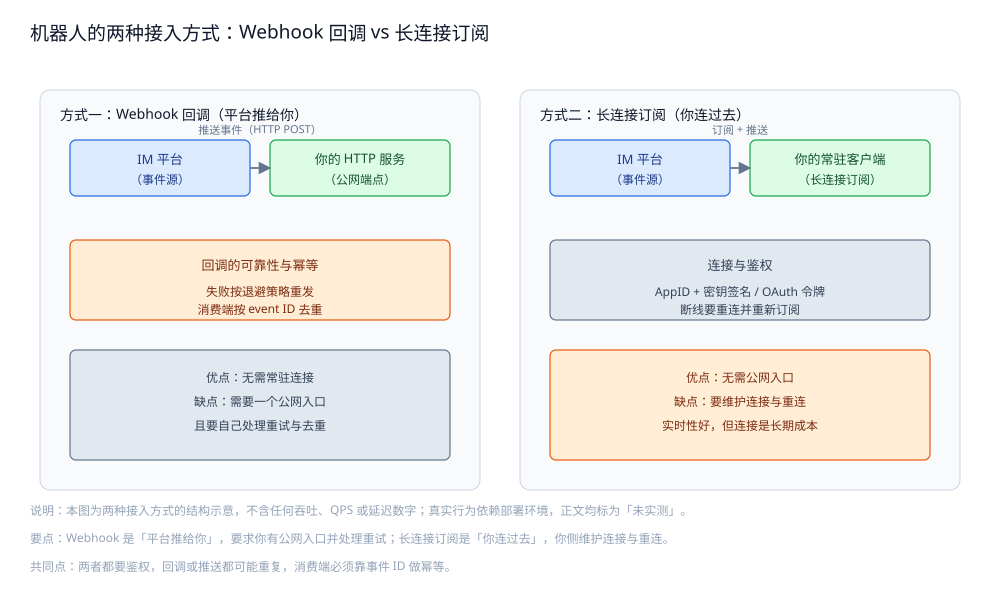
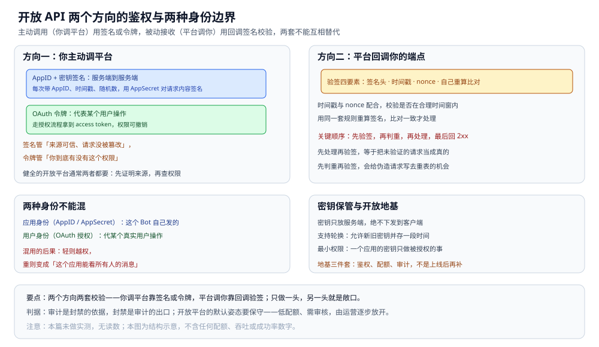
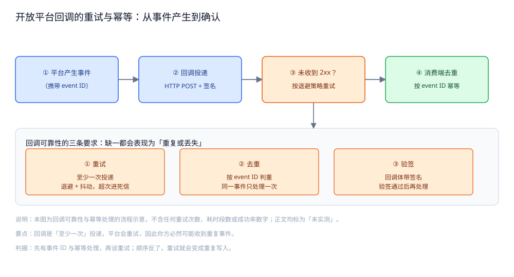

# 机器人与开放平台

> **外部系统怎么接入 IM**：Bot / Webhook / 开放 API 的定位、
> Bot 收消息的两种接入方式（回调 vs 长连接订阅）、开放 API 的鉴权、
> 回调的可靠性与幂等、发消息 API 的设计，以及 Bot 带来的安全与体验问题。
>
> 本篇是 IM 目录的**对外能力篇**：讲"把 IM 能力以 API 暴露给第三方"时的**结构与判据**。
> Bot 收发的消息类型与业务语义见 [消息类型与业务语义.md](消息类型与业务语义.md)；
> 回调走的那条网络路径见 [通信链路与协议栈.md](通信链路与协议栈.md)；
> 长连接订阅怎么建、怎么保活见 [在线状态与推送.md](在线状态与推送.md)。
>
> 内容整理自个人学习笔记，并参考公开的开放平台 API 设计与 Webhook 回调实践资料；素材见 [素材清单](../../../素材清单.md)。
>
> ⚠️ 实测口径：**本篇未做实测**。回调投递、重试与限流的行为都依赖
> **真实公网端点、第三方系统与真实流量**，本机无法复现；正文只讲结构、语义与判据，
> **不引用任何吞吐 / QPS / 成功率 / 延迟数字**。

---

## 一、机器人为什么需要「开放平台」？

**本节要点**：Bot 的价值在于**把外部系统的能力接进 IM**；
而一旦对外提供能力，就必须同时提供**鉴权、配额、审计**这三件套——否则开放的就是"任人乱用"。

### 1.1 为什么要开放

| 需求 | 例子 |
|---|---|
| **通知外部事件** | 监控告警、订单状态、CI 结果推送到群 |
| **让外部系统操作 IM** | 工单系统往会话里发消息、建群、拉人 |
| **让 IM 触发外部动作** | 用户 @ 机器人，机器人去查数据库并回消息 |
| **第三方应用集成** | ISV 在平台上开发自己的 Bot 应用 |

⭐ 一句话：**开放平台把"IM 能做什么"变成一组可被第三方调用的 API**，
而三方调用的前提是"能识别你是谁、能限制你用多少、能追溯你做了什么"。

### 1.2 三件套：鉴权、配额、审计

| 件套 | 回答什么 | 缺了会怎样 |
|---|---|---|
| **鉴权** | "你是谁、你能不能做这个操作" | 任何人冒充你的应用发消息 |
| **配额** | "你能用多少"（调用频率、消息量、群数量） | 一个应用把平台资源打满 |
| **审计** | "你做过什么"（谁、何时、对谁、做了什么） | 出问题查不到源头，封禁也缺依据 |

⭐ 判据：**这三件不是"上线后再补"，而是开放平台的地基**。
只做鉴权不做配额，是被滥用；只做配额不做审计，是出事了说不清。

### 1.3 两种身份：应用身份与用户身份

开放 API 有两个层面的身份，不能混：

- **应用身份（AppID / AppSecret）**：代表"这个 Bot / 这个第三方应用"；
- **用户身份（OAuth 授权）**：代表"某个真实用户授权了这个应用代他操作"。

⭐ 判据：**"以应用名义"做的事（如 Bot 自己发通知）用应用身份**；
**"代表某个用户"做的事（如代用户发消息、读他的会话）必须拿到用户授权**。
把两者混用，轻则越权，重则变成"应用能看所有人的消息"。

## 二、Bot 怎么收消息？

**本节要点**：Bot 收消息有两条路——**Webhook 回调**（平台把事件推给你）
和**长连接订阅**（你连过来持续收）；两者在网络与运维上的取舍相反。

### 2.1 两种接入方式

| 方式 | 谁发起连接 | 事件怎么到 | 典型形态 |
|---|---|---|---|
| **Webhook 回调** | 平台 → 你 | 平台对你的 **HTTPS 端点**发 POST | 你有一个公网可访问的 HTTP 服务 |
| **长连接订阅** | 你 → 平台 | 你**主动连到平台**并保持订阅 | 你维护一个常驻客户端 |



图怎么读：左右两栏对应 2.1 表里的两行，差别只在"谁发起连接"。
左栏「方式一：Webhook 回调（平台推给你）」：IM 平台（事件源）向你的 HTTP 服务（公网端点）「推送事件（HTTP POST）」，
旁边挂着「回调的可靠性与幂等：失败按退避策略重发 / 消费端按 event ID 去重」，
结论是「优点：无需常驻连接」「缺点：需要一个公网入口，且要自己处理重试与去重」。
右栏「方式二：长连接订阅（你连过去）」：你的常驻客户端（长连接订阅）与 IM 平台（事件源）之间是「订阅 + 推送」，
上方写「连接与鉴权：AppID + 密钥签名 / OAuth 令牌」，并提醒「断线要重连并重新订阅」，
结论是「优点：无需公网入口」「缺点：要维护连接与重连」，再补一句「实时性好，但连接是长期成本」。
底部三行是共同点：Webhook 是「平台推给你」，要求你有公网入口并处理重试；长连接订阅是「你连过去」，你侧维护连接与重连；
两者都要鉴权，回调或推送都可能重复，消费端必须靠事件 ID 做幂等。
本图为结构示意，不含任何吞吐、QPS 或延迟数字，正文均标为「未实测」。

### 2.2 取舍

| 维度 | **Webhook 回调** | **长连接订阅** |
|---|---|---|
| 公网入口 | **必须有**（平台要能访问到你） | **不需要**（你连出去即可） |
| 内网 / 私有部署 | 要穿透或网关暴露 | 天然适合内网环境 |
| 连接管理 | 无（无状态 HTTP） | **要维护连接、心跳与重连** |
| 实时性 | 取决于回调投递 | 长连接更直接 |
| 主要痛点 | 回调可能**重复 / 乱序 / 丢失** | 连接会断，断线期间可能漏事件 |
| 鉴权 | 靠**回调签名校验** | 靠**建连时的签名 / 令牌** |

⭐ 判据：
**你能提供公网 HTTPS 端点、且不想维护长连接 → Webhook**；
**你在内网、或想拿到更直接的推送 → 长连接订阅**。
真实平台常**两者都提供**，让开发者按部署环境选。

### 2.3 无论哪条路，两件事都躲不掉

- **事件可能重复**：Webhook 会重试、长连接断了会补推，所以**消费端必须幂等**（见第四节）；
- **事件可能乱序**：不同事件到达顺序不保证，要按事件自身携带的顺序信息处理。

> ⚠️ **未实测**：本节不给"回调平均延迟""重试几次"的数字。
> 原因：这些取决于平台策略与真实网络，本机无法复现。

## 三、开放 API 怎么鉴权？

**本节要点**：**主动调用（你调平台）用签名或令牌**，**被动接收（平台调你）用回调签名校验**——
两种方向，两套校验，不能互相替代。

### 3.1 主动调用：签名 vs 令牌

| 方式 | 怎么做 | 适合 |
|---|---|---|
| **AppID + 密钥签名** | 每次请求带 AppID、时间戳、随机数，用 AppSecret 对请求内容签名 | 服务端到服务端、无用户上下文的调用 |
| **OAuth 令牌** | 走授权流程拿到 access token，带 token 调用 | 代表某个用户操作、权限可撤销 |

**原理层**：签名的构造与验签见 [摘要与数字签名.md](../../../06-工程实践/安全/摘要与数字签名.md)；
令牌（JWT 类）的签发与校验见 [JWT与APIKey鉴权.md](../../../06-工程实践/安全/JWT与APIKey鉴权.md)。

⭐ 判据：**签名解决"请求没被篡改、确实来自你"，令牌解决"你有权做这件事"**。
一个健全的开放平台通常**两者都要**——先证明来源，再检查权限。

### 3.2 回调方向的验签

平台调你的 Webhook 时，你要能确认"这确实来自平台，而不是被人伪造"：

| 要素 | 作用 |
|---|---|
| **签名头** | 平台用约定密钥对回调体签名，附在请求头里 |
| **时间戳** | 校验回调是否在合理时间窗内，防重放 |
| **随机数 / nonce** | 与时间戳配合，进一步防重放 |
| **你的校验** | 用同一套规则重算签名，**比对一致才处理** |

⭐ **关键顺序**：**先验签，再处理**。先处理再验签，等于把未验证的请求当成真的——
这正是 [摘要与数字签名.md](../../../06-工程实践/安全/摘要与数字签名.md) 里"先验证、后使用"的通用原则。

### 3.3 密钥怎么保管

- **只放在服务端**，绝不下发到客户端；
- **支持轮换**：密钥泄露要能换，所以调用要允许"新旧密钥并存一段时间"；
- **最小权限**：一个应用的密钥只能做它被授权的事。



图怎么读：上方两块是**两个方向两套校验**。「方向一：你主动调平台」给出 **AppID + 密钥签名**（每次带 AppID、时间戳、随机数，
用 AppSecret 对请求内容签名，适合服务端到服务端）与 **OAuth 令牌**（代表某个用户操作，权限可撤销），
并写明「签名管来源可信、请求没被篡改；令牌管你到底有没有这个权限」。「方向二：平台回调你的端点」给出验签四要素
（签名头 · 时间戳 · nonce · 自己重算比对）与关键顺序：**先验签，再判重，再处理，最后回 2xx**——
先处理再验签等于把未验证的请求当成真的，先判重再验签会给伪造请求写去重表的机会。
下方两块是 1.3 的两种身份边界（应用身份 / 用户身份，混用重则变成「这个应用能看所有人的消息」）与 3.3 的密钥保管三条，
末行点出「地基三件套：鉴权、配额、审计，不是上线后再补」。本图为结构示意，不含配额或成功率数字。

## 四、怎么保证回调可靠？

**本节要点**：回调是**"至少一次"投递**——平台收不到成功响应就会重试，
所以你**必然可能收到重复事件**；可靠性的真正落点不在平台，而在**你的幂等处理**。

### 4.1 至少一次 + 幂等 = 用户感知的"恰好一次"

| 环节 | 谁负责 | 做法 |
|---|---|---|
| **投递** | 平台 | 未收到 2xx 就**按退避策略重试** |
| **去重** | **你** | 按**事件 ID** 判重，重复事件直接忽略 |
| **处理** | 你 | 幂等处理（同事件多次处理结果一致） |
| **确认** | 你 | 处理成功后**返回 2xx**，让平台停止重试 |



图怎么读：主干是一条四步流水线，对应 4.1 那张「谁负责什么」的表：
「① 平台产生事件（携带 event ID）→ ② 回调投递（HTTP POST + 签名）→ ③ 未收到 2xx？按退避策略重试 → ④ 消费端去重（按 event ID 幂等）」。
第 ③ 步是分叉点：拿不到 2xx 就重投，所以同一条事件会第二次、第三次走到 ④。
下半单独列出「回调可靠性的三条要求：缺一都会表现为『重复或丢失』」，与 4.2 逐条对齐：
「① 重试：至少一次投递，退避 + 抖动，超次进死信」「② 去重：按 event ID 判重，同一事件只处理一次」
「③ 验签：回调体带签名，验签通过后再处理」。
底部给出判据原文：回调是「至少一次」投递，平台会重试，因此你方必然可能收到重复事件；
先有事件 ID 与幂等处理，再谈重试——顺序反了，重试就会变成重复写入。
本图为流程示意，不含任何重试次数、耗时段数或成功率数字，正文均标为「未实测」。

### 4.2 三条要求

1. **重试**：平台侧至少一次投递，退避且带抖动，超次进死信；
2. **去重**：消费端按 **事件 ID** 判重，**先判重、再处理**；
3. **验签**：回调体带签名，**先验签、再处理**（见第三节）。

⭐ 判据：**顺序是"验签 → 判重 → 处理 → 返回 2xx"**。
任何一步被调换（比如先处理再判重），都会出现"重复扣款 / 重复发货"这类真实事故。
这套结构与 [通知系统设计.md](../通知系统设计.md) 的回执与重试同源。

### 4.3 乱序怎么处理

回调**不保证顺序**。处理乱序的通用办法：

- **以事件自带的序号 / 时间戳为准**，而不是以到达顺序为准；
- **状态类事件**用"版本号 / 单调字段"比较，**旧事件到了就丢弃**；
- **需要顺序的场景**，把事件按业务键（如订单 ID）路由到同一处理队列，串行消费。

> ⚠️ **未实测**：本节不给"重试间隔""去重窗口"的数字。
> 原因：这些取决于平台策略与业务容忍度，本机给不出有意义的取值。

## 五、发消息 API 怎么设计？

**本节要点**：发消息 API 要回答四个问题——**以谁的名义发、发给谁、发什么类型、能发多少**；
漏掉任何一个，都会变成滥用或缺能力。

### 5.1 四个要定清楚的点

| 点 | 说明 |
|---|---|
| **以谁的名义** | 以应用 / Bot 名义，还是代表某个用户（需用户授权，见 1.3） |
| **发给谁** | 单聊对端、群 ID、还是"@ 某些人"；要区分"发给会话"与"点名" |
| **发什么** | 纯文本、**富媒体**、卡片 / 结构化消息（见 [富媒体消息.md](富媒体消息.md)） |
| **能发多少** | **频率配额**：单位时间调用次数、单会话消息量、群发范围 |

### 5.2 @ 与可见范围

| 概念 | 要点 |
|---|---|
| **@ 某人** | 是消息里的**结构化提及**，不是字符串里写个名字 |
| **可见范围** | 群内消息默认全员可见；Bot 应有"仅相关人可见"等收敛选项 |
| **群发边界** | Bot 能不能一次给大量会话发，是**配额与合规**双重问题 |

⭐ 判据：**@ 必须是结构化字段**。把"@张三"当成字符串塞进正文，客户端无法可靠高亮，
也无法据此做"是否真的点到了张三"的校验。

### 5.3 幂等与去重

发消息 API 同样要支持**幂等**：调用方带一个**客户端消息 ID**，
平台侧按"应用 + 该 ID"去重，避免"超时重发"变成"发了两条"
（机制与 [消息可靠投递.md](消息可靠投递.md) 第四节一致）。

## 六、Bot 与安全、体验怎么平衡？

**本节要点**：Bot 既是能力也是风险面——**它进群能看消息、能主动发消息**，
所以要管住**进群权限、群发滥用、审计与封禁**。

### 6.1 进群与权限

| 控制 | 说明 |
|---|---|
| **进群需授权** | 谁有权把 Bot 拉进群，应受群管理员控制 |
| **最小可见** | Bot 默认只应看到"被 @ 的消息"或"相关消息"，而不是整群全量 |
| **可被移除** | 管理员能随时移除 Bot |

⭐ 判据：**Bot 的可见范围应与它的职责匹配**——一个只回工单的 Bot，
没有理由读到群里所有消息。这与 [端到端加密.md](端到端加密.md) 的"谁能解密"边界也相关。

### 6.2 防止用 Bot 群发垃圾

| 手段 | 作用 |
|---|---|
| **消息频率配额** | 限制单位时间的发送量（见第五节） |
| **群发范围限制** | 限制一次能覆盖的会话数 |
| **内容审核** | 消息内容过审再发出（见 [内容审核与合规.md](内容审核与合规.md)） |
| **行为限流与封禁** | 异常时先限流、再封禁（见 [限流与防刷.md](限流与防刷.md)） |

⭐ 判据：**"能发"不等于"随便发"**。开放平台的默认姿态应该是**保守**——
默认低配额、默认需审核，由运营按应用逐步放开。

### 6.3 审计与封禁

- **审计**：记录"哪个应用、在什么时间、对哪个会话、做了什么"，可追溯；
- **封禁**：发现滥用能**立即停止某个应用的调用**，且不影响其他应用；
- **告警**：配额接近上限、审核命中异常时提前告警。

⭐ 关键：**审计是封禁的依据，封禁是审计的出口**。
没有审计的封禁是"凭感觉"，没有封禁的审计是"马后炮"。

## 使用：Webhook 回调「验签 + 幂等」的骨架

**本节要点**：把回调处理的正确顺序落成 **可编译的最小骨架**：
**先验签 → 再判重 → 最后处理**；依赖真实平台与公网的部分标注未实测。

```go
package im

import (
	"crypto/hmac"
	"crypto/sha256"
	"encoding/hex"
	"errors"
	"sync"
)

var (
	ErrBadSignature = errors.New("webhook signature mismatch")
	ErrDuplicate    = errors.New("duplicate event")
)

// VerifySignature 用共享密钥校验回调体的签名。
//
// ⚠️ 未实测：本机实现只证明「先验签、后处理」的语义与顺序。
// 真实平台还会带时间戳与 nonce 用于防重放，需按平台文档一并校验。
func VerifySignature(secret, body, gotSig string) error {
	mac := hmac.New(sha256.New, []byte(secret))
	mac.Write([]byte(body))
	want := hex.EncodeToString(mac.Sum(nil))
	if !hmac.Equal([]byte(want), []byte(gotSig)) {
		return ErrBadSignature
	}
	return nil
}
```

幂等判重**必须在"验签之后、处理之前"**——顺序错了会重复处理：

```go
// EventDeduper 按事件 ID 判重。
//
// ⚠️ 未实测：本机实现是进程内 map，仅用于验证语义。
// 生产必须落在共享存储（带 TTL 的 SET NX 或唯一索引）上，
// 否则多实例部署时判重不成立。
type EventDeduper struct {
	mu   sync.Mutex
	seen map[string]struct{}
}

func NewEventDeduper() *EventDeduper {
	return &EventDeduper{seen: map[string]struct{}{}}
}

// SeenOrAdd 返回 true 表示该事件此前已处理过。
func (d *EventDeduper) SeenOrAdd(eventID string) bool {
	d.mu.Lock()
	defer d.mu.Unlock()
	if _, ok := d.seen[eventID]; ok {
		return true
	}
	d.seen[eventID] = struct{}{}
	return false
}
```

处理入口把两步串起来：**任何一步不过，就不处理、直接返回**。

```go
// HandleWebhook 是回调处理的正确顺序：验签 → 判重 → 处理。
//
// ⚠️ 未实测：未接真实平台与公网端点。
// 原因：回调的重复、乱序与重试行为必须由真实平台产生，本机无法复现，
// 给出运行结果即为编造。
func HandleWebhook(secret, body, sig string, dedup *EventDeduper, eventID string,
	process func(body string) error) error {
	// ① 先验签：不通过一律不处理。
	if err := VerifySignature(secret, body, sig); err != nil {
		return err
	}
	// ② 再判重：重复事件直接当成功（返回 nil），让平台停止重试。
	if dedup.SeenOrAdd(eventID) {
		return ErrDuplicate
	}
	// ③ 最后处理：成功后由上层返回 2xx 停止平台重试。
	return process(body)
}
```

> ⚠️ **未实测**：以上代码**只做静态编译校验**（`gofmt` 通过），未运行 `go test`。
> 原因：回调的可靠性依赖公网端点、真实平台与真实流量，本机单进程无法复现，
> 给出运行结果即为编造。

## 延伸追问

- **Webhook 和长连接订阅，选哪个？** → 看部署：**能提供公网 HTTPS 端点、不想维护长连接 → Webhook**；**在内网、或要更直接的推送 → 长连接订阅**。很多平台两者都提供，按环境选。
- **回调为什么一定会重复？** → 因为投递是**至少一次**：平台没收到 2xx 就会重试，而"你处理成功但响应在返回途中丢了"这种情形无法消除，所以重试必然存在，只能靠消费端幂等来吸收。
- **验签和判重能不能合成一步？** → 不能。验签回答"**请求是不是真的**"，判重回答"**这个事件是不是已经处理过**"。顺序还必须是验签在前——先判重会给伪造请求写去重表的机会。
- **Bot 应该默认能看群里所有消息吗？** → 不应该。默认姿态应是**最小可见**（如只看被 @ 的消息），按职责申请更大范围，并接受审计；这与"端到端加密下谁能解密"是同一类边界问题。
- **发消息 API 的幂等键用什么？** → 用**调用方生成的客户端消息 ID**，平台按"应用 + 该 ID"去重；这样"调用超时后重发"不会变成两条消息。

## 关联

- [通信链路与协议栈.md](通信链路与协议栈.md) — 分层总纲：回调与开放 API 调用各自走哪条路径。
- [协议设计.md](协议设计.md) — Bot 消息作为报文类型时的字段与版本演进约束。
- [消息类型与业务语义.md](消息类型与业务语义.md) — Bot 收发消息的类型与业务语义归属。
- [在线状态与推送.md](在线状态与推送.md) — 长连接订阅所依赖的连接、心跳与重连。
- [消息可靠投递.md](消息可靠投递.md) — 发消息 API 的幂等去重与投递语义来源。
- [富媒体消息.md](富媒体消息.md) — 卡片 / 结构化消息的类型与渲染边界。
- [群聊.md](群聊.md) — Bot 进群、@ 与群内可见范围的成员语义。
- [内容审核与合规.md](内容审核与合规.md) — Bot 消息的内容审核与合规边界。
- [限流与防刷.md](限流与防刷.md) — 应用配额、群发限制与滥用封禁。
- [端到端加密.md](端到端加密.md) — "谁能解密 / 谁能看见"的边界，与 Bot 可见范围同源。
- [通知系统设计.md](../通知系统设计.md) — 渠道抽象、回执与重试，与回调可靠性同源。
- [JWT与APIKey鉴权.md](../../../06-工程实践/安全/JWT与APIKey鉴权.md) — 令牌与密钥鉴权的实现原理。
- [摘要与数字签名.md](../../../06-工程实践/安全/摘要与数字签名.md) — 签名构造与"先验证、后使用"原则。
- [稳定性三件套.md](../../分布式/服务治理/稳定性三件套.md) — 开放平台过载时的限流、熔断与降级。
- [README.md](README.md) — IM 目录总纲与阅读顺序。
> 反向引用（本篇被下列文档引到）：[音视频信令.md](音视频信令.md)
