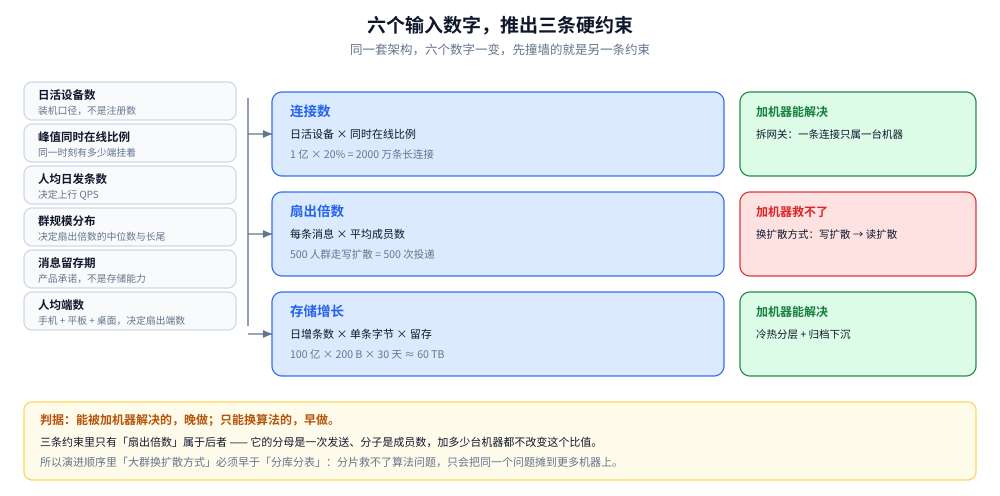
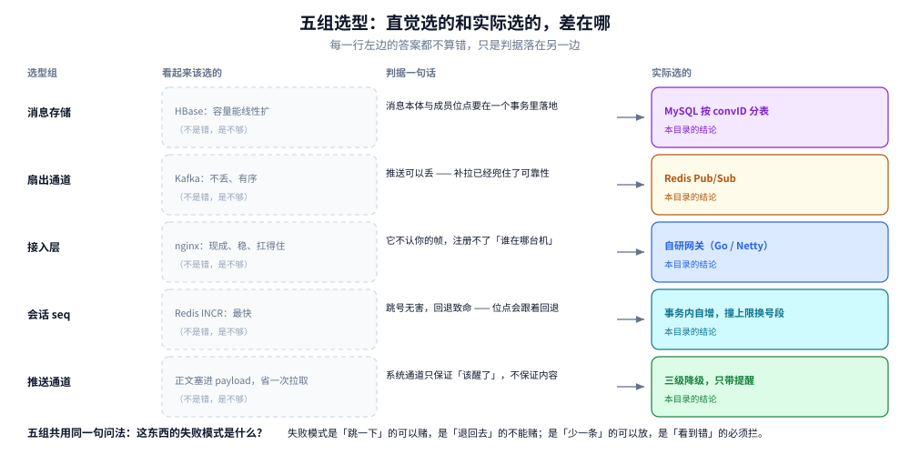

# 架构与选型

> 覆盖：**IM 这道题的整体形态是怎么推出来的** —— 六个输入数字推出三条硬约束、四层的切法为什么是四层、五组关键选型各落在哪一边、以及遇到没列出的新组件时能自己判的四条通用判据；末尾收本目录十九篇的分工与读序。
>
> 不覆盖：各层的机制细节在零件篇（[通信链路与协议栈.md](通信链路与协议栈.md) / [协议设计.md](协议设计.md) / [在线状态与推送.md](在线状态与推送.md) / [消息可靠投递.md](消息可靠投递.md) / [会话与未读.md](会话与未读.md)）；数据落点在 [存储全景.md](存储全景.md)；**这套系统是分几步长成这样的**在 [演进路线.md](演进路线.md)；通用选型判据在 03 层（[存储选型与组合.md](../../../03-数据与中间件/数据存储/存储架构与场景/存储选型与组合.md)、[消息队列选型对比.md](../../../03-数据与中间件/中间件/消息队列/消息队列选型对比.md)）。
>
> 内容整理自个人学习笔记，素材见 [素材清单](../../../素材清单.md)。
>
> 📎 **实测口径**：本篇是选型与总纲篇，**不引入新读数**。文中量级都是**算式骨架 + 明确标注的示意代入值**（既不是本机实测，也不是任何线上系统的读数）；需要压测才能定的输入（单机连接上限、单机吞吐上限）一律**不给数值**，只给判据。零件篇的投递骨架只给可编译骨架，涉及真实长连接与多机路由的部分均标「⚠️ 未实测」，本篇不复述。

---

## 一、六个数字怎么推成三条硬约束？

**本节要点**：架构不是从「用哪些组件」开始的，是从**六个输入数字**开始的。这六个数字两两相乘，得到三条硬约束；三条约束里**只有一条加机器救不了**，而它决定了整个方案的长相。

### 1.1 六个输入，每个都在改别人

| 输入 | 它真正决定什么 | 一变会改掉哪一处 |
|---|---|---|
| 日活设备数 | 连接的**基数**（不是注册用户数，是装机并在线过的设备） | 网关规模、路由表容量 |
| 峰值同时在线比例 | 同一时刻有多少端挂着长连接 | 网关规模（这是唯一只能靠压测校准的比例） |
| 人均日发条数 | 上行 QPS | 逻辑层副本数、seq 分配器的吞吐 |
| **群规模分布** | **扇出倍数的中位数与长尾** | 扩散方式、MQ 规模、是否要单独的大群通道 |
| 消息留存期 | 存储容量（产品承诺，不是存储能力） | 冷热分层的位置、归档成本 |
| 人均端数 | 扇出**端数**（一条消息要推到几个端） | 收件箱模型、已读收敛规则 |

⭐ 六个里最容易被漏掉的是**群规模分布**：它不改变 QPS，却把 QPS 乘成一个不可能的量级。人均发条数从 30 涨到 40（+33%）是线性的烦恼；一个群从 50 人涨到 500 人（+900%）是结构性的麻烦。

### 1.2 三条约束，两个能加机器、一个不能

| 约束 | 算式骨架 | 示意代入（⚠️ 只演示怎么乘） | 撞墙后的出路 |
|---|---|---|---|
| **连接数** | 日活设备 × 同时在线比例 | `1 亿 × 20% = 2000 万` 条长连接 | **加机器**：网关无状态化后横向拆 |
| **扇出倍数** | 每条消息 × 平均成员数 | `500` 人群走写扩散 = 一次发送放大成 `500` 次投递 | **换算法**：写扩散 → 读扩散 |
| **存储增长** | 日增条数 × 单条字节 × 副本放大 × 留存天数 | `100 亿 × 200 B × 30 天 ≈ 60 TB` | **加机器 + 分层**：冷热分层、归档下沉 |



图怎么读：左列六个数字不是各自对应一条约束，而是**两两相乘**才落成中间的三个框——`日活设备 × 同时在线比例` 得连接数，`每条消息 × 平均成员数` 得扇出倍数，`日增条数 × 单条字节 × 留存` 得存储增长。右列是这张图真正要说的事：前两条与第三条的出路是「加机器 / 加分层」，只有扇出倍数那一框的出路是「换算法」——因为它的分母是一次发送、分子是成员数，加多少台机器都不改变这个比值。底部那句是本节的判据：**能被加机器解决的晚做，只能换算法的早做**。图里的代入值只演示算式怎么乘，不代表任何线上系统。

### 1.3 判据：加机器能解决的晚做，只能换算法的早做

⭐ 这条判据解释了两件反直觉的事：

- **「连接数」看着最吓人，其实是最好办的**。两千万条连接拆到几十台网关，每台几十万条，是工程问题不是算法问题——只要**网关无状态化**（连接知识外置），加机器就完事。
- **「扇出倍数」看着只是个乘法，其实最难**。它没有「加机器」这个选项：500 人的群走写扩散，一次发送要落 500 份；加到 500 台机器，每台还是落 500 份，只是分摊得开一点，成本不降。唯一的出路是**改扩散方式**（大群转读扩散，见 [群聊.md](群聊.md) 第四节与 [消息可靠投递.md](消息可靠投递.md) 第三节）。

所以演进顺序里「大群换扩散方式」必须早于「按 convID 分库分表」：**分片救不了算法问题，只会把同一个问题摊到更多机器上**（演进顺序见 [演进路线.md](演进路线.md) 第一波到第五波）。

---

## 二、为什么切这四层，不是三层也不是六层？

**本节要点**：切层的判据不是「职责像不像」，而是**这份状态归谁持有、它变得有多快**。四个部分里只有两个持状态，另外两个可以随时重建——这一条决定了谁能随意扩缩容。

### 2.1 四层各持哪份状态

| 部分 | 持有什么状态 | 变化有多快 | 这一层挂了会怎样 | 细节在哪 |
|---|---|---|---|---|
| **接入层（网关）** | 公网长连接、`uid → 网关实例` 的映射 | 毫秒级：连上、断开、心跳 | 该机上的连接全断，客户端重连到别处 | [在线状态与推送.md](在线状态与推送.md) |
| **逻辑层（消息服务）** | **不持有状态**，只处理一次请求 | — | 这次请求失败，重试即可 | [消息可靠投递.md](消息可靠投递.md) |
| **存储层** | 会话、消息、成员位点（**权威源只有一个**） | 秒级：每次发送都写 | 消息不可写，全站停摆 | [存储全景.md](存储全景.md) |
| **推送通道** | 订阅关系、在途投递（丢了不可惜） | 毫秒级：发布即过 | 在线推送丢失，靠上线补拉兜底 | [在线状态与推送.md](在线状态与推送.md) |


图怎么读：四行按「持有什么状态 → 变化有多快 → 挂了会怎样」三列排开，蓝色与紫色两层（接入层、存储层）是真持状态的，青色与橙色两层（逻辑层、推送通道）是可随时重建的。要读出的是右列的分野：持状态的两层挂了是「连接断」和「写不进」，无状态的两层挂了只是「这次失败，重试」。底部那行是本节的结论——**有状态收拢到网关、共享状态选一份权威**，本质都是「把不可重建的东西集中到一处，其余全部做成可丢弃」。

### 2.2 少一层会死在哪

| 去掉哪一层 | 看起来省了什么 | 实际死在哪 |
|---|---|---|
| **去掉网关**，客户端直连逻辑层 | 少一跳、少一层运维 | 逻辑层变成**有状态**：扩缩容要迁连接（每次都掉线一批），灰度发布等于全员重连。死在「C 端发版不可控」——客户端不可能跟着你的发布节奏重连 |
| **去掉推送通道**，逻辑层直接调各网关 | 少一次订阅广播 | 一次发送要**同步等 N 个网关**返回，一个慢客户端拖住整条发送链路——队头阻塞从「每条连接」上升到「每条消息」 |
| **去掉存储层**，消息只留在网关内存 | 延迟最低 | 网关一重启在途消息全没；两台网关之间无法交接；历史消息无从补拉 |

### 2.3 多一层会多在哪

真有人加第五层：**路由层**（网关与逻辑层之间再插一层「用户在哪」的服务）。它在两种条件下才值得：

- 连接数大到路由表本身要单独扩缩容，且与网关的扩缩容节奏不同（网关按连接数扩，路由按查询 QPS 扩）；
- 存在多种接入形态（长连 / 小程序 / Web / 开放 API）需要统一找人的逻辑。

不满足这两条时，路由层是**纯粹的跳数**：多一次 RPC、多一份要保证一致的缓存、多一个可能挂的组件。⚠️ 这与「路由表放 Redis」不冲突——那是**存储位置**的选择，不是**分层**的选择。

---

## 三、五组选型分别落在哪一边？

**本节要点**：每一组选型都有一个「看起来该选它」的答案，它通常不算错，只是判据落在另一边。**判据不是「哪个更快」，而是「这东西的失败模式是什么」**。



图怎么读：五行各是一组选型，四列分别是「组名 / 看起来该选的 / 判据一句话 / 实际选的」。左边虚线框里的答案都不算错——HBase 容量确实能线性扩、Kafka 确实不丢、nginx 确实稳——但它们回答的是「这东西强在哪」，不是「这条链路上最怕什么」。中间那列才是分水岭，右列是结论。底部那句是全节的总判据：**失败模式是「跳一下」的可以赌，是「退回去」的不能赌；是「少一条」的可以放，是「看到错」的必须拦**。

### 3.1 消息存储：为什么权威源是 MySQL，不是 HBase 也不是 Kafka

| 候选 | 强在哪 | 死在 IM 的哪一条 | 能当什么 |
|---|---|---|---|
| **MySQL 按 `convID` 分表** | 事务（消息本体 + 成员位点一次写入）、按 `(convID, seq)` 主键范围扫、强持久 | 单表写放大、跨会话查询弱（靠检索副本补） | **权威源** |
| **HBase / Cassandra** | 写吞吐与容量线性扩、按 rowkey 范围扫很快 | **没有跨行事务**：「写消息 + 更新位点」要么拆两步（中间失败就丢位点），要么自己实现两阶段；二级索引弱，按人搜 / 跨会话搜要另建表 | 只可能替换「消息流」这一段 |
| **TiDB / OceanBase** | 兼容 MySQL 协议、自动分片、有分布式事务 | 分片后的尾部延迟与热点会话冲突；规模不够时运维成本高于收益 | 分片运维撑不住时的替换项 |
| **Kafka 直接当消息库** | 顺序写极快、天然按 partition 有序 | 保留期有限（它不是存储）、**不能按 seq 随机读一条**、撤回要重写整个 partition | 只能当**投递管道** |

⭐ 判据一句话：**IM 的存储要同时做到「一条消息和一个位点原子地写进去」与「按 `(convID, seq)` 随机读一条」**。前者排除了纯 KV / 宽表（HBase、Cassandra），后者排除了日志（Kafka）。能同时做到的只剩关系库（含分布式关系库）。

⚠️ 还有一个 IM 特有的、比选型更容易错的点：**分片键必须是 `convID`，不能是 `uid`**。按 `uid` 分片时，一条群消息要写 N 个成员的收件箱 = 跨 N 个分片的事务，分布式事务直接否决整个方案；按 `convID` 分片，一条消息只落一个分片（群消息也只存一份，读时按成员位点扇出）。代价是「查某人所有会话」要额外维护一张按 `uid` 的索引表。

### 3.2 扇出通道：为什么推送不走 MQ

| 候选 | 它保证什么 | 用在推送上的后果 |
|---|---|---|
| **Redis Pub/Sub** | 广播即达，**订阅者不在线就丢** | 正好匹配：「丢了就丢了，上线补拉」 |
| **Kafka** | 持久、分区有序、消费组 rebalance | 给「可以丢的东西」付了「不可丢」的价钱；rebalance 期间推送会停 |
| **自研路由直推** | 点对点、无广播放大 | 网关数过百后才是首选（见下） |
| **全广播**（不查路由） | 最简单，网关自己看本机有没有这条连接 | 带宽换简单：`消息速率 × 网关数` |

⭐ 判据一句话：**推送是「尽力而为的实时提醒」，不是「必须送达的投递」**。必须送达的部分已经由「落库 + 补拉」保证了（见 [消息可靠投递.md](消息可靠投递.md) 第六节），所以推送通道**丢了不要紧**。一旦要求推送通道不丢，就变成了「再建一条可靠链路」——代价翻倍，收益为零。

⚠️ 但 Pub/Sub 的广播放大会在网关数上来后咬人：`消息速率 × 网关数` 就是总出向带宽。网关规模过百后改用「查连接路由表、点对点推」，判据是**单网关的入向带宽预算**，不是网关台数本身。

### 3.3 接入层：为什么网关不能直接用 nginx

| 候选 | 能做 | 不能做 |
|---|---|---|
| **nginx / Envoy** | TLS 卸载、连接数统计、L4 限流、静态路由 | **不认你的帧** → 做不了「按 `uid` 注册路由」、做不了「未读推送落地」、做不了协议级灰度 |
| **Netty（Java）** | event loop 无每连接栈，百万连接下内存更可控 | 回调式代码，且「一条连接不能被多线程同时写」的线程亲和必须自己守 |
| **Go `net` + epoll** | 一连接一 goroutine，代码等同同步写法（每连接 2~8 KB 栈） | GC 与调度器在百万连接级的抖动要自己压 |

⭐ 判据一句话：**接入层要自己实现三件事——协议编解码、连接路由注册、心跳判死，而这三件全在应用层**。所以 nginx 适合做它的**前置**（TLS 卸载、四层转发），不适合**替代**它。很多生产架构是 `nginx → 自研网关`，两层各干各的。

Go 与 Netty 之间：**十万级连接，Go 的简单性远大于 Netty 的内存优势；千万级，Netty（或 Go 上裸写 epoll + 对象池）才值得那份额外复杂度**。⚠️ 这条分界只能靠压测校准，本篇不给具体连接数。

### 3.4 会话 seq 分配器：分片之后怎么还单调

这一组最容易被忽略，却直接决定「位点能不能用」。

| 做法 | 怎么做 | 失败模式 |
|---|---|---|
| DB 自增 / 行锁 | 每条 `UPDATE conv SET seq = seq + 1` 再读回 | 慢（每消息一次行锁）；同会话写入串行，吞吐上限 = 一次行锁的时间 |
| Redis `INCR` | `INCR conv:{id}:seq` | 快，但主从切换丢写 → **seq 回退** → 位点回退 → 补拉重复或乱序 |
| **号段预分配** | 一次取 N 个（如 1000），内存里发，用完再取 | 进程重启浪费一段 → **跳号**（无害：补拉按 `seq > lastSeq` 扫，跳号只是少一条） |
| 按 `convID` 预分配区间 | 每个会话固定一段号空间 | 扩容要重新划分，规划错了要迁移历史 |
| 雪花 / ULID | 全局时间有序 ID | **不是会话内连续**：能排序，不能当「第几条」用 → 位点差算不出来 |

⭐ 判据一句话：**编号只要求「会话内单调且不重复」，不要求连续**。所以「跳号」是可以接受的（补拉按 `seq > lastSeq` 扫，跳号只是少一条），「回退」不能接受（会导致补出重复或乱序）。Redis `INCR` 看起来最简，它的失败模式（主从切换丢写 → 回退）恰好是最坏的一种。

⚠️ 但别把这条判据读成「一定要用号段」。**事务内自增（`UPDATE conv SET seq = seq + 1` 再读回）是最容易做对的默认档**——seq 与消息本体、成员位点天然在同一个事务里，进程崩了也不会留下「号发出去了、消息没落库」的空洞；代价是同会话写入串行。号段预分配是把分配挪到事务外换吞吐，**此时要额外保证「位点只随消息事务提交」**，否则崩溃后会留下空洞。判据是**单会话的写入吞吐有没有撞上那一次行锁的串行上限**：没撞上就用事务内自增，撞上了才换号段。现有零件的默认写法是前者（见 [存储全景.md](存储全景.md) 使用节第 ④ 步）。

### 3.5 推送通道：为什么只带「提醒」不带正文

| 通道 | 保证什么 | 代价 / 限制 |
|---|---|---|
| **自建长连** | 在线时最快、能承载正文 | 离线即断，唤不醒 App |
| **APNs / FCM** | 离线时唯一能叫醒 App 的路 | payload 上限（iOS 约 4 KB）、静默推送会被限流、不保证顺序 |
| **国内厂商通道聚合** | Android 各家后台存活 | 每家规则不同，要维护多套接入与配额 |
| **短信 / 电话** | 最强到达 | 最贵，只用于极少数场景 |

⭐ 判据一句话：**系统通道只保证「该醒了」，不保证「内容是什么」**。所以三级降级是：长连（带内容）→ 系统通道（只带「你有一条新消息」）→ 上线补拉（拿真内容）。

⚠️ 常见错法是把正文塞进 payload「省一次拉取」：iOS 超限被静默截断、Android 各厂商行为不一，最后表现为「通知里有内容、点进去是空的」。这不是通道的 bug，是把「提醒」当成了「投递」。

---

## 四、遇到没列出的组件，用哪四条判据自己判？

**本节要点**：上面五组是这道题的常考项，真做系统时会遇到没列出的（比如「在线状态放 Redis 还是 etcd」「已读回执存不存」「这里的缓存要不要」）。四条判据能覆盖绝大多数新问题。

| 判据 | 问法 | 用它排除了什么 |
|---|---|---|
| **谁持状态** | 这份状态变化多快？是不是只对一台机器有意义？ | 把连接知识塞进逻辑层（→ 逻辑层不再无状态） |
| **谁是权威源** | 丢了能不能从别处重建？ | 把 Redis 当消息权威源（能丢、成本高） |
| **哪一侧可以异步** | 用户是否在等这个结果？ | 把扇出做成同步（一次发送等 N 个网关） |
| **失败代价谁承担** | 失败时是「用户看到错」还是「用户多等一会」？ | 把撤回、置顶做成控制类（丢了用户看到错的东西） |

⭐ 四条里最常被跳过的是第四条。前三条决定「放在哪」，第四条决定「走哪条通道、要不要落库」——**看到错的必须同步 + 落库，多等一会的可以重试 + 异步**。这张表在 [协议设计.md](协议设计.md) 第三节被落成「数据类 / 控制类 / 命令类」的可靠性定级。

---

## 五、本目录十九篇怎么分工？

**本节要点**：两篇主线（本篇 + 演进路线）+ 一篇方案 + 五篇零件 + 一篇存储横切 + 十篇业务能力。**主线讲「为什么是这样」，零件讲「具体怎么做」**，两边不重复。

先按**问题**看：这十九篇其实在回答四个问题，而四个问题**互相咬合**。

| # | 问题 | 一句话 | 主要落在 |
|---|---|---|---|
| ① | 长连接与在线状态 | 连接落在哪台网关、断线多快被发现、用户同时在几台设备上 | [在线状态与推送.md](在线状态与推送.md) |
| ② | 消息可靠投递 | 丢了之后谁来补、补的时候会不会补多 | [消息可靠投递.md](消息可靠投递.md) |
| ③ | 顺序与去重 | 会话内按 `seq` 有序，跨重传按消息 ID 去重 | [协议设计.md](协议设计.md)、[消息可靠投递.md](消息可靠投递.md) |
| ④ | 多端同步与未读 | 已读是一份共享可变状态，靠最终一致 + 收敛规则 | [会话与未读.md](会话与未读.md) |

⭐ 咬合点有两处：**`seq` 一物两用**（既排序、又当断线补齐的位点），**连接路由一物两用**（既决定推送往哪发、又决定多端怎么扇出）。所以这四篇不能拆开乱读——读④之前得先懂②，读②之前得先懂①。

再按**层**看：

### 5.1 主线与零件

| 篇 | 回答什么问题 | 关键词 |
|---|---|---|
| **本篇** | 六个数字怎么推成三条约束、为什么切四层、五组选型各落在哪边 | 硬约束 / 四层 / 选型判据 / 通用四问 |
| [演进路线.md](演进路线.md) | 这套系统是分几步长成的、每一步撞什么墙、代价是什么 | 六波十三阶段 / 问题驱动 / 不可逆决定 |
| [总体设计.md](总体设计.md) | 整体形态、三个核心取舍、一次消息走哪几步、前提与边界、容量与配置口径 | 整体形态 / 核心取舍 / 十步链路 / 前提与边界 |
| [通信链路与协议栈.md](通信链路与协议栈.md) | 一条消息跨哪**三条路径**、各自协议栈、跨路径怎么衔接 | 三条路径 / 协议栈分层 / 超时预算 / 降级 |
| [协议设计.md](协议设计.md) | IM **特有**的三件事怎么定：两套序号怎么分工、乱序怎么容错、可选特性按什么定可靠性等级 | 两层序号 / 撤回先到 / 可靠性定级 |
| [在线状态与推送.md](在线状态与推送.md) | **谁在线、消息往哪推**、推不到怎么办 | 长连接选型 / 连接路由 / 心跳重连 / 离线降级 |
| [消息可靠投递.md](消息可靠投递.md) | 消息怎么**不丢、不重、有序**地送到对端 | seq / 消息 ID / ACK / 存储转发 / 扩散 / 幂等 |
| [会话与未读.md](会话与未读.md) | 会话与未读这份**共享状态**怎么存、怎么同步 | 会话模型 / 未读计数 / 已读收敛 / 游标分页 |
| [存储全景.md](存储全景.md) | 这个系统的**数据都存哪** | 数据角色 / 载体 / 读写路径 |

### 5.2 业务能力十篇

| 优先级 | 篇 | 回答什么问题 |
|---|---|---|
| P0 | [消息类型与业务语义.md](消息类型与业务语义.md) | 消息除了文本还有什么类型；撤回 / 编辑 / 引用 / 转发 / @ 怎么落进协议 |
| P0 | [群聊.md](群聊.md) | 群成员怎么管、群权限怎么分层、**大群**为什么要特殊处理 |
| P0 | [富媒体消息.md](富媒体消息.md) | 图片 / 语音 / 视频 / 文件的上传、秒传、断点续传、CDN |
| P0 | [搜索与历史.md](搜索与历史.md) | 全文搜索 / 按会话搜 / 按人搜；历史冷热分层 |
| P1 | [端到端加密.md](端到端加密.md) | E2EE 密钥体系、群组密钥、与服务器功能的冲突 |
| P1 | [内容审核与合规.md](内容审核与合规.md) | 敏感词 / 机审人审 / 举报处置 / 合规留存 |
| P1 | [限流与防刷.md](限流与防刷.md) | 消息频率、群发限制、防垃圾与黑产 |
| P2 | [跨地域多活.md](跨地域多活.md) | 异地多活、长连接跨地域、多活下 seq 唯一性 |
| P2 | [音视频信令.md](音视频信令.md) | WebRTC 信令走 IM 通道、呼叫状态机、多人通话 |
| P2 | [机器人与开放平台.md](机器人与开放平台.md) | Bot / Webhook / 开放 API、回调可靠性与鉴权 |

> ⚠️ 十篇共用一条边界：**主线细节不在能力篇里重复** —— 群聊的「写扩散 vs 读扩散」在 [消息可靠投递.md](消息可靠投递.md) 第三节，富媒体的对象存储细节在 [文件存储与上传架构.md](../文件存储与上传架构.md)，搜索的引擎细节在 [Elasticsearch/README.md](../../../03-数据与中间件/数据存储/搜索与分析/Elasticsearch/README.md)，限流算法本体在 [限流算法.md](../../分布式/稳定性/限流算法.md)。

### 5.3 三条读序，按你手上的问题选

**A. 方案线（答系统设计题 / 评审一个新方案）**

```text
① 本篇              ← 六个数字 → 三条约束 → 四层 → 五组选型
        ↓
② 演进路线.md       ← 这套方案是分几步撞出来的，每步的代价
        ↓
③ 总体设计.md       ← 整体形态、三个取舍、一次消息十步
        ↓
④ 通信链路与协议栈 → 协议设计 → 在线状态与推送 → 消息可靠投递 → 会话与未读
        ↓
⑤ 存储全景.md       ← 横切收口：各篇的数据分别落在哪
```

**B. 落地线（要动手写代码）**

[消息可靠投递.md](消息可靠投递.md) 第一节（seq 与消息 ID，**不依赖任何连接实现**）→ [会话与未读.md](会话与未读.md) → [在线状态与推送.md](在线状态与推送.md) → 按业务补能力篇（P0 四篇优先）。

**C. 排障线（线上不对劲）**

| 现象 | 先看 |
|---|---|
| 消息丢了 / 少了一条 | [消息可靠投递.md](消息可靠投递.md) 第六节（离线与补拉）→ [存储全景.md](存储全景.md) 使用（每步落点） |
| 未读不清零 / 多端不一致 | [会话与未读.md](会话与未读.md) 第四节（已读收敛） |
| 消息重复 | [消息可靠投递.md](消息可靠投递.md) 第四节（幂等） |
| 推不到 / 延迟高 | [在线状态与推送.md](在线状态与推送.md) 第三节（心跳与判死）、第五节（降级） |
| 顺序乱 | [协议设计.md](协议设计.md) 第一节（两层序号）→ [消息可靠投递.md](消息可靠投递.md) 第一节 |
| 消息发不出去（被限） | [限流与防刷.md](限流与防刷.md) |

### 5.4 四种读错的顺序

| 读法 | 后果 |
|---|---|
| 先读投递、后读连接 | seq 与 ACK 讲得通，但「为什么必须按 seq 补」体会不到——没先理解连接会断 |
| 只读会话、跳过连接 | 未读收敛的规则记住了，但「推送不到时降级到哪」完全接不上 |
| 只读零件、不读本篇与演进 | 每个部件都会做，但答不出「我这个体量该不该上网关层」「为什么大群必须换算法」 |
| 五篇各读一半 | 分层、帧、seq、未读、路由各一条线，几条线在「一条消息的生命周期」上对不齐 |

---

## 六、与 03 层选型篇怎么分工？

**本节要点**：IM 是**把分布式零件拼成系统**的场景题。零件「本身怎么选」在 03 层，「在 IM 这条链路上选哪个、代价落在哪」在本篇。

| 相关目录 | 分工 |
|---|---|
| [存储选型与组合.md](../../../03-数据与中间件/数据存储/存储架构与场景/存储选型与组合.md) | 那边讲**通用判据**（五种角色、同步三路线、冷热三层）；本篇讲 IM 上的落点与五组对照 |
| [消息队列选型对比.md](../../../03-数据与中间件/中间件/消息队列/消息队列选型对比.md) | 那边讲**产品之间怎么选**；本篇只回答「推送为什么不用 MQ」 |
| [数据同步方式选型对比.md](../../../03-数据与中间件/数据存储/数据同步/数据同步方式选型对比.md) | 那边讲 CDC / 双写 / 定时全量；本篇用它的结论建检索副本 |
| [分布式/](../../分布式/README.md) | 那边是零件的原理（一致性、故障转移、负载均衡）；这边把零件拼成「一条消息的完整生命周期」 |
| [总体设计.md](../弹幕系统/总体设计.md) | 同为长连接 + 扇出，但弹幕**允许丢**、IM **不允许丢**，两条方案的差正源于此 |
| [总体设计.md](../社交互动系统/总体设计.md) | 那边的「未读数 / 计数 / 关系」与本目录「未读收敛」是同类共享状态问题 |

**本目录收什么、不收什么**：

| 收 | 不收（在哪） |
|---|---|
| 消息的**编号、确认、去重、补偿**这套投递协议 | **TCP / WebSocket 协议栈原理** → [02-计算机基础/网络/](../../../02-计算机基础/网络/) |
| 会话与未读的**数据模型与收敛规则** | **Redis / MySQL 本身的用法** → [03-数据与中间件/](../../../03-数据与中间件/) |
| 连接路由、心跳、多端在线的**设计判据** | **负载均衡 / 注册发现的算法层** → [分布式/](../../分布式/README.md) |
| 富媒体的**上传与发送解耦**判据 | **对象存储 / CDN 本身的用法** → [对象存储/README.md](../../../03-数据与中间件/数据存储/对象存储/README.md) |
| 消息检索的**权限过滤与冷热分层** | **搜索引擎 / 分词 / DSL 细节** → [Elasticsearch/README.md](../../../03-数据与中间件/数据存储/搜索与分析/Elasticsearch/README.md) |
| 限流**在 IM 里怎么用**（键与降级） | **限流算法本体** → [限流算法.md](../../分布式/稳定性/限流算法.md) |

---

## 使用：一张选型对照表的模板

**本节要点**：评审一个 IM 方案时，把它的每个组件按这九列填一遍。**填不满的行，就是没想清楚的地方**。

| 列 | 填什么 | 填不出来的含义 |
|---|---|---|
| 组件 | 具体产品 / 自研模块 | 还在讲「上一套分布式存储」这种没落地的话 |
| 承担什么 | 一句话，动词开头 | 说不出它解决哪个约束 |
| 数据角色 | 权威源 / 副本 / 传输通道 / 归档 | 说不清丢了能不能重建 |
| 失败模式 | 它挂了 / 它慢了，用户看到什么 | 说不出失败模式，就选不出方案 |
| 选它的判据 | 为什么是它、**为什么不是那个** | 只有「因为快 / 因为主流」，是抄的不是选的 |
| 反过来选的条件 | 什么情况下应该换成另一个 | 说不出反向条件，说明判据是事后编的 |
| 代价 | 为它多付的一次性成本与长期成本 | 没代价的方案不存在，没写就是没想 |
| 兜底 | 它失效时谁接住 | 没有兜底 = 单点 |
| 观测 | 用哪个指标判断它开始不行 | 没有指标 = 只能等用户投诉 |

⭐ 九列里最常空着的是**「反过来选的条件」**与**「失败模式」**。一条判据如果连「什么情况下它会失效」都说不出来，它就不是判据，是偏好。

---

## 延伸追问

- **为什么先算连接数，而不是先算 QPS？** → 因为连接数是**约束里的边界条件**：它决定网关规模，而网关是整套方案里唯一「数量随用户线性增长」的部件。QPS 决定副本数，副本数加机器就能改；连接数的上限由客户端行为决定，改不了（见 1.2）。
- **「扇出倍数」为什么不能靠加机器解决？** → 它是一次发送要落多少份的比值，与机器数无关。500 人群写扩散要落 500 份，加到 500 台机器每台还是得处理自己那份（见 1.3）。
- **分片键为什么必须是 `convID`？** → 按 `uid` 分片时一条群消息要跨 N 个成员分片写，跨分片事务直接否决；按 `convID` 分片一条消息只落一个分片，代价是要额外维护按 `uid` 的会话索引（见 3.1）。
- **推送为什么可以丢？丢了用户不就少消息了？** → 丢的是**推送**，不是**消息**。消息已经落库，客户端上线按 `lastSeq` 补拉就拿到了。把推送做成可靠投递，是给一个已经解决的问题再买一份保险（见 3.2）。
- **seq 为什么可以不连续？** → 补拉的条件是 `seq > lastSeq`，跳号只会少一条（本来就没有），回退才会补出重复或乱序。所以号段预分配（会跳号）优于 Redis `INCR`（会回退）（见 3.4）。
- **四层能不能合并成两层，少运维一点？** → 合并的代价不是运维，是**状态耦合**：网关与逻辑层合并 → 逻辑层跟着连接数扩缩容；逻辑层与存储合并 → 消息服务变成有状态。少一层省的是部署，多付的是扩缩容与灰度（见 2.2）。
- **这套判据能用在别的系统上吗？** → 四条通用判据（谁持状态 / 谁是权威源 / 哪一侧可异步 / 失败代价谁承担）是通用的；三条硬约束里的「扇出倍数」是 IM / 社交这类「一次写多份」的系统特有的（见第四节）。
- **为什么本目录没有「需求分析」一篇？** → 需求部分就是本篇第一节的六个数字：多一篇会变成复述，而真正难的「六个数字怎么变成约束」只有放在选型之前才有意义。

## 关联

- **下游机制**：[演进路线.md](演进路线.md) — 这套方案分六波十三阶段长成，每一步的撞墙点与代价。
- **下游机制**：[总体设计.md](总体设计.md) — 整体形态 / 三个核心取舍 / 一次消息十步 / 前提与边界 / 容量与配置口径。
- **下游机制**：[通信链路与协议栈.md](通信链路与协议栈.md) — 三条路径与各自协议栈。
- **下游机制**：[协议设计.md](协议设计.md) — 两层序号 / 撤回乱序 / 可靠性定级 / 报文字段。
- **下游机制**：[在线状态与推送.md](在线状态与推送.md) — 长连接 / 连接路由 / 心跳重连 / 离线降级。
- **下游机制**：[消息可靠投递.md](消息可靠投递.md) — seq / ACK / 扩散 / 幂等 / 补偿。
- **下游机制**：[会话与未读.md](会话与未读.md) — 会话模型 / 未读数 / 多端收敛 / 游标分页。
- **对照/互补**：[存储全景.md](存储全景.md) — 横切篇：IM 的数据都存哪、谁权威、怎么同步。
- **上游/总纲**：[存储选型与组合.md](../../../03-数据与中间件/数据存储/存储架构与场景/存储选型与组合.md) — 通用判据：数据角色、权威源与副本、冷热分层。
- **上游/总纲**：[消息队列选型对比.md](../../../03-数据与中间件/中间件/消息队列/消息队列选型对比.md) — 产品之间的选择与语义。
- **方法论**：[系统设计方法论.md](../系统设计方法论.md) — 澄清边界 → 量级估算 → 第一性问题 → 分层加手段 → 代价与兜底。
- **对照/互补**：[总体设计.md](../弹幕系统/总体设计.md) — 同为长连接扇出，但允许丢，对照取舍差在哪。
- **对照/互补**：[总体设计.md](../社交互动系统/总体设计.md) — 计数与关系类共享状态的另一套讲法。

> 反向引用（本篇被下列文档引到）：[演进路线.md](演进路线.md)、[总体设计.md](总体设计.md)、[协议设计.md](协议设计.md)、[存储全景.md](存储全景.md)
