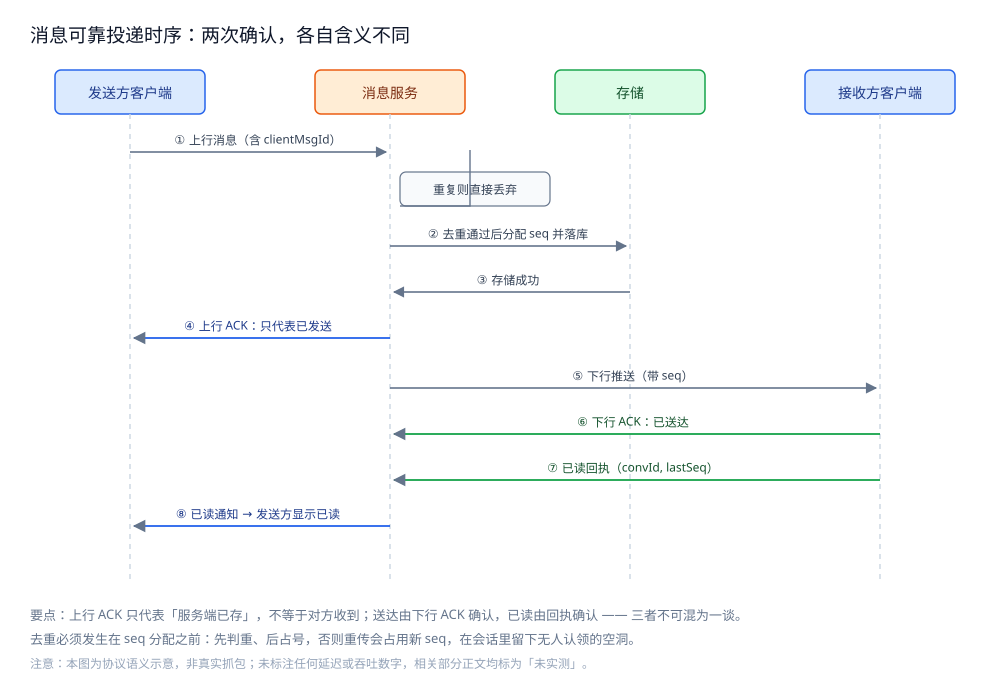
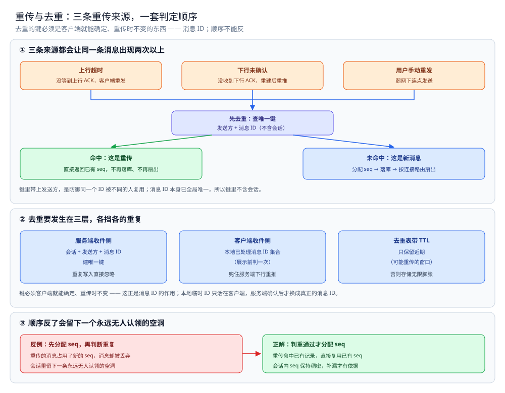
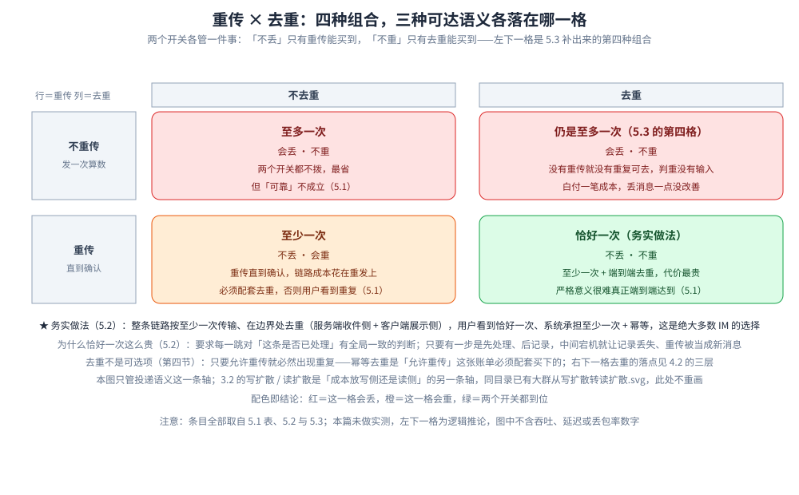

# 消息可靠投递

> 消息在会话内的 **seq 与消息 ID** 怎么定、客户端 ACK 与服务端存储转发怎么配合、
> 群聊走**写扩散还是读扩散**、重传与**幂等去重**、以及可达的三种语义（至多一次 / 至少一次 / 恰好一次）与各自代价。
>
> 内容整理自个人学习笔记，素材见 [素材清单](../../../素材清单.md)。

---

## 一、会话内的消息序号与消息 ID 怎么定？

**本节要点**：同一个系统里要有**两套编号**——seq 管**会话内排序**、消息 ID 管**跨重传去重**，两者的取值范围与用途完全不同，混用就会出问题。

### 1.1 先分清两个编号要解决的问题

| 编号 | 用途 | 取值范围 | 谁生成 | 关键性质 |
|---|---|---|---|---|
| **seq**（会话内序号） | 排序、断线后从哪补 | **会话内**单调递增，从 1 开始 | **服务端**（存转发时分配） | 小、稠密、同会话可比 |
| **消息 ID** | 幂等去重、引用、回执定位 | **全局**唯一 | 服务端（或客户端先生成再转正） | 全局唯一、可跨会话 |

**为什么 seq 一定要服务端分配**：客户端时钟不可信、多端并发发送会撞号。
把"谁先谁后"这个决定权收归**这个会话的写入方**（服务端），顺序才有唯一答案。

### 1.2 seq 的两个容易踩的边界

- **seq 是"会话内"而非"全局"**。全局递增序号会让每个会话的序号出现大量空洞，
  客户端看到 "100、250、300" 就会误判"丢了 149 条"从而触发无意义的重拉。**会话内稠密**才是关键。
- **seq 一旦分配不可回退**。分配成功但存储失败时，**宁可留一个空洞也不要重发占号**——
  因为你无法确认对端是否已经通过推送看到过这个号。

### 1.3 客户端还有一个"临时编号"

客户端在**乐观上屏**（先显示再等服务端确认）时会先给消息一个**本地临时 ID**，
服务端确认后用真正的消息 ID 与 seq 替换。它只活在客户端本地，用于：

- 把"我这条还在发送中"的消息和别人的消息排在一起；
- 服务端上行 ACK 回来时**对上号**，把临时消息转正。

> ⚠️ **未实测**：本节只给概念与取舍，不附实现读数。原因：seq 的稠密度与空洞行为
> 依赖真实的多端并发发送，本机单进程无法复现。

## 二、客户端 ACK 与服务端存储转发怎么配合？

**本节要点**：IM 和"点对点直发"最大的区别是**服务端一定会存**——它把发送方与接收方的生命周期**解耦**：发送方可以下线、接收方可以离线，消息都不会因此丢。

### 2.1 四个环节，两次确认

一条消息的完整链路有四步，其中有**两次确认**，各自含义不同：

| 环节 | 谁 → 谁 | 含义 | 客户端表现 |
|---|---|---|---|
| ① 上行 | 发送方 → 服务端 | 消息到达服务端 | 服务端回**上行 ACK** → 发送方显示"已发送" |
| ② 存储 | 服务端（分配 seq + 落库） | 消息持久化，可被拉取 | 无 |
| ③ 下行 | 服务端 → 接收方 | 推送给在线的接收方 | 接收方回**下行 ACK** → 服务端标记"已送达" |
| ④ 已读 | 接收方 → 服务端 → 发送方 | 接收方打开了会话 | 发送方显示"已读" |

**关键判据**：**上行 ACK 只代表"服务端存了"，不代表"对方收到了"**。
很多"消息发了但对方说没看到"的问题，根因就是把上行 ACK 当成了送达。送达是③，已读是④。



图怎么读：四条生命线——发送方客户端、消息服务、存储、接收方客户端。① 发送方上行消息（含 clientMsgId），服务端先去重、重复则直接丢弃；去重通过后 ② 分配 seq 并 ③ 落库，④ 回上行 ACK——它只代表「已发送」，不代表对方收到。⑤ 下行推送（带 seq）、⑥ 接收方回下行 ACK 标记已送达，⑦ 已读回执最后经 ⑧ 通知发送方显示已读。去重必须发生在 seq 分配之前：先判重、后占号。图为协议语义示意，非真实抓包。

### 2.2 服务端的"存储转发"到底存什么

服务端存转发（store-and-forward）意味着：**发送方和接收方不需要同时在线**。
要存的至少有两份：

- **会话消息流**：按 seq 顺序存的一份**权威副本**，是"漫游与补齐"的来源；
- **收件箱 / 未读位点**：接收方"读到哪了"的游标（下一节与 [会话与未读.md](会话与未读.md) 都会用到）。

> ⚠️ **未实测**：时序图描述的是**协议语义**，不是某次真实抓包。
> 原因：需要真实长连接与两台以上机器才能观察到完整的上下行 ACK。

### 2.3 消息存哪、存多久？

不同生命周期的数据放不同存储，保留策略也跟着不同：

| 数据 | 存储 | 保留 |
|---|---|---|
| 会话元数据 / 成员表 | MySQL（分库分表） | 永久 |
| 近期消息 | MySQL 或 Redis | 最近 N 条 |
| 历史消息 | 对象存储（冷归档） | 按产品策略 |
| 在线状态 | Redis（带 TTL） | 会话级 |
| 大文件 | 对象存储 | 永久 |

⭐ 判据：**「保留多久」由产品预期决定，不由存储成本倒推** —— 先定「用户能看到多久的历史」，再据此选存储层级（热 / 温 / 冷）。详细分工见 [存储选型与组合.md](../../../03-数据与中间件/数据存储/存储架构与场景/存储选型与组合.md)。

> ⚠️ **未实测**：上表的「最近 N 条」「按产品策略」不写具体数值 —— 保留窗口取决于真实存储成本与产品决策，本机给不出。

## 三、群聊的消息该写扩散还是读扩散？

**本节要点**：群聊的核心取舍是**把"一份消息发给 N 个人"的成本放在写侧还是读侧**——
写扩散写放大 N 倍但读得快，读扩散只写一份但每次读要合并，**群越大越该往读扩散走**。

### 3.1 两种扩散方式

| 维度 | **写扩散**（fan-out on write） | **读扩散**（fan-out on read） |
|---|---|---|
| 存法 | 每条消息**给每个成员各写一份**（或各写一条收件箱记录） | 会话消息流**只写一份**，成员共享 |
| 写成本 | × 成员数 N | × 1 |
| 读成本 | 读自己的收件箱，O(1) 定位 | 读时要**合并自己所有会话的消息流**再排序 |
| 适合 | **小群、好友少的场景**，读多写少 | **大群、公开场景**，写多且成员极多 |
| 主要痛点 | 大群写放大爆炸 | 读侧合并与分页复杂 |

### 3.2 判据：比"写放大"与"读放大"哪个更贵

和 [README.md](../社交互动系统/README.md) 的推拉判据同源：

- **写扩散**的放大系数 = **成员数 N**；每条消息都要写 N 次。
- **读扩散**的放大系数 = **用户参与的会话数 M**；每次打开列表要跨 M 个会话流做归并。

**结论**：群人数大 → 写扩散的 N 太大 → 转读扩散；
用户会话数大 → 读扩散的 M 太大 → 该给列表做缓存或预聚合。
现实系统常用**混合**：小群写扩散、大群读扩散，阈值按"每写一条消息的写放大上限"来定。

🔗 本节的两种扩散形态已由同目录共用图承担，同型不重画：[大群从写扩散转读扩散.svg](images/大群从写扩散转读扩散.svg) —— 该图左栏画「1 条消息只写 1 次 → 服务端扇出 N 份到各成员收件箱 → 成员读自己的收件箱」，右栏画「只写 1 份到会话流 → 读取时按成员表扇出 → 成员各自按时序拉取」，两栏各自标出「写放大 N 倍 / 读放大 1 倍」与「写放大 1 倍 / 读放大 N 倍」，正是上面 3.1 表与 3.2 判据的图形；末行还带上了大群的特有限制（成员上限、@所有人 限频、回执只留聚合）。**分工**：那张图是**群聊视角**（大群怎么退化处理，见 [群聊.md](群聊.md)），本节是**投递视角**的成本归属，措辞与数字口径一致。

> ⚠️ **未实测**：本节不给"N 到多少要切换"的具体数字。
> 原因：切换阈值取决于存储的写入能力与群活跃度，本机没有多机与真实大盘，任何数字都是编造。

## 四、重传与幂等怎么保证不重复？

**本节要点**：**只要允许重传（至少一次语义），就必然出现重复**——所以"幂等去重"不是可选项，
它是"允许重传"这个决定必须配套买下的账单。

### 4.1 什么时候会发生重传

- **客户端上行超时**：发了但没等到上行 ACK，客户端自行重发；
- **服务端下行未确认**：推了但没收到下行 ACK，服务端在连接重建后重推；
- **用户手动重发**：弱网下用户连点发送。

三种重传都会让**同一条消息**出现在对端视野里两次以上。

### 4.2 去重的唯一依据：消息 ID

去重的键必须是**客户端就能确定、且重传时不变**的东西——这正是消息 ID 的作用：

| 去重层 | 手段 | 兜底语义 |
|---|---|---|
| 服务端收件侧 | 以「会话 + 发送方 + 消息 ID」建**唯一键**，重复写入直接忽略 | 同一逻辑消息只落一次 |
| 客户端收件侧 | 本地维护**已处理消息 ID 集合**，重复到达直接丢弃 | 兜住服务端下行重推 |
| 存储去重表 | 去重表带 **TTL**（如只保留近期），避免无限膨胀 | 只对"可能重传的窗口"生效 |

**顺序很重要**：**先去重、后分配 seq**。反过来会出现"重传的消息占用了新的 seq"，
在会话里留下一条永远无人认领的空洞。

```go
package im

// Deduper 用「发送方 + 消息 ID」做幂等判定。
//
// ⚠️ 未实测：本骨架只保证可编译（gofmt 通过），未接真实存储跑过。
// 原因：真实去重必须落在共享存储（Redis 或 DB 唯一索引）上才能跨节点生效，
// 本机单进程内存实现只能证明"逻辑对不对"。
type Deduper interface {
	// SeenOrAdd 返回 true 表示这条消息此前已经处理过（重复，应丢弃）。
	SeenOrAdd(senderID, msgID string) (bool, error)
}

// UniqueKey 是去重键的规范形：发送方 + 消息 ID。
// 不含会话，是因为消息 ID 本身已全局唯一；带上发送方是防御同 ID 被不同人复用。
func UniqueKey(senderID, msgID string) string {
	return senderID + ":" + msgID
}
```



图怎么读：上半是判定流程——上行超时、下行未确认、用户手动重发这三条来源都会让同一条消息再出现一次，它们汇入同一个入口：**先判重**。判重的键是发送方 + 消息 ID，消息 ID 本身已全局唯一所以键里不含会话，带上发送方是防御同一个 ID 被不同的人复用；命中就直接返回已有 seq，不再落库、不再扇出，只有未命中才走"分配 seq → 落库 → 扇出"。中间一块是三层去重各挡什么：服务端收件侧靠唯一键让重复写入被直接忽略，客户端在展示前查本地的已处理集合兜住下行重推，去重表带 TTL 只保留"可能重传的窗口"，否则存储无限膨胀。顺带一句两处键的差别：上面判定用的「发送方 + 消息 ID」比收件侧表格里的「会话 + 发送方 + 消息 ID」更严格——多带一个会话维度，意味着同一个消息 ID 出现在两个会话里就不会被判成重复。下半是顺序反了的代价：先占号再判重，重传的消息占用了新的 seq 而自身被丢弃，会话里留下一条永远无人认领的空洞。别把它和本篇前面"分配成功但存储失败时，宁可留空洞也不重发占号"那条混起来——那条讲的是同一个号不能重发，这里讲的是新消息才配占新号，两者指向同一条原则：一个 seq 只属于一条逻辑消息。图为协议语义示意，不含实测读数。

## 五、至多一次 / 至少一次 / 恰好一次，代价差在哪？

**本节要点**：三种"可达语义"不是三档并排的选项，而是**同一条链路上「要不要重传」与「要不要去重」的四种组合**——恰好一次本质上就是"至少一次 + 去重"。

### 5.1 三种语义

| 语义 | 做法 | 会不会丢 | 会不会重 | 代价 |
|---|---|---|---|---|
| **至多一次** | 不重传，发一次算数 | **会丢** | 不会重 | 最省，但"可靠"不成立 |
| **至少一次** | 重传直到确认 | 不丢 | **会重** | 必须配套去重，否则用户看到重复 |
| **恰好一次** | 至少一次 + 端到端去重 | 不丢 | 不重 | **最贵**，且严格意义很难真正端到端达到 |

### 5.2 为什么"恰好一次"这么贵

"恰好一次"要同时满足"绝不丢"和"绝不重"，等于要求链路上每一跳
**对"这条是否已处理"有全局一致的判断**。只要有一步是"先处理、后记录"，
中间那一下宕机就会让记录丢失、重传被当成新消息。

**务实做法**：整条链路按**至少一次**传输，在**边界处去重**——
服务端在**收件侧**去重、客户端在**展示侧**去重。用户看到的是"恰好一次"，
系统承担的是"至少一次 + 幂等"的成本。这是绝大多数 IM 的选择。

> ⚠️ **未实测**：本节是语义与代价的对照，不含任何吞吐或延迟数字。
> 原因：三种语义的差异必须靠真实网络抖动与宕机才能量化，本机跑不出来。

### 5.3 重传 × 去重的四个开关组合各自落在哪

**本节要点**：三种语义不是三档并排，而是「要不要重传」与「要不要去重」这两个开关的**四种组合**——第四种（不重传 + 去重）常被误当成「恰好一次」的低配版，其实它仍然是至多一次，只是多付了一笔用不上的成本。

| 重传 | 去重 | 落到哪种语义 | 会不会丢 | 会不会重 | 说明 |
|---|---|---|---|---|---|
| 不重传 | 不去重 | 至多一次 | 会丢 | 不重 | 5.1 第一行：发一次算数，最省，但「可靠」不成立 |
| 不重传 | 去重 | **仍是至多一次** | 会丢 | 不重 | 4.1 把上行超时、下行未确认、用户连点三种来源都算作重传；这一档的前提是三者都不存在，于是**没有重复可去，判重没有输入** |
| 重传 | 不去重 | 至少一次 | 不丢 | 会重 | 5.1 第二行：必须配套去重，否则用户看到重复 |
| 重传 | 去重 | 恰好一次（务实做法） | 不丢 | 不重 | 5.1 第三行 + 5.2：至少一次 + 端到端去重，代价最贵 |

⭐ 判据：**「不丢」只有重传能买到，「不重」只有去重能买到**——两个开关各管一件事，缺一个就有一列是坏的。所以「不重传 + 去重」不是「恰好一次」的雏形，而是**给至多一次多买了一份用不上的保险**：它花了去重的成本，却一点也没改善丢消息。

顺带把 5.1 的「代价」列落到开关上：至多一次的省，来自两个开关都不拨；至少一次的成本是重传链路本身；恰好一次最贵，是因为它要在**每一跳**都对「这条是否已处理」有一致的判断（5.2），落地形态就是 4.2 的三层去重（服务端收件侧、客户端展示侧、带 TTL 的去重表）。

> ⚠️ **未实测**：本表是 5.1 与 5.2 既有语义的组合展开，「不重传 + 去重」一格为逻辑推论而非实测分档；「会丢 / 会重」的判定必须靠真实网络抖动与宕机才能量化，本机跑不出来，表中不含吞吐、延迟或丢包率读数。



图怎么读：这是一张 2×2 开关对照，行是「要不要重传」、列是「要不要去重」，四格的名字与「会丢 / 会重」逐格取自 5.1 表与 5.3 表。左上「至多一次」＝两个开关都不拨，最省但可靠不成立；左下是 5.3 补出来的**第四格**——没有重传就没有重复可去，判重表没有输入，于是仍落在至多一次，只是多付一笔成本；右上「至少一次」＝只拨重传，不丢但会重；右下「恰好一次」＝两个都拨，不丢不重、代价最贵，也是 5.2 说的绝大多数 IM 的务实选择（整条链路按至少一次传输、在服务端收件侧与客户端展示侧做边界去重）。配色即结论：红＝那一格会丢，橙＝那一格会重，绿＝两个开关都到位。矩阵下方另有六行说明：首行深色是 5.2 的务实做法与「绝大多数 IM 的选择」，中间四行灰字依次是 5.2「为什么恰好一次这么贵」的宕机推理、第四节「去重不是可选项，而是允许重传必须配套买下的账单」、本图与 3.2 写扩散 / 读扩散两条轴的分工、配色口径；末行灰字声明条目全部取自 5.1 表、5.2 与 5.3，左下一格为逻辑推论。图为语义对照示意，不含任何读数。

## 六、离线消息与拉取补偿怎么兜底？

**本节要点**：**推送是"尽力而为"，拉取才是"最终兜底"**——只要对端不在线或推送失败，
就必须有一条"上线后按 seq 补齐"的确定路径，它是整套可靠性的最后一道防线。

### 6.1 两类补偿

| 类型 | 触发时机 | 依据 | 说明 |
|---|---|---|---|
| **收件箱补偿** | 服务端记下"这条该投给谁、投到哪个位点" | 收件箱记录 | 对端上线后从收件箱取未投递部分 |
| **位点补偿** | 客户端带着"我读到哪了"上线 | 客户端上报的 **lastSeq** | 服务端返回该 seq 之后的全部消息 |

**判据**：**位点补偿是必须的，收件箱补偿是可选的优化**。
只靠收件箱，服务端要维护"某条消息投没投给某个人"的 N×M 状态，成本高；
只靠位点，客户端上报的位点若丢（换了设备），会漏消息，需要"位点丢失时回退到最近一次已知位点"。

### 6.2 拉取为什么必须是"从 lastSeq 往后拉"

- 客户端上报 **lastSeq**（最后一条已确认收到的会话内序号）；
- 服务端返回 **seq > lastSeq** 的消息，**按 seq 升序**；
- 客户端拿到后按 seq 排序、按消息 ID 去重，更新 lastSeq。

这条路径天然支持**幂等**：重复拉取同一段只会因为去重而"看起来没变化"。

### 6.3 离线消息要设过期

离线消息**不可能无限期保留**——存储成本随"不活跃用户数 × 人均未读"线性增长。
常见做法是给离线消息一个**保留窗口**（超出窗口的只保留会话摘要或直接不保留），
并把这个窗口写进产品预期里。具体天数由业务定，**本篇不编造具体数值**。

## 使用：一个最小可编译的投递与去重骨架

**本节要点**：把 seq 分配、去重、位点补齐三件事拼成一个**可编译**的最小骨架；
所有依赖真实长连接与多机存储的部分均标注未实测。

```go
package im

import (
	"errors"
	"fmt"
	"sync"
)

// Message 是一条待投递的消息。
//
// Seq 由服务端在存储成功前分配，是会话内排序与位点补偿的唯一依据；
// MsgID 由发送方生成，用于跨重传的幂等去重。
type Message struct {
	ConvID string
	From   string
	MsgID  string
	Seq    int64
	Body   string
}

var ErrDuplicate = errors.New("duplicate message")

// SeqAllocator 按会话分配单调递增的 seq。
//
// ⚠️ 未实测：本机实现用进程内计数器，仅能证明"接口与顺序语义"。
// 生产必须换成共享存储（如 Redis INCR），否则多网关会各自分配、序号会撞。
type SeqAllocator struct {
	mu   sync.Mutex
	next map[string]int64
}

func NewSeqAllocator() *SeqAllocator {
	return &SeqAllocator{next: map[string]int64{}}
}

func (a *SeqAllocator) Allocate(convID string) int64 {
	a.mu.Lock()
	defer a.mu.Unlock()
	a.next[convID]++
	return a.next[convID]
}
```

去重必须**先于** seq 分配执行，否则重传会占用新的 seq。

```go
// MemoryDeduper 是 Deduper 的进程内实现，仅用于跑通链路。
//
// ⚠️ 未实测：仅编译校验。本机单进程实现无法验证跨节点去重，
// 真实系统应使用带 TTL 的 Redis SET NX 或 DB 唯一索引。
type MemoryDeduper struct {
	mu   sync.Mutex
	seen map[string]struct{}
}

func NewMemoryDeduper() *MemoryDeduper {
	return &MemoryDeduper{seen: map[string]struct{}{}}
}

func (d *MemoryDeduper) SeenOrAdd(senderID, msgID string) (bool, error) {
	k := UniqueKey(senderID, msgID)
	d.mu.Lock()
	defer d.mu.Unlock()
	if _, ok := d.seen[k]; ok {
		return true, nil
	}
	d.seen[k] = struct{}{}
	return false, nil
}
```

把三段接起来：**去重 → 分配 seq → 存储**，任何一步失败都不对外确认。

```go
// Delivery 把「去重 / 分配 seq / 存储」按正确顺序编排。
//
// ⚠️ 未实测：未接真实存储与长连接。
// 原因：可靠性结论（丢不丢、重不重）必须在真实网络与多机上观察，
// 本机只能验证编排顺序与幂等逻辑。
type Delivery struct {
	dedup Deduper
	seq   *SeqAllocator
	store map[string][]Message // 会话 -> 消息流（示意，真实为持久化存储）
	mu    sync.Mutex
}

func NewDelivery(d Deduper, a *SeqAllocator) *Delivery {
	return &Delivery{dedup: d, seq: a, store: map[string][]Message{}}
}

func (dl *Delivery) Send(convID, from, msgID, body string) (Message, error) {
	// ① 先去重：重传的消息在这里被拦下，不占用 seq。
	dup, err := dl.dedup.SeenOrAdd(from, msgID)
	if err != nil {
		return Message{}, fmt.Errorf("dedup: %w", err)
	}
	if dup {
		return Message{}, ErrDuplicate
	}
	// ② 再分配 seq：只有确认是新消息才占号。
	seq := dl.seq.Allocate(convID)
	m := Message{ConvID: convID, From: from, MsgID: msgID, Seq: seq, Body: body}
	// ③ 存储成功后才允许对外确认（此处返回即代表"已存"）。
	dl.mu.Lock()
	dl.store[convID] = append(dl.store[convID], m)
	dl.mu.Unlock()
	return m, nil
}

// Pull 按位点补齐：返回 seq > lastSeq 的消息，升序。
//
// 这条路径是"推送失败"的唯一兜底，天然幂等：
// 重复拉同一段，客户端靠消息 ID 去重后结果不变。
func (dl *Delivery) Pull(convID string, lastSeq int64) []Message {
	dl.mu.Lock()
	defer dl.mu.Unlock()
	var out []Message
	for _, m := range dl.store[convID] {
		if m.Seq > lastSeq {
			out = append(out, m)
		}
	}
	return out
}
```

> ⚠️ **未实测**：以上全部代码**只做静态编译校验**（`gofmt` 通过）。
> 未运行 `go test` 的原因：真实投递可靠性依赖长连接、断线重连与多机路由，
> 本机单进程的环境无法复现，给出运行结果就是编造。

## 延伸追问

- **为什么 seq 和消息 ID 不合成一个？** → 两者的取值范围与用途相反：seq 要**小、稠密、会话内可比**，才能做排序和位点；消息 ID 要**全局唯一**，才能跨重传去重。合成一个必然牺牲其中一端（要么序号有空洞，要么 ID 不可比）。
- **写了 seq 还需要时间戳吗？** → 时间戳只用于展示（"几点发的"），**不用于排序**。客户端时钟不可信，用它排序会导致跨端消息顺序错乱；排序一律以服务端 seq 为准。
- **写扩散的群，成员加入时能看到历史消息吗？** → 分两种：成员发的消息若只写了成员副本，新成员看不到历史；要支持"入群看历史"，就得让会话保留一份共享的权威消息流，读时再按加入时间裁剪——这就是往读扩散靠。
- **离线很久的用户上线，要一次拉回全部消息吗？** → 不要。按"最近一次已知位点"往后拉，并给离线消息设保留窗口；超出窗口的部分用会话摘要体现"这里有很多条"，而不是把每条都拉回。
- **推送和拉取谁优先？** → **推是体验、拉是正确性**。推让消息实时出现，拉保证一条都不少；两者都要有，缺了推是"卡顿"，缺了拉是"丢消息"。

## 关联

- [通信链路与协议栈.md](通信链路与协议栈.md) — 分层总纲：一条消息跨哪三条路径、本篇在第几条路径上、跨路径怎么衔接。
- [协议设计.md](协议设计.md) — ACK 与消息 seq 装在哪一种「帧」里、报文类型怎么定。
- [会话与未读.md](会话与未读.md) — 投递结果如何落成会话列表与未读状态、已读位点怎么收敛。
- [在线状态与推送.md](在线状态与推送.md) — ACK 与推送依赖的长连接、连接路由与离线推送降级。
- [README.md](README.md) — 本篇在 IM 四个硬问题里的位置与阅读顺序。
- [README.md](../社交互动系统/README.md) — 推拉扩散判据的同源讲法（写放大 vs 读放大）。
- [消息队列选型对比.md](../../../03-数据与中间件/中间件/消息队列/消息队列选型对比.md) — 异步投递与写扩散常借 MQ 削峰，语义与选型在那边。
- [存储选型与组合.md](../../../03-数据与中间件/数据存储/存储架构与场景/存储选型与组合.md) — 通用视角：数据角色、权威源与副本、冷热分层与多存储同步。
> 反向引用（本篇被下列文档引到）：[时序数据存储.md](../../../03-数据与中间件/数据存储/存储架构与场景/形态篇/时序数据存储.md)、[内容审核与合规.md](内容审核与合规.md)、[存储全景.md](存储全景.md)、[富媒体消息.md](富媒体消息.md)、[总体设计.md](总体设计.md)、[搜索与历史.md](搜索与历史.md)、[机器人与开放平台.md](机器人与开放平台.md)、[消息类型与业务语义.md](消息类型与业务语义.md)、[端到端加密.md](端到端加密.md)、[群聊.md](群聊.md)、[跨地域多活.md](跨地域多活.md)、[限流与防刷.md](限流与防刷.md)、[音视频信令.md](音视频信令.md)
