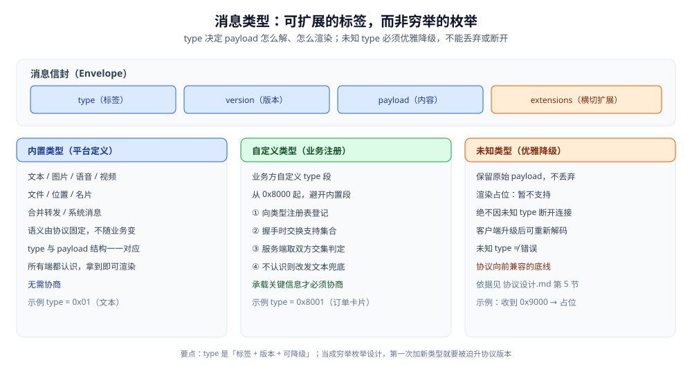
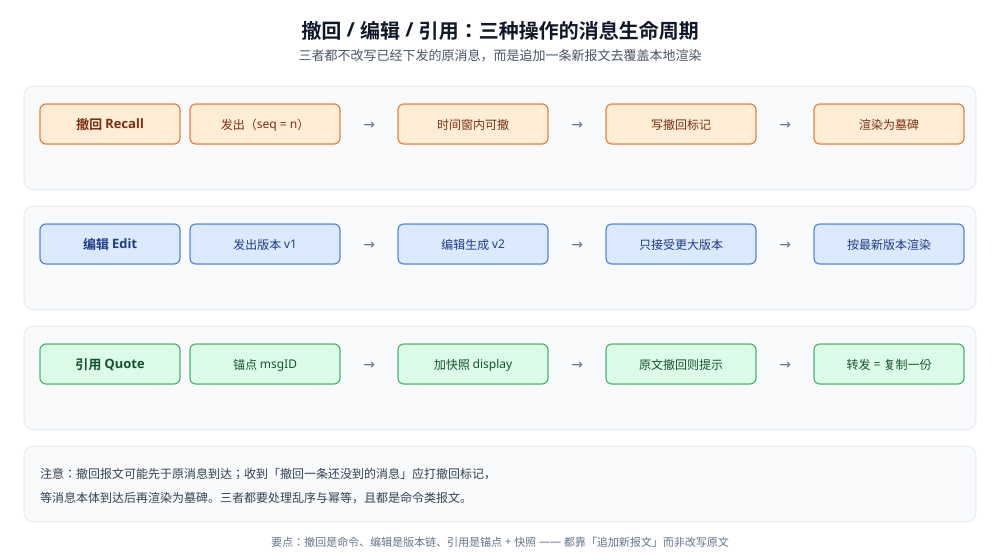

# 消息类型与业务语义

> 一条消息**是什么**（type）、能对它**做什么**（撤回 / 编辑 / 引用 / 转发 / @），以及这些「操作」在业务语义上怎么落。
>
> 本篇是**业务层报文语义**：接在 [协议设计.md](协议设计.md) 的「报文类型」之下——那边讲帧与报文在线上怎么走、未知类型怎么被忽略，
> 这边讲一条消息**装载的业务类型**与**围绕它的一组操作**（撤回 / 编辑 / 引用 / 转发 / @）怎么表达。
> 帧格式与「未知类型必须优雅忽略」的协议级依据见 [协议设计.md](协议设计.md) 第三、五节；
> 撤回 / 编辑在报文集里的分类（命令类）见 [协议设计.md](协议设计.md) 3.3、第六节；
> @ 与群的关系见 [群聊.md](群聊.md)；图片 / 语音 / 文件这类**超长消息体**见 [富媒体消息.md](富媒体消息.md)。
>
> 内容整理自个人学习笔记，并参考 MQTT / XMPP / Matrix 与 Protobuf 官方文档；素材见 [素材清单](../../../素材清单.md)。
>
> ⚠️ 实测口径：**本篇未做实测**。「使用」节的 Go 结构骨架是**可编译示例**，未在本仓运行；
> 原因：消息类型体系的价值在**跨版本、跨端的兼容行为**上——需要老客户端 + 新服务端 + 灰度中的第三方客户端同时在线才能验证，
> 单进程环境测不出「未知类型是否被优雅降级」。文中不引用任何第三方数字。

---

## 一、IM 里的消息该分成哪几类？

**本节要点**：消息类型不是「能想到多少种就写多少种」，而是分成**平台内置**与**业务自定义**两段。⭐ 判据是——**type 是一个可扩展的「标签」，不是一份穷举的枚举**；把它当枚举来设计，第一次要加新类型时就会被迫升协议版本。

### 1.1 两个维度：谁定义、承载什么

| 维度 | 取值 | 谁决定 | 影响 |
|---|---|---|---|
| **定义方** | 平台内置 / 业务自定义 | 内置由 IM 平台定义；自定义由接入业务方定义 | 决定「要不要协商」 |
| **承载** | 纯文本 / 结构化内容 / 状态变更 | 由 type 决定 payload 结构 | 决定「客户端怎么渲染」 |

两个维度合起来看：**同一个 type 就是「怎么解 payload + 怎么渲染」的唯一开关**——所以 type 与 payload 的结构必须一一对应、不能复用。

### 1.2 平台内置类型的清单

内置类型是**所有端都认识**的那一批，它们的语义由协议固定，不随业务变化：

| type | 中文名 | payload 里装什么 | 特殊之处 |
|---|---|---|---|
| `text` | 文本 | 文本串 + 少量标记（@ / 表情 / 链接） | 唯一可以「就地编辑」的类型 |
| `image` | 图片 | 缩略图 URL + 原图 URL + 宽高 | 消息体只存 URL，不存图 |
| `voice` | 语音 | URL + 时长 + 转文字结果（可选） | 时长决定播放条长度 |
| `video` | 视频 | URL + 封面 + 时长 + 宽高 | 与图片同构，多一个封面 |
| `file` | 文件 | URL + 文件名 + 大小 + 校验值 | 需要一个「已下载」的本地状态 |
| `location` | 位置 | 经纬度 + POI 名称 + 缩略图 | 隐私敏感，撤回/清理要一并处理 |
| `contact` | 名片 | 用户 ID + 展示名 + 头像 URL | 与「引用」一样是**指向别人**的消息 |
| `merge` | 合并转发 | 一批被引用消息的快照 | 见 5.4 |
| `system` | 系统消息 | 事件码 + 参数 | 见 1.3 |
| `custom` | 自定义 | 业务自定义结构 | 见 2.3 |

⭐ 判据：**「消息体里放的是内容本身，还是指向内容的 URL / ID」**——图片、语音、视频、文件都属于后者，它们的**字节不走消息通道**（走对象存储 + CDN，见 [富媒体消息.md](富媒体消息.md)），消息里只留一个 URL 和元信息。

### 1.3 系统消息是「特殊的一类」

系统消息**不是人发的，是会话自身发生的状态变更**：谁入群、谁退群、谁撤回、谁改了群名、群公告更新。

| 特征 | 说明 |
|---|---|
| sender | 通常为空，或标记为「系统」 |
| 能否回复 / 引用 | 通常不能（回复一条「XX 入群」没有语义） |
| 是否计未读 | 通常**不计未读**（否则每次有人进退群都刷未读） |
| 是否进会话列表排序 | 通常**不更新会话的最后消息时间**（否则群列表会被系统消息刷屏） |
| 落地形态 | 可以是一条真实消息，也可以只是**客户端根据成员变更事件本地生成**的一段文案 |

> ⚠️ 最后一行是个真实取舍：**系统消息「落库成消息」 vs 「客户端按事件现场生成」**。
> 落库的好处是**多端一致、可漫游**（新设备拉历史也能看到「XX 入群」）；
> 现场生成的好处是省存储，坏处是**不同客户端版本文案可能不一致**，且新入群成员看不到历史事件。
> 常见的折中：**重要的落库（改名、公告、撤回），次要的现场生成（入群退群提示）**。

---

## 二、消息类型怎么设计才可扩展？

**本节要点**：可扩展性靠三件事——**标签与内容分离**、**未知类型优雅降级**、**自定义类型的注册与协商**。三件事缺一件，新类型上线就会变成老端事故。

### 2.1 type 字段 + payload：标签与内容分离

一条消息在业务层长这样：

```text
Message {
  type        : uint16       // 怎么解 payload、怎么渲染
  clientMsgID : string       // 客户端生成的临时 ID，用于乐观上屏对号
  payload     : bytes        // 结构由 type 决定
  extensions  : map<k, v>    // 可选扩展，与 type 无关的横切信息
}
```

三个要点：

- **type 与 payload 解耦**：type 只回答「payload 用哪个结构解」，payload 里不重复放类型标记。
- **explicit 的 type 才是唯一判据**：不要靠「payload 里有没有某个字段」去猜类型（图片有 url、文件也有 url，猜不出来）。
- **extensions 是横切信息的出口**：比如引用信息、@ 列表、客户端展示需要的附加属性，都能挂在这里，**不必为每个新需求加一个顶层字段**。

### 2.2 未知类型为什么必须优雅降级

模型见下图——type 是标签，收到未知标签时的正确动作是**保留原始 payload + 渲染占位**，而不是丢弃或断开。



| 收到未知 type 的做法 | 后果 |
|---|---|
| **丢弃该消息** | 用户少看到一条消息，且**服务端已落库**，多端状态不一致 |
| **断开连接 / 报错** | 新类型灰度上线时老端集体掉线（见 [协议设计.md](协议设计.md) 5.3） |
| ✅ **保留 payload + 渲染「暂不支持」占位** | 老端不崩、不失联，等它升级后重渲染还能看到内容 |

⭐ 关键点：**未知类型的 payload 必须原样保留**。因为「不支持」是**当前版本**的状态，不是永久状态——用户升级 App 后，同一条消息应当能被重新解码出来。若当时丢弃了 payload，升级后也救不回来。

### 2.3 自定义类型的注册与协商

业务方要加自己的消息类型（如「订单卡片」「审批单」），不能随便占用一个 type 编号就发——否则两端各说各话。做法是**注册 + 协商**：

```text
① 注册：业务方向 IM 平台的类型注册表登记（type 段 + 结构定义 + 版本）
        ↓
② 协商：客户端握手时上报自己支持的 type 集合（能力位 / 列表）
        ↓
③ 判定：服务端取双方交集，知道「这条自定义消息对方能不能看懂」
        ↓
④ 降级：对方不支持时，改发一条 text 兜底（如「[订单卡片] 点击查看」）
```

> ⭐ 判据：**「自定义类型要不要协商」看它是否承载了绕不过的业务信息**。
> 若对方看不懂也**无伤大雅**（如一张可选的卡片皮肤），可以直接发、让对方降级渲染；
> 若对方看不懂就**丢了关键信息**（如一条审批必须点「同意/拒绝」），就必须协商 + 文本兜底，不能指望对方自己猜。
> 这与 [协议设计.md](协议设计.md) 第五、六节的能力协商是同一套机制，只是**协商的粒度从「特性」细化到了「消息类型」**。

---

## 三、撤回怎么做？

**本节要点**：撤回 = **时间窗 + 幂等 + 乱序容错**三件事。核心认知是——**消息一旦下发就无法「收回」，撤回必然是一条新报文**（命令类），靠它去覆盖已经落库、已经在对方屏幕上的旧消息。

### 3.1 撤回的两条硬约束：时间窗与幂等

| 约束 | 为什么 | 怎么做 |
|---|---|---|
| **时间窗** | 「无限期可撤回」等于允许篡改已读对话 | 服务端按**消息发出时间**判定，超窗直接拒绝；窗口是产品策略（分钟级） |
| **权限** | 只能撤自己的（群管理员可撤他人，见 [群聊.md](群聊.md) 3.2） | 校验 sender 与操作者身份 |
| **幂等** | 撤回报文会被重发、会重复到达 | 「撤回一条已撤回的消息」= 无副作用，直接返回成功 |
| **幂等键** | 客户端重试要能被识别为同一操作 | 用 msgID 作为幂等键，不用「第几次撤回」 |

⚠️ **时间窗要按「消息发出时间」而不是「服务端收到撤回的时间」来判**——否则一个客户端离线很久后恢复，攒着的撤回请求会一起生效，把早已超窗的消息也撤了。

### 3.2 撤回是「改写原消息」还是「追加一条消息」？

| 方案 | 做法 | 代价 |
|---|---|---|
| **原地改写** | 把库里那条消息的内容清空 / 打标 | 已下发的副本**收不回来**——对方本地那份还是旧内容 |
| ✅ **追加一条 Recall 命令** | 新增一条命令类报文（见 [协议设计.md](协议设计.md) 3.3）指向 msgID | 需要所有端都理解这条命令并覆盖本地渲染 |

结论：**撤回本身也是一条消息**。因为「消息已经发给别人了」是既成事实，唯一能改变对方屏幕的办法是**再发一条指令过去**。原地改写只解决服务端自己这一份。

> ⚠️ 由这个结论推出一个常被忽略的点：**撤回命令也必须可靠投递**。
> 如果撤回命令丢了（走的是「可丢」的控制类语义），接收方就会**永久看到一条本该被撤回的消息**。
> 所以撤回被归为**命令类**：要落库、要 ACK（见 [协议设计.md](协议设计.md) 3.4）。

### 3.3 ⚠️ 撤回报文先于原消息到达怎么办

扇出顺序不保证：**撤回报文可能先到，被撤回的原消息后到**。接收方若直接丢弃「撤一条还没收到的消息」，等原消息到达时就再也撤不掉了。

正确顺序：

```text
收到 Recall(msgID=X)
        ↓
本地有 X？  ── 有 ──▶ 立即标记为「已撤回」，重渲染为墓碑
        │
        └── 没有 ──▶ 打一个「撤回标记」(tombstone)，记下 X
                          ↓
                     稍后收到 X 本体 → 立刻按标记渲染为「已撤回」，不再显示原文
```

**这条「先打标记、后补标记」的逻辑，是撤回能否正确的关键**。它和 [协议设计.md](协议设计.md) 3.3 讲的乱序容错是同一处坑，只是这里落在业务渲染上。

### 3.4 撤回之后，本地怎么处理？

| 处理项 | 做法 | 注意 |
|---|---|---|
| 消息体 | 渲染为墓碑占位（「XX 撤回了一条消息」） | **不要真的删掉**，否则无法与 seq 对齐 |
| 缓存 / 缩略图 | 一并失效（图片、语音的本地缓存要清） | 位置消息还要考虑隐私 |
| 未读数 | **不因为撤回而回退** | 已读位点是单调不减的（见 [会话与未读.md](会话与未读.md) 第四节） |
| 会话最后一条 | 撤回后最后一条变墓碑，**排序不回落** | 否则会话会被撤回刷到列表底部 |
| 服务端历史 | 通常**保留原内容 + 撤回标记**（合规需要） | 客户端不可见不等于服务端删除，见 [内容审核与合规.md](内容审核与合规.md) |

---

## 四、编辑怎么做？

**本节要点**：编辑要用**版本链**而不是原地改写——因为多条编辑指令可能乱序到达，必须能判断「谁是新的」。编辑是**可选特性**，很多 IM 干脆不做（见 4.3 的取舍）。

### 4.1 版本链 vs 原地改写

| 方案 | 做法 | 问题 |
|---|---|---|
| **原地改写** | 直接覆盖库里的内容 | 乱序到达时**旧编辑会覆盖新编辑**，最终内容随机 |
| ✅ **版本链** | 每次编辑生成一个递增值（revision / 编辑时间戳），存 **msgID → 最新 revision → 内容** | 稍复杂，但乱序可判序 |

⭐ 判据：**只要编辑指令可能被重发或乱序，就必须有版本号**。判断规则很简单——**只接受 revision 更大的编辑**，旧的一律忽略（幂等 + 保序一次解决）。

### 4.2 编辑要不要重新推送？

**要**。编辑的意义就是让接收方看到新内容，不推送对方永远停留在旧版本。要点：

- 推送的是一条 **Edit 命令**（命令类，要落库、要 ACK），带 `msgID + 新内容 + revision`。
- 接收方按 4.1 的规则**只接受更大的 revision**。
- **不需要为编辑生成新的会话 seq**——它改的是同一 seq 的消息，不是新消息；否则会话里会凭空多出一条。

> ⚠️ 与撤回一样，**Edit 也可能先于原消息到达**。处理方式同 3.3：先存下「待应用的编辑」，等原消息到了再应用。

### 4.3 编辑与撤回的关系

| 关系 | 规则 |
|---|---|
| 优先级 | **撤回高于编辑**：已撤回的消息不可再编辑，编辑命令应被忽略 |
| 顺序 | 撤回后再发编辑 = 无效；编辑后再撤回 = 生效（撤回覆盖一切） |
| 是否值得做 | 编辑实现的成本主要在**多端一致与乱序**上，若产品不需要，**不做编辑是最省事的选择** |

> ⭐ 判据：**「编辑」本质上是「撤回 + 重发」的一个便捷形态**。如果产品只需要「改错别字」这种低频场景，直接允许撤回重发，
> 就能砍掉一整条版本链和它的乱序处理——这是很常见的取舍。

---

## 五、引用与转发怎么做？

**本节要点**：引用要同时带**锚点**（用来跳转）和**快照**（用来渲染）；转发则在**复制**与**引用**之间二选一，代价正好相反。

### 5.1 引用 = 锚点 + 快照

| 组成 | 作用 | 只有它够不够 |
|---|---|---|
| **锚点**（被引用消息的 msgID） | 点击可跳转到原消息 | ❌ 原消息不可见时（被撤 / 无权限）就渲染不出来 |
| **快照**（发送者名 + 内容摘要 + 类型） | **不依赖原消息**即可渲染引用块 | ❌ 原消息更新后，快照会「过期」 |

⭐ 结论：**两个都要**。锚点解决「跳转与溯源」，快照解决「渲染的独立性」——只带指针会在原消息不可见时露馅，只带快照会失去跳转能力。

### 5.2 被引用的消息被撤回 / 编辑后，显示什么？

| 原消息后来发生 | 引用块的显示策略 |
|---|---|
| **被撤回** | 显示「引用的消息已被撤回」，**保留快照还是清空是产品选择**；通信类产品通常清空，避免撤回绕过 |
| **被编辑** | 两种策略：① 显示「（已编辑）」+ 引用时的**旧快照**；② 跟随显示**新内容**。①更常见，因为它符合「引用是当时的一句话」的直觉 |
| **本人无权限看**（跨会话） | 只显示快照，**点击不可跳转** |

⚠️ 这里有个安全细节：**快照是原文的副本，撤回不会连带收回引用里的快照**。所以「撤回」在带引用的场景下**不能保证内容彻底消失**——这既是产品要接受的现实，也是合规时要说明的边界（见 [内容审核与合规.md](内容审核与合规.md)）。

### 5.3 ⭐ 转发：复制，还是引用？

这是本篇最需要权衡的一处。同一句「转发」，背后是两种完全不同的数据模型：

| 方案 | 模型 | 好处 | 代价 |
|---|---|---|---|
| **复制** | 把内容**拷一份**进新消息（新 msgID） | 原消息删除 / 撤回**不影响**转发件；跨会话天然可行 | **失去溯源**（看不出原始出处）；内容重复占存储；**原消息被撤回后转发件仍在**（合规风险） |
| **引用**（指针） | 新消息只存**指向原消息的 ID** | 省空间、可溯源、原文更新可跟随 | 原消息不可见 / 被撤 / 无权限时**渲染不出来**；跨会话**受原会话权限限制** |

⭐ 判据：**「转发件要不要在原文消失后继续可见」**——要，就复制；不要（且看重溯源与省空间），就引用。

- **复制更常见**（如把一条消息转发到另一个群）：因为它**不受原会话权限牵连**，也不会因为原文被撤而变成空白。
- **引用**适合**同一会话内**、且产品强调「这条内容来自某处」的场景。
- 大文件类消息（图片 / 视频）常走「**引用 + 共享 URL**」的折中：**元信息引用原消息，字节不复制**（见 [富媒体消息.md](富媒体消息.md)）。

### 5.4 合并转发

「合并转发」是把**多条消息打包**成一条消息。两种实现：

| 实现 | 做法 | 代价 |
|---|---|---|
| **引用一批 ID** | 只存被转发消息的 ID 列表 | 原消息被撤 / 不可见时缺内容 |
| **内联快照** | 把多条消息的**内容快照**打进 payload | 体积大，但**自包含**、不依赖原文 |

⭐ 判据：合并转发通常选**内联快照**——因为它被打包带出原会话后，必须能**独立展示**；若只带 ID，进了新会话后一旦原会话权限变化就渲染不全了。



---

## 六、@ 怎么实现？

**本节要点**：@ 不能靠「文本里出现 @昵称」来实现——昵称可改、可重名，纯文本匹配必然出错。正确做法是把 @ 目标**结构化地编码进消息体**，@所有人 则是一条**受权限与频率限制**的特殊 @。

### 6.1 @ 的人怎么编码进消息体？

在 payload 里带一个结构化的 mention 列表，而不是靠字符串匹配：

```text
payload.mentions = [
  { userID: "u1001", offset: 0,  len: 3 },   // 文本第 0~3 字是 @u1001
  { userID: "all",   offset: 12, len: 4 }    // @所有人 用保留 ID 表示
]
```

- **用 userID 而不是昵称**：昵称可改、可重名，只有 ID 稳定。
- **带 offset / len（或占位符）**：渲染时才能高亮成蓝色可点区域；否则只能整段当普通文本。
- **`@所有人` 用一个保留 ID**（如 `all`），不要塞进普通成员列表——它的权限校验、未读联动都与普通 @不同（见 6.2 / 6.3）。

### 6.2 @所有人 的限制

| 限制 | 为什么 | 怎么做 |
|---|---|---|
| **角色限制** | 防止任意成员刷屏打扰全群 | 只有群主 / 管理员可 @所有人（见 [群聊.md](群聊.md) 3.3） |
| **频率限制** | 大群里一次 @所有人 = 一次全员打扰 | 服务端限频 / 限每日次数（见 [限流与防刷.md](限流与防刷.md)） |
| **规模相关** | 成员越多，一次 @所有人的扇出越大 | 大群可能**直接不允许** @所有人（见 [群聊.md](群聊.md) 4.3） |

### 6.3 @ 与我（未读联动）

@ 有一个绕不开的联动：**「@我」的消息要能在群免打扰的情况下依然提醒我**。这要求：

- 服务端在落库时**索引出「这条消息 @了谁」**，而不是让每个客户端自己从文本里猜。
- 「@我」通常计入一个**独立于群未读的计数**（群里 100 条未读里，有 2 条 @我 → 列表上显示「[2 条@我]」）。
- 但它**仍然是同一条消息**：已读时，群未读与 @我计数**一起清**，不能出现「@我已读但群未读没减」的错位。收敛规则见 [会话与未读.md](会话与未读.md) 第四节。

> ⭐ 判据：**@ 是「消息的一个属性」，不是「另一条消息」**。把它做成第二条消息（「XX 在群里 @了你」）会导致未读、排序、去重全部对不上。

---

## 使用：一个「消息扩展字段」的 Go 结构骨架

把「type 标签 + payload + extensions + 未知类型降级」串成一个可编译的骨架。**⚠️ 未实测**：仅结构定义与本地校验逻辑，未接入真实长连接，也未做跨版本联调（原因见篇首）。

```go
package im

import (
	"encoding/json"
	"fmt"
)

// MsgType 是「标签」而非穷举枚举：平台内置 + 业务自定义共用同一字段。
type MsgType uint16

const (
	TypeText     MsgType = 0x01
	TypeImage    MsgType = 0x02
	TypeVoice    MsgType = 0x03
	TypeVideo    MsgType = 0x04
	TypeFile     MsgType = 0x05
	TypeLocation MsgType = 0x06
	TypeContact  MsgType = 0x07
	TypeMerge    MsgType = 0x08
	TypeSystem   MsgType = 0x09
	// 自定义类型从 0x8000 起，避开内置段，便于区间判定
	TypeCustomBase MsgType = 0x8000
)

// Message 是业务层的一条消息。
type Message struct {
	Type        MsgType           `json:"type"`        // 怎么解 payload、怎么渲染
	ClientMsgID string            `json:"clientMsgID"` // 乐观上屏的临时 ID
	Payload     json.RawMessage   `json:"payload"`     // 结构由 Type 决定，未知类型时原样保留
	Extensions  map[string]string `json:"extensions"`  // 横切信息：引用 / @ / 展示附加项
}

// Mention 是 @ 的结构化编码：用 userID 而非昵称（昵称可改）。
type Mention struct {
	UserID string `json:"userID"` // "@所有人" 用保留 ID "all"
	Offset int    `json:"offset"`
	Len    int    `json:"len"`
}

// TextPayload 是 TypeText 的 payload 结构。
type TextPayload struct {
	Text     string    `json:"text"`
	Mentions []Mention `json:"mentions,omitempty"`
}

// Rendered 是「解码后给客户端渲染用」的结果。
type Rendered struct {
	Kind        string // "text" / "image" / "unsupported" ...
	Body        string // 可展示的文本（未知类型时是占位文案）
	RawPreserved bool  // 未知类型时 payload 是否被原样保留
}

// Render 解码并渲染。未知类型必须「保留 payload + 渲染占位」，绝不丢弃、绝不断开。
func Render(m Message) Rendered {
	switch m.Type {
	case TypeText:
		var p TextPayload
		if err := json.Unmarshal(m.Payload, &p); err != nil {
			return Rendered{Kind: "unsupported", Body: "消息解析失败", RawPreserved: true}
		}
		return Rendered{Kind: "text", Body: p.Text}
	default:
		// ★ 未知类型：不返回错误、不丢弃 payload；由上层把原始 Message 连同占位一起渲染，
		//   等客户端升级后可用同样的 Payload 重新解码（见 2.2）。
		return Rendered{Kind: "unsupported", Body: "[暂不支持的消息类型]", RawPreserved: true}
	}
}

// Validate 只做「结构可判定」的本地校验，不涉及任何网络行为。
func (m Message) Validate() error {
	if m.ClientMsgID == "" {
		return fmt.Errorf("clientMsgID required")
	}
	if len(m.Payload) == 0 {
		return fmt.Errorf("empty payload for type %#x", m.Type)
	}
	return nil
}
```

**这段骨架显式省略的部分**：撤回 / 编辑命令的版本链与乱序缓冲、引用的锚点 + 快照结构、@所有人的权限与限频校验、以及把 `Render` 的结果接到真实的会话与未读模型上。

---

## 延伸追问

- **type 为什么不能设计成「穷举枚举」？** → 枚举意味着「没列出来的就是非法的」，一旦加新类型就必须升协议版本、逼所有端同步升级；把 type 当**可扩展标签**、配合未知类型降级，才能让新类型灰度上线而不影响老端（见 1.1、2.2）。
- **撤回为什么必须是一条新报文，不能直接删库？** → 因为消息**已经下发到对端**，删服务端那一份改变不了对方屏幕上已有的内容；只有再发一条命令过去覆盖，才能让所有端一致（见 3.2）。
- **撤回报文先到、原消息后到，会怎样？** → 若直接丢弃「撤一条还没到的消息」，原消息到达时就再也撤不掉了；必须先**打撤回标记**，等原消息到达后按标记渲染为墓碑（见 3.3）。
- **编辑为什么要版本号，不能直接覆盖？** → 编辑指令会重发、会乱序，直接覆盖会让**旧编辑盖掉新编辑**；带 revision、只接受更大值，才能幂等且保序（见 4.1）。
- **转发到底是复制还是引用？** → 取决于「原文消失后转发件要不要继续可见」：要，就**复制**（不受原会话权限牵连）；不要且看重溯源，就**引用**（省空间但依赖原文可见性）。大文件常用「引用元信息 + 共享 URL」的折中（见 5.3）。
- **@ 为什么不能用文本匹配实现？** → 昵称可改、可重名，文本匹配会认错人、会漏人；必须把 @ 目标**结构化编码**进 payload（userID + 偏移），@所有人 再用保留 ID 单独表示（见 6.1）。
- **撤回后引用块里的快照会一起消失吗？** → 不会。**快照是原文的副本**，撤回不会连带收回它；所以「撤回」在带引用的场景下不能保证内容彻底消失，这是产品与合规都要接受的边界（见 5.2）。

## 关联

- [协议设计.md](协议设计.md) — 报文层：帧格式、报文类型分向与语义、未知类型必须忽略、命令类报文的幂等与乱序容错（本篇 3.2 / 3.3 的协议级依据）。
- [群聊.md](群聊.md) — @所有人 的权限与限频、管理员撤回他人消息的边界（本篇第六节的落点）。
- [富媒体消息.md](富媒体消息.md) — 图片 / 语音 / 视频 / 文件的消息体为什么只存 URL、上传与转码链路。
- [会话与未读.md](会话与未读.md) — 「@我」与群未读的收敛规则、已读位点单调不减（本篇 3.4 / 6.3 依赖它）。
- [消息可靠投递.md](消息可靠投递.md) — 撤回 / 编辑作为命令类报文，为什么也必须落库并 ACK。
- [内容审核与合规.md](内容审核与合规.md) — 撤回只影响客户端可见性，服务端通常保留原内容与撤回标记。
- [限流与防刷.md](限流与防刷.md) — @所有人 与自定义消息类型的频率限制。
- [README.md](README.md) — 本目录导读：四个硬问题与阅读顺序。
> 反向引用（本篇被下列文档引到）：[搜索与历史.md](搜索与历史.md)、[机器人与开放平台.md](机器人与开放平台.md)、[音视频信令.md](音视频信令.md)
