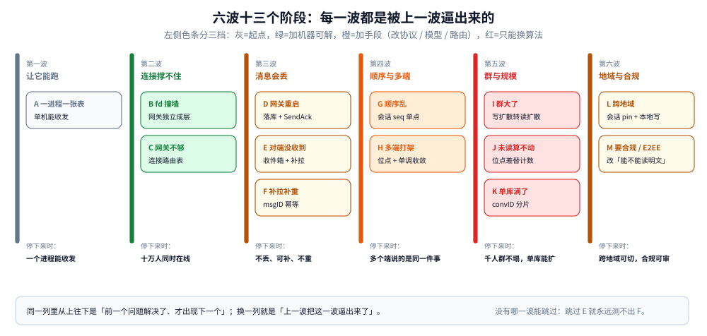
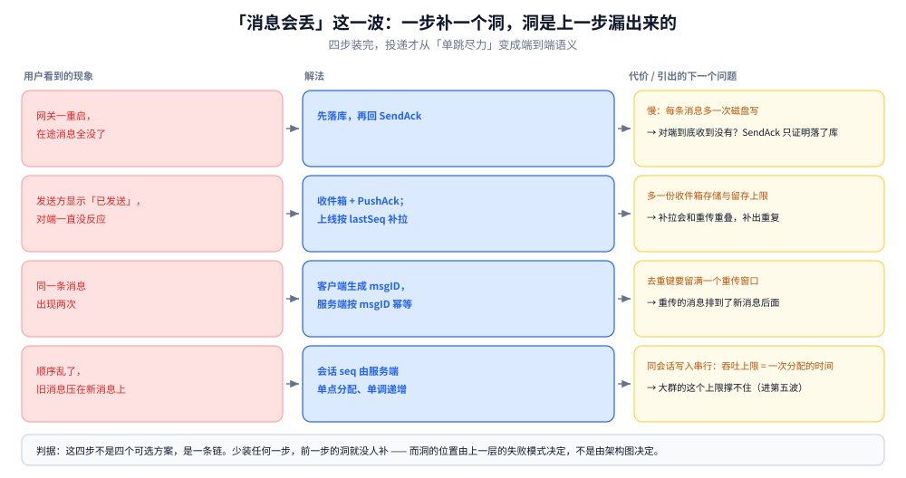

# 演进路线

> 覆盖：这套 IM **是分几步长成现在这样的** —— 六波十三个阶段，每一波先说「用户/监控看到什么现象」，再说「最容易先想到但错的解法」，然后才是方案、代价，以及**这个方案自己漏出来的下一个洞**；末尾给一份「哪些决定必须第一天做对」的不可逆清单与逐阶段自检表。
>
> 不覆盖：每个方案的机制细节在零件篇，各节都给了指针；整体形态与选型判据在 [架构与选型.md](架构与选型.md)、[总体设计.md](总体设计.md)。
>
> 内容整理自个人学习笔记，素材见 [素材清单](../../../素材清单.md)。
>
> 📎 **实测口径**：本篇是**推演篇**，不引入新读数。文中出现的量级都是算式骨架与示意代入，不引用任何吞吐或延迟数字；「某一波之后能撑多少人」这类结论**一律不给数值**，因为单机上限必须压测，本篇只给判据与顺序。零件篇里的可编译骨架与标「⚠️ 未实测」的边界，本篇不复述。

---

## 一、为什么按「撞墙的顺序」演进，而不是按组件清单一次建全？

**本节要点**：一次建全会把「还不知道要什么」的部分也固化下来；分阶段的价值不在省工期，而在**每一波都能停在一个自洽的状态**，并且知道停下来时的代价。

### 1.1 一次建全的三个代价

| 代价 | 现场表现 | 分波怎么避开 |
|---|---|---|
| 为峰值买架构 | 一上来就上多地域多活，日常两地都在跑空转 | 先单地域跑到真撞墙再拆 |
| 算法问题被当成容量问题 | 大群扇出爆炸，第一反应是加机器、加 MQ 分区，加完还是慢 | 先用小群验证投递链路，大群单独一波处理 |
| 不可逆的决定拖到最后 | convID 编码、msgID 生成方、seq 作用域，改一次要迁历史数据 | 第一波就把这四条定死（见第九节） |

第三条最容易被低估：**前三条（协议、编号、分片键）是结构决定，不是后期加个组件能补的**。等到第五波发现 `convID` 编码不支持分片，要迁的是全量历史消息。

### 1.2 每一波都要能停

六波分别停在六种可用状态：**能收发**、**能扛十万连接**、**不丢不重**、**多端一致**、**千人群不塌**、**跨地域可切**。任何一波停下来，产品都还能用，只是能力少一层——不能出现「停在中途就什么都收发不了」的切法。

### 1.3 判据：加机器能解决的晚做，只能换算法的早做

⭐ 这是全套演进顺序的唯一排序依据，也是 [架构与选型.md](架构与选型.md) 1.3 那条判据的复用：

| 这一波的问题 | 靠什么解决 | 所以排在第几波 |
|---|---|---|
| 连接数撑不住 | **加机器**（网关无状态化后横向拆） | 第二波——晚做 |
| 消息丢了 | **加手段**（落库 + ACK + 幂等，改协议与流程） | 第三波 |
| 顺序与多端 | **换数据模型**（seq 与位点） | 第四波 |
| 大群扇出爆炸 | **换算法**（写扩散 → 读扩散，加机器无效） | 第五波——但它的问题在第二波就埋下了，只是没暴露 |
| 单库写不下 | 加机器（分片） | 第五波后半 |
| 跨地域 | 加机房 + 改路由 | 第六波 |

⚠️ 表格第五行的错位是真实的：扇出倍数是**第一波就要算清的输入**（[架构与选型.md](架构与选型.md) 1.2），但它的痛要到群规模真实上来才发作。所以「早做」指的是**早做判断**（第一波就知道要不要读扩散），不是早写代码。

---

## 二、六波十三个阶段分别撞什么墙？

**本节要点**：每一波解决一类风险，而不是一类组件。**组件是结果，不是阶段划分的依据**。

图怎么读：六列从左到右是时间序，每列的小卡片是该波里的具体阶段（A~M），底部「停下来时」是这一波的可用状态。左侧色条分三档：**灰=起点，绿=加机器可解，橙=加手段（改协议 / 模型 / 路由），红=只能换算法**。全图只有第五波是红色——这就是 1.3 那条判据的图形表达：能被加机器解决的往后放，只能换算法的单独拿出来做。底部那句提醒读法：同一列从上往下是「前一个问题解决了才出现下一个」，换一列是「上一波把这一波逼出来了」。

| 波 | 阶段 | 新解决的风险 | 一句话方案 | 停下来时的状态 |
|---|---|---|---|---|
| 一 | A | 从零到能收发 | 一个进程 + 一张消息表 | 单机能跑，重启全断 |
| 二 | B、C | 连接数与「人在哪台机」 | 网关独立 + 连接路由表 | 十万级同时在线 |
| 三 | D、E、F | 消息丢失与补投 | 落库 + SendAck + 收件箱 + msgID 幂等 | 不丢、可补、不重 |
| 四 | G、H | 顺序与多端状态 | 会话 seq + 两个位点单调收敛 | 多个端说的是同一件事 |
| 五 | I、J、K | 群规模与单库容量 | 读扩散 + 位点差 + `convID` 分片 | 千人群不塌，单库能扩 |
| 六 | L、M | 地域与合规 | 会话 pin + 改「服务端能不能读明文」 | 跨地域可切，合规可审 |

---

## 三、第一波：先让它跑起来，要定死哪三件事？（A）

**现象**：还没现象——这一波的目标是**把三件事定死**：消息怎么落库、序号怎么分配、客户端怎么显示「已发送」。定完这三件，后面每一波都是在它们上面加层次。

**最容易做错的**：一上来就画多网关 + MQ + 分库分表的架构图。图本身没错，但它把「哪条是主链路」淹没了，而且会让人误以为难点在组件，其实难点在**编号**。

**方案**：一个进程，一张 `message` 表，主键 `(convID, seq)`；收到消息就落库、分配会话内 seq、如果对端连接恰好在同一进程就直接转发。

**代价**：重启即全断；单进程连接数受 fd 与内存限制；两台机器之间无法交接。

**引出的下一个问题**：连接数先撞墙——不是消息量，是连接数。

---

## 四、第二波：为什么先撑不住的是连接，不是消息量？（B、C）

### 4.1 B：fd 撞墙，把「持连接」拆出去

**现象**：`too many open files`；进程内存随连接数线性涨；一次 Full GC 让所有连接一起卡顿。

**最容易先想到的错解**：调大 `ulimit -n`、加内存、换更大的机器。→ 这只能把墙推远一点，推不过去：单机连接数受内核参数、每连接内存、心跳开销三项同时限制，而且**重启即全断**这个性质没变。

**方案**：把「持连接」拆成独立进程（网关），业务逻辑搬进无状态服务。这就是 [架构与选型.md](架构与选型.md) 2.2 里「去掉网关会死在哪」的正向版本。

**代价**：多一跳内网 RPC（几十微秒到毫秒级）；连接与业务不再同进程，于是**必须回答「用户在哪台网关」**。

**引出的下一个问题**：网关一台不够，要好几台——这时「找人在哪」就成了新问题。

### 4.2 C：多网关之后，「人在哪」变成全局知识

**现象**：用户在网关 A，消息服务把消息交给网关 B，B 的进程内 map 里没有这条连接，消息推不出去；用户体感是「对方在线却收不到」。

**最容易先想到的错解**：把路由表放各网关的进程内 map（只对单机成立）；或者干脆广播给所有网关（可行，但带宽随网关数线性放大）。

**方案**：集中式连接路由表（`uid → 实例集合`），带 TTL 与续期、断连即删、值是**集合**（多端）。真实系统常是混合：**本机持有的连接直接推，跨节点的查表或广播**。

**代价**：每次跨节点推送多一次查表；路由表本身要处理过期、续期与脑裂；TTL 设长了死连接残留、设短了频繁误判。

**引出的下一个问题**：能找到人了，但网关一重启，在途消息全没了。

细节见 [在线状态与推送.md](在线状态与推送.md) 第二节。

---

## 五、第三波：消息丢了之后，一条链上要补几个洞？（D、E、F）

**这一波是整套演进里唯一「一步补一个洞」的连锁**，四步装完，投递才从「单跳尽力」变成端到端语义。

图怎么读：四行是四个连着的洞，每行的右列两行字分别是「这一步的代价」和「它自己漏出来的下一个问题」——注意每一行的下一个问题，就是下一行的现象，这是全图要传达的结构：**这四步不是四个可选方案，是一条链，少装任何一步，前一步的洞就没人补**。而洞的位置不是从架构图上推出来的，是从上一层的失败模式里推出来的（图第一行的「对端到底收到没有」就不是架构问题，是语义问题）。

### 5.1 D：网关一重启，在途消息全没了

**现象**：发版或重启后，用户看到「发送中」转了几秒然后消失；有投诉但复现不了。

**错解**：让客户端超时重发（**会重复**，因为服务端可能已经处理了）；把消息先放 Redis 当天缓冲（Redis 会丢，且单位成本高）。

**方案**：先落库（消息本体 + 成员位点**在同一事务**）+ 分配会话 seq，落库成功才回 SendAck。

**代价**：每条消息多一次同步磁盘写；而且「已发送」只证明落库了，**不证明对方收到**。

### 5.2 E：对端到底收到没有

**现象**：发送方显示「已发送」，对端毫无反应——离线、弱网、App 被后台杀掉，三种情况在日志里长得一样。

**错解**：把「系统推送调用成功」当成「消息已送达」。APNs / FCM 只保证「到达提醒」，甚至不保证一定提醒到。

**方案**：分三条路——① 对端在线：Push → PushAck → 上报送达位点；② 对端离线：落收件箱（**必须有留存上限**）+ 系统通道只带提醒；③ 上线：按 `lastSeq` 补拉。

**代价**：多一份收件箱存储与留存策略；补拉带来新的读放大（每次上线扫一段）。

### 5.3 F：补拉补出了重复

**现象**：同一条消息显示两次。触发条件是「客户端超时重传」与「上线补拉」重叠。

**错解**：按「发送时间 + 内容」判重。内容相同是合法的（连发两个「好」是两条消息）。

**方案**：客户端生成 `clientMsgID`（跨连接、跨设备唯一），服务端按它幂等；去重键的留存要**覆盖**客户端的最长重传窗口。

**代价**：去重键要存满一个窗口（存储与清理）；客户端必须保证 msgID 稳定（重装、换端要能续上）。

**引出的下一个问题**：不重了，但顺序乱了——重传的那条排到了新消息后面。

细节见 [消息可靠投递.md](消息可靠投递.md) 第二、四、六节。

---

## 六、第四波：不丢了，为什么顺序还是乱的？（G、H）

### 6.1 G：顺序乱了

**现象**：旧消息压在新消息上面；同一条会话在两个端上的顺序不同。

**错解**：用客户端时间戳排序（时钟不同步，且用户能改表）；用帧里的 `seq` 排序（那是连接内序号，重连归零）。

**方案**：会话内 `seq` 由**服务端**在事务里分配、单调递增，客户端一律按它排序；帧序号只用于请求-响应配对。

**代价**：同会话写入被串行化，吞吐上限 = 一次分配的时间——**这个上限在第五波会被大群撞穿**。

⚠️ 这一层最容易混的是「两套序号」，判据是「重连之后还需要它吗」（见 [协议设计.md](协议设计.md) 第一节）。

### 6.2 H：多端说的是两件事

**现象**：手机上读了，平板上还挂着 99+；两个端来回改，未读数会「反弹」。

**错解**：用一个全局未读计数器（多端并发 `DECR` 会互相覆盖）；每次打开全量重算（成本随历史增长）。

**方案**：两个位点——`lastMsgSeq`（这个会话现在到第几条）与 `lastReadSeq`（我读到第几条），**未读 = 位点差**；已读取 `max` **单调不减**；Redis 计数器只做加速，对不上时以位点为准。

**代价**：位点差要扫区间（大群很贵）；计数与位点会短暂不一致，要能容忍。

**引出的下一个问题**：大群里这个「扫区间」直接算不动。

细节见 [会话与未读.md](会话与未读.md) 第三、四节。

---

## 七、第五波：加机器为什么救不了大群？（I、J、K）

**这一波是唯一「换算法」的一波**：加机器在这里不起作用，因为扇出倍数是一次发送对成员数的比值，与机器数无关。

### 7.1 I：一次发送要落一千份

**现象**：千人群一条消息让 MQ 积压、推送延迟从毫秒级涨到秒级；写收件箱的 QPS = 发送 QPS × 成员数。

**错解**：加 MQ 分区、加消费线程、加机器 → 扇出倍数没变，只是摊得更开；把群拆小 → 产品不允许。

**方案**：**按群规模分档**。小群走写扩散（一次写 N 份，读时直接取）；大群走**读扩散**（只写一份，读时按每个成员的位点扇出）。判据是**扇出倍数与读放大的成本谁更低**，拐点由群规模分布决定（见 [群聊.md](群聊.md) 第四节）。

**代价**：读扩散要为**每个成员**维护「我在这个群读到第几条」的位点；读时要做多源合并；大群的「未读」不能再靠计数器。

**引出的下一个问题**：大群的未读算不动。

### 7.2 J：未读算不动

**现象**：打开一个万人大群，未读要算几秒；Redis 计数器与真实位点长期对不上。

**错解**：给大群也维护精确计数（每次发送要 `INCR` 一万次，等于把写扩散换个地方做）。

**方案**：未读退化成**近似或按需**——「有没有未读」存布尔或粗粒度，「具体多少」在打开会话时按位点差精算，或者产品上直接显示「999+」。

**代价**：产品体验让步（精确未读变贵）；首次打开会话慢一点。

### 7.3 K：单库写不下

**现象**：消息表写放大、慢查询出现、单表接近上限。

**错解**：按时间分表（跨时间查一个会话要扫多表）；按 `uid` 分片（群消息跨分片事务，直接否决）。

**方案**：按 `convID` 分库分表，消息表主键 `(convID, seq)`；另维护一张按 `uid` 的会话索引表供「我的会话列表」用。

**代价**：跨会话查询（搜索、运营导出）只能走检索副本；扩容要迁移数据（预分片或一致性哈希）；`seq` 分配点要跟着分片走——**这一条是第五波和第四波的接缝，也是最容易返工的地方**（见 [架构与选型.md](架构与选型.md) 3.4）。

细节见 [群聊.md](群聊.md) 第四、五节与 [消息可靠投递.md](消息可靠投递.md) 第三节。

---

## 八、第六波：跨地域与合规，各自改的是哪条前提？（L、M）

### 8.1 L：跨地域

**现象**：两地用户互发消息的延迟是单地域的几倍；两地同时分配同一会话的 `seq` 会撞。

**错解**：两地都能写、靠「时间戳 + 机器号」拼全局 ID → 会话内 `seq` 不再单调，位点失效。

**方案**：**会话 pin 到主地域**——谁写都转发到主地域分配 `seq`，其他地域只放读副本；长连接就近接入，跨地域只转发「这条会话的写」。故障时切主，切换期该会话的写不可用（读可以继续）。

**代价**：跨地域写多一次 RTT；主地域故障要切，切换窗口内写不可用或要双写；`seq` 的分配点变成全局唯一的瓶颈点，要单独设计。

### 8.2 M：合规与 E2EE

**现象**：监管要求留存与可审；产品同时要求端到端加密。两者直接冲突。

**错解**：先上 E2EE 再想审核 → 发现服务端拿不到明文，搜索、审核、多端漫游三件事全部失效，功能要推倒。

**方案**：**先定一句话——服务端还能不能读到明文**，再定留存、删除、审核落在哪一层。上了 E2EE 之后，审核只能退化为「元数据审核 + 成员举报 + 端侧上报」，检索只能退化为端侧索引。

**代价**：这是全部十三阶段里唯一「一旦选错就要推倒重来」的一步——它不是加一层，是改整套功能的前提（见 [端到端加密.md](端到端加密.md) 与 [内容审核与合规.md](内容审核与合规.md)）。

细节见 [跨地域多活.md](跨地域多活.md) 第三、四、五节。

---

## 九、哪些决定必须第一天做对？

**本节要点**：判据是**改它的成本**。凡是会固化进历史数据或已发到客户端的东西，第一天做对；凡是可重建、可替换的，随时能补。

### 9.1 不可逆清单

| 决定 | 为什么不可逆 | 改它的代价 |
|---|---|---|
| **`convID` 的编码方式**（单聊是否用「两个 uid 排序拼接」） | 它同时是分片键、幂等键的一部分 | 改要迁全部历史消息与索引 |
| **`msgID` 由谁生成、什么格式** | 已经发到用户手里的 ID 收不回来 | 换格式 = 老客户端发的 ID 服务端不认 |
| **`seq` 的作用域与分配点** | 回退违约；客户端已按它排序 | 换分配器要重排历史 `seq`，等于重写位点 |
| **消息留存策略**（多久、冷热分界） | 删掉的消息找不回来 | 只能对未来的数据生效 |
| **协议帧的向前兼容机制**（未知字段、未知报文类型能否忽略） | 老客户端装着不升级 | 任何新功能上线都变成老端事故 |
| **分片键（`convID`，不是 `uid`）** | 与上面第一条绑定 | 与 `convID` 编码一起改 |

### 9.2 可以后补的

检索副本、内容审核、限流额度、多地域多活、音视频信令、机器人平台、端到端加密（只要**第一天就明确「服务端要读明文」**，后面改 E2EE 属于推倒重来而非后补）。

⭐ 一句话记法：**进了历史数据的、发到客户端的、写进主键的——第一天定；其余都能补。**

---

## 使用：十三阶段自检清单

**本节要点**：每次演进到某一波之前，用这张表过一遍。每一行只有两句问话，答不上来就别往下走。

| 阶段 | 自检问话 | 不满足时的症状 |
|---|---|---|
| A | 消息落库与 `seq` 是否在同一个事务里？ | 重启后出现「有消息没位点」 |
| B | 网关重启，客户端多久能全部重连回来？ | 发版后有用户长时间「发送中」 |
| C | 用户在别的网关，消息怎么找到他？ | 「对方在线但收不到」 |
| D | 「已发送」和「对方收到」是不是两个状态？ | 客服收到「显示已发送但对方没看到」 |
| E | 系统推送成功之后，真消息靠什么补？ | 「通知里有、点进去是空的」 |
| F | 去重键的留存期覆盖客户端最长重传窗口了吗？ | 低频但偶发的重复消息 |
| G | 客户端排序用的是会话 `seq` 还是别的？ | 偶发乱序、跨端顺序不一致 |
| H | 未读是「位点差」还是「一个计数器」？ | 未读不清零、多端不一致、反弹 |
| I | 这个群的扇出倍数是多少，写扩散扛得住吗？ | 大群发一条消息，全站推送变慢 |
| J | 万人大群打开时要扫多少行？ | 大群首屏几秒 |
| K | `seq` 分配点跟着分片走了吗？ | 分片后出现跨分片 `seq` 冲突 |
| L | 两地能同时给同一个会话分配 `seq` 吗？ | 跨地域切换后补拉出空洞 |
| M | 服务端还能不能读明文？ | 上了 E2EE 才发现搜索与审核全废 |

---

## 延伸追问

- **能不能跳过第二波，直接做第三波（先保证不丢）？** → 不能，但可以说清顺序的「为什么」：不丢的四步（落库 / 收件箱 / 幂等 / seq）里，收件箱与补拉都依赖「人在哪台机」，没有网关与路由表就无处投递。第三波建在第二波上（见第四节与第五节）。
- **为什么第五波的读扩散不放到第二波就做？** → 判断要早做（第一波算扇出倍数），实现要等到群里真的有人。过早做读扩散，小群会白付「每个成员一条位点」的存储与合并开销，而这份开销在小群上完全不划算（见 7.1）。
- **「加机器能解决的晚做」会不会变成拖延的借口？** → 判据要配上量级：如果连接数的年增长会让网关台数翻十倍，那它就不是「加机器」问题而是「网关该怎么拆」问题。判据看的是**增长斜率**，不是当下绝对值（见 1.3）。
- **哪一波最容易返工？** → 第五波的 `seq` 分配点。它在第四波被定成「服务端单点分配」，到第五波分片时「单点」变成了「每片一个点」，分片键与 `seq` 作用域一旦不一致，位点全部要重算（见 7.3）。
- **六波能不能并行两条？** → 第二波与第三波可以并行（网关与投递协议互不依赖），第四波必须在第三波之后（位点依赖 `seq`），第五波必须在第四波之后，第六波可以在任意时刻启动但**不能与第五波同时改 `seq` 分配点**。
- **如果一开始就知道要做 E2EE，前面几波要改什么？** → 只改一处：把「服务端能否读明文」作为存储与检索设计的前提写进第一波。其余阶段不变——但审核与搜索的实现路径全变（见 8.2）。
- **这套路线适用于别的系统吗？** → 「按撞墙顺序 + 每波留回退 + 不可逆清单」这套方法是通用的；具体六波的内容是 IM 特有的，别的系统（Feed、秒杀）撞墙顺序完全不同（见 [系统设计方法论.md](../系统设计方法论.md) 第六节）。

## 关联

- **上游/总纲**：[架构与选型.md](架构与选型.md) — 六个数字 → 三条硬约束 → 四层 → 五组选型，本篇的排序依据来自那里的 1.3。
- **上游/总纲**：[总体设计.md](总体设计.md) — 演进终态的整体形态、三个取舍与一次消息十步。
- **第一、二波**：[在线状态与推送.md](在线状态与推送.md) — 长连接选型、连接路由表、心跳重连。
- **第三波**：[消息可靠投递.md](消息可靠投递.md) — seq / ACK / 收件箱 / 幂等 / 补偿。
- **第四波**：[会话与未读.md](会话与未读.md) — 两个位点、未读派生、单调收敛。
- **第五波**：[群聊.md](群聊.md) — 大群按规模分档、写扩散转读扩散、成员表分片键。
- **第五波**：[存储全景.md](存储全景.md) — 分片之后的数据角色与读写路径。
- **第六波**：[跨地域多活.md](跨地域多活.md) — 会话 pin、跨地域复制、故障切换。
- **第六波**：[端到端加密.md](端到端加密.md) / [内容审核与合规.md](内容审核与合规.md) — 「服务端能不能读明文」的两侧。
- **方法论**：[系统设计方法论.md](../系统设计方法论.md) — 澄清边界 → 估算 → 第一性问题 → 分层加手段 → 规划演进。
- **对照/互补**：[演进路线与实施计划.md](../大数据平台/演进路线与实施计划.md) — 同一套「分阶段 + 每阶段能停」的写法，用在数据平台上。
