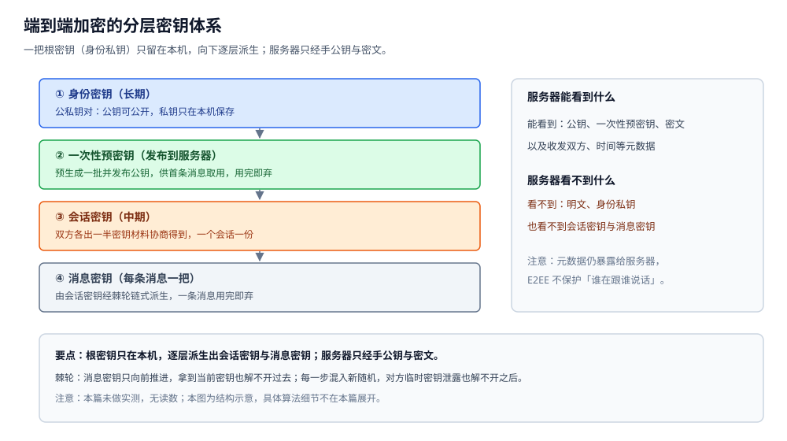
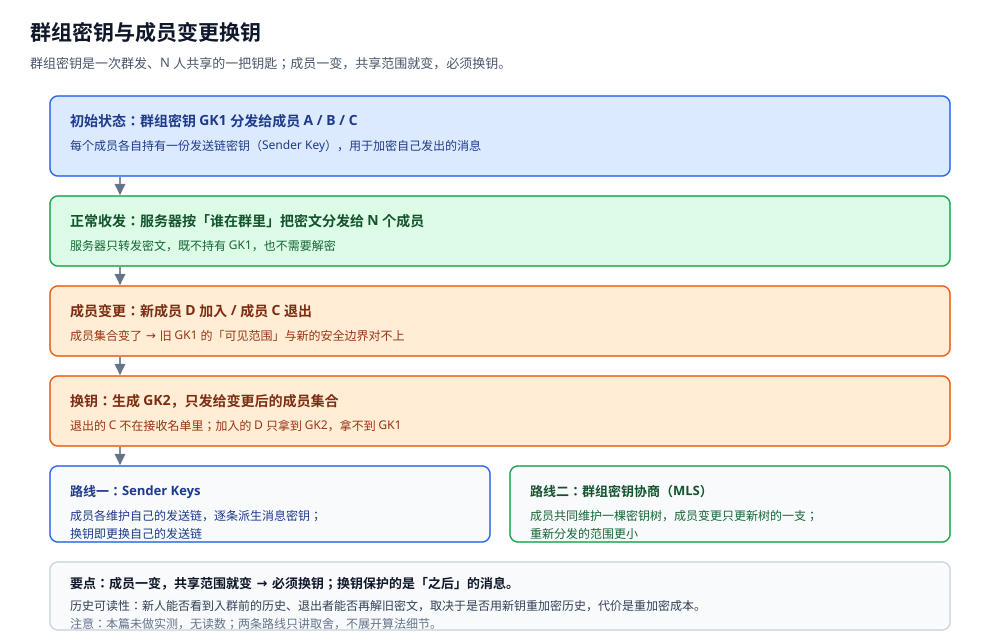
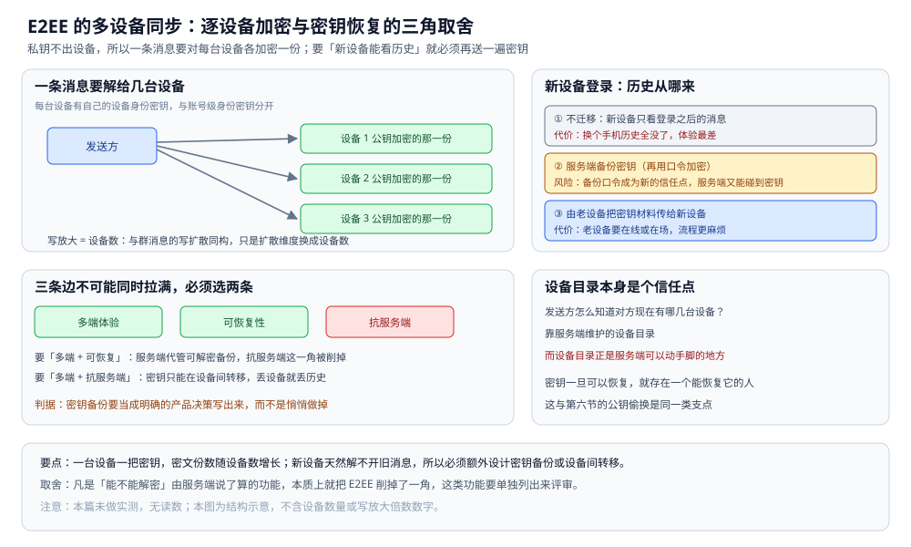
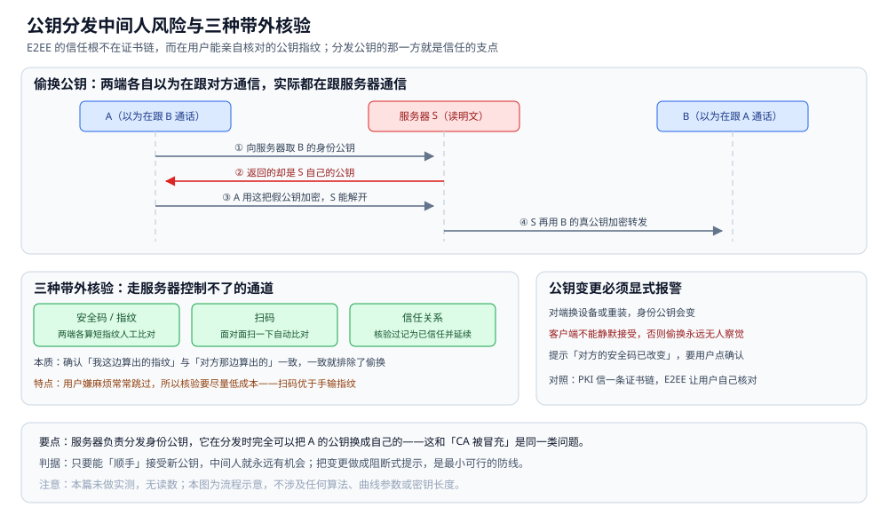
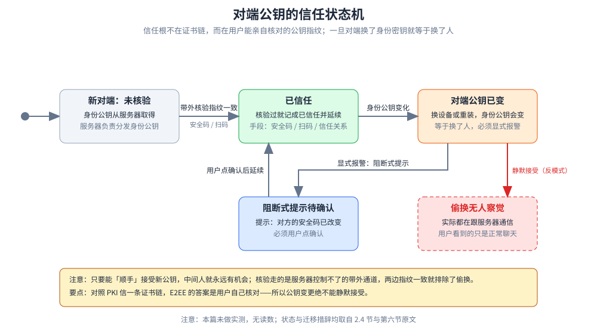

# 端到端加密

> 本篇讲 IM 里端到端加密（E2EE）的**工程模型**：密钥从哪来、群组密钥怎么管、多端怎么同步、
> 以及它与服务端搜索 / 内容审核 / 消息漫游这些"必须看得见明文才能做"的功能怎么冲突。
> **不推密码学数学证明**，只回答"这套东西在系统里怎么落地、代价落在哪"。
>
> 本篇是 IM 目录的**内容保密层（E2EE 篇）**：回答"消息内容对服务器不可读"这件事怎么成立。
> 它建立在 [通信链路与协议栈.md](通信链路与协议栈.md) 的三条路径之上（那里的 TLS 只保护**传输**、
> 不保护服务端）；密文怎么装进报文见 [协议设计.md](协议设计.md)，密文照常怎么投递见 [消息可靠投递.md](消息可靠投递.md)；
> E2EE 对搜索与审核的冲击分别在 [搜索与历史.md](搜索与历史.md)、[内容审核与合规.md](内容审核与合规.md) 里展开。
>
> 内容整理自个人学习笔记，并参考 Signal 的 Double Ratchet 公开文档与 MLS（RFC 9420）公开资料；素材见 [素材清单](../../../素材清单.md)。
>
> ⚠️ 实测口径：**本篇未做实测**。原因：E2EE 的所有结论（谁能解密、换设备后能不能看历史、
> 成员变更后旧消息还能不能被解）都取决于真实的多端登录、群成员变更与密钥同步流程，
> 本机单进程无法复现。所有代码块**只做静态编译校验**（`gofmt` 通过），
> 不附任何运行读数，也不给任何"加密开销倍数""密文膨胀率"之类的数字。

---

## 一、E2EE 到底"端到端"在哪？

**本节要点**：E2EE 的"端"指的是**用户的设备**，不是服务器；服务器从"能读内容的中间人"退化成
"只转发密文的邮局"。它和 TLS 传输加密是两个**不同层次**的保护，谁也不能替代谁。

### 1.1 三种"加密"要先分清

日常说的"加密"至少有三层，保护的**对象**和**防的人**都不一样：

| 层次 | 保护什么 | 密钥握在谁手里 | 服务器能读明文吗 | 主要防谁 |
|---|---|---|---|---|
| **传输加密**（TLS） | 链路上的一段 | 客户端与**服务器**两端 | **能**（它就在端点上） | 链路上的窃听者 |
| **静态加密**（at rest） | 落盘的数据 | 服务器（或 KMS） | **能**（解密后才落库） | 拿到磁盘的入侵者 |
| **端到端加密**（E2EE） | 消息内容本身 | **只有用户设备** | **不能** | 服务器本身、链路上的任何人 |

⭐ 一句话：**TLS 的两个端点是"客户端 ↔ 服务器"，服务器站在链条中间；E2EE 的两个端点是"我的设备 ↔ 你的设备"，服务器站在链条之外**。这是两者最本质的差别，也是为什么"上了 HTTPS" 完全不等价于"消息对服务器保密"。

### 1.2 服务器在 E2EE 里的角色变化

| 能力 | 明文模式（TLS + 服务端可信） | E2EE 模式 |
|---|---|---|
| 读消息内容 | 能 | **不能**，只看到密文 |
| 服务端搜索 | 全文检索 | 失效，只能客户端建索引 |
| 内容审核 | 服务端机审 | 只能客户端做或放弃 |
| 富媒体转码 / 缩略图 | 能做 | 看不到内容，做不了 |
| 消息撤回 / 删除 | 服务端删副本即可 | 只能删服务端密文，**对方设备上的仍在** |
| 路由与投递 | 能做 | **照样能做**（密文照发） |
| 元数据（收发方 / 时间 / 大小） | 能看到 | **仍然能看到**（E2EE 不保护它） |

**关键判据**：E2EE 改变的是**内容**的可见性，不是**投递**的可行性——
服务器依旧要分配 seq、要 ACK、要存转发，只不过它搬的是它读不懂的字节。

### 1.3 算法部分不在这里展开

对称加密、非对称加密、混合加密、密钥派生函数（KDF）的**算法本体**在
[加密算法.md](../../../06-工程实践/安全/加密算法.md) 里讲。这里只借用它的一条结论：

> **握手的元问题不是"哪个算法更强"，而是"密钥最后落在谁手里"。**

E2EE 关心的正是后半句。所以本篇几乎不出现算法名，只出现"密钥怎么来、怎么分、怎么换"。

## 二、密钥体系怎么搭？

**本节要点**：E2EE 用的不是一把密钥，而是**分层 + 短期化**的一套：长期的身份密钥用来"认人"，
中期的会话密钥用来"开一条通道"，每条消息一把的消息密钥用来"用完即弃"。
**短期化**就是前向保密与后向安全的来源。

### 2.1 三层密钥各管什么

| 层次 | 生命周期 | 用途 | 谁持有 |
|---|---|---|---|
| **身份密钥**（Identity Key） | 长期（跟着账号/设备走） | 认证"这个公钥是谁的"、签名预密钥 | 公私钥对：公钥可公开，私钥不出设备 |
| **会话密钥**（Session Key） | 中期（一个会话一份） | 作为根，派生消息密钥 | 只有通信双方（群聊则为群成员） |
| **消息密钥**（Message Key） | 极短（一条消息一把） | 真正加密这条消息体 | 派生后即用、用完即弃 |

**为什么要分三层**：如果只有一把长期密钥直接加密所有消息，一旦泄露就是"全军覆没"——
所有历史、所有未来都完。分层 + 短期化把"一次泄露的损失"限制在**一小段**消息上。

### 2.2 一次性预密钥解决"对方不在线"

IM 是**异步**的：你发起会话时，对方很可能离线。
如果非要等对方在线才能协商密钥，第一条消息就发不出去。做法是：

1. 每个用户**预生成一批一次性预密钥**（prekey），把**公钥**发布到服务器；
2. 发送方要发起会话时，从服务器**取一份对方的预公钥**（连同对方的身份公钥）；
3. 用这些公钥拼出一次密钥协商，**第一条消息就能加密**；
4. 该预密钥**用完即弃**（一次性），服务器不再复用它。

⭐ 判据：**预密钥是"离线也能发起加密会话"的代价**——它必须预先发布，
因此服务器手上有这批公钥（公钥泄露不致命，但私钥绝不出设备）。
"一次性"是关键：可复用的预密钥会让前向保密打折扣。

### 2.3 棘轮：为什么密钥要"边走边转"

"棘轮"（ratchet）是一个**只能向前、不能倒回**的机械比喻，对应两类推进：

| 棘轮 | 推进方式 | 带来的性质 |
|---|---|---|
| **DH 棘轮** | 每完成一个来回，双方各生成一对**新的临时密钥**再做一次协商，把新结果混进根密钥 | 后向安全（未来保密）：旧的临时私钥泄了，也影响不了之后 |
| **对称棘轮** | 沿密钥链**每发一条（或每条）**派生一个新消息密钥，旧密钥随即丢弃 | 前向保密：拿到当前消息密钥，也解不开过去 |

两句话记住前向保密与后向安全：

- **前向保密**：**过去**的消息，即使现在的密钥被拿到，也解不开——因为过去的密钥**已经丢了**；
- **后向安全**（未来保密）：**将来**的消息，即使某一次临时密钥泄露，也解不开——因为**之后又混入了新随机**。

> ⚠️ 这里只讲概念层。KDF 怎么选、曲线参数怎么定、DH 怎么和对称链混，
> 属于密码学实现细节，见 [加密算法.md](../../../06-工程实践/安全/加密算法.md)，本篇不展开。



图怎么读：左侧是四层自上而下的派生关系——① 身份密钥（长期，公私钥对：公钥可公开，私钥只在本机保存）→
② 一次性预密钥（发布到服务器，预生成一批并发布公钥，供首条消息取用，用完即弃）→ ③ 会话密钥（中期，
双方各出一半密钥材料协商得到，一个会话一份）→ ④ 消息密钥（每条消息一把，由会话密钥经棘轮链式派生，用完即弃）。
右侧分三格写明服务器的可见边界：能看到公钥、一次性预密钥、密文与收发双方 / 时间等元数据，看不到明文、身份私钥、
会话密钥与消息密钥，并提示「元数据仍暴露给服务器，E2EE 不保护谁在跟谁说话」。本图为结构示意，本篇未做实测、无读数。

### 2.4 身份密钥负责"认证"，而不只是"加密"

会话密钥只保证了"这条通道没被第三方窃听"，但它回答不了"**对面到底是不是本人**"。
把"某把公钥属于某个用户"这件事绑定住，靠的是**身份密钥的签名**（他人签名、预密钥签名）：

- 发送方用签名验证"这份预密钥确实由对方的身份私钥签发"；
- 一旦对面换了一把身份密钥，就等于换了人（见第六节），必须显式报警。

这一步的机制（摘要、签名、验签）见 [摘要与数字签名.md](../../../06-工程实践/安全/摘要与数字签名.md)。

## 三、群聊的密钥怎么管？

**本节要点**：单聊的密钥是"两人协商"，群聊要把它变成"**一次加密、N 人可解**"；
而成员一旦发生增删，就要**换钥**。这一节的全部难点都长在"共享范围会变"上。

### 3.1 从"发 N 份"到"共享一把群组密钥"

最朴素的做法是**把同一份明文对每个成员各加密一次**：

| 做法 | 加密开销 | 成员变更时 |
|---|---|---|
| 对每个成员单独加密 | O(N) | 要重新给 N 个人各发一份 |
| **共享一把群组密钥 GK** | O(1)：用 GK 加密一次，N 人可解 | 生成新的 GK，重发给**变更后的成员集合** |

群组密钥把"加密次数"从 N 降到 1，代价是**共享范围必须时刻和安全边界一致**——
多一个人不该看到，就少一把密钥的范围；少一个人不该看到，就得换钥。

### 3.2 两条路线：Sender Keys 与 MLS

| 维度 | **Sender Keys** 路线 | **群组密钥协商（MLS）** 路线 |
|---|---|---|
| 基本结构 | 每个成员维护**自己的一条发送链**，逐条派生消息密钥 | 全体成员共同维护一棵**密钥树** |
| 加密开销 | 与群规模基本无关（各发各的） | 树结构让开销随规模增长更平缓 |
| 成员变更 | 各自更换发送链并重分发 | 只更新树的一支，重分发范围更小 |
| 典型代价 | 成员越多、发送链越多，管理面越大 | 协议与状态复杂，实现门槛高 |

两条路线的共同点：**都不是"一把密钥发一次就完事"**，而是把"谁该能解"编码进密钥结构，
并且**成员一变就动密钥**。

### 3.3 成员进出与历史消息可读性

这是群聊 E2EE 里最容易踩的一个点：**换钥只能保护"之后"，保护不了"之前"**。

| 事件 | 换钥后能防住 | 换钥**防不住** |
|---|---|---|
| **新成员 D 加入** | D 拿不到 GK1，解不开入群前的密文 | 若管理员想让 D 看到历史，就得**用新钥重加密历史**，成本高 |
| **成员 C 退出** | C 拿不到 GK2，解不开之后的新消息 | C 手上**已经收到的旧密文**仍在，换钥追不回来 |

一句话：**"密钥一旦到手就无法收回"**。所以现实系统的做法通常是
"**入群后的消息可见，入群前的历史按策略裁剪**"，并把这一点明确告诉用户。
这与 [群聊.md](群聊.md) 里"入群看历史"的产品策略**直接冲突**——产品要的是"新人能看到全部历史"，
E2EE 要的是"没密钥就看不到"，两者必须有一方让步。



图怎么读：主干四步依次是「初始状态：群组密钥 GK1 分发给成员 A / B / C」→「正常收发：服务器按谁在群里把密文分发给 N 个成员，
服务器只转发密文，既不持有 GK1，也不需要解密」→「成员变更：新成员 D 加入 / 成员 C 退出，旧 GK1 的可见范围与新的安全边界对不上」→
「换钥：生成 GK2，只发给变更后的成员集合；退出的 C 不在接收名单里，加入的 D 只拿到 GK2，拿不到 GK1」。
底部两栏对照两条路线：Sender Keys（成员各维护自己的发送链，换钥即更换自己的发送链）与 MLS（共同维护一棵密钥树，
成员变更只更新树的一支，重新分发范围更小）。要点句写明「换钥保护的是之后的消息」，历史可读性取决于是否用新钥重加密历史。
本篇未做实测，无读数。

## 四、多端怎么同步密钥？

**本节要点**：一个人可能有多台设备，而**私钥不出设备**，所以同一条消息往往要用**每台设备的公钥分别加密**；
新设备又要能看到历史，于是"密钥备份与恢复"成了 E2EE 最现实的一块软肋。

### 4.1 一条消息要"解给几台设备"

- 每台设备有自己的**设备身份密钥**，与账号级身份密钥分开；
- 发送方为接收方的**每一台设备**各加密一份密文（写放大 = 设备数）；
- 这与 [消息可靠投递.md](消息可靠投递.md) 里的"写扩散"是同一种结构，只是这里的扩散维度从
  "成员数"变成了"**设备数**"。

> ⚠️ 设备列表从哪来，本身是个一致性问题：发送方怎么知道对方现在有哪几台设备？
> 这依赖服务端维护的"设备目录"，而设备目录**正是服务端可以动手脚的地方**。

### 4.2 新设备登录：历史从哪来

| 方案 | 做法 | 代价 / 风险 |
|---|---|---|
| 不迁移 | 新设备只看得到登录之后的消息 | 用户体验差，"换个手机历史全没了" |
| **服务端备份密钥** | 密钥（通常再用口令加密）存到服务器 | 备份口令成为**新的信任点**；服务端又能"碰"到密钥 |
| **设备间直接转移** | 由老设备把密钥材料传给新设备 | 需要老设备在线 / 在场，流程更麻烦 |

三种方案没有免费的：**要"新设备能看历史"，就必然要有一条把密钥"再送一遍"的路径**。

### 4.3 密钥同步为什么是 E2EE 的软肋

把上面几节连起来看，会得到一个不太舒服的结论：

- 只要**密钥可以恢复**，世界上就存在**一个能恢复它的人**——要么是用户自己（凭口令），
  要么是服务端（凭它代管的备份）；
- 服务端一旦代管"可解密的备份"，它就从"只转发密文"**退回了"有机会拿到明文"**；
- 三条边**多端体验 / 可恢复性 / 抗服务端**不可能同时拉满，必须选两条。

⭐ 判据：**凡是"能不能解密"由服务端说了算的功能，本质上就把 E2EE 削掉了一角**。
所以设计时要把"密钥备份"当成一个**明确的产品决策**写出来，而不是悄悄做掉。



图怎么读：左上「一条消息要解给几台设备」——发送方对**设备 1 / 设备 2 / 设备 3 公钥加密的那一份**各发一份密文，
底部写明「写放大 = 设备数：与群消息的写扩散同构，只是扩散维度换成设备数」。右上列出新设备登录的三条路：
① 不迁移（代价：换个手机历史全没了）、② 服务端备份密钥（再用口令加密）（风险：备份口令成为新的信任点）、
③ 由老设备把密钥材料传给新设备（代价：老设备要在线或在场）。下方左侧把 4.3 的结论画成三个盒子——
**多端体验 / 可恢复性 / 抗服务端**——并注明「三条边不可能同时拉满，必须选两条」；右下提醒设备目录本身是个信任点。
本图为结构示意，不含设备数量或写放大倍数数字。

## 五、E2EE 和服务器功能怎么冲突？

**本节要点**：搜索、审核、漫游、富媒体处理这些功能都**默认服务器看得见明文**；
E2EE 一旦启用，它们要么搬到客户端，要么只能做"**加密不覆盖元数据**"的折中。
这是 E2EE 落地时最现实的一道墙。

### 5.1 功能冲突清单

| 功能 | 明文模式怎么做 | E2EE 下怎么变 |
|---|---|---|
| 服务端全文搜索 | 服务器建索引、直接查 | 失效；只能**客户端本地建索引**（见 [搜索与历史.md](搜索与历史.md)） |
| 内容审核 | 服务端机审 + 人审 | 服务端看不到明文；只能客户端审（**用户可绕过**）或放弃（见 [内容审核与合规.md](内容审核与合规.md)） |
| 消息漫游 | 服务端存明文，按位点下发 | 服务器只有密文，漫游 = **密钥同步 + 客户端解密** |
| 富媒体缩略图 / 转码 | 服务器生成缩略图、转格式 | 看不到内容，做不了（见 [富媒体消息.md](富媒体消息.md)） |
| 服务端撤回 / 删除 | 删掉服务端副本 | 只能删服务端密文，**对方设备上的副本还在** |

### 5.2 三种可能的折中

1. **客户端建索引**：客户端解密后在本地建搜索索引；代价是"换设备要重建索引""多端索引不一致"。
2. **加密不覆盖元数据**：消息体加密，但**谁发给谁、何时发、多大**仍可见；
   这让服务端还能做"关系分析、时间线"，隐私保护因此是**部分的**。
3. **可验证但不可读**：服务端能在**不解密**的前提下验证某些性质（如加密搜索、范围查询）；
   工程上代价大、能力受限，远不是"直接查"的替代品。

⭐ 判据：**先问"这个功能是不是非得看明文"**。如果非看不可，就只能在
"**牺牲 E2EE**"和"**牺牲这个功能**"之间选一个，没有第三条路能让两者都完整保留。

## 六、怎么让用户相信"没被中间人替换密钥"？

**本节要点**：E2EE 的信任根不在证书链，而在**用户能亲自核对公钥指纹**。
服务器仍然可能"偷换"某人的公钥来实施中间人，所以必须有**带外核验**（安全码、扫码、信任关系）。

### 6.1 中间人风险从哪来

服务器负责分发身份公钥。它在分发时**完全可以把 A 的公钥换成自己的**，
于是 A 和 B 各自以为在跟对方通信，实际都在跟服务器通信：

```text
A（以为在跟 B 通话）── 加密给 S ──→ 服务器 S（读明文）── 加密给 B ──→ B（以为在跟 A 通话）
```

这与 [数字证书与PKI.md](../../../06-工程实践/安全/数字证书与PKI.md) 里
"CA 被冒充"是**同一类问题**：分发公钥的那一方就是信任的支点。
区别在于，PKI 的答案是"信任一条证书链"，而 E2EE 的答案是"**用户自己核对**"。

### 6.2 三种核验手段

| 手段 | 做法 | 特点 |
|---|---|---|
| **安全码 / 指纹** | 两端各算出对方身份公钥的短指纹，**人工比对**是否一致 | 最通用；用户嫌麻烦，常常跳过 |
| **扫码** | 一端把公钥指纹生成二维码，另一端**扫一下**自动比对 | 比手输指纹省事，适合"面对面" |
| **信任关系** | 一旦核验过就记成"已信任"，之后该对端密钥变化要提示 | 把一次性核验的效果**延续**下去 |

核验的本质是**走一条服务器控制不了的带外通道**（看着对方屏幕、扫对方二维码），
确认"我这边算出来的指纹"和"对方那边算出来的指纹"一致——一致就排除了偷换。

### 6.3 公钥变更必须"显式报警"

对端换了设备或重装，身份公钥会变。这时候客户端**不能静默接受**，而要明确提示：
"对方的安全码已改变"。否则偷换公钥这件事**永远无人察觉**——用户看到的只是正常聊天。

```text
用户主张：只要能"顺手"接受新公钥，中间人就永远有机会。
对策：把"安全码变了"做成一个必须用户点确认的阻断式提示。
```



图怎么读：上半是一条四步时序——① A 向服务器取 B 的身份公钥 → ② **返回的却是 S 自己的公钥**（红色箭头）→
③ A 用这把假公钥加密，S 能解开 → ④ S 再用 B 的真公钥加密转发，于是「两端各自以为在跟对方通信，实际都在跟服务器通信」。
下半给出三种带外核验：**安全码 / 指纹**（两端各算短指纹人工比对）、**扫码**（面对面扫一下自动比对）、
**信任关系**（核验过记为已信任并延续），并点明本质是「确认我这边算出的指纹与对方那边算出的一致，一致就排除了偷换」；
右侧是 6.3 的要求——公钥变更必须显式报警，提示「对方的安全码已改变」，要用户点确认。本图为流程示意，不涉及算法与密钥长度。



图怎么读：把 2.4「一旦对面换了一把身份密钥就等于换了人，必须显式报警」与第六节核验规则连成一台状态机——
**新对端未核验**（身份公钥从服务器取得）经带外核验指纹一致进入**已信任**（核验过就记成已信任并延续）；
对端换设备或重装使**身份公钥变化**进入**对端公钥已变**态；此后两条出路：走 6.3 的**阻断式提示待确认**、
确认后重核验一致回到已信任；若**静默接受**（红色虚线，反模式）则落到**偷换无人察觉**——用户看到的只是正常聊天，实际都在跟服务器通信。
状态与迁移措辞均取自 2.4 与第六节原文，本篇未做实测、无读数。

## 使用：会话密钥派生与消息加密的 Go 骨架

**本节要点**：用标准库把"会话密钥 → 每条消息密钥 → AEAD 加密"这条链落成**可编译的最小骨架**；
只做静态编译校验，不做任何实测。

```go
package e2ee

import (
	"crypto/aes"
	"crypto/cipher"
	"crypto/hkdf"
	"crypto/rand"
	"crypto/sha256"
	"errors"
	"fmt"
)

// SessionKey 是双方协商得到的会话根密钥。
// 真实系统中它由 DH 协商得到、并被棘轮持续推进；这里只当输入用。
type SessionKey []byte

// DeriveMessageKey 沿「对称棘轮」派生一条消息的密钥。
//
// ⚠️ 未实测：本骨架只保证可编译。真实的棘轮还要在每一轮回环里
// 混入新的 DH 输出（DH 棘轮那一半），这里为便于阅读只用「会话密钥 + 序号」派生。
func DeriveMessageKey(sk SessionKey, seq uint64) ([]byte, error) {
	info := fmt.Sprintf("msg-key/%d", seq)
	return hkdf.Key(sha256.New, sk, nil, info, 32)
}
```

加密用 AEAD（带关联数据认证），并把 `convID + seq` 作为附加数据绑定进去，
这样密文**换到别的会话 / 别的序号**就会校验失败，防止"重放 / 移位"。

```go
// Encrypt 用 AEAD 加密一条消息体。
// AAD 绑定 convID 与 seq：密文被挪到别的会话或别的序号上，解密会失败。
func Encrypt(mk []byte, convID string, seq uint64, plaintext []byte) (nonce, ct []byte, err error) {
	block, err := aes.NewCipher(mk)
	if err != nil {
		return nil, nil, err
	}
	aead, err := cipher.NewGCM(block)
	if err != nil {
		return nil, nil, err
	}
	nonce = make([]byte, aead.NonceSize())
	if _, err := rand.Read(nonce); err != nil {
		return nil, nil, err
	}
	aad := []byte(fmt.Sprintf("%s/%d", convID, seq))
	ct = aead.Seal(nil, nonce, plaintext, aad)
	return nonce, ct, nil
}

// Decrypt 是 Encrypt 的逆操作。
// ⚠️ 未实测：未接真实网络与密钥管理，只验证「AEAD 绑 AAD」这一逻辑。
func Decrypt(mk, nonce, ct []byte, convID string, seq uint64) ([]byte, error) {
	block, err := aes.NewCipher(mk)
	if err != nil {
		return nil, err
	}
	aead, err := cipher.NewGCM(block)
	if err != nil {
		return nil, err
	}
	aad := []byte(fmt.Sprintf("%s/%d", convID, seq))
	pt, err := aead.Open(nil, nonce, ct, aad)
	if err != nil {
		return nil, errors.New("aead open failed：密钥不对，或密文 / AAD 被改动")
	}
	return pt, nil
}
```

把三段接起来的顺序是：**协商会话密钥 → 按 seq 派生消息密钥 → AEAD 加密 → 发密文与 nonce**。
服务器全程只看到 `nonce` 与 `ct`，看不到 `mk`，也看不到明文。

> ⚠️ **未实测**：以上代码**只做静态编译校验**（`gofmt` 通过），未运行 `go test`。
> 原因：真正的 E2EE 结论依赖多端登录、密钥同步与成员变更流程，
> 本机单进程跑不出"换设备能否解密""退群者能否解密"这类行为，给出运行结果即为编造。

## 延伸追问

- **E2EE 之后服务器还能做什么？** → 还能做路由、存密文、管元数据（谁发给谁、何时、多大）与分发公钥目录；内容层面的搜索、审核、转码**全部要搬到客户端或直接放弃**。
- **为什么"上了 HTTPS"不等于"消息保密"？** → 因为 TLS 的端点是"客户端 ↔ 服务器"，服务器**就在链条中间**、能读明文；E2EE 的端点是两台用户设备，服务器在链条之外，只拿到密文。
- **群大时 Sender Keys 和 MLS 差在哪？** → Sender Keys 让每个成员各维护一条发送链，加密开销与群规模基本无关，但成员越多发送链管理面越大；MLS 用密钥树把成员变更限制在树的一支，重分发范围更小，代价是协议与状态更复杂。
- **退出群的人还能看到群里的新消息吗？** → 换钥之后解不开**新**消息；但他在群里期间收到的密文**已经在他设备上**，换钥追不回来。这就是"密钥一旦到手无法收回"。
- **为什么多设备会显著拉高 E2EE 的复杂度？** → 因为一条消息要对**每台设备的公钥**各加密一份，而"私钥不出设备"意味着新设备天然解不开旧消息，于是必须额外设计密钥备份或设备间转移。
- **E2EE 能防住服务端乱来吗？** → 能防"**改内容**"（AEAD 校验会失败），但防不住"**不发 / 延迟发 / 打乱顺序**"这类流量层面的操纵；元数据的保护要靠另一套机制，不在本篇范围内。
- **预密钥为什么必须"一次性"？** → 它是"对方离线也能发起加密会话"的前提；可复用的话，同一份预密钥会反复参与协商，前向保密的边界就被拉大，一旦泄露影响面也更大。

## 关联

- [通信链路与协议栈.md](通信链路与协议栈.md) — 分层总纲：TLS 在哪一层，E2EE 与它分属"传输保密"和"内容保密"两个不同的保护面。
- [协议设计.md](协议设计.md) — 密文、nonce、设备密钥标识这些字段怎么装进报文帧、怎么向前兼容。
- [消息可靠投递.md](消息可靠投递.md) — 密文照常走 seq / ACK / 幂等去重；E2EE 不改投递语义，只改负载那一段。
- [会话与未读.md](会话与未读.md) — 多端漫游依赖的位点，与 E2EE"每设备一份密文"之间的关系。
- [内容审核与合规.md](内容审核与合规.md) — E2EE 与内容审核的根本矛盾、以及可能的折中与代价。
- [搜索与历史.md](搜索与历史.md) — E2EE 下服务端搜索为什么失效、客户端建索引怎么补。
- [群聊.md](群聊.md) — 群成员变更、入群看历史与群组换钥的交叉点。
- [富媒体消息.md](富媒体消息.md) — 正文密钥与文件密钥怎么分、服务器转码缩略图为什么难。
- [机器人与开放平台.md](机器人与开放平台.md) — 机器人要读明文才能应答，天然与 E2EE 冲突。
- [加密算法.md](../../../06-工程实践/安全/加密算法.md) — 对称 / 非对称 / 混合加密与 KDF 的算法本体。
- [摘要与数字签名.md](../../../06-工程实践/安全/摘要与数字签名.md) — 身份密钥靠签名把"这把公钥是谁的"绑定住。
- [数字证书与PKI.md](../../../06-工程实践/安全/数字证书与PKI.md) — 另一种建立信任的路子：证书链 vs 用户亲自核对指纹。
- [README.md](README.md) — 本篇在 IM 目录里的位置与阅读顺序。
