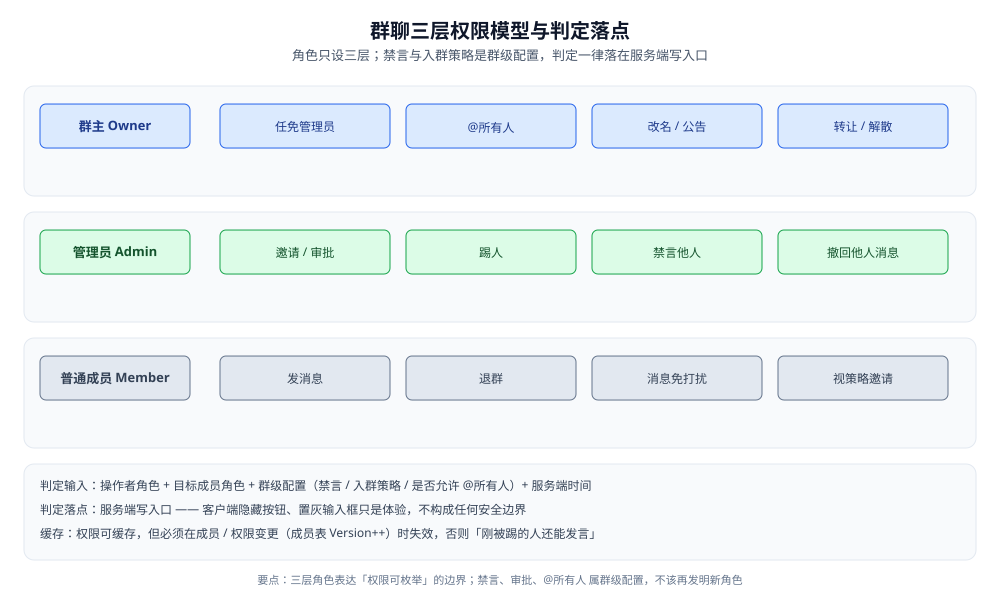
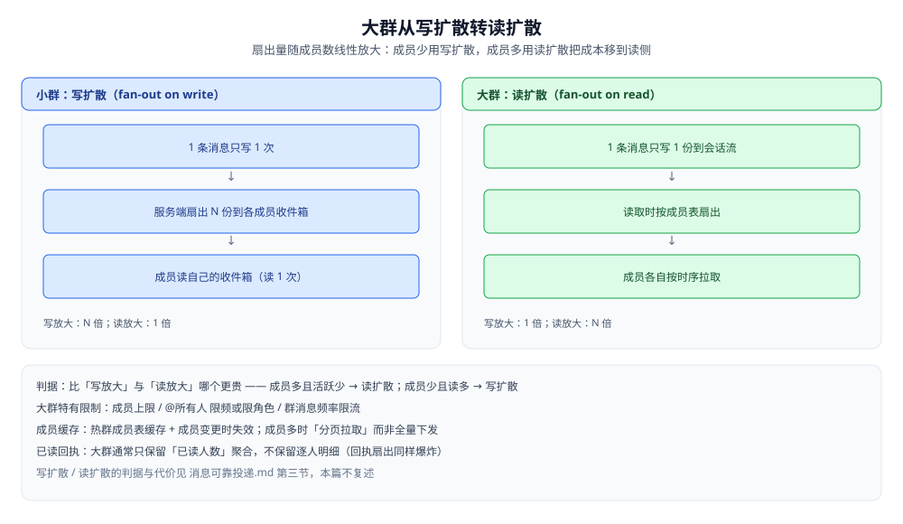

# 群聊

> 群聊这一「多参与者会话」的**成员 / 权限 / 大群**工程问题：成员会变、权限要分层、大群会放大。
>
> 本篇是**业务层的多参与者会话**：讲群里「成员怎么管、权限怎么分、大群怎么特殊对待、成员表怎么建模」。
> 群聊的「写扩散 vs 读扩散」属于投递问题，已在 [消息可靠投递.md](消息可靠投递.md) 第三节讲透，本篇只在 4.2 引一句指路、不复述；
> 群会话的未读收敛见 [会话与未读.md](会话与未读.md)；
> 群里的 @ 与系统消息（入群 / 退群提示）见 [消息类型与业务语义.md](消息类型与业务语义.md)；
> 大群扇出跨机房见 [跨地域多活.md](跨地域多活.md)；群消息与 @所有人 的限频见 [限流与防刷.md](限流与防刷.md)。
>
> 内容整理自个人学习笔记，并参考 XMPP MUC / Matrix 房间模型与公开工程资料；素材见 [素材清单](../../../素材清单.md)。
>
> ⚠️ 实测口径：**本篇未做实测**。「使用」节的 Go 数据模型骨架是**可编译示例**，未在本仓运行；
> 原因：群成员与权限的正确性体现在**并发变更下的幂等与一致**上——需要多客户端同时对同一群做入群 / 踢人 / 禁言，
> 再观察成员表与计数是否漂移，单进程环境复现不出这类交错。文中不引用任何第三方数字。

---

## 一、群聊比单聊多了哪些问题？

**本节要点**：单聊是「两端固定的对称会话」，群聊是「参与者会变、角色不对称、规模会放大」的会议——多出来的所有工程复杂度，都来自这四个字：**成员会变**。

### 1.1 四个新增变量

| 变量 | 单聊 | 群聊 | 带来的新问题 |
|---|---|---|---|
| **成员集合** | 固定两人 | 动态增删 | 历史可见性、成员表规模、缓存失效（见第二节） |
| **权限** | 对称 | 分层与不对称 | 谁能踢人 / 禁言 / @所有人（见第三节） |
| **扇出规模** | 1 对 1 | 1 对 N | 通知与投递随 N 放大（见第四节） |
| **成员关系** | 隐式（会话的两个人） | **显式一张成员表** | 要建表、要计数、要分片（见第五节） |

⭐ 一句话：**单聊的「参与者」是会话的属性，群聊的「参与者」是一份独立的、会变的共享数据**——一切复杂度都是这句话的展开。

### 1.2 与单聊逐项对照

| 维度 | 单聊 | 群聊 |
|---|---|---|
| 参与者 | 常量 2 | 变量 N，可增可减 |
| 权限判定 | 几乎不需要 | 每次写操作都要判（角色 + 群配置） |
| 扇出 | 写 1 读 1 | 写 / 读放大随 N 增长 |
| 未读位点 | 一人一份 | **每人一份**（见 [会话与未读.md](会话与未读.md) 第四节） |
| 成员数据 | 无独立表 | 独立成员表 + 计数器 |
| 历史可见性 | 天然全见 | **要按入群时间过滤**（见 2.3） |

> ⚠️ 一个容易漏的点：**群会话的未读不是一份**，而是「每个成员一份」。群里有 100 人，就有 100 份已读位点。
> 这直接决定了 4.5「大群要不要逐人已读回执」的取舍——回执本身也是 100 份。

---

## 二、成员怎么管理？

**本节要点**：四种操作（邀请 / 踢出 / 退群 / 转让）都要**幂等**，都要处理**历史可见性**这条横切线，并且**变更要按增量事件广播**而不是全量推成员表。

### 2.1 四种基本操作

| 操作 | 谁能发起 | 幂等键 | 主要副作用 |
|---|---|---|---|
| **邀请 / 加入** | 成员邀请、或按入群策略自入 | `(groupID, userID, join)` | 成员表加一行、计数 +1、记入群位点 |
| **踢出** | 群主 / 管理员 | `(groupID, userID, kick)` | 成员表删行、计数 -1、**该成员会话列表要去掉这个群** |
| **退群** | 自己 | `(groupID, userID, quit)` | 与踢出同构，只是发起者是自己 |
| **转让群主** | 群主 | `(groupID, newOwner)` | **必须原子**：新群主就位与旧群主降级是一次变更 |
| **解散群** | 群主 | `(groupID, dissolve)` | 群状态置为已解散；成员表可清理也可留档 |

⚠️ **转让群主为什么必须是原子操作**：如果「升新群主」与「降旧群主」分成两步执行，中间崩了就会出现**两个群主**或**没有群主**的状态。
正确做法是把这次变更当作**一次事务内的成员表更新**（新群主 role=owner、旧群主 role=admin 或 member 同时生效）。

### 2.2 成员变更的幂等

成员变更事件会被**重发与重放**（群里消息走的是「至少一次」，见 [消息可靠投递.md](消息可靠投递.md) 第四节），所以：

- **每个操作都带幂等键**：重复的「踢出 u1001」应当无副作用，而不是报「该成员不存在」。
- **重复入群不能重复计数**：已在成员表里的 userID 再次收到「加入」事件，应保持 `memberCount` 不变。
- **给成员表加版本号**：每次变更 `Version++`，客户端拿它判断本地缓存的成员表是否过期（见 4.4）。

> ⭐ 判据：**「操作的结果状态」比「操作本身」更重要**——把每个成员操作都写成「把成员表变成目标状态」的幂等更新，
> 而不是「执行一个动作」，重复事件就自然无害。

### 2.3 ⭐ 历史消息可见性：入群看历史吗？

这是群聊独有的、必须显式决策的一条策略：

| 策略 | 做法 | 代价 |
|---|---|---|
| **全部可见** | 任何成员能看该群从第一条起的历史 | 新成员能看到入群前的全部对话，**隐私最差** |
| **仅入群后可见** | 只能看到加入时间之后的消息 | 需要一个**过滤位点**，服务端要按它裁剪 |
| **按群配置** | 群主决定用哪种 | 灵活，但要两套逻辑都实现 |

实现要点：

- **过滤位点用「入群时的会话 seq」而不是时间戳**。seq 是会话内的权威顺序，时间戳有时钟问题；用 seq 才能稳定地切「入群前后」。
- **过滤必须在服务端做**。客户端拿不到就不该拿到——若只在前端隐藏，一次抓包就能拖走全量历史。
- **位点存在成员表里**（见第五节 `JoinSeq`），因为它是「人 × 群」的属性，不是群或人的属性。

### 2.4 成员变更要不要广播？

要，但**只推增量，不推全量**：

- 推「谁进来了、谁出去了」这类**事件**，由客户端在本地成员表上应用；全量推成员表在大群里会把下行带宽打爆。
- 事件要**防抖 / 合并**：短时间内大量进退群（如拉人入群）会产生事件风暴。
- 客户端本地成员表**只用于展示**（头像、昵称、@候选），**权限判定一律回服务端**（见 3.4）——本地表过期不影响安全。

---

## 三、群权限怎么分层？

**本节要点**：权限用**最小必要角色集**（群主 / 管理员 / 成员）表达，禁言与审批是**群级配置**而非角色；⭐ 一切权限判定**落在服务端写入口**，客户端置灰只是体验。

### 3.1 三层角色



| 能力 | 群主 | 管理员 | 普通成员 |
|---|---|---|---|
| 发消息 | ✅ | ✅ | ✅（未被禁言时） |
| 邀请 / 审批入群 | ✅ | ✅ | 视入群策略 |
| 踢人 | ✅ | ✅ | ❌ |
| 禁言他人 | ✅ | ✅ | ❌ |
| 撤回他人消息 | ✅ | ✅ | ❌（只能撤自己的） |
| @所有人 | ✅ | ✅ | ❌ |
| 任免管理员 | ✅ | ❌ | ❌ |
| 改名 / 公告 | ✅ | ✅ | ❌ |
| 转让 / 解散群 | ✅ | ❌ | ❌ |

⭐ 判据：**角色只设到「权限可枚举、边界清晰」的三层**。不要为「能不能发链接」这类小开关发明新角色——那应该做成**群级配置**，让三层角色各自可配。

### 3.2 禁言：全体与单人

| 类型 | 粒度 | 存储 | 判定 |
|---|---|---|---|
| **全体禁言** | 群级开关 | 群表一个布尔字段 | 除群主 / 管理员外，全员不可发言 |
| **单人禁言** | 成员级 | 成员表一个**截止时间**字段 | 该成员在截止时间前不可发言 |

两个易错点：

- ⚠️ **禁言到期用服务端时间判**，不能用客户端时间——否则改本机时钟就能绕过。
- ⚠️ **全体禁言要不要限制管理员**：若限制，出现紧急情况时管理员也发不了公告；多数产品让**群主 / 管理员在全体禁言下仍可发言**。这个规则要写进权限矩阵，不能靠代码「顺手」决定。
- **单人禁言对管理员的优先级**：通常是「管理员/群主不受单人禁言影响」，同样要显式定义。

### 3.3 入群审批与 @所有人 权限

- **入群策略**有三种：自由加入 / 需审批 / 仅邀请。审批队列本身是**共享状态**：多人同时审批同一条申请，要幂等（重复同意不能加两个人）。
- **@所有人 属于角色权限**（见 3.1），并且在大群里还要额外**限频或禁用**（见 4.3 与 [消息类型与业务语义.md](消息类型与业务语义.md) 6.2）。

### 3.4 权限判定的落点

权限判定的输入是四样东西：

```text
操作者角色 + 目标成员角色 + 群级配置（禁言 / 入群策略 / 是否允许 @所有人）+ 当前时间
```

- ✅ **判定在服务端写入口**：客户端隐藏按钮、置灰输入框都只是体验，**不构成任何安全边界**。
- ✅ **判定结果可缓存**：权限是读多写少的数据，可为每个成员缓存一份有效权限集。
- ⚠️ **但缓存必须在成员 / 权限变更时失效**：否则会出现「刚被踢的人还能发言」「刚被禁言的人还在刷屏」——这类 bug 都源自**权限缓存没跟成员表版本联动**（见 4.4 的版本号）。

---

## 四、大群为什么要特殊处理？

**本节要点**：大群的所有特殊处理都指向同一个根因——**扇出量随成员数线性放大**。放大的是写、是通知、是缓存、是回执；每一样都要么削峰、要么改结构、要么直接放弃。

### 4.1 成员上限不是随意的

群人数上限是**产品策略与工程约束的交点**：它同时决定了

- 一条消息的**扇出目标数**（写多少份 / 通知多少人）；
- **成员表**的单群规模（能不能一次拉全、要不要分页）；
- **通知量**（一条公告产生多少条离线推送）。

⭐ 判据：**不同规模档位用不同架构**——几百人的小群可以「写扩散 + 全量成员表」，十万人的大群必须「读扩散 + 分页成员表 + 限频」。
把上限设成「一个很大的数」而不改架构，等于把小群的做法硬套到大群上。

### 4.2 扇出爆炸 → 转读扩散



- 「写扩散 / 读扩散」的判据与代价（写放大 vs 读放大怎么比）见 [消息可靠投递.md](消息可靠投递.md) 第三节，**本篇不复述**。
- 这里只补一句大群特有的动机：**当 N 很大时，「一条消息写 N 份」的写放大不划算**，于是转为「只写 1 份到会话流、读取时按成员表扇出」。
- ⚠️ 转读扩散不是免费的：它把成本从**写侧**移到了**读侧**，并让「实时推送」变复杂（推送时仍需知道推给谁，见 [在线状态与推送.md](在线状态与推送.md) 第六节）。

### 4.3 @所有人 与群消息频率

| 项目 | 小群 | 大群 |
|---|---|---|
| @所有人 | 群主 / 管理员可用 | **限频、限角色，甚至禁用** |
| 群消息频率 | 一般不限 | 需要对每人在群内的发送频率限制 |
| 通知风暴 | 可接受 | 一条公告 = 大批离线推送，必须削峰 |

- 大群的一次 @所有人等于**同时打扰整个群**，所以它是**受权限 + 频率双重约束**的操作（见 [限流与防刷.md](限流与防刷.md)）。
- 通知/推送的削峰与合并属于投递与推送的范畴，见 [在线状态与推送.md](在线状态与推送.md) 第五节与 [通知系统设计.md](../通知系统设计.md)。

### 4.4 成员缓存与「群成员分页拉取」

大群里**不能全量下发成员表**，做法是「缓存热点 + 分页拉取」：

- **服务端**只缓存**热点群**的成员表（或成员 ID 集合），冷群按需从存储加载。
- **客户端**拉成员列表要**分页**（按加入顺序 / 角色分批），而不是一次拉全。
- **缓存失效靠成员表版本号**：客户端带上自己缓存的 `Version`，服务端若发现版本更新则返回增量或要求重拉（版本号定义见 2.2）。

> ⭐ 判据：**「这份数据是否随 N 线性增长」**——随 N 增长的数据（成员表、通知目标、逐人回执）都必须有**分页 / 缓存 / 聚合**中的至少一样，否则大群必崩。

### 4.5 大群的已读回执要不要保留？

| 粒度 | 小群 | 大群 |
|---|---|---|
| **逐人已读明细** | 可保留（显示「谁已读」） | 通常**放弃**——N 份回执的扇出与存储都不划算 |
| **已读人数聚合** | 也可 | 保留聚合值（如「已读 1.2 万」）即可 |

- 根因还是扇出：**逐人回执 = 每人一份 × 每份要告知若干人**，在大群里同样爆炸。
- 聚合后的「已读人数」是**派生数据**，和未读计数一样会漂移，需要定期重算（见 [会话与未读.md](会话与未读.md) 第三节）。

---

## 五、群成员表怎么建模？

**本节要点**：需要按成员存属性 → **一行一成员**；只需要快速集合运算 / 计数 → **位图**；分片键选 **groupID**，让「一个群的成员」天然落在一个分片里。

### 5.1 一行一成员 vs 位图

| 方案 | 模型 | 适合 | 代价 |
|---|---|---|---|
| **一行一成员** | `(groupID, userID)` 一行，带角色 / 入群位点 / 禁言截止 | 需要**按成员存属性** | 成员多时行数大，全量扫描贵 |
| **位图** | `groupID → bitmap(userID 编号)` | 只需要**判断是否成员 / 求成员数 / 求交集** | 存不下属性；要求 userID 是**稠密整数编号** |
| **组合** | 行存属性 + 位图做快速判定与计数 | 大群的常见做法 | 两份数据要同步 |

⭐ 判据：**「要不要按成员存属性」**——角色、入群位点、禁言截止都是属性，必须一行一成员；
而「某人是不是群成员」「两个群的共同成员」这类判断，位图一次位运算就够。
大群常用**组合**：属性落行、快速判定落位图。

### 5.2 成员数怎么计数？

- ❌ **不要每次 `count(*)`**：大群的成员表行数很多，逐次统计成本高。
- ✅ **用群表上的独立计数器**（如 `memberCount` 字段），入群 +1、退群 -1，与成员变更在**同一事务**里更新。
- ⚠️ **计数器一定会与真实成员表漂移**（重复事件、事务回滚、并发）。所以要能**对账重算**——这与「未读是派生数据」是同一类问题（见 [会话与未读.md](会话与未读.md) 第三节）。
- ⚠️ **计数增减必须幂等**：重复的「加入」事件不能重复 +1（幂等键见 2.2）。

### 5.3 分片键：按群 ID 分片天然聚合

| 分片键 | 好处 | 代价 |
|---|---|---|
| **groupID**（推荐） | 「某群的成员列表」「改某群成员」都落在**同一分片**，是单分片操作 | 「查某用户加入了哪些群」要跨分片 |
| **userID** | 「查某用户的所有群」方便 | 「查某群的成员」要跨分片——而这是成员表的主查询 |

⭐ 判据：**成员表的头号查询是「这个群的成员有谁」**，所以分片键取 `groupID`。
超大群（单群成员数远超常规）可能把该群**单独拆到独立表 / 独立分片**，避免一个热点群拖累整分片——这是「分片键正确但单键过大」时的补充手段。

---

## 使用：群成员与权限的数据模型 Go 骨架

把「成员表 + 群配置 + 幂等变更 + 权限判定 + 历史可见性」串成一个可编译骨架。**⚠️ 未实测**：仅结构与纯函数判定，未接入存储与并发环境（原因见篇首）。

```go
package im

import (
	"errors"
	"time"
)

// Role 是三层角色：权限边界清晰、可枚举，不再细分。
type Role int

const (
	RoleMember Role = iota // 普通成员
	RoleAdmin              // 管理员
	RoleOwner              // 群主
)

// JoinPolicy 是入群策略，属群级配置而非角色。
type JoinPolicy int

const (
	JoinFree     JoinPolicy = iota // 自由加入
	JoinApproval                   // 需审批
	JoinInviteOnly                 // 仅邀请
)

// Member 是「人 × 群」的一行：属性都挂在这里。
type Member struct {
	GroupID    string
	UserID     string
	Role       Role
	JoinSeq    int64      // 入群时的会话 seq 位点，用于历史可见性过滤（见 2.3）
	JoinedAt   time.Time  // 展示用；过滤以 JoinSeq 为准
	MutedUntil *time.Time // 单人禁言截止；nil 表示未禁言
}

// Group 是群级配置与派生计数。
type Group struct {
	GroupID     string
	OwnerID     string
	Version     int64 // 成员表版本：每次变更 +1，客户端据此判断缓存失效（见 2.2 / 4.4）
	MemberCount int64 // 派生计数：与成员变更同事务更新，需可对账（见 5.2）
	AllMuted    bool  // 全体禁言：群级开关
	JoinPolicy  JoinPolicy
}

// CanSend 判定某成员此刻能否在群里发言。now 由服务端注入，不得用客户端时间。
func (g Group) CanSend(m Member, now time.Time) (bool, string) {
	if g.AllMuted && m.Role == RoleMember {
		// 群主 / 管理员不受全体禁言限制，否则紧急时无法发公告（见 3.2）
		return false, "group muted"
	}
	if m.MutedUntil != nil && now.Before(*m.MutedUntil) {
		return false, "member muted"
	}
	return true, ""
}

// CanManage 判定能否执行管理动作（踢人 / 禁言 / 撤回他人消息）。
func (m Member) CanManage() bool {
	return m.Role == RoleAdmin || m.Role == RoleOwner
}

// CanMentionAll 判定能否 @所有人（大群还需额外限频，见 4.3）。
func (m Member) CanMentionAll(g Group) bool {
	return m.Role == RoleAdmin || m.Role == RoleOwner
}

// CanViewSeq 判定该成员能否看到会话内的某条 seq（历史可见性，见 2.3）。
// 位点用 seq 而非时间戳：seq 是会话内权威顺序。
func (m Member) CanViewSeq(seq int64) bool {
	return seq >= m.JoinSeq
}

// TransferOwner 转让群主：一次事务内同时改写两行，避免「两个群主 / 没有群主」（见 2.1）。
func TransferOwner(g *Group, oldOwner, newOwner *Member) error {
	if oldOwner.Role != RoleOwner {
		return errors.New("only owner can transfer")
	}
	if oldOwner.UserID == newOwner.UserID {
		return nil // 幂等：转给自己等于什么都没做
	}
	oldOwner.Role = RoleAdmin
	newOwner.Role = RoleOwner
	g.OwnerID = newOwner.UserID
	g.Version++ // 触发客户端成员缓存失效
	return nil
}

// ApplyJoin 是一条幂等的「加入」：已在群里则不动计数（见 2.2 / 5.2）。
func ApplyJoin(exists bool, g *Group, m Member) {
	if exists {
		return // 重复事件：无副作用
	}
	g.MemberCount++
	g.Version++
	_ = m
}
```

**这段骨架显式省略的部分**：真正的存储事务与分片路由、位图加速的成员判定、禁言与审批的并发控制、成员变更事件的防抖与广播、以及把 `CanSend` / `CanViewSeq` 接到真实的会话读写路径上。

---

## 延伸追问

- **群聊相比单聊，多出来的复杂度根源是什么？** → 一句话是**「成员会变」**：参与者从会话的常量属性变成了独立的、动态的共享数据，于是有了历史可见性、权限分层、扇出放大和成员表规模四类问题（见第一节）。
- **为什么成员变更必须幂等？** → 群里的变更事件会重发与重放（至少一次语义），不幂等会出现重复计数、重复入群、报「成员不存在」等错误；把操作写成「更新到目标状态」即可幂等（见 2.2）。
- **新成员该不该看到入群前的历史？** → 三种策略（全可见 / 仅入群后 / 按配置），主流是「仅入群后可看」，用**入群时的 seq 位点**在服务端过滤；用 seq 而非时间戳是为了避开时钟问题，且过滤必须在服务端做（见 2.3）。
- **管理员能不能被禁言？** → 通常不能——单人禁言与全体禁言对群主 / 管理员一般都不生效，否则紧急时无法发公告；这条规则要**显式写进权限矩阵**，不能靠代码顺手决定（见 3.2）。
- **大群为什么要放弃逐人已读回执？** → 因为逐人回执的扇出同样随成员数放大；大群只保留「已读人数」这类聚合值，聚合值作为派生数据需要定期重算（见 4.5）。
- **成员数为什么不能直接 `count(*)`？** → 大群成员表行数多，逐次统计成本高；用群表上的计数器 + 幂等增减 + 定期对账更划算，代价是计数器会漂移（见 5.2）。
- **群成员表为什么按 groupID 分片？** → 成员表的主查询是「某群的成员有谁」，按 groupID 分片能让「拉成员」「改成员」落在同一分片；代价是「查某人加了哪些群」变跨分片（见 5.3）。

## 关联

- [消息可靠投递.md](消息可靠投递.md) — 群聊的写扩散 / 读扩散判据与代价、seq 与幂等去重（本篇 4.2 的指路对象）。
- [消息类型与业务语义.md](消息类型与业务语义.md) — 群系统消息、@ 的编码方式、@所有人 的权限与限频。
- [会话与未读.md](会话与未读.md) — 群会话的每成员一份已读位点、未读与已读人数的收敛规则。
- [在线状态与推送.md](在线状态与推送.md) — 大群实时推送往谁推、通知扇出与削峰。
- [跨地域多活.md](跨地域多活.md) — 大群与成员表跨机房部署时的归属与一致性问题。
- [限流与防刷.md](限流与防刷.md) — 群消息频率、@所有人 限频与通知风暴的削峰。
- [通知系统设计.md](../通知系统设计.md) — 一条群公告如何扇出成大批离线通知。
- [缓存一致性.md](../../../03-数据与中间件/数据存储/缓存/缓存一致性.md) — 成员表与权限缓存的失效策略（本篇 3.4 / 4.4 的通用原理）。
- [README.md](README.md) — 本目录导读：四个硬问题与阅读顺序。
> 反向引用（本篇被下列文档引到）：[内容审核与合规.md](内容审核与合规.md)、[机器人与开放平台.md](机器人与开放平台.md)、[端到端加密.md](端到端加密.md)、[音视频信令.md](音视频信令.md)
