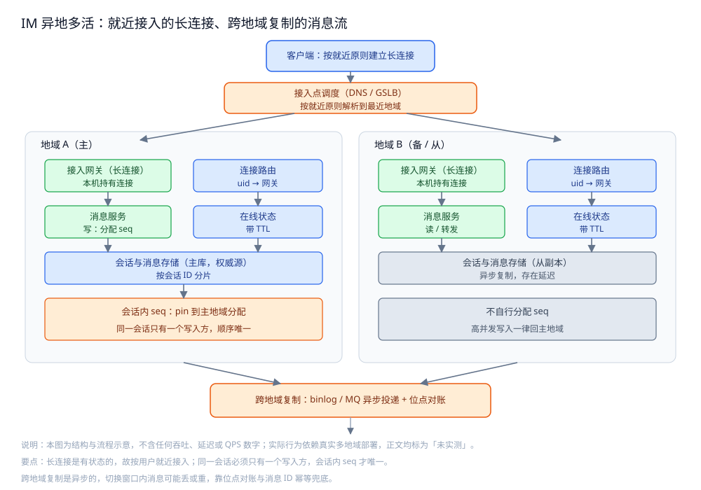
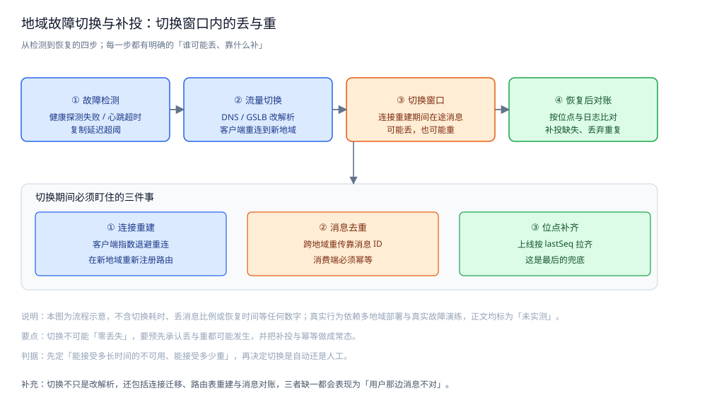

# 跨地域多活

> IM 的**异地多活**：为什么用户分布广就要多活、**长连接怎么跨地域**、
> 消息怎么在地域间复制、多活下**会话内 seq 怎么保持唯一**、地域故障怎么切与怎么补、
> 以及多活要付出的代价。
>
> 本篇是 IM 目录的**部署形态篇**：讲**结构与判据**，不做部署教程。
> 连接本身怎么选、路由表怎么放见 [在线状态与推送.md](在线状态与推送.md)；
> 消息在单地域内怎么不丢不重见 [消息可靠投递.md](消息可靠投递.md)；
> 一条消息跨的三条路径见 [通信链路与协议栈.md](通信链路与协议栈.md)。
>
> 内容整理自个人学习笔记，并参考分布式系统多地域容灾与数据复制的公开资料；素材见 [素材清单](../../../素材清单.md)。
>
> ⚠️ 实测口径：**本篇未做实测**。多活的一切结论（切换耗时、跨地域延迟、复制滞后）
> 都依赖**真实多地域机房、跨域专线与真实故障演练**，本机单进程环境无法复现；
> 正文只给结构与判据，**不引用任何吞吐 / 延迟 / QPS / 端到端时延数字**。

---

## 一、IM 为什么需要多活？

**本节要点**：多活不是"多买几个机房"——它是**用户分布、单点故障、就近延迟**三个问题
同时指向同一个答案；而 IM 的特殊之处在于**它要跨地域的不只是数据，还有"能接住连接的入口"**。

### 1.1 三个动因

| 动因 | 说明 | 如果只做单地域 |
|---|---|---|
| **用户分布广** | 用户可能在任何地区，链路越长越容易丢包、抖动 | 远端用户延迟高、弱网体验差 |
| **单地域故障** | 机房级断电、光缆中断、区域性网络故障 | 一次故障 = 全站不可用 |
| **就近接入** | 让用户连到**物理上最近**的接入点，缩短接入链路 | 所有都要绕到同一个入口，延迟被拉长 |

⭐ 一句话：**多活要解决的是"就近接入"和"断一个地域不倒"两件事**，两者都指向"多地都要有可用的接入与服务"。

### 1.2 IM 多活的特殊难点：长连接是有状态的

普通无状态服务做多活，只要**多地都有一份能读的数据**，请求打到哪都行。
IM 不一样：

- 用户的长连接**只能活在某一台网关进程里**，也就是**只能落在某一个地域**；
- 一条要发给用户的消息，必须送到**持有他连接的那个地域的那台网关**；
- 用户如果跨地域移动（出差、旅行），**连接要跟着换地域**。

| 维度 | 无状态服务 | IM 长连接 |
|---|---|---|
| 请求落哪 | 任意实例都行 | **发往用户连接所在的地域** |
| 状态在哪 | 数据层 | **连接状态在网关进程内 + 路由表** |
| 迁移单位 | 无需迁移 | **连接本身要迁移或重建** |

⭐ 判据：**IM 的多活，难点不在"数据多地一份"，而在"人连着哪个地域"这件事本身是状态**。

## 二、长连接怎么跨地域？

**本节要点**：先靠**接入点调度**把用户引到最近的地域；用户跨地域移动时，
在**连接迁移**与**重连到新地域**之间做取舍——前者平滑但要维护会话上下文，后者简单但会闪断。

### 2.1 接入点调度：把用户引到最近的地域

用户建连前，第一步是"连到哪里"。这一步由**域名解析**完成：

| 手段 | 做法 | 特点 |
|---|---|---|
| **DNS** | 同一个域名按解析者所在地区返回不同 IP | 简单，但受本地 DNS 缓存影响 |
| **GSLB**（全局负载均衡） | 按地理 / 运营商 / 健康度返回接入点 | 更精细，可剔除故障地域 |
| **客户端拨测 + 择优** | 客户端拿到多个候选接入点，自己探测选最快的 | 最贴近真实链路，但要客户端参与 |

⭐ 判据：**接入调度的目标不是"最均匀"，而是"让用户连到最近且健康的接入点"**。
它的原理（服务发现、健康检查、就近策略）见 [服务发现与负载均衡.md](../../分布式/服务治理/服务发现与负载均衡.md)。

### 2.2 用户跨地域移动时：迁移还是重连？

用户从 A 城飞到 B 城，原来的长连接落到地域 A 的网关上。有两条路：

| 方案 | 做法 | 优点 | 代价 |
|---|---|---|---|
| **连接迁移** | 把这条连接（及其会话上下文）从地域 A 的网关交接到地域 B | 用户几乎无感，少一次闪断 | 要跨地域传递连接上下文，实现复杂 |
| **重连到新地域** | 客户端发现新地域更近，主动断开、连到地域 B | 实现简单，复用现成的重连逻辑 | 有一次闪断，重连后要补消息 |

```text
跨地域移动（从 A 到 B）：

方案一：连接迁移
  地域 A 网关 ── 交接会话上下文 ──▶ 地域 B 网关
  客户端：连接不变，几乎无感
  代价：上下文传递 + 路由表原子更新

方案二：重连到新地域
  客户端 ── 断开 ──▶ 重连到地域 B ──▶ 按位点补齐断线期间消息
  客户端：短暂闪断
  代价：复用现成重连逻辑（见 在线状态与推送.md）
```

⭐ 判据：**大多数系统选"重连"**——因为"断线重连 + 位点补齐"这套逻辑本来就必须存在
（见 [在线状态与推送.md](在线状态与推送.md) 第三节），复用它比重写一套"跨地域连接迁移"划算得多。
**连接迁移只在"连接代价极高、闪断代价极大"时才值得**。



## 三、消息怎么跨地域复制？

**本节要点**：**同一会话的消息必须在多个地域都可见**，否则切换后用户看不到历史。
复制手段从最省的**存储层复制**到最灵活的**业务层投递**，代价是"复制延迟"不可避免。

### 3.1 为什么必须跨地域复制

用户这次连着地域 A，下次可能就在地域 B 上线。他要看到的是**同一个会话的完整消息流**，
不会因为"换了个机房"就少了一截历史。所以：

- **会话消息流**：必须是**多地可见**的权威副本；
- **会话与成员**：也必须在多地可读，否则切过去找不到会话。

### 3.2 三种复制路径

| 路径 | 层次 | 做法 | 特点 |
|---|---|---|---|
| **存储层复制** | DB | 主库单向复制到从库（binlog） | 最省事，延迟取决于链路与回放 |
| **链路层同步** | DB 日志 | 订阅 binlog，投递到异地 | 逻辑解耦，可按需过滤、转换 |
| **业务层投递** | 应用 | 应用把消息事件投到跨域 MQ，异地消费写入 | 最灵活，可在异地做额外处理 |

对应原理见 [复制与高可用.md](../../../03-数据与中间件/数据存储/关系型/MySQL/复制与高可用.md)、
[日志与持久化.md](../../../03-数据与中间件/数据存储/关系型/MySQL/日志与持久化.md)、
[数据同步方式选型对比.md](../../../03-数据与中间件/数据存储/数据同步/数据同步方式选型对比.md)。

### 3.3 复制必然是异步的

跨地域链路的延迟远大于同机房，**强同步复制会把每次写入的耗时绑定到最慢的地域**——
一条消息的发送会被"等另一个地域确认"拖住。所以常见做法是：

- **写入只等本地**：本地落库即返回上行 ACK（见 [消息可靠投递.md](消息可靠投递.md) 第二节）；
- **异地异步追**：通过复制 / MQ 异步把消息送到其他地域；
- **接受滞后**：短期内异地看到的消息**比本地慢一点**，切换时要考虑这段"还没复制过去"的窗口。

⭐ 判据：**复制延迟是"用一致性换延迟"的账单**。要问的是"能接受多长的滞后"，而不是"能不能零延迟"——
这是 [一致性与CAP.md](../../分布式/理论/一致性与CAP.md) 在多活场景的具体落点。

> ⚠️ **未实测**：本节不给"跨地域复制滞后多少毫秒"的数字。
> 原因：滞后取决于专线质量、复制方式与写入压力，缺了真实多地域链路，任何数字都是编造。

## 四、多活下会话内 seq 还唯一吗？

**本节要点**：这是多活里**最容易被忽略、后果最直接**的一个问题——
如果同一会话的消息能在两个地域各自分配 seq，同会话的顺序就会**分叉**；
解决它的第一原则是**让一个会话只有一个写入方**。

### 4.1 问题从哪来

[消息可靠投递.md](消息可靠投递.md) 里，**会话内 seq 由服务端分配、必须单调唯一**。
一旦多活：

- 用户在 A 地域发一条、在 B 地域又发一条，**两个地域各自分配 seq**；
- 两条消息的 seq 可能相同，或大小顺序与真实顺序相反；
- 对端按 seq 排序、断线按 seq 补齐（见 [消息可靠投递.md](消息可靠投递.md) 第六节），
  **错误的分叉 seq 会导致消息乱序甚至"看起来丢了"**。

### 4.2 三种解法

| 方案 | 做法 | 代价 |
|---|---|---|
| **会话 pin 主地域**（主流） | 每个会话**固定归属一个地域**，该会话的 seq 只能由这个地域分配 | 跨地域写入要**转发回主地域**，多一跳 |
| **全局发号** | 用一个全局唯一发号器（如雪花类 ID）给消息编号 | 全局唯一好办，但**"会话内稠密递增"难保证** |
| **冲突合并** | 允许两地各自分配，读时按规则合并去冲突 | 规则复杂，用户体验最不可控 |

⭐ 判据：**首选"会话 pin 主地域"**。它把 [消息可靠投递.md](消息可靠投递.md) 里
"seq 由这个会话的写入方分配"这条原则**原样保留**，只是把"写入方"从一个实例提升为"一个地域"。
**发号器方案**见 [分布式ID.md](../../分布式/理论/分布式ID.md)，但它给的是"全局唯一"，
**不是"会话内稠密"**——IM 要的是后者。

### 4.3 "pin" 到哪个地域怎么定

| 方式 | 说明 |
|---|---|
| **按会话 ID 哈希** | `hash(convID) % 地域数`，简单、稳定，但调整地域数会大范围重排（见 [一致性哈希.md](../../分布式/服务治理/一致性哈希.md)） |
| **按会话创建地** | 会话在哪个地域创建就 pin 在哪个地域，符合"就近创建"直觉 |
| **按成员多数地** | 群会话按成员主要分布地选择，减少跨地域写 |

⭐ 注意：**pin 信息本身也是"要被多地读到的状态"**——它必须存在一个多地都一致的目录里，
否则 A 地域以为是主、B 地域也以为是主，就退化成"冲突合并"了。

```text
一次跨地域写消息（会话 pin 在 A 地域）：

用户在 B 地域 ── 发送 ──▶ B 地域网关
                              │ 查会话 pin：主地域 = A
                              ▼
                         转发到 A 地域消息服务
                              │ 去重 → 分配 seq → 存储（见 消息可靠投递.md）
                              ▼
                         返回 SendAck（msgID + seq）
                              │
                              ▼
                         B 地域回客户端；跨地域复制把消息带回 B
```

## 五、地域故障怎么切？

**本节要点**：切换不是"改个解析就完事"——**连接要重建、路由要重挂、在途消息要对账**；
而且必须预先承认：**切换窗口里消息可能丢、也可能重**。

### 5.1 从检测到恢复的四步

1. **故障检测**：健康探测失败、心跳大面积超时、跨地域复制延迟异常拉长；
2. **流量切换**：GSLB / DNS 改解析，把新连接引到健康地域；
3. **切换窗口**：正在断线重连的连接，其**在途消息可能丢（没送达）或重（重传）**；
4. **恢复后对账**：按位点与消息日志比对，**补投缺失、丢弃重复**。



### 5.2 切换时三件事必须一起做

| 事项 | 说明 | 呼应 |
|---|---|---|
| **连接重建** | 客户端指数退避重连，在新地域重新注册路由 | [在线状态与推送.md](在线状态与推送.md) 第三节 |
| **消息去重** | 跨地域重传的消息靠**消息 ID** 幂等（见 [消息可靠投递.md](消息可靠投递.md) 第四节） | 去重先于 seq 分配 |
| **位点补齐** | 上线按 `lastSeq` 拉齐，这是最后的兜底 | [消息可靠投递.md](消息可靠投递.md) 第六节 |

⭐ **判据**：**不追求"零丢失"，追求"丢了能补、补了不重"**。这正是
[稳定性三件套.md](../../分布式/服务治理/稳定性三件套.md) 在多活场景的落点——
限流保护切换中的地域不被打垮、熔断隔离故障地域、降级让非核心功能先让路。

### 5.3 自动切还是人工切

- **自动切**：发现快、恢复快，但**误判代价高**（网络抖动可能被当成地域故障，导致无谓切换）；
- **人工切**：判断稳，但**慢**，故障期间用户一直不可用。

**务实做法**：**分级**——单点 / 单实例的故障交给自动化（本来就有冗余）；
**整个地域的切换**先告警、由人或带值守的自动化决策。**判据是先定"能接受多长的不可用"**，再决定自动化程度。

### 5.4 切换后最容易漏的一步：对账

切换后系统"看起来恢复了"，但**切换窗口里可能既有丢的、又有重的**。所以必须有一条对账：

- 比较"本地消息流"与"异地副本 / 客户端上报的位点"；
- 找出**缺失**的（该有而没有）→ 补投；
- 找出**重复**的（同消息 ID 出现多次）→ 去重。

> ⚠️ **未实测**：本节不附任何"切换耗时""恢复时间"数字。
> 原因：这些只能由真实地域故障演练得出，本机无法制造地域级故障。

## 六、多活的代价是什么？

**本节要点**：多活不是免费的——它用**一致性、延迟、运维复杂度、成本**换来"就近 + 容灾"，
所以要问的第一个问题是**"我们这个规模到底值不值得上多活"**。

### 6.1 四类代价

| 代价 | 说明 |
|---|---|
| **一致性** | 跨地域复制异步 → 异地存在滞后窗口，切换时要用对账弥补 |
| **延迟** | 跨地域写入要转发回主地域（会话 pin），多一跳 |
| **运维复杂度** | 多地数据一致性、切换预案、演练、对账，都要常态化 |
| **成本** | 多地域都要有可承接流量的容量，不是"备份机房"而是"都能跑" |

### 6.2 什么规模才值得

| 情形 | 建议 |
|---|---|
| **用户集中在单一区域、可接受分钟级中断** | 先做**同城多机房 / 主备**，不上多活 |
| **用户跨区域、对可用性要求高** | 上**异地多活**，并按会话 pin 定主地域 |
| **有数据驻留 / 合规要求** | 数据按要求分地域存放，多活同时承担合规职责 |

⭐ 判据：**多活的门槛是"可用性目标 + 用户分布"，不是"技术看起来很酷"**。
对大多数系统，"同城双活 + 异地冷备"的性价比往往高于一步到位的异地多活。

## 使用：跨地域「会话 pin 主地域」路由的骨架

**本节要点**：把"会话 → 主地域"的 pin、以及"跨地域写入转发回主地域"落成
**可编译的最小骨架**；依赖真实多地域部署的部分标注未实测。

```go
package im

import (
	"errors"
	"sync"
)

// RegionHome 记录一个会话的「主地域」——即该会话的 seq 由哪个地域分配。
//
// ⚠️ 未实测：本机实现是进程内 map，仅用于验证接口与语义。
// 生产必须把这份映射放到多地一致的目录里，
// 否则 A、B 两地域可能都以为自己是主，会话内 seq 就会分叉。
type RegionHome struct {
	mu   sync.RWMutex
	home map[string]string // convID -> regionID
}

func NewRegionHome() *RegionHome {
	return &RegionHome{home: map[string]string{}}
}

// Pin 为会话指定主地域（幂等：已 pin 过的会话不改变归属）。
func (h *RegionHome) Pin(convID, regionID string) {
	h.mu.Lock()
	defer h.mu.Unlock()
	if _, ok := h.home[convID]; !ok {
		h.home[convID] = regionID
	}
}

// Home 返回会话的主地域；未 pin 时报错，调用方应先去 pin。
func (h *RegionHome) Home(convID string) (string, error) {
	h.mu.RLock()
	defer h.mu.RUnlock()
	r, ok := h.home[convID]
	if !ok {
		return "", ErrNoHome
	}
	return r, nil
}

var ErrNoHome = errors.New("conv has no home region")
```

消息服务在"非主地域"收到写请求时，**转发回主地域**再分配 seq：

```go
// Router 按「会话 pin 主地域」把写请求送到应该分配 seq 的地域。
//
// ⚠️ 未实测：未接真实的跨地域转发与存储。
// 原因：跨地域延迟与转发行为必须在真实多地域链路上观察，本机无法复现。
type Router struct {
	home    *RegionHome
	here    string // 本实例所在地域
	forward func(regionID string, req SendRequest) (SendResult, error)
}

func (r *Router) Send(req SendRequest) (SendResult, error) {
	home, err := r.home.Home(req.ConvID)
	if err != nil {
		return SendResult{}, err
	}
	if home == r.here {
		// 本地域就是主：直接分配 seq（去重 / seq / 存储见 消息可靠投递.md）。
		return r.sendLocal(req)
	}
	// 非主地域：转发回主地域，由它分配会话内 seq。
	return r.forward(home, req)
}
```

> ⚠️ **未实测**：以上代码**只做静态编译校验**（`gofmt` 通过），未运行 `go test`。
> 原因：会话 pin 与跨地域转发的正确性依赖**多个地域、真实跨域链路与故障演练**，
> 本机单进程无法复现，给出运行结果即为编造。

## 延伸追问

- **多活和主备最大的区别是什么？** → 主备里备机房平时不接流量、只等切换；多活里**多地都要能承接真实流量**，因此容量、数据与路由在平时就是"都在跑"。多活的成本高，正是在这里。
- **为什么跨地域移动优先选"重连"而不是"连接迁移"？** → 因为"断线重连 + 位点补齐"这套逻辑**本来就必须存在**（弱网、NAT 老化都会断线），复用它几乎零成本；而连接迁移要跨地域传递会话上下文、原子更新路由，复杂度和故障面都大得多。
- **跨地域复制能不能做成强同步？** → 能，但会把每次写入拖到"等最慢地域确认"，用户感知明显变慢。IM 的取舍是**本地落库即确认、异地异步追**，用"接受滞后"换低延迟（见 [一致性与CAP.md](../../分布式/理论/一致性与CAP.md)）。
- **为什么 seq 不能用一个全局发号器解决？** → 全局发号器给的是**全局唯一**，但 IM 要的是**会话内稠密递增**：全局序号会让每个会话出现大量空洞，对端误判"丢了很多条"而触发无意义重拉（见 [消息可靠投递.md](消息可靠投递.md) 第一节）。
- **切换过程中"可能丢也可能重"，那岂不是不可靠？** → 切换本身就是一次大的断线重连，期间的不确定性靠**位点补齐（补丢）+ 消息 ID 去重（去重）**兜底；可靠性不是"切换时一条不差"，而是"切换后能收敛到一致"。

## 关联

- [通信链路与协议栈.md](通信链路与协议栈.md) — 分层总纲：一条消息跨的三条路径，本篇是在"长连接与下游"两级上做地域分布。
- [在线状态与推送.md](在线状态与推送.md) — 连接路由、心跳重连与离线降级，本篇的"连接切换"复用它。
- [消息可靠投递.md](消息可靠投递.md) — 会话内 seq、去重与位点补偿，本篇第四节直接依赖它的编号原则。
- [会话与未读.md](会话与未读.md) — 会话模型与多端同步，跨地域后这份共享状态的存放要一并考虑。
- [群聊.md](群聊.md) — 多成员会话的写入扇出，跨地域时写放大与 pin 主地域会互相影响。
- [搜索与历史.md](搜索与历史.md) — 历史消息跨地域可读的索引与存储分布相关。
- [一致性与CAP.md](../../分布式/理论/一致性与CAP.md) — "复制延迟换延迟"的取舍原理。
- [分布式ID.md](../../分布式/理论/分布式ID.md) — 全局发号器方案，用于对照"全局唯一 vs 会话内稠密"。
- [一致性哈希.md](../../分布式/服务治理/一致性哈希.md) — 会话 pin 按哈希分配时的重排问题。
- [服务发现与负载均衡.md](../../分布式/服务治理/服务发现与负载均衡.md) — 就近接入与健康剔除的原理层。
- [稳定性三件套.md](../../分布式/服务治理/稳定性三件套.md) — 切换时的限流、熔断、降级。
- [复制与高可用.md](../../../03-数据与中间件/数据存储/关系型/MySQL/复制与高可用.md) — 存储层复制与主从切换。
- [数据同步方式选型对比.md](../../../03-数据与中间件/数据存储/数据同步/数据同步方式选型对比.md) — 跨地域同步方式的选型对比。
- [消息队列选型对比.md](../../../03-数据与中间件/中间件/消息队列/消息队列选型对比.md) — 跨域投递借 MQ 时的语义与选型。
- [README.md](README.md) — IM 目录总纲与阅读顺序。
