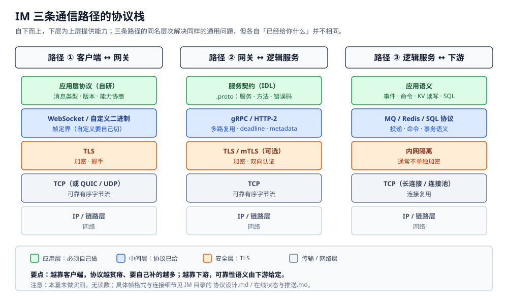
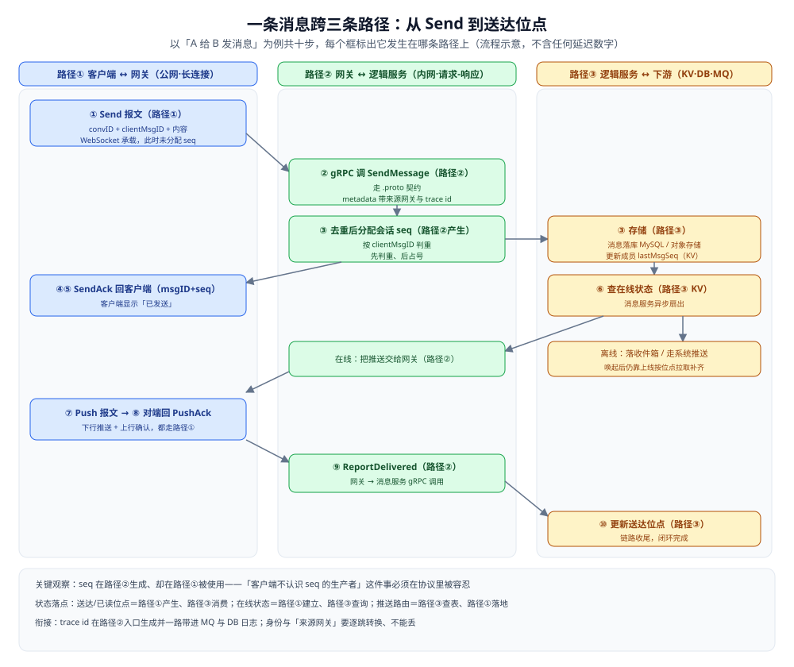

# 通信链路与协议栈

> IM 里一条消息从「用户按下发送」到「对端看到」要跨**三条通信路径**：
> **客户端 ↔ 网关**（长连接）、**网关 ↔ 逻辑服务**（RPC）、**逻辑服务 ↔ 下游**（MQ / KV / DB）。
> 三条路径的网络环境、通信模式、失败代价、演进节奏全都不同，因此**协议栈也不同**。
>
> 本篇是 IM 目录的**分层篇（分层总纲）**：讲清「为什么分三条路径、每条路径用什么协议、跨路径怎么衔接」。
> **各路径的细节不在这里重复**：报文层（帧格式 / 消息类型 / 版本演进）见 [协议设计.md](协议设计.md)；
> 连接层（长连接选型 / 连接路由 / 心跳 / 离线降级）见 [在线状态与推送.md](在线状态与推送.md)；
> 投递语义（会话 seq / ACK / 幂等）见 [消息可靠投递.md](消息可靠投递.md)；
> 状态模型（会话 / 未读 / 多端收敛）见 [会话与未读.md](会话与未读.md)。
>
> 内容整理自个人学习笔记，并参考 gRPC / WebSocket（RFC 6455）/ MQTT / HTTP/2 官方规范；素材见 [素材清单](../../../素材清单.md)。
>
> ⚠️ 实测口径：**本篇不做实测**。它是「分层总纲」，所有内容都是**结构与模型的定性对照**；
> 涉及具体读数的判断指向对应专篇。不引用任何第三方吞吐或延迟数字。

---

## 一、为什么一条消息要跨三条路径？

**本节要点**：**不是「一根管子从客户端拉到数据库」，而是三段各自解决不同问题的链路**。
三段分开的根本原因是：**参与方不同、网络环境不同、通信模式不同、失败代价不同、演进节奏不同**。
把三段拼成一根管子，就会在每一段上都做妥协。

| 维度 | **路径 ①：客户端 ↔ 网关** | **路径 ②：网关 ↔ 逻辑服务** | **路径 ③：逻辑服务 ↔ 下游** |
|---|---|---|---|
| 参与方 | 用户设备 ↔ 服务端 | 服务端 ↔ 服务端 | 服务端 ↔ 存储 / 中间件 |
| 网络环境 | ⭐ **公网**：丢包、抖动、NAT、弱网切换 | ⭐ **内网**：低延迟、高带宽 | 内网（同机房 / 同可用区） |
| 通信模式 | ⭐ **双向推**：服务端要主动推 | **同步请求-响应**为主 | **异步事件流 + 同步 KV** |
| 连接寿命 | **长**（秒~小时级） | **短**（毫秒~秒级） | 长（MQ 长连接 / DB 连接池） |
| 失败代价 | 用户掉线、消息延迟 | 服务 5xx、请求失败 | 消息积压、数据不一致 |
| 失败处理 | ⭐ **重连 + 位点补齐** | ⭐ **超时 + 重试 + 熔断** | ⭐ **重投 + 补偿 + 对账** |
| 演进节奏 | ⚠️ **慢**（客户端发版难） | ⭐ **快**（服务灰度天级） | 中（存储升级要评审） |
| 协议选择 | WebSocket / 自定义二进制 | gRPC / Thrift | MQ 协议 / Redis 协议 / SQL |

⭐ **一句话**：**三段各有各的「最难」，硬合成一根管子，就要用一根管子的最严约束去限制另外两段**。
比如客户端升级困难、所以协议要向前兼容；后端服务可以天级灰度、本可以激进演进 —— 混在一起，后端就只能陪着客户端慢慢爬。

---

## 二、三条路径的协议栈长什么样？

**本节要点**：**每一层协议都在替上一层解决一个问题**。看清协议栈的层次，就知道「哪一层已经帮你做了、哪一层还要你自己做」。



图怎么读：三条路径（客户端 ↔ 网关、网关 ↔ 逻辑服务、逻辑服务 ↔ 下游）各自一列，自下而上堆：IP / 链路层 → TCP → TLS → 帧定界（WebSocket / HTTP-2 / MQ 协议）→ 应用语义，下层为上层提供能力。要点是——越靠客户端协议越「贫瘠」，要自己补的越多（报文类型、seq、心跳都得自研）；越靠下游，投递语义由下游给定。

### 2.1 路径 ①：客户端 ↔ 网关

```text
应用层协议（自研）      ← 消息类型、版本、能力协商（见 协议设计.md）
        ↑
WebSocket / 自定义协议   ← 帧定界、控制帧（WebSocket 帮你；自定义要自己切）
        ↑
TLS                     ← 加密、握手
        ↑
TCP（或 QUIC / UDP）    ← 可靠传输（或 QUIC 自己做）
        ↑
IP / 链路层             ← 网络
```

这条路径的**特殊之处**在公网和长期存活：NAT 会让连接被中途掐断、移动网络会切换 IP，
所以「连接会断」是**常态而不是异常**——这一层的一切设计（心跳、重连、位点补齐）都从这来。

### 2.2 路径 ②：网关 ↔ 逻辑服务

```text
服务契约（IDL）          ← .proto：服务 / 方法 / 消息 / 错误码（见 协议设计.md 的报文类型，语义在此）
        ↑
gRPC / HTTP-2           ← 多路复用、流控、deadline、metadata、trailer
        ↑
TLS（内网可选 / mTLS）   ← 加密、双向认证
        ↑
TCP                     ← 可靠有序字节流
        ↑
IP / 链路层
```

这条路径与 ① 最大的不同：**HTTP/2 原生给了「一次请求 ↔ 一次响应」的配对**（靠 stream id），
不需要像 ① 那样自己造 seq 来配对；`deadline` 与 `metadata` 也是协议自带的——这就是为什么服务间调用不需要自研协议。

### 2.3 路径 ③：逻辑服务 ↔ 下游

```text
应用语义                ← 事件 / 命令 / KV 读写 / SQL（业务含义在这一层）
        ↑
MQ 协议 / Redis 协议 / SQL ← 投递语义（MQ）、命令语义（Redis）、事务语义（SQL）
        ↑
TCP（长连接 / 连接池）    ← 复用连接，避免每操作一次握一次手
        ↑
IP / 链路层
```

这条路径的协议**不是一种**：往下游的每一次通信都可能落在不同协议上，
而**可靠性 / 一致性由具体下游决定**——数据库给你事务，MQ 给你至少一次，Redis 可能什么都不给。

### 2.4 三条协议栈逐层对照

| 层次 | 路径 ①（客户端 ↔ 网关） | 路径 ②（网关 ↔ 逻辑服务） | 路径 ③（逻辑服务 ↔ 下游） |
|---|---|---|---|
| 字节流可靠性 | TCP | TCP | TCP |
| 加密 | TLS（公网必需） | TLS（可选 / mTLS） | 通常依赖内网隔离，不单独加密 |
| 消息边界 | WebSocket 帧 / 自定义定界 | HTTP-2 帧 | MQ 帧 / 协议自带 |
| 请求-响应配对 | ❌ 要自造 seq | ✅ stream id | MQ 靠 ack，KV/DB 天然配对 |
| 超时语义 | ❌ 要自造心跳判死 | ✅ deadline | 消费超时 / 连接超时 |
| 服务契约 | 自研报文类型 | ✅ IDL（.proto） | 各自协议 schema |
| 应用层语义 | ✅ 全部自己做 | 部分自己做（幂等 / 重试） | 幂等 / 补偿自己做 |

⭐ 一句话：**越靠近客户端，协议越「贫瘠」，要自己补的东西越多；越靠近下游，协议越「专用」，可靠性语义由下游给定**。

---

## 三、协议栈上哪些是「别人替你做了」、哪些必须自己来？

**本节要点**：**一层能做的不必再做一遍**。分不清「谁负责什么」，就会出现两种典型浪费——
在 TCP 上再写一遍可靠传输，或者在 WebSocket 上再手搓一套心跳协议。

### 3.1 传输与安全层已经给的东西

| 能力 | 谁给的 | 说明 |
|---|---|---|
| 可靠、有序的字节流 | TCP | 三段的底层都一样；除非换成 QUIC，才要接受「可靠性在 UDP 之上重建」 |
| 拥塞控制与重传 | TCP | 不要在上层再写一遍「丢包重传」——那是 TCP 的事 |
| 加密与身份握手 | TLS | 公网路径几乎必开；内网看安全要求 |
| 连接复用 | HTTP-2 / 连接池 | 服务间与下游不必每次重新握手 |

### 3.2 中间层已经给的东西

| 能力 | 路径 ① | 路径 ② | 路径 ③ |
|---|---|---|---|
| 消息边界（帧） | WebSocket 帮你切；自定义要自己切 | HTTP-2 帧 | MQ 协议帧 |
| 请求-响应配对 | ❌ 无（要自造 seq） | ✅ stream id | 消费 ack 配对 |
| 超时 / 取消传播 | ❌ 无 | ✅ deadline | ⚠️ 部分（连接超时，非业务 deadline） |
| 上下文透传 | ⚠️ 靠自研字段 | ✅ metadata | ⚠️ 靠消息头 |
| 投递语义 | ❌ 无 | 同步调用 | MQ：至少一次 / 至多一次 |

### 3.3 只有应用层能做的（不要重复造轮子）

下面这些**三条路径都得不到**，必须由 IM 自己的应用层定义：

- **报文类型与版本**：什么报文是"发送"、什么是"已读回执"，协议栈不认识（见 [协议设计.md](协议设计.md)）；
- **能力协商**：对端支持哪些可选特性，只有握手时双方交换位图才知道；
- **会话内 seq 与幂等去重**：TCP 保证"字节不丢"，但不保证"消息不被应用重放一次"（见 [消息可靠投递.md](消息可靠投递.md)）；
- **连接路由**：谁在线、在哪台网关，是 IM 自己的状态，任何协议栈都不提供（见 [在线状态与推送.md](在线状态与推送.md)）；
- **未读与已读收敛**：一份被多端共享的派生状态，只能自己定收敛规则（见 [会话与未读.md](会话与未读.md)）。

⭐ 判据：**「这一层已经给你了，就别再做一遍」**。TCP 给了可靠字节流、HTTP-2 给了配对与 deadline、
MQ 给了持久化与消费组——把这些再实现一次，只会多一份 bug，不会多一分可靠。

---

## 四、一条消息怎么跨过这三条路径？

**本节要点**：把三条路径串起来看，才能看清**哪些状态在哪条路径上产生、哪条路径上被消费**。

以「用户 A 给用户 B 发消息」为例：

```text
① 客户端 → 网关：Send 报文（convID + clientMsgID + 内容）
        │  路径 ①：WebSocket 承载；未分配 seq
        ↓
② 网关 → 消息服务：gRPC 调 SendMessage
        │  路径 ②：走 .proto 契约
        ↓
③ 消息服务：
        ├─ 去重（按 clientMsgID）        ← 见 消息可靠投递.md 第四节
        ├─ 分配会话 seq                  ← seq 在路径 ② 生成
        ├─ 存储消息（路径 ③ 的 DB）      ← 路径 ③：MySQL / 对象存储
        └─ 更新成员 lastMsgSeq（路径 ③ 的 KV）
        ↓
④ 消息服务 → 网关：返回 SendAck（msgID + seq）
        ↓
⑤ 网关 → 客户端：SendAck 报文
        │  客户端显示"已发送"
        ↓
⑥ 消息服务异步扇出：
        ├─ 查在线状态（路径 ③ 的 KV）    ← 见 在线状态与推送.md 第二节
        ├─ 对端在线 → 发到网关（路径 ② 的推送）
        └─ 对端离线 → 落收件箱 / 走系统推送
        ↓
⑦ 网关 → 对端客户端：Push 报文
        │  路径 ①：WebSocket
        ↓
⑧ 对端客户端回 PushAck
        │  路径 ① 上行
        ↓
⑨ 网关 → 消息服务：gRPC 调 ReportDelivered
        │  路径 ②
        ↓
⑩ 消息服务更新送达位点（路径 ③）
```

**这张时序图里，状态分别落在哪三条路径上**：

| 状态 | 在哪条路径产生 | 在哪条路径消费 | 见哪篇 |
|---|---|---|---|
| 会话内 seq | 路径 ②（消息服务分配） | 路径 ①（客户端按 seq 排序） | [消息可靠投递.md](消息可靠投递.md) |
| 送达 / 已读位点 | 路径 ①（客户端回执） | 路径 ③（落库） | [会话与未读.md](会话与未读.md) |
| 在线状态 | 路径 ①（连接建立） | 路径 ③（KV 查询） | [在线状态与推送.md](在线状态与推送.md) |
| 推送路由 | 路径 ③（路由表） | 路径 ①（连接落地） | [在线状态与推送.md](在线状态与推送.md) |

⭐ 关键观察：**seq 在路径 ② 生成、却在路径 ① 被使用**——所以"客户端不认识 seq 的生产者"这件事必须在协议里被容忍（seq 只是编号，不要求客户端理解它怎么来的）。



图怎么读：三条泳道分别是路径 ①②③，十步自上而下推进，重点看「跨路径」的位置——seq 在路径②产生、却在路径①被使用；送达/已读位点在路径①产生、路径③落库；trace id 在路径②入口生成并一路带进 MQ 与 DB 日志。对端离线时走「落收件箱 / 走系统推送」，唤起后仍靠上线按位点拉取补齐。图为流程示意，不含任何延迟数字。

---

## 五、三条路径之间靠什么衔接？

**本节要点**：三条路径**不是拼起来就完事**——它们之间要传递身份、上下文与时间预算。
这三样东西**断了任何一样，链路就退化成一堆各自为政的调用**。

### 5.1 身份与上下文怎么一路带下去

同一条消息在三条路径上的"身份"载体不同，要**逐跳转换、不能丢**：

| 路径 | 身份载体 | 要带什么 |
|---|---|---|
| ① 客户端 ↔ 网关 | 连接级会话（登录态绑在长连接上） | 用户身份、设备标识、协议版本 |
| ② 网关 ↔ 逻辑服务 | gRPC metadata | 用户身份、**来源网关**（回推要用）、trace id |
| ③ 逻辑服务 ↔ 下游 | MQ 消息头 / KV 与 SQL 参数 | 用户身份、trace id、幂等键 |

⚠️ **来源网关**这一项最容易漏：逻辑服务异步扇出时，要知道"这条消息该推给哪台网关"，
而"对端在哪台网关"要现查，但"**谁把这个请求带上来的**"是发起端信息，**不转进 metadata 就丢了**。

### 5.2 进 MQ 的消息里必须带什么

异步扇出常借 MQ（见 [消息队列选型对比.md](../../../03-数据与中间件/中间件/消息队列/消息队列选型对比.md)）。进 MQ 的载荷至少要包含：

- **trace id**：它是整条链路**唯一能把三段日志串起来**的东西。客户端发的报文里没有它，
  网关要在**路径 ② 的入口**生成一个，并**一路带进 MQ、带进 DB 写入日志**——否则出了问题只能按时间"猜"是哪条消息；
- **幂等键**（消息 ID 或 clientMsgID）：消费者重投时用来去重（见 [消息可靠投递.md](消息可靠投递.md)）；
- **来源与目标**：convID、接收方列表、发起网关——扇出时**直接可用，不必回查**。

⭐ 判据：**"这条消息出了进程之后，还认得出自己是谁吗？"** 认不出，就要在载荷里补上下文。

### 5.3 超时预算怎么逐跳递减

一次跨路径调用有个**总预算**（用户能忍受多久），这个预算要**逐跳扣减**，而不是每跳都各自"等一会儿"：

```text
用户可忍的总预算 B（示意；B 按场景定，本仓不给具体数字）
   └─ 路径 ①：客户端等待      总预算 = B
        └─ 路径 ②：网关调逻辑服务   deadline = B - 网关自身开销
             └─ 路径 ③：逻辑服务访下游  deadline = 上级 deadline - 逻辑服务自身开销
```

三个要点：

- **每跳只减不增**：下级 deadline 必须小于上级剩余预算，否则上级早超时了，下级还在跑；
- **重试要在总预算内**：如果每跳都"失败就重试一次"，最坏情况会**成倍放大**总耗时——
  所以重试**只在外层做**、且**只对幂等方法做**（见 [稳定性三件套.md](../../分布式/服务治理/稳定性三件套.md)）；
- **deadline 要能取消下游**：路径 ③ 的长查询、MQ 消费要在收到取消信号后**尽快停**，否则线程被慢慢拖死。

⚠️ **反模式**：每跳都设一个固定的"我超时 3 秒"。浅调用看起来没事，
一旦链路变深（① → ② → ③ 再套一层），总耗时就是各跳超时之和，雪崩从这里开始。

---

## 六、三条路径的降级策略一样吗？

**本节要点**：**不一样**。每条路径的失败代价不同，降级策略也不同。

| 路径 | 失败表现 | 降级策略 |
|---|---|---|
| **① 客户端 ↔ 网关** | 连接断、消息延迟 | 客户端重连（指数退避 + 抖动）；重连后按位点补拉（见 [在线状态与推送.md](在线状态与推送.md)） |
| **② 网关 ↔ 逻辑服务** | 5xx、超时 | 熔断 + 降级（如"消息入队稍后重试"）；用户看到"发送中" |
| **③ 逻辑 ↔ 下游** | MQ 积压、KV 不可用、DB 慢 | MQ 重投 + 死信；KV 降级为读 DB；DB 写入走缓冲 |

⭐ **网关的位置很特殊**：它同时面临 ① 和 ② 两条路径的失败。**当路径 ② 挂时，网关不能简单断开客户端** ——
断开会让用户看到"掉线"，而实际上用户设备一切正常，是后端出问题。

**正确做法**：

- 网关对客户端**保持连接**（心跳继续）；
- 对上行消息**快速失败 + 明确回执**（"发送失败，请重试"），而不是让消息"发送中"卡死；
- 对下行推送**入队缓冲**，后端恢复后补推。

---

## 七、为什么不能「一条路径走到底」？

**本节要点**：三个常见的「简化方案」，以及它们为什么不成立。

### 7.1 客户端直连逻辑服务（跳过网关）

**问题**：

- 逻辑服务要处理**长连接** —— 这需要专门的连接管理、路由表、心跳，比业务逻辑复杂一个数量级；
- 服务扩容时，长连接要重新分布（哪个实例接哪条连接），客户端也要跟着重连；
- 逻辑服务本身要能水平扩展，但**长连接是有状态的**，与"无状态服务"的定位冲突。

⭐ **网关 = 专门处理"有状态长连接"的一层**，把无状态的逻辑服务解放出来。

### 7.2 客户端直接用 gRPC（跳过 WebSocket）

**问题**：

- **浏览器不支持 gRPC**（HTTP/2 帧不能从 JS 直接构造，trailer 不可用）；
- gRPC 的设计假设是"服务对服务"，没有考虑**弱网重连、离线、电量**这些客户端约束；
- gRPC 的流控和超时模型对**移动端弱网**不友好（详见 [四种通信模式.md](../../../03-数据与中间件/中间件/RPC框架/gRPC/四种通信模式.md)）。

⭐ 判据：**服务间用 gRPC，客户端用 WebSocket** —— 两者的优化目标不同。

### 7.3 逻辑服务直接通过 MQ 回客户端（跳过网关）

**问题**：

- MQ 是**广播**模型，一条消息要发给"当前持有该用户连接的网关" —— 网关需要订阅主题、过滤自己持有的连接；
- 客户端连接状态**不在 MQ 里**，MQ 无法感知"这个用户是否在线、在哪台网关"；
- 网关是**唯一知道"谁在哪"的一层**，跳过它就必须把这层知识搬到别处。

⭐ 判据：**网关是"连接知识"的唯一持有者**，任何要推到客户端的消息都必须经过它。

---

## 使用：一次完整跨路径调用的配置清单

**本节要点**：把三条路径的**关键配置项**列成清单，供落地时对照。
⚠️ 所有数值都是**示例**，真实取值必须按场景调，本仓不给数字。

### 路径 ①：客户端 ↔ 网关

```text
[ ] WebSocket 或自定义二进制选型       —— 判据见 在线状态与推送.md 1.1
[ ] 帧头布局与字段宽度                 —— 见 协议设计.md 第二节
[ ] 帧大小上限（安全项，必须有）       —— 见 协议设计.md 2.3
[ ] 心跳间隔 / 超时 / 判死次数         —— 见 在线状态与推送.md 3.2
[ ] 断线重连退避曲线 + 抖动            —— 见 在线状态与推送.md 3.3
[ ] 应用层协议版本号 + 能力位图         —— 见 协议设计.md 5.1 / 5.2
[ ] 未知报文类型的处理（必须优雅忽略）  —— 见 协议设计.md 5.3
```

### 路径 ②：网关 ↔ 逻辑服务

```text
[ ] .proto 定义（服务 + 消息 + 错误码）
[ ] 超时预算逐跳递减                   —— 见本篇 5.3
[ ] deadline 传递（gRPC 原生支持）
[ ] metadata 传递（trace id / 用户身份 / 来源网关）
[ ] 重试策略（只在外层、只对幂等方法）  —— 见 稳定性三件套.md
[ ] 熔断与降级开关
[ ] 内网 TLS / mTLS（如安全要求高）
```

### 路径 ③：逻辑服务 ↔ 下游

```text
[ ] MQ 消息格式（含 trace id）          —— 见本篇 5.2
[ ] MQ 投递语义（至少一次 + 消费端幂等）
[ ] 死信队列 + 重试策略
[ ] KV 连接池 / 超时 / 降级预案
[ ] DB 事务边界与补偿路径
[ ] 对账与监控（各路径的状态一致性）
```

**三条路径的公共检查项**：

```text
[ ] trace id 从入口生成，贯穿 ①②③（否则排障只能靠时间猜）
[ ] 每一跳的失败都有明确回执，不产生"永远发送中"的消息
[ ] 幂等键在跨路径传递中不被替换或丢失
[ ] 任一条路径的降级不牵连另外两条（如路径 ③ 慢，不导致路径 ① 掉线）
```

---

## 延伸追问

- **为什么不让客户端直接连逻辑服务？** → 长连接是**有状态**的，而逻辑服务要求**无状态可水平扩展**；网关把这份"有状态"单独收拢，逻辑服务才能随意扩缩容（见本篇 7.1）。
- **网关 ↔ 逻辑服务为什么不用自定义协议？** → 因为 HTTP-2/gRPC **已经给了**请求-响应配对、deadline、metadata、多路复用；自研一遍只会多一份 bug，不会多一分可靠（见本篇 3.2、3.3）。
- **三段的超时为什么不能各设各的？** → 用户感知的是**端到端总耗时**，不是某一段的耗时；每跳各设固定超时，链路一变深总耗时就是各段之和，重试还会成倍放大（见本篇 5.3）。
- **trace id 为什么必须在网关入口生成？** → 客户端报文里没有它；只有从路径 ② 入口生成并一路带进 MQ 与 DB 日志，三条路径的日志才能被串成一条（见本篇 5.2）。

## 关联

- [协议设计.md](协议设计.md) — 报文层：帧格式 / 报文类型 / 粘包半包 / 版本演进 / 能力协商。
- [在线状态与推送.md](在线状态与推送.md) — 连接层：长连接选型 / 连接路由 / 心跳重连 / 离线降级。
- [消息可靠投递.md](消息可靠投递.md) — 投递语义：seq / ACK / 写扩散与读扩散 / 幂等。
- [会话与未读.md](会话与未读.md) — 状态模型：会话 / 未读数 / 多端收敛 / 游标分页。
- [README.md](README.md) — IM 目录导读：四个硬问题与零件清单。
- [稳定性三件套.md](../../分布式/服务治理/稳定性三件套.md) — 限流 / 熔断 / 降级，路径 ② 的失败处理在此展开。
- [四种通信模式.md](../../../03-数据与中间件/中间件/RPC框架/gRPC/四种通信模式.md) — 服务间调用为什么用 gRPC、四种模式各适合什么。
- [net包与TCP-UDP编程.md](../../../01-编程语言/go/网络编程/net包与TCP-UDP编程.md) — 粘包半包与帧定界在通用网络编程里的讲法（本篇不重复）。
- [消息队列选型对比.md](../../../03-数据与中间件/中间件/消息队列/消息队列选型对比.md) — 路径 ③ 的异步扇出常借 MQ，选型与投递语义在那边。
- [README.md](../弹幕系统/README.md) — 同为长连接扇出场景，可容忍丢失，与本目录对照取舍。
- [README.md](../../分布式/README.md) — 本目录所用零件（一致性 / 故障转移 / 负载均衡）的原理线。
> 反向引用（本篇被下列文档引到）：[富媒体消息.md](富媒体消息.md)、[搜索与历史.md](搜索与历史.md)、[机器人与开放平台.md](机器人与开放平台.md)、[端到端加密.md](端到端加密.md)、[跨地域多活.md](跨地域多活.md)、[音视频信令.md](音视频信令.md)
