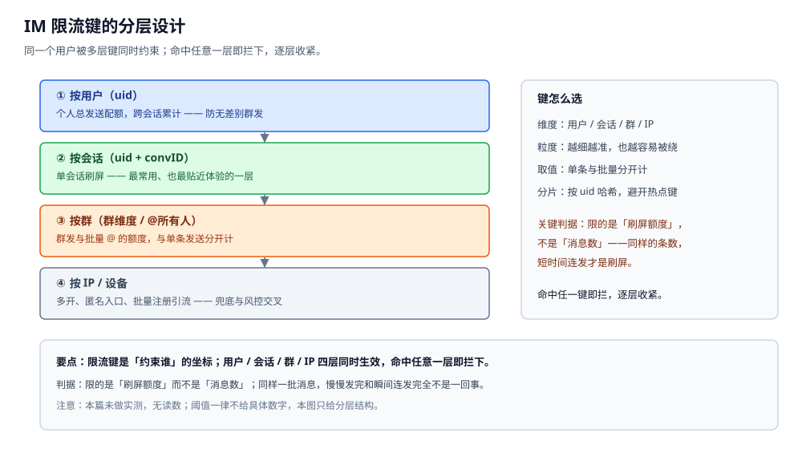
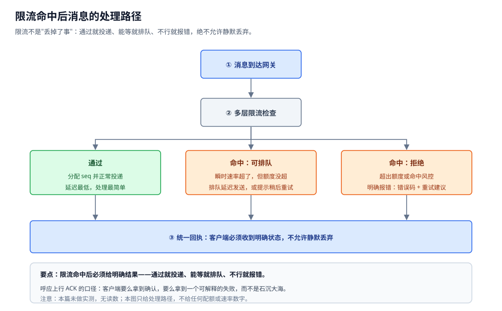

# 限流与防刷

> 本篇讲 IM 里的**发送频率限制与反垃圾**：限流键怎么选、用哪种限流算法、
> 群发与批量操作怎么限、新号与黑产怎么防、命中之后消息怎么处理、
> 以及防刷与正常体验怎么平衡。
>
> 本篇是 IM 目录的**流量治理与反滥用层**：它管的是"**这条消息该不该让它发出去**"，
> 而不是"发出去之后怎么送"。算法本体（令牌桶 / 滑动窗口 / 漏桶）在
> [限流算法.md](../../分布式/服务治理/限流算法.md) 与 [稳定性三件套.md](../../分布式/服务治理/稳定性三件套.md) 里讲，
> 本篇**不重复算法**，只讲"在 IM 里怎么用、键怎么选、命中后怎么处理"。
> 命中后的处置动作与内容审核共用一套分级思路，见 [内容审核与合规.md](内容审核与合规.md)。
>
> 内容整理自个人学习笔记，并参考令牌桶 / 滑动窗口等经典限流算法的公开资料；素材见 [素材清单](../../../素材清单.md)。
>
> ⚠️ 实测口径：**本篇未做实测**。原因：限流的效果取决于真实用户行为分布与真实黑产强度，
> 本机既没有流量也没有攻击样本，任何"误伤率 / 拦截率 / 命中阈值 / QPS"的数字都是编造。
> 所有代码块**只做静态编译校验**（`gofmt` 通过），不附运行读数。

---

## 一、IM 要限谁的流？

**本节要点**：限流的第一步是**选键**——"按谁限"决定了拦住谁、误伤谁；
IM 里至少要同时维护**用户 / 会话 / 群 / IP 设备**四种键，
而最核心的判据是：**限的是"刷屏额度"，不是"消息数"**。

### 1.1 四种键，各拦什么

| 键 | 拦住什么 | 误伤面 |
|---|---|---|
| **按用户（uid）** | 无差别群发、批量骚扰 | 活跃用户的正常密集发送 |
| **按会话（uid + convID）** | 单会话刷屏（最贴近体验的一层） | 两个人在密集对话时 |
| **按群（群维度 / @所有人）** | 群内刷屏、批量 @ | 群管理员的正常通知 |
| **按 IP / 设备** | 多开小号、批量注册引流 | 同一公司 / 学校出口 IP 的正常用户 |

⭐ 判据：**没有哪个单键是够用的**。只按用户限，换个号就绕过去了；
只按 IP 限，换个 IP 就绕过去了；只按会话限，跨会话轰炸就绕过去了。
所以四层要**同时生效，命中任意一层即拦下**。

### 1.2 限的是"刷屏额度"，不是"消息数"

这是 IM 限流与"普通接口限流"最不一样的一点：

- 同样是 100 条消息，**在一小时里发完是正常对话，在一分钟里发完就是刷屏**；
- 所以配额必须带**时间窗**，限的是"**单位时间内的量**"，而不是"累计总量"；
- 例外：少数"低价值重复行为"（如打招呼、加好友）确实要按**累计总量**限，
  因为它们的危害与"快慢"无关，只与"做了多少次"有关。

一句话：**判断刷屏的是"速率"，不是"总数"**；判断骚扰的是"次数"，不是"速率"。
两种判据对应两种键，不能混用。

### 1.3 为什么必须多键同时生效



四层键之间是**与**的关系，不是**或**的关系：一条消息要**同时**通过用户总量、会话速率、
群发额度与 IP 兜底，才算"放行"。任何一层不过，就进入第五节讲的"命中后处理"。

## 二、用哪种限流算法？

**本节要点**：算法本体不在本篇（见 [限流算法.md](../../分布式/服务治理/限流算法.md)），
这里只回答"**在 IM 里每种算法用在哪**"：**瞬时平滑用令牌桶、绝对上限用滑动窗口、粗粒度兜底用计数器**，并且计数**必须落在共享存储上**。

### 2.1 三种算法在 IM 里的分工

| 算法 | 特性 | IM 里的用途 |
|---|---|---|
| **令牌桶** | 允许**突发**（桶里有存货就能连着发），长期平均受速率约束 | 单会话刷屏、消息发送速率——最常用 |
| **滑动窗口** | 精确限制"最近一段时间内的总量"，不留突发 | 群发 / @所有人这类"绝对上限"场景 |
| **固定计数器** | 实现最简单，窗口边界处会"双倍放行" | 粗粒度兜底（如按 IP 的日总量） |

⭐ 判据：**要"允许小突发、限制长期速率"就用令牌桶**（对话本来就是一阵一阵的）；
**要"任何时刻都不许超"就用滑动窗口**（群发、@所有人）。
两者的差异不在实现难度，而在"要不要给突发留余地"。

### 2.2 为什么计数必须放在共享存储

IM 的网关是**多节点**的，如果限流计数放在单机内存里：

- 每台机器各限一份 → 实际配额 = 单机配额 × 节点数；
- 用户重连到另一台网关，计数清零 → 限流形同虚设。

所以计数要么落在 **Redis 之类的共享存储**（`INCR` + 过期时间），
要么用"**本机预分配额度**"的方式：中心一次发一批额度给每台机器，机器用完再领。
这两种做法的取舍与 [并发限制器.md](../../分布式/服务治理/并发限制器.md) 同源。

### 2.3 阈值要能动态调整

阈值**不能写死在代码里**：它要可配置、可灰度、可回滚——
道理和内容审核的规则库一样（见 [内容审核与合规.md](内容审核与合规.md)）。
新阈值先小流量试，观测异常就立刻撤回。

> ⚠️ 本篇不给任何具体阈值（每秒多少条、每天多少条）。
> 原因：合理阈值必须从真实流量分布里估出来，本机没有流量，写出来就是编造。

## 三、群发与批量怎么限制？

**本节要点**：群发、@所有人、批量加好友、批量建群都是"**一次操作放大 N 倍**"的动作，
它们的键与单条发送**不同**，而且必须按"**放大后的规模**"来限。

### 3.1 单条 vs 批量：两种键

| 类型 | 键 | 计数单位 |
|---|---|---|
| **单条发送** | `uid + convID` | 按**条**计 |
| **批量动作** | `uid`（或 `uid + 目标群`） | 按**操作次数 × 影响人数**计 |

⭐ 关键：**群发一条消息影响 N 个人，它的成本是 N，不是 1**。
如果批量动作也按"条数"限流，就会严重低估它的影响面——
一次"群发好友"操作，用户以为只发了一条，系统要处理 N 次投递。

### 3.2 逐项该限什么

| 动作 | 放大了什么 | 该限的维度 |
|---|---|---|
| 群发消息 | 影响人数 N | 按"总触达人数"限 |
| @所有人 | 群内全员通知 | 按"群 + 时间窗"严格限 |
| 群发好友（多选转发） | 目标会话数 | 按"目标会话数"限 |
| 批量建群 | 新建会话数 | 按"累计建群数"限 |
| 批量拉人进群 | 被拉人数 | 按"被拉人头数"限，并对**被拉方**也做保护 |

### 3.3 判据：键里要体现"影响规模"

限流键里应当带上**影响规模**（发给了多少人），而不是只记"发了几条"。
选群发键、@所有人键时，语义层要先给出"这条消息会触达谁"——这依赖
[消息类型与业务语义.md](消息类型与业务语义.md) 对消息类型的定义，
以及 [群聊.md](群聊.md) 对群成员规模与管理员权限的约定。

## 四、怎么防垃圾与黑产？

**本节要点**：限流是**速率**维度，防刷还要叠加**身份**（新号）、**内容**（重复）、
**设备**与**行为序列**四个维度；单靠限速挡不住有组织的黑产。

### 4.1 新号限制

新注册账号在"扶正期"应该更严：加好友、发消息、发链接、进群的额度更低。

⭐ 判据：这**不是惩罚新人**，而是"**信誉分低的先按低额度跑，行为正常再逐步放开**"。
老号也不是绝对放开——一旦出现异常行为，信誉分同样会下调。

### 4.2 社交动作频率

社交动作（加好友、拉群、扫码、进群）要**双向限流**：

- **加的一方**限"加多少"；
- **被加的一方**也要限"被加多少"——防止"一个号被上万人加"从而沦为导流靶子。

只限单向，等于把压力全部转移到被骚扰的一方。

### 4.3 内容特征

一些不依赖语义、纯统计的特征，成本低且有效：

| 特征 | 说明 |
|---|---|
| 重复文本 | 同一段内容短时间内发往多个会话 / 多个人 |
| 链接占比过高 | 正常聊天里链接密度远低于导流场景 |
| 短链跳转 | 短链可指向动态变化的目标，是常见绕过手段 |

这些特征与 [内容审核与合规.md](内容审核与合规.md) 的机审**共用同一批信号**：
重复文本既是垃圾特征，也是审核的命中线索。

### 4.4 设备指纹与行为序列

- **设备指纹**：同一设备上注册 / 登录多个账号、模拟器、群控设备群；
- **行为序列**：`注册 → 集中加好友 → 发链接 → 导流`这种固定套路，
  单看每一步都正常，连起来就是黑产脚本。

把设备与行为信号叠加成一个**风险分**，与限流键**联合决策**：
风险分高的账号，同样的行为用更严的额度。

### 4.5 风控是"叠加"，不是"替代"

| 维度 | 主要信号 | 典型动作 |
|---|---|---|
| 速率 | 单位时间发送量 | 限速、排队 |
| 身份 | 账号年龄、信誉分 | 新号低额度 |
| 内容 | 重复文本、链接密度 | 拦截、转人工 |
| 设备 | 指纹、多账号聚集 | 提高风控等级 |
| 行为 | 操作序列模式 | 触发二次验证 |

⭐ 判据：**没有任何一个维度能单独定性黑产**，所以它们必须叠加成"风险分"，
再由风险分去驱动"用多严的限流键"。

## 五、限流键与降级怎么设计？

**本节要点**：键的选择决定"限得准不准"，**命中后的处理**决定"用户会不会莫名其妙地丢消息"；
一条硬规则是——**不能静默丢弃**，要么排队，要么明确报错。

### 5.1 键的选择与分片

| 考虑 | 做法 |
|---|---|
| 键的基数 | 会随用户数增长，不能硬编码成有限集合 |
| 热点键 | 按 `uid` 做哈希分片，避免大 V 的键把单个分片打爆 |
| 两级查询 | 先查本机预分配额度（便宜），不够再查共享存储（准确） |
| 计数与真源 | 计数是**派生**的，过期即可；不必追求强一致，见 [缓存一致性.md](../../../03-数据与中间件/数据存储/缓存/缓存一致性.md) |

### 5.2 命中之后消息怎么处理

这是最容易做错的一步。三种处理方式，风险完全不同：

| 处理 | 效果 | 风险 |
|---|---|---|
| **丢弃**（不发也不告知） | 系统最省事 | ⚠️ **最糟**：用户以为发出去了，实际没有 |
| **排队** | 保留消息，延迟发送 | 需要队列与过期；延迟太久等于变相失败 |
| **明确报错** | 立刻告诉用户"被限了、稍后再试" | 体验上"发不出去"，但**是可解释的** |

⭐ 判据：**静默丢弃是绝对不行的**。它直接违背
[消息可靠投递.md](消息可靠投递.md) 里"**明确回执**"的口径——
客户端要么拿到确认（已发送），要么拿到一个**可解释的失败**，而不是石沉大海。
"用户以为发了、对方其实没收到"是 IM 里最糟的一类故障。



### 5.3 限流组件自己挂了怎么办

限流是一道**闸门**，闸门本身也会故障。故障时的策略只有两条极端，加一条折中：

| 策略 | 行为 | 后果 |
|---|---|---|
| **fail-closed** | 闸门挂了就**全拒** | 安全，但会把所有正常用户一起误伤 |
| **fail-open** | 闸门挂了就**全放** | 不影响体验，但攻击者只要打挂闸门就能绕过 |
| **折中** | 降级为**本机粗粒度阈值**，或只保留最关键的键 | 兼顾，但需要额外的兜底逻辑 |

这属于 [稳定性三件套.md](../../分布式/服务治理/稳定性三件套.md) 讲的"降级"范畴：
**先定义"最坏情况下退到什么程度"，再谈精确阈值**。

### 5.4 让用户知道"被限了"

被限流时，客户端要收到**可行动的反馈**：

- 一个明确的**错误码**（区别于网络失败的"发送中"）；
- 一句可执行的**建议**（"发送过快，请稍后再试"）；
- 如果走了排队，要能显示"排队中"而不是"已发送"。

**再次强调**：不要出现"看起来发送成功、其实没发出去"的中间态。

## 六、防刷和正常体验怎么平衡？

**本节要点**：阈值定太严 → 误伤正常用户（尤其活跃用户与批量操作场景）；
定太松 → 放过垃圾。平衡靠**分级 + 灰度 + 可申诉 + 可观测**，而不是一次性调参。

### 6.1 误伤与放过是同一根滑杆的两端

| 方向 | 后果 | 谁受损 |
|---|---|---|
| 调严 | 正常用户发不出消息、被禁言 | 老老实实的用户（最不该受损的人） |
| 调松 | 垃圾刷屏、导流横行 | 被骚扰的用户 + 平台的合规风险 |

⭐ 判据：**不同维度的严格度应该不同**——用户总量维度可以**放宽**（正常人也可能群发通知），
单会话速率与群发维度要**收紧**（这两个维度放大的都是骚扰面）。

### 6.2 阈值怎么调才稳

| 手段 | 做法 |
|---|---|
| **灰度** | 新阈值先小流量试，观测异常立刻回滚 |
| **按人群** | 新号严、老号松；信誉分高的放宽 |
| **按时间** | 活动期动态放宽、风险期收紧，阈值随业务节奏变 |
| **按场景** | 单聊 / 群聊 / 系统通知用不同的键与阈值 |

> ⚠️ 本篇不给任何具体数值。原因同上：阈值必须从真实分布里估，编一个数字没有任何意义。

### 6.3 可申诉 + 可观测

- **可申诉**：被误限的用户要能申诉并复核——这与
  [内容审核与合规.md](内容审核与合规.md) 的申诉通道是**同一套**，不必另起一套；
- **可观测**：至少要看"限流命中率""申诉率（间接反映误伤）""Top 命中键"，
  否则阈值调得好不好没有任何依据。观测口径与
  [稳定性三件套.md](../../分布式/服务治理/稳定性三件套.md) 一致。

**闭环**：**限流 → 申诉 → 复核 → 调阈值 → 再观测**，
这才是"防刷"与"体验"能长期共存的唯一方式。

## 使用：按用户 + 会话双键限流的 Go 骨架

**本节要点**：用令牌桶实现"用户总量 + 单会话速率"双键限流，
并把**命中结果与建议等待时间**返回给调用方；只做静态编译校验。

```go
package ratelimit

import (
	"sync"
	"time"
)

// Bucket 是令牌桶。
//
// ⚠️ 未实测：只保证可编译。真实系统中桶状态必须放共享存储（如 Redis），
// 或做「本机预分配额度」，否则多网关各限各的，实际配额会翻倍。
type Bucket struct {
	mu       sync.Mutex
	capacity float64 // 桶容量：允许的突发量
	rate     float64 // 每秒补充的令牌数：长期平均速率
	tokens   float64
	last     time.Time
}

func NewBucket(capacity, rate float64) *Bucket {
	return &Bucket{capacity: capacity, rate: rate, tokens: capacity, last: time.Now()}
}

// Allow 消耗一个令牌。返回是否放行，以及命中时建议的重试等待。
func (b *Bucket) Allow(now time.Time) (bool, time.Duration) {
	b.mu.Lock()
	defer b.mu.Unlock()
	b.tokens += now.Sub(b.last).Seconds() * b.rate
	b.last = now
	if b.tokens > b.capacity {
		b.tokens = b.capacity
	}
	if b.tokens < 1 {
		need := 1 - b.tokens
		return false, time.Duration(need / b.rate * float64(time.Second))
	}
	b.tokens--
	return true, 0
}
```

双键限流器：先过"用户总量"，再过"单会话速率"，任一不过就返回**明确的失败**。

```go
// Decision 是一次限流判定的结果。
// Pass 为真表示放行；否则 Key 指出是哪一层拦下的，RetryAfter 给出建议等待。
type Decision struct {
	Pass       bool
	Key        string
	RetryAfter time.Duration
}

// Limiter 同时按「用户总配额」与「单会话配额」限流。
//
// ⚠️ 未实测：只做静态编译校验。真实系统还要处理：
// ① 桶状态落共享存储或本机预分配；② 键分片与热点；
// ③ 限流组件自身故障时的降级（fail-open 还是 fail-closed）。
type Limiter struct {
	mu      sync.Mutex
	byUser  map[string]*Bucket
	byConv  map[string]*Bucket
	userCap float64
	userRt  float64
	convCap float64
	convRt  float64
}

func NewLimiter(userCap, userRt, convCap, convRt float64) *Limiter {
	return &Limiter{
		byUser:  map[string]*Bucket{},
		byConv:  map[string]*Bucket{},
		userCap: userCap, userRt: userRt,
		convCap: convCap, convRt: convRt,
	}
}

// Allow 先过用户总量、再过单会话速率；两层都过才放行。
// 命中时给出「是哪一层、多久后可重试」，供调用方回一条明确的错误。
func (l *Limiter) Allow(uid, convID string, now time.Time) Decision {
	l.mu.Lock()
	ub, ok := l.byUser[uid]
	if !ok {
		ub = NewBucket(l.userCap, l.userRt)
		l.byUser[uid] = ub
	}
	ck := uid + "/" + convID
	cb, ok := l.byConv[ck]
	if !ok {
		cb = NewBucket(l.convCap, l.convRt)
		l.byConv[ck] = cb
	}
	l.mu.Unlock()

	if pass, retry := ub.Allow(now); !pass {
		return Decision{Pass: false, Key: "user:" + uid, RetryAfter: retry}
	}
	if pass, retry := cb.Allow(now); !pass {
		return Decision{Pass: false, Key: "conv:" + ck, RetryAfter: retry}
	}
	return Decision{Pass: true, Key: "ok"}
}
```

> ⚠️ **未实测**：以上代码**只做静态编译校验**（`gofmt` 通过），未运行 `go test`。
> 未跑的原因：限流的实际效果依赖真实流量分布与多网关部署，
> 本机单进程既复现不了"多网关各限各的"这个坑，也给不出任何可信的命中读数。

## 延伸追问

- **为什么限流键要分层，而不是只用一个？** → 因为任何单键都能被绕开：按用户限能换号、按 IP 限能换 IP、按会话限能跨会话轰炸。四层同时生效，绕开一层的成本就被另一层接住。
- **令牌桶和滑动窗口在 IM 里怎么选？** → 对话本来就是"一阵一阵"的，用令牌桶允许小突发、约束长期速率；群发 / @所有人这类要求"任何时刻不超"的场景用滑动窗口，不留突发。
- **限流计数为什么不能放单机内存？** → 网关是多节点的，单机计数等于"每台机器各限一份"，实际配额随节点数翻倍；用户重连换机器还会把计数清零，限流直接失效。
- **群发为什么不能按"条数"限？** → 一条群发影响 N 个人，成本是 N；按条数限会严重低估影响面。键里要体现"总触达人数"，而不是"发了几条"。
- **限流命中后可以悄悄丢掉这条消息吗？** → 绝对不行。静默丢会让用户以为发出去了，实际对方没收到——这违背 [消息可靠投递.md](消息可靠投递.md) 的"明确回执"原则。只能排队或明确报错。
- **限流服务自己挂了怎么办？** → 全拒（fail-closed）会误伤所有正常用户，全放（fail-open）会被攻击者打穿；务实做法是降级为本机粗粒度阈值，只保留最关键的键。
- **防刷是不是阈值调得越严越好？** → 不是。调严误伤的是老老实实的用户，调松放过的才是垃圾；只能靠分级、灰度、可申诉、可观测去动态平衡，没有一劳永逸的最优阈值。

## 关联

- [限流算法.md](../../分布式/服务治理/限流算法.md) — 令牌桶 / 漏桶 / 滑动窗口的算法本体与数学性质。
- [稳定性三件套.md](../../分布式/服务治理/稳定性三件套.md) — 限流 / 熔断 / 降级作为一个整体，含限流组件自身的故障策略。
- [并发限制器.md](../../分布式/服务治理/并发限制器.md) — 并发信号量的实现与取舍，与限流键的"本机预分配"同源。
- [消息可靠投递.md](消息可靠投递.md) — 命中后"不能静默丢弃"的根据：上行 ACK 与明确回执的口径。
- [协议设计.md](协议设计.md) — 限流失败要以哪种报文 / 错误码返回给客户端。
- [在线状态与推送.md](在线状态与推送.md) — 连接层的频率限制（心跳、重连）与消息层限流的分工。
- [会话与未读.md](会话与未读.md) — 会话维度限流键 `uid + convID` 对应的会话模型。
- [内容审核与合规.md](内容审核与合规.md) — 举报入口的限流、处置分级与申诉通道，与防刷共用一套信号。
- [群聊.md](群聊.md) — 群发、@所有人、批量拉人的额度与群管理员权限的边界。
- [消息类型与业务语义.md](消息类型与业务语义.md) — 判定"这次发送会触达谁"，是群发键的前提。
- [富媒体消息.md](富媒体消息.md) — 图片 / 文件发送的独立额度，与文本消息分开计。
- [机器人与开放平台.md](机器人与开放平台.md) — 开放接口的调用配额与机器人限流。
- [缓存一致性.md](../../../03-数据与中间件/数据存储/缓存/缓存一致性.md) — 限流计数作为派生数据，与真源的取舍。
- [README.md](README.md) — 本篇在 IM 目录里的位置与阅读顺序。
