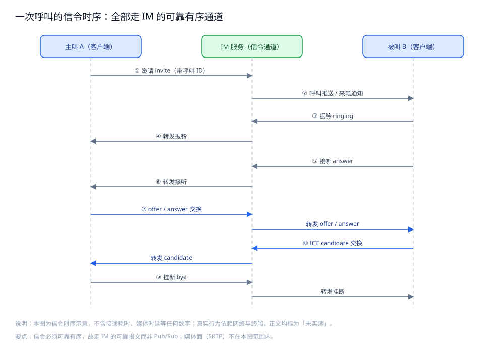
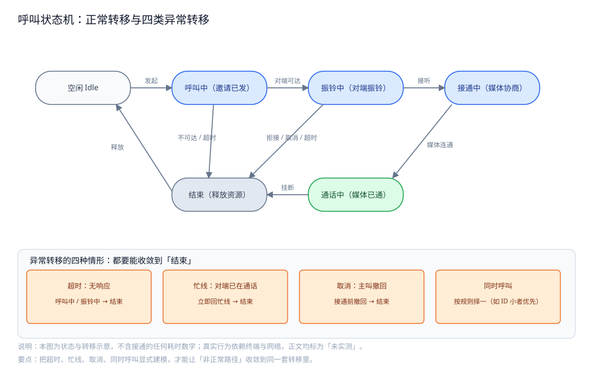
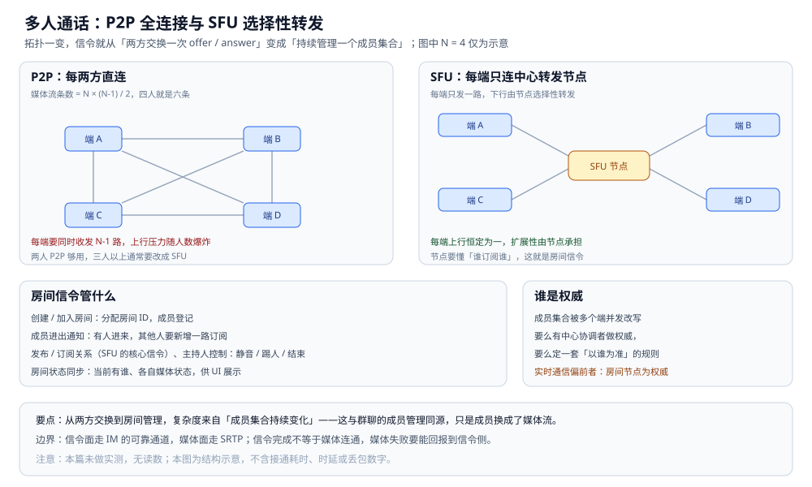

# 音视频信令

> 把 **WebRTC 的信令跑在 IM 自己的长连接上**：一次呼叫的信令怎么走、
> 呼叫状态机长什么样、被叫不在线怎么唤起、多人通话的信令与 P2P 有何不同、
> 信令面与媒体面的边界在哪。
>
> 本篇是 IM 目录的**实时通信篇**：只讲**信令**，**不展开 WebRTC 的媒体面细节**
> （编解码、NAT 穿透、拥塞控制等不在本篇范围）。
> 信令走的那条连接怎么建、怎么保活见 [在线状态与推送.md](在线状态与推送.md)；
> 信令作为一种报文类型怎么定义见 [协议设计.md](协议设计.md)；
> 消息类型与业务语义的总体分层见 [消息类型与业务语义.md](消息类型与业务语义.md)。
>
> 内容整理自个人学习笔记，并参考 WebRTC 系列公开规范（如 RFC 8825 总体架构）与 SIP 的公开资料；素材见 [素材清单](../../../素材清单.md)。
>
> ⚠️ 实测口径：**本篇未做实测**。呼叫接通耗时、媒体时延、丢包率等都依赖
> **真实终端、真实网络与真实设备**，本机无法复现；正文只讲信令的结构、时序与判据，
> **不引用任何接通耗时 / 端到端时延 / 解码延迟数字**。

---

## 一、为什么信令要复用自己的 IM 长连接？

**本节要点**：信令**本质就是"结构化消息"**——它要的正是 IM 长连接已经提供的
**鉴权、在线、推送、可靠有序**四件事；另开一条信令通道等于把这四件事再实现一遍。

### 1.1 信令要的四样东西，IM 连接都已经有

| 信令的需要 | IM 长连接是否已提供 | 对应 |
|---|---|---|
| **身份鉴权** | 有：连接建立时已完成登录态绑定 | [通信链路与协议栈.md](通信链路与协议栈.md) 第五节 |
| **对端在线判断** | 有：连接路由知道谁在线、在哪台网关 | [在线状态与推送.md](在线状态与推送.md) 第二节 |
| **推到对端** | 有：在线直接推、离线走系统推送 | [在线状态与推送.md](在线状态与推送.md) 第五节 |
| **可靠有序** | 有：会话内 seq + ACK + 去重 | [消息可靠投递.md](消息可靠投递.md) |

⭐ 判据：**信令不该另起炉灶**。再建一条长连接，就要再解决一次鉴权、心跳、重连、路由——
而这些 IM 主链路早就有了。**复用 = 少一条要维护的生命周期**。

### 1.2 信令就是"带类型和状态机约束的消息"

一条"我要呼叫你"的信令，和一条普通聊天消息在传输上没有本质区别：

- 都是**发给某个人**（或某个房间）的结构化载荷；
- 都要**可靠送达**（丢了呼叫就卡住）；
- 都要能**落到离线补偿**里（对方不在线，上线后要知道有过这通呼叫）。

区别只在**业务语义**：信令带一个**呼叫 ID**和**状态机**，而聊天消息不带。
所以信令完全可以作为一种**消息类型**（见 [消息类型与业务语义.md](消息类型与业务语义.md)）
跑在既有通道上，**不需要新协议**。

### 1.3 与"专门开信令通道"的取舍

| 方案 | 优点 | 代价 |
|---|---|---|
| **复用 IM 长连接**（本文推荐） | 复用鉴权 / 在线 / 推送 / 可靠投递 | 信令与聊天共享一条连接，要防止互相拖累 |
| **独立信令通道** | 信令流量与聊天隔离，互不影响 | 要重做鉴权、心跳、重连、路由与离线补偿 |

⭐ **务实取舍**：**默认复用**；只有当"信令量大到会拖累聊天"或"信令要独立部署与升级"时，
才考虑拆出一条专门通道——但那时它要解决的问题，和 IM 主链路是一模一样的一整套。

## 二、一次呼叫的信令怎么走？

**本节要点**：一次呼叫的信令是一串**有严格先后**的交换——邀请、振铃、接听、媒体协商、挂断；
**其中媒体协商部分的载荷（offer / answer / candidate）必须原样透传**，服务端只做转投、不解释内容。

### 2.1 完整的信令序列

```text
主叫 A                     IM 服务（信令通道）                 被叫 B
  │  ① 邀请 invite ──────────────▶│
  │                                │  ② 呼叫推送 / 来电通知 ───────▶│
  │                                │◀── ③ 振铃 ringing ────────────│
  │◀─ ④ 转发振铃 ─────────────────│
  │                                │◀── ⑤ 接听 answer ─────────────│
  │◀─ ⑥ 转发接听 ─────────────────│
  │  ⑦ offer ─────────────────────▶│  转发 offer ───────────────▶│
  │◀─ 转发 answer ─────────────────│◀── answer ───────────────────│
  │  ⑧ ICE candidate 交换（双向、多条）                            │
  │  ⑨ 挂断 bye ──────────────────▶│  转发挂断 ──────────────────▶│
```



图怎么读：三条泳道就是三个角色——「主叫 A（客户端）」「IM 服务（信令通道）」「被叫 B（客户端）」，
标题点明本章的核心结论：全部走 IM 的可靠有序通道。
时序自上而下九步，与 2.1 的 ASCII 时序一一对应：「① 邀请 invite（带呼叫 ID）」→「② 呼叫推送 / 来电通知」→
「③ 振铃 ringing」→「④ 转发振铃」→「⑤ 接听 answer」→「⑥ 转发接听」→「⑦ offer / answer 交换（转发 offer / answer）」→
「⑧ ICE candidate 交换（转发 candidate）」→「⑨ 挂断 bye（转发挂断）」。
凡是落在中间泳道的步骤，都是 IM 服务在做转发，这就是"信令复用 IM 通道"最直观的形态。
底部要点写清了范围：信令必须可靠有序，故走 IM 的可靠报文而非 Pub/Sub；媒体面（SRTP）不在本图范围内。
本图为信令时序示意，不含接通耗时、媒体时延等任何数字，真实行为依赖网络与终端，正文均标为「未实测」。

### 2.2 每一步在做什么

| 步骤 | 做什么 | 关键点 |
|---|---|---|
| **① 邀请** | 主叫发起呼叫，携带呼叫 ID 与主叫能力 | 呼叫 ID 是这通呼叫的**幂等与去重键** |
| **② 呼叫推送** | 服务端把来电推给被叫 | 被叫不在线要走系统推送（见第四节） |
| **③ 振铃 / ⑤ 接听** | 被叫回振铃、回接听 | 服务端据此更新呼叫状态并回报主叫 |
| **⑦ offer / answer** | 双方交换媒体能力（编解码、网络候选） | **服务端只透传**，不解释内容 |
| **⑧ ICE candidate** | 交换网络候选地址，双向、可能多条 | 也是透传；条数不定，必须允许乱序到达后重排 |
| **⑨ 挂断** | 任一方结束呼叫 | 双方都要收到，才能各自释放资源 |

### 2.3 为什么信令必须"可靠有序"

这是本篇最核心的一条判据：**信令必须走 IM 的可靠报文，而不是能丢的 Pub/Sub 广播**。

| 维度 | 信令 | 弹幕那类可丢的实时消息 |
|---|---|---|
| 丢一条邀请 | 呼叫**根本起不来** | 少一条弹幕，无所谓 |
| 丢一条 answer | 媒体**协商不完成**，通话接不通 | — |
| 顺序错乱 | 先收到"接听"再收到"邀请" → 状态机进入非法态 | 顺序无所谓 |
| 结论 | **必须至少一次 + 有序 + 去重** | 尽力而为即可 |

⭐ 判据：**信令是"控制面"，控制面不能丢**。它就该走 [消息可靠投递.md](消息可靠投递.md)
里那套"编号 + 确认 + 去重"，而不是走 [在线状态与推送.md](在线状态与推送.md) 第六节那种
"广播推实时、丢了靠位点补"的尽力而为路径。

### 2.4 信令走哪种报文

- **命令类报文**：邀请、接听、挂断，语义是"改变状态"（见 [协议设计.md](协议设计.md) 第三节）；
- **透传载荷**：offer / answer / candidate 作为 **body 原样携带**，服务端不解析、只转投；
- **回执**：每个信令的送达用 ACK 表达（见 [消息可靠投递.md](消息可靠投递.md) 第二节）。

> ⚠️ **未实测**：本节不给"呼叫建立需要多少毫秒""candidate 有几条"的数字。
> 原因：这两者都取决于终端、网络与穿透结果，缺真实设备与网络，任何数字都是编造。

## 三、呼叫状态机长什么样？

**本节要点**：呼叫是一个**有生命周期的状态机**——把"空闲 / 呼叫中 / 振铃中 / 接通中 / 通话中 / 结束"
显式建模，才能把**超时、忙线、取消、双方同时呼叫**这些"非正常路径"收敛到同一套转移里。

### 3.1 五个状态与正常转移

```text
空闲 ──发起──▶ 呼叫中 ──对端可达──▶ 振铃中 ──接听──▶ 接通中 ──媒体连通──▶ 通话中
                                                          │                  │
                                                          └────── 挂断 ──────┘
                                                                  ▼
                                                                 结束 ──释放──▶ 空闲
```



图怎么读：图的上半是 3.1 那条主干的显式建模，六个状态横排成一条链——
「空闲 Idle ──发起──▶ 呼叫中（邀请已发）──对端可达──▶ 振铃中（对端振铃）──接听──▶ 接通中（媒体协商）──媒体连通──▶ 通话中（媒体已通）」，
再由「挂断 / 拒接 / 取消 / 超时」汇入「结束（释放资源）」，末端「释放」回到空闲。
下半单独列出「异常转移的四种情形：都要能收敛到『结束』」，与 3.2 的表逐条对应：
「超时：无响应 → 呼叫中 / 振铃中 → 结束」「忙线：对端已在通话 → 立即回忙线 → 结束」
「取消：主叫撤回 → 接通前撤回 → 结束」「同时呼叫 → 按规则择一（如 ID 小者优先）」。
要点写在底部：把超时、忙线、取消、同时呼叫显式建模，才能让「非正常路径」收敛到同一套转移里。
本图为状态与转移示意，不含接通的任何耗时数字；真实行为依赖终端与网络，正文均标为「未实测」。

### 3.2 四类异常转移

| 异常 | 从哪个状态触发 | 走向 |
|---|---|---|
| **超时** | 呼叫中 / 振铃中长时间无响应 | → 结束（主叫看到"无人接听"） |
| **忙线** | 被叫已在通话中 | 立即回忙线 → 结束 |
| **取消** | 主叫在接通前撤回 | → 结束（被叫的振铃要同步停止） |
| **拒接** | 被叫主动拒绝 | → 结束 |

⭐ **判据**：**状态机必须显式**。不建模的状态机典型表现是"卡在呼叫中出不来""被叫响了但主叫已取消"——
根因都是**异常转移没被定义成合法边**。

### 3.3 双方同时呼叫怎么办

A 呼叫 B 的同时，B 也在呼叫 A——两条邀请在服务端相遇，出现**呼叫冲突**。处理办法是**双方用同一套规则择一**：

| 规则 | 说明 |
|---|---|
| **按呼叫 ID 择一** | 例如约定"呼叫 ID 小的一方获胜"，双方都能算出同一个结果 |
| **按优先级择一** | 有优先级差异时（如都是同一用户多端），按端类型定 |
| **各自拒绝** | 简单但不友好，用户看到两边都"用户忙" |

⭐ 关键：**冲突处理规则必须是"双方都能独立算出同一个结果"的确定性规则**——
否则 A 保留自己的、B 保留自己的，就会出现两条并行呼叫。

### 3.4 状态存在哪

呼叫是**短生命周期状态**（秒级~分钟级），与"会话未读"那种长期状态不同：

| 存放 | 适合 | 说明 |
|---|---|---|
| **内存 + 带 TTL 的 KV** | 活跃呼叫 | 挂了就结束，天然适合 TTL |
| **持久化** | 呼叫记录（用于账单 / 风控 / 展示） | 是**事后记录**，不参与实时状态机 |

⭐ 判据：**实时状态机放内存 / KV，历史记录才落库**——把状态机塞进事务数据库，
只会让"挂断后清理"变成一件要小心处理的事。

## 四、被叫不在线怎么办？

**本节要点**：**在线走长连接推、不在线走系统推送唤起**；但系统推送只负责"唤起"，
**不保证到达，也不等于接听**——接不通要有明确的降级。

### 4.1 在线与离线的两条路

| 被叫状态 | 信令怎么到 | 依据 |
|---|---|---|
| **在线（有活跃长连接）** | 通过长连接直接推 **呼叫邀请** | [在线状态与推送.md](在线状态与推送.md) 第二节 |
| **不在线（无活跃长连接）** | 走 **APNs / FCM / 厂商通道**推"来电" | [在线状态与推送.md](在线状态与推送.md) 第五节 |

⭐ 判据与离线消息一致：**系统推送只做"唤起"，不做"送达"**。
被叫被唤起、客户端上线后，**要立刻通过长连接去服务端取这次呼叫的状态**——
因为推送可能延迟，这通呼叫可能已经被取消了。

### 4.2 接不通的降级

| 情形 | 降级 |
|---|---|
| 被叫不在线且系统推送未能唤起 | 呼叫超时 → 结束；可留一条"未接来电"记录 |
| 被叫在线但长时间不接 | 振铃超时 → 结束 |
| 被叫设备网络不可达 | 走超时逻辑，不要一直"呼"着 |

⭐ **判据**：**每一通呼叫都要有"最大等待"，而不是无限等等看**。
呼叫不像聊天消息可以慢慢补，它是有时效的——过了时效，再接通也只是尴尬。

### 4.3 与通知系统复用的地方

呼叫推送本身也是一种"通知"：**渠道抽象（长连接 / 系统推送）、回执、重试**
与 [通知系统设计.md](../通知系统设计.md) 讲的是同一套结构。
区别在于：呼叫通知**有强时效**，过期就该放弃，而不是像普通通知那样重试到送达。

## 五、多人通话有什么不同？

**本节要点**：从 **P2P（两方直连）** 到 **SFU（选择性转发）**，信令从"两方交换"
变成**"房间管理"**——要维护房间状态、成员进出、主持人控制。

### 5.1 为什么多人不能继续 P2P

| 拓扑 | 说明 | 随人数增长 |
|---|---|---|
| **P2P** | 每两方直连，共需 N×(N-1)/2 条媒体流 | 人一多，每端要同时收发多路，上行压力爆炸 |
| **SFU** | 每端只连中心转发节点，由节点选择性转发 | 每端只发一路，扩展性好 |

⭐ 判据：**两人 P2P 够用，三人以上通常要 SFU**。这是"媒体面"的取舍，
但**它把信令从"两方交换"变成了"房间管理"**——这正是本节要讲的边界。



图怎么读：左侧 P2P 画了四个端两两直连的六条线，标注「媒体流条数 = N × (N-1) / 2，四人就是六条」，
结论是「每端要同时收发 N-1 路，上行压力随人数爆炸」；右侧 SFU 是星型——四个端各连一次中心的 **SFU 节点**，
「每端上行恒定为一，扩展性由节点承担」，并且「节点要懂谁订阅谁，这就是房间信令」。
下方左块列出房间信令管什么：创建 / 加入房间（分配房间 ID，成员登记）、成员进出通知（有人进来其他人要新增一路订阅）、
发布 / 订阅关系与主持人控制（静音 / 踢人 / 结束）、房间状态同步；右块给出一致性立场：成员集合被多个端并发改写，
要么有中心协调者做权威、要么定一套「以谁为准」的规则，实时通信偏前者（房间节点为权威）。N = 4 仅为示意，本图不含任何时延数字。

### 5.2 房间信令管什么

| 信令 | 作用 |
|---|---|
| **创建 / 加入房间** | 分配房间 ID，成员登记 |
| **成员进出通知** | 有人进来，其他人要**新增一路订阅** |
| **发布 / 订阅关系** | 谁发布媒体、谁订阅谁（SFU 的核心信令） |
| **主持人控制** | 静音某人、踢人、结束会议 |
| **房间状态同步** | 当前有谁、各自媒体状态，供 UI 展示 |

⭐ 关键差异：**P2P 只需交换一次 offer/answer，房间则要持续管理"成员集合"**——
这更像 [群聊.md](群聊.md) 的成员管理问题，只是"成员"变成了"媒体流"。

### 5.3 房间状态的一致性

房间成员集合是一份**被多个端并发改写的共享状态**（有人加入、有人掉线），
它的收敛问题与 [会话与未读.md](会话与未读.md) 的多端同步同源：
**要么由一个中心协调者做权威，要么定一套"以谁为准"的规则**。
实时通信偏向前者——**由房间节点作为权威**，客户端以它的通知为准。

## 六、信令与媒体面的边界在哪？

**本节要点**：**IM 只管信令，媒体走 SRTP（或等价的安全传输）**；
两者**生命周期不同、失败表现不同**，要能分别观测、分别降级。

### 6.1 边界的划分

| 面 | 内容 | 承载 | 本笔记 |
|---|---|---|---|
| **信令面** | 邀请、状态、offer/answer、candidate、房间管理 | IM 的可靠通道 | 本篇 |
| **媒体面** | 音视频数据流本身 | SRTP / RTP（**不在本篇范围**） | 不展开 |

⭐ 判据：**信令面走可靠通道、媒体面走实时通道**。把媒体塞进 IM 的可靠通道会把它拖垮；
把信令丢进"尽力而为"的媒体通道会让呼叫状态失控——**两者必须分开**。

### 6.2 两者失败的相互影响

| 失败 | 表现 | 处理 |
|---|---|---|
| **信令通、媒体不通** | 呼叫接通了但没声音 | 信令侧要能收到"媒体失败"回报，触发结束或降级 |
| **媒体通、信令弱** | 声音在、状态更新卡 | 靠信令的可靠通道重发状态，避免 UI 与真实状态不一致 |
| **信令通道整体断** | 呼叫直接结束 | 与 [在线状态与推送.md](在线状态与推送.md) 的重连一起恢复 |

⭐ 关键：**信令面要给媒体面"报告失败"的通道**。否则会出现"看起来接通了，其实听不到"——
用户只会认为"这软件坏了"。

## 使用：呼叫信令的状态与消息类型骨架

**本节要点**：把呼叫状态机的**状态与合法转移**、以及信令的**消息类型**落成
**可编译的最小骨架**；不接真实媒体面，相关部分标注未实测。

```go
package im

import (
	"errors"
	"sync"
)

// CallState 是呼叫状态机的五个状态。
//
// 注意：真正的呼叫还包含「接通中（媒体协商）」这一态，
// 它跨越信令与媒体两个面——信令完成不等于媒体连通。
type CallState int

const (
	StateIdle CallState = iota // 空闲
	StateCalling               // 呼叫中（邀请已发）
	StateRinging               // 振铃中（对端已振铃）
	StateConnected             // 通话中
	StateEnded                 // 结束
)

// SignalType 是信令的消息类型（作为 IM 报文的一种 body 类型）。
type SignalType string

const (
	SigInvite    SignalType = "invite"    // 邀请
	SigRinging   SignalType = "ringing"   // 振铃
	SigAnswer    SignalType = "answer"    // 接听
	SigOffer     SignalType = "offer"     // 媒体协商（透传）
	SigCandidate SignalType = "candidate" // 网络候选（透传）
	SigBye       SignalType = "bye"       // 挂断
	SigBusy      SignalType = "busy"      // 忙线
	SigCancel    SignalType = "cancel"    // 取消
)

var (
	ErrIllegalTransition = errors.New("illegal call state transition")
	ErrCallEnded         = errors.New("call already ended")
)
```

状态机只接受**合法转移**，非法转移一律拒绝——这正是"把异常路径显式建模"的落点：

```go
// Call 是一通呼叫的状态机实例。
//
// ⚠️ 未实测：本机实现只证明「状态与合法转移」的语义。
// 真实呼叫还要处理超时、媒体面回调与多人房间，本机无法复现。
type Call struct {
	mu    sync.Mutex
	ID    string
	state CallState
}

// legalNext 定义允许的状态转移。不在表里的转移一律非法。
var legalNext = map[CallState][]CallState{
	StateIdle:      {StateCalling},
	StateCalling:   {StateRinging, StateEnded},
	StateRinging:   {StateConnected, StateEnded},
	StateConnected: {StateEnded},
	StateEnded:     {StateIdle},
}

func canMove(from, to CallState) bool {
	for _, s := range legalNext[from] {
		if s == to {
			return true
		}
	}
	return false
}

// Move 执行一次状态转移；非法则返回错误，状态保持不变。
func (c *Call) Move(to CallState) error {
	c.mu.Lock()
	defer c.mu.Unlock()
	if c.state == StateEnded && to != StateIdle {
		return ErrCallEnded
	}
	if !canMove(c.state, to) {
		return ErrIllegalTransition
	}
	c.state = to
	return nil
}
```

> ⚠️ **未实测**：以上代码**只做静态编译校验**（`gofmt` 通过），未运行 `go test`。
> 原因：呼叫的真实行为依赖终端、媒体面与真实网络，本机跑不出有意义的结论，
> 给出运行结果即为编造。

## 延伸追问

- **信令能不能走 Pub/Sub？** → 不能当主路径。Pub/Sub 不保留消息、可能丢，而信令丢一条邀请呼叫就起不来、丢一条 answer 就接不通。信令必须走 IM 的**可靠有序报文**。
- **为什么 offer / answer 服务端只透传、不解析？** → 它们是**端与端之间的媒体协商结果**，语义只有两端懂；服务端越俎代庖去改写，等于在两端的协商里塞进一个不懂业务的中间人，只会引入难查的问题。
- **信令完成就等于通话接通了吗？** → 不等于。信令只完成了"协商"，**媒体连通是另一件事**（走 SRTP）。所以要单独有"媒体连通"这个态，以及"媒体失败"的回报，否则会出现"看着接通了、其实没声音"。
- **被叫不在线，呼叫邀请要不要无限重发？** → 不要。呼叫**有时效**，超过等待窗口就该结束，而不是像普通消息那样重试到送达；过期后可以留一条"未接来电"。
- **双方同时呼叫为什么要有确定性规则？** → 否则 A 保留自己的呼叫、B 保留自己的，会出现两条并行呼叫，双方各自振铃。确定性规则（如按呼叫 ID 择一）让两端**独立算出同一个结论**。

## 关联

- [通信链路与协议栈.md](通信链路与协议栈.md) — 分层总纲：信令走的就是"客户端 ↔ 网关 ↔ 逻辑服务"这套链路。
- [协议设计.md](协议设计.md) — 邀请 / 接听 / 挂断作为命令类报文的字段与版本演进。
- [消息类型与业务语义.md](消息类型与业务语义.md) — 信令作为一种消息类型的业务语义归属。
- [在线状态与推送.md](在线状态与推送.md) — 在线判断、系统推送唤起、离线降级，本篇第四节直接依赖。
- [消息可靠投递.md](消息可靠投递.md) — 信令"至少一次 + 有序 + 去重"所依赖的编号与确认机制。
- [群聊.md](群聊.md) — 多人通话的房间成员管理，与会话成员管理同源。
- [机器人与开放平台.md](机器人与开放平台.md) — 机器人加入通话 / 会议的信令与鉴权边界。
- [通知系统设计.md](../通知系统设计.md) — 渠道抽象、回执与重试，呼叫推送与普通通知共用同一套结构。
- [稳定性/README.md](../../分布式/稳定性/README.md) — 信令通道过载时的限流、熔断与降级。
- [README.md](README.md) — IM 目录导读与阅读顺序。
