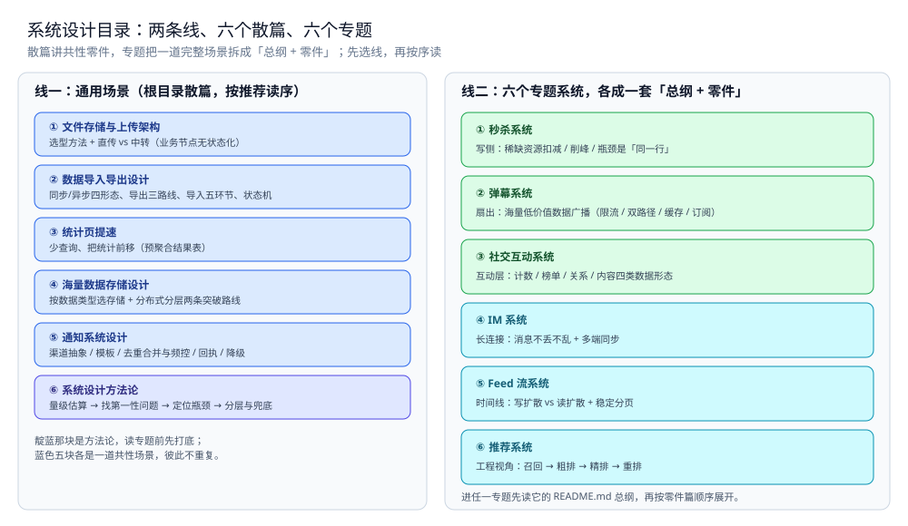

# 系统设计笔记索引（本目录导读）

> 本目录回答的是「**给定一个场景，怎么把它设计出来**」，分两条线：
> **通用场景**（根目录散篇）回答「有共性的那一层」——文件存储与上传、导入导出、海量数据存储、统计提速；
> **专题系统**（子目录）把一道完整场景题拆成「总纲 + 零件」——弹幕系统、秒杀系统、社交互动系统。
>
> 内容整理自个人学习笔记，并参考《大型网站技术架构：核心原理与案例分析》（李智慧）。**本文件只给阅读顺序与依赖关系**——
> 每篇的知识点描述见 [全仓知识点目录](../../目录.md)，本目录**不重复描述**；跨目录的延伸见「四、与其它目录的分工」。

---

## 一、先读哪几篇（总纲，互不重复）

| 顺序 | 篇 | 视角 | 一句话 |
|---|---|---|---|
| ① | [秒杀系统/总体设计.md](秒杀系统/总体设计.md) | ⭐ **写侧总体设计** | 「稀缺资源扣减」这条线：原子性的边界、削峰的交易、**真正的瓶颈是「同一行」** |
| ② | [弹幕系统/总体设计.md](弹幕系统/总体设计.md) | ⭐ **扇出总纲** | 「海量低价值数据 + 广播扇出」这条线：限流 → 双路径 → 缓存 → Redis 发布订阅 |
| ③ | [社交互动系统/总体设计.md](社交互动系统/总体设计.md) | ⭐ **互动层总纲** | 「高并发读 + 高并发写 + 强共享状态」三件事同时出现：计数 / 榜单 / 关系 / 内容四类数据形态 |
| ④ | [文件存储与上传架构.md](文件存储与上传架构.md) | **共性零件** | 一条贯穿本目录的原则：**业务节点只做计算、数据一律中心化**（无状态 vs 有状态） |

> ⭐ **这三套场景怎么配合**：三篇都从「先想清楚有什么」开始，但**痛点不同**——
> 秒杀痛在「扣减」、弹幕痛在「扇出与丢弃」、互动层痛在「计数与排序」。
> 手段（原子判定 / 异步 / 分片 / 缓存）是共用的，读的时候对照着看「同一手段在不同痛点下怎么变形」。

## 二、两条线各自的顺序



图怎么读：左栏是通用场景的六篇散篇，顺序即下面的 2.1；最下面那块（方法论）用靛蓝标出，因为它不属于某一道场景题，而是贯穿所有场景的打底视角；原先同列的「存储选型与组合」已于 2026-10-11 迁往 `03-数据与中间件/数据存储/存储架构与场景/`。右栏是六个专题系统，绿色三块对应写侧、扇出、互动层三条痛点线，青色三块对应长连接、时间线、推荐三条线；每块只标「这条线痛在哪」，零件篇清单在各自目录的总纲里，本图不重复。两条线的分工是：散篇回答「有共性的那一层」，专题回答「给定一整套场景怎么设计」，同一手段（原子判定 / 异步 / 分片 / 缓存）在两边互相回指。图为篇目地图，不含任何性能读数。

### 2.1 通用场景（根目录散篇）

```text
① 文件存储与上传架构   ← 入口：直传 vs 中转（业务节点无状态化）；文件存储选型已移至 03/中间件/对象存储
② 数据导入导出设计     ← 输入输出：同步/异步四形态、导出三路线、导入五环节、任务表状态机
③ 统计页提速           ← 读侧加速：少查询、把统计前移（预聚合结果表）
④ 海量数据存储设计     ← 开放题：按数据类型选存储 + 分布式分层两条突破路线
⑤ 通知系统设计         ← 统一通知：渠道抽象 / 模板 / 去重合并与频控 / 回执 / 降级
⑥ 系统设计方法论       ← 方法论：量级估算 → 找第一性问题 → 定位瓶颈 → 分层与兜底
⑦ 全链路压测设计       ← 验证：容量 / 瓶颈 / 极限三问，染色与影子库，closed 与 open 两种模型的实测差异
```

本线篇目：[文件存储与上传架构.md](文件存储与上传架构.md) → [数据导入导出设计.md](数据导入导出设计.md) → [统计页提速.md](统计页提速.md) → [海量数据存储设计.md](海量数据存储设计.md) → [通知系统设计.md](通知系统设计.md) → [系统设计方法论.md](系统设计方法论.md) → [全链路压测设计.md](全链路压测设计.md)

### 2.2 六个专题系统（子目录，各成「总体设计 + 零件」）

```text
① 秒杀系统/           ← 写侧：稀缺资源扣减
     README.md             目录导读：七问清单 / 篇目清单 / 阅读顺序 / 目录分工
     总体设计.md           整体形态 + 核心取舍 + 一次秒杀走哪几步（原子性的边界 / 削峰的交易 / 瓶颈是「同一行」）
     秒杀骨架.md            三段骨架：Lua 预扣 → 异步入队 → 消费落库 + 幂等
     订单系统设计.md        状态机 / 幂等 / 分布式事务 / 分库分表 / 超时关单
     库存系统设计.md        扣减一致性 / 防超卖 / 缓存与 DB 同步 / 分布式锁
     支付系统设计.md        幂等 / 异步通知 / 重试退避 / 对账 / 资金安全
     商品详情页设计.md      ⭐ 读的另一半：多级缓存 / 击穿与穿透 / 本地 TTL / 静态化与 CDN
     优惠券系统设计.md      另一类稀缺资源：领取 / 防刷 / 分布式锁 / 异步发放 / 红包拆分
     存储全景.md           数据都存哪（角色 / 载体 / 读写路径 / 与其它系统的差异）

② 弹幕系统/           ← 扇出：海量低价值数据广播
     README.md             目录导读：五个核心问题 / 篇目清单 / 阅读顺序 / 目录分工
     总体设计.md           整体形态 + 核心取舍 + 一次弹幕走哪几步（限流 / 双路径 / 缓存落库 / 发布订阅扇出）
     接入与推送.md          骨架①②：数据面 + 限流 + 跨节点推送抽象、连接侧慢隔离
     编排与落库.md          骨架③④：Node.Accept 的四层编排顺序、BatchWriter 攒批落库
     Java实现.md            同一套四层的 Java 版（含虚拟线程对照组）
     弹幕渲染与同步.md      客户端渲染与时间同步（轨道分配 / 批量绘制 / 时钟对齐 / seek 重拉）
     存储全景.md           数据都存哪（角色 / 载体 / 读写路径 / 与其它系统的差异）

③ 社交互动系统/        ← 互动层：计数 / 榜单 / 关系 / 内容
     README.md             目录导读：四个核心问题 / 篇目清单 / 阅读顺序 / 目录分工
     总体设计.md           整体形态 + 核心取舍 + 一次互动走哪几步（数据形态 → 原子手段 → 代价落点）
     评论点赞设计.md        计数 / 去重 / 缓存 / 异步写 / 热 key
     排行榜设计.md          ZSET / 分页 / 实时更新 / 持久化
     关注粉丝设计.md        关系存储 / 分片 / 推拉结合 / 大 V（单向关注）
     好友关系设计.md        双向好友：状态机 / 存储 / 分片 / 缓存一致性
     朋友圈设计.md          feed 视角（总纲）：要素分析 / ER 表设计 / 数据分层 / 推拉方式
     朋友圈骨架.md          朋友圈的 Go / Java 骨架与三组实测
     存储全景.md           数据都存哪（角色 / 载体 / 读写路径 / 与其它系统的差异）

④ IM系统/             ← 长连接：消息不丢不乱 + 多端同步
     README.md             目录导读：四个核心问题 / 篇目清单 / 阅读顺序 / 目录分工
     总体设计.md           整体形态 + 核心取舍 + 一次消息走哪几步（三条路径 / 端到端可靠 / 状态归属）
     通信链路与协议栈.md    分层总纲：三条路径 / 各自协议栈 / 跨路径衔接
     协议设计.md            报文层：帧格式 / 报文类型 / 粘包半包 / 版本演进 / 能力协商
     消息可靠投递.md        会话 seq / ACK / 存储转发 / 写扩散 vs 读扩散 / 幂等 / 三种语义
     会话与未读.md          会话模型 / 列表排序 / 未读数 / 多端已读收敛 / 游标分页
     在线状态与推送.md      长连接选型 / 连接路由 / 心跳重连 / 离线推送降级 / 跨节点扇出
     消息类型与业务语义.md  业务语义：消息类型 / 撤回 / 编辑 / 引用 / 转发 / @
     群聊.md                成员管理 / 群权限分层 / 大群特殊处理
     富媒体消息.md          上传解耦 / 秒传 / 断点续传 / CDN / 转码
     搜索与历史.md          全文搜索 / 权限过滤 / 结果高亮 / 冷热分层
     端到端加密.md          E2EE 密钥体系 / 群组密钥 / 与服务器功能冲突
     限流与防刷.md          消息频率 / 群发限制 / 防垃圾与黑产
     内容审核与合规.md      敏感词匹配 / 机审人审 / 举报处置 / 合规留存
     跨地域多活.md          异地多活 / 长连接跨地域 / seq 唯一性 / 故障切换
     音视频信令.md          WebRTC 信令走 IM 通道 / 呼叫状态机 / 多人通话
     机器人与开放平台.md    Bot / Webhook / 开放 API / 回调可靠性
     存储全景.md           数据都存哪（角色 / 载体 / 读写路径 / 与其它系统的差异）

⑤ Feed流系统/         ← 时间线：写扩散 vs 读扩散 + 稳定分页
     README.md             目录导读：三个核心问题 / 篇目清单 / 阅读顺序 / 目录分工
     总体设计.md           整体形态 + 核心取舍 + 一次刷屏走哪几步（写侧 / 读侧 · 游标 vs offset · 时间倒序 vs 综合分）
     写扩散与读扩散.md      推拉代价结构 / 大 V 阈值 / 模式切换
     时间线存储与分页.md    时间线存哪 / 游标分页 / 多路合并 / 缓存分层
     排序与去重.md          稳定排序键 / 多路合并去重 / 分页插入 / 兜底默认序
     存储全景.md           数据都存哪（角色 / 载体 / 读写路径 / 与其它系统的差异）

⑥ 推荐系统/           ← 工程视角：召回 → 粗排 → 精排 → 重排
     README.md             目录导读：四个核心问题 / 篇目清单 / 阅读顺序 / 目录分工
     总体设计.md           整体形态 + 核心取舍 + 一次请求走哪几步（分层 / 在线离线分离 / 延迟预算兜底）
     召回与排序.md          多路召回 / 粗排 / 精排 / 重排 / 候选量级与延迟预算 / 降级
     特征与冷启动.md        特征三分与一致性 / 冷启动 / 探索利用 / 评估 / 兜底
     存储全景.md           数据都存哪（角色 / 载体 / 读写路径 / 与其它系统的差异）
```

### 2.3 依赖关系（谁要前置）

| 本篇 | 建议先读 | 为什么 |
|---|---|---|
| [秒杀系统/总体设计.md](秒杀系统/总体设计.md) | [限流算法.md](../分布式/稳定性/限流算法.md) | 削峰与入口限流的算法层在那边 |
| [秒杀系统/库存系统设计.md](秒杀系统/库存系统设计.md) | [秒杀系统/总体设计.md](秒杀系统/总体设计.md) 的 2.1~2.3 | 先有「超卖是第一性问题」的认知，才看得懂预扣与分段 |
| [秒杀系统/商品详情页设计.md](秒杀系统/商品详情页设计.md) | [缓存问题与方案.md](../../03-数据与中间件/数据存储/缓存/缓存问题与方案.md) | 读侧的穿透 / 击穿 / 雪崩机制底座 |
| [弹幕系统/接入与推送.md](弹幕系统/接入与推送.md) | [弹幕系统/总体设计.md](弹幕系统/总体设计.md) | 那是四层设计，这是把它落成骨架的前两段 |
| [弹幕系统/编排与落库.md](弹幕系统/编排与落库.md) | [弹幕系统/接入与推送.md](弹幕系统/接入与推送.md) | 后两段骨架接续前两段 |
| [社交互动系统/评论点赞设计.md](社交互动系统/评论点赞设计.md) | [社交互动系统/总体设计.md](社交互动系统/总体设计.md) | 先分清四类数据形态，再进入具体形态 |
| [社交互动系统/朋友圈设计.md](社交互动系统/朋友圈设计.md) | — | 独立成篇；骨架见 [朋友圈骨架.md](社交互动系统/朋友圈骨架.md) |
| [数据导入导出设计.md](数据导入导出设计.md) | [秒杀系统/总体设计.md](秒杀系统/总体设计.md) 的削峰一节 | 「异步任务」的判据与那里同源 |
| [IM系统/README.md](IM系统/README.md) | [弹幕系统/总体设计.md](弹幕系统/总体设计.md) | 弹幕的四层设计与发布订阅扇出，是 IM 跨节点推送的同一套思路 |
| [IM系统/通信链路与协议栈.md](IM系统/通信链路与协议栈.md) | [IM系统/总体设计.md](IM系统/总体设计.md) | 先有整体形态与三个核心取舍的地图，再看三条路径怎么分层 |
| [IM系统/协议设计.md](IM系统/协议设计.md) | [IM系统/通信链路与协议栈.md](IM系统/通信链路与协议栈.md) | 先知道「报文在哪条路径上跑」，再定报文怎么切边界、怎么兼容老端 |
| [IM系统/消息可靠投递.md](IM系统/消息可靠投递.md) | [IM系统/总体设计.md](IM系统/总体设计.md) | 先有整体形态与三个核心取舍的地图，再进入投递细节 |
| [IM系统/群聊.md](IM系统/群聊.md) | [IM系统/消息可靠投递.md](IM系统/消息可靠投递.md) | 群的「写扩散 vs 读扩散」在投递篇；群聊篇只讲成员 / 权限 / 大群策略 |
| [IM系统/富媒体消息.md](IM系统/富媒体消息.md) | [文件存储与上传架构.md](文件存储与上传架构.md) | 直传 vs 中转、有状态/无状态在那里；本篇讲「上传与发消息解耦」 |
| [IM系统/搜索与历史.md](IM系统/搜索与历史.md) | [IM系统/会话与未读.md](IM系统/会话与未读.md) | 搜索命中后的上下文加载与游标分页复用会话篇 |
| [Feed流系统/总体设计.md](Feed流系统/总体设计.md) | [社交互动系统/朋友圈设计.md](社交互动系统/朋友圈设计.md) | 朋友圈是 Feed 的一个具体场景实例，先看那篇的要素分析 |
| [推荐系统/总体设计.md](推荐系统/总体设计.md) | [Feed流系统/总体设计.md](Feed流系统/总体设计.md) | 推荐的产出最终要落进 Feed 里排序，先懂时间线再谈推荐 |
| [社交互动系统/好友关系设计.md](社交互动系统/好友关系设计.md) | [社交互动系统/关注粉丝设计.md](社交互动系统/关注粉丝设计.md) | 先看单向关注的关系存储与分片，再看双向好友差在哪 |
| [弹幕系统/弹幕渲染与同步.md](弹幕系统/弹幕渲染与同步.md) | [弹幕系统/总体设计.md](弹幕系统/总体设计.md) | 服务端四层设计是客户端渲染与同步的前提 |
| [通知系统设计.md](通知系统设计.md) | [数据导入导出设计.md](数据导入导出设计.md) | 异步任务、进度与可靠投递的判据同源 |

## 三、专题线：只想补某一块

| 目的 | 按这个顺序读 |
|---|---|
| **搞懂「超卖 / 幂等 / 状态机」怎么落** | [秒杀系统/总体设计.md](秒杀系统/总体设计.md) → [秒杀系统/库存系统设计.md](秒杀系统/库存系统设计.md) → [秒杀系统/订单系统设计.md](秒杀系统/订单系统设计.md) → [秒杀系统/秒杀骨架.md](秒杀系统/秒杀骨架.md) |
| **搞懂「读多写少」怎么加速** | [商品详情页设计.md](秒杀系统/商品详情页设计.md) → [统计页提速.md](统计页提速.md) → [社交互动系统/朋友圈设计.md](社交互动系统/朋友圈设计.md) |
| **搞懂「扇出与丢弃」** | [弹幕系统/总体设计.md](弹幕系统/总体设计.md) → [弹幕系统/接入与推送.md](弹幕系统/接入与推送.md) → [弹幕系统/编排与落库.md](弹幕系统/编排与落库.md) |
| **搞懂「计数 / 榜单 / 关系」** | [社交互动系统/总体设计.md](社交互动系统/总体设计.md) → [评论点赞设计.md](社交互动系统/评论点赞设计.md) / [排行榜设计.md](社交互动系统/排行榜设计.md) / [关注粉丝设计.md](社交互动系统/关注粉丝设计.md) |
| **搞懂「文件怎么存、怎么传」** | [文件存储与上传架构.md](文件存储与上传架构.md) → [数据导入导出设计.md](数据导入导出设计.md) |
| **要在 Go 里落地一套骨架** | [秒杀系统/秒杀骨架.md](秒杀系统/秒杀骨架.md) / [弹幕系统/接入与推送.md](弹幕系统/接入与推送.md) / [朋友圈骨架.md](社交互动系统/朋友圈骨架.md) |
| **搞懂「一条消息跨了哪三条路径」** | [IM系统/总体设计.md](IM系统/总体设计.md) → [IM系统/通信链路与协议栈.md](IM系统/通信链路与协议栈.md) |
| **搞懂「消息不丢不乱」** | [IM系统/总体设计.md](IM系统/总体设计.md) → [IM系统/通信链路与协议栈.md](IM系统/通信链路与协议栈.md) → [IM系统/协议设计.md](IM系统/协议设计.md) → [IM系统/消息可靠投递.md](IM系统/消息可靠投递.md) → [IM系统/会话与未读.md](IM系统/会话与未读.md) |
| **搞懂「IM 要上线还差什么」** | [IM系统/README.md](IM系统/README.md) 2.2 → [IM系统/消息类型与业务语义.md](IM系统/消息类型与业务语义.md) → [IM系统/群聊.md](IM系统/群聊.md) → [IM系统/富媒体消息.md](IM系统/富媒体消息.md) → [IM系统/搜索与历史.md](IM系统/搜索与历史.md) |
| **搞懂「时间线 / 大 V 扇出」** | [Feed流系统/总体设计.md](Feed流系统/总体设计.md) → [Feed流系统/写扩散与读扩散.md](Feed流系统/写扩散与读扩散.md) → [Feed流系统/时间线存储与分页.md](Feed流系统/时间线存储与分页.md) |
| **搞懂「推荐怎么服务化」** | [推荐系统/总体设计.md](推荐系统/总体设计.md) → [推荐系统/召回与排序.md](推荐系统/召回与排序.md) → [推荐系统/特征与冷启动.md](推荐系统/特征与冷启动.md) |
| **搞懂「怎么下手做一次系统设计」** | [系统设计方法论.md](系统设计方法论.md) → 再任选一个专题目录的 README 对照练一遍 |
| **搞懂「数据该怎么分行存储」** | [存储选型与组合.md](../../03-数据与中间件/数据存储/存储架构与场景/存储选型与组合.md) → [海量数据存储设计.md](海量数据存储设计.md) |
| **搞懂「双向好友」** | [社交互动系统/好友关系设计.md](社交互动系统/好友关系设计.md) → [社交互动系统/关注粉丝设计.md](社交互动系统/关注粉丝设计.md)（单向关注对照） |

## 四、与其它目录的分工

| 相关目录 | 关系 |
|---|---|
| [分布式/](../分布式/README.md) | **上一层：理论设计**——那边讲**单点零件**（限流 / 熔断 / 注册发现 / 一致性）的机制与取舍，这边把这些零件**拼成真实系统** |
| [03-数据与中间件/](../../03-数据与中间件/) | **另一层：实际落地的工具**——本目录用到的 Redis / MySQL / MQ 的**组件原理、参数与选型**在那边，这里只讲「在场景里怎么用」 |
| [01-编程语言/go/](../../01-编程语言/go/) | 本目录的骨架多为 Go；语言机制（并发、channel、GC）在那边 |
| [MySQL/](../../03-数据与中间件/数据存储/关系型/MySQL/) | 状态机 / 幂等 / 深分页 / 锁的底层原理在那边 |
| [缓存/](../../03-数据与中间件/数据存储/缓存/) | 穿透 / 击穿 / 雪崩 / 淘汰策略的机制底座 |
| [可观测性/](../../03-数据与中间件/中间件/可观测性/) | 场景落地后的链路追踪与监控 |
| [存储架构与场景/](../../03-数据与中间件/数据存储/存储架构与场景/README.md) | **泛场景的存储形态与判据**（角色 / 组合 / 分层 / 分类形态）在那边；本目录只讲「在给定场景里怎么用」 |

## 五、本目录的边界与缺口

**边界**：本目录只收**「给定场景的设计题」**——从「先分清有什么、找出第一性问题」到
「逐层加手段、说清代价」为止。**组件的原理、架构与选型**不收（在 `03-数据与中间件/`）。

| 本目录收 | 不收（在哪） |
|---|---|
| 场景题的**推导与判据**、分层与代价权衡 | **组件本身的原理与参数** → [03-数据与中间件/](../../03-数据与中间件/) |
| 可运行的**最小骨架**与实测读数 | **语言机制**（并发 / GC / channel）→ [01-编程语言/](../../01-编程语言/) |
| 原子性边界、幂等、削峰、缓存、分片 | **单点零件的算法层** → [分布式/](../分布式/README.md) |
| | **部署形态**（容器 / CI-CD）→ [06-工程实践/](../../06-工程实践/) |

⭐ **本目录是三层里的「实际场景实施」层**，判据反向读——一篇只剩下面某一样时，它就流到别处：

| 只剩 | 判据（问自己一句） | 去哪 |
|---|---|---|
| **抽象机制**，把这场景题换掉仍成立 | 是不是在讲「同步还是异步 / 推还是拉 / 多数派怎么保」这类取舍 | [分布式/](../分布式/README.md)（理论设计） |
| **某个产品的参数与报错** | 换掉这个产品，这段话还成立吗？不成立 | [03-数据与中间件/](../../03-数据与中间件/)（实际落地的工具） |
| **语言机制**（并发、GC、channel） | 是不是在讲语言本身怎么跑 | [01-编程语言/](../../01-编程语言/) |

判据句的形态最能区分两层：`分布式/` 给**取舍**（为什么这样选、什么条件下反过来），本目录给**推导链**（先分清有什么 → 第一性问题 → 逐层加手段 → 代价与兜底），并常配可运行骨架与实测读数。三层分流举例：**缓存** —— 分布式给一致性与失效策略的取舍、本目录给 [商品详情页设计.md](秒杀系统/商品详情页设计.md) 的多级缓存与击穿兜底、03 给 [淘汰策略.md](../../03-数据与中间件/数据存储/NoSQL/Redis/淘汰策略.md) 的 `maxmemory-policy` 怎么配。

**已知缺口**（按主题 grep 实得）：

| 缺口 | 现状 | 结论 |
|---|---|---|
| **IM / 消息系统** | ✅ 已补（[IM系统/](IM系统/README.md)，2026-10-10） | **16 篇**：5 篇分层主线（总纲 / 报文 / 连接 / 投递 / 会话未读）+ 10 篇业务能力篇（消息类型 / 群聊 / 富媒体 / 搜索 / 加密 / 审核 / 限流 / 多活 / 音视频信令 / 机器人）；音视频篇只讲信令面，媒体面（WebRTC / SFU）未覆盖 |
| **Feed 流 / 推荐** | ✅ 已补（[Feed流系统/](Feed流系统/README.md)、[推荐系统/](推荐系统/README.md)，2026-10-10） | 均为**工程视角**；模型训练与特征平台只在架构层点到，不做算法推导 |
| **存储选型与组合（跨专题）** | ✅ 已补于 2026-10-10，**2026-10-11 迁至**[存储架构与场景/](../../03-数据与中间件/数据存储/存储架构与场景/README.md) | 通用视角：数据角色 / 权威源与副本 / 冷热分层 / 多存储同步；本目录的「数据存哪」自此以那边为总纲，各专题 README 保留「数据存哪」节互引 |
| **短链系统** | 全目录 0 篇 | 可补：发号 + 映射 + 跳转，与本目录的「分布式 ID / 缓存」正交 |
| **限流在场景里的落地**（秒杀入口） | 有实测（秒杀 README 1.6） | 算法本体在 [限流算法.md](../分布式/稳定性/限流算法.md)，此处不重复 |
| **全链路压测** | ✅ 已补（[全链路压测设计.md](全链路压测设计.md)，2026-10-22） | 容量曲线与两种发压模型为本机实测；**影子集群与 MQ 影子 topic 未实测**，只给判据 |

## 延伸追问

- **本目录和 [分布式/](../分布式/README.md) 区别是什么？** → 那边是**零件的原理**（限流怎么算、Raft 怎么选主），这边是**把零件拼成系统**（秒杀怎么扣库存、弹幕怎么扇出）。
- **为什么每道场景题都要拆成「总纲 + 零件」？** → 总纲给**推导与判据**（怎么答、为什么这么分层），零件给**细节与实测**（具体怎么写、读数多少）；混在一篇里读者找不到入口。
- **读这些场景题的正确姿势？** → 别背组件清单，盯住每篇的**判据句**（如「瓶颈是同一行」「不变量越短越好」）与**代价句**（异步丢多少、推拉谁吃亏）。

## 关联

- [秒杀系统/总体设计.md](秒杀系统/总体设计.md) — 写侧总体设计：稀缺资源扣减的全链路推导
- [弹幕系统/总体设计.md](弹幕系统/总体设计.md) — 扇出总纲：四层设计与发布订阅
- [社交互动系统/总体设计.md](社交互动系统/总体设计.md) — 互动层总纲：四类数据形态与三步骨架
- [IM系统/总体设计.md](IM系统/总体设计.md) — 长连接与消息可靠投递：整体形态 / 核心取舍 / 一次消息走哪几步
- [IM系统/通信链路与协议栈.md](IM系统/通信链路与协议栈.md) — 分层总纲：三条路径 / 各自协议栈 / 跨路径衔接
- [IM系统/README.md](IM系统/README.md) — IM 目录导读：分层主线 + 十篇业务能力篇（P0/P1/P2）
- [Feed流系统/总体设计.md](Feed流系统/总体设计.md) — 时间线与写读扩散
- [推荐系统/总体设计.md](推荐系统/总体设计.md) — 推荐的四层工程流水线
- [系统设计方法论.md](系统设计方法论.md) — 本目录的方法论总纲
- [通知系统设计.md](通知系统设计.md) — 统一通知的渠道抽象与可靠投递
- [文件存储与上传架构.md](文件存储与上传架构.md) — 共性零件：业务无状态、数据中心化
- [分布式/README.md](../分布式/README.md) — 本目录所用零件的原理线
