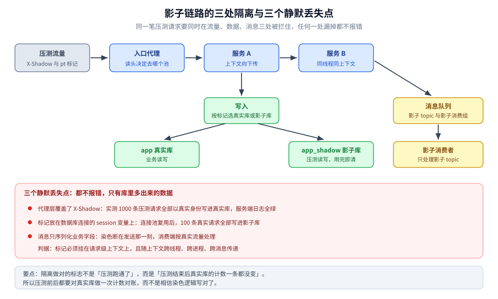
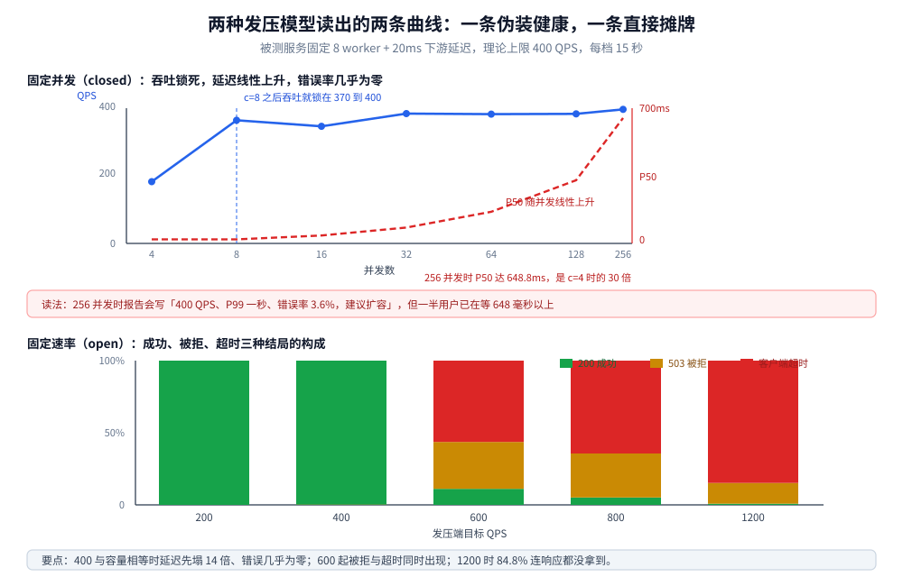

# 全链路压测设计

> 压测要回答哪三个问题 → 全链路和单接口差在哪 → 染色会从哪几处静默丢失 → 影子库的三种形态 →
> 发压模型怎么选（本机两种模型的实测差异）→ 怎么从数据里读出容量拐点 → 线上压测怎么踩刹车。
>
> 内容整理自个人学习笔记。**纸上怎么估量级**见
> [系统设计方法论.md](系统设计方法论.md) 的估算一节，**阈值该怎么定、告警怎么分级**见
> [告警规则与阈值设计.md](../../03-数据与中间件/中间件/可观测性/告警与响应/告警规则与阈值设计.md)，
> **限流、熔断、降级各自的触发条件**见 [稳定性/README.md](../分布式/稳定性/README.md)——本篇只讲怎么真压、怎么读。
>
> ✅ **本篇的容量曲线、发压模型差异、染色污染条数均为本机实跑**：被测服务是 8 worker + 20ms 下游延迟的固定容量模型
> （理论上限 400 QPS），发压器 Go 1.26 两种模型、七档并发 / 五档速率；染色实验用 MySQL 8.0 双库 + Nginx 1.26.3
> 前置，1000 条压测请求逐条计数。**生产级影子集群、MQ 影子 topic、全链路闭环压测未实测**，
> 按公开实践陈述并在「校验口径」逐条标注。

## 一、压测要回答的三个问题

**本节要点**：容量、瓶颈、极限是三个不同的问题，需要三种不同的压法。用阶梯压测去回答「崩溃长什么样」，或者用一次恒定压力去回答「瓶颈在哪」，都拿不到答案。

| 问题 | 要的输出 | 压法 | 读什么 |
|---|---|---|---|
| 容量是多少 | 满足 SLO 的最大可持续 QPS | 阶梯升压，每档稳定 5~15 分钟 | QPS 平台期、P99 相对基线的倍数 |
| 瓶颈在哪 | 最先饱和的那一跳 | 链路每跳埋同一套指标 | 各跳的并发占用、队列深度、连接池等待 |
| 极限是什么 | 超载后的行为形态 | 越过容量继续加压 | 是「快速拒绝」还是「全链路排队雪崩」 |

第三个问题最容易被跳过，但它的答案决定了系统在下一次大促时的死法。本机实测两种形态差别极明显：

- **容量内**（open 200 QPS）：P50 20.9ms，零错误；
- **刚好到容量**（open 400 QPS）：P50 跳到 296.6ms，只有 6 个 503——**请求都成功了，但已经排了 14 倍的队**；
- **明显超载**（open 800 QPS）：只有 5.1% 的请求拿到了 200，30.5% 被拒（503），64.4% 卡在客户端 10 秒超时。

「全成功但延迟 14 倍」这种状态最危险：它看起来没有故障，但用户侧已经在批量超时。

## 二、全链路压测和单接口压测差在哪

**本节要点**：单接口压测测出的是「一个服务的资源上限」，全链路压测测出的是「一条业务链路的容量」。两者的差别不在工具，在依赖、数据和下游保护三件事上。

### 2.1 三处差别

| 维度 | 单接口压测 | 全链路压测 | 差异后果 |
|---|---|---|---|
| 依赖 | 下游 mock 或空实现 | 真实下游，含连接池、限流、超时 | 单接口压测看不到下游成为瓶颈 |
| 数据 | 固定入参、少量 ID | 按生产分布（热点、大 key、冷热比） | 缓存命中率被高估，DB 压力被低估 |
| 下游保护 | 打不到 | 会触发熔断/降级/限流，进而改变链路形态 | 单接口压测永远看不到「降级后的容量」 |

### 2.2 容量由链路里最窄的那一跳决定

本机被测服务的结构很典型：固定 8 个 worker，每个请求 sleep 20ms 模拟下游调用。用 Little 定律验算，稳态下：

```text
并发数 = QPS × 单请求延迟
8      = 400 × 0.021
```

实测 c=8 时读到 369.5 QPS、P50 21.1ms，`8 / 0.0211 ≈ 379`，与 369.5 的差是测量期间的抖动。这条关系是全链路压测的第一性原理：**链路容量 = 每一跳「并发上限 ÷ 单次耗时」的最小值**。任何一跳的连接池设成 20、下游耗时 50ms，这一跳的上限就是 400 QPS，上游再能扛也没用。

## 三、流量染色：三处载体与三个静默丢失点

**本节要点**：染色不是「加一个 header」就完了。它至少要在三处载体上存在——HTTP 头、消息体、数据库字段——而且每一处都可能被静默丢掉。丢掉之后没有任何报错，只有真实库里多出来的数据。

### 3.1 三处载体

| 载体 | 覆盖的调用形态 | 丢失方式 |
|---|---|---|
| HTTP 头（`X-Shadow: 1`） | 同步调用 | 代理层覆盖、跨线程未传递 |
| 消息属性 / 消息体字段 | 异步消费 | 生产者没写、消费端没读 |
| 数据库字段 / 表名后缀 | 落库 | 只在写路径生效，读路径要另判 |

### 3.2 三个实测的丢失点

实验结构：Nginx 1.26.3 前置 → 服务读 `X-Shadow` 决定写 `app`（真实库）还是 `app_shadow`（影子库），同时在 body 里内嵌 `{"pt":1}` 作为**第二处标记**，落库时两列都记。这样即使头丢了，也能从 `payload_pt` 列反查「这笔到底是不是压测流量」。

| 场景 | 请求 | 落 `app`（真实库） | 落 `app_shadow`（影子库） | 结论 |
|---|---|---|---|---|
| X1 请求级染色 + Nginx 透传 | 1000 条压测 | 0 | 1000 | 正确隔离 |
| X2 Nginx 把 `X-Shadow` 清空 | 1000 条压测 | **1000** | 0 | 污染 100% |
| X3 连接级染色（`SET @shadow=1`） | 100 条压测 + 100 条真实 | 0 | 200 | 反向污染 100 条 |

三个结论：

1. **X2 的污染在库里查不出来**。服务端看到的是一个没有 `X-Shadow` 的正常请求，所有日志都正常，唯一异常是「真实库多了一千条订单」。如果压测报告只看「我发了多少请求」，这一天会以「线上订单量异常增长」的形式被发现。
2. **X3 是更隐蔽的一种**。连接级染色把标记放进数据库连接的 session 变量里，连接池复用之后，接下来的真实请求继承了上一个请求的标记——100 条真实订单全部写进了影子库。用户下单成功，业务侧查不到订单。
3. **判据**：染色必须挂在「请求级上下文」上，并且随上下文跨线程、跨进程、跨消息传递。任何落在连接、线程局部变量、session 变量上的标记，都会被复用机制串味。



上半部分是请求的正向路径：压测流量带着 `X-Shadow` 与 body 里的 `pt` 标记进入代理，代理按标记决定服务池，服务再把标记传进数据访问层与消息生产者，最终分别落到影子库与影子 topic。下半部分红框里是三个实测过的丢失点——代理覆盖头部、标记挂在连接 session 变量上、消息只序列化业务字段，它们的共同特征是全程没有任何错误日志，只能靠压测前后对真实库做计数对账发现。

```text
正确：request_scoped_ctx.shadow = true   → 显式传参 / 上下文对象 / MDC
错误：connection.setAttribute("shadow")   → 连接池复用即串味
错误：thread_local.shadow                  → 线程池复用即串味
```

## 四、影子库与影子表：三种形态与各自的切分点

**本节要点**：影子形态的本质差别不是「隔离得多彻底」，而是「哪一层知道自己在写影子」。切分点越靠上，业务代码越干净，但可观测性越差。

| 形态 | 结构 | 切分点 | 优点 | 代价 |
|---|---|---|---|---|
| 影子表 | `app.order` + `app.order_shadow` | DAO 层改表名 | 零额外实例，最快落地 | 表名硬编码在代码里，DDL 要双份 |
| 影子库 | `app` + `app_shadow`（同实例） | 数据源路由 | 库级隔离，清库简单 | 共用实例资源，压测会挤占真实库 |
| 影子集群 | 独立实例 + 独立库 | 中间件/代理层 | 物理隔离，可全量压 | 成本高，数据要同步 |

### 4.1 切分点选在哪

```text
DAO 层双表名     → 代码里 if shadow then "order_shadow" else "order"：最直白，最容易被新写的 SQL 漏掉
数据源路由       → 按请求上下文切换 DataSource：与业务解耦，需要框架支持（多数据源 + 动态路由）
数据库代理/中间件 → 代理层按影子标记改库名或表名：业务完全无感，但排障要多看一层
```

⚠️ **影子表与主表的 DDL 必须同步**。影子表少一个索引，压测读出的 QPS 会比真实情况低一大截，而这个偏差在报告里看不出来——报告只会说「容量不足」。

### 4.2 清理策略

影子库最大的隐患不是写进去，是**忘了清**。三种清法：

| 清法 | 做法 | 风险 |
|---|---|---|
| 压测后整库 drop | 影子库独占实例时最干净 | 误删真实库的概率不为零，要人工双确认 |
| 按标记删 | `DELETE ... WHERE payload_pt=1` | 标记丢了的脏数据永远清不掉 |
| 按时间窗删 | 保留最近 N 天 | 需要定期任务与监控，否则越积越大 |

## 五、数据隔离：写、读、消息三条路

**本节要点**：只隔离写路径是不够的。压测流量读到的缓存、读到的从库、发出的消息，任何一条没隔离，压测结果都会失真，或者污染真实业务。

| 路径 | 隔离方式 | 漏掉的后果 |
|---|---|---|
| 写 | 影子库 / 影子表（4.1） | 真实数据被压测数据淹没 |
| 读（DB） | 影子库自带隔离 | 读到真实数据，缓存预热失真 |
| 读（缓存） | key 前缀或独立实例 | 压测写入的缓存被真实流量读到 |
| 消息 | 影子 topic + 独立消费组 | 压测消息被真实消费者处理，触发真实业务动作 |

⚠️ **消息隔离最容易漏**。同步链路有 header 可传，消息只有 body 和属性——生产者在发消息时如果只序列化了业务字段，染色就断在发送那一刻。判据：**染色字段必须是消息 schema 的一部分**，而不是「额外加的一个属性」。

## 六、压测流量怎么造：两种模型的实测差异

**本节要点**：同样的服务、同样的目标 QPS，固定并发模型（closed）和固定速率模型（open）会给出完全不同的结论。前者永远看不到过载，后者能看到失败形态。这是压测设计里最容易出错的一个选择。

### 6.1 两种模型的定义

```text
closed：N 条连接，每条上一个请求回来才发下一个 —— 压测工具的默认行为
open  ：按时间表发请求，不管上一个有没有回来 —— 真实用户的到达模型
```

差别在语义：closed 模型的并发是**常量**，open 模型的并发是**变量**（服务慢了，在途请求自动堆积）。

### 6.2 closed 模型的读数：一条假健康曲线

| 并发 | 实测 QPS | P50 | P99 | 非 200 |
|---|---|---|---|---|
| 4 | 186.2 | 21.2ms | 25.8ms | 0 |
| 8 | 369.5 | 21.1ms | 31.4ms | 0 |
| 16 | 350.7 | 41.3ms | 127.0ms | 0 |
| 32 | 388.1 | 81.7ms | 147.2ms | 0 |
| 64 | 386.6 | 164.0ms | 317.5ms | 0 |
| 128 | 387.5 | 327.4ms | 647.5ms | 1 |
| 256 | 400.9 | 648.8ms | 1023.4ms | 229 |

读这张表要抓住两点：

1. **QPS 从 c=8 起就锁死在 370~400**，再加 32 倍并发，吞吐一点不涨。这就是容量上限。
2. **延迟随并发线性上升，错误率几乎不动**（256 并发时只有 229/6273 ≈ 3.6% 被拒）。用这份数据写报告，结论会是「系统支撑 256 并发、P99 一秒、错误率 3.6%，建议扩容」——听起来系统还活着。

但真实情况是：256 个用户里有一半在等 648 毫秒以上。**closed 模型把「排队」伪装成了「正常」**，因为压测客户端自己承担了排队——它不会因为慢而发出更多请求。

### 6.3 open 模型的读数：失败形态一目了然

| 目标 QPS | 完成 QPS | P50 | 200 | 503 | 客户端超时 |
|---|---|---|---|---|---|
| 200 | 199.5 | 20.9ms | 2997 | 0 | 0 |
| 400 | 386.6 | 296.6ms | 5984 | 6 | 0 |
| 600 | 305~338 | 1013.9ms | 935~1113 | 1740~2745 | 4747~4905 |
| 800 | — | 10000.4ms | 553 | 3328 | 7014 |
| 1200 | — | 10000.5ms | 112 | 1978 | 11660 |

每档单轮 15 秒；600 一档另跑三轮，完成量落在 305~338 QPS。800 与 1200 两档的 P50 已经是客户端 10 秒超时的上限，所以「完成 QPS」没有意义，改看失败分布：

- 800 QPS：5.1% 成功、30.5% 被服务端拒绝（503，排队超时）、**64.4% 连响应都没拿到**。
- 1200 QPS：0.8% 成功、14.4% 被拒、**84.8% 客户端超时**。

被拒比例反而下降，是因为超时先发生——请求还没排到队尾就已经被客户端放弃了。**「服务端拒绝」和「客户端超时」是两种完全不同的失败**：前者是保护机制生效，后者是保护机制失效后被调用方判死。



上排是封闭模型：实线（QPS）在第 8 个并发之后完全走平，虚线（P50）却随并发一路从 21 毫秒涨到 649 毫秒，两条线交叉的位置就是「再加并发只是加排队」的分界。下排是开放模型的五种结局构成，绿色是成功、黄色是被服务端拒绝、红色是客户端超时——200 与 400 两档几乎全绿，600 起红色迅速吃掉大半，1200 档只剩 0.8% 的绿。

### 6.4 怎么选

| 目的 | 用哪个模型 | 理由 |
|---|---|---|
| 找容量上限 | open，阶梯升速 | 只有 open 能压出「超过容量之后」 |
| 找单机资源瓶颈 | closed，固定并发扫描 | 并发恒定，便于归因到 CPU/内存/连接 |
| 验证限流是否生效 | open，直接打过阈值 | closed 打不穿，因为并发被客户端限住了 |
| 复现线上流量 | open + 思考时间 + 真实比例 | 线上是开环到达，不是闭环 |

⚠️ **思考时间不能省**。closed 模型下每个虚拟用户发完立刻发下一个，等于把 1000 个用户压缩成 1000 个不知疲倦的机器人；真实用户的到达间隔服从某种分布，压测里通常用 1~3 秒的随机停顿近似。

### 6.5 发压机的位置

| 位置 | 影响 | 判据 |
|---|---|---|
| 与被测同机不同容器 | 抢 CPU，客户端先饱和时读数失真 | 观察发压机自身 CPU，超过 70% 就不信读数 |
| 同机房独立机 | 推荐，网络 RTT 可忽略 | 需确认交换机/网卡不是瓶颈 |
| 跨机房 / 公网 | RTT 进入延迟基数 | 要单独扣掉网络耗时 |

本机实测顺带撞到一个**与发压机位置无关、但会让读数差三倍**的坑：被测服务默认没关 Nagle，同一个 20ms 的服务，P50 被侧成 **64.1ms**；在 handler 上打开 `TCP_NODELAY` 后回到 **21.3ms**。这 40 毫秒是 Nagle 与延迟 ACK 的经典组合，会让「容量」被低估到 1/3。压测前先把被测服务的 Nagle 关掉，否则量出来的是协议栈的性格，不是业务的能力。

## 七、怎么从数据里读容量

**本节要点**：容量不是「压出来的最大 QPS」，而是「满足 SLO 的最大 QPS」。三个信号按出现顺序排列：延迟相对基线突变 → 错误率台阶 → 吞吐回落。等第三个信号出现才动手，已经晚了。

### 7.1 三个信号的出现顺序（实测）

| 信号 | 首次出现的档位 | 读数 | 含义 |
|---|---|---|---|
| P50 相对基线突变 | open 400（正好等于容量） | 20.9ms → 296.6ms，14 倍 | 开始排队 |
| 错误率台阶 | open 600 | 503 占 24%~36% | 队列超时开始生效 |
| 吞吐回落 | open 1200 | 完成量掉到 580 QPS 以下 | 保护机制把系统拖进更差的状态 |

**拐点判据**：`P99 > 基线 P99 × 3` 或 `P50 > 基线 P50 × 2`。用绝对值定阈值（比如「P99 超过 500ms 算拐点」）在延迟基数不同的服务上不通用，倍数才可比。

### 7.2 容量写进报告时要带三个数

```text
容量 = 386 QPS（P99 147ms，错误率 0.1%）
拐点 = 400 QPS（P50 相对基线 14 倍，503 开始出现）
极限 = 800 QPS（成功 5.1%，30.5% 被拒，64.4% 客户端超时）
```

只写「容量 400 QPS」是没用的——它既没说在什么 SLO 下成立，也没说超过之后会怎样。

### 7.3 一个必须排除的干扰项

7.1 的三个信号都建立在「基线可信」上。以下三种情况会让基线失真：

| 干扰 | 症状 | 处理 |
|---|---|---|
| Nagle / 延迟 ACK | 基线延迟比预期高 2~3 倍（6.5 节：20ms 被测成 64ms） | 关 `TCP_NODELAY`，或确认客户端侧 |
| 发压机自身饱和 | 并发上去了 QPS 反而降 | 看发压机 CPU，换机器或换工具 |
| 首次请求的开销 | 头几秒延迟异常高 | 预热连接池与缓存，丢弃前 N 秒数据 |

## 八、线上压测的风险控制

**本节要点**：线上压测的最大风险不是压垮，是「压出了故障但没人在看」。四道防线按顺序：限速、可停、白名单、观察窗口。

| 防线 | 做法 | 判据 |
|---|---|---|
| 限速 | 发压端按 QPS 上限令牌桶 | 超过上限直接不发，而不是发出去等拒绝 |
| 随时可停 | 一个开关，秒级生效，不依赖发压机存活 | 演练时真的按一次 |
| 下游白名单 | 明确哪些下游允许打、哪些必须 mock | 支付、短信、第三方接口一律 mock |
| 观察窗口 | 每档压力之间留 3~5 分钟观察 | 不留窗口就分不清是上一档的余波还是这一档的影响 |

### 8.1 自动熔断发压

人工盯盘靠不住。硬判据（任一触发即停压）：

```text
真实业务接口错误率 > 1%
被压核心接口 P99 > 基线的 5 倍
数据库主库 CPU > 80% 持续 1 分钟
影子库写入延迟 > 200ms
```

⚠️ **判据要基于真实业务指标，不是压测指标**。压测指标是「我发了多少、成功多少」，它天然正常；只有真实业务指标（真实用户的成功率、真实订单量）才能反映压测是否溢出了边界。

### 8.2 什么阶段不该做全链路压测

- 没有监控的系统：压出问题看不见，压完也不知道发生了什么；
- 没有回滚能力的系统：发现问题只能等它自己好；
- 没有限流/熔断的系统：过载会直接雪崩，压测变成事故演练（非受控的那种）；
- 影子链路没验证过的系统：先跑 100 QPS 验证零污染，再谈容量。

## 校验口径

| 部分 | 状态 | 依据 |
|---|---|---|
| 容量曲线（6.2、6.3） | ✅ 实跑 | 8 worker + 20ms 被测服务，Go 1.26 发压器，closed 七档 / open 五档，每档 15 秒 |
| Little 定律验算（2.2） | ✅ 实跑核对 | c=8 读 369.5 QPS、P50 21.1ms，`8/0.0211 = 379` |
| Nagle 干扰（6.5） | ✅ 实跑 | 同一服务同一压力：未关 P50 64.1ms，关后 21.3ms |
| 染色三组（3.2） | ✅ 实跑 | MySQL 8.0 双库 + Nginx 1.26.3，1000/1000/200 条逐条计数 |
| 影子表/库/集群三形态（四） | 结构对照 | 本机只实测了「同实例不同库」一种，其余按实践归纳 |
| MQ 影子 topic（五） | ⚠️ 未实测 | 本篇只给判据，未搭 Kafka 影子 topic 验证消费隔离 |
| 生产级全链路压测平台 | ⚠️ 未实测 | 流量录制回放、集群发压、影子集群均未搭建 |
| 8.1 熔断判据 | 经验归纳 | 阈值为示意值，未做实测标定 |

⚠️ 被测服务是**自建的固定容量模型**（8 worker + 20ms sleep + 1 秒排队超时），不是真实业务服务。它给出的是「容量上限如何由并发与耗时决定」的定量关系，不代表任何具体产品的性能。

## 延伸追问

- **Q：为什么 open 模型在 600 QPS 时「完成 QPS」低于 400？**
  因为服务端同时在处理两类请求：正常请求（21ms）和被拒绝的请求（等满 1 秒队列超时）。后者占用了线程，反而挤掉了本该成功的请求。这就是过载后「保护机制本身也在消耗容量」。

- **Q：P99 突变和错误率台阶，哪个更适合做扩容信号？**
  P99 突变早得多（本机是 400 vs 600 的差别），但噪声大，适合做「预告」；错误率台阶稳定，适合做「触发」。实践中两者一起用：P99 触发人工确认，错误率触发自动扩容。

- **Q：影子库会不会让压测结果偏乐观？**
  会。影子库通常比真实库空、索引更少、没有其他业务在争抢，读出来的 QPS 往往高于真实情况。修正方式是让影子库定期导入真实量级的数据（脱敏后），或者按比例打折后再写进报告。

- **Q：压测要不要压到「崩溃」？**
  要，但在影子链路里压。崩溃形态（快速拒绝还是雪崩）是容量规划的必要输入，线上压到崩溃则不可接受。

- **Q：为什么本机用 8 worker 而不是模拟多线程服务器？**
  固定 worker 池是最容易复现的容量模型，理论上限可以手算（`workers / delay`），便于验证「读出来的容量是否等于理论值」。真实服务的并发上限由线程池、连接池、协程调度共同决定，读数会比理论值低。

## 关联

- **上游/总纲**：[系统设计方法论.md](系统设计方法论.md) — 量级估算（纸上算），本篇是它的实测验证环节
- **上游/总纲**：[稳定性/README.md](../分布式/稳定性/README.md) — 限流、熔断、降级的触发阈值来自本篇的容量读数
- **上游/总纲**：[告警规则与阈值设计.md](../../03-数据与中间件/中间件/可观测性/告警与响应/告警规则与阈值设计.md) — 压测期间要盯的指标与告警分级
- **对照/互补**：[灰度发布与流量路由.md](../../06-工程实践/部署/灰度发布与流量路由.md) — 染色头的四跳旅程与本篇第三节是同一套载体，灰度管「去哪」，压测管「别写进去」
- **对照/互补**：[秒杀系统/README.md](秒杀系统/README.md) — 大促场景的容量规划与限流编排
- **下游机制**：[海量数据存储设计.md](海量数据存储设计.md) — 影子库的数据量级会反向影响存储设计
