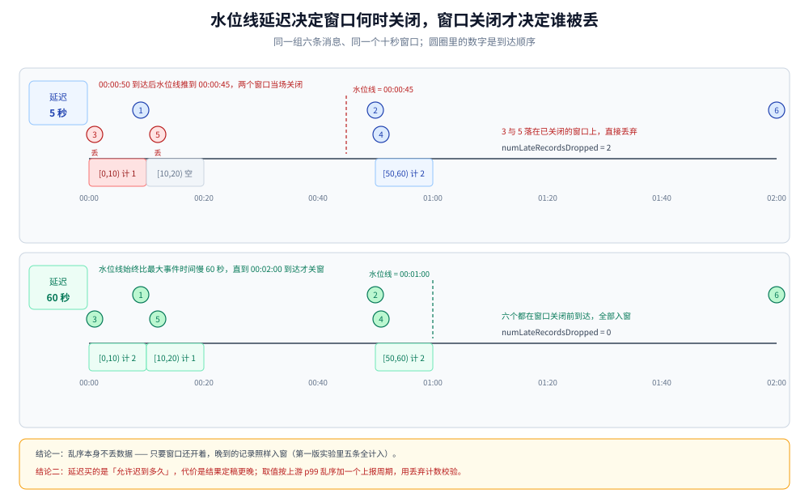
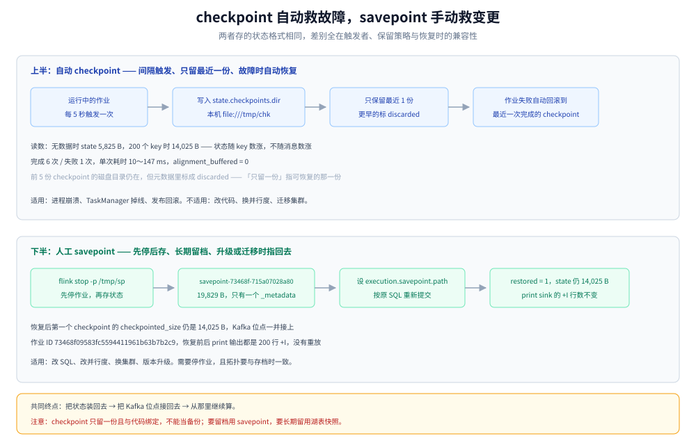
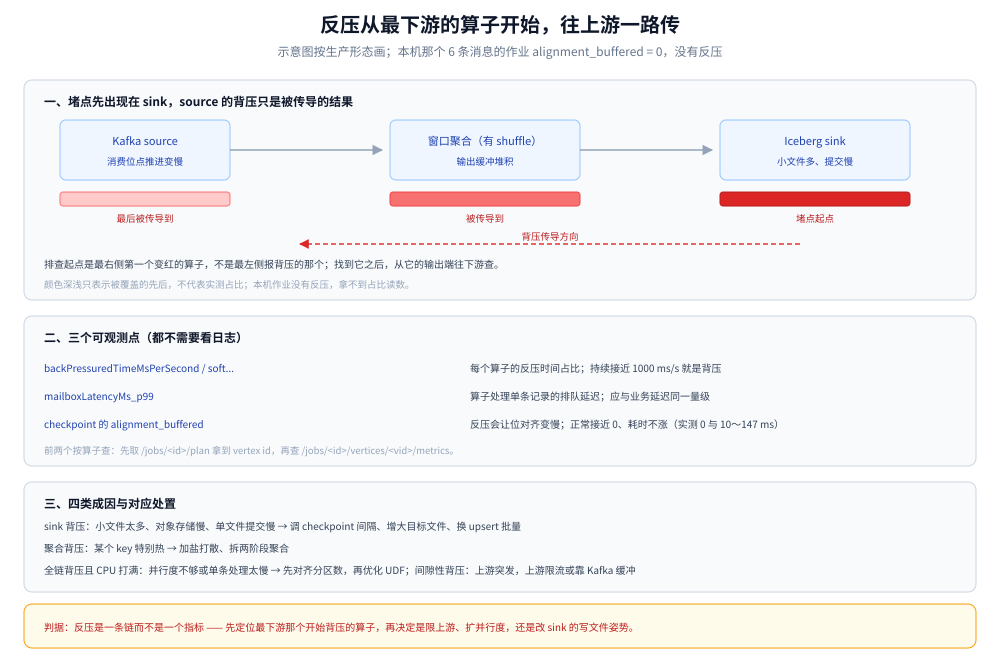

# Flink 实时链路

> 覆盖：流链路在这套平台里承担什么、**水位线与迟到到底怎么算**、checkpoint 与 savepoint 各救什么、作业怎么写才可运维、状态与 slot 怎么配、反压从哪看。读数全部来自单容器 Flink 1.20.5 + Kafka 3.9。
>
> 不覆盖：Kafka 的分区、保留与消费组见 [Kafka集群与Topic设计.md](Kafka集群与Topic设计.md)；湖表写入的幂等语义见 [数据湖与Iceberg表设计.md](数据湖与Iceberg表设计.md)；批侧的分工与补数见 [Spark批处理与调度.md](Spark批处理与调度.md)；CDC 源端的一体化配置见 [FlinkCDC.md](../../../03-数据与中间件/数据存储/数据同步/CDC/FlinkCDC.md)。
>
> 内容整理自个人学习笔记。实测环境：`apache/flink:1.20-scala2.12`（Flink 1.20.5，standalone，1 JobManager + 1 TaskManager / 1 slot）、`apache/kafka:3.9.0`（KRaft 单节点）、`flink-sql-connector-kafka-3.3.0-1.20.jar`；Flink 容器与 Kafka 容器共用网络命名空间（本机 `docker network create` 不可用）。未实测：多 TaskManager 的 slot 分配、RocksDB 状态后端、反压的真实临界点、Flink 写 Iceberg。读数见各节，汇总在文末「校验口径」。

---

## 一、15 分钟时效下，为什么还要一条常驻流链路？

**本节要点**：15 分钟这个数字只说明「看板可以慢」，没说明「中间状态可以丢」。流链路买的是三件批给不了的东西：**在途状态、迟到容忍、秒级发现**。

### 1.1 三件批做不稳的事

| 场景 | 批的困难 | 流的做法 |
|---|---|---|
| CDC 变更合并（同一行一分钟改十次） | 每批都要回查全量才能确定「最终长什么样」 | 按主键保留最新状态，来一条覆盖一条 |
| 迟到数据的修正 | 窗口关闭后要重跑整个分区 | 在水位线容忍内继续入窗，窗口关闭后才定稿 |
| 链路故障的发现 | 下一批跑完才知道上一批错了 | `numLateRecordsDropped`、消费滞后、checkpoint 失败立刻可见 |

### 1.2 与 Spark 的分工

| | Flink | Spark |
|---|---|---|
| 输入 | Kafka topic（raw / cleaned）、CDC 流 | 湖表 ODS / DWD |
| 状态 | 常驻在 TaskManager 内存 / RocksDB | 不保留，每次从表里读 |
| 输出 | DWD 增量、DWS 实时窗口、ADS 推送 | DWS / ADS 重建、对账 |
| 失败 | 从 checkpoint 恢复，接着算 | 重跑一个分区 |

判据：**需要跨事件记住东西的，交给流**；只依赖「这一批数据本身」的，交给批。

---

## 二、水位线到底决定什么？

**本节要点**：水位线不决定「数据丢不丢」，它决定**窗口什么时候关**；只有窗口已经关了，后到的记录才会被丢。把这两件事混起来，就会得出「调大延迟会丢更多数据」这种反结论。

### 2.1 水位线是一条进度承诺

`WATERMARK FOR ts AS ts - INTERVAL '5' SECOND` 的意思是：**我认为事件时间小于「已见最大 ts 减 5 秒」的记录都已经到齐了**。基于这个承诺，Flink 在 `watermark >= 窗口结束时间` 时关闭窗口并输出结果。承诺错了（真有更晚的到），后到的记录就落在已关闭的窗口上。

### 2.2 实测 A：延迟 5 秒

六条消息按 3 秒间隔依次发到 1 分区的 topic，事件时间分别是 `00:00:09 / 00:00:50 / 00:00:01 / 00:00:51 / 00:00:12 / 00:02:00`：

| 顺序 | 记录的事件时间 | 到达后的水位线 | 此刻关闭的窗口 |
|---|---|---|---|
| 1 | 00:00:09 | 00:00:04 | 无 |
| 2 | 00:00:50 | 00:00:45 | `[0,10)`、`[10,20)` |
| 3 | 00:00:01 | 00:00:45 | 无（已关，记录被丢） |
| 4 | 00:00:51 | 00:00:46 | 无 |
| 5 | 00:00:12 | 00:00:46 | 无（已关，记录被丢） |
| 6 | 00:02:00 | 00:01:55 | `[50,60)` |

输出（filesystem sink，CSV）：

```text
"2026-10-25 00:00:00","2026-10-25 00:00:10",1
"2026-10-25 00:00:50","2026-10-25 00:01:00",2
```

窗口算子的指标：`numRecordsIn = 6`、`numRecordsOut = 2`、**`numLateRecordsDropped = 2`**。

`[0,10)` 只剩 1 条（00:00:09），00:00:01 被丢；`[10,20)` 一条都没输出，因为它在 00:00:12 到达之前就已经关闭了，而空窗口不产生行。

### 2.3 实测 B：延迟 60 秒

同一组六条，只把水位线延迟改成 60 秒：

| 顺序 | 记录的事件时间 | 到达后的水位线 | 此刻关闭的窗口 |
|---|---|---|---|
| 1 | 00:00:09 | 23:59:09 | 无 |
| 2 | 00:00:50 | 23:59:50 | 无 |
| 3 | 00:00:01 | 23:59:50 | 无（窗口还开着，正常入窗） |
| 4 | 00:00:51 | 23:59:51 | 无 |
| 5 | 00:00:12 | 23:59:51 | 无（正常入窗） |
| 6 | 00:02:00 | 00:01:00 | `[0,10)`、`[10,20)`、`[50,60)` |

输出：

```text
"2026-10-25 00:00:00","2026-10-25 00:00:10",2
"2026-10-25 00:00:10","2026-10-25 00:00:20",1
"2026-10-25 00:00:50","2026-10-25 00:01:00",2
```

`numRecordsIn = 6`、**`numLateRecordsDropped = 0`**。



图怎么读：上下两条时间轴用的是同一组事件时间，差别只在「水位线推到哪」。上面那条在 00:00:50 到达时就把水位线推到 00:00:45，`[0,10)` 与 `[10,20)` 当场关闭，随后到达的 00:00:01 与 00:00:12 无处可去；下面那条的水位线始终慢 60 秒，三条都在窗口关闭前到达。要读出的是：**延迟参数买的是「允许迟到多久」，不是「多算多少数据」**。

### 2.4 两条容易记反的结论

1. **乱序到得早不丢**：第一版实验里，乱序记录在窗口关闭之前到达，`[0,10)` 计到了全部 5 条，一条没丢 —— 水位线本身不丢弃任何记录；
2. **窗口关了才丢**：真正丢弃发生在「记录所属窗口已关闭」之后，指标记在 `numLateRecordsDropped`。

### 2.5 怎么用这个指标

| 现象 | 含义 | 动作 |
|---|---|---|
| `numLateRecordsDropped` 偶发个位数 | 上游偶发延迟 | 观察，不动参数 |
| 持续增长且与流量同比例 | 延迟设小了，或上游有不按时间的补发 | 结合乱序分布调大延迟 |
| 一直为 0 但结果仍偏少 | 不是迟到问题 | 查上游是否漏发、窗口是否按事件时间切 |

延迟不是越大越好：它直接决定**结果定稿延迟**。设 60 秒，`[0,10)` 的结果要到水位线越过 00:00:10 才出，看板就慢 60 秒。本方案取「延迟 = 上游 p99 乱序 + 一个上报周期」，约 2～3 分钟（见 [容量规划与成本.md](容量规划与成本.md)）。

---

## 三、checkpoint 和 savepoint 各救什么？

**本节要点**：checkpoint 救的是**故障**（自动、定期、只留最近几份），savepoint 救的是**变更**（手动、留档、跨版本可恢复）。两者的状态格式一样，用途和生命周期完全不同。

### 3.1 差异

| | checkpoint | savepoint |
|---|---|---|
| 谁触发 | 系统按间隔自动 | 人（`flink stop -p` 或 REST） |
| 用途 | 故障恢复 | 升级、扩缩容、迁移、回滚 |
| 保留 | 默认只留 1 份（旧的标 `discarded`） | 不自动删，由人管理 |
| 作业状态 | 不停 | `stop` 会先停作业再存 |
| 状态兼容 | 只能恢复同一份代码 | 允许改并行度、改算子（有限） |
| 存放 | `state.checkpoints.dir` | `state.savepoints.dir` |

### 3.2 实测：checkpoint 的读数

作业：`SELECT id, COUNT(*) FROM kafka_source GROUP BY id`（keyed state），checkpoint 间隔 5 秒，`state.checkpoints.dir=file:///tmp/chk`：

| 项 | 读数 |
|---|---|
| 完成 / 失败 | total 7，completed 6，failed 1 |
| state 大小（无数据时） | 5,825 B |
| state 大小（200 个 key） | 14,025 B |
| 单次耗时 | 10～147 ms |
| alignment_buffered | 0 |
| 保留份数 | 1（前 5 份 `discarded: true`，第 6 份保留） |

两个可以直接用的推论：

- **状态随 key 数增长，不随消息数增长**：2000 条消息、200 个 key，state 只到 14 KB。规划状态大小时按「去重 key 数 × 单条大小」算，不要按吞吐算（[容量规划与成本.md](容量规划与成本.md) 的 19 GB 就是这么来的）。
- **checkpoint 耗时与数据量正相关**：无数据时 10～28 ms，有数据后最长 147 ms。间隔太短（比如 1 秒）会让上一次没写完就开下一次，表现为 failed 计数上升。

### 3.3 实测：savepoint 与恢复

```text
$ bin/flink stop -p /tmp/sp 73468f09583fc5594411961b63b7b2c9
Suspending job "73468f09583fc5594411961b63b7b2c9" with a CANONICAL savepoint.
Triggering stop-with-savepoint for job 73468f09583fc5594411961b63b7b2c9.
Waiting for response...
Savepoint completed. Path: file:/tmp/sp/savepoint-73468f-715a07028a80
```

savepoint 目录总大小 19,829 B，里面只有一个 `_metadata` 文件（状态小的时候全在元数据里）。

恢复时不需要重新打包作业，只要在同一个 SQL 脚本里指定路径后重新提交：

```sql
SET 'execution.savepoint.path' = 'file:///tmp/sp/savepoint-73468f-715a07028a80';
SET 'execution.attached' = 'false';
-- 后面与原来完全相同的 CREATE TABLE / INSERT INTO
```

REST 返回的恢复信息：

```text
"counts": { "restored": 1, ... }
"restored": {
  "id": 11,
  "restore_timestamp": 1792913492426,
  "external_path": "file:/tmp/sp/savepoint-73468f-715a07028a80"
}
```

恢复后第一个 checkpoint 的 `checkpointed_size` 仍是 14,025 B —— 状态原样接上了；print sink 的 `+I` 行数在恢复前后都是 200，**没有重放任何一条插入**（此前已推进到 `+U[199, 10]`）。



图怎么读：上半部分是自动的 checkpoint 循环（间隔触发、只留最近一份、故障时自动恢复）；下半部分是人工的 savepoint（`stop -p` 先停后存、留档、升级或迁移时 `-s` 指回去）。两条路的终点是同一个动作：把状态装回去、把 Kafka 位点接回去、从那里继续。

### 3.4 恢复时最容易踩的三个坑

| 坑 | 症状 | 原因与处理 |
|---|---|---|
| 改了 SQL 导致算子 UID 变化 | 恢复时报状态映射失败或状态为空 | 拓扑要与 savepoint 一致；SQL 作业要固定 `pipeline.operator-chaining` 与算子顺序，改动大的话走「新作业 + 双写切换」 |
| 从 savepoint 恢复后重复消费 | 下游出现重复行 | Kafka 位点从 savepoint 恢复，若 sink 不幂等就会写重 —— sink 必须按主键覆盖（见第 4.2 节） |
| 并行度改了但 key 分布变了 | 恢复成功但状态倾斜 | keyed state 按 key group 重分配，扩并行度是安全的，缩并行度要确认没有超出 key group 上限 |

---

## 四、作业怎么写才可运维？

**本节要点**：可运维的作业有三个特征 —— **拓扑稳定、sink 幂等、参数显式**。缺一个，出故障时都只能重跑全量。

### 4.1 一个可上线的 SQL 作业骨架

```sql
SET 'execution.attached' = 'false';
SET 'execution.checkpointing.interval' = '3 min';
SET 'execution.checkpointing.timeout' = '10 min';
SET 'execution.checkpointing.min-pause' = '1 min';
SET 'state.checkpoints.dir' = 's3://bdp-flink/ckp';
SET 'state.savepoints.dir' = 's3://bdp-flink/savepoints';

CREATE TABLE cdc_orders (
  order_id STRING,
  status STRING,
  amount DECIMAL(12,2),
  updated_at TIMESTAMP(3),
  WATERMARK FOR updated_at AS updated_at - INTERVAL '2' MINUTE,
  PRIMARY KEY (order_id) NOT ENFORCED
) WITH (
  'connector' = 'kafka',
  'topic' = 'cdc.shop.orders.raw',
  'properties.bootstrap.servers' = 'kafka-0:9092,kafka-1:9092,kafka-2:9092',
  'properties.group.id' = 'g_orders_dwd',
  'scan.startup.mode' = 'group-offsets',
  'properties.isolation.level' = 'read_committed',
  'format' = 'debezium-json'
);

CREATE TABLE dwd_orders (
  order_id STRING,
  status STRING,
  amount DECIMAL(12,2),
  updated_at TIMESTAMP(3),
  PRIMARY KEY (order_id) NOT ENFORCED
) WITH (
  'connector' = 'iceberg',
  'catalog-name' = 'lake',
  'catalog-type' = 'rest',
  'uri' = 'http://iceberg-rest:8181',
  'warehouse' = 's3://lake/warehouse',
  'write.upsert.enabled' = 'true'
);

INSERT INTO dwd_orders SELECT order_id, status, amount, updated_at FROM cdc_orders;
```

几个参数的理由：

| 参数 | 取值 | 为什么 |
|---|---|---|
| `scan.startup.mode` | `group-offsets` | 首次上线用 `earliest-offset` 补历史，之后必须换成 group-offsets，否则每次重启都从头读 |
| `isolation.level` | `read_committed` | Debezium 用事务写 Kafka，读未提交会看到中间态 |
| `execution.attached` | `false` | sql-client 提交后立即退出，脚本化部署不等作业结束 |
| checkpoint 间隔 | 3 分钟 | 与 15 分钟 SLA 匹配；再短会推高写放大 |
| sink `write.upsert.enabled` | `true` | 主键覆盖，重放不会写重 |

### 4.2 sink 的幂等：append 与 upsert 是两种保证

| sink 语义 | 重放后的结果 | 适用 |
|---|---|---|
| append（只追加） | 重复行，行数翻倍 | 只用于「上游保证不重」的场景，本方案基本不用 |
| upsert（按主键覆盖） | 相同 | DWD 明细、DWS 实时窗口、ADS |
| append + 窗口去重键 | 相同（窗口结果本身按主键唯一） | 窗口聚合结果 |

「Flink 端到端 exactly-once」在湖表上表现为「按主键覆盖 + checkpoint 提交文件」；不满足这两个条件时，实际是 at-least-once，重复只能靠下游去重。

### 4.3 并行度与算子链

- **并行度对齐 Kafka 分区数**：一个分区只能被一个子任务读，并行度超过分区数会有一部分子任务空转（本方案 24 分区、24 并行度）；
- **算子链默认会合并**，链上任何一个算子反压都会拖住整条链；排查时先看哪个算子先出现背压（第 6 节）；
- **不要为了「看起来快」把并行度调大**：状态会随之分裂成更多 key group，checkpoint 文件数上升。

### 4.4 一个真实的连接失败

在容器里先用 Pod IP（`172.17.0.2:9092`）连 Kafka，作业启动即报：

```text
TimeoutException: Timed out waiting for a node assignment. Call: describeTopics
```

原因是 broker 的 `advertised.listeners=PLAINTEXT://localhost:9092`：客户端先连上 172.17.0.2，拿到元数据后被指向 `localhost:9092`，于是去连自己。改成 `localhost:9092`（Flink 与 Kafka 同网络命名空间）后立刻正常。

结论：**Kafka 连接问题先看 `advertised.listeners`，不要先怀疑网络策略**。生产里每个 broker 的 `advertised.listeners` 必须是客户端可达的地址，容器化部署尤其容易在这里出问题。

---

## 五、状态与资源怎么配？

**本节要点**：状态大小由「要记住多少 key」决定，slot 数由并行度决定，两者分开算。混在一起估，就会用「加内存」去治「并行度不够」。

### 5.1 状态后端

| | heap（默认） | RocksDB |
|---|---|---|
| 状态放哪 | JVM 堆 | 本地磁盘 + 堆外 |
| 适合 | 几 GB 以内、key 数少 | 几十 GB、key 数以千万计 |
| checkpoint | 全量 | 可增量 |
| 风险 | Full GC 停顿 | 磁盘 I/O 与写放大 |

本方案状态约 19 GB（窗口去重 9 GB + CDC 活跃行 10 GB），必须用 RocksDB + 增量 checkpoint；用 heap 后端时一次 Full GC 就是分钟级停顿（算式见 [容量规划与成本.md](容量规划与成本.md)）。

### 5.2 状态不能只靠水位线清理

窗口关闭后状态会被清掉，但 keyed 聚合（比如「用户最近一次下单」）的状态不会自动过期。写法是显式配 TTL：

```sql
SET 'table.exec.state.ttl' = '7 d';
```

不给 TTL 的结果是「跑得越久、checkpoint 越大、恢复越慢」，而且增长是静默的 —— 只有 checkpoint 大小在涨。

### 5.3 slot 与并行度

本机只有 1 个 TaskManager、1 个 slot。在这个环境里再提交第二个作业，它不会报「资源不足」，而是停在 `RESTARTING` 反复重试：

```text
$ curl -s localhost:8081/jobs/8057cf6e0570aa59706b4432d0304c9b | grep state
"state":"RESTARTING"
```

生产上的对应现象是「作业一直重启、日志里找不到根因」。判据是看 `flink list` 与集群的 `slots-total / slots-available`，而不是只看作业日志。

---

## 六、反压从哪里看、怎么下手？

**本节要点**：反压不是一个指标，是一条**从下游往上游传的链**。定位顺序永远是「先找最下游哪个算子开始背压」，再从那个算子的输出端往下游查。

### 6.1 三个可观测点

| 指标 | 看什么 | 正常值 |
|---|---|---|
| `backPressuredTimeMsPerSecond` / `softBackPressuredTimeMsPerSecond` | 每个算子的反压时间占比 | 持续接近 1000 ms/s 就是背压 |
| `mailboxLatencyMs_p99` | 算子处理单条记录的排队延迟 | 与业务延迟同一量级 |
| checkpoint 的 `alignment_buffered` / 耗时 | 反压会让位对齐变慢 | 接近 0、耗时不涨 |

实测里 `alignment_buffered = 0`、checkpoint 耗时 10～147 ms，说明这个 6 条消息的作业完全没有压力 —— 把它当基线，任何一项明显偏离都说明链路有问题。

### 6.2 常见原因与处置

| 现象 | 可能原因 | 处置 |
|---|---|---|
| 写湖表的 sink 背压 | 小文件太多、对象存储慢、单文件提交慢 | 调 checkpoint 间隔、增大目标文件、换 upsert 批量 |
| 有 shuffle 的聚合背压 | 数据倾斜，某个 key 特别热 | 加盐打散、拆两阶段聚合 |
| 全链背压且 CPU 打满 | 并行度不够或单条处理太慢 | 先对齐分区数，再优化 UDF |
| 反压间隙性出现 | 上游突发流量 | 上游限流或加缓冲（Kafka 本身就是缓冲，别在 Flink 里再堆） |



图怎么读：从左到右是 source、窗口聚合、sink 三段，右下角的背压条从 sink 开始变红并往左蔓延。要读出的是：**看到 source 背压不等于 source 有问题**，它往往只是把下游的堵点传了过来；真正的排查起点是最右侧第一个变红的算子。

## 使用：一份可上线的提交与观测命令

```bash
# 提交（SQL 作业，attached=false 时提交即返回 Job ID）
docker exec bdp-flink bash -c "cd /opt/flink && bin/sql-client.sh -f /tmp/job.sql"

# 触发 savepoint 并停止（升级前必做）
docker exec bdp-flink bash -c "cd /opt/flink && bin/flink stop -p /opt/flink/savepoints <job-id>"

# 从 savepoint 恢复：脚本里 SET 'execution.savepoint.path'，不需要额外命令行参数
```

| 要做的事 | 命令 / 接口 |
|---|---|
| 看作业列表与状态 | `bin/flink list`，或 `GET /jobs` |
| 看 checkpoint 统计 | `GET /jobs/<id>/checkpoints` |
| 看某算子的指标 | `GET /jobs/<id>/vertices/<vid>/metrics?get=<name>` |
| 看恢复来源 | 同上的 `checkpoints` 接口里的 `restored` 字段 |
| 停作业（不留状态） | `bin/flink cancel <job-id>` |

指标名里的算子下标要转义，比如 `0.GlobalWindowAggregate[5].numLateRecordsDropped` 在 URL 里写成 `0.GlobalWindowAggregate%5B5%5D.numLateRecordsDropped`，否则接口返回空数组。

## 校验口径

> 本篇读数的校验方式与范围（`apache/flink:1.20-scala2.12`，Flink 1.20.5，standalone 1 JM + 1 TM / 1 slot；Kafka 3.9.0 KRaft 单节点）：

- **真跑并取到读数**：第 2.2 节（5 秒延迟：`[0,10)=1`、`[50,60)=2`、`numLateRecordsDropped=2`）；第 2.3 节（60 秒延迟：`[0,10)=2`、`[10,20)=1`、`[50,60)=2`、丢弃为 0）；第 3.2 节 checkpoint 的完成/失败计数、state 大小 5,825 → 14,025 B、耗时 10～147 ms；第 3.3 节 `stop -p` 生成的 savepoint 路径与 19,829 B 目录、恢复后 `restored=1` 与 state 不变；第 4.4 节的 `advertised.listeners` 报错原文；第 5.2.1 节第二个作业停在 `RESTARTING`。
- **只静态校验**：第 4.1 节的 Iceberg sink 与 `s3://` 路径（本机未装 Iceberg Flink runtime，未跑过写湖）；第 5.1 / 5.2 节的 RocksDB 与 TTL 取值（设计值，未在亿级 key 上验证）。
- **未实测**：多 TaskManager 的 slot 分配与资源不足时的排队行为；RocksDB 增量 checkpoint 的写放大；真实反压的临界流量（本机作业只有 6 条消息，`alignment_buffered` 恒为 0）；Flink 端到端写 Iceberg 的 exactly-once；savepoint 跨版本恢复时改并行度的行为。
- **容器**：`bdp-flink`、`bdp-kafka`（均保留未删）。

| 项 | 实际值 |
|---|---|
| Flink | 1.20.5（`1.20-scala2.12` 镜像） |
| 部署 | standalone，1 JobManager + 1 TaskManager / 1 slot |
| Kafka 连接器 | `flink-sql-connector-kafka-3.3.0-1.20.jar` |
| 状态后端 | 默认（heap），未开 RocksDB |
| checkpoint | 间隔 5 秒，`file:///tmp/chk` |
| 测试 topic | `wm5b`、`wm30b`（各 1 分区）、`state1`（1 分区，2000 条 / 200 个 key） |

---

## 延伸追问

- **水位线延迟设得越大越安全吗？** → 不是。延迟买的是「允许迟到多久」，代价是结果定稿更晚、状态留得更久。取值应该是「上游 p99 乱序 + 一个上报周期」，然后靠 `numLateRecordsDropped` 校验。
- **窗口关闭后迟到的那条记录去哪了？** → 直接丢弃，只在 `numLateRecordsDropped` 里留计数，不进任何输出。要救它只能放宽容忍（allowed lateness）或从 ODS 重算该窗口。
- **checkpoint 能不能当备份？** → 不能。默认只留最近一份、跟作业代码绑定、作业删除后通常一并清理。要留档用 savepoint，要长期留用湖表快照。
- **从 savepoint 恢复后为什么会重复消费？** → 位点是从 savepoint 里恢复的，如果 savepoint 时的位点比实际写入湖表的进度更靠前，就会重放一段；sink 幂等时无害，不幂等时写重。
- **并行度能不能超过 Kafka 分区数？** → 能，但多出来的子任务读不到数据，只增加空转与状态分裂；除了「预留扩容空间」，没有别的收益。
- **作业一直在 RESTARTING，日志没报错怎么办？** → 先看集群 slot 是否用完（`slots-available = 0`），再看是否卡在拉取镜像或初始化；资源不足在 Flink 里表现为重启，不是明确的报错。

## 关联

- **上游通道**：[Kafka集群与Topic设计.md](Kafka集群与Topic设计.md) — 分区数、保留期与 `advertised.listeners`
- **上游采集**：[数据采集与CDC.md](数据采集与CDC.md) — CDC 三通道与位点语义
- **上游原理**：[FlinkCDC.md](../../../03-数据与中间件/数据存储/数据同步/CDC/FlinkCDC.md) — 源端一体化与快照阶段
- **下游存储**：[数据湖与Iceberg表设计.md](数据湖与Iceberg表设计.md) — 流写入湖表的幂等与提交
- **对照链路**：[Spark批处理与调度.md](Spark批处理与调度.md) — 回填、重建与对账为什么交给批
- **下游验证**：[流批对账与数据质量.md](流批对账与数据质量.md) — 水位线丢弃的数据怎么在对账里发现
- **容量算式**：[容量规划与成本.md](容量规划与成本.md) — 30 slot / 19 GB 状态 / 46 GB checkpoint
- **部署**：[K8s部署与运维.md](K8s部署与运维.md) — Flink Operator 的 checkpoint 存储与升级流程
