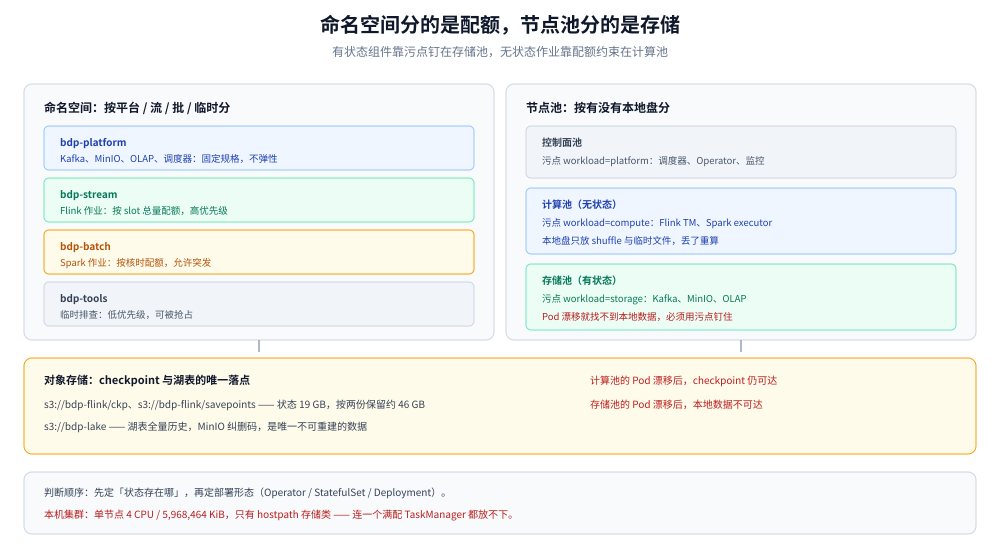
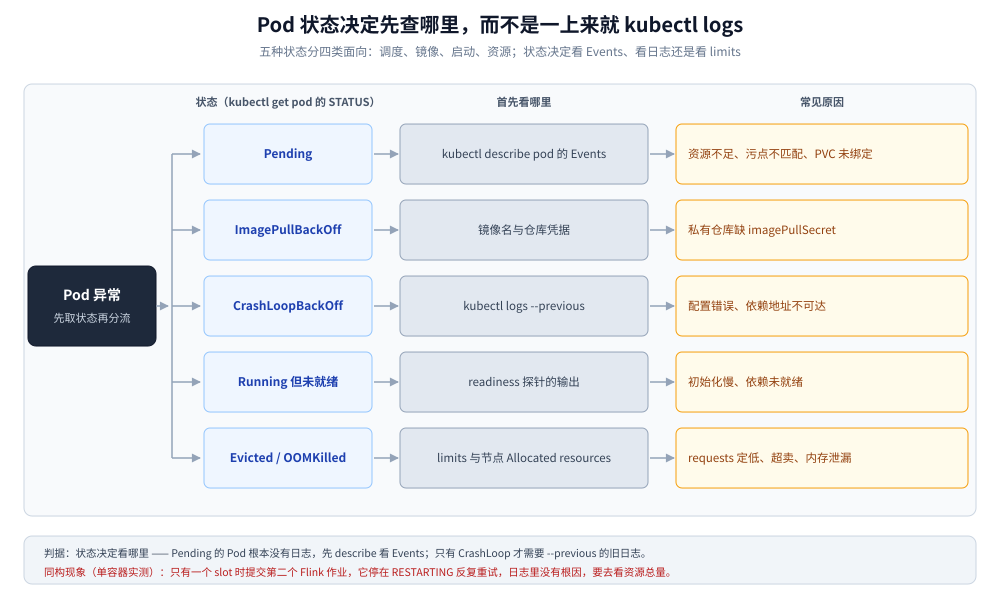

# K8s 部署与运维

> 覆盖：自建 K8s 上哪些组件自己管、Operator 拓扑怎么摆、CPU 与内存怎么分、状态与中间数据放哪、备份恢复怎么验收、故障先看什么。集群读数来自本机 Docker Desktop Kubernetes（v1.36.1，单节点）；多节点拓扑与 Operator 实际调度未实测。
>
> 不覆盖：容量怎么算见 [容量规划与成本.md](容量规划与成本.md)；Flink 作业参数见 [Flink实时链路.md](Flink实时链路.md)；批任务提交见 [Spark批处理与调度.md](Spark批处理与调度.md)。
>
> 内容整理自个人学习笔记，素材见 [素材清单](../../../素材清单.md)。**实测口径**：第 1.3 节、第 2.1 节、第 6.1 节的集群读数与 `kubectl --dry-run=server` 结果为本机真跑；多节点调度、Operator 升级、真实备份恢复未实测，见文末「校验口径」。

---

## 一、自建 K8s 上，哪些组件该自己管？

**本节要点**：判据只有一条 —— **这个组件的状态存在哪**。状态在对象存储里的（Flink、Spark）适合 Operator；状态在本地盘且要求持久化的（Kafka、MinIO、OLAP）需要独立的节点池与存储方案；状态在控制面外部的（元数据、配置）走备份。

### 1.1 三类形态与判据

| 形态 | 适用组件 | 判据 | 代价 |
|---|---|---|---|
| Operator 托管 | Flink、Spark | 状态可放对象存储，作业生命周期可重建 | 需要多学一套 CRD |
| StatefulSet + 本地盘 | Kafka、ClickHouse | 数据在本地盘，重建代价高 | 节点绑定、扩容要迁移数据 |
| 普通 Deployment | 埋点网关、调度器 Web | 无状态，多副本即可 | 无 |

把 Kafka 交给 Operator 也能跑，但「Pod 漂移后本地盘数据还在不在」这个问题不会因为用了 Operator 而消失。判断顺序是**先定存储，再定部署形态**。

### 1.2 有状态组件的摆放

| 组件 | 存储 | 说明 |
|---|---|---|
| Kafka | 本地 SSD，按 broker 绑定 | 副本已提供冗余，快照备份意义有限 |
| MinIO | 本地 HDD / SSD，纠删码 | 湖表的物理底座，要按容量篇算裸盘 |
| OLAP（Doris / StarRocks） | 本地 SSD | 数据可从湖表重建，备份优先级低于湖表 |
| Flink | 对象存储（checkpoint / savepoint） | 本地盘只放临时文件 |
| Spark | 对象存储（shuffle 可放本地） | 作业结束即销毁 |

「可从湖表重建」是降低备份优先级的前提：OLAP 丢了，重跑发布任务就能恢复；湖表丢了，什么都没了。**备份预算应该按不可重建性分配**。

### 1.3 本机集群的真实现状

```text
$ kubectl get nodes
NAME             STATUS   ROLES           AGE     VERSION
docker-desktop   Ready    control-plane   2d17h   v1.36.1

$ kubectl get node docker-desktop -o jsonpath='{.status.allocatable}'
4 CPU | 5968464Ki mem | pods 110
```

单节点、可分配 4 核 / 约 5.7 GiB 内存，存储类只有 `hostpath`（`Delete` 回收策略）。对照容量篇的 streaming 池规格（6 × 8c32G、30 slot、120 GB），**本机连一个 TaskManager 都放不下满配的一个**，所以全册的集群读数一律以单容器实测替代，不冒充集群。

---

## 二、Operator 拓扑怎么摆？

**本节要点**：Flink 用 Application 模式、每个作业一个 JobManager；命名空间按「平台组件」与「业务作业」分开；节点池按「计算型 / 存储型」分开，用污点保证有状态 Pod 不被调度到计算节点。

### 2.1 命名空间与配额

| 命名空间 | 放什么 | 配额策略 |
|---|---|---|
| `bdp-platform` | Kafka、MinIO、OLAP、调度器 | 按容量篇的固定规格，不做弹性 |
| `bdp-stream` | Flink 作业（Application 模式） | 按 slot 总量配额 |
| `bdp-batch` | Spark 作业 | 按核时配额，允许突发 |
| `bdp-tools` | 临时排查、一次性任务 | 低优先级，可被抢占 |

配额要写在**命名空间级**而不是集群级：集群级配额一旦打满，所有团队一起卡住；命名空间级配额让超限只影响自己。

### 2.2 Flink：Application 模式与每作业一个 JobManager

| 模式 | JobManager | 适用 |
|---|---|---|
| Session | 多作业共享一个 JM | 开发调试，作业之间互相影响 |
| Per-job | 每作业一个 JM | 已废弃 |
| Application | 每作业一个 JM + 独立 TM | 生产 |

生产用 Application 模式：一个作业的 JM 崩溃不会带走其他作业，资源也按作业隔离。代价是每个作业都要一个 JM 的固定开销（本方案按 2 GB 计），作业数多时要算进总内存。

### 2.3 节点池与污点

```text
计算池（无状态）      Flink TM、Spark executor      污点：workload=compute
存储池（有状态）      Kafka、MinIO、OLAP            污点：workload=storage
控制面                调度器、Operator、监控         污点：workload=platform
```

有状态 Pod 必须落在存储池：本地盘与节点绑定，Pod 漂移到另一个节点就找不到数据。用污点 + 容忍保证这一点，而不是靠标签选择器 —— 标签只影响调度倾向，污点才是硬约束。



图怎么读：左边四列是命名空间，配额写在各自的命名空间上，超限只影响自己那一列；右边三个池用污点区分，有状态 Pod 被钉在存储池，计算池的 Pod 漂移不影响数据；底部是对象存储，checkpoint、savepoint 与湖表都在这里，所以 `file://` 只适合单容器跑机制。要读出的是：**K8s 上真正需要「搬不走」的只有存储池里的本地盘，其余状态都该外置到对象存储**。

---

## 三、CPU 和内存怎么分才不互相挤？

**本节要点**：先按业务重要性分优先级，再定 requests；requests 定得比实际用量低，等于把超卖风险留给最关键的作业。

### 3.1 三档优先级

| 优先级 | 谁 | 被抢占时的行为 |
|---|---|---|
| 高 | 流作业、对账任务 | 不被抢占；资源不足时新批作业排队 |
| 中 | 日常批、ADS 发布 | 可被流作业挤占，但保留最小配额 |
| 低 | 回填、临时排查 | 随时可被抢占，跑不完就重跑 |

回填是典型的「可以等」：一次 3 年历史重算约 5,900 core·h（见 [容量规划与成本.md](容量规划与成本.md) 第 3 节），按 200 核跑要 30 小时 —— 这种任务放在低优先级，用空闲资源慢慢跑，比给它固定配额划算。

### 3.2 requests 定多少

| 作业类型 | requests | limits | 理由 |
|---|---|---|---|
| Flink TM | 等于实际堆外 + 堆内需求 | 略高于 requests | 状态后端是 RocksDB，内存超卖会 OOM |
| Spark executor | 按核时估算的均值 | 允许突发 | 批作业可以慢，不能死 |
| 临时任务 | 低 | 中 | 允许被抢占 |

Flink 的 requests 不能按均值定：RocksDB 的内存用量随状态增长，超卖后表现为 checkpoint 变慢直到失败，而不是立刻报错。

### 3.3 超卖与 OOM 的关系

K8s 的调度只看 requests，不看实际用量。两个作业的 requests 之和不超过节点容量，但实际用量之和可以超过 —— 这时最先撑爆的是内存，表现为节点 OOM Killer 随机杀 Pod。**现象是「随机某个 Pod 被重启」，根因是 requests 定低了**，从 Pod 日志里永远找不到。

---

## 四、状态与中间数据放哪？

**本节要点**：checkpoint 与 savepoint 必须放对象存储；本地盘只放可以丢的数据（shuffle、临时文件）。判据是「这个文件丢了，作业还能不能从别处恢复」。

### 4.1 checkpoint 必须放对象存储

单容器实测里 checkpoint 写的是 `file:///tmp/chk`，那是为了把机制跑通；放到 K8s 上，`file://` 只在 Pod 本地，Pod 一漂移 checkpoint 就没了。生产配置：

```text
state.checkpoints.dir  = s3://bdp-flink/ckp
state.savepoints.dir   = s3://bdp-flink/savepoints
```

容量篇按「状态 19 GB × 2 份 × 1.2 ≈ 46 GB」给 checkpoint 留了空间（[容量规划与成本.md](容量规划与成本.md) 第 2 节），这个数只对对象存储有意义。

### 4.2 本地盘只放可以丢的东西

| 数据 | 放哪 | 丢了会怎样 |
|---|---|---|
| Flink checkpoint | 对象存储 | 回滚到更早的状态 |
| Spark shuffle | 本地盘 | 重算该 stage |
| 临时解压 / 缓存 | 本地盘（emptyDir） | 重新拉取 |
| Kafka 日志 | 本地盘 + 副本 | 由副本补齐，单副本时不可恢复 |

---

## 五、备份与恢复怎么做？

**本节要点**：按「不可重建性」分配备份预算 —— 湖表与元数据是第一位，配置与密钥第二位，OLAP 可以重建不占备份配额。

### 5.1 三类数据、三种周期

| 数据 | 备份方式 | 周期 | RPO |
|---|---|---|---|
| 湖表（Iceberg） | 对象存储版本 + 快照保留 | 实时（对象存储版本） | 分钟级 |
| 元数据（Catalog / 调度 DAG / 权限） | 数据库导出 | 每日 | 24 小时 |
| 配置与密钥 | Git + 密钥管理系统 | 变更即提交 | 0 |

湖表的备份不是「另存一份数据」，而是**保留足够多的快照**：对象存储版本 + Iceberg 快照过期策略配合，才能在误删表或误写之后回滚（见 [数据湖与Iceberg表设计.md](数据湖与Iceberg表设计.md) 第 5 节）。

### 5.2 恢复演练的验收读数

| 项目 | 验收标准 |
|---|---|
| 单表回滚到一个快照 | 有明确命令、有耗时记录 |
| 从 savepoint 恢复流作业 | 状态大小不变、无重复写入 |
| 重建 OLAP 一天的 ADS | 从湖表重算并发布，对账差额为 0 |
| 元数据恢复到昨日 | 调度 DAG 完整、能正常触发 |

没有演练过的备份等于没有备份。验收标准要写成可执行的命令与读数，而不是「已验证可恢复」。

---

## 六、出故障先看什么？

**本节要点**：Pod 的状态比日志更早说明问题。先按状态分五类，再决定看事件、看日志还是看资源。

### 6.1 Pod 的五种状态

| 状态 | 首先看 | 常见原因 |
|---|---|---|
| `Pending` | `kubectl describe pod` 的 Events | 资源不足、污点不匹配、PVC 未绑定 |
| `ImagePullBackOff` | 镜像名与仓库凭据 | 私有仓库缺 secret |
| `CrashLoopBackOff` | 上一次的容器日志 | 配置错误、依赖不可达 |
| `Running` 但未就绪 | readiness 探针输出 | 初始化慢、依赖未就绪 |
| `Evicted` / `OOMKilled` | 节点资源与 limits | 超卖、内存泄漏 |



图怎么读：从左侧的「Pod 异常」出发，先按 `kubectl get pod` 的状态分成四路：调度问题看 Events，启动问题看上一次日志，资源问题看 limits 与节点，就绪问题看探针。要读出的是：**状态决定看哪里**，不要一上来就 `kubectl logs` —— `Pending` 的 Pod 根本没有日志。

### 6.2 作业重启循环

Flink 作业反复重启时，第一现场不是作业日志，而是资源：

```text
$ kubectl get pods -n bdp-stream
$ kubectl describe node <node> | grep -A5 "Allocated resources"
```

单容器实测里出现过同类现象：只有一个 slot 时提交第二个作业，它不报「资源不足」，而是停在 `RESTARTING` 反复重试，日志里看不到根因（见 [Flink实时链路.md](Flink实时链路.md) 第 5.3 节）。K8s 上的对应现象是 `CrashLoopBackOff` 或作业状态 `RESTARTING`，判据同样是看资源池的总量与余量，而不是只看作业自身。

### 6.3 节点故障

| 现象 | 处理顺序 |
|---|---|
| 节点 NotReady | 先摘流量的调度（污点 + 驱逐），再查节点 |
| 存储池节点宕机 | 等副本补齐，不要立刻重建 Pod —— 重建会把副本压力集中到剩余节点 |
| 控制面不可用 | 已运行的 Pod 不受影响，先停止发布与调度 |

---

## 使用：一套最小清单

```yaml
apiVersion: v1
kind: Namespace
metadata:
  name: bdp-stream
---
apiVersion: v1
kind: ResourceQuota
metadata:
  name: stream-quota
  namespace: bdp-stream
spec:
  hard:
    requests.cpu: "12"
    requests.memory: 32Gi
    limits.cpu: "24"
    limits.memory: 64Gi
---
apiVersion: scheduling.k8s.io/v1
kind: PriorityClass
metadata:
  name: bdp-stream-high
value: 100000
globalDefault: false
description: "流作业：不被批任务抢占"
```

```yaml
apiVersion: flink.apache.org/v1beta1
kind: FlinkDeployment
metadata:
  name: dwd-orders
  namespace: bdp-stream
spec:
  image: flink:1.20
  flinkVersion: v1_20
  serviceAccount: flink
  jobManager:
    resource:
      cpu: 1
      memory: 2g
  taskManager:
    resource:
      cpu: 2
      memory: 4g
  job:
    jarURI: local:///opt/flink/usrlib/dwd-orders.jar
    parallelism: 4
    upgradeMode: savepoint
    state: running
```

```bash
# 提交前先做服务端校验：能发现字段名与类型问题
kubectl apply --dry-run=server -f dwd-orders.yaml

# 上线后确认资源与状态
kubectl get flinkdeployment -n bdp-stream
kubectl get pods -n bdp-stream -o wide
```

本机实测的两条校验结果：

```text
# 核心资源（ResourceQuota / LimitRange）校验通过
resourcequota/bdp-quota created (server dry run)
limitrange/bdp-defaults created (server dry run)

# FlinkDeployment 校验失败 —— CRD 未安装
error: resource mapping not found for name: "dwd-orders" ...
no matches for kind "FlinkDeployment" in version "flink.apache.org/v1beta1"
ensure CRDs are installed first
```

第二条是这类清单最常见的失败原因：**CRD 没装，清单再对也提交不上去**。装 Operator 之前先 `kubectl get crd | grep flink` 确认，比反复改 YAML 快。

---

## 校验口径

> ✅ 本篇读数的校验方式与范围（本机 Docker Desktop Kubernetes，2026-10-25）：

- **真跑并取到读数**：第 1.3 节的集群现状 —— Kubernetes v1.36.1，单节点 `docker-desktop`（control-plane，Ready，2d17h），可分配 4 CPU / 5,968,464 KiB / 110 pods；存储类只有 `hostpath`（`Delete` / `Immediate`）。
- **真跑并取到读数**：第 2.1 节的 ResourceQuota 与 LimitRange 通过 `kubectl apply --dry-run=server` 校验（为不改动本机集群，校验副本的 namespace 改为 `default`，`bdp` 命名空间未创建）。
- **真跑并取到读数**：`FlinkDeployment` 的 dry-run 报 `no matches for kind "FlinkDeployment" in version "flink.apache.org/v1beta1"`，本机未安装 Flink Operator CRD。
- **真跑并观察到**：同一份文件里先建 Namespace、后建同命名空间的 ResourceQuota，首次 `apply --dry-run=server` 会因命名空间不存在而失败 —— 命名空间要单独先应用。
- **未实测**：多节点调度、污点与容忍的实际效果、Flink Operator 的 Application 模式部署与升级、savepoint 升级流程、对象存储上的 checkpoint 读写、备份恢复演练的真实耗时、节点故障后的副本补齐。
- **实测环境**：Docker Desktop Kubernetes v1.36.1（单节点）、kubectl v1.36.1。

| 依赖 | 实际版本 |
|---|---|
| Kubernetes | v1.36.1（Docker Desktop，单节点） |
| kubectl | v1.36.1 |
| 节点可分配资源 | 4 CPU / 5,968,464 KiB / 110 pods |
| Flink Operator | 未安装（CRD 缺失已实测） |

## 延伸追问

- **为什么 Flink 用 Application 模式而不是 Session？** → Session 模式多个作业共享 JobManager，一个作业把 JM 打挂会带走全部作业；Application 模式每作业一个 JM，隔离性好，代价是固定的 JM 开销。
- **Kafka 能不能跑在 K8s 上？** → 能，但必须绑本地盘并按节点规划 broker；用网络存储跑 Kafka 会把顺序写变成网络写，延迟与吞吐都不对。
- **requests 设小一点不是能塞更多作业吗？** → 能塞进去，但会把风险转成随机的 `OOMKilled`；现象是「某个 Pod 莫名其妙重启」，从日志里查不到原因。
- **checkpoint 放本地盘行不行？** → 单节点且 Pod 永不漂移时可以，但这就失去了用 K8s 的意义；Pod 漂移后本地 checkpoint 不可达，作业只能从头跑。
- **备份演练多久做一次？** → 与变更频率挂钩：湖表备份每月演练、元数据恢复每季度演练、savepoint 恢复每次升级前必做。

## 关联

- **上游/总纲**：[README.md](README.md) — 本册的分层架构与篇目分工
- **容量**：[容量规划与成本.md](容量规划与成本.md) — 30 slot / 120 GB / 46 GB checkpoint 的来源
- **流作业**：[Flink实时链路.md](Flink实时链路.md) — checkpoint、savepoint 与资源不足的表现
- **批作业**：[Spark批处理与调度.md](Spark批处理与调度.md) — spark-submit 与回填任务的提交
- **存储**：[数据湖与Iceberg表设计.md](数据湖与Iceberg表设计.md) — 快照保留与恢复
- **出口**：[OLAP查询服务.md](OLAP查询服务.md) — OLAP 集群的部署与重建
- **治理**：[元数据血缘与权限治理.md](元数据血缘与权限治理.md) — 元数据的备份与权限审计
- **组件原理**：[部署/k8s](../../../06-工程实践/部署/k8s/) — K8s 基础对象与调度机制
