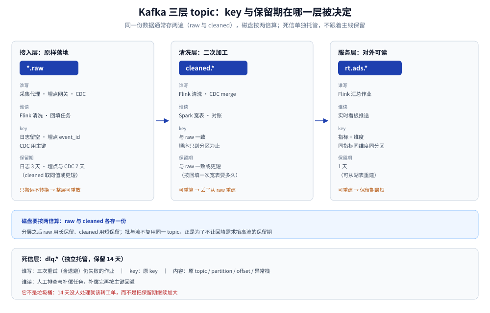
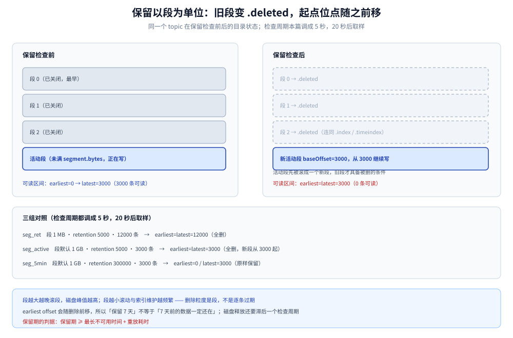
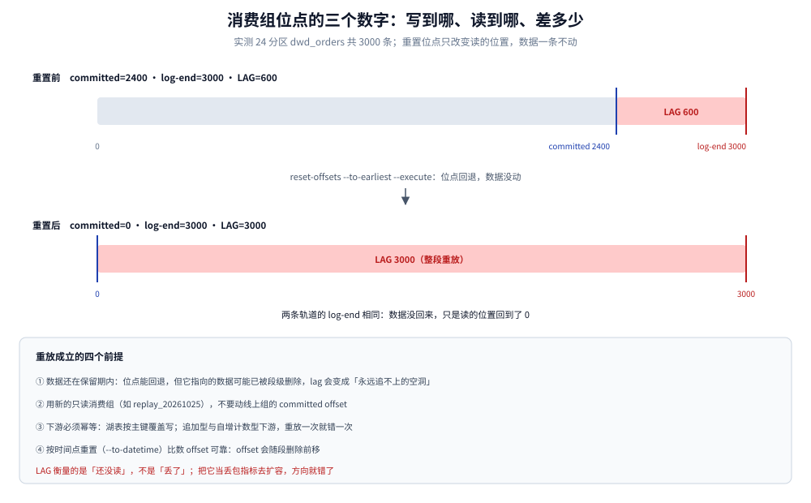

# Kafka 集群与 Topic 设计

> 覆盖：这套平台里 Kafka 的 **topic 分层、分区与 key、副本与 acks、保留与重放、压缩选型、消费组运维**，以及在自建 K8s 上用 Strimzi 落地时的关键参数。文中读数全部来自单 broker 容器实测。
>
> 不覆盖：分区、副本、ISR 的协议原理见 [Kafka/README.md](../../../03-数据与中间件/中间件/消息队列/Kafka/README.md)；分区数与磁盘的算式见 [容量规划与成本.md](容量规划与成本.md)；上游三条通道见 [数据采集与CDC.md](数据采集与CDC.md)。
>
> 内容整理自个人学习笔记。实测环境：`apache/kafka:3.9.0`（KRaft 单节点，broker+controller 同进程）、Docker 29.7.2、4 核；未实测多 broker、ISR 收缩与副本追赶。命令与读数见各节，汇总在文末「校验口径」。

---

## 一、为什么先定 topic 结构，而不是先定分区数？

**本节要点**：topic 是**保留期与 key 的边界**，分区只是它内部的并行度。先定 topic，分区数才有意义 —— 因为一条数据要存几遍、能回放多久，由 topic 决定。

### 1.1 三层 topic

| 层 | 命名 | 谁写 | 谁读 | key | 保留期 |
|---|---|---|---|---|---|
| 接入层 | `*.raw` | 采集代理、埋点网关、CDC | Flink 清洗作业、回填任务 | 按源：日志留空、埋点 `event_id`、CDC 主键 | 日志 3 天，埋点与 CDC 7 天 |
| 清洗层 | `cleaned.*` | Flink 清洗/合并作业 | Spark 宽表、Flink 窗口、对账 | 与 raw 一致 | 与 raw 一致或更短 |
| 服务层 | `rt.ads.*` | Flink 汇总作业 | 实时看板推送 | 指标 + 维度 | 1 天 |
| 死信 | `dlq.*` | 消费失败的作业 | 人工与补偿任务 | 原 key | 14 天 |

两条纪律：

- **raw 层只做搬运**，不做业务转换 —— 它是「可整层重放」的唯一保证，改口径时从这里重跑；
- **服务层可重建**，因此保留期最短；把 ADS 也当成「不可再生数据」是这套结构最常见的浪费。



图怎么读：横向是三层的流向，纵向标注每层的 key 与保留期。同一份数据在 Kafka 里通常存两遍（raw 与 cleaned），磁盘要按两倍算 —— 这也是「压缩比与保留期必须一起看」的原因。死信层单独列出：它不是垃圾桶，14 天没人处理就该转成工单，而不是继续扩大保留期。

### 1.2 为什么批与流不复用同一个 topic

消费组之间互不影响，所以「批任务会不会抢流的消息」这个担心其实不存在。真正冲突的是**保留期**：流只要 3 天，回填要 7 天甚至 30 天，取大值会让磁盘按最大需求付费。分层之后，raw 用长保留、cleaned 用短保留，两边各取所需。

---

## 二、分区数怎么定？

**本节要点**：分区数取两个下限的较大者 —— 峰值带宽下限与消费并行度下限；定下来之后**只能加不能减**，而且加分区会改变 key 到分区的映射，历史顺序保证会断。

### 2.1 两个下限

按 [容量规划与成本.md](容量规划与成本.md) 的输入（峰值 10 万条/秒、0.5 KB/条 → 48.8 MB/s）：

```text
带宽下限   = 48.8 MB/s ÷ 5 MB/s（单分区保守可持续写）≈ 10
并行度下限 = 24（Flink 单作业并行度上限）
分区数     = max(10, 24) = 24
```

分区多于带宽需求的部分不是浪费：它买的是**消费侧并行度**与**故障时的重分配余量**。

### 2.2 实测：24 分区在单 broker 上的样子

```text
$ kafka-topics.sh --bootstrap-server localhost:9092 --describe --topic dwd_orders
Topic: dwd_orders  PartitionCount: 24  ReplicationFactor: 1
  Partition: 0  Leader: 1  Replicas: 1  Isr: 1  Elr:
  ...
  Partition: 23 Leader: 1  Replicas: 1  Isr: 1  Elr:
分区行数：24
```

单 broker 时 24 个分区全部以本机为 leader —— 这条读数只能证明「分区建对了」，证明不了分布。三 broker 下每个 broker 应分到 8 个 leader，这一点本机无法验证。

### 2.3 key 选择：有序性只到分区为止

Kafka 只保证**同一分区内**的顺序，所以「同一个订单的变更不乱序」这件事，完全靠 key。

实测（24 分区、200 个业务 key、共 3000 条）：

```text
distinct_keys=200  keys_on_multiple_partitions=0
```

同一个 key 的 15 次写入始终落在同一分区，顺序因此成立。

⚠️ 无 key 时不是「均匀散列」，而是**粘性分区**：生产者把一批写满一个分区再换下一个。实测一次写 8 条无 key 消息，前 8 条全部落在 `Partition:16`。这意味着「没 key 也能均匀分布」只在长时段成立，瞬时会造成分区倾斜 —— 埋点这类无主键数据要接受这一点，或者人为取 `device_id` 做 key。

### 2.4 加分区的代价

| 动作 | 后果 | 什么时候还能做 |
|---|---|---|
| 加分区 | key→partition 映射整体变化，同一 key 的历史消息与新消息可能在不同分区 → 顺序断裂 | 消费侧改为按事件时间重排，或接受「历史与新数据不同分区」 |
| 减分区 | 不支持 | 只能新建 topic 迁移 |
| 改 key | 等同于「顺序保证重建」 | 停机或让下游做好重排 |

---

## 三、副本与 acks：这道闸门在单副本上拦不住

**本节要点**：`RF=3` + `min.insync.replicas=2` + `acks=all` 是一组必须同时成立的三角。少任何一个，`acks=all` 都退化成「写进 leader 就算成功」。

### 3.1 三角关系

| 参数 | 生产取值 | 作用 |
|---|---|---|
| `replication.factor` | 3 | 副本数，决定能坏几台 |
| `min.insync.replicas` | 2 | ISR 少于这个数就拒绝 `acks=all` 的写入 |
| `acks` | `all` | 要求所有 ISR 落盘才应答 |

`min.insync.replicas=2` 的意义不是「更安全」，而是**用可用性换一致性**：当只剩一台 broker 时，写请求直接失败，而不是静默丢掉副本。

### 3.2 实测：单副本上这道闸门不生效

在本机单 broker 上建了一个 `min.insync.replicas=2` 的 topic（副本因子只能是 1），用 `acks=-1` 写 5 条：

```text
$ kafka-configs.sh --describe --entity-type topics --entity-name dwd_strict
  min.insync.replicas=2
$ kafka-verifiable-producer.sh --topic dwd_strict --max-messages 5 --acks -1
{"name":"producer_send_success","value":"0","partition":2,"offset":202}
...
{"name":"tool_data","sent":5,"acked":5,"avg_throughput":8.44}
```

5 条全部 `acked`，broker 日志里也没有 `NOT_ENOUGH_REPLICAS`。结论有两条：**这道闸门在本机无法验证**（要 3 副本才会走到拒绝分支），以及**别在单副本环境里用这个配置做「写入安全」的验证** —— 它会给出一个假的「通过」。

⚠️ 由于本机不具备多 broker，副本追赶、ISR 收缩、`unclean.leader.election` 的取舍只能按文档写，本册不冒充读数。

### 3.3 采集侧为什么必须是 `acks=all`

采集是**唯一一次**能拿到原始数据的机会：一条消息在采集侧丢了，下游既无法重放也无法补算。所以 `acks=all`、`enable.idempotence=true`、`retries` 足够大是硬要求；吞吐不够就加分区，不要降 acks。

---

## 四、保留期到底删什么？

**本节要点**：保留是**段级删除**，不是「逐条过期」；生效时间 = `retention.ms` + 最多一个检查周期；删除后位点起点会前移，`--from-beginning` 也就从更晚的地方开始。

### 4.1 段、检查周期与删除

Kafka 的日志由若干 segment 组成，只有**已关闭**的段才会被保留策略删掉；什么时候关闭由 `segment.bytes` / `segment.ms` 决定。组了三组对照（检查周期都调成 5 秒）：

| topic | 段大小 | `retention.ms` | 写入量 | 20 秒后 |
|---|---|---|---|---|
| `seg_ret` | 1 MB | 5000 | 12000 条 | earliest=latest=12000（全删） |
| `seg_active` | 默认 1 GB | 5000 | 3000 条（约 0.5 MB） | earliest=latest=3000（全删，旧段变 `.deleted`，新段从 3000 起） |
| `seg_5min` | 默认 1 GB | 300000 | 3000 条（约 0.5 MB） | earliest=0，latest=3000（原样保留） |

三组读数说明三件事：

1. **5 秒保留确实能把数据删干净**，包括那个「还没写满」的活动段 —— 它在到期后被滚成一个空段，旧段连同索引一起变成 `.deleted`；
2. **5 分钟保留则完全不受影响** —— 保留策略确实按时间工作；
3. **删除的粒度是段**：`segment.bytes` 越大，越晚滚段，磁盘峰值就越高；段越小，滚动与索引维护越频繁。



图怎么读：左边是三个已关闭段与一个活动段，右边是保留检查之后的同一目录 —— 旧段的 `.log/.index/.timeindex` 变成 `.deleted`，活动段被滚成新段。要点是两条：**磁盘占用会滞后于保留期一个检查周期**（默认 5 分钟），以及 **`earliest offset` 会随删除前移**，所以「保留 7 天」不等于「7 天前的数据一定还在」。

### 4.2 保留期该设多长

判据只有一个：**保留期 ≥ 最长不可用时间 + 重放耗时**。

- `*.raw` 层：按「下游故障最长恢复时间」定。CDC 的 raw 还要与 MySQL binlog 保留期对齐 —— 两个窗口取小值才是真实可回放窗口；
- `cleaned.*`：按「回填一次宽表要多久」定；
- `rt.ads.*`：可重建，1 天够。

### 4.3 三种保留策略

| 策略 | 配置 | 适用 | 注意 |
|---|---|---|---|
| 按时间 | `retention.ms` | 绝大多数 topic | 生效滞后一个检查周期 |
| 按字节 | `retention.bytes` | 磁盘吃紧时的兜底 | 与时间策略**同时**生效，谁先到删谁 |
| 压实 | `cleanup.policy=compact` | 变更日志、维表快照 | 只保留每个 key 的最新值，不用于事件流 |

---

## 五、压缩选型：压缩比是数据的属性

**本节要点**：不要抄别人评测里的「5 倍压缩」，那和你的数据分布强相关。用同一份生产者代码、同一批 5 万条消息，换 `compression.type` 量三遍，再决定容量。

### 5.1 实测：两种数据分布，差 3 倍以上

| 数据 | 编码 | 落盘字节 | 相对未压缩 |
|---|---|---|---|
| 随机字母数字填充（458 B/条 × 5 万） | `none` | 23,909,865 | 1.00× |
| 同上 | `lz4` | 20,157,358 | 1.19× |
| 同上 | `zstd` | 13,155,377 | 1.82× |
| 结构化 JSON（388 B/条 × 5 万，重复键 + 低基数字段） | `zstd` | 3,289,726 | **5.90×** |

同样的 `zstd`，在随机数据上只有 1.8 倍，在结构化 JSON 上有 5.9 倍。原因不复杂：压缩吃的是重复 —— JSON 的键名、枚举值、递增 ID 都能压，随机串不能。

对容量的含义：
- 用「压缩后大小」估 Kafka 分区会低估 3–5 倍；
- 用「原始大小 × 5」估湖表会高估（Parquet 列存 + 同类值聚集，通常比行式压缩更好）；
- **两个数分开记**，并且用自己样本实测。

### 5.2 端到端压缩 vs broker 端压缩

| 位置 | 配置 | 谁付 CPU | 效果 |
|---|---|---|---|
| 生产端 | `compression.type=zstd` | 生产者 | 网络与磁盘都省，推荐 |
| broker 端 | `compression.type=producer`（默认，保持原样） | 不额外付 | 若设成 `zstd`，broker 会重新压缩，吃 broker CPU |
| 消费端 | 自动解压 | 消费者 | 无配置项 |

生产端压缩 + broker 保持原样，是这套平台的选择。

---

## 六、消费组、滞后与重放

**本节要点**：`LAG = LOG-END-OFFSET - CURRENT-OFFSET`，它衡量的是「还没读」，不是「丢了」。重放只是把 `CURRENT-OFFSET` 往前挪，前提是数据还在保留期内。

### 6.1 实测：滞后与重放

在 24 分区的 `dwd_orders` 上写 3000 条，用消费组 `g_lag` 读走一部分，再看位点：

```text
$ kafka-consumer-groups.sh --describe --group g_lag
GROUP   TOPIC      PARTITION  CURRENT-OFFSET  LOG-END-OFFSET  LAG
g_lag   dwd_orders 16         108             135             27
g_lag   dwd_orders 15         84              105             21
...
committed_total=2400  lag_total=600  end_total=3000
```

再补写 600 条，滞后回到 600；随后把位点重置到最早：

```text
$ kafka-consumer-groups.sh --group g_lag --topic dwd_orders \
    --reset-offsets --to-earliest --execute
committed_total=0  lag_total=3000  end_total=3000
```

滞后从 600 跳回 3000 —— 这就是「重放」的全部含义：数据没动，只是消费位点回退了。但这一步能成立的唯一前提是**数据还没被保留策略删掉**。



图怎么读：上面那条是重置前的分区，committed 在 2400、log-end 在 3000，lag 600；下面那条是执行 `--to-earliest` 之后，committed 回到 0，lag 变成 3000。图中两个 log-end 相同，说明数据一条没动、只是读的位置变了 —— 所以「重放」总是安全的，只要数据还在。

### 6.2 重放的三条纪律

1. **用只读消费组重放**：新建一个 group（如 `replay_20261025`），不要动线上组的位点；
2. **按时间点重置**：`--to-datetime 2026-10-25T00:00:00.000` 比数 offset 可靠；
3. **下游必须幂等**：重放等于把一批旧消息再写一次，湖表侧要用主键覆盖写（见 [数据湖与Iceberg表设计.md](数据湖与Iceberg表设计.md)）。

### 6.3 死信怎么用

三次重试（含退避）仍失败 → 写 `dlq.<业务>` 并带上原始 topic / partition / offset / 异常栈。死信的保留期不是越长越好：14 天没处理就该转工单，否则它只是一个更贵的黑洞。

---

## 七、在 K8s 上怎么落地

**本节要点**：Strimzi 把 broker、PVC、监听器与 topic 都变成 CRD；关键是每个 broker 独占 PVC、`min.insync.replicas` 与副本因子一起设、分区不能靠 CRD 反悔。

```yaml
apiVersion: kafka.strimzi.io/v1beta2
kind: Kafka
metadata:
  name: bdp-kafka
spec:
  kafka:
    version: 3.9.0
    replicas: 3
    listeners:
      - name: internal
        port: 9092
        type: internal
        tls: true
    config:
      offsets.topic.replication.factor: 3
      transaction.state.log.replication.factor: 3
      transaction.state.log.min.isr: 2
      default.replication.factor: 3
      min.insync.replicas: 2
      log.retention.hours: 72
      log.segment.bytes: 1073741824
    storage:
      type: jbod
      volumes:
        - id: 0
          type: persistent-claim
          size: 2Ti
          class: local-nvme
          deleteClaim: false
```

```yaml
apiVersion: kafka.strimzi.io/v1beta2
kind: KafkaTopic
metadata:
  name: cdc-shop-orders-raw
  labels:
    strimzi.io/cluster: bdp-kafka
spec:
  topicName: cdc.shop.orders.raw
  partitions: 24
  replicas: 3
  config:
    retention.ms: "604800000"
    min.insync.replicas: 2
```

## 使用：日常运维命令表

| 要做的事 | 命令 |
|---|---|
| 看分区与 ISR | `kafka-topics.sh --bootstrap-server k:9092 --describe --topic <t>` |
| 看消费滞后 | `kafka-consumer-groups.sh --describe --group <g>` |
| 重置到某时间点 | `kafka-consumer-groups.sh --group <g> --topic <t> --reset-offsets --to-datetime 2026-10-25T00:00:00.000 --execute` |
| 看落盘字节 | `kafka-log-dirs.sh --describe --topic-list <t>` |
| 改保留期 | `kafka-configs.sh --alter --entity-type topics --entity-name <t> --add-config retention.ms=86400000` |
| 量压缩比 | 同一批数据换 `compression.type` 各写一遍，比 `kafka-log-dirs.sh` 的 `size` |

## 校验口径

> 本篇读数的校验方式与范围（`apache/kafka:3.9.0`，KRaft 单节点，Docker 29.7.2，4 核）：

- **真跑并取到读数**：第 2.2 节分区与 ISR；第 2.3 节 key 分区唯一性与粘性分区；第 3.2 节 `acks=-1` / `min.insync.replicas=2` 在单副本下的行为；第 4.1 节三组保留对照；第 5.1 节四种压缩落盘字节；第 6.1 节滞后与位点重置。
- **只做静态校验**：第 7 节的 Strimzi CRD（未装 Strimzi Operator，未在 K8s 上应用）。
- **未实测**：多 broker 的 ISR 收缩与副本追赶、三副本下的 `NOT_ENOUGH_REPLICAS` 拒绝、跨机网络吞吐、事务型生产者。
- **容器**：`bdp-kafka`（保留未删，后续 Flink 篇还要用它作数据源）。

| 项 | 实际值 |
|---|---|
| Kafka | 3.9.0（镜像 `apache/kafka:3.9.0`） |
| 模式 | KRaft 单节点，broker id=1 兼任 controller |
| 检查周期 | `log.retention.check.interval.ms=5000`（默认 300000） |
| 段大小默认 | `log.segment.bytes=1073741824` |

---

## 延伸追问

- **为什么 `acks=all` 还需要 `min.insync.replicas=2`？`acks=all` 不是已经等所有副本了吗？** → `acks=all` 等的是「当前 ISR」，而 ISR 可能已经缩到 1；`min.insync.replicas` 是给 ISR 设的下限，两者缺一不可。
- **分区数能不能按峰值 QPS 直接除以单分区 QPS？** → 不能，还要看下游并行度与故障时的重分配余量；本方案 24 分区就是被 Flink 并行度顶上去的，带宽只要求 10。
- **为什么删数据后磁盘没立刻降下来？** → 段先变成 `.deleted`，由日志清理与文件系统回收逐步释放；保留策略的检查周期也决定了滞后。
- **`cleanup.policy=compact` 能当「去重」用吗？** → 能保证每个 key 至少留最后一条，但不保证「任何时刻都能读到」；事件流用它会在中途读到旧值，去重还是要靠下游幂等。
- **重放会不会把下游写坏？** → 只要下游是「按主键覆盖写 + 幂等」，重放就是安全的；不幂等的下游（自增计数、追加日志）重放一次就错一次。
- **单 broker 能用来验证副本策略吗？** → 不能。本篇实测已证明：`min.insync.replicas=2` 在单副本上没有形成闸门，验证副本行为至少要 3 broker。

## 关联

- **上游采集**：[数据采集与CDC.md](数据采集与CDC.md) — 三条通道如何决定 topic 与 key
- **下游存储**：[数据湖与Iceberg表设计.md](数据湖与Iceberg表设计.md) — raw 层重放与湖表幂等写
- **下游计算**：[Flink实时链路.md](Flink实时链路.md) — 24 并行度从哪来、checkpoint 怎么配
- **容量算式**：[容量规划与成本.md](容量规划与成本.md) — 2730 GB 磁盘与 24 分区的完整推导
- **组件原理**：[Kafka/README.md](../../../03-数据与中间件/中间件/消息队列/Kafka/README.md) — 分区、副本、ISR 与控制器
- **部署**：[K8s部署与运维.md](K8s部署与运维.md) — Strimzi 之外的整体拓扑与故障演练
