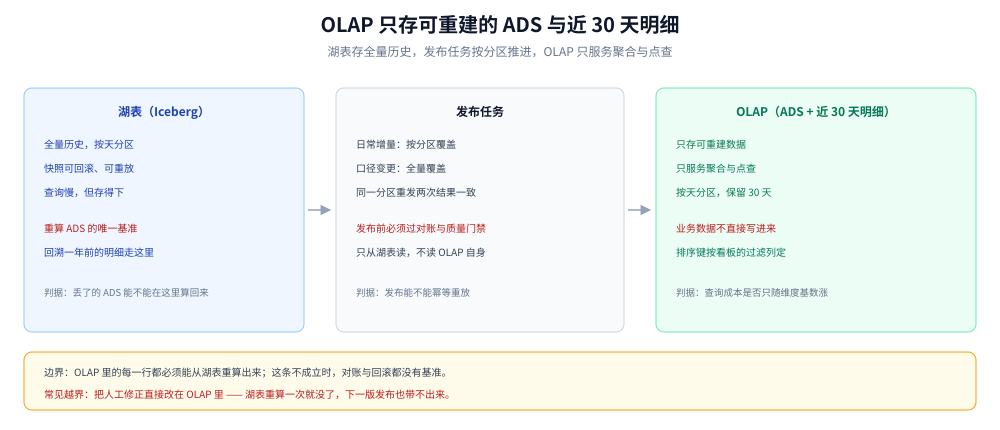
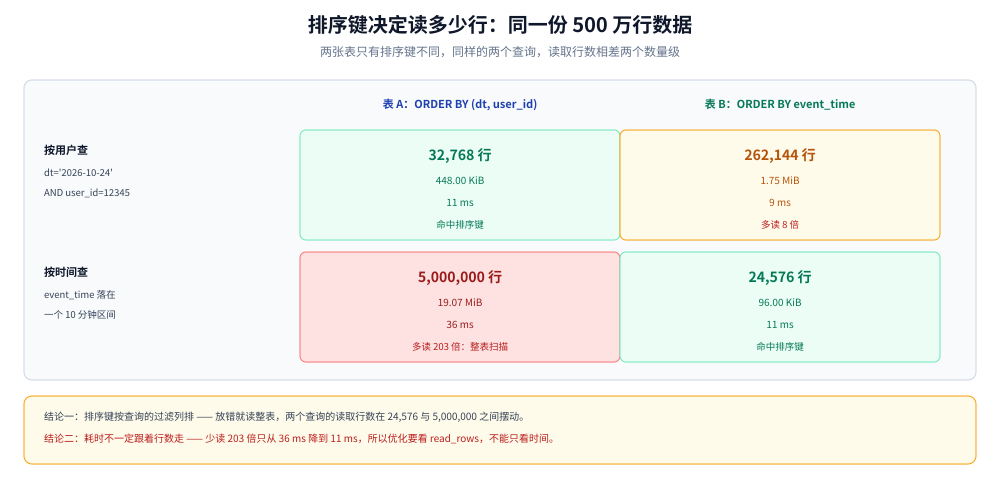

# OLAP 查询服务

> 覆盖：OLAP 在这套平台里的边界、Doris / StarRocks、ClickHouse、Trino 三者的分水岭、表怎么建才查得快、慢查询怎么定位、ADS 怎么发布与回滚。ClickHouse 的读数来自单容器 5,000,000 行实测；Doris / StarRocks / Trino 只做设计判断，未实测。
>
> 不覆盖：列存原理见 [ClickHouse/README.md](../../../03-数据与中间件/数据存储/列式数据库/ClickHouse/README.md)；ADS 的口径定义见 [分层建模与指标口径.md](分层建模与指标口径.md)；湖表存储见 [数据湖与Iceberg表设计.md](数据湖与Iceberg表设计.md)。
>
> 内容整理自个人学习笔记，素材见 [素材清单](../../../素材清单.md)。**实测口径**：第 3.1、3.3、3.4 节的读数为本机真跑（ClickHouse 26.3.29.7）；集群形态、并发与资源隔离未实测，见文末「校验口径」。

---

## 一、OLAP 在这套平台里只做一件事？

**本节要点**：OLAP 不存原始数据，只存**可重建的 ADS** 与**近期明细**。判断一张表该不该进 OLAP，用两条就够：丢了能不能从湖表重建、查询形态是不是聚合或点查。

### 1.1 三条边界

| 边界 | 判据 | 越界的后果 |
|---|---|---|
| 只存可重建数据 | 能否从湖表按 SQL 重算出来 | 不可重建的数据进了 OLAP，就成了第二份真相 |
| 只服务聚合与点查 | 查询是否带时间范围与维度过滤 | 大范围明细扫描会把并发打垮 |
| 不承担写入 | 写入是否只来自批 / 流任务的发布 | 业务直接写 OLAP，回滚与对账都失去基准 |

「不可重建」是三条里最容易被破坏的一条。典型场景是把人工修正的数据直接改在 OLAP 里：湖表重算一次，修正就没了；反过来，只改湖表不重发 ADS，看板又不会变。修正必须落在湖表的修正层，再由发布任务带出来。

### 1.2 与湖表的分工

```text
湖表（Iceberg）      全量历史、可回放、按天分区、查询慢但便宜
    │  发布任务（按天覆盖 / 按分区覆盖）
    ▼
OLAP（ADS + 近 30 天明细）   只放看板要用的聚合结果与排障要用的明细
```

分工的判据是**查询频次与数据量**：每天被查上万次、每次只看固定几个指标 → 进 OLAP；偶尔回溯一年前的明细 → 走湖表上的 Spark / Trino。把两者混在一张表里，要么 OLAP 存不下，要么湖表被高频查询拖垮。



图怎么读：左边是湖表，存全量历史与可回放的分区；中间是发布任务，按分区把结果推进 OLAP；右边是 OLAP，只留最近 30 天的 ADS 与排障明细。要读出的是：**OLAP 里的每一行都必须能从左边重算出来**，这条不成立时，对账与回滚都没有基准。

---

## 二、三个引擎怎么选？

**本节要点**：先看**更新模式与 join 形态**，再看并发与运维成本。ClickHouse 单表扫描最快但更新与 join 弱；Doris / StarRocks 的聚合模型与多表 join 更贴近看板；Trino 是联邦查询层，不是 serving 层。

### 2.1 分水岭对照

| 维度 | Doris / StarRocks | ClickHouse | Trino |
|---|---|---|---|
| 数据模型 | 明细 / 聚合 / 主键模型，支持按主键更新 | 宽表为主，`ReplacingMergeTree` 等引擎做最终合并 | 无存储，只做查询 |
| 多表 join | 原生支持，有分布式 join 与 colocate | 支持但更依赖内存与右表大小 | 擅长，但依赖各源系统的读取能力 |
| 点查更新 | 主键模型可实时 upsert | 无真正 upsert，靠后台合并 | 不适用 |
| 高并发点查 | 强项 | 需靠副本与查询队列 | 不适合 |
| 单表大扫描 | 好 | 最强 | 取决于源 |
| 运维复杂度 | 中（FE + BE） | 低（单进程） | 中（coordinator + catalog） |
| 典型角色 | 看板 serving | 日志 / 事件分析 | 跨源联邦查询 |

### 2.2 本方案为什么以 MPP 为主

日增 200 GB、看板以「按维度看指标」为主、指标需要按主键修正（退款、状态回撤）、还要支撑几十个并发查询。四个条件里，**按主键修正**与**并发**直接排除了 ClickHouse 作为主库的可能：ClickHouse 的更新是异步合并，查到的结果取决于查询时刻的合并进度，对账时无法给出确定值。

所以本方案把 Doris / StarRocks 作为 serving 主库，ClickHouse 留给「单表大扫描、日志式数据、不需要更新」的场景。

### 2.3 ClickHouse 在什么条件下更合适

- 数据是**只追加**的事件流，不需要按主键修正；
- 查询以**单表宽表扫描 + 聚合**为主，join 很少；
- 能接受「查询结果与合并进度相关」这一语义；
- 运维人手有限，希望一个进程搞定。

反过来，只要出现「同一订单状态要改」「看板要 join 三张维表」「几十个并发同时点查」中任意一条，就该换 MPP。

### 2.4 Trino 的位置

Trino 不做 serving：它没有自己的存储，每次查询都要从 Iceberg / MySQL / OLAP 拉数据。它的价值在**跨源一次性查询**（比如临时核对湖表与业务库），以及给分析师一个统一的 SQL 入口。把它放到看板后面，延迟与并发都会成为问题。

---

## 三、表怎么建才查得快？

**本节要点**：查询快慢首先取决于**读了多少行**，其次才是算得多快。排序键与分区键决定读多少行，预聚合决定算多少行；两者都做对之后，剩下的才是引擎调优。

### 3.1 排序键决定读多少行

同一份 5,000,000 行、7 个日分区的数据，建两张只差排序键的表：

| 表 | 排序键 |
|---|---|
| A | `ORDER BY (dt, user_id)` |
| B | `ORDER BY event_time` |

同一个查询在两张表上的读数：

| 查询 | 表 | read_rows | read_bytes | 耗时 |
|---|---|---|---|---|
| `dt='2026-10-24' AND user_id=12345` | A | 32,768 | 448.00 KiB | 11 ms |
| 同上 | B | 262,144 | 1.75 MiB | 9 ms |
| `event_time` 落在一个 10 分钟区间 | B | 24,576 | 96.00 KiB | 11 ms |
| 同上 | A | 5,000,000 | 19.07 MiB | 36 ms |

两行结论：

- **排序键要按查询的过滤列排**。按用户查就把 `user_id` 放进排序键，按时间查就把时间放进去；放错时读的是整表（5,000,000 行 vs 24,576 行，差两个数量级）。
- **耗时不一定跟着行数走**。第二组里 B 少读了 200 倍的行，耗时却只从 36 ms 降到 11 ms —— 因为扫描本身很快，固定开销占了主导。用小数据量测「优化有没有用」，很容易得出错误结论，要看 `read_rows` 而不是只看时间。



图怎么读：左边是按 `(dt, user_id)` 排序的表，右边是按 `event_time` 排序的表；上方查询按时间过滤，下方查询按用户过滤。同一份数据、同样的 5,000,000 行，读取行数在 24,576 与 5,000,000 之间摆动。要读出的是：**排序键不是索引的附属品，它就是读多少行的决定因素**。

### 3.2 分区键与分区粒度

分区解决的是「裁剪」，排序键解决的是「定位」，两者不能互相替代：

| 选择 | 建议 | 原因 |
|---|---|---|
| 分区列 | 日期（或日期 + 业务线） | 与查询的时间范围天然对齐，便于按分区重刷 |
| 分区数 | 单表控制在几百到几千 | 分区过多会导致元数据与文件句柄压力 |
| 分区粒度 | 按天；数据量小时按月 | 按小时分区在日增 200 GB 的量级下会产生过多小分区 |

本方案的 ADS 按天分区、保留 30 天，共 30 个分区；湖表保留全量历史，两者用同一套日期口径，发布任务才能按天覆盖。

### 3.3 预聚合：把 47.68 MiB 降到 182 B

同一份数据，直接查明细表与查预聚合表：

| 查询 | read_rows | read_bytes | 耗时 |
|---|---|---|---|
| 明细表按日聚合 | 5,000,000 | 47.68 MiB | 51 ms |
| 预聚合表（7 行） | 7 | 182.00 B | 2 ms |

预聚合的价值不在「快 25 倍」，而在**把查询成本从「跟数据量成正比」变成「跟维度基数成正比」**。数据每天涨，查询耗时不变；这是看板能长期稳定的前提。

代价是时效与灵活性：预聚合表只回答预先定义的维度组合，换一个维度就得重建。所以 ADS 层要按看板的实际查询建，而不是把所有维度组合都物化一遍。

### 3.4 物化视图是增量维护，不是快照

实测：在 5,000,000 行的明细表上建一个按日聚合的物化视图，建好后查它是**空的**；插入 10,000 行后，视图里只有这 10,000 行（`cnt=10000`、`amt=500000`），此前 714,285 行的历史没有被回填；同日全量重算是 724,285 行、35,499,950。

| 时刻 | 物化视图 | 同日全量重算 |
|---|---|---|
| 建好后 | 0 行 | 714,285 行 |
| 插入 10,000 行后 | 10,000 行 / 500,000 | 724,285 行 / 35,499,950 |

结论：物化视图只处理**建好之后**的写入。历史数据要么建视图时用 `POPULATE` 一次性灌入，要么单独跑一次回填；两者都没做，视图会安静地少一大截，而且查起来完全正常。这条在 ClickHouse 与 Doris 的物化视图上都成立，属通用语义。

---

## 四、查询为什么慢？

**本节要点**：慢查询分「读太多」与「算太久」两类，定位的第一步是看 `read_rows` 与耗时的比例，而不是先看执行计划。

### 4.1 四类慢查询

| 类型 | 特征 | 处置 |
|---|---|---|
| 扫太多 | `read_rows` 接近全表 | 补分区裁剪、改排序键、加预聚合 |
| join 太大 | 右表被反复广播 / shuffle 量大 | 改 colocate、缩右表、预 join 成宽表 |
| 聚合基数太高 | `GROUP BY` 的 key 接近行数 | 先降维再聚合，或改近似算法 |
| 并发打满 | 单查不慢，一起变慢 | 资源组隔离、限并发、加副本 |

### 4.2 定位顺序

```text
第一步  看 read_rows / 总行数的比例
          ├─ 接近 1 → 裁剪没生效：查分区键、排序键、过滤条件写法
          └─ 很小但慢 → 进入第二步
第二步  看耗时分布（扫描 / 聚合 / 等待）
          ├─ 聚合慢 → 看 GROUP BY 基数与聚合函数
          └─ 等待慢 → 看并发、队列、副本
第三步  看是否命中预聚合
          └─ 没有 → 评估是否值得为这个查询建 ADS 表
```

用「读了 5,000,000 行、耗时 36 ms」与「读了 24,576 行、耗时 11 ms」这组读数做基线：前者是裁剪失效，后者是固定开销。两者的处置完全不同，只看耗时会把它们混为一类。

### 4.3 资源怎么分

- **按查询来源分组**：看板查询、分析师临时查询、对账任务分到不同的资源组 / 队列，避免临时大查询拖垮看板；
- **限并发而不是限超时**：并发上限能在排队阶段保护系统，超时只会在打满之后才生效；
- **给对账留固定配额**：对账任务每天定时跑，抢不到资源时会静默延后，第二天的对账结果就少了参照。

Doris / StarRocks 用资源组（Resource Group）与查询队列；ClickHouse 用 `settings` 里的查询并发与内存限制。两者的共同点是**先分组再限流**，不分组只限流会把正常查询也一起卡住。

---

## 五、ADS 怎么发布与回滚？

**本节要点**：发布只有两种形态 —— 全量覆盖与分区覆盖。选择判据是「这次变更影响多少天」；回滚的判据是「上一版的结果还在不在」。

### 5.1 两种发布形态

| 形态 | 适用 | 代价 |
|---|---|---|
| 全量覆盖 | 口径变更、维度重构 | 重算全部历史，耗时长 |
| 分区覆盖 | 日常增量、补数 | 只重算受影响分区，快 |

日常发布用分区覆盖，口径变更用全量覆盖；两种都要保证**发布是幂等的** —— 同一个分区重发两次，结果必须一样。

### 5.2 回滚

回滚的前提是上一版结果还在。三条做法：

- ADS 表按分区保留两版（`_v1` / `_v2` 或用发布日期做分区后缀），回滚时切视图；
- 湖表侧保留快照，必要时从快照重算 ADS；
- 口径变更走「双写 + 对比 + 切换」，而不是直接改生产 SQL。

只有第一种能在一分钟内回滚，后两种都要分钟到小时级。看板类指标的变更，优先选第一种。

---

## 使用：建表、预聚合与慢查询定位

```sql
-- 1. ADS 表：排序键按查询的过滤列排，按天分区
CREATE TABLE ads_order_daily (
  dt          DATE,
  channel     VARCHAR(32),
  order_cnt   BIGINT,
  gmv         DECIMAL(18, 2)
) ENGINE = MergeTree
PARTITION BY dt
ORDER BY (dt, channel);
```

```sql
-- 2. 增量预聚合：物化视图只处理建好之后的写入
CREATE MATERIALIZED VIEW ads_order_daily_mv
ENGINE = SummingMergeTree
ORDER BY (dt, channel) AS
SELECT dt, channel, count() AS order_cnt, sum(amount) AS gmv
FROM dwd_orders
GROUP BY dt, channel;
```

```sql
-- 3. 查慢查询：先看读了多少行，再看耗时
SELECT
  query_duration_ms,
  read_rows,
  formatReadableSize(read_bytes) AS read_size,
  substring(query, 1, 80) AS q
FROM system.query_log
WHERE type = 'QueryFinish'
  AND event_time > now() - INTERVAL 1 HOUR
ORDER BY query_duration_ms DESC
LIMIT 10;
```

```sql
-- 4. Doris / StarRocks 侧的资源组（伪代码，按官方语法调整）
-- CREATE RESOURCE GROUP rg_bi
--   TO (user='bi')
--   WITH (cpu_core_limit = 8, mem_limit = '40%', concurrency_limit = 20);
```

判据：第 1 段的排序键来自看板的过滤条件，不是来自主键；第 2 段的物化视图建好后必须补一次历史回填，否则只有新数据；第 3 段的排序要看 `query_duration_ms`，但归因要看 `read_rows`。

---

## 校验口径

> ✅ 本篇读数的校验方式与范围（本机 Docker Desktop，2026-10-25）：

- **真跑并取到读数**：第 3.1 节的排序键对照 —— 5,000,000 行、7 个日分区、53.85 MiB；`(dt,user_id)` 表上单日单用户读 32,768 行 / 448.00 KiB / 11 ms，`event_time` 表上同为 262,144 行 / 1.75 MiB / 9 ms；10 分钟时间范围在 `event_time` 表上 24,576 行 / 96.00 KiB / 11 ms，在 `(dt,user_id)` 表上 5,000,000 行 / 19.07 MiB / 36 ms。
- **真跑并取到读数**：第 3.3 节的预聚合对照 —— 明细表按日聚合 5,000,000 行 / 47.68 MiB / 51 ms，预聚合表 7 行 / 182.00 B / 2 ms。
- **真跑并取到读数**：第 3.4 节的物化视图 —— 建好后 0 行；插入 10,000 行后视图 10,000 行 / 500,000，同日全量重算 724,285 行 / 35,499,950，历史未回填。
- **示例未运行**：第 1 节与「使用」中的 ADS DDL、物化视图 DDL、`system.query_log` 查询在 ClickHouse 26.3.29.7 上语法成立；Doris 资源组一段是伪代码，未在 Doris 上执行。
- **未实测**：Doris / StarRocks 的建表与查询耗时；Trino 的跨源查询；多副本下的并发表现；资源组隔离效果；亿级数据量下的排序键收益。
- **实测环境**：`clickhouse/clickhouse-server:26.3-alpine`（26.3.29.7），容器 `bdp-clickhouse`，单机单副本。

| 依赖 | 实际版本 |
|---|---|
| ClickHouse | 26.3.29.7（单容器） |
| Doris / StarRocks | 未部署，只做设计判断 |
| Trino | 未部署 |
| 数据量 | 5,000,000 行 / 53.85 MiB / 7 个日分区 |

## 延伸追问

- **ClickHouse 能不能做主库？** → 能，但要接受「更新是异步合并、查询结果与合并进度相关」这一语义；需要按主键给出确定值的场景（订单状态、退款修正）不适合。
- **排序键能不能包含所有过滤列？** → 不能。排序键越长，写入与合并成本越高，而且只有前缀能有效裁剪；把高频过滤列排前面，其余交给跳数索引。
- **预聚合表越多越好吗？** → 不是。每张预聚合表都要维护一条写入链路，口径变更时要全部重刷；按看板的真实查询建，不按维度组合穷举。
- **为什么不能只看查询耗时？** → 第 3.1 节的第二组里，少读 200 倍的行只换来 3 倍的时间差；只看时间会误判优化无效，看 `read_rows` 才知道裁剪有没有生效。
- **Trino 能不能直接替换 MPP？** → 不能。它没有自己的存储与预聚合，每次查询都要回源，延迟与并发都不是 serving 的量级。

## 关联

- **上游/总纲**：[README.md](README.md) — 本册的分层架构与篇目分工
- **上游口径**：[分层建模与指标口径.md](分层建模与指标口径.md) — ADS 的指标定义与口径版本
- **上游存储**：[数据湖与Iceberg表设计.md](数据湖与Iceberg表设计.md) — 全量历史与重算的数据源
- **上游对账**：[流批对账与数据质量.md](流批对账与数据质量.md) — 发布前的对账与质量门禁
- **下游运维**：[K8s部署与运维.md](K8s部署与运维.md) — OLAP 集群的部署与备份
- **容量**：[容量规划与成本.md](容量规划与成本.md) — OLAP 的 0.55 TB 与副本系数
- **组件原理**：[ClickHouse/README.md](../../../03-数据与中间件/数据存储/列式数据库/ClickHouse/README.md) — 列存、稀疏索引与合并机制
