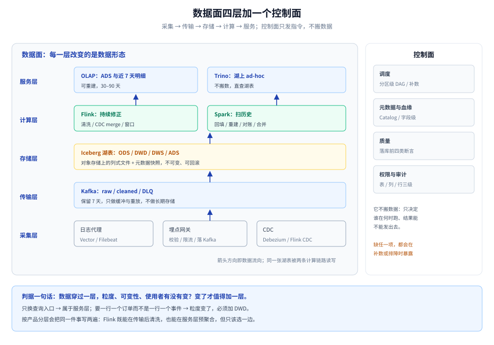

# 大数据平台

> 覆盖：一套**自建 K8s 上的分析型数据平台**从设计到落地的全套笔记 —— 采集与 CDC、Kafka、Iceberg 湖表、分层建模、Spark 批、Flink 流、对账与质量、OLAP 服务、运维、治理与分阶段实施。
>
> 不覆盖：组件的通用原理在 03 目录（Kafka 册、CDC 册、ClickHouse 册、可观测性册）；场景题的方法论见 [系统设计方法论.md](../系统设计方法论.md)；不写机器学习平台、不写云托管产品选型、不写 OLTP。
>
> 内容整理自个人学习笔记。量级坐标：日增原始数据 200 GB、峰值 10 万条/秒、时效 15 分钟、平台 1–2 人、自建 K8s。**集群规模未实测**；机制类判断（分区、checkpoint、快照、幂等写）在 Kafka / Flink / Spark+Iceberg 三个单容器里取真读数，偏差写在对应零件篇。

---

## 一、本册回答什么？

**一句话定位**：它回答的不是「大数据组件怎么选」，而是**一份数据从产生到出现在看板上，中间要经过哪几个必须改变形态的关口，以及每个关口错了会怎样**。

与常见资料的分水岭有三处：

| 常见写法 | 本册的写法 |
|---|---|
| 按组件罗列（Kafka / Flink / Spark / Doris 各一章） | 按数据形态分层（原始字节 → 事件流 → 不可变湖表 → 宽表 → 汇总） |
| 假设「实时」是目标，一律上流 | 先问时效是多少：**15 分钟用微批就够**，流的价值在 CDC merge 与迟到修正 |
| 只讲怎么搭起来 | 每一篇都写「错了长什么样」：重复计数、静默错位、小文件、口径打架 |

## 二、架构全景



图怎么读：从下往上是数据流 —— 采集侧把日志、埋点、业务库变更送进 Kafka；Flink 做清洗、CDC merge 与窗口聚合，一边写 cleaned topic，一边写湖表与 ADS；Spark 读同一张湖表做回填、重建、对账与小文件合并；OLAP 只存可重建的 ADS 与近期明细。右侧那一列是控制面（调度、元数据血缘、质量、权限），它不搬数据，只决定「谁在什么时候跑、结果能不能发出去」。图中不标吞吐，量级与算式见 [容量规划与成本.md](容量规划与成本.md)。

## 三、篇目分工

| 篇 | 回答的问题 | 关键内容 |
|---|---|---|
| [总体架构与选型.md](总体架构与选型.md) | 分几层、Flink 与 Spark 的边界在哪、八个组件怎么选 | 五层 + 控制面、双引擎判据、选型表、K8s 节点池 |
| [容量规划与成本.md](容量规划与成本.md) | 要买多少机器、钱花在哪 | 四个输入推六项规格、成本结构、三条杠杆 |
| [数据采集与CDC.md](数据采集与CDC.md) | 数据怎么进来、schema 变了怎么办 | 日志代理、埋点网关、Debezium/Flink CDC、限流背压 |
| [Kafka集群与Topic设计.md](Kafka集群与Topic设计.md) | 分区、副本、保留、topic 怎么规划 | KRaft 拓扑、key 选择、三层 topic、死信与重放 |
| [数据湖与Iceberg表设计.md](数据湖与Iceberg表设计.md) | 表怎么存、怎么回填、小文件怎么办 | 分区/排序/分桶、快照与回滚、compaction、保留策略 |
| [分层建模与指标口径.md](分层建模与指标口径.md) | ODS/DWD/DWS/ADS 各放什么、指标怎么定义 | 粒度、维度建模、SCD2、指标字典与口径版本 |
| [Spark批处理与调度.md](Spark批处理与调度.md) | 批任务怎么跑、怎么幂等、怎么补数 | Spark on K8s、微批、覆盖写、DAG 粒度、回填 |
| [Flink实时链路.md](Flink实时链路.md) | 流作业怎么不丢不重、状态怎么恢复 | checkpoint/savepoint、水位线、RocksDB、幂等 sink、反压 |
| [流批对账与数据质量.md](流批对账与数据质量.md) | 两条链路结果对不上怎么办 | 五类规则、对账口径、迟到修正、告警分级 |
| [OLAP查询服务.md](OLAP查询服务.md) | 查询引擎怎么选、慢查询怎么查 | Doris/StarRocks vs ClickHouse vs Trino、物化视图、资源组 |
| [K8s部署与运维.md](K8s部署与运维.md) | 组件怎么摆、故障怎么演练 | Operator 拓扑、资源队列、备份恢复、值班手册 |
| [元数据血缘与权限治理.md](元数据血缘与权限治理.md) | 表从哪来、谁能看哪一列 | Catalog、血缘、列级权限、脱敏、审计 |
| [演进路线与实施计划.md](演进路线与实施计划.md) | 先做什么、什么时候扩、怎么回退 | A–D 四阶段、里程碑、验收读数、回退方案 |

## 四、三条读序

**按角色读**（同一套内容，三种进法）：

| 角色 | 读序 | 理由 |
|---|---|---|
| 架构 / 负责人 | 总体架构 → 容量 → 演进路线 → 对账质量 | 先定边界与规模，再定节奏与验收 |
| 数据开发 | 分层建模 → Spark 批 → Flink 流 → 对账质量 | 先有表与口径，再写两条链路，最后验证 |
| 平台运维 | Kafka → 湖表 → K8s 运维 → OLAP | 先保入口与存储，再保计算与出口 |

**按依赖读**（前一篇的输出是后一篇的输入）：

```text
总体架构 ──> 容量 ──> 演进路线
   │            │
   ├──> 采集与CDC ──> Kafka ──> Flink ──┐
   │                                   ├──> 对账与质量 ──> OLAP
   └──> 湖表与Iceberg ──> 分层建模 ──> Spark ──┘
                                   └──> K8s 运维 ──> 元数据与治理
```

## 五、版本坐标与实测边界

| 组件 | 设计按 | 核对方式 |
|---|---|---|
| Kafka | 3.9.x（KRaft） | `kafka-topics.sh --describe` |
| Flink | 1.20.x / 2.x | `flink --version`、`flink list` |
| Spark | 3.5.x | `spark-submit --version` |
| Iceberg | 1.7+（实测 1.6.1） | `DESCRIBE FORMATTED` 看 `provider` |
| OLAP | Doris 2.x / StarRocks 3.x | `select version()` |
| MinIO | 稳定版 | `mc admin info` |

**已在单容器实测的范围**：Kafka 单 broker 的分区、消费组、保留与重放；Flink standalone 的 checkpoint、水位线、迟到数据；Spark local + Iceberg 的建表、静态/动态覆盖写、DDL 演进、小文件合并、快照回滚与过期；ClickHouse 单机的建表与查询耗时。

**未实测、只做设计或静态校验**：多 broker 集群与副本追赶；K8s 上的 Operator 实际调度；Doris / Trino 集群；MinIO 纠删码真实容量；真实规模压测（本机 16 GB 内存，`docker network create` 不可用，一律单容器内多进程）。所有「集群读数」在篇内都标为假设，不冒充实测。

## 六、本册边界

- **只管分析型数据**：埋点、日志、业务库 CDC。不覆盖在线交易、缓存、搜索、消息中间件自身的高可用设计。
- **只管自建**：托管产品的参数与账单不在本册；需要对照时看 03 目录的选型篇。
- **不重复组件原理**：Kafka 的分区与副本、CDC 的日志解析、ClickHouse 的列存，各自由 03 的册解释；本册只写「在本架构里怎么用、用错会怎样」。
- **不写 ML 平台**：特征工程与训练平台是另一条线，本册只到「算法能直接读湖表」。

## 关联

- **上游/总纲**：[系统设计/README.md](../README.md) — 本目录的通用场景与专题系统地图
- **同目录方法论**：[系统设计方法论.md](../系统设计方法论.md) — 量级估算、找第一性问题、分层加手段
- **同目录验证**：[全链路压测设计.md](../全链路压测设计.md) — 容量与瓶颈怎么用压测确认
- **同目录存储**：[海量数据存储设计.md](../海量数据存储设计.md) — 按数据类型选存储的通用判据
- **组件原理**：[Kafka/README.md](../../../03-数据与中间件/中间件/消息队列/Kafka/README.md) — 分区、副本、消费组
- **组件原理**：[CDC/README.md](../../../03-数据与中间件/数据存储/数据同步/CDC/README.md) — 日志解析与全量增量一体化
- **组件原理**：[ClickHouse/README.md](../../../03-数据与中间件/数据存储/列式数据库/ClickHouse/README.md) — 列存与查询执行
- **可观测**：[可观测性选型对比.md](../../../03-数据与中间件/中间件/可观测性/可观测性选型对比.md) — 平台的监控、日志与告警从哪来
