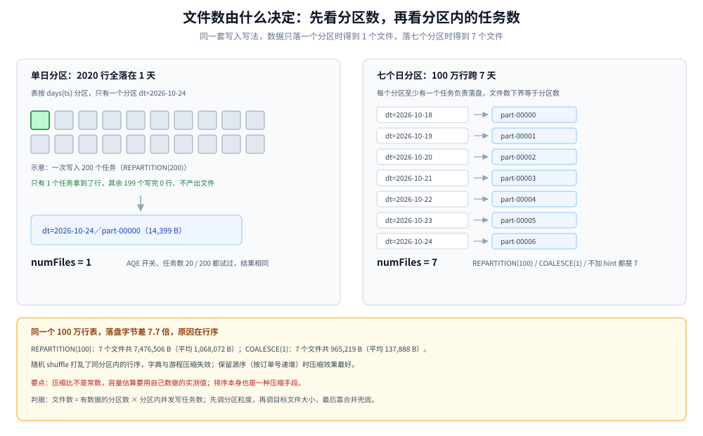

# Spark 批处理与调度

> 覆盖：这条批链路在本平台里承担什么、作业有哪几种形态、`spark-submit` 该动哪些旋钮、**文件数到底由什么决定**、DAG 怎么切与怎么补数、批作业失败先查什么。
>
> 不覆盖：湖表的文件格式、快照与合并命令见 [数据湖与Iceberg表设计.md](数据湖与Iceberg表设计.md)；指标口径与分层职责见 [分层建模与指标口径.md](分层建模与指标口径.md)；流链路见 [Flink实时链路.md](Flink实时链路.md)；Spark on K8s 的整体拓扑见 [K8s部署与运维.md](K8s部署与运维.md)。
>
> 内容整理自个人学习笔记。实测环境：`apache/spark:3.5.5-scala2.12-java17`（容器 `bdp-spark`，`--master local[2]`，2 GB driver）、Iceberg `1.6.1`、HadoopCatalog + `/wh/warehouse`。命令与读数见各节，汇总在文末「校验口径」。

---

## 一、有了 Flink，为什么还要一条 Spark 批链路？

**本节要点**：流解决的是「不断到达的最新数据」，批解决的是「已经落下来的全部数据」。后者有三件事流做不到 —— 重算历史、整表重建、跨源全量比对。

### 1.1 只有批能做的三件事

| 场景 | 为什么流做不到 | 批的做法 |
|---|---|---|
| 口径变更后的历史重算 | 流只能从「现在」往后算，历史窗口已经关闭 | 从 ODS 重放指定日期区间，重写 DWD/DWS 分区 |
| 整表重建（换分区键、换列类型） | 流作业的状态与目标表结构绑死 | 新表全量写入 + 原子切换 |
| 跨源全量对账 | 流的两个输入没有共同的「一致点」 | 同一快照上做全外连接，差异落表 |

这三件事的共同点是**需要一次性读到一个完整、静止的数据集**。流作业里没有「静止」这个状态，所以只能交给批。

### 1.2 与 Flink 的分工

| | Flink | Spark |
|---|---|---|
| 读什么 | Kafka、CDC 变更流 | 湖表（ODS/DWD）、维表 |
| 写什么 | DWD 增量、DWS 实时窗口、ADS 推送 | DWS 重建、ADS 重建、对账结果 |
| 触发方式 | 常驻，事件驱动 | 定时（15 分钟 / 天）+ 手动补数 |
| 失败恢复 | checkpoint / savepoint | 重跑一个分区（要求幂等） |
| 资源形态 | 常驻 slot | 按需申请、跑完释放 |

判据只有一句：**这条计算需不需要「等数据到齐」**。需要 → 批；不需要、只要「来一条算一条」→ 流。

---

## 二、一个批作业有哪几种形态？

**本节要点**：形态不是按业务分，是按**写入姿势**分 —— 追加、按分区覆盖、整表覆盖、只读比对。姿势定错，重跑就会写重或写丢。

### 2.1 四种形态

| 形态 | 输入范围 | 写入姿势 | 幂等靠什么 | 本方案的例子 |
|---|---|---|---|---|
| 增量追加 | 上批水位之后的新数据 | `INSERT INTO` | 水位表 + 分区不重叠 | DWD 明细补齐 |
| 分区重建 | 指定日期的整段 | `INSERT OVERWRITE`（静态分区） | 覆盖即幂等 | DWS 某一天重算 |
| 整表重建 | 全表 | 写新表 + 改名切换 | 表级原子替换 | 换分区键后的 DWD |
| 只读比对 | 两张表同一快照 | 不写目标表，差异落结果表 | 结果表按批次覆盖 | 流批对账 |

### 2.2 形态决定写入姿势

同一份数据，四种姿势的结果完全不同：

```sql
-- 增量追加：靠水位表保证不重复，不靠 SQL 本身
INSERT INTO local.dwd.pay_event
SELECT * FROM local.ods.event_raw
WHERE event_time >= (SELECT max(watermark) FROM local.meta.watermark WHERE job = 'dwd_pay');

-- 分区重建：静态覆盖，只替换 dt = '2026-10-24'
INSERT OVERWRITE local.dws.trade_15m PARTITION (dt = '2026-10-24')
SELECT window_start, channel, region, SUM(amount), COUNT(DISTINCT order_id)
FROM local.dwd.pay_event WHERE dt = '2026-10-24'
GROUP BY window_start, channel, region;

-- 整表重建：写临时表，成功后改名
CREATE TABLE local.dws.trade_15m_v2 USING iceberg AS SELECT ... FROM local.dwd.pay_event;
ALTER TABLE local.dws.trade_15m RENAME TO local.dws.trade_15m_old;
ALTER TABLE local.dws.trade_15m_v2 RENAME TO local.dws.trade_15m;
```

⚠️ 第 2 段用的是**静态分区覆盖**，语义是「这个分区被整体替换」。动态覆盖（不写分区值）会按输入数据里出现过的分区替换，输入漏一天就会把那天清空 —— 两种语义的实测差异见 [数据湖与Iceberg表设计.md](数据湖与Iceberg表设计.md) 第 3 节。

---

## 三、文件数是写出来的，还是配出来的？

**本节要点**：文件数 = **有数据的分区数 × 分区内并发写任务数**。分区数是表定义的，任务数是写入姿势给的；只调 `shuffle.partitions` 不一定有用，因为空任务不产出文件。

### 3.1 实测：单日分区下，四种写法都是 1 个文件

表按 `days(ts)` 分区，2020 行数据全部落在 `2026-10-24`，所以只有 1 个分区：

| 写入写法 | AQE | 文件数 | 落盘字节 |
|---|---|---|---|
| `/*+ REPARTITION(200) */` | 开 | 1 | 14,399 |
| `/*+ REPARTITION(20) */` | 关 | 1 | 14,394 |
| `/*+ REPARTITION(200) */` | 关 | 1 | 14,399 |
| `/*+ COALESCE(1) */` | 关 | 1 | 5,250 |

200 个任务、AQE 开关都试过，文件数都是 1 —— 因为数据只落在一个分区里，只有一个任务真正拿到了行，其余任务写完 0 行不产出文件。

### 3.2 实测：7 个日分区、100 万行，三种写法都是 7 个文件

换成 7 天的 100 万行数据（`o%7` 决定日期），同样的写法得到完全不同的结论：

| 写入写法 | 文件数 | 落盘总字节 | 平均每个文件 | 写入耗时 |
|---|---|---|---|---|
| `/*+ REPARTITION(100) */` | 7 | 7,476,506 | 1,068,072 | 24.2 s |
| `/*+ COALESCE(1) */` | 7 | 965,219 | 137,888 | 12.1 s |
| 不加 hint | 7 | 965,219 | 137,888 | — |

文件数仍然是 7 —— 等于分区数。这说明真正决定文件数的是**分区数**：每个分区至少要有一个任务负责落盘，分区内再按任务数分裂。



图怎么读：左边是单分区的情况，200 个任务里只有 1 个拿到数据，产出 1 个文件；右边是 7 个分区，每个分区至少一个任务，于是至少 7 个文件。要读出的是：控制小文件的第一步是控制分区粒度（按天还是按小时），第二步才是控制分区内的任务数。

### 3.3 一个意外读数：同样的行数，落盘字节差 7.7 倍

上表里 7,476,506 与 965,219 是同一份 100 万行数据。差别来自写入时的**行序**：

- `REPARTITION(100)` 经过一次随机 shuffle，同一分区里的行序被打乱；
- `COALESCE(1)` 保留源文件的顺序（源数据按订单号递增），同一分区文件里相邻行高度相似。

后果有两层：一是**压缩比不是常数**，别拿别人的「5 倍压缩」估容量；二是**排序本身就是一种压缩手段**，按 `order_id` 或 `ts` 排过再写，文件会更小、后续扫描也更快（Iceberg 的 `write.distribution-mode` 与排序键的关系见湖表篇）。

### 3.4 控制文件数的三个手段

| 手段 | 作用点 | 代价 |
|---|---|---|
| 分区粒度（天 / 小时） | 决定最小文件数的下界 | 分区太细 → 小文件变多、元数据膨胀 |
| `write.target-file-size-bytes` | 单文件目标大小（本方案 128 MB） | 只影响切分，不减少任务数 |
| `rewrite_data_files` 周期合并 | 事后收拾 | 要占计算资源，且与并发写竞争同一分区 |

调优顺序是「先调分区、再调文件大小、最后靠合并兜底」，反过来做会一直追着合并跑。

---

## 四、15 分钟一轮，批处理来得及吗？

**本节要点**：纯算力从来不是瓶颈，**启动与调度开销**才是。这一点决定了主链路交给 Flink、批只做回填与重建。

### 4.1 实测：100 万行的读、算、写

| 动作 | 数据量 | 耗时 |
|---|---|---|
| 读 CSV（含 schema 推断） | 100 万行 / 48 MB | 4.3 s（另一次 15.5 s） |
| 聚合（去重订单 + 求和 + 窗口数） | 100 万行 → 5000 订单 / 672 个窗口 | 3.5 s |
| 全量写入 7 个日分区 | 100 万行 | 12.1 s（`COALESCE(1)`）/ 24.2 s（`REPARTITION(100)`） |
| 分区裁剪查询（2/7 天） | 285,600 行 | 0.68 s |

两次读同一份文件的耗时差 3.6 倍（4.3 s 对 15.5 s），本机 I/O 波动很大 —— 单机单次读数不能当吞吐基线，只能看量级。分区裁剪那条更有参考价值：扫 2 天比扫 7 天少读 71% 的行，耗时 0.68 s。

### 4.2 换算到本方案的一批

按 [容量规划与成本.md](容量规划与成本.md) 的输入（日增 200 GB、一天 96 个 15 分钟窗口）：

```text
每批输入 = 200 GB ÷ 96 ≈ 2.08 GB（压缩后）
按 8 核、单核 30 MB/s 估算 ≈ 9 秒
加上提交与调度开销 30 秒 → 单批约 39 秒
```

39 秒占 15 分钟预算的 4%。所以「15 分钟微批」在算力上完全可行，它不是被算力否掉的，是被**启动次数**否掉的：一天 96 次提交，每次都要申请 executor、拉镜像、初始化 SparkContext，任何一次慢启动都会吃掉 SLA 余量。

### 4.3 所以边界这样划

| 需求 | 用谁 | 理由 |
|---|---|---|
| 15 分钟内出结果的常规指标 | Flink 常驻 | 免去每次启动开销 |
| 历史区间重算 | Spark | 只有批能「停在一个静止的数据集上算」 |
| 每日全量对账 | Spark | 需要一次读完整段 |
| 口径变更后的历史回溯 | Spark | 从 ODS 重放，按分区覆盖 |

---

## 接入：spark-submit 的旋钮

**本节要点**：参数分三组 —— 资源、并行度、写入。绝大多数「慢」和「文件多」的根因在后两组，加资源解决不了。

### 5.1 三组旋钮

| 组 | 参数 | 本方案取值 | 调错的症状 |
|---|---|---|---|
| 资源 | `--executor-cores` / `--executor-memory` | 4 核 / 8 GB | 核多内存少 → OOM 与落盘 spill |
| 资源 | `--num-executors` / 动态分配 | 动态分配开，上限按队列 | 固定大开 → 占着队列不释放 |
| 并行度 | `spark.sql.shuffle.partitions` | 按数据量 200～800 | 默认 200 配小数据 → 200 个空任务 |
| 并行度 | `spark.sql.adaptive.enabled` | `true` | 关掉后小分区不会被合并 |
| 写入 | `write.target-file-size-bytes` | 128 MB | 太小 → 小文件；太大 → 单任务长时间写 |
| 写入 | 分区覆盖的写法 | 静态分区 | 动态覆盖会清掉输入里缺失的分区 |

### 5.2 一次完整的提交（K8s 集群模式）

```bash
spark-submit \
  --master k8s://https://kubernetes.default.svc:443 \
  --deploy-mode cluster \
  --name dws-trade-15m-20261024 \
  --conf spark.kubernetes.namespace=bdp-batch \
  --conf spark.kubernetes.container.image=registry.local/spark:3.5.5 \
  --conf spark.kubernetes.authenticate.driver.serviceAccountName=spark \
  --conf spark.executor.instances=8 \
  --conf spark.executor.cores=4 \
  --conf spark.executor.memory=8g \
  --conf spark.dynamicAllocation.enabled=true \
  --conf spark.dynamicAllocation.maxExecutors=20 \
  --conf spark.sql.shuffle.partitions=400 \
  --conf spark.sql.adaptive.enabled=true \
  --conf spark.sql.catalog.lake=org.apache.iceberg.spark.SparkCatalog \
  --conf spark.sql.catalog.lake.type=rest \
  --conf spark.sql.catalog.lake.uri=http://iceberg-rest:8181 \
  local:///opt/jobs/dws_trade.py --dt 2026-10-24
```

`local://` 表示镜像里已内置作业包，不需要每次上传 —— 启动时间主要省在这里。

### 5.3 写入侧要写成「可按分区重跑」

```python
dt = args.dt
spark.sql(f"""
  INSERT OVERWRITE lake.dws.trade_15m PARTITION (dt = '{dt}')
  SELECT window_start, channel, region,
         SUM(pay_amount) AS pay_amount, COUNT(DISTINCT order_id) AS pay_orders
  FROM lake.dwd.pay_event WHERE dt = '{dt}'
  GROUP BY window_start, channel, region
""")
```

只要目标分区与输入分区一致，这个作业重跑一次、十次，结果都一样 —— 幂等不是靠去重，是靠**覆盖同一个位置**。

---

## 调度：DAG 怎么切、补数怎么跑

**本节要点**：DAG 的粒度取「**一张目标表一个分区**」，不是「一条 SQL 一个任务」；补数靠的是「每个任务都能独立重跑同一分区」，所以幂等必须在写入层解决。

### 6.1 三种调度器

| 方案 | 适合 | 优点 | 代价 |
|---|---|---|---|
| Airflow | 依赖复杂、跨系统编排 | DAG 表达力强、回填与重试成熟 | 需要维护 scheduler 与元数据库 |
| DolphinScheduler | 中文团队、可视化 DAG | 上手快、内置补数与告警 | 二次开发要读它的模型 |
| Spark Operator + CronJob | 只有 Spark 作业、已在 K8s | 少一个组件、与 K8s 原生 | 依赖关系要自己用 Job 状态拼 |

本方案选 DolphinScheduler（1–2 人维护，可视化补数省事）；作业多到几十个、依赖跨系统时再换 Airflow。

### 6.2 DAG 粒度

| 粒度 | 例子 | 问题 |
|---|---|---|
| 一条 SQL 一个任务 | 每张表的每条语句 | 任务数爆炸，依赖图不可读 |
| 一张目标表一个任务 | `dws_trade_15m_20261024` | 推荐：失败重跑范围清楚 |
| 一层一个任务 | 整个 DWD 层 | 一个表失败要重跑整层 |

推荐粒度是「**目标表 + 分区**」：任务名带 `dt`，重跑只影响那一天。

### 6.3 补数的四条纪律

1. **水位表而不是「跑过没跑过」标记**：记录每张表已完成的最高分区，补数从水位往后推；
2. **并发上限按目标表算**：同一分区的两个任务并发写，后提交的会覆盖前者，数字可能倒退；
3. **先补上游再补下游**：反过来要跑两遍；
4. **补完必须验**：分区行数、与上游的计数比、与前一天的量级比，三条都要看。

### 6.4 一个最小 DAG

```yaml
# DolphinScheduler 的 DAG 等价描述（伪代码，字段随版本略有差异）
tasks:
  - name: dwd_pay_20261024
    type: SPARK
    params: { main: dws_trade.py, args: "--layer dwd --dt 2026-10-24" }
  - name: dws_trade_20261024
    type: SPARK
    depends: [dwd_pay_20261024]
    params: { main: dws_trade.py, args: "--layer dws --dt 2026-10-24" }
  - name: ads_board_20261024
    type: SPARK
    depends: [dws_trade_20261024]
    params: { main: ads_board.py, args: "--dt 2026-10-24" }
  - name: check_20261024
    type: SQL
    depends: [ads_board_20261024]
    params: { sql: "SELECT abs(a.pay_amount - b.pay_amount) FROM ..." }
```

---

## 排查：批作业失败了先看什么

**本节要点**：先分清「提交失败」「运行失败」「跑完但数字不对」三类，它们的排查入口完全不同。

### 7.1 三类故障

| 症状 | 先查什么 | 常见原因 |
|---|---|---|
| 提交就失败 | driver 日志第一屏 | 镜像拉不到、ServiceAccount 缺权限、`spark-submit` 参数拼错 |
| 跑到一半失败 | executor 日志里的 `Exit status` | OOM（`Container killed by YARN/K8s`）、数据倾斜导致的单任务超时 |
| 跑完但数字不对 | 分区行数与上游计数 | 覆盖写用了动态分区、输入漏一天、口径 SQL 版本不对 |
| 文件数暴涨 | `SELECT count(*) FROM <表>.files` | 分区粒度太细、并发任务过多、未做合并 |
| `DESCRIBE DETAIL` 报错 | 是否加载了 extensions jar | 只用 runtime jar 时报 `[TABLE_OR_VIEW_NOT_FOUND] The table or view DETAIL cannot be found`，改用 `<表>.files` / `<表>.partitions` |

### 7.2 两条常用命令

```sql
-- 文件数与平均大小：判断要不要合并
SELECT partition, count(*) AS files, sum(file_size_in_bytes) / count(*) AS avg_bytes
FROM lake.dws.trade_15m.files GROUP BY partition ORDER BY partition DESC LIMIT 10;

-- 快照与最近提交：判断是不是被别的任务覆盖过
SELECT snapshot_id, committed_at, operation, summary['added-records']
FROM lake.dws.trade_15m.snapshots ORDER BY committed_at DESC LIMIT 5;
```

## 校验口径

> 本篇读数的校验方式与范围（`apache/spark:3.5.5-scala2.12-java17`，`local[2]`，2 GB driver，Iceberg 1.6.1，HadoopCatalog）：

- **真跑并取到读数**：第 3.1 节四种写法在单日分区下的文件数（均为 1）；第 3.2 节 100 万行 / 7 个日分区下的文件数与落盘字节（7 个文件，7,476,506 B 与 965,219 B）；第 4.1 节读、聚合、写入与分区裁剪的耗时。
- **只静态校验**：第 5.2 节的 `spark-submit` 参数（未在 K8s 上提交，`iceberg-rest` 与 `registry.local` 均为设计值）；第 6 节的调度器选型与 DAG 配置（未装 DolphinScheduler / Airflow）；第 2 节的四种写入姿势（前两种已分别实测，整表重建的改名切换未跑）。
- **未实测**：真实规模的倾斜与 OOM 复现；动态分配的实际伸缩；`iceberg-rest` Catalog 的并发提交冲突；K8s 上的镜像拉取与 ServiceAccount 权限。
- **容器**：`bdp-spark`（保留未删）。

| 项 | 实际值 |
|---|---|
| Spark | 3.5.5-scala2.12-java17 |
| 并行度 | `local[2]`，driver 2 GB |
| Iceberg | 1.6.1（runtime jar；extensions 未加载） |
| 测试表 | `exp.t_ods_events`（按 `days(ts)` 分区）、`exp.t_dws_15m`、`exp.t_files`（7 个日分区 / 100 万行） |
| 百万行数据 | 5000 个订单 × 200 条事件，金额 50.00，跨 2026-10-18 ～ 10-24 |

---

## 延伸追问

- **既然 15 分钟批只跑 39 秒，为什么还要 Flink？** → 39 秒只是计算时间，没算每天 96 次的提交、排队与启动；而且批每次都要重新读一遍当天已处理的数据来对齐状态，流的价值就在「状态不落地重启」。
- **`shuffle.partitions` 调大能不能治小文件？** → 反了。调大只会增加任务数，文件数由分区数与拿到数据的任务数决定；治小文件要调分区粒度与目标文件大小。
- **AQE 开着，为什么还要手动 `REPARTITION`？** → AQE 合并的是「空与过小的分区」，不会主动把数据拆开；写入前要控制并发度时，仍然要显式指定。
- **覆盖写会不会把正在读这张表的下游搞崩？** → 湖表是快照隔离，读方拿的是提交那一刻的快照，覆盖不影响正在跑的查询；但下游如果按分区路径直接读文件就会读到新旧混合。
- **补数时能不能一边补一边让流继续写？** → 可以，但必须补到「流还没写过的分区」，否则两边写同一分区且后提交者生效。跨界的那个分区要停流或让流让路。
- **DAG 里要不要放质量校验节点？** → 要，而且要在「写入完成之后、下游启动之前」。校验规则与分级见 [流批对账与数据质量.md](流批对账与数据质量.md)。

## 关联

- **上游存储**：[数据湖与Iceberg表设计.md](数据湖与Iceberg表设计.md) — 覆盖写、`MERGE`、小文件合并的实际命令与读数
- **上游建模**：[分层建模与指标口径.md](分层建模与指标口径.md) — 批重建的 DWS / ADS 一行代表什么
- **对照链路**：[Flink实时链路.md](Flink实时链路.md) — 同一条计算的流式版本，以及为什么它不做回填
- **下游验证**：[流批对账与数据质量.md](流批对账与数据质量.md) — 批结果与流结果的比对规则
- **容量算式**：[容量规划与成本.md](容量规划与成本.md) — 23 core·h/天与 5900 core·h 回填怎么算
- **部署**：[K8s部署与运维.md](K8s部署与运维.md) — Spark Operator、队列与资源上限
- **总体位置**：[总体架构与选型.md](总体架构与选型.md) — 双引擎的边界从哪来
