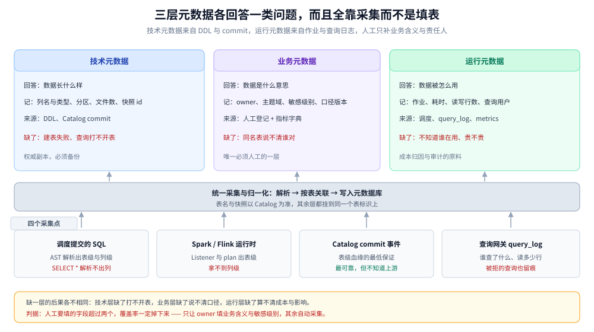
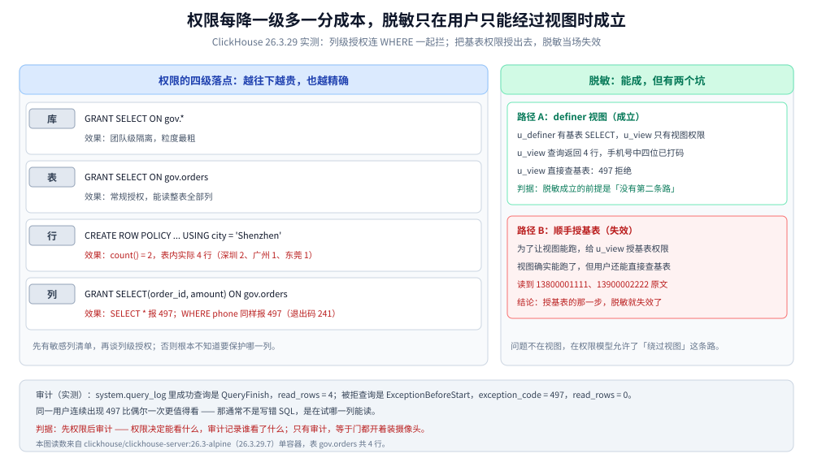

# 元数据血缘与权限治理

> 覆盖：表从哪来、字段从哪来、谁能看哪一列、谁在什么时候看过；把治理落成三个可执行物件 —— Catalog 与血缘、行列权限与脱敏、审计日志。
>
> 不覆盖：Iceberg 的元数据文件与快照结构见 [数据湖与Iceberg表设计.md](数据湖与Iceberg表设计.md)；指标口径本身怎么定义见 [分层建模与指标口径.md](分层建模与指标口径.md)；元数据服务的部署与备份见 [K8s部署与运维.md](K8s部署与运维.md)；通用的数据分级与合规流程见 [敏感数据治理与合规.md](../../../06-工程实践/安全/应用与数据安全/敏感数据治理与合规.md)。
>
> 内容整理自个人学习笔记，素材见 [素材清单](../../../素材清单.md)。**实测口径**：ClickHouse 26.3.29.7 单容器上的列级授权、行策略、definer 视图脱敏与 `system.query_log` 审计为本机真跑，读数见第 4.2、4.3、5.2 节；Catalog 服务、SQL 血缘解析、跨引擎权限同步未实测，见文末「校验口径」。

---

## 一、没有治理的平台上，最先失控的是哪三件事？

**本节要点**：治理不是三份文档，而是三个**可查询、可执行、可审计**的物件。三件事一旦失控，平台会「能出数但没人敢信」：同名表、断头表、库级权限。

### 1.1 三个现象与它们缺的物件

| 现象 | 现场怎么发现 | 缺的物件 |
|---|---|---|
| 同名不同义 | 两个看板都叫「订单汇总」，数字差 3% | 业务元数据：owner + 口径版本 |
| 断头表 | 一张表停更 90 天，没人敢删，也没人知道谁在读 | 血缘 + 访问记录 |
| 库级权限 | 给了库就能看手机号原文 | 列级权限 + 脱敏 |

三者的共同点是**到出事那天才被发现**：口径打架时对比两个 SQL 才发现，删表删出事故才发现下游在用，数据泄露时才发现权限是整库授的。

### 1.2 三个物件各自管什么

| 物件 | 回答的问题 | 失效后的表现 |
|---|---|---|
| Catalog | 表在哪、schema 是什么 | 建表失败、查询找不到表 |
| 血缘 | 这张表从哪来、到哪去 | 改字段不知道影响谁 |
| 权限与审计 | 谁能看哪一列、谁看过 | 只能事后追责，无法事前阻断 |

三者的关系是**上游依赖**：权限挂在表上，表名与 schema 来自 Catalog，影响分析靠血缘。所以治理的起点不是买一个数据目录产品，而是先把 Catalog 的权威性定下来 —— 谁写的表结构算数。

### 1.3 为什么「写在文档里」不算治理

一份 Confluence 页面能写清 owner 和口径，但它有三个硬伤：**不可查询**（没人会在改字段前去翻文档）、**不可执行**（文档说只有分析师能看手机号，数据库不知道）、**不可审计**（谁看过没人记录）。治理物件的最低要求是能被工具读到，并在错误发生时拦住或留痕。

---

## 二、元数据到底要记哪三样？

**本节要点**：技术、业务、运行三层元数据各回答一个问题，缺一层就有一类问题查不出来。Catalog 与数据目录不是一回事，前者是权威，后者是可重建的索引。

### 2.1 三层元数据

| 层 | 回答的问题 | 典型字段 | 主要来源 |
|---|---|---|---|
| 技术元数据 | 数据长什么样 | 列名与类型、分区、文件数、快照 id | DDL、Catalog commit |
| 业务元数据 | 数据是什么意思 | owner、主题域、敏感级别、指标口径版本 | 人工登记 + 指标字典 |
| 运行元数据 | 数据是怎么被用的 | 作业、耗时、读写行数、查询用户 | 调度、采集入库、`query_log` |

缺技术元数据，查询引擎连表都打不开；缺业务元数据，同名表永远说不清谁对；缺运行元数据，能回答「表对不对」，但回答不了「谁在用、贵不贵」。

### 2.2 Catalog 不是数据目录

这两个东西经常被当成一个，判据是**它挂了会不会影响出数**：

| 系统 | 角色 | 挂了会怎样 | 能否重建 |
|---|---|---|---|
| Iceberg REST / HMS | 权威：表在哪个路径、当前快照是哪个 | 不能建表、流作业不能提交 | 不能，必须备份 |
| DataHub / OpenMetadata | 索引：搜索、血缘展示、owner | 搜不到、看不了血缘，出数不受影响 | 能，从 Catalog 与日志重采 |

这条判据直接决定备份优先级：Catalog 的元数据库每日导出（见 [K8s部署与运维.md](K8s部署与运维.md) 第 5.1 节），数据目录丢了重采一遍即可。反过来把数据目录当权威，就会出现「目录里有这张表、实际已经不存在」。

### 2.3 本方案的最小形态

Catalog 选 **Iceberg REST + 后端 PostgreSQL**：REST 让 Spark、Flink、Trino 用同一份表定义，后端库负责事务与并发；不选 HadoopCatalog 的原因是它把元数据放在对象存储的目录里，并发建表会互相覆盖。



图怎么读：上方三列是三层元数据各自的字段与来源，下方四个采集点按「静态解析、运行时上报、commit 事件、查询日志」四路供给。要读出的是：**治理数据不是人工填出来的，是采集出来的**；人工只补业务含义这一层，其余三层都该自动进来。

---

## 三、血缘是怎么采到的，断在哪？

**本节要点**：表级血缘已经能解决「改字段前问谁」；列级血缘在 `SELECT *`、UDF、动态 SQL、临时表四处必断。断链不可怕，可怕的是给断链的血缘打上「完整」的标记。

### 3.1 四种采集方式与覆盖范围

| 方式 | 覆盖 | 拿到什么 | 代价 |
|---|---|---|---|
| SQL AST 解析 | 调度提交的 SQL | 表级 + 列级（简单语句） | 视图、UDF、动态 SQL 解析不了 |
| Spark Listener | Spark 作业 | 表级，含读写行数 | 需改提交入口注入 listener |
| Flink plan | 流作业 | 表级，来自算子与 connector | 拿不到列级 |
| Catalog commit | 写入落表 | 表级，最可靠 | 无列级，不知道上游是谁 |

四种方式是**互补而非替代**：Catalog commit 保证「这张表确实被写过」，SQL 解析补「谁写的、写了哪些列」，运行日志补「读了多少」。只上其中一种，血缘必然缺一块。

### 3.2 列级血缘的四个断点

| 断点 | 为什么断 | 退化结果 |
|---|---|---|
| `SELECT *` | 列集合要到执行期才确定 | 只能记表级依赖 |
| UDF / 自定义函数 | 函数内部读什么表解析器看不到 | 漏掉一条下游 |
| 动态 SQL / 存储过程 | 字符串拼接，静态解析无解 | 整条链断 |
| 临时表 / 临时视图 | 中间表未登记，名字对不上 | 血缘分成两段 |

列级血缘的价值在「改一个字段，精确列出受影响的报表」；一旦断在 `SELECT *`，这个能力就退化成表级，影响分析只能回答「可能受影响」。

### 3.3 断链之后怎么标

| 置信度 | 判据 | 能用来做什么 |
|---|---|---|
| 确认 | 解析成功且与 Catalog commit 对得上 | 精确影响分析、自动阻断 |
| 推断 | 只有表级信息，或来自命名约定 | 提醒 owner 自查，不阻断 |
| 未知 | 动态 SQL、外部写入 | 只能按 owner 通知 |

**不要为了让血缘图好看而抹平置信度**：把「推断」标成「确认」，第一次改字段就会漏掉下游。宁可图上留虚线，也不要给出错误的确定感。

### 3.4 三条缝合线

1. **命名规范**：临时表统一前缀 `tmp_` 并要求登记，解析器至少能把它和正式表区分开。
2. **入口收口**：所有 Spark / Flink 作业走同一个提交网关，listener 与 plan 只在这里注入，绕过网关的作业直接拒绝。
3. **commit 兜底**：以 Catalog commit 为表级血缘的最低保证，解析失败时至少还有「这张表昨天被写过」。

### 3.5 血缘的两个用法

- **影响分析**：删列、改类型、改口径之前，先查下游；有确认级血缘的可以自动阻断发布，推断级的通知 owner。
- **成本归因**：把运行元数据里的扫描字节按表汇总，才能回答「哪张表没人看却占着 3 TB」，这也是容量篇里生命周期策略的依据。

---

## 四、列级权限与脱敏怎么落地？

**本节要点**：授权粒度每降一级，维护成本上一个台阶；能靠「脱敏视图 + 独立 definer」解决的，就不要把基表权限放出去 —— 给了基表就等于放弃了脱敏。

### 4.1 四级落点

| 粒度 | 解决什么 | ClickHouse 物件 | 适用 |
|---|---|---|---|
| 库 | 谁能进这个域 | `GRANT SELECT ON gov.*` | 团队级隔离 |
| 表 | 谁能读这张表 | `GRANT SELECT ON gov.orders` | 常规授权 |
| 行 | 谁能看哪些行 | `CREATE ROW POLICY ... USING` | 按城市 / 租户隔离 |
| 列 | 谁能看哪些列 | `GRANT SELECT(col1, col2)` | 手机号、身份证等敏感列 |

### 4.2 实测：列级授权连 WHERE 一起管

在 `gov.orders`（4 行：深圳 2、广州 1、东莞 1）上只授 `order_id, amount` 两列，结果三条：

```text
$ clickhouse-client -u u_col -q "SELECT * FROM gov.orders"
Code: 497. DB::Exception: u_col: Not enough privileges. To execute this query,
it's necessary to have the grant SELECT ON gov.orders.
(Missing permissions: SELECT ON gov.orders). (ACCESS_DENIED)

$ clickhouse-client -u u_col -q "SELECT order_id, amount FROM gov.orders ORDER BY order_id"
1  120.5
2  80
3  300
4  45.2

$ clickhouse-client -u u_col -q "SELECT order_id FROM gov.orders WHERE phone LIKE '138%'"
Code: 497 ... (ACCESS_DENIED)   # 退出码 241
```

第三条是关键：**权限检查不只看投影列，还看过滤条件**。只授两列而用户在 `WHERE` 里拿手机号做前缀匹配，同样被拒 —— 否则攻击者可以靠二分条件把值试出来。

行策略是另一个维度：给 `u_row` 整表权限，再加 `CREATE ROW POLICY city_only ON gov.orders FOR SELECT USING city = 'Shenzhen' TO u_row`，它查到的 `count()` 是 **2**，`groupArray(city)` 是 `['Shenzhen','Shenzhen']`；表里仍是 4 行。行策略是**查询期过滤**，不改数据，也不能替代列权限。

### 4.3 脱敏：视图能成，但有两个坑

给 `u_view` 只授脱敏视图 `gov.orders_masked`（把手机号拼成 `138****1111`），第一次直接报错：

```text
$ clickhouse-client -u u_view -q "SELECT * FROM gov.orders_masked"
Code: 497 ... it's necessary to have the grant SELECT ON gov.orders
```

原因是 ClickHouse 的视图默认按 **definer 权限**执行：视图的查询要用「创建者」的权限去读基表，而 `u_view` 自己只有视图权限，不够。正确做法是建一个只负责读基表的 definer 用户：

```sql
CREATE USER u_definer IDENTIFIED WITH no_password;
GRANT SELECT ON gov.orders TO u_definer;
CREATE VIEW gov.orders_masked SQL SECURITY DEFINER DEFINER = u_definer AS
SELECT order_id, user_id, concat(substring(phone,1,3),'****',substring(phone,8)) AS phone,
       amount, city
FROM gov.orders;
GRANT SELECT ON gov.orders_masked TO u_view;
```

改完再查，`u_view` 拿到 4 行脱敏后的 `138****1111`，直接查基表仍被拒。第二个坑在下一步：为了「让视图能跑」顺手 `GRANT SELECT ON gov.orders TO u_view`，视图确实能跑了，但 `u_view` 同时能直接查基表：

```text
$ clickhouse-client -u u_view -q "SELECT order_id, phone FROM gov.orders LIMIT 2"
1  13800001111
2  13900002222
```

**授基表权限的那一刻，脱敏就失效了**。这跟「视图能不能用」无关，是权限模型决定的：脱敏只在「用户只能经过视图」时才成立。



图怎么读：左边四级阶梯越往下越精确，也越要维护 —— 行策略给出 `count() = 2` 而表内仍是 4 行，列级授权让 `SELECT *` 与 `WHERE phone` 都返回 497。右边两条路径的差别只在于「用户能不能直接读基表」：definer 视图下脱敏成立，顺手授出基表后原文立刻可见。要读出的是：**脱敏不是视图的属性，是权限集合的属性**。

| 脱敏方式 | 做法 | 代价 |
|---|---|---|
| definer 脱敏视图 | 独立 definer 用户 + 只授视图 | 每个敏感表要维护一个视图与一个用户 |
| 写入侧脱敏 | 湖表里就不落原文，原文留在业务库 | 下游要用原文时无法回溯 |
| 查询层 UDF / 策略 | 在引擎侧按角色改写 | 各引擎语法不同，易漏 |

### 4.4 跨引擎的坑

同一套权限在 Hive、Trino、ClickHouse 里的语义与语法都不一样：Hive 的列授权需要 `GRANT SELECT(col) ON TABLE`，Trino 依赖 connector 透传，ClickHouse 是 `GRANT SELECT(col) ON db.table`。**权限只在一个地方定义、多引擎同步**，否则「换一个引擎查」就是一条绕过路径。这也是为什么本方案把查询入口收敛到 OLAP 服务层（见 [OLAP查询服务.md](OLAP查询服务.md)），而不是让分析师直连每个引擎。

---

## 五、审计要留什么、留多久？

**本节要点**：审计记录五个字段：谁、何时、哪张表、读了多少行、成没成。被拒绝的查询同样要留痕 —— 它才是「有人在试探」的最早信号。

### 5.1 五个字段

| 字段 | 来源 | 用途 |
|---|---|---|
| 用户 | 登录身份，不是连接名 | 追责与权限回收 |
| 时间 | 服务端时间 | 与告警、变更记录对齐 |
| 对象 | 库.表（列级能记更好） | 定位影响范围 |
| 量 | `read_rows` / `read_bytes` | 区分「看一眼」和「拖全表」 |
| 结果 | 成功 / 拒绝 + 错误码 | 发现试探行为 |

### 5.2 实测：拒绝也有记录

在 ClickHouse 里执行 `SYSTEM FLUSH LOGS` 后查 `system.query_log`（过滤掉查日志本身的语句），几种结果都留了痕：

```text
user    type                  exception_code  read_rows  query
u_view  QueryFinish           0               4          SELECT * FROM gov.orders_masked ...
u_view  ExceptionBeforeStart  497             0          SELECT phone FROM gov.orders LIMIT 1
u_col   QueryFinish           0               4          SELECT order_id, amount FROM gov.orders ...
u_col   ExceptionBeforeStart  497             0          SELECT order_id ... WHERE phone LIKE '138%'
```

三点读法：

- 成功查询是 `QueryFinish`，`read_rows = 4`，能看出读取规模；
- 被拒查询是 `ExceptionBeforeStart`、`exception_code = 497`、`read_rows = 0` —— 权限在解析后、执行前就被拦住，没有扫描；
- 同一个用户连续出现 497，比「偶尔一次」更值得看：这通常不是写错 SQL，是在试哪一列能读。

### 5.3 保留多久

审计日志本身就是数据，会跟业务数据抢存储：

| 项 | 取值 | 理由 |
|---|---|---|
| 保留期 | 180 天在线 | 覆盖季度审计与事故追溯 |
| 归档 | 1 年冷存（对象存储） | 合规举证，查得少 |
| 内容 | 摘要 + SQL 前 N 字符 | 全量 SQL 会带出敏感字面量 |
| 落点 | 独立库，与业务表分开 | 防止被业务侧误删 |

⚠️ 审计表不要和被审计的数据放同一个库：一次误删库会同时删掉证据，这也是 K8s 篇把「元数据每日导出」单列一条的原因。

### 5.4 审计不能替代权限

审计是**事后**，权限是**事前**。只有审计没有权限，等于把所有门都开着、装摄像头；只有权限没有审计，出了问题不知道谁在什么时候越的界。两者都要，但顺序是先权限、后审计 —— 先把能看的范围划小，再记录范围内外的访问。

---

## 六、治理怎么不变成填表？

**本节要点**：自动采集优先，人工只填「业务含义」与「责任人」；把治理检查卡在发布路径上，而不是靠季度盘点。

### 6.1 人工只填两样

| 谁填 | 填什么 | 为什么必须人工 |
|---|---|---|
| 表 owner | 业务含义、敏感级别 | 机器不知道「这列是身份证」 |
| 指标 owner | 口径定义与版本 | 口径是业务决策，不是数据特征 |

其余（schema、分区、血缘、访问量、耗时）全部自动采集。**需要人工填的字段超过两个，覆盖率一定掉下来。**

### 6.2 阻断式校验

ADS 发布前跑三条检查，不过就不许发：

1. 表有 owner 且 owner 是有效账号；
2. 有确认级的表级血缘（至少知道上游是谁）；
3. 指标口径在字典里能查到版本号。

发布后再补检查没有意义 —— 数字已经上看板了。

### 6.3 三种责任，别混成一个

| 角色 | 负责 | 不负责 |
|---|---|---|
| 表 owner | 表的内容、敏感级别、生命周期 | 作业稳定性 |
| 指标 owner | 口径定义、口径变更通知 | 具体 SQL 实现 |
| 平台 owner | Catalog、权限系统、审计管道 | 业务口径 |

「这张表谁负责」答不上来，通常不是没人管，而是三个角色被混成了一个「数据组」。

### 6.4 四个覆盖率指标

| 指标 | 设计目标 | 说明 |
|---|---|---|
| 有 owner 的表占比 | ≥ 95% | 剩下 5% 是临时表与待下线表 |
| ADS 的确认级血缘覆盖 | 100% | ADS 数量有限，可逐个补齐 |
| 敏感列的列级权限覆盖 | 100% | 敏感列清单先于权限 |
| 查询审计留痕率 | 100% | 绕不过网关才算数 |

这些是**设计目标**，不是实测读数；落地时按季度报一次趋势，比报绝对值有用。

---

## 使用：四段最小配置

**本节要点**：四段脚本覆盖「列级授权、行策略、脱敏视图、审计查询」，可直接在单机 ClickHouse 上复现第 4、5 节的读数。

```sql
-- 1. 列级授权：只给两列
CREATE USER u_col IDENTIFIED WITH no_password;
GRANT SELECT(order_id, amount) ON gov.orders TO u_col;
SHOW GRANTS FOR u_col;
-- GRANT SELECT(amount, order_id) ON gov.orders TO u_col

-- 2. 行策略：按城市隔离
CREATE USER u_row IDENTIFIED WITH no_password;
GRANT SELECT ON gov.orders TO u_row;
CREATE ROW POLICY city_only ON gov.orders FOR SELECT USING city = 'Shenzhen' TO u_row;
SELECT short_name, database, table, select_filter FROM system.row_policies WHERE short_name = 'city_only';

-- 3. 脱敏视图 + 独立 definer（不要给业务用户基表权限）
CREATE USER u_definer IDENTIFIED WITH no_password;
GRANT SELECT ON gov.orders TO u_definer;
CREATE VIEW gov.orders_masked SQL SECURITY DEFINER DEFINER = u_definer AS
SELECT order_id, user_id, concat(substring(phone,1,3),'****',substring(phone,8)) AS phone,
       amount, city
FROM gov.orders;
GRANT SELECT ON gov.orders_masked TO u_view;
```

```sql
-- 4. 审计：拒绝与成功一起看
SYSTEM FLUSH LOGS;
SELECT user, type, exception_code, read_rows, query_duration_ms, query
FROM system.query_log
WHERE event_date = today()
  AND user IN ('u_col','u_row','u_view')
  AND query NOT LIKE '%system.query_log%'
ORDER BY event_time_microseconds DESC
LIMIT 20;
```

```text
-- 行策略登记后的元数据（实测）
short_name  database  table   select_filter
city_only   gov       orders  city = 'Shenzhen'
```

---

## 校验口径

> ✅ 本篇读数的校验方式与范围（ClickHouse 26.3.29.7 单容器，2026-10-25）：

- **真跑并取到读数**：第 4.2 节 —— `gov.orders` 4 行；`GRANT SELECT(order_id, amount)` 后 `SELECT *` 报 497（退出码 241）；`WHERE phone LIKE '138%'` 同样报 497；只选授权列返回 4 行。
- **真跑并取到读数**：第 4.2 节行策略 —— `count() = 2`、`groupArray(city) = ['Shenzhen','Shenzhen']`，表内仍 4 行。
- **真跑并取到读数**：第 4.3 节 —— 普通视图只授视图时 497；改为 `SQL SECURITY DEFINER DEFINER = u_definer` 后返回 4 行 `138****1111`，直接查基表仍 497；再授基表后能读到 `13800001111` 原文。
- **真跑并取到读数**：第 5.2 节 —— `system.query_log` 中成功为 `QueryFinish`（`read_rows = 4`），被拒为 `ExceptionBeforeStart`（`exception_code = 497`、`read_rows = 0`）。
- **未实测**：Iceberg REST Catalog 的并发建表与事务冲突、Spark / Flink 的 listener 与 plan 血缘采集、Hive / Trino 的列级授权语义、权限跨引擎同步、审计日志的归档与容量占用。
- **设计目标非实测**：第 6.4 节的四个覆盖率指标是目标值，本机没有真实平台的表数量与访问数据，未产出覆盖率读数。
- **实测环境**：`clickhouse/clickhouse-server:26.3-alpine`，版本 26.3.29.7，容器 `bdp-clickhouse`。

| 依赖 | 实际版本 |
|---|---|
| ClickHouse Server | 26.3.29.7 |
| clickhouse-client | 26.3.29.7 |
| Iceberg REST Catalog | 未实测 |
| 数据目录（DataHub / OpenMetadata） | 未实测 |

## 延伸追问

- **列级权限能防止把数据导出去吗？** → 防不住。列权限只挡「直接读哪一列」，能读的列照样可以导出；真正的防线是敏感列清单 + 脱敏 + 导出审计三件一起。
- **行策略会不会拖慢查询？** → 它会给查询加一个隐式过滤条件，走分区或主键时几乎无感，走全表扫描时等于多扫一遍；所以行策略要配合分区键设计。
- **为什么不用一个「数据脱敏中间件」统一做？** → 中间件只能覆盖走它的查询，直连、导数、脚本都绕得过去；脱敏必须落在数据或权限层，中间件只适合做查询结果的二次处理。
- **血缘解析能不能完全自动、无需人工？** → 表级可以做到接近全自动，列级做不到：`SELECT *` 与 UDF 在静态解析里天然不可判；目标是「列级尽量自动，断点明确标注」。
- **审计日志保留 180 天够吗？** → 看合规要求；大多数事故在 90 天内被发现，180 天覆盖一个季度复盘周期，更长的用冷存归档。
- **Catalog 和权限系统能不能合并？** → 可以合并成一个产品，但职责要分开：Catalog 决定「表存不存在」，权限决定「你能不能看」；合在一起时最容易出现「建表即授权」。

## 关联

- **上游/总纲**：[README.md](README.md) — 控制面四件套在本册的位置
- **上游**：[总体架构与选型.md](总体架构与选型.md) — 控制面为什么单列一层
- **数据来源**：[数据湖与Iceberg表设计.md](数据湖与Iceberg表设计.md) — 快照与 Catalog 的写入路径
- **口径来源**：[分层建模与指标口径.md](分层建模与指标口径.md) — 指标字典与口径版本
- **部署与备份**：[K8s部署与运维.md](K8s部署与运维.md) — 元数据每日导出与恢复演练
- **权限落点**：[OLAP查询服务.md](OLAP查询服务.md) — 查询入口收敛与资源组
- **分级依据**：[敏感数据治理与合规.md](../../../06-工程实践/安全/应用与数据安全/敏感数据治理与合规.md) — 数据分级与留存删除
- **事件与证据**：[审计与应急响应.md](../../../06-工程实践/安全/安全工程/审计与应急响应.md) — 审计事件与证据链
