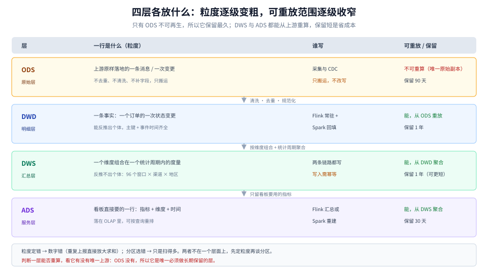
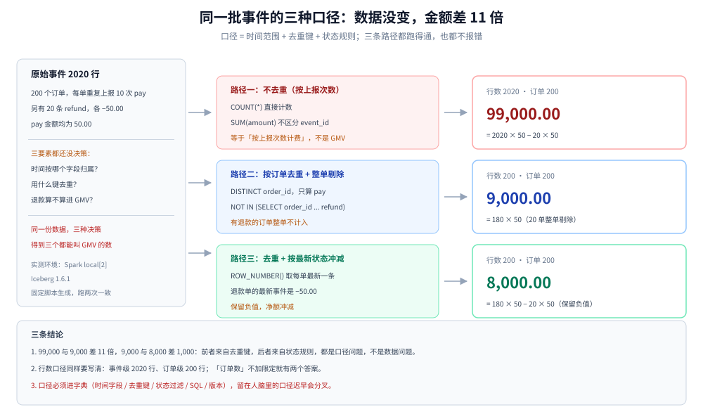

# 分层建模与指标口径

> 覆盖：ODS / DWD / DWS / ADS 四层各放什么、粒度怎么定、维度建模（星型、三类事实表、SCD）怎么落到湖表，以及**指标口径的三要素（时间、去重、状态）** —— 同一批事件为什么能算出四个不同的 GMV。
>
> 不覆盖：湖表的文件与快照机制见 [数据湖与Iceberg表设计.md](数据湖与Iceberg表设计.md)；批任务的调度与幂等写在 [Spark批处理与调度.md](Spark批处理与调度.md)；两条链路结果对不上怎么查见 [流批对账与数据质量.md](流批对账与数据质量.md)。
>
> 内容整理自个人学习笔记。口径读数在 `apache/spark:3.5.5-scala2.12-java17`（容器 `bdp-spark`，`local[2]`）上真跑：2020 行事件（200 个订单、每单 10 次重复上报、外加 20 条退款），六种口径得到六个不同数字，见第 4 节。

---

## 一、为什么先定粒度，再谈分层？

**本节要点**：粒度是「一行代表什么」，它决定了后面的去重、求和、关联能不能算对；分层只是把不同粒度装进不同的表。粒度定错，分层再整齐也救不回来。

### 1.1 粒度是一句必须能被验证的话

「一行是一个订单」不合格，因为它没说清「同一订单改了一次地址算不算第二行」。合格的写法要带三个要素：

```text
粒度 = 主体 + 时刻 + 变更类型
例：一行 = 一个订单在订单服务的一次状态变更（created / paid / shipped / closed）
```

三要素齐全时，任何一个数字都可以通过「沿着主键去重 + 按时间切窗」复算出来；缺一个，不同人写出的 SQL 就会不同。

### 1.2 粒度定错的两种长相

| 长相 | 现场 | 后果 |
|---|---|---|
| 把「一次上报」当「一个订单」 | 埋点因重试重复上报，同一订单写了 10 行 | `SUM(amount)` 直接放大 10 倍（第 4 节实测：99,000 对 9,000） |
| 事实表与维表粒度不一致 | 事实表按订单、维表按用户，join 后 1:N | 金额按用户维度汇总时被重复相加 |

### 1.3 粒度与分区不是一回事

分区是**物理布局**（按天切成不同目录），粒度是**逻辑语义**（一行是什么）。两者常被混着说：

| | 分层 / 粒度 | 分区 |
|---|---|---|
| 决定什么 | 数字对不对 | 扫描多少文件 |
| 改错的代价 | 历史数字全部要重算 | 重新组织文件即可，数字不变 |
| 谁关心 | 数据开发、业务 | 平台、存储 |

一个分区键选得再漂亮，事实表粒度写成「一次请求」也照样算出 10 倍 GMV。

---

## 二、四层各自放什么？

**本节要点**：判断一层该放什么，只问三个问题 —— **能不能从上游重算、谁写、保留多久**。这三个问题决定的不只是内容，还有故障时你能回退到哪一层。

### 2.1 四层职责

| 层 | 一行是什么 | 谁写 | 能否重算 | 保留 |
|---|---|---|---|---|
| ODS | 上游原样落地的记录（一条消息 / 一次变更） | 采集与 CDC（Flink 或 Spark 只做搬运） | 不能，是唯一原始副本 | 90 天 |
| DWD | 清洗、去重、规范化后的一条事实 | Flink 常驻 + Spark 回填 | 能，从 ODS 重放 | 1 年 |
| DWS | 一个维度组合在一个统计周期内的度量 | 两条链路都写 | 能，从 DWD 聚合 | 1 年（可重算更短） |
| ADS | 看板直接要的一行（指标 + 维度 + 时间） | Flink 汇总或 Spark 重建 | 能，从 DWS 聚合 | 30 天，落在 OLAP |



图怎么读：左边一列是「一行代表什么」，从一条消息变成一条事实、再变成一个维度组合、最后一屏看板的一格。关键在中间那列：只有 ODS 是不可再生的，所以它的保留期最长；DWS 与 ADS 都能从上游重算，保留期短是省成本，不是省事。

### 2.2 DWD 与 DWS 的边界怎么切

两者最容易混。判据只有一条：

> **能从这一行反推出个体吗？** 能 → DWD；不能 → DWS。

- 「订单 o1 在 10:03 由 created 变为 paid，金额 50.00」—— 能定位到具体订单 → DWD；
- 「2026-10-24 10:00–10:15，渠道 A、地区华南，支付金额 12,300，支付订单 246 笔」—— 反推不出是哪 246 笔 → DWS。

切错的典型症状：把明细塞进 DWS（一行带 `order_id`），下游要对账时无法还原，只能回头读 DWD；或者把聚合结果灌进 DWD，导致重放时同一批数据被二次聚合。

### 2.3 为什么这套平台把 ODS 放在湖表，而不是留在 Kafka

Kafka 的保留期按「最长不可用时间」定，本方案是 7 天（见 [Kafka集群与Topic设计.md](Kafka集群与Topic设计.md)）；而 ODS 要支撑 90 天内的重放与口径回溯。把 Kafka 当 ODS 会有两个后果：7 天前的数据重放不出来，以及 topic 的磁盘成本按 90 天算（`retention.ms` 一改就是全量）。

所以这条链是：**Kafka 负责解耦与削峰（7 天），湖表 ODS 负责可回放历史（90 天）**。

---

## 三、维度建模在这套架构里怎么落地？

**本节要点**：分析侧用星型而不是第三范式，因为分析查询先做过滤再聚合，join 越少越稳；真正决定可维护性的是**事实表的三类划分**与**维表怎么处理变化**。

### 3.1 为什么不用第三范式

交易库用范式化是为了「改一处不错两处」；分析侧要的是「一次扫描把维度都带上」：

| | 范式化 | 星型 |
|---|---|---|
| 表数量（订单主题） | 十几张（订单、订单项、地址、渠道、状态码…） | 1 张事实 + 4～6 张维表 |
| 典型查询 | 5 个以上 join | 1～2 个 join |
| 改一处维度的代价 | 只改一行 | 维表插入新版本，事实表不动 |

湖表上 join 的成本比库内高（要读文件、要 shuffle），join 越少，批作业越稳。

### 3.2 三类事实表

| 类型 | 一行是什么 | 本方案的例子 | 更新方式 |
|---|---|---|---|
| 事务事实表 | 一次业务动作 | 一次支付、一次退款 | 追加，不更新 |
| 周期快照事实表 | 某个周期末的状态 | 每天 23:59 的库存余额、会员等级 | 每周期追加一整批 |
| 累积快照事实表 | 一个流程从开始到结束的各阶段时间 | 订单履约：创建 / 支付 / 发货 / 签收 | 按主键 MERGE，覆盖后一阶段 |

累积快照是唯一「会被更新」的事实表，正好对上湖表的 `MERGE INTO`：同一订单来第二次变更时按主键覆盖，幂等由主键保证（写法见 [数据湖与Iceberg表设计.md](数据湖与Iceberg表设计.md)）。

### 3.3 维表的缓慢变化：SCD1 还是 SCD2

| | SCD1（直接覆盖） | SCD2（保留历史，加有效区间） |
|---|---|---|
| 一行是什么 | 维度的当前值 | 维度在一个时间段内的取值 |
| 能回答 | 用户现在属于哪个地区 | 用户在上个月属于哪个地区 |
| 表大小 | 不增长 | 每次变更新增一行 |
| 写法的代价 | 一条 `MERGE` 覆盖 | 关旧行 + 开新行，两步要在同一事务里 |

判断只需问业务一句：**「去年的报表要不要按去年的归属重算？」** 要 → SCD2；不要 → SCD1。绝大多数场景里只有少数维表（组织架构、销售归属、价格档位）需要 SCD2，其余用 SCD1 就够 —— 全量上 SCD2 会让每张维表都变成「有效区间 join」，查询复杂度上一个台阶。

SCD2 在湖表上的写法（两条语句必须落在同一批提交里）：

```sql
-- 1. 关掉变化的旧版本
MERGE INTO local.dim.user_scd2 t
USING (SELECT user_id, region, updated_at FROM local.ods.user_change) s
ON t.user_id = s.user_id AND t.is_current = true
WHEN MATCHED AND t.region <> s.region THEN
  UPDATE SET t.valid_to = s.updated_at, t.is_current = false;

-- 2. 开新版本
INSERT INTO local.dim.user_scd2
SELECT s.user_id, s.region, s.updated_at AS valid_from,
       TIMESTAMP '9999-12-31 00:00:00' AS valid_to, true AS is_current
FROM local.ods.user_change s
WHERE NOT EXISTS (
  SELECT 1 FROM local.dim.user_scd2 t
  WHERE t.user_id = s.user_id AND t.is_current = true AND t.region = s.region);
```

### 3.4 退化维度与维度一致性

- **退化维度**：订单号这类「天然唯一、没有别的属性」的维度，直接放在事实表里，不单独建维表；
- **维度一致性**：同一个「渠道」在支付事实和退款事实里必须是同一套编码，否则两条链路汇总时同一渠道会被拆成两个。这一类问题不报错，只表现为「总数对、明细分不开」。

---

## 四、同一个「GMV」为什么能算出四个数？

**本节要点**：口径 = **时间范围 + 去重键 + 状态规则**。三要素任缺一个，两个人就会算出两个数 —— 而且两份 SQL 都能跑通、都不报错。

### 4.1 实测：2020 条事件，六个读数

数据：200 个订单，每个订单被重复上报 10 次（`pay`，各 50.00），另加 20 条退款（`refund`，各 −50.00）。

| 口径 | SQL 要点 | 读数 |
|---|---|---|
| A 事件级行数 | `COUNT(*)` | 2020 |
| B 去重订单数 | `COUNT(DISTINCT order_id)` | 200 |
| C 直接求和（含重复） | `SUM(amount)` | 99,000.00 |
| D 按订单取最新一条后求和 | `ROW_NUMBER() OVER (PARTITION BY order_id ORDER BY ts DESC)` | 8,000.00 |
| E 去重且剔除有退款的订单 | `pay` 去重后 `NOT IN (refund)` | 9,000.00 |
| F 去重用户数 | `COUNT(DISTINCT user_id)` | 200 |

D 与 E 都是「去重后的 GMV」，差 1,000：D 取最新事件时，那 20 个退款订单的最新一条是 `-50.00`，净额被冲减；E 是把有退款的订单整单剔除，不留负值。两个数都能被业务叫成「GMV」，写进看板前必须指定是哪一个。

C 的 99,000 是「按上报次数计费」的口径 —— 它没有错，只是回答的是另一个问题。



图怎么读：左边是原始的 2020 行，三条路径分别对应「不去重（99,000）」「按订单去重（9,000）」「去重后按最新状态冲减（8,000）」。要读出的是：三个数字的差别不来自数据质量，而来自三要素的选择；一旦口径写进 SQL 却不写进字典，下一个人换一种写法，看板就会「自己变了」。

### 4.2 三个要素各自的失效方式

| 要素 | 写不清楚会怎样 | 正确写法 |
|---|---|---|
| 时间 | 用处理时间代替事件时间，跨零点批次数字错位 | 明写「按 `paid_at`（事件时间，UTC+8）归属」 |
| 去重 | 上游至少一次投递，不去重就按次数算 | 明写去重键：`event_id`（埋点）或 `order_id`（业务） |
| 状态 | 「已支付」是否含退款、含关闭 | 明写状态集合：`status IN ('paid')` 且退款单独冲减 |

### 4.3 口径不写进 SQL，就会留在人脑里

最常见的现场：看板上一行数字，三个人能说出三种算法，谁的都对。解决办法不是「统一一下」，而是把口径变成**带版本的、可执行的**定义（第 6 节）。

---

## 五、15 分钟粒度带来什么口径问题？

**本节要点**：窗口变短，最先暴露的不是性能问题，而是**边界问题** —— 跨窗口的记录归谁、迟到多久还能改、累计指标与快照指标谁能重算。

### 5.1 窗口边界

15 分钟窗口统一用**左闭右开**（`[10:00, 10:15)`），并写进指标定义。跨零点的窗口有两种处理：按自然日切（`[23:45, 24:00)` 与 `[00:00, 00:15)` 分开）或按滑动窗口（会重复计数，必须配去重键）。分区键按事件时间的日期切，不能按处理时间切 —— 否则跨零点批次会写进第二天的分区，历史分区被频繁改写。

### 5.2 迟到修正：能改多少由水位线决定

流链路的迟到容忍是**有上限**的。本机实测：水位线延迟设 5 秒时，`[0,10)` 窗口只计 1 条，`numLateRecordsDropped = 2`；改成 60 秒后同一批数据三个窗口全出、丢弃为 0（读数与机制见 [Flink实时链路.md](Flink实时链路.md)）。

对口径的含义：**15 分钟窗口的指标不是「到点就终值」**，而是「到点后还能被修正一个容忍窗口」。所以 ADS 要区分「实时值」与「结算值」，两者的时间戳不同。

### 5.3 快照指标与累计指标

| 指标类型 | 例子 | 能否在 15 分钟粒度上直接相加 | 正确做法 |
|---|---|---|---|
| 累计（可加） | 支付金额、订单数 | 能 | 按窗口累加 |
| 快照（不可加） | 日活、在线用户、库存余额 | 不能 | 每个窗口内去重，跨窗口再按天去重 |
| 比率（不可加） | 支付转化率、客单价 | 不能 | 存分子分母，查询时再除 |

「把 96 个 15 分钟窗口的 DAU 相加」是这套架构里最容易犯的错：加出来的是「人次」，不是「人数」。

### 5.4 时区

三个地方必须统一：库里的时间字段（本方案统一存 UTC）、指标定义里的归属时区（业务按 UTC+8）、分区键切分用的时区（跟着归属时区）。三者不一致时，跨零点批次会同时出现在两天或两天都不出现，且不会报错。

---

## 六、指标字典怎么写成可执行的东西？

**本节要点**：指标定义不是文档，是**一张表 + 一条 SQL**：表里存要素，SQL 里存算法，两者用版本号绑定。口径变了就发新版本，旧版本至少并行一个周期。

### 6.1 三类指标

| 类型 | 定义 | 例子 |
|---|---|---|
| 原子指标 | 一个业务动作 + 一个度量 + 一个限定 | 支付金额（`SUM(amount)`，限定 `status = 'paid'`） |
| 派生指标 | 原子指标 + 统计周期 + 维度 + 修饰 | 近 7 天、华南区、支付金额 |
| 复合指标 | 两个以上派生指标运算 | 支付转化率 = 支付订单数 ÷ 下单数 |

派生与复合指标不要各自写一遍 SQL，否则分母和分子的口径迟早分叉。

### 6.2 一条指标定义必须有的字段

| 字段 | 作用 | 漏了会怎样 |
|---|---|---|
| 名称 / 编码 | 唯一标识，编码给程序用 | 看板与文档对不上号 |
| 粒度 | 一行代表什么 | 聚合层级被随意改变 |
| 事件时间字段 | 归属按哪个时间 | 跨零点错位 |
| 去重键 | 用什么去重 | 重复上报直接放大 |
| 状态过滤 | 哪些状态计入 | 「GMV 含不含退款」靠猜 |
| 口径 SQL / 版本 | 可执行的定义 | 定义与实现两张皮 |
| 生效时间 | 从哪批数据开始用 | 历史与新数字混在一张图里 |
| 负责人 | 变更有谁批 | 改了没人知道 |

### 6.3 口径变更的三步

1. **新版本并行**：新旧口径同时算，写到 ADS 的不同列（`gmv_v1` / `gmv_v2`）；
2. **双跑对账**：连续一个完整周期（本方案 14 天）比对差异，差异要能被解释成「口径差的正是那批退款单」；
3. **切换与下线**：看板切到新列，旧列保留一个季度后删除，指标字典里旧版本标记 `deprecated_at`。

---

## 使用：指标字典与分层建表的模板

指标字典本身就是一张湖表，口径 SQL 以字符串存进去，由调度按版本执行：

```sql
CREATE TABLE local.meta.metric_def (
  metric_code   string,
  metric_name   string,
  grain         string,
  time_field    string,
  dedup_key     string,
  status_filter string,
  sql_text      string,
  version       int,
  effective_from timestamp,
  owner         string,
  deprecated_at timestamp
) USING iceberg
PARTITIONED BY (days(effective_from));
```

一条 GMV 的注册行（对应第 4 节的 E 口径）：

```sql
INSERT INTO local.meta.metric_def VALUES (
  'gmv_paid_dedup', '支付金额（去重、剔除退款）',
  '一行 = 一个订单在一个 15 分钟窗口内的支付净额',
  'paid_at', 'order_id', "status = 'paid' AND refunded = false",
  'SELECT window_start, SUM(amount) FROM local.dwd.pay WHERE status = ''paid'' GROUP BY window_start',
  2, TIMESTAMP '2026-10-01 00:00:00', 'data-owner', NULL);
```

四层建表骨架（只写与本篇有关的列与属性）：

```sql
CREATE TABLE local.ods.event_raw (
  event_id string, user_id string, event_type string,
  amount decimal(18,2), event_time timestamp, ingest_time timestamp
) USING iceberg PARTITIONED BY (days(event_time));

CREATE TABLE local.dwd.pay_event (
  order_id string, user_id string, amount decimal(18,2),
  paid_at timestamp, dt string
) USING iceberg PARTITIONED BY (dt);

CREATE TABLE local.dws.trade_15m (
  window_start timestamp, channel string, region string,
  pay_amount decimal(18,2), pay_orders bigint
) USING iceberg PARTITIONED BY (days(window_start));

CREATE TABLE local.ads.trade_board (
  stat_time timestamp, metric_code string, dim_key string, metric_value decimal(18,2)
) USING iceberg PARTITIONED BY (days(stat_time));
```

## 校验口径

> 本篇读数的校验方式与范围（`apache/spark:3.5.5-scala2.12-java17`，`local[2]`，Iceberg 1.6.1）：

- **真跑并取到读数**：第 4.1 节六个口径（2020 / 200 / 99,000 / 8,000 / 9,000 / 200），数据由固定脚本生成，脚本与查询各跑两次读数一致。
- **只静态校验**：第 3.3 节的 SCD2 两条语句（语法按 Iceberg 1.6 的 `MERGE INTO` 语义写，未在真实维表上跑过双步提交）；第 6 节的指标字典 DDL 与「使用」节的四层建表（未逐项验证 TBLPROPERTIES 与分区演进）。
- **未实测**：真实规模下的 `COUNT(DISTINCT)` 与 `ROW_NUMBER` 开销（2020 行在秒级内完成，不代表亿级明细的表现）；SCD2 全量 join 的查询代价；跨时区数据的实际错位表现（用构造数据描述，未跑跨零点批次）。
- **容器**：`bdp-spark`（保留未删）。

| 项 | 实际值 |
|---|---|
| Spark | 3.5.5-scala2.12-java17 |
| 测试数据 | 2020 行 = 200 单 × 10 次重复 `pay` + 20 条 `refund` |
| 金额 | `pay` 50.00 / `refund` −50.00 |
| 时间分布 | 全部在 `2026-10-24` 当天，单一日分区 |

---

## 延伸追问

- **为什么不能直接在各层都用同一个 `SELECT SUM` 完事？** → 因为「一行是什么」在每层不同：ODS 一行是一条消息，DWD 一行是一条事实，DWS 一行是一个窗口聚合。同一个 `SUM` 写在不同的表上，算的是不同问题的答案。
- **DWS 要不要存明细的中间结果？** → 不存。要能还原个体就说明该放 DWD；把明细塞进 DWS 会让重放时二次聚合，且存储翻倍。
- **SCD2 一定比 SCD1 好吗？** → 不是。SCD2 让每次查询都要带「有效期」条件，写错的概率上升；只有业务明确要求「按当时的归属重算历史」时才值得。
- **口径版本并行期间，看板显示哪个数？** → 显示旧版本，新版本只写不展示；对账期结束、差异被解释清楚后再切。切之前把差异原因写到指标字典的变更记录里。
- **15 分钟窗口的数字能不能当天的日报直接相加？** → 累计型指标可以；快照型（日活、在线数）不行，必须再按天去重。比率型要存分子分母，不能相加也不能平均。
- **同一份数据，Flink 与 Spark 算出来的数不一致，先怀疑谁？** → 先比两边的「三要素」是否一致（时间字段、去重键、状态过滤），再比数据是否到齐；口径不同造成的差异占绝大多数，见 [流批对账与数据质量.md](流批对账与数据质量.md)。

## 关联

- **上游存储**：[数据湖与Iceberg表设计.md](数据湖与Iceberg表设计.md) — 累积快照事实表的 `MERGE` 怎么写、分区怎么选
- **上游采集**：[数据采集与CDC.md](数据采集与CDC.md) — 重复上报与 at-least-once 从哪来
- **下游计算**：[Spark批处理与调度.md](Spark批处理与调度.md) — DWS 与 ADS 的批重建、补数
- **下游计算**：[Flink实时链路.md](Flink实时链路.md) — 迟到容忍决定口径能不能在窗口关闭后修正
- **下游验证**：[流批对账与数据质量.md](流批对账与数据质量.md) — 两条链路的同一指标怎么比
- **对外服务**：[OLAP查询服务.md](OLAP查询服务.md) — ADS 表怎么摆、比率指标怎么在查询时算
- **容量算式**：[容量规划与成本.md](容量规划与成本.md) — DWS / ADS 的存储估算从哪来
- **总体位置**：[总体架构与选型.md](总体架构与选型.md) — 分层在五层架构里的位置
