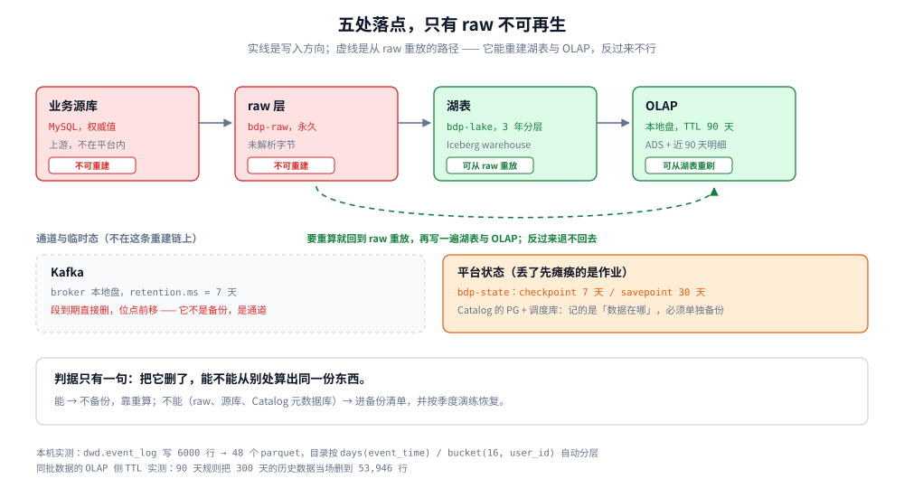

# 存储全景

> 覆盖：一份数据落在哪五处、bucket 与路径怎么划、生命周期配置写在哪个参数上、哪份必须备份哪份可重建、成本怎么归到表上。
>
> 不覆盖：**读哪一份副本**的判据在 [架构与选型.md](架构与选型.md) 1.4；**表的列与分区键**在 [存储结构设计.md](存储结构设计.md)；湖表机制、Kafka 分区副本、OLAP 排序键分别在 [数据湖与Iceberg表设计.md](数据湖与Iceberg表设计.md)、[Kafka集群与Topic设计.md](Kafka集群与Topic设计.md)、[OLAP查询服务.md](OLAP查询服务.md)；容量算式在 [容量规划与成本.md](容量规划与成本.md)。
>
> 内容整理自个人学习笔记。bucket 划分、路径模板、生命周期参数是本方案的设计值；**文件数、目录结构、TTL 行为、topic 配置**在 Spark 3.5.5 + Iceberg 1.6.1、ClickHouse 26.3.29.7、Kafka 3.9.0 单容器实测，读数见文末「校验口径」。

---

## 一、一份数据在平台里落在哪五处？

**本节要点**：五处落点里只有两处不可再生 —— **源库与 raw 层**。判断一份数据该不该备份，只问一句：把它删了，能不能从别处算出同一份东西。



图怎么读：左边是入口，右边是消费面。实线箭头是数据的正常流向，虚线箭头是**重建方向** —— 只有从 raw 出发的那条虚线成立，反向不成立。Kafka 在图上，但它不是一份「存储」：7 天后自删，删了没法重建。中间那层「平台状态」（checkpoint、Catalog 元数据库、调度库）不在数据链路里，丢了先瘫痪的是作业，不是数据。

### 1.1 五处落点，五种读写模式

| 落点 | 物理位置 | 写者 | 读者 | 能重建吗 | 保留 |
|---|---|---|---|---|---|
| raw | `s3://bdp-raw/` | 采集 / 埋点网关 | 重放任务、Spark | ❌ 不能 | 永久，90 天转低频 |
| 湖表 | `s3://bdp-lake/warehouse/` | Flink / Spark | Spark、Flink、Trino | ✅ 从 raw 重放 | 热 90 天 / 温 1 年 / 冷 3 年 |
| OLAP | BE / CN 本地盘 | Flink 窗口、Spark 批 | BI、接口、告警 | ✅ 从湖表重刷 | 30–90 天（TTL） |
| Kafka | broker 本地盘 | 采集、Flink | Flink、回放任务 | ❌ 到期即删 | 1–7 天 |
| 平台状态 | `s3://bdp-state/` + PG | Flink、调度 | 作业恢复 | ⚠️ 半可重建 | checkpoint 7 天、savepoint 30 天 |

上游还有一个不属于平台的落点：**业务源库**。它不是副本，是权威 —— 平台里所有关于它的事实都是从 binlog 抄来的，抄错了只能回源核对，不能反向修。

### 1.2 重建是单向的

`raw → 湖表 → OLAP` 这条链只能顺着走，理由不是「麻烦」，而是**信息量在递减**：

- **OLAP 重建不了湖表**：它只有聚合结果与近 90 天明细，90 天以前的明细在 OLAP 里根本不存在；
- **湖表重建不了 raw**：湖表里是解析后的事件，上游字段类型一变、解析规则一错，只有原始 JSON 能证伪（这条在 [架构与选型.md](架构与选型.md) 1.4 的第 ⑤ 行用过，那里讲「读哪份」，这里讲「删了能不能回来」）；
- **Kafka 连「重建」的资格都没有**：`retention.ms` 到期就删段，删掉的位点补不回来，它只是通道。

由此得到本节唯一一条硬规则：**能重建的落点丢了算故障，不能重建的落点丢了算事故。** 备份预算只花在后者。

---

## 二、bucket 与路径怎么划？

**本节要点**：bucket 按三件事切 —— 生命周期、写权限、成本归属；路径按「一类数据一个前缀」划，**每个前缀只有一个写入方**。

### 2.1 为什么不是一个大 bucket

一个 bucket 最省事，但三件事会立刻打架：

| 约束 | 一个大 bucket 的问题 | 分开之后 |
|---|---|---|
| 生命周期 | raw 永久、checkpoint 7 天、tmp 3 天，规则无法按前缀区分 | 每个 bucket 一条 ILM 规则 |
| 写权限 | 采集服务能写「永久保留区」，一次误写无法回收 | raw 只给采集账号写，湖表只给计算账号写 |
| 成本归属 | 账单只有一行，分不清谁花的 | 按 bucket 出账，再按前缀下钻到库 |

本方案四个 bucket：

| bucket | 放什么 | 生命周期 | 谁能写 | 备份 |
|---|---|---|---|---|
| `bdp-raw` | 未解析原始字节 | 永久，90 天转低频、1 年转归档 | 采集服务账号 | 异地复制 |
| `bdp-lake` | 湖表 warehouse（数据 + 元数据） | 数据文件跟快照走，不设 ILM | Flink / Spark 写账号 | 快照 + 异地 |
| `bdp-state` | checkpoint / savepoint | checkpoint 7 天、savepoint 30 天 | Flink 账号 | 不备 |
| `bdp-tmp` | shuffle 溢出、导出中间文件 | 3 天 | 所有计算账号 | 不备 |

### 2.2 路径模板

```text
raw（Hive 风格，按接收时间切，不按事件时间）
  s3://bdp-raw/events/<app_id>/dt=<yyyy-MM-dd>/hour=<HH>/part-<n>.json.zst
  s3://bdp-raw/cdc/<db>/<table>/dt=<yyyy-MM-dd>/<binlog-file>-<pos>.json

湖表（Iceberg 规范，data / metadata 两段，不要自创第三层）
  s3://bdp-lake/warehouse/<db>.db/<table>/data/<partition-path>/<file>.parquet
  s3://bdp-lake/warehouse/<db>.db/<table>/metadata/v<N>.metadata.json
  s3://bdp-lake/warehouse/<db>.db/<table>/metadata/snap-<snapshot-id>-<n>-<uuid>.avro
  s3://bdp-lake/warehouse/<db>.db/<table>/metadata/<uuid>-m<n>.avro

平台状态
  s3://bdp-state/ckp/<job-name>/<checkpoint-id>/
  s3://bdp-state/savepoints/<job-name>/<savepoint-id>/
```

三条纪律：

1. **raw 按接收时间切分区，不按事件时间**。接收时间是网关唯一能保证单调的量；客户端时钟错乱时，按事件时间落盘会写进「未来」的分区，后面重放找不到。
2. **`metadata` 目录下三种文件缺一不可**：`metadata.json`（表的当前状态）、`snap-*.avro`（快照清单）、`*-m<n>.avro`（manifest）。手工清理时删掉任一。表就打不开了 —— 这也是为什么湖表的清理必须走 `expire_snapshots`，而不是 `rm`。
3. **隐藏分区会自己生成目录名**。本机实测建完 `dwd.event_log` 并写 6000 行后，落盘结构是下面这样，两层目录分别是 `days(event_time)` 与 `bucket(16, user_id)` 的产物，写入方一个字段都不用填：

```text
dwd/event_log/data/event_time_day=2026-11-01/user_id_bucket=0/00000-5-<uuid>-0-00004.parquet
dwd/event_log/data/event_time_day=2026-11-01/user_id_bucket=1/00000-5-<uuid>-0-00006.parquet
dwd/event_log/metadata/v1.metadata.json
dwd/event_log/metadata/v2.metadata.json
dwd/event_log/metadata/snap-7753336637338055151-1-<uuid>.avro
dwd/event_log/metadata/<uuid>-m0.avro
```

### 2.3 每个前缀只能有一个写入方

同一个表目录被两个作业并发写，后果不是「慢」而是三种坏法：小文件翻倍（两边各写一份）、快照提交冲突（`CommitFailedException`）、以及最隐蔽的——两边都在写同一个分区，合并任务只认其中一个的文件清单。

落地方式不是「约定」，而是**账号隔离**：`bdp-lake` 上给每个作业一个独立的 service account，按前缀授 `s3:PutObject`，跨作业写别人的前缀直接 403。compaction 与 `expire_snapshots` 是唯一例外——它们改的是 `metadata`，必须与写入方串行，通常放在同一调度 DAG 里排队。

---

## 三、生命周期配在哪个参数上？

**本节要点**：六份存储有六个开关，**没有统一的「保留期」**。配错的共同症状是「表还在，文件没了」。

### 3.1 六个开关，各管一段

| 载体 | 开关 | 作用对象 | 设错的症状 |
|---|---|---|---|
| Kafka | `retention.ms` / `retention.bytes` | 段（segment） | 生效滞后一个检查周期；`earliest offset` 前移，7 天前的数据不保证还在 |
| Iceberg 快照 | `history.expire.max-snapshot-age-ms` + `expire_snapshots` | 元数据 | 太短回不去，太长元数据膨胀到查询变慢 |
| Iceberg 数据文件 | `expire_snapshots` 的 `older_than` | `data/` | 快照还在、文件被删 → 读表报文件不存在 |
| 对象存储 | MinIO ILM 规则（按前缀） | 全部对象 | 比快照更早生效 → 制造孤儿引用 |
| OLAP | `TTL stat_date + INTERVAL 90 DAY` | part | **补历史数据会被当场删**（见 3.3） |
| Flink | `state.checkpoints.dir` + 保留个数 | checkpoint 目录 | 恢复点不足，只能回退到很早的状态 |

### 3.2 顺序：快照先过期，文件才能删，ILM 只兜底

这三者的关系在 [数据湖与Iceberg表设计.md](数据湖与Iceberg表设计.md) 6.3 已经推过：**快照过期 → 文件可删 → ILM 兜底**，中间至少要留一个完整保留窗口。这里补的是「配在哪个参数上」：

```text
1. 快照：ALTER TABLE ... SET TBLPROPERTIES ('history.expire.max-snapshot-age-ms'='604800000')  -- 7 天
2. 文件：CALL catalog.system.expire_snapshots(table => 'db.tbl', older_than => TIMESTAMP '...')
3. ILM ：mc ilm rule add s3/bdp-lake --prefix "warehouse/db.db/tbl/" --expire-days 30   ← 只能当兜底
```

⚠️ ILM 的 `expire-days` 必须**大于**「快照保留 + 一个合并周期」。反过来配，MinIO 会在湖表还引用着文件的时候删掉它，症状是查询时报 `FileNotFoundException`，而 `snapshots` 表里一切正常 —— 这类故障最难查，因为元数据全对。

### 3.3 实测：TTL 会把补进去的历史数据当场删掉

ClickHouse 的 `TTL stat_date + INTERVAL 90 DAY` 是**按当前时间滚动**的，不是按写入时间。本机实测：建一张带 90 天 TTL 的 ADS 表，插入 300 天、共 200 万行，`SELECT count()` 只剩 **53,946** 行，日期范围 **2026-08-08 ~ 2026-10-27**（当前时间 2026-11-05 往前 90 天，正好从 08-08 起）。

补历史数据前必须先看一眼 TTL：

```sql
-- 补数前：临时放开 TTL（或先 ALTER 掉），补完再挂回去
ALTER TABLE ads.trade_board REMOVE TTL;
-- 补完
ALTER TABLE ads.trade_board MODIFY TTL stat_date + INTERVAL 90 DAY;
```

这条坑与「先删文件再删快照」是同一类错误：**清理策略的时间基准假设错了**。湖表的基准是快照引用，OLAP 的基准是当前时间。

---

## 四、备份与恢复：哪份必须备？

**本节要点**：只备不能重建的，其余靠重算。恢复演练不看「能不能起来」，看三个数：**多久恢复、丢多少、对不对得上**。

### 4.1 六类数据，六种周期

| 数据 | 能重建吗 | 备份方式 | 周期 | 恢复验收 |
|---|---|---|---|---|
| `bdp-raw` | ❌ | 跨集群复制 / 冷归档 | 每日增量 | 抽一天重放，行数与湖表该天一致 |
| `bdp-lake` 元数据 | ⚠️ 半 | 快照 + 元数据目录同步 | 每日 | `snapshots` 条数一致，时间旅行可读 |
| `bdp-lake` 数据文件 | ✅ 从 raw | 不单独备（靠 raw） | — | 重放后 `count(*)` 一致 |
| OLAP | ✅ 从湖表 | 不备 | — | 重刷 ADS 后与湖表对账差额 0 |
| Catalog 元数据库（PG） | ❌ | `pg_dump` 每日全量 | 每日 | 表清单条数一致 |
| 调度库（PG） | ❌ | `pg_dump` 每日全量 | 每日 | DAG 数与最近一次成功时间 |
| Flink checkpoint | ⚠️ | 不备 | — | 从 savepoint 恢复后无重复消费 |

**Catalog 元数据库为什么要单独备**：它装的是「哪张表在哪个路径、当前快照是哪个」。丢了之后数据文件都还在，但没有任何东西知道它们属于哪张表 —— 相当于把整个 warehouse 变成一堆无名 parquet。重建的代价是逐表 `register_table`，表多了就是一整天。

### 4.2 恢复演练看三个数

| 指标 | 怎么量 | 本方案的验收线 |
|---|---|---|
| 恢复耗时（RTO） | 从执行恢复到查询可用 | 单表 < 30 分钟，全库 < 4 小时 |
| 丢失窗口（RPO） | 最近一次可用备份的时间差 | raw ≤ 1 天，状态库 ≤ 1 天 |
| 一致性 | 恢复后与上游/湖表对账差额 | 0 行、0 分 |

演练频率：raw 与 Catalog 每季度一次，其余每半年。⚠️ 只做「备份成功」的监控没有意义 —— 备份成功不等于能恢复，演练必须真删一张表再恢复。

---

## 五、成本怎么归到表上？

**本节要点**：账单只到 bucket，分摊要到库、到表。归不到表的成本，没人会去优化。

### 5.1 三个口径，从粗到细

| 口径 | 数据来源 | 用途 | 粒度成本 |
|---|---|---|---|
| bucket | 对象存储账单 | 与预算对账 | 只到四个 bucket，看不出谁花的 |
| 前缀（库） | `mc du s3/bdp-lake/warehouse/dwd` | 团队/业务线分摊 | 到层，够做部门结算 |
| 表 | 每日扫 `warehouse/<db>.db/` 下各表目录的字节数 | 找「最贵的十张表」 | 到表，才能推动优化 |

表级成本不需要精确到分：每天扫一次目录大小，记进 `meta.table_registry` 的成本列，趋势比绝对值有用。

### 5.2 最容易被忽略的三项

1. **小文件的第二份存储**：每 15 分钟一批、每批每分区一个文件，一天就是一个分区 96 个文件。文件本身几十 MB，但每个文件在对象存储上还有元数据开销，且合并时读放大会额外算一次 I/O。容量篇把这笔钱算进了「膨胀系数 1.3」，实际观测里它常常更大。
2. **快照指向的旧文件**：`expire_snapshots` 之前，被覆盖的数据文件一个都不会删。一次全表重写就多一整套文件，占用量是逻辑量的两倍。
3. **checkpoint 的累积**：保留 10 个 checkpoint、每个 19 GB，就是 190 GB 常年不动。这个数字在容量篇按 46 GB 留了空间，前提是保留个数设成 3。

---

## 使用：一次全链路的存储落点清单

从一条埋点到看板上的一个数，中间落过哪些地方、各留多久：

| # | 环节 | 落点 | 路径 / 表 | 保留 |
|---|---|---|---|---|
| ① | 网关收包 | 无（内存队列） | — | 秒级 |
| ② | 网关落原始 | `bdp-raw` | `raw/events/<app>/dt=/hour=/part-*.json.zst` | 永久 |
| ③ | 投 Kafka | broker 盘 | `events.raw`（24 分区，`retention.ms=604800000`） | 7 天 |
| ④ | Flink 清洗后写湖 | `bdp-lake` | `warehouse/dwd.db/event_log/data/event_time_day=*/user_id_bucket=*/` | 3 年分层 |
| ⑤ | Flink 窗口结果 | `bdp-lake` + OLAP | `dws.db/trade_15m` + `ads.trade_board` | 湖 3 年 / OLAP 90 天 |
| ⑥ | Flink 状态 | `bdp-state` | `ckp/<job>/<checkpoint-id>/` | 保留 3 个 |
| ⑦ | 表元数据 | `bdp-lake` | `warehouse/dwd.db/event_log/metadata/*.avro` | 与快照同寿 |
| ⑧ | 表清单与口径 | Catalog PG + `bdp-lake` | PG 库 + `meta.db/metric_def` | 永久 |
| ⑨ | Spark 合并产物 | `bdp-lake` | 同 ④ 目录，文件数减少 | 同 ④ |
| ⑩ | BI 查询 | OLAP 本地盘 | `ads.trade_board`（TTL 90 天） | 90 天 |

⚠️ 这张表最容易出错的不是哪一行，而是**第 ⑧ 行**：口径定义与表清单如果只活在文档里、不进存储，换个人接手就重建不出来。所以 `meta` 库和 Catalog 的 PG 一样，都必须进备份清单。

---

## 校验口径

**真跑并取到读数**（Spark 3.5.5 + Iceberg 1.6.1 单容器）：

- 路径与目录结构：建 `dwd.event_log`（`days(event_time)` + `bucket(16, user_id)`）后写 6000 行，落盘 48 个 parquet，目录为 `data/event_time_day=*/user_id_bucket=*/`，`metadata/` 下有 `v1/v2.metadata.json`、`snap-*.avro`、`*-m0.avro`（见 2.2）。
- 文件数：3 天数据、每天 2000 行，共 48 个文件（3 天 × 16 桶），每天 16 个文件、约 125 行/文件。

**真跑并取到读数**（ClickHouse 26.3.29.7 单容器）：

- TTL 行为：带 `TTL stat_date + INTERVAL 90 DAY` 的 ADS 表插入 300 天、200 万行，`count()` 返回 53,946，日期范围 2026-08-08 ~ 2026-10-27（见 3.3）。

**真跑并取到读数**（Kafka 3.9.0 单容器）：

- topic 配置：`events.raw` 24 分区、`retention.ms=604800000`、`compression.type=lz4`，`--describe` 的 Configs 段确认三者都落在 topic 级而不是 broker 级。

**未实测、只做设计**：多 bucket 的 ILM 规则实际执行效果（单容器只有一个本地目录）；跨集群复制的带宽与延迟；`mc du` 按前缀统计的真实耗时；MinIO 纠删码下的实际可用容量。这些在文中都标为设计值，不冒充读数。

---

## 延伸追问

- **为什么 raw 层不能只留 30 天，反正湖表里都有？** → 湖表是「解析后」的，解析规则本身会错。raw 是唯一能证伪解析的地方；丢掉它，任何口径修正都只能对未来的数据生效。
- **Kafka 的 7 天保留能不能当备份？** → 不能。`retention.ms` 到期删段，删完位点前移，没有任何恢复手段；而且它按分区有序，不保证全局顺序。
- **四个 bucket 是不是太多了？** → 判据是「生命周期 / 权限 / 成本归属有没有至少一项不同」。三项都相同的两个 bucket 应该合并。
- **OLAP 既然能重刷，为什么还要 TTL？** → TTL 是用「可以重建」换「磁盘成本」。没有 TTL，OLAP 会慢慢长成第二份湖表，且扩容要搬迁。
- **checkpoint 为什么不备？** → 它的价值是「快速恢复到最近状态」，不是「历史留档」。更早的状态可以从 savepoint 或重放 raw 得到，备份 checkpoint 只会让恢复路径变复杂。
- **表级成本为什么要每天扫目录，不能读 Iceberg 元数据吗？** → 元数据里的 `file_size_in_bytes` 是逻辑大小，不含副本与对象存储的最小计费单元；扫目录拿到的是实际占用，两者在文件很小时差得明显。

## 关联

- **上游/总纲**：[架构与选型.md](架构与选型.md) — 1.4 讲「读哪一份」，本篇讲「放在哪、谁写、多久删」
- **下游**：[存储结构设计.md](存储结构设计.md) — 本篇说文件放哪，那篇说表建什么列、什么分区键
- **机制**：[数据湖与Iceberg表设计.md](数据湖与Iceberg表设计.md) — 快照、manifest、expire 的机制侧；本篇只给落点与参数
- **机制**：[Kafka集群与Topic设计.md](Kafka集群与Topic设计.md) — 段、保留、检查周期的机制侧
- **机制**：[OLAP查询服务.md](OLAP查询服务.md) — 排序键、预聚合、TTL 对查询的影响
- **成本**：[容量规划与成本.md](容量规划与成本.md) — 容量算式与三笔膨胀；本篇讲成本怎么归到表
- **运维**：[K8s部署与运维.md](K8s部署与运维.md) 4.1 — checkpoint 与 savepoint 的目录配置
- **治理**：[元数据血缘与权限治理.md](元数据血缘与权限治理.md) — Catalog 与权限落点，本篇只讲它存在哪
- **对照/互补**：[IM系统/存储全景.md](../IM系统/存储全景.md) — 同一个问题的在线侧版本：那边按「读写路径」分类，这边按「可重建性」分类
