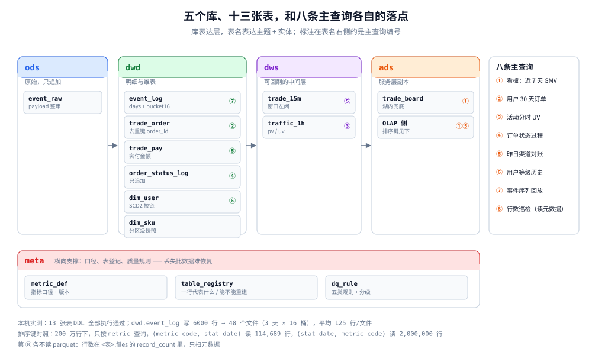
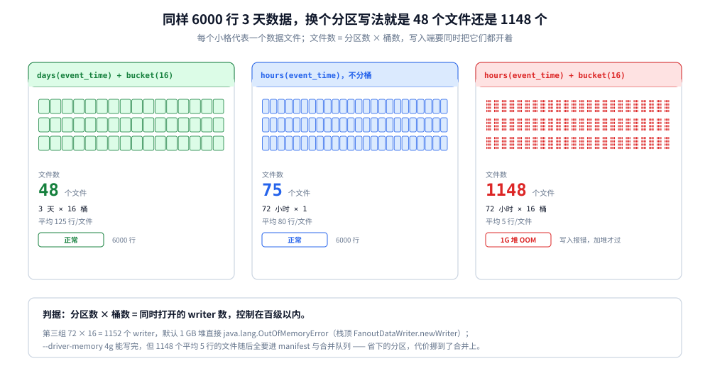
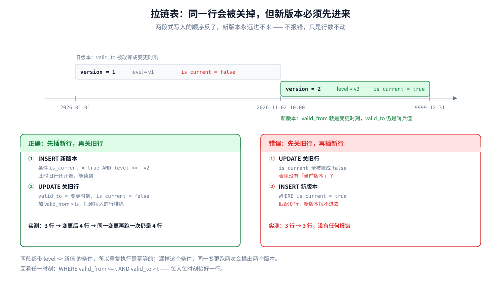

# 存储结构设计

> 覆盖：五个库怎么分、每张表长什么样（可直接执行的 DDL）、拉链表怎么闭合、Kafka 七条 topic 的规格、OLAP 的排序键怎么定、平台自己那三张元数据表、八条主查询各走哪张表的哪个分区，以及建表评审与字段文档怎么维护。
>
> 不覆盖：**文件放哪个 bucket、多久删**在 [存储全景.md](存储全景.md)；湖表的快照与合并机制在 [数据湖与Iceberg表设计.md](数据湖与Iceberg表设计.md)；指标口径与分层职责在 [分层建模与指标口径.md](分层建模与指标口径.md)；排序键的原理在 [OLAP查询服务.md](OLAP查询服务.md) 第三节；权限与审计在 [元数据血缘与权限治理.md](元数据血缘与权限治理.md)。
>
> 内容整理自个人学习笔记。**13 张表的 DDL 全部在 Spark 3.5.5 + Iceberg 1.6.1 上执行通过**；文件数、分区裁剪、拉链表行数、排序键读行数为本机真跑读数；Doris / StarRocks 侧只给等价写法，未实测，见文末「校验口径」。

---

## 一、五个库怎么分，表怎么命名？

**本节要点**：**库表达「层」，表名表达「主题 + 实体」**。库已经说明了这是 ODS 还是 DWD，表名再带 `ods_` / `dwd_` 前缀就是冗余 —— 冗余的命名迟早会打架（一张表被挪层，名字改不动）。



图怎么读：从左往右是数据流（ods → dwd → dws → ads），meta 在下方横跨，它不搬数据，只定义「一行代表什么」与「这张表能不能重建」。表名右侧的圆圈是主查询编号 —— 一个表如果没有任何编号命中，要么它是纯中间产物，要么就是建多了。第八节会把八条查询逐条对到表和分区上；ADS 在主查询 ①⑤ 上出现两次，是因为湖内副本用于对账、OLAP 副本用于出图。

### 1.1 库按层分，一层的表进同一个库

| 库 | 放什么 | 谁写 | 主要读者 | 表数（本方案） |
|---|---|---|---|---|
| `ods` | 原始事件，只追加不解析 | 采集 / Flink 落地 | 重放任务 | 1 |
| `dwd` | 明细事实与维表，一行一件事 | Flink CDC + Spark 批 | 计算、ad-hoc | 6 |
| `dws` | 按主题聚合的中间层，可回刷 | Flink 窗口 | ADS 生成、对账 | 2 |
| `ads` | 湖内的看板兜底副本 | Spark / Flink | 对账、Trino | 1 |
| `meta` | 口径、表登记、质量规则 | 人工 + 调度 | 平台本身 | 3 |

命名四条规则：

1. **库名不带业务线**。业务线进字段（`app_id` / `biz_line`）或独立库；一带业务线，跨业务的公共维表就没地方放。
2. **表名 `主题_实体`**：`trade_order`、`trade_pay`、`traffic_1h`。主题在前，按主题排序时同类表相邻。
3. **不带 `t_` / `tmp_` 前缀**。临时表放 `tmp` 库并在 TTL 到期后自动删；带前缀的临时表会永久留下来。
4. **版本号不进表名**。`order_v2` 一旦出现，两张表就开始各改各的；版本进字段（`metric_version` / `schema_version`）。

### 1.2 字段命名与类型纪律

类型的错误是最贵的一类 —— 它不报错，只在半年后表现为「金额差几分钱」。

| 场景 | 用什么 | 不要用 | 理由 |
|---|---|---|---|
| 金额 | `decimal(18,2)` | `double` / `float` | 浮点累加会丢精度，对账时差额是 0.01 的倍数且查不出根因 |
| 时间 | `timestamp` | `string`（除分区列 `dt`） | 字符串比较依赖格式，`2026-1-5` 与 `2026-01-05` 排不到一起 |
| 分区列 `dt` | `string` `yyyy-MM-dd` | `date` | 与 Hive / 对象存储目录约定一致，跨引擎不用转换 |
| 布尔 | `boolean` | `int` 0/1 | 读代码的人不用查字典 |
| 枚举 | `string` + `COMMENT` | `int` 编码 | 加一个枚举值不用改代码，注释即文档 |
| 业务主键 | `string` | 自增 `bigint` | 多源合并、分库分表后自增 id 会撞 |
| 缺失 | `null` | `''` / `-1` / `'unknown'` | 三种「空」混在一起，`count(distinct)` 与 `is null` 都会骗人 |

### 1.3 每张表必须带的四列

```sql
dt             string     COMMENT '分区列，接收日期'          -- 或由 days(ts) 隐藏分区替代
ingested_at    timestamp  COMMENT '入湖时间，与事件时间分开'   -- 区分「数据晚到」与「处理慢」
src            string     COMMENT 'sdk / server / cdc / batch' -- 出问题时先按来源圈范围
schema_version int        COMMENT '写入时的 schema 版本'       -- 上游改字段后能定位到批次
```

这四列在排查时的作用各不相同：`ingested_at - event_time` 是延迟，`src` 缩小范围，`schema_version` 定位解析规则，`dt` 决定能不能裁剪。**少任何一列，都会在某个故障里多花半天。**

---

## 二、ODS 与 raw：原始层到底建不建表？

**本节要点**：raw 是**目录**不是表 —— 它要能被任何引擎读、能按文件重放；ODS 表只做一件事：把原始串**原样**存下来，不解析。

### 2.1 raw 是目录，不进 Catalog

| 做法 | 好处 | 代价 |
|---|---|---|
| 只存对象存储目录（本方案） | 任何引擎都能读；解析规则改了直接重放 | 不能 `SELECT`，要过引擎；没有 schema 约束 |
| 建成 Iceberg 表 | 能直接查、能时间旅行 | schema 一固化，上游加字段就要演进；重放变成「改表结构」 |

选目录的理由：raw 的价值是**未经加工**，一旦进了表格式就有了 schema 约束，上游字段类型一变就得先演进 schema 才能落盘 —— 而那时候你最需要的是「先存下来再说」。

### 2.2 ODS 表只做一件事：可重放

```sql
CREATE TABLE lake.ods.event_raw (
  event_id      string  COMMENT '客户端生成的唯一 id，去重键',
  app_id        string  COMMENT '业务线标识',
  payload       string  COMMENT '上游原始 JSON，不做字段拆分',
  received_at   timestamp COMMENT '网关收到的时间',
  dt            string  COMMENT '接收日期 yyyy-MM-dd，由写入方填'
) USING iceberg
PARTITIONED BY (dt)
TBLPROPERTIES (
  'write.target-file-size-bytes' = '134217728',
  'write.parquet.compression-codec' = 'zstd'
);
```

`payload` 整串存，不拆字段。原因：**解析规则只应该存在一处**（DWD 的 Flink 作业）。ODS 也拆一遍，就有了两套规则，改一处必漏一处。

ODS 与 raw 的关系不是二选一，而是「目录存字节、表存可查的字节」：raw 全量永久，ODS 只留最近 7–30 天用来快速核对，更早的回 raw 重放。

---

## 三、DWD：明细表怎么建？

**本节要点**：明细表的三件事按顺序定 —— **分区用隐藏 transform**（不用手写 `dt`）、**去重键来自业务而不是自增**、**维度变化用拉链表而不是覆盖**。

### 3.1 事件明细：隐藏分区 + 分桶

```sql
CREATE TABLE lake.dwd.event_log (
  event_id      string  COMMENT '去重键',
  user_id       string  COMMENT '登录用户，未登录为 device_id',
  event_type    string  COMMENT 'view/click/order/pay',
  page_id       string,
  amount        decimal(18,2) COMMENT '仅 order/pay 有值',
  event_time    timestamp COMMENT '事件发生时间，水位线依据',
  ingested_at   timestamp COMMENT '入湖时间',
  src           string  COMMENT 'sdk / server / cdc',
  schema_version int
) USING iceberg
PARTITIONED BY (days(event_time), bucket(16, user_id))
TBLPROPERTIES (
  'write.target-file-size-bytes' = '134217728',
  'write.distribution-mode' = 'hash',
  'history.expire.max-snapshot-age-ms' = '604800000'
);
```

建完 `SHOW CREATE TABLE` 的回显会变一个样子，这不是错：

```text
PARTITIONED BY (days(event_time))
CLUSTERED BY (user_id)
INTO 16 BUCKETS
```

写入方用 `bucket(16, user_id)` 声明桶，Iceberg 内部存的是 `bucket[16]` 变换；Spark 的 `SHOW CREATE TABLE` 把它渲染成 Hive 风格的 `CLUSTERED BY`。**两种写法等价，改表时不要以为它被改写成了别的分区方式。**

**为什么用 `days(event_time)` 而不是 `dt string`**：查询时不用知道分区列叫什么。本机实测（3 天、6000 行）：

| 表 | 查询条件 | 返回行数 | 是否裁剪 |
|---|---|---|---|
| `event_log`（`days(event_time)`） | `event_time >= '11-02' AND < '11-03'` | 2009 | ✅ 只读 1 天分区 |
| `trade_order`（`dt string`） | `created_at >= '11-02'` | 1995 | ❌ 扫了 3 天 |
| `trade_order`（`dt string`） | `dt = '2026-11-02'` | 1005 | ✅ 只读 1 天 |

第三行是关键：`dt` 分区的表**必须用 `dt` 过滤才裁得掉**。业务方习惯写 `created_at`，看起来结果对，实际每次都全表扫 —— 这类问题不会报错，只会让查询越来越慢。



图怎么读：每个小格是一个数据文件，第三栏每格里的 4×4 点阵代表 16 个桶文件。左栏 48 个格子铺得开，第三栏已经密到看不清 —— 文件数就是分区数乘桶数。右下的标签不是评价，是实测结果：前两种写法 6000 行正常写出，第三种在默认 1 GB 堆下直接 OOM。

**⚠️ 分区粒度 × 桶数 = 写入端同时打开的 writer 数。** 同一个表改成 `hours(event_time)` + `bucket(16, user_id)` 后，本机三组读数很说明问题（都是 6000 行、3 天数据）：

| 分区 / 桶 | 文件数 | 平均每文件行数 | 结果 |
|---|---|---|---|
| `days` + `bucket(16)` | 48 | 125 | 正常 |
| `hours`，不分桶 | 75 | 80 | 正常 |
| `hours` + `bucket(16)` | **1148** | **5** | 默认 1 GB 堆 `OutOfMemoryError`（栈顶 `FanoutDataWriter.newWriter`），加到 4 GB 才写完 |

72 个小时分区 × 16 桶 = 1152 个 writer 同时开着。写出 1148 个文件、平均每个 5 行 —— 这些文件随后每一个都要进 manifest、进合并队列。判据：**分区数 × 桶数控制在百级以内**，超了先降分区粒度，再考虑分桶。

### 3.2 事实表：去重键与版本列

```sql
CREATE TABLE lake.dwd.trade_order (
  order_id      string COMMENT '主键，来自业务库，不重新生成',
  user_id       string,
  sku_id        string,
  quantity      int,
  amount        decimal(18,2) COMMENT '下单金额，非支付金额',
  status        string COMMENT 'created/paid/shipped/closed',
  created_at    timestamp,
  updated_at    timestamp COMMENT 'CDC 的源端更新时间，取最新版本判据',
  dt            string
) USING iceberg
PARTITIONED BY (dt)
TBLPROPERTIES (
  'write.target-file-size-bytes' = '134217728',
  'write.merge.mode' = 'copy-on-write'
);
```

三条纪律：

1. **Iceberg 没有主键约束**，`order_id` 只是「约定上的唯一」。真正的去重发生在写入端：`MERGE INTO ... ON t.order_id = s.order_id`，或者先按 `order_id` 取 `updated_at` 最大的一行再 `append`。
2. **版本判据用源端的 `updated_at`，不用 `ingested_at`**。CDC 重放时 `ingested_at` 会全部刷新，用它判最新会把旧版本又盖回去。
3. **`copy-on-write` 与 `merge-on-read` 二选一**：更新频率高（CDC 每行每天改好几次）选 MoR，读放大换写放大；以追加为主、偶尔更正选 CoW，读路径简单。本方案交易表更新不多，选 CoW。

### 3.3 状态流水：不改行，只追加

```sql
CREATE TABLE lake.dwd.order_status_log (
  order_id      string,
  from_status   string,
  to_status     string,
  changed_at    timestamp COMMENT 'CDC 的 binlog 时间',
  operator      string,
  dt            string
) USING iceberg
PARTITIONED BY (days(changed_at));
```

订单表只保留最新状态，过程留在这里。两类表的分工：**「现在是什么」查 `trade_order`，「怎么变成这样」查 `order_status_log`**。把过程塞进主表的 JSON 字段里是常见错法 —— 查不出来，也没法按状态建索引。

### 3.4 拉链表：六列结构与两段式写入

```sql
CREATE TABLE lake.dwd.dim_user (
  user_id       string COMMENT '业务主键，拉链内可出现多次',
  user_name     string,
  level         string,
  region        string,
  valid_from    timestamp COMMENT '本条版本生效时间',
  valid_to      timestamp COMMENT '本条版本失效时间，当前版本为 9999-12-31',
  is_current    boolean   COMMENT '查询时先按它过滤，再按时间兜底',
  version       int       COMMENT '同一 user_id 内单调递增',
  dt            string
) USING iceberg
PARTITIONED BY (dt);
```

`is_current` 与 `valid_to` 是冗余的（一个是另一个的简写），但有它查询写起来简单得多：拉当前状态用 `WHERE is_current = true`，回看历史用时间区间。**冗余的代价是必须同时更新两处**，这就是下面这条坑的来源。



图怎么读：上半是同一行在时间轴上的两个版本 —— 旧版本的 `valid_to` 被改写成变更时刻，新版本的 `valid_from` 就是那个时刻。下半左右两张卡是同一个变更的两种写法：左卡先插后关，实测 3 行变 4 行；右卡先关后插，`WHERE is_current = true` 已经匹配不到任何行，行数停在 3 且不报错。

**写入必须两段，且顺序不能反**：

```sql
-- 1) 先插新版本：此刻旧行还开着，能读到
INSERT INTO lake.dwd.dim_user
SELECT user_id, user_name, 'v2', region, TIMESTAMP '2026-11-02 10:00:00',
       TIMESTAMP '9999-12-31 00:00:00', true, version + 1, '2026-11-02'
FROM lake.dwd.dim_user
WHERE user_id = 'u-1' AND is_current = true AND level <> 'v2';

-- 2) 再关旧行：valid_from < ts 把刚插入的那行排除掉
UPDATE lake.dwd.dim_user
SET valid_to = TIMESTAMP '2026-11-02 10:00:00', is_current = false
WHERE user_id = 'u-1' AND is_current = true
  AND valid_from < TIMESTAMP '2026-11-02 10:00:00' AND level <> 'v2';
```

⚠️ 顺序反了会**静默丢版本**。本机第一次实测就是先 `UPDATE` 关闭旧行、再 `INSERT` 新行，结果 `INSERT` 的 `WHERE is_current = true` 已经匹配不到任何行，总行数停在 3 行不动 —— 没有报错，只是新版本永远进不来。

两段都带 `level <> 'v2'` 条件，所以**重复执行是幂等的**：本机实测 3 行 → 变更后 4 行 → 同一变更再跑一次仍是 4 行；按 `2026-11-01 12:00:00` 回看，每人恰好一行。

查询的两种写法：

```sql
-- 当前状态
SELECT * FROM lake.dwd.dim_user WHERE is_current = true;
-- 任意时点回看
SELECT * FROM lake.dwd.dim_user
WHERE valid_from <= TIMESTAMP '2026-11-01 12:00:00'
  AND valid_to   >  TIMESTAMP '2026-11-01 12:00:00';
```

---

## 四、维表：小表覆盖、大表分桶

**本节要点**：维表只有两种建法 —— **装得进内存的全量覆盖**，**装不进的按 join key 分桶**。中间的「增量更新维表」是最容易出错的一档，除非有明确需求，不要做。

### 4.1 小维表：全量覆盖 + `updated_at`

```sql
CREATE TABLE lake.dwd.dim_sku (
  sku_id        string,
  sku_name      string,
  category_l1   string,
  category_l2   string,
  list_price    decimal(18,2),
  updated_at    timestamp,
  dt            string
) USING iceberg
PARTITIONED BY (dt);
```

每天一批全量覆盖当天的 `dt` 分区（`INSERT OVERWRITE ... WHERE dt = '<today>'`），保留最近 30 天分区。历史分区不动，所以「昨天的商品名」还能查到 —— 这是覆盖写与拉链表的中间形态：**不做行级版本，只做分区级快照**，够用且简单。

Flink 侧关联这张表用广播状态或 `lookup join` + 本地缓存（TTL 10 分钟），不要每条事件查一次湖表。

### 4.2 大维表：两侧同桶数

维表超过几千万行、装不进内存时，按 join key 分桶，两侧桶数必须相同：

```sql
-- 事实侧
PARTITIONED BY (days(event_time), bucket(64, sku_id))
-- 维表侧
PARTITIONED BY (bucket(64, sku_id))
```

同桶数的两张表做 join，Spark 可以只 shuffle 一次（或者干脆不 shuffle，按桶对齐读）。⚠️ 桶数不同不是「慢一点」，而是**桶对不上，join 退化成全量 shuffle**，等于白建。

---

## 五、DWS 与 ADS：汇总表建在哪？

**本节要点**：DWS **落湖、不落 OLAP** —— 它是可回刷的中间层，口径一改要能重算；ADS 落 OLAP，因为它只服务查询，丢了能重建。

### 5.1 DWS 三张，按粒度分而不是按主题分

```sql
CREATE TABLE lake.dws.trade_15m (
  window_start  timestamp COMMENT '窗口左闭，UTC',
  channel       string,
  region        string,
  pay_amount    decimal(18,2),
  pay_orders    bigint,
  dt            string
) USING iceberg
PARTITIONED BY (days(window_start), bucket(8, channel));

CREATE TABLE lake.dws.traffic_1h (
  hour_start    timestamp,
  page_id       string,
  pv            bigint,
  uv            bigint,
  dt            string
) USING iceberg
PARTITIONED BY (days(hour_start));
```

DWS 的粒度由**下游最细的查询**决定，不由上游窗口决定：Flink 算的是 1 分钟窗口，但看板最细只到 15 分钟，DWS 就存 15 分钟；存 1 分钟会让表大 15 倍，而没人查。

### 5.2 ADS 落 OLAP：排序键就是主查询的列序

湖内的 `ads.trade_board` 是对账用的兜底副本，真正对外的是 OLAP 里的同名表：

```sql
CREATE TABLE ads.trade_board (
  stat_date    Date,
  metric_code  LowCardinality(String),
  dim_key      String,
  metric_value Decimal(18,2)
) ENGINE = MergeTree
PARTITION BY toYYYYMM(stat_date)
ORDER BY (metric_code, stat_date)      -- ← 主查询的前缀顺序
TTL stat_date + INTERVAL 90 DAY;
```

排序键的选择没有「最优」，只有「和主查询一致」。本机实测（200 万行、300 天、10 个月分区，同一份数据建两张表，只有排序键不同）：

| 查询 | `ORDER BY (stat_date, metric_code)` | `ORDER BY (metric_code, stat_date)` |
|---|---|---|
| 只按 metric 筛（看板每个图表固定指标） | 读 **2,000,000** 行 / 1.91 MiB / 65 ms | 读 **114,689** 行 / 112.52 KiB / 48 ms |
| 只按日期筛（导出某天全量） | 读 **16,384** 行 / 32 KiB / 23 ms | 读 **90,112** 行 / 176 KiB / 16 ms |

看板的主查询是「固定 metric + 一段时间」，所以选 `(metric_code, stat_date)`，读行数差 **17.4 倍**；代价是「按日期导出全量」这类查询变慢 5.5 倍。⚠️ 如果两类查询都很多，正确做法不是折中排序键，而是**建两张表**或加投影 —— ClickHouse 没有「两个排序键都最优」。

### 5.3 物化视图与 TTL

预聚合（`AggregatingMergeTree` + 物化视图）怎么写、TTL 怎么配，分别在 [OLAP查询服务.md](OLAP查询服务.md) 3.3–3.4 与 [存储全景.md](存储全景.md) 3.3。这里只提醒一句：**TTL 的基准是当前时间**，补历史数据前必须先 `REMOVE TTL`，否则插进去就被删。

---

## 六、Kafka：七条 topic 的规格表

**本节要点**：topic 的规格要在一张表里说清 —— 名字、分区、保留、key、压缩、谁写谁读。散在配置文件里的规格，接手的人要读五个文件才拼得出来。

### 6.1 七条 topic

| topic | 分区 | 保留 | key | 压缩 | 写入方 | 消费方 |
|---|---|---|---|---|---|---|
| `events.raw` | 24 | 7 天 | `device_id` | lz4 | 埋点网关 | Flink 清洗 |
| `events.cleaned` | 24 | 3 天 | `user_id` | lz4 | Flink 清洗 | 入湖、实时指标 |
| `cdc.mysql.trade` | 12 | 7 天 | `order_id` | lz4 | Debezium | Flink CDC merge |
| `rt.ads.trade` | 6 | 1 天 | `channel` | lz4 | Flink 窗口 | OLAP 写入器 |
| `dwd.replay` | 12 | 3 天 | `order_id` | lz4 | 回放工具 | Flink 重算 |
| `events.dlq` | 3 | 14 天 | 原 key | uncompressed | 网关、Flink | 人工处理 |
| `dim.sku.snapshot` | 1 | 7 天 | `sku_id` | lz4 | 批任务 | Flink 广播 |

本机实测建完后的 `--describe`（`events.raw`）：

```text
Topic: events.raw  PartitionCount: 24  ReplicationFactor: 1
Configs: compression.type=lz4,segment.bytes=1073741824,retention.ms=604800000
```

三个值都落在 **topic 级**（`Configs` 段）而不是 broker 级 —— 这是能在同一集群里让不同 topic 用不同保留期的前提。

### 6.2 命名与死信

命名用 `<域>.<层>.<主题>`：`events.raw` 是「埋点域 + 原始层 + 主题」，`rt.ads.trade` 是「实时域 + 服务层 + 主题」。层级写进名字，运维看到 topic 名就知道该不该动它。

⚠️ **`compression.type` 没有 `none`**。本机实测用 `--config compression.type=none` 建 topic 直接失败（合法值是 `uncompressed`、`gzip`、`snappy`、`lz4`、`zstd`、`producer`）。更麻烦的是：如果建 topic 的脚本把输出重定向到 `/dev/null`，这个失败**不会有任何提示**，topic 就是没建出来，直到消费端报 `UNKNOWN_TOPIC_OR_PARTITION`。

死信 topic 的三条要求：保留期长于上游（14 天 > 7 天，给排查留时间）、不压缩（要看原始字节）、**只有一个消费方**（人工处理，不接自动重试，否则会放大故障）。

---

## 七、元数据与控制面自己存哪？

**本节要点**：平台自己也需要存储，而且这部分**丢失比数据丢失更难恢复** —— 因为它记录的是「数据在哪」。

### 7.1 Catalog 的元数据库

| 存什么 | 存在哪 | 丢了会怎样 |
|---|---|---|
| 命名空间、表名、表路径 | PG（REST Catalog 的后端） | 数据文件都在，但没人知道它们属于哪张表 |
| 当前快照 ID、schema 版本 | 同上 | 只能靠 `metadata.json` 反推，逐表 `register_table` |
| 权限策略 | 同上（或 Ranger） | 全表对所有人可读，或全不可读 |

备份方式与验收见 [存储全景.md](存储全景.md) 4.1。

### 7.2 平台自己的三张表

```sql
CREATE TABLE lake.meta.metric_def (
  metric_code   string,
  metric_name   string,
  grain         string COMMENT '一行代表什么，必须能被验证',
  time_field    string,
  dedup_key     string,
  status_filter string,
  sql_text      string,
  version       int,
  effective_from timestamp,
  owner         string,
  deprecated_at timestamp
) USING iceberg
PARTITIONED BY (days(effective_from));

CREATE TABLE lake.meta.table_registry (
  table_name    string COMMENT '库名.表名',
  layer         string COMMENT 'ods/dwd/dws/ads/meta',
  grain         string COMMENT '一行代表什么',
  partition_spec string COMMENT '分区表达式原文',
  sort_or_bucket string,
  owner         string,
  sla           string COMMENT '产出时间，如 07:30',
  retention_days int,
  rebuildable   boolean COMMENT '能否从上游重建',
  upstream      string COMMENT '逗号分隔的上游表',
  doc_url       string,
  updated_at    timestamp
) USING iceberg;

CREATE TABLE lake.meta.dq_rule (
  rule_id       string,
  table_name    string,
  rule_type     string COMMENT 'not_null/unique/range/freshness/sum_match',
  expr          string,
  threshold     double,
  severity      string COMMENT 'P0/P1/P2',
  owner         string,
  enabled       boolean
) USING iceberg;
```

`table_registry` 是这一册里最不起眼、但最先该建的表：它把「一行代表什么、分区表达式、能不能重建、SLA、谁负责」集中在一处，**新建表时顺手插一行，比事后补文档便宜十倍**。它也是第四节「字段文档怎么不腐烂」的锚点。

---

## 八、八条主查询各走哪张表、哪个分区？

**本节要点**：表建得对不对，最终由主查询验证。这一节把「查询 → 表 → 裁剪条件」写死 —— 任何一条主查询找不到能裁剪的表，就说明表结构有问题。

| # | 主查询 | 走哪张表 | 裁剪条件 | 预期读量 |
|---|---|---|---|---|
| ① | 看板：近 7 天 GMV 按渠道 | OLAP `ads.trade_board` | `metric_code='gmv'` + `stat_date` 区间 | 十几万行 / 百 KB 级 |
| ② | 某用户近 30 天订单明细 | `dwd.trade_order` | `dt` 30 个值 | 该用户订单量级 |
| ③ | 某活动的分时 UV | `dws.traffic_1h` | `days(hour_start)` 命中活动当天 | 24 行/页 |
| ④ | 一个订单的状态变化全过程 | `dwd.order_status_log` | `days(changed_at)` | 几次到几十次 |
| ⑤ | 昨天的渠道对账 | `dwd.trade_pay` + `ads.trade_board` | `dt = 昨天` | 两张表各一天 |
| ⑥ | 用户等级的历史变化 | `dwd.dim_user` | `valid_from/valid_to` 时间区间 | 每人几行 |
| ⑦ | 某用户的事件序列回放 | `dwd.event_log` | `days(event_time)` + `bucket(16,user_id)` | 该用户当天事件 |
| ⑧ | 某表昨天产出了多少行（不扫数据） | `<表>.files` / `.partitions` | 按 `partition` 过滤 | 只读元数据 |

第 ⑧ 条是最容易被忽略的用法：**行数、文件数、分区数都在元数据表里**，`SELECT SUM(record_count) FROM tbl.files WHERE partition.dt = '...'` 不用扫一个 parquet 文件。质量校验与容量巡检都应该走这条，而不是 `count(*)`。

第 ⑦ 条是分桶真正生效的地方：`bucket(16, user_id)` 让同一用户的事件落进同一个桶文件，按 `user_id` 过滤时只读 1/16 —— 前提是查询里带 `user_id`。没有这个条件，桶一点用都没有。

---

## 使用：建表、改表、评表

### 建表模板

新建一张 DWD 表时，把这个模板填完再提交，比对着别人的表抄更可靠：

```sql
CREATE TABLE lake.dwd.<主题>_<实体> (
  <业务主键>     string  COMMENT '来源与生成规则',
  <维度列>       string,
  <度量列>       decimal(18,2) COMMENT '单位与口径',
  event_time    timestamp COMMENT '事件时间',
  ingested_at   timestamp COMMENT '入湖时间',
  src           string,
  schema_version int,
  dt            string
) USING iceberg
PARTITIONED BY (<days(ts) 或 dt>[, bucket(<n>, <join key>)])
TBLPROPERTIES (
  'write.target-file-size-bytes' = '134217728',
  'write.distribution-mode' = 'hash',
  'history.expire.max-snapshot-age-ms' = '604800000'
);
```

提交前自查五条：**一行代表什么能一句话说清吗？分区列会被查询用到吗？去重键来自业务吗？金额是 decimal 吗？每列都有 COMMENT 吗？** 五条有一问答不上，就别建。

### 改表：哪些变更安全

| 变更 | 安全吗 | 代价 |
|---|---|---|
| 加列（可空 / 带默认值） | ✅ | 只改元数据，历史文件不重写 |
| 改列名 | ✅ | 按 field id 走，历史数据仍可读 |
| 放宽类型（`int` → `bigint`） | ✅ | 元数据变更 |
| 收窄类型（`bigint` → `int`） | ⚠️ | 有溢出风险，要重写数据 |
| 删列 | ⚠️ | 元数据可删，文件里的数据还在，回滚会「复活」 |
| 改分区方式 | ❌ 等于重建 | 必须新表 + 迁移 + 切流量 |

原则：**能加列就不要改列，能改元数据就不要重写文件**。改分区方式是唯一需要当成「迁移项目」来做的变更，写进排期，不要顺手做。

### 字段文档怎么不腐烂

文档腐烂的根因不是人懒，是**没有校验**。做法是三步：

1. **注释写进 DDL**：`COMMENT '...'` 跟着表走，`DESCRIBE TABLE` 就能导出，本机实测列注释确实落进元数据（`event_id → 去重键`）。
2. **导出成 Markdown，进版本库**：`DESCRIBE TABLE` 的结果按表生成一节，与 `table_registry` 的 `doc_url` 对应。
3. **CI 里 diff**：DDL 改了但导出文档没重生成，CI 直接失败。这一步才是防腐的关键 —— 没有它，前两步三个月后就会分叉。

```bash
# 每天由调度执行，diff 非空就告警
spark-sql -e "DESCRIBE TABLE lake.dwd.event_log" > docs/dwd.event_log.md.new
diff docs/dwd.event_log.md docs/dwd.event_log.md.new || echo "字段文档过期：dwd.event_log"
```

---

## 校验口径

**真跑并取到读数**（Spark 3.5.5 + Iceberg 1.6.1，单容器，`local[*]`）：

- 13 张表 DDL 全部执行通过，五库（`ods` / `dwd` / `dws` / `ads` / `meta`）建成，表数为 1 + 6 + 2 + 1 + 3。
- 分区裁剪：`event_log` 按 `event_time` 过滤返回 2009 行（只读 1 天分区）；`trade_order` 按 `created_at` 过滤返回 1995 行（扫 3 天）、按 `dt` 过滤返回 1005 行（读 1 天）。
- 分桶与文件数：`days(event_time)` + `bucket(16, user_id)` 写 6000 行，48 个文件、每天 16 个、约 125 行/文件。
- 分区粒度：`hours(event_time)` 不分桶同样 6000 行 → 75 个文件、72 个分区；`hours` + `bucket(16)` → 1148 个文件、平均 5 行/文件，默认 1 GB 堆 `OutOfMemoryError`（`FanoutDataWriter.newWriter`），`--driver-memory 4g` 后写入成功。
- 拉链表：3 行 → 变更后 4 行 → 重复执行仍 4 行；按 `2026-11-01 12:00:00` 回看每人 1 行。
- 元数据：`SHOW TBLPROPERTIES` 回显 7 项（含 `write.target-file-size-bytes`），`DESCRIBE` 回显列注释与分区规格 `days(event_time)` / `bucket(16, user_id)`。

**真跑并取到读数**（ClickHouse 26.3.29.7，单容器）：

- 排序键对照：200 万行、300 天。只按 metric：`(stat_date, metric_code)` 读 2,000,000 行 / 1.91 MiB / 65 ms，`(metric_code, stat_date)` 读 114,689 行 / 112.52 KiB / 48 ms。只按日期：前者 16,384 行 / 32 KiB / 23 ms，后者 90,112 行 / 176 KiB / 16 ms。

**真跑并取到读数**（Kafka 3.9.0，单容器）：

- 七条 topic 建成，`events.raw` 的 `--describe` 为 24 分区、`retention.ms=604800000`、`compression.type=lz4`；`compression.type=none` 建 topic 失败（合法值 `uncompressed`）。

**未实测、只给等价写法**：Doris / StarRocks 的建表语句（`DUPLICATE KEY` / `DISTRIBUTED BY HASH` 与 ClickHouse 的 `ORDER BY` 不是一一对应）；`bucket` 在 join 时省掉 shuffle 的实际效果（单容器无法验证多 executor 的 shuffle 行为）；`copy-on-write` 与 `merge-on-read` 的写放大倍数；拉链表在真实 CDC 频率下的合并成本。以上在文中都标为设计判断，不冒充读数。

---

## 延伸追问

- **为什么库按层分，不按业务线分？** → 业务线会变，层不会。按业务线分库，跨业务的公共维表（用户、商品）无处安放，最后必然出现「抄一份到每个业务库」。
- **ODS 层是不是可以不要，raw 直接进 DWD？** → 可以省掉，代价是解析出错时没有「可查的原始层」，只能回对象存储捞文件。ODS 存在的意义是让核对快一点，不是必需。
- **`dt` 字符串分区和 `days()` 隐藏分区能混用吗？** → 能，但不要在同一张表里混。`dt` 的好处是任何引擎都能写（包括不认 Iceberg 的工具），`days()` 的好处是查询不用记分区列名；按写入工具选。
- **拉链表要不要加 `is_current`，既然 `valid_to` 已经能判断？** → 要加。查询 `valid_to = '9999-12-31'` 依赖哨兵值，改哨兵会全表失效；`is_current` 是布尔，语义稳定，代价是写入时多更新一列。
- **ADS 为什么还要在湖里留一份？** → 对账要有第三份口径，且 OLAP 重建时湖里的 ADS 能当基线。它不是服务层的备份，是「上一次算出来的结果」。
- **`table_registry` 和 Catalog 有什么区别？** → Catalog 记「表在哪、schema 是什么」，是机器读的；`table_registry` 记「一行代表什么、谁负责、能不能重建」，是人读的。两者都要有，不能互相替代。

## 关联

- **上游/总纲**：[架构与选型.md](架构与选型.md) — 五层与四份载体的位置；本篇是「存储层」的物理落地
- **上游**：[存储全景.md](存储全景.md) — 文件放哪、谁写、多久删；本篇接着讲表建什么
- **机制**：[数据湖与Iceberg表设计.md](数据湖与Iceberg表设计.md) — 分区/排序/分桶的判据与快照机制，本篇给的是落地 DDL
- **机制**：[分层建模与指标口径.md](分层建模与指标口径.md) — 四层职责与指标字典，本篇给字段与类型纪律
- **机制**：[OLAP查询服务.md](OLAP查询服务.md) — 排序键原理、预聚合与慢查询定位
- **机制**：[Kafka集群与Topic设计.md](Kafka集群与Topic设计.md) — 分区数与保留期的判据，本篇给规格表
- **治理**：[元数据血缘与权限治理.md](元数据血缘与权限治理.md) — Catalog、血缘、列级权限；`table_registry` 是它的输入之一
- **质量**：[流批对账与数据质量.md](流批对账与数据质量.md) — `dq_rule` 的规则类型与告警分级
- **对照/互补**：[IM系统/存储结构设计.md](../IM系统/存储结构设计.md) — 同一个问题的在线侧版本：那边按「三份存储」切，这边按「五个层」切
