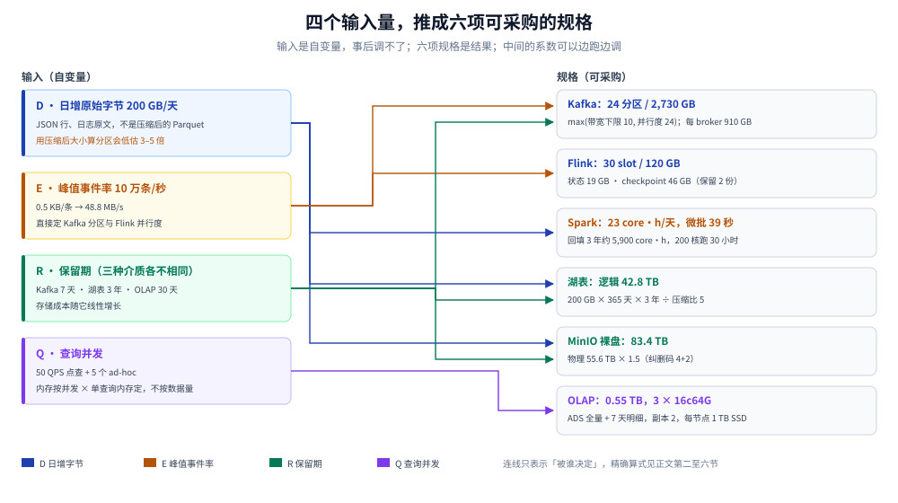
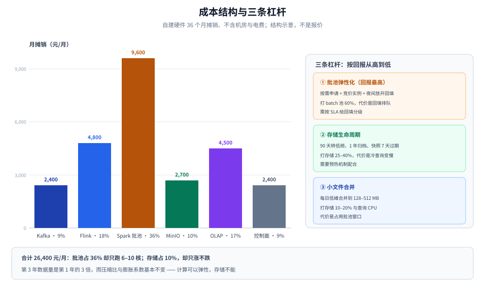

# 容量规划与成本

> 覆盖：把四个输入量（日增字节、峰值事件率、保留期、查询并发）推成六项规格 —— Kafka 分区与磁盘、Flink slot 与 checkpoint、Spark 核时、对象存储裸盘、OLAP 内存副本，再合成一张成本账；给可复算的公式与三条省钱杠杆。
>
> 不覆盖：参数怎么调在零件篇；什么时候扩、按什么顺序扩见 [演进路线与实施计划.md](演进路线与实施计划.md)；组件自身机制见 [Kafka/README.md](../../../03-数据与中间件/中间件/消息队列/Kafka/README.md)。
>
> 内容整理自个人学习笔记。本篇是**算式篇**：输入按 日增 200 GB、峰值 10 万条/秒、消息 0.5 KB、Kafka 保留 7 天、湖表保留 3 年、看板 50 并发 代入，所有结果由文末脚本算出、可原样复现；**集群未实测**，压缩比与单核扫描速率按经验取值，实测校正在第二、三批的零件篇里给。

---

## 一、容量由哪四个数决定？

**本节要点**：容量问题看着有十几个参数，真正的自变量只有四个 —— 日增字节、峰值事件率、保留期、查询并发。其余全是「系数」，系数可以事后调，这四个数调不了。

| 输入 | 本方案的假设 | 直接决定 | 系数依赖 |
|---|---|---|---|
| 日增原始字节 `D` | 200 GB/天 | 湖表容量、批计算量、OLAP 明细量 | 压缩比、膨胀系数 |
| 峰值事件率 `E` | 10 万条/秒 | Kafka 分区与磁盘、Flink 并行度 | 平均消息大小、单分区吞吐 |
| 保留期 `R` | Kafka 7 天 / 湖 3 年 / OLAP 30 天 | 磁盘与对象存储成本 | 热温冷分层比例 |
| 查询并发 `Q` | 50 QPS 点查 + 5 个 ad-hoc | OLAP 副本与内存 | 单查询内存、命中率 |

⚠️ 最容易估错的是 `D`：它是**原始字节**（JSON 行、日志原文），不是入库后的 Parquet 大小。用压缩后的大小去算 Kafka 分区，会低估 3–5 倍；用原始大小去算对象存储，会高估同样倍数。两个数要分开记。



图怎么读：左边四个输入，右边六项可采购的规格。连线只表示「被谁决定」，不表示精确换算 —— 精确算式在下面五节。这张图要说明的是一件事：**别从组件出发反推容量**（「先买三台 Kafka」），那会把四个输入里的三个丢掉。

---

## 二、Kafka 要多少分区、多大磁盘？

**本节要点**：分区数取两个下限的较大者 —— **带宽下限**（峰值字节率 ÷ 单分区可持续写）与**消费并行度下限**（下游 Flink 的并行度上限）；磁盘按「日增量 × 保留天数 × 副本数」算，别按峰值速率乘秒数，那是把峰值当成全天。

### 2.1 分区数

```text
峰值字节率 = 100000 条/秒 × 0.5 KB = 48.8 MB/s
带宽下限   = 48.8 MB/s ÷ 5 MB/s（单分区保守可持续写）= 10
并行度下限 = 24（Flink 单作业并行度上限，受 slot 与状态限制）
分区数     = max(10, 24) = 24 → 每 broker 8 个
```

为什么单分区按 5 MB/s 而不是 50 MB/s：分区是一条顺序日志，写放大、页缓存回刷、ISR 同步都会拉低可持续值；按 50 MB/s 估，一次 broker 故障触发副本追赶就会把整条链路拖慢。24 个分区给 3 broker 各 8 个，故障时单 broker 承担 16 个仍有余量。

### 2.2 磁盘

```text
Kafka 总量 = D × 保留天数 × 副本数 × 膨胀系数 × 压缩后占比
           = 200 GB × 7 × 3 × 1.3 × 0.5 ≈ 2730 GB
每 broker  = 910 GB → 配 2 TB NVMe（含 2 倍余量）
```

⚠️ 把 Kafka 保留期从 7 天改成 90 天，总量从 2.7 TB 涨到 35 TB —— 这是「Kafka 当长期存储」的第一个账单，第二个账单是重平衡与副本追赶的时间。长期存储交给 Iceberg，Kafka 只做缓冲。

### 2.3 几个连带参数

| 参数 | 取值 | 理由 |
|---|---|---|
| 副本数 / `min.insync.replicas` | 3 / 2 | 允许一台 broker 故障仍可写 |
| `acks` | `all` | 采集侧丢一条就无法回放，宁慢不丢 |
| 压缩 | `zstd`（或 `lz4`） | CPU 换磁盘与网络，通常 0.5 以下 |
| 单条消息上限 | 1 MB | 大对象走对象存储，消息只带引用 |
| 分区 key | 业务主键（订单号 / 用户 ID） | 同键有序；无键时轮询，别用随机 |

---

## 三、Flink 的 slot 与状态怎么算？

**本节要点**：slot 数由**并行度**决定，不是由数据量决定；内存由**状态量**决定，状态量由「需要跨事件记住多少 key」决定。两件事分开估，混在一起就会「加内存治背压」。

### 3.1 slot 与内存

```text
并行度 = 24（与 Kafka 分区对齐，一个分区一个消费子任务）
slot   = 24 × 1.2（留 20% 余量）= 29 → 取 30
内存   = 30 slot × 4 GB = 120 GB（TaskManager 总内存，不含 JM）
```

每个 slot 4 GB 的构成：RocksDB 写缓冲 + 堆内算子 + 网络缓冲。低于 2 GB 时，网络缓冲占比过高，反压会先于 CPU 出现。

### 3.2 状态量

```text
窗口去重 key = 10 万/秒 × 15 分钟 × 60 = 9000 万个
去重状态     = 9000 万 × 100 B ≈ 9 GB
CDC 活跃行   = 5000 万行 × 200 B ≈ 10 GB
状态合计     ≈ 19 GB
checkpoint   = 19 GB × 2（保留两份）× 1.2 ≈ 46 GB
```

结论：状态在几十 GB 量级，必须用 **RocksDB 状态后端 + 增量 checkpoint**；用堆内状态后端会把 19 GB 直接压在 JVM 堆上，Full GC 一次就是分钟级停顿。

### 3.3 checkpoint 参数

| 参数 | 取值 | 理由 |
|---|---|---|
| 间隔 | 3 分钟 | 与 15 分钟 SLA 匹配；间隔越短，恢复越快但写放大越高 |
| 超时 | 10 分钟 | 小于一个窗口，避免 checkpoint 永远追不上 |
| 最小间隔 | 1 分钟 | 防止上一轮没写完就开下一轮 |
| 存储 | 对象存储（S3 兼容） | 与 TaskManager 生命周期解耦 |
| 增量 | 开启（RocksDB） | 19 GB 全量每 3 分钟一次，写放大不可接受 |

---

## 四、Spark 批到底要多少核时？

**本节要点**：批计算量 = **要扫的压缩后字节 ÷ 单核扫描速率 × 开销系数**。算出来通常远小于直觉 —— 真正吃资源的是**回填**和**大维表 join**，不是日常 T+1。

### 4.1 日常批

```text
压缩后日增   = 200 GB ÷ 5 = 40 GB
单核扫描     = 30 MB/s（Parquet + Zstd，保守值）
纯扫描核时   = 40 GB × 1024 ÷ 30 MB/s ÷ 3600 ≈ 0.38 core·h
含 shuffle / join / 写出的开销系数 40：
日常批       = 0.38 × 40 × 1.5（宽表重建）≈ 23 core·h/天
```

23 core·h 摊到 4 小时窗口只要 6 核平均；即使按 10 倍安全系数也就是 60 核。**所以「批集群」的规格不是为日常批定的，是为回填定的**：一次 3 年历史重算 = 23 × 365 × 0.7 ≈ 5900 core·h，按 200 核跑要 30 小时。

### 4.2 15 分钟微批（备用路径）

```text
每批输入 = 200 GB ÷ 96（一天 96 个 15 分钟）= 2.08 GB
计算时间 = 2.08 GB × 1024 ÷ 30 MB/s ÷ 8 核 ≈ 9 秒
加调度与启动开销 30 秒 → 单批约 39 秒
```

结论：15 分钟微批在算力上**非常便宜**，瓶颈在调度与启动开销；这也是为什么主链路交给 Flink 常驻作业、批只做回填与重建 —— 每 15 分钟起一次 Spark 作业，光启动就吃掉一半预算。

---

## 五、对象存储与 Iceberg 要多少裸盘？

**本节要点**：逻辑容量按「日增 × 保留 ÷ 压缩比」，物理容量再乘**膨胀系数**（快照、小文件、未合并）与**纠删码开销**。三层系数一层都不能省，否则采购时差一倍。

```text
逻辑容量 = 200 GB × 365 × 3 ÷ 5 ≈ 42.8 TB
物理占用 = 42.8 × 1.3（快照 + 小文件）≈ 55.6 TB
MinIO 裸盘 = 55.6 × 1.5（EC 4+2）≈ 83.4 TB
热数据（90 天）= 200 × 90 ÷ 5 ≈ 3.52 TB
```

| 项 | 取值 | 说明 |
|---|---|---|
| 纠删码 | 4+2 | 可用容量 = 裸盘 × 2/3，允许坏两块盘 |
| 快照保留 | 7 天 | 再长就用「标签」保留里程碑，不保留每日快照 |
| 文件目标大小 | 128–512 MB | 小于 128 MB 的算小文件，进入每日合并队列 |
| 生命周期 | 90 天转低频、1 年转归档 | 用对象存储的分层，不搬数据 |

⚠️ 小文件是隐形的第二份存储：15 分钟一批、每批每分区一个文件，一天就是一个分区 96 个文件；一年后查询计划要打开几十万个文件句柄。合并任务不是优化项，是**容量项**。

---

## 六、OLAP 内存与副本怎么估？

**本节要点**：OLAP 存的是**可重建的服务层数据**，所以只保留「报表要用的」：ADS 全量 + 7 天明细。副本按可用性定（2 副本），内存按**并发 × 单查询内存**定，不按数据量定。

```text
明细 7 天   = 200 GB × 7 ÷ 5 ≈ 273 GB
2 副本     ≈ 0.55 TB  → 3 个 BE 节点，每节点 1 TB SSD
单查询内存  = 100 MB（点查）/ 1 GB（聚合）
50 QPS 点查 = 5 GB 工作集 + 16 GB/节点缓存 → 每节点 64 GB
```

| 组件 | 起步规格 | 扩容判据 |
|---|---|---|
| Doris / StarRocks BE | 3 × 16c64G / 1 TB SSD | 单节点 CPU > 70% 持续 10 分钟，或查询 P95 > 3 s |
| FE | 3 × 8c16G | 元数据 QPS 高或 FE 单点 |
| Trino worker | 3 × 16c64G（按需扩） | ad-hoc 并发 > 5 或扫描量 > 1 TB/查询 |

---

## 七、把账合起来：钱花在哪一项？

**本节要点**：自建口径下，**最大的一项不是存储，是「为峰值常驻的批池」**；存储占比不高但增长最快，且不可弹性。

下表按自建硬件 36 个月摊销、不含机房与电费，单价取区间中值 —— 它是**结构示意**，不是报价。

| 项 | 规格 | 月摊销（元） | 占比 |
|---|---|---|---|
| Kafka | 3 × 8c32G / 2 TB NVMe | 2,400 | 9% |
| Flink（streaming 池） | 6 × 8c32G（30 slot） | 4,800 | 18% |
| Spark（batch 池） | 8 × 16c64G，可弹到 16 台 | 9,600 | 36% |
| MinIO | 83 TB 裸盘 + 3 台存储节点 | 2,700 | 10% |
| OLAP | 3 × 16c64G / 1 TB SSD | 4,500 | 17% |
| 控制面 | 调度 + 元数据 + 监控，3 × 8c32G | 2,400 | 9% |
| **合计** | — | **26,400** | 100% |

两个读法：

- **批池占 36%，但日常只用 6–10 核**。这是最大的浪费项，也是最先该动的一刀：批池改成按需申请 + 竞价实例，平均利用率从 5% 提到 40%，这一项能省六成。
- **存储只占 10%，但它只涨不跌**。计算可以弹性，存储不能：第 3 年数据量是第 1 年的 3 倍，而压缩比与膨胀系数基本不变。



图怎么读：左柱是月摊销的六项，最长的一段是批池；右列是三条杠杆各自作用的项 —— 弹性化打批池、生命周期打存储、合并小文件同时打存储与查询 CPU。图中数字与上表一致，单位是元/月，不含机房电费，不能当作报价使用。

---

## 八、三条杠杆与一个反直觉结论

**本节要点**：省钱不靠「换更便宜的组件」，靠**提高已买资源的利用率**；三条杠杆按回报从高到低是：批池弹性化、存储生命周期、小文件合并。

| 杠杆 | 动作 | 省哪一项 | 代价 |
|---|---|---|---|
| 批池弹性化 | 按需申请、竞价实例、夜间放开回填 | batch 池 60% | 回填排队，需 SLA 分级 |
| 存储生命周期 | 90 天转低频、1 年归档、快照 7 天过期 | 存储 25–40% | 冷数据查询变慢，需预热 |
| 小文件合并 | 每日低峰合并到 128–512 MB | 存储 10–20% + 查询 CPU | 占用批池窗口 |
| 压缩与列存 | Kafka zstd、湖表 Zstd、OLAP 列存 | 全线 30–50% | CPU 换 IO，需压测拐点 |

**反直觉结论**：在这套量级下，把 Kafka 保留期从 7 天加到 30 天，磁盘账单从 2.7 TB 涨到 11.7 TB（约 4 倍），但省下的「重放历史」能力几乎用不上 —— 因为湖表已经保留了全部历史。**Kafka 的保留期只需要覆盖「最慢消费者的追赶时间 + 一次故障恢复」，7 天足够。**

---

## 使用：一份可复算的容量表

**本节要点**：把四个输入代进这段脚本，六项规格与占比一次算出；改任何一个输入，其余结果会自动跟着变。

```python
import math

D, EPS, MSG_KB = 200, 100_000, 0.5      # 日增 GB / 峰值条每秒 / 平均消息 KB
KDAYS, YEARS, COMP = 7, 3, 5            # Kafka 保留 / 湖保留 / 压缩比
INFLATE, REPL, KCOMP = 1.3, 3, 0.5      # 膨胀 / 副本 / Kafka 压缩后占比
CONS_PAR, SLOT_GB = 24, 4               # 下游并行度 / 每 slot 内存

peak_mbs = EPS * MSG_KB / 1024
parts = max(math.ceil(peak_mbs / 5), CONS_PAR)
parts = math.ceil(parts / 12) * 12      # 取 12 的倍数，均分到 3 个 broker
kafka_gb = D * KDAYS * REPL * INFLATE * KCOMP
logical_tb = D * 365 * YEARS / COMP / 1024
physical_tb = logical_tb * INFLATE
minio_tb = physical_tb * 1.5            # EC 4+2
state_gb = EPS * 15 * 60 * 100 / 1e9 + 50e6 * 200 / 1e9
ckpt_gb = state_gb * 2 * 1.2
scan_core_h = (D / COMP) * 1024 / 30 / 3600
daily_core_h = scan_core_h * 40 * 1.5
olap_tb = D * 7 / COMP / 1024

print(f"peak MB/s        = {peak_mbs:.1f}")
print(f"partitions       = {parts}  kafka total GB = {kafka_gb:.0f}  per broker = {kafka_gb/3:.0f}")
print(f"lake logical TB  = {logical_tb:.1f}  physical = {physical_tb:.1f}  minio raw = {minio_tb:.1f}")
print(f"hot 90d TB       = {D*90/COMP/1024:.2f}")
print(f"flink slots      = {CONS_PAR}  mem = {CONS_PAR*SLOT_GB} GB")
print(f"state GB         = {state_gb:.1f}  checkpoint GB = {ckpt_gb:.1f}")
print(f"scan core-h/day  = {scan_core_h:.2f}  daily spark = {daily_core_h:.1f}")
print(f"microbatch GB    = {D/96:.2f}  est sec = {D/96*1024/30/8+30:.0f}")
print(f"olap detail TB   = {olap_tb:.2f}  2 replicas = {olap_tb*2:.2f}")
```


```text
实测输出（Python 3.13，输入取本节假设）：
peak MB/s        = 48.8
partitions       = 24  kafka total GB = 2730  per broker = 910
lake logical TB  = 42.8  physical = 55.6  minio raw = 83.4
hot 90d TB       = 3.52
flink slots      = 24  mem = 96 GB
state GB         = 19.0  checkpoint GB = 45.6
scan core-h/day  = 0.38  daily spark = 22.8
microbatch GB    = 2.08  est sec = 39
olap detail TB   = 0.27  2 replicas = 0.55
```

⚠️ 这段脚本只做算术：`5 MB/s`、`30 MB/s`、压缩比 `5`、膨胀 `1.3` 都是系数，换成你环境实测值即可。**不要把它当性能预测** —— 它只回答「要买多少」，不回答「跑多快」。

---

## 延伸追问

- **为什么分区数不按数据量算？** → 分区是并行与有序的单位，不是容量单位；数据量大但消费并行度低，多分区只是增加元数据与重平衡成本。
- **Kafka 副本 3 是不是太多？** → 两台机器故障仍可写要 3 副本；2 副本在单机故障时就要停写，对采集侧意味着丢数或阻塞。
- **Flink 状态为什么不用堆内？** → 19 GB 状态压在堆上，Full GC 的停顿会超过 checkpoint 间隔；RocksDB 把大部分状态放到本地盘，堆只留索引与缓冲。
- **批池按需会不会拖慢 SLA？** → 会，所以要分两级：核心报表预留最小常驻额度，回填与 ad-hoc 走竞价队列，排队但不影响出数时间。
- **OLAP 为什么要留 7 天明细？** → 报表下钻与问题排查需要；更久的历史查湖表（Trino），代价是秒级变十秒级。
- **小文件合并占批池，会不会和回填抢资源？** → 会，所以合并放在最低峰并设上限；用 Iceberg 的 `rewrite_data_files` 按分区做，不做全表。
- **压缩比取 5 合理吗？** → JSON 文本转 Parquet + Zstd 通常在 4–8 倍；日志类重复度高可取 8，埋点字段多取 4。落地后用一天真实数据校正。
- **成本模型里为什么没有网络？** → 同机房内网为主，跨可用区副本与出网流量另计；如果对象存储跨区，带宽会变成第二大的项。

## 关联

- **上游/总纲**：[README.md](README.md) — 本册定位与篇目分工
- **上游**：[总体架构与选型.md](总体架构与选型.md) — 本篇的五层结构与双引擎分工从哪来
- **下游零件**：[Kafka集群与Topic设计.md](Kafka集群与Topic设计.md) — 分区数与保留策略的落地配置
- **下游零件**：[Flink实时链路.md](Flink实时链路.md) — slot、状态后端与 checkpoint 的实际参数
- **下游零件**：[数据湖与Iceberg表设计.md](数据湖与Iceberg表设计.md) — 膨胀系数、小文件与快照保留
- **下游零件**：[OLAP查询服务.md](OLAP查询服务.md) — 副本、内存与查询并发
- **验证**：[全链路压测设计.md](../全链路压测设计.md) — 用压测校正单核扫描速率与压缩比
- **对照/互补**：[海量数据存储设计.md](../海量数据存储设计.md) — 存储形态的通用选型判据
