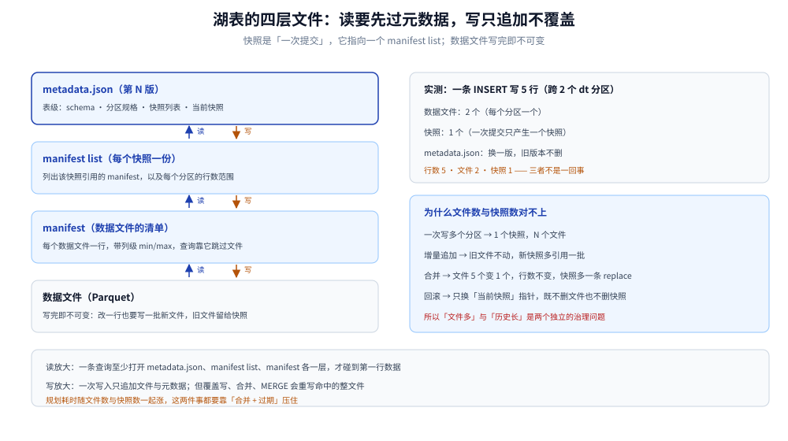
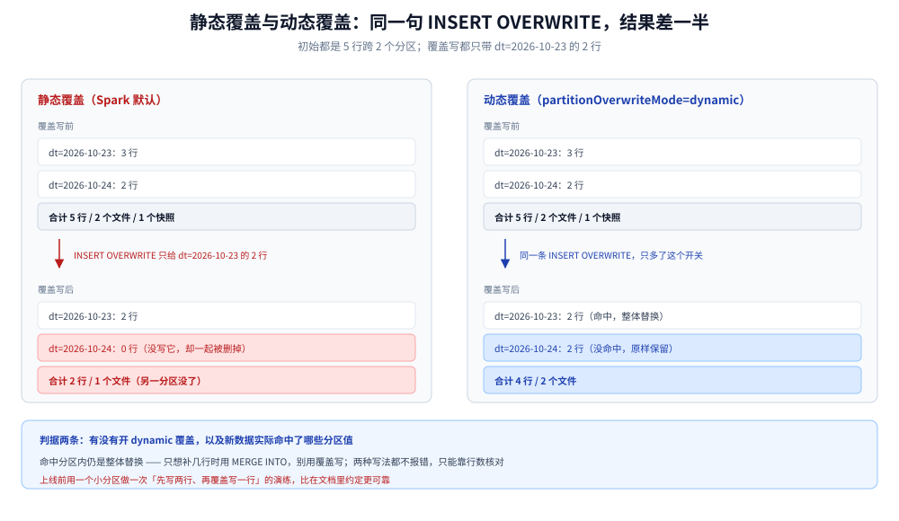
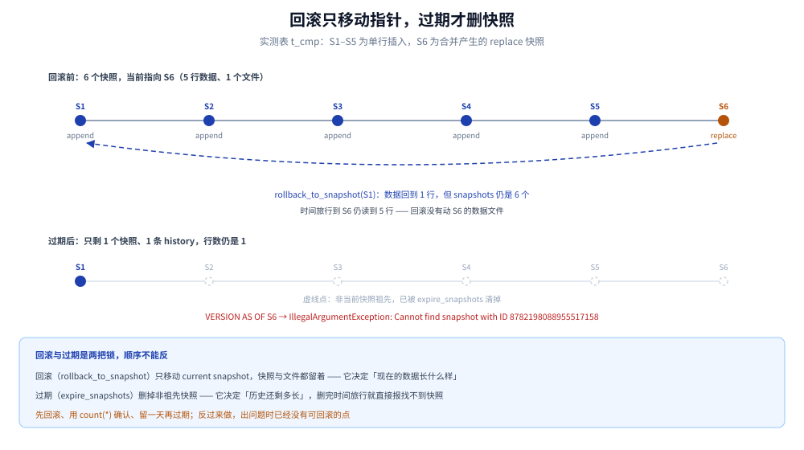

# 数据湖与 Iceberg 表设计

> 覆盖：湖表在这套平台里怎么存、怎么回填、怎么让批与流同时安全写入 —— 分区/排序/分桶的选法、快照与时间旅行、15 分钟微批的覆盖写姿势、小文件合并、回滚与过期。Iceberg 读数全部来自本机 Spark + Iceberg 容器实测。
>
> 不覆盖：Iceberg 的元数据协议与 Hudi / Paimon 的格式对比不在本篇；分区数与存储容量的算式见 [容量规划与成本.md](容量规划与成本.md)；微批的调度与补数见 [Spark批处理与调度.md](Spark批处理与调度.md)；流写入的幂等见 [Flink实时链路.md](Flink实时链路.md)。
>
> 内容整理自个人学习笔记。实测环境：`apache/spark:3.5.5-scala2.12-java17`（容器 `bdp-spark`，`local[2]`）、Iceberg `1.6.1`、HadoopCatalog + 本地文件系统仓库（`/wh/warehouse`）。未实测：S3 / MinIO 的 FileIO 行为、Flink 与 Trino 并发写同一张表、真实规模的 compaction 耗时。命令与读数见各节，汇总在文末「校验口径」。

---

## 一、为什么湖表要「只写文件 + 换快照」，而不是就地改文件？

**本节要点**：对象存储上的文件改不了，只能整文件重写；湖表把「改哪一行」翻译成「写一批新文件 + 提交一个指向新文件集合的快照」。理解这一点，后面所有坑（覆盖写、合并、回滚）都是同一个机制的不同侧面。

### 1.1 一次写入落下了哪些文件

自上而下四层：metadata.json（表级：schema、分区规格、快照列表）→ manifest list（一个快照一份，列出该快照引用的 manifest）→ manifest（每个数据文件一行，带列级统计）→ 数据文件（Parquet，写完即不可变）。



图怎么读：读写方向相反 —— 写是「新数据文件 → 新 manifest → 新 manifest list → 新 metadata.json 版本」，读是「metadata.json → manifest list → manifest → 数据文件」。所以一次写入的代价落在元数据上，一次查询的代价也先落在元数据上；只有删掉中间任何一层，「快照」这个概念就不成立了。

### 1.2 快照不等于文件

实测 `t_static`：一条 `INSERT` 写入 5 行、跨两个 `dt` 分区，落盘结果是 **2 个数据文件、1 个快照**。

```text
S1_rows_after_insert              5
S2_files_after_insert             2
S3_snaps_after_insert             1
```

两者不是一一对应：一个快照可以引用多个文件（一次写多个分区），一个文件也能被多个快照引用（增量写入时旧文件不动）。这也解释了后面合并的读数 —— 文件数变了，快照只是多了一条。

### 1.3 换来了什么，代价是什么

| 换来的能力 | 对应的代价 |
|---|---|
| 读一致：一条查询始终看到一个快照 | 元数据文件随时间增长，规划耗时上升 |
| 回滚与时间旅行 | 旧文件不能立刻删，要等快照过期 |
| 增量读（只处理新快照） | 不合并就攒小文件，读放大会先爆发 |
| schema 演进不重写历史 | 演进后的语义差异要靠 field id 兜住 |

---

## 二、分区、排序、分桶怎么选？

**本节要点**：分区决定「一次写入影响多大一片」，排序决定「查询能跳过多大一片」，分桶只在按该列做 MERGE 且写放大明显时才需要。三者的开销依次递增，能不加就不加。

### 2.1 分区先于一切

| 层 | 分区键 | 判据 |
|---|---|---|
| ODS / raw | `days(ts)` + `hour(ts)`（隐藏分区） | 回放按摄入时间；重跑一批只覆盖一批 |
| DWD | 业务日期 `dt` | 查询几乎都带业务时间 |
| DWS | `dt` | 汇总按天重算 |
| ADS | `dt` | 只留近期，可整分区重建 |

两条纪律：

- **分区字段不超过两个**：每多一层，文件数与 manifest 条目就乘一级；
- **一个分区要能对应一次批的范围**：微批按 15 分钟写，分区若按分钟切，每天光分区数就 96 个，文件数再乘命中分区数，元数据先撑不住。

Iceberg 的隐藏分区允许直接对时间戳做变换，不必在数据里多养一个 `dt` 列 —— 这比「让上游保证每行都带分区字段」可靠得多，也避免了业务时间与摄入时间被混用。

### 2.2 排序解决什么

`ALTER TABLE ... WRITE ORDERED BY (user_id)` 让文件内部按该列有序。它不改分区，但查询的 `WHERE user_id = ?` 能靠 manifest 里的 min/max 统计跳过大量文件。代价是每次写入多一次排序。

### 2.3 分桶什么时候才用

`bucket(16, user_id)` 把同一 user 的行固定到同一批文件里，只对「按该列做大范围 MERGE」或「与同分桶的另一张表 join」有收益。否则它只会把文件数乘以桶数。

### 2.4 本平台的选择

ODS 用 `days(ts)` + `hour(ts)` 隐藏分区；DWD 用业务 `dt`；DWS / ADS 用 `dt`；不排序、不分桶。理由是这套平台的查询以「按天聚合」为主，排序的收益要让位于 15 分钟一批的写入延迟 —— 排序是拿写带宽换读带宽，而这里的瓶颈在写。

---

## 三、15 分钟微批怎么写才不会写坏？

**本节要点**：Spark 里 `INSERT OVERWRITE` 的默认语义是**整表静态替换**，不是「替换今天这个分区」。在按天分区的湖表上执行它，会把其它分区的数据一起抹掉，而且不报错。

### 3.1 实测：默认覆盖写把整表替换了

表 `t_static` 按 `dt` 分区，先写入 5 行（`dt=2026-10-23` 三行、`dt=2026-10-24` 两行）：

```sql
INSERT INTO local.exp.t_static VALUES (1,10.00,'2026-10-23'),(2,20.00,'2026-10-23'),
  (3,30.00,'2026-10-23'),(4,40.00,'2026-10-24'),(5,50.00,'2026-10-24');
```

再执行一条只带 `dt=2026-10-23` 两行的覆盖写：

```sql
INSERT OVERWRITE local.exp.t_static VALUES (1,10.00,'2026-10-23'),(2,20.00,'2026-10-23');
```

```text
S4_rows_after_overwrite           2
S5_rows_dt24_after_overwrite      0
S6_files_after_overwrite          1
```

`dt=2026-10-24` 的两行**一起消失**。这条 SQL 看起来是「重写今天这批」，实际是「清空整表，再写入这两行」。

### 3.2 为什么会这样

Spark 的 `spark.sql.sources.partitionOverwriteMode` 默认是 `STATIC`：`INSERT OVERWRITE` 不带分区子句时按静态分区处理，目标就是整张表。Hive 的默认行为同样是静态。

⚠️ 两边的默认值都不站在你这边：你以为在写一个分区，实际在写整表；而且成功返回、行数看起来也「合理」—— 这是这类事故最难被发现的地方。

### 3.3 三种安全写法

| 写法 | 语义 | 适用 | 代价 |
|---|---|---|---|
| 动态覆盖（`partitionOverwriteMode=dynamic`） | 只替换本次数据命中的分区 | 按天重算整个分区 | 命中分区内仍是全量替换，批次必须完整 |
| `MERGE INTO`（按主键） | 命中则更新、未命中则插入 | 增量修正、迟到数据 | 需要主键；copy-on-write 会重写命中文件 |
| 只追加 + 下游去重 | 永不覆盖 | 事件流 | 读时要去重，存储只增不减 |

### 3.4 实测：动态覆盖的边界

同样 5 行起步，开启动态覆盖后只写 `dt=2026-10-23` 的两行：

```text
D1_rows_after_dynamic             4
D2_rows_dt24_after_dynamic        2
D3_files_after_dynamic            2
```

`dt=2026-10-24` 的两行保留下来了，`dt=2026-10-23` 从 3 行变成 2 行 —— 这就是「只替换命中的分区」。边界也要记住：**命中的那个分区是被整体替换的**，所以这一批的数据必须覆盖该分区的全部内容；微批只补几行时用它，会把分区里其它的行删掉。



图怎么读：左右两张表的初始状态相同（5 行、2 个分区、2 个文件），差别只在覆盖写之后 —— 左边 `dt=2026-10-24` 变成 0 行、合计 2 行；右边它仍是 2 行、合计 4 行。判断一段覆盖写属于哪一种，只看两件事：有没有开 `partitionOverwriteMode=dynamic`，以及新数据实际命中了哪些分区值。

### 3.5 幂等重跑：MERGE 跑两遍与跑一遍一样

15 分钟一批、失败重跑是常态，所以写入必须幂等。实测同一条 `MERGE INTO` 连跑两次：

```sql
MERGE INTO local.exp.t_merge t
USING (SELECT 1L id, 11.00 amount, '2026-10-23' dt
       UNION ALL SELECT 3L, 30.00, '2026-10-23') s
ON t.id = s.id
WHEN MATCHED THEN UPDATE SET t.amount = s.amount
WHEN NOT MATCHED THEN INSERT (id, amount, dt) VALUES (s.id, s.amount, s.dt);
```

```text
M1_first_run_rows     3    61.00
M2_second_run_rows    3    61.00
M3_files              1
M4_snaps              3
```

行数与求和都没变，只有快照多了一个 —— **幂等的是结果，不是写入次数**。注意 `M3_files=1`：MERGE 会重写被命中的文件（copy-on-write），补跑不会持续堆文件，但每次都要整文件重写；被修正的行越多，写放大越高。

---

## 四、schema 演进为什么不会读错历史？

**本节要点**：Iceberg 按 **field id** 对齐列，不按列名、也不按位置。所以改名与加列都不必重写历史文件；反过来，任何绕过表定义的「重建表」都会把 id 关系打断。

### 4.1 字段 id 是唯一身份

写入时每一列被分配一个 id 并随数据文件一起落盘；读取时按 id 找到对应的物理列，再把当前的 name 套上去。改名只改 metadata 里的 name，历史文件一个字节都不用动。

### 4.2 实测：DDL 不产生快照

在 `t_static`（此时 2 行）上执行两个 DDL：

```sql
ALTER TABLE local.exp.t_static ADD COLUMN channel string;
ALTER TABLE local.exp.t_static RENAME COLUMN amount TO pay_amount;
```

```text
S7_snaps_after_ddl                2
S8_rows_after_ddl                 2
```

快照数仍是 2（一条 insert + 一条 overwrite），说明 **DDL 只改 metadata.json，不产生快照、不动数据文件**。`DESCRIBE` 的读数是：

```text
pay_amount          decimal(12,2)
channel             string
```

新列对历史数据读出来是 `NULL`，旧列按 id 在原位置命中 —— 历史不需要重写一行。

### 4.3 哪些变更安全

| 变更 | 支持 | 风险 |
|---|---|---|
| 末尾加列 | 是 | 下游 `INSERT ... VALUES` 用位置参数会错位，一律写列名 |
| 改名 | 是（按 id） | 旧 SQL 里的旧列名直接报列不存在 |
| 放宽类型（int → bigint） | 是 | — |
| 收窄类型（bigint → int） | 否 | 只能新建列 + 回填 + 删旧列 |
| 删列 | 是（只删元数据） | 时间旅行到旧快照时，这一列又会出现 |
| 改分区规格 | 是（分区演进） | 新旧数据分区布局不同，查询规划要同时处理两套 |

### 4.4 一条纪律：不要用「重建表」代替 DDL

`CREATE TABLE t_new AS SELECT * FROM t` 再改名，会把所有 field id 重新分配，历史文件的 id 映射全部作废 —— 快照还在，但它已经不是同一张表了，时间旅行与增量读都失去意义。删列就用 `ALTER TABLE ... DROP COLUMN`，改类型就先加列再回填。

---

## 五、小文件怎么合，合完行数为什么不变？

**本节要点**：15 分钟一批的湖表，文件数按「批数 × 命中分区数」增长；`rewrite_data_files` 只是把多个小文件读出来重写成大文件，行数不变，代价是重写字节加一个新快照。

### 5.1 小文件从哪来

实测 5 次单行 `INSERT` 的结果：

```text
C1_files_before_compact           5
C2_rows_before_compact            5
C3_snaps_before_compact           5
```

按平台的量级推：每天 96 批，若每批命中 10 个分区，就是 960 个文件/天、一周 6720 个。每个文件都要在查询规划时被 manifest 打开一次，读放大会先于存储成本爆发。

### 5.2 实测：合并 5 → 1

```sql
CALL local.system.rewrite_data_files(
  table => 'exp.t_cmp',
  options => map('target-file-size-bytes','8388608'));
```

```text
C4_files_after_compact            1
C5_rows_after_compact             5
C6_snaps_after_compact            6
8782198088955517158               replace
```

文件 5 → 1，行数仍是 5，快照多了一条 `replace`。合并本身是一次普通提交：旧文件还在（被旧快照引用），所以时间旅行到合并之前，仍然读到 5 行、5 个文件。

### 5.3 三种合并粒度

| 策略 | 做什么 | 什么时候用 |
|---|---|---|
| binpack | 把小文件拼到大文件，不排序 | 默认，按分区跑 |
| sort | 按指定列重排后重写 | 查询有强过滤列 |
| z-order | 多维空间填充排序 | 时间 + 用户两个维度都常过滤 |

### 5.4 什么时候跑

低峰期按分区跑，一次只碰一个 `dt`。合并整表会同时占用扫描和写带宽，还会一次性把快照数推高；合并期间也不要对同一分区跑覆盖写 —— 两边都基于同一批文件做替换，后提交的一方会把前一方的工作成果覆盖掉。

### 5.5 合并也有代价

重写字节等于被合并文件的总大小；新快照引用新文件、旧快照仍引用旧文件，所以在下一次 `expire_snapshots` 之前，磁盘占用是「旧 + 新」两份。合并频率不是越高越好，按「每天一次、按分区」起步就够。

---

## 六、回滚与过期：什么时候还能回到昨天？

**本节要点**：`rollback_to_snapshot` 只移动当前快照指针，**不删快照**；真正决定「还能不能回到某时刻」的是 `expire_snapshots`。两件事经常被混为一谈，于是有人以为回滚之后历史就没了，或者以为不清理也能一直留着。

### 6.1 实测：回滚不删快照

`t_cmp` 合并后共有 6 个快照（5 个 `append` + 1 个 `replace`）。回滚到第一个：

```sql
CALL local.system.rollback_to_snapshot('exp.t_cmp', 7838250044365004942);
```

```text
R1_rows           1
R2_files          1
R3_snaps          6
R5_history        7
VERSION AS OF 8782198088955517158   5 行
```

数据回到了第一行，6 个快照**全在**，`history` 多了一条回滚记录；时间旅行到被「抛弃」的那个合并快照，仍能读到 5 行。回滚是一次提交，不是一次删除。

### 6.2 实测：过期才真正删

接着执行过期，`older_than` 给一个未来的时间点：

```sql
CALL local.system.expire_snapshots('exp.t_cmp', TIMESTAMP '2026-10-26 00:00:00');
```

```text
E1_snaps          1
E2_history        1
E3_rows           1
```

不属于当前快照祖先的 5 个快照被清掉。此后时间旅行：

```text
java.lang.IllegalArgumentException: Cannot find snapshot with ID 8782198088955517158
```



图怎么读：横轴是提交顺序，前五个是单行插入、第六个是合并产生的 replace。回滚让「当前」回到第一个，但六个点都还在；过期之后只剩第一个点，虚线表示其余已经不可达。要读出的结论是：「回滚」和「过期」是两把不同的锁 —— 回滚决定现在的数据长什么样，过期决定历史还剩多长。

### 6.3 三层保留期不要设反

| 层 | 控制什么 | 设错会怎样 |
|---|---|---|
| 快照保留（`expire_snapshots` / `history.expire.*`） | 还能回到哪个时间点 | 太短：出事后无法回滚；太长：元数据膨胀 |
| 数据文件寿命 | 旧文件何时可删 | 快照过期了文件还在，磁盘不降 |
| 对象存储生命周期（MinIO ILM） | 兜底删除 | 比快照更早生效 → 快照指向的文件被删，读表直接报文件不存在 |

顺序必须是「快照先过期，文件后删」，中间留出至少一个完整的保留窗口。对象存储的生命周期规则只能当兜底，不能当主策略 —— 它看不到湖表的快照引用关系。

### 6.4 回滚的正确姿势

1. 先列快照：`SELECT snapshot_id, committed_at, operation FROM <表>.snapshots ORDER BY committed_at`；
2. 核对目标快照的 `operation` 是否符合预期（`append` / `overwrite` / `replace`）；
3. 执行回滚，然后用一条 `count(*)` 确认行数；
4. **别立刻过期** —— 回滚本身不删东西，留一天才能反悔。

---

## 使用：建表与维护的日常命令

建表时把「文件大小目标」与「快照保留」一起写进属性，避免后面靠人记：

```sql
CREATE TABLE local.dwd.orders (
  id bigint,
  amount decimal(12,2),
  ts timestamp,
  dt string
) USING iceberg
PARTITIONED BY (dt)
TBLPROPERTIES (
  'write.target-file-size-bytes' = '134217728',
  'history.expire.max-snapshot-age-ms' = '864000000'
);
```

日常维护按「看 → 合 → 过 → 回」四类命令：

| 要做的事 | 命令 |
|---|---|
| 看快照 | `SELECT snapshot_id, committed_at, operation FROM local.dwd.orders.snapshots ORDER BY committed_at` |
| 看文件数与行数 | `SELECT count(*) FROM local.dwd.orders.files` / `SELECT count(*) FROM local.dwd.orders` |
| 看每个分区的文件数 | `SELECT partition, count(*) FROM local.dwd.orders.files GROUP BY partition` |
| 合并小文件 | `CALL local.system.rewrite_data_files(table => 'dwd.orders', where => "dt = '2026-10-23'")` |
| 查看过期计划 | `CALL local.system.expire_snapshots(table => 'dwd.orders', older_than => TIMESTAMP '2026-10-25 00:00:00')` |
| 回滚 | `CALL local.system.rollback_to_snapshot('dwd.orders', <snapshot_id>)` |
| 时间旅行 | `SELECT * FROM local.dwd.orders VERSION AS OF <snapshot_id>` |

## 校验口径

> 本篇读数的校验方式与范围（`apache/spark:3.5.5-scala2.12-java17`，`local[2]`，Iceberg 1.6.1，HadoopCatalog + 本地文件系统仓库）：

- **真跑并取到读数**：第 1.2 节（5 行 → 2 文件 / 1 快照）；第 3.1 节（静态覆盖后 5 行 → 2 行、另一分区清零）；第 3.4 节（动态覆盖后 4 行、另一分区保留）；第 3.5 节（同一 MERGE 连跑两次，行数与求和不变）；第 4.2 节（DDL 前后快照数不变，`DESCRIBE` 显示新列名）；第 5.2 节（5 个文件合并为 1，行数不变）；第 6.1 节（回滚后快照仍为 6、时间旅行仍可读）；第 6.2 节（过期后快照剩 1、时间旅行抛 `Cannot find snapshot with ID`）。
- **只静态校验**：第 2 节的分区与排序建议（设计判据，未在真实数据规模上对比过查询耗时）；「使用」节的建表 DDL 与 TBLPROPERTIES 取值（未逐项验证属性是否按预期生效）。
- **未实测**：S3 / MinIO 的 FileIO 与 multipart 行为、Flink 与 Spark 并发写同一张表的冲突处理、真实规模的 compaction 耗时与写放大、分区演进后的跨布局查询。
- **容器**：`bdp-spark`（保留未删）。

| 项 | 实际值 |
|---|---|
| Spark | 3.5.5-scala2.12-java17 |
| Iceberg | 1.6.1（`iceberg-spark-runtime-3.5_2.12` + `iceberg-spark-extensions`） |
| Catalog | HadoopCatalog，`warehouse=/wh/warehouse` |
| 并行度 | `local[2]` |
| 测试表 | `exp.t_static`（按 dt 分区）、`exp.t_dyn`、`exp.t_cmp`（不分分区）、`exp.t_merge`（按 dt 分区） |

---

## 延伸追问

- **为什么 `INSERT OVERWRITE` 删掉别的分区却不报错？** → 静态覆盖的语义就是「这张表的目标位置被替换」，分区只是布局；它按定义不关心原来有哪些分区，所以没有可校验的对象。
- **`MERGE INTO` 是幂等的，为什么还要对账？** → 幂等只保证「同样的输入跑两遍结果一样」；它不保证输入本身完整（漏批、迟到、上游重复键），那部分要靠 [流批对账与数据质量.md](流批对账与数据质量.md)。
- **快照那么多，查询会变慢吗？** → 规划阶段要读的 manifest 随快照引用的文件增长而增长；频繁过期能压住，但过期太激进会失去回滚点，取值时按「至少覆盖一次完整回填周期」定。
- **合并会不会把流作业正在写的文件也重写掉？** → 会与同一分区的写入竞争，最终提交的一方生效；调度上让合并与微批错峰，并按分区而不是整表跑。
- **改列类型后历史文件需要重写吗？** → 放宽类型不需要，读时按 id 与目标类型解释；收窄类型不支持，只能新建列回填。
- **时间旅行能当「数据备份」用吗？** → 能当「近期误操作的撤销键」，不能当备份：过期之后就没了，跨集群/跨地域的恢复仍要靠对象存储的版本或异地副本。

## 关联

- **上游采集**：[数据采集与CDC.md](数据采集与CDC.md) — raw 层的消息怎么变成湖表的行
- **上游通道**：[Kafka集群与Topic设计.md](Kafka集群与Topic设计.md) — 重放的前提是数据还在保留期内
- **下游计算**：[Spark批处理与调度.md](Spark批处理与调度.md) — 微批怎么调、补数怎么覆盖
- **下游计算**：[Flink实时链路.md](Flink实时链路.md) — 流式入湖的 checkpoint 与提交间隔
- **口径与验证**：[流批对账与数据质量.md](流批对账与数据质量.md) — 两条链路写同一张表后怎么比
- **容量算式**：[容量规划与成本.md](容量规划与成本.md) — 42.8 TB 逻辑 / 55.6 TB 物理怎么来
- **总体位置**：[总体架构与选型.md](总体架构与选型.md) — 湖表在五层里承担什么
- **对外服务**：[OLAP查询服务.md](OLAP查询服务.md) — ADS 从湖表重建的路径
