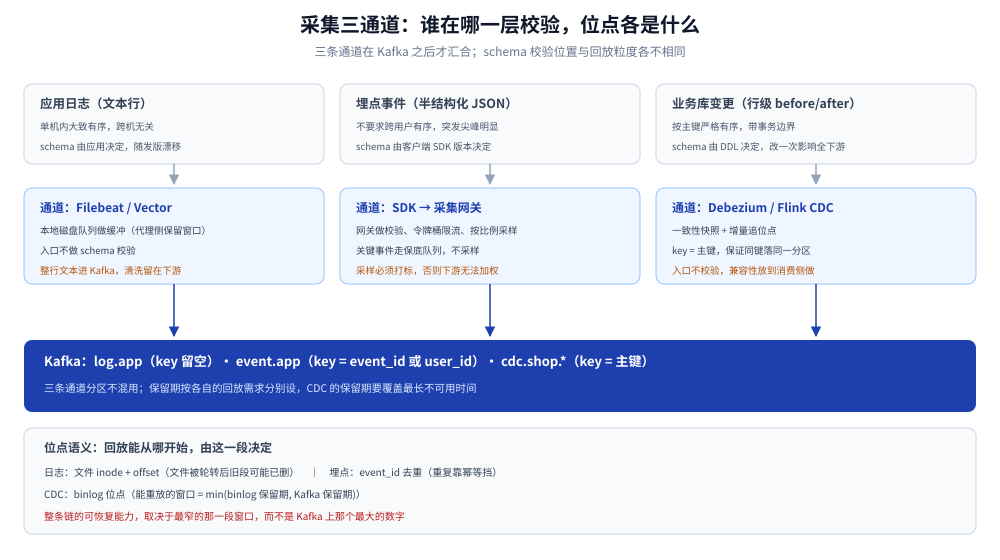
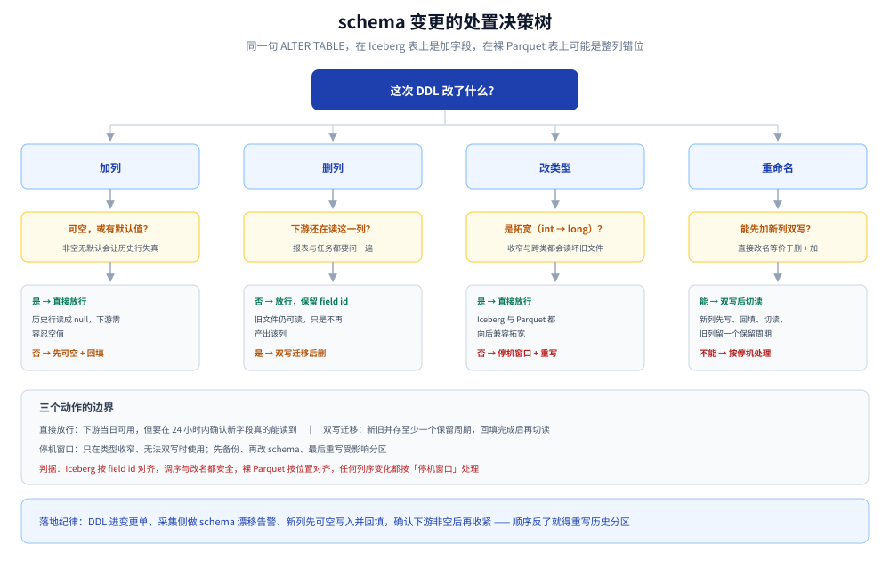

# 数据采集与 CDC

> 覆盖：数据从三类源（应用日志、埋点事件、业务库变更）进入 Kafka 的三条通道，以及三条通道上各自最容易出错的地方 —— CDC 读的是什么、schema 变了怎么办、入口被打满时丢谁、怎么验收「全、准、及时」。
>
> 不覆盖：Kafka 自身的分区与副本见 [Kafka集群与Topic设计.md](Kafka集群与Topic设计.md)；日志后端的存储与查询见 [日志系统选型对比.md](../../../03-数据与中间件/中间件/可观测性/日志系统/日志系统选型对比.md)；binlog 格式与复制原理见 [CDC/README.md](../../../03-数据与中间件/数据存储/数据同步/CDC/README.md)。
>
> 内容整理自个人学习笔记。**本篇没有容器实测**：本轮三轮实测预算给了 Kafka、Flink、Spark+Iceberg，MySQL binlog 解析与 Debezium 连接器未起；文中的位点语义与幂等推演按组件文档与协议行为写，涉及实测的判断都标了出处。

---

## 一、三类数据源，为什么不能走同一条通道？

**本节要点**：判「走哪条通道」不看数据大小，看三个属性 —— **有序性的粒度**、**schema 的所有者**、**回放的最小单位**。三者不同，通道就必须分开。

| 源 | 形态 | 有序性 | schema 谁定 | 回放粒度 | 通道 |
|---|---|---|---|---|---|
| 应用日志 | 文本行（最多半结构化） | 单机内大致有序，跨机无关 | 应用自己，随发版漂移 | 按时间或 offset | Filebeat / Vector / Fluent Bit → Kafka |
| 埋点事件 | 半结构化 JSON | 不要求跨用户有序 | 客户端 SDK 版本决定 | 按事件 ID 去重 | SDK → 采集网关 → Kafka |
| 业务库变更 | 行级 before/after + 事务边界 | **按主键严格有序** | DDL 决定，改一次影响全下游 | 按 binlog 位点 | Debezium / Flink CDC → Kafka |

三条判据怎么用：

- **有序性粒度决定 Kafka 的 key**：日志没有业务主键，key 留空、按分区轮询；埋点用 `event_id` 或 `user_id`；CDC 必须用主键，否则同一个主键的 `UPDATE` 会被拆到两个分区并行处理，下游拿到的是「先新后旧」。
- **schema 的所有者决定校验放在哪**：日志与埋点的 schema 由客户端定，**入口必须校验**（否则脏数据会污染整条链路）；CDC 的 schema 由 DDL 定，入口校验没有意义，要在**消费侧**做兼容。
- **回放粒度决定保留期**：日志丢一天可以接受，CDC 丢一天就要全量重做 —— 所以 CDC 的 topic 保留期必须覆盖「最长不可用时间」，而不是「最长排查时间」。



图怎么读：三条通道在 Kafka 之后才汇合。日志与埋点在入口就做 schema 校验和限流，CDC 不做 —— 它的 schema 由 DDL 携带，校验放到消费侧。图下方标注每条通道的位点语义：日志按文件 inode + offset，埋点按事件 ID 去重，CDC 按 binlog 位点。把 CDC 和日志塞进同一个 topic，最先坏的通常不是吞吐，而是 CDC 的「按主键有序」被日志流量打散。

### 1.1 一条通道会怎样

三种具体的坏法，按发生概率排序：

1. **分区争用**：日志峰值是 CDC 的几十倍，同一 topic 里日志把分区写满，CDC 消息排在后面 —— 表现为「业务库明明改了，看板十分钟没动」，而 Kafka 监控一切正常。
2. **大消息拖慢整批**：日志里偶尔出现完整堆栈或报文 dump，单条几 MB；同一个批次里的小 CDC 事件跟着一起等网络。
3. **schema 校验错位**：给日志设计的 `parse.key=true` 与 `drop malformed` 规则套到 CDC 上，会把不带 key 的 DDL 事件直接丢掉。

---

## 二、CDC 到底读的是什么？

**本节要点**：CDC 读的是**行级变更镜像 + 事务边界**，不是 SQL。三个最容易估错的点：`row_image` 决定 update 事件的完整度、事务边界决定事件条数、快照与增量的衔接决定会不会重复。

### 2.1 row image：update 事件里到底带了什么

| `binlog_row_image` | update 事件带什么 | 下游怎么处理 | 风险 |
|---|---|---|---|
| `FULL` | 全部列的前后镜像 | 直接 upsert | 日志量最大，宽表会翻倍 |
| `MINIMAL` | 只带主键 + 被改的列 | 必须「先查后合」或要求上游补齐 | 下游只拿到半个行，整行覆盖会把其他列清空 |
| `NOBLOB` | 除大字段外全部列 | 大字段单独取 | 大字段（JSON / TEXT）会失真 |

⚠️ 最贵的错不是丢消息，是**用 `MINIMAL` 的镜像去做整行覆盖写**：`UPDATE orders SET status='PAID'` 在下游变成一行只有 `id` 与 `status` 的记录，金额与用户 ID 全被写成 null。判据很简单 —— 湖表的写入是「整行替换」还是「按列合并」，取决于上游的 `binlog_row_image`，这一条要在接入前问清楚。

### 2.2 事务边界：一条 SQL 不等于一条事件

- 一个事务里改 10 行，Debezium 会发 10 条数据事件 + 1 条事务元数据事件（`transaction` 类型），下游可以按事务聚合；
- Flink CDC 的增量阶段默认**按事务边界切分**，所以「下游看到的批次」与「源端提交次数」不是 1:1；
- 一个 `UPDATE ... WHERE` 改了一百万行，会变成一百万条事件 —— **批量订正比在线流量更容易打爆链路**，这是「上游做批量订正必须提前通知」的技术原因。

### 2.3 快照与增量的衔接

全量 + 增量一体化的标准流程是「先一致性快照、再从快照位点追日志」，衔接处有两个必须承认的事实：

- **无锁快照不等于无 DDL**：快照期间发生的 `ALTER TABLE` 不会被快照捕获，只能靠 schema 历史 topic 回放，或者干脆重做快照；
- **衔接处一定会有重叠**：快照最后一条与 binlog 起点之间通常有重叠窗口，连接器宁可重也不肯漏 —— 所以**下游必须幂等**，这不是可选项。

### 2.4 重复从哪来

| 来源 | 触发条件 | 重复范围 | 应对 |
|---|---|---|---|
| 位点回退 | 连接器重启后从上次提交位点重放 | 少量、连续 | 幂等 upsert |
| 重平衡 | 多并行度下分片重分配 | 秒级窗口 | 同上 |
| 快照与增量交叠 | 首次启动、重做快照 | 全量边界附近 | 同上 |
| 下游写失败重试 | Sink 事务超时 | 单批次 | 两阶段提交或幂等键 |

幂等键怎么选：CDC 用「主键 + 源端位点（或源端更新时间）」；日志用「设备 ID + 日志序号」；埋点用 `event_id`。**别用「内容哈希」当幂等键** —— 同一条业务记录两次合法更新内容可能相同，哈希会把它们合并成一条。

---

## 三、schema 变了怎么办？

**本节要点**：多数 schema 变更对管道是「静默的」—— 不会报错，只会让下游某一列悄悄变成 null 或错位。判断兼容与否只看一件事：**下游是按列名（field id）对齐，还是按列位置对齐**。

### 3.1 兼容矩阵

| 变更 | Kafka 侧 | 湖表侧 | 下游查询 | 结论 |
|---|---|---|---|---|
| 加列（可空） | 兼容 | 加字段，历史文件读成 null | 正常 | 最安全，但要给默认值 |
| 加列（非空无默认） | 兼容 | 历史行没有值 | 查询炸或统计失真 | 禁止，先可空再回填 |
| 删列 | 兼容 | 保留 field id，旧文件仍可读 | `SELECT *` 少一列 | 半安全，需通知下游 |
| 改类型 `int→long` | 兼容 | 兼容 | 正常 | 安全 |
| 改类型 `long→int` 或 `string→int` | 兼容传输 | 不兼容 | 读旧文件报错或截断 | 危险，要走停机窗口 |
| 重命名列 | 兼容 | 等价于「删 + 加」 | 历史列名丢失 | 禁止直接做，先加新列双写 |
| 枚举值新增 | 兼容 | 兼容 | 下游 `switch` 落到默认分支 | 需下游兜底 |

### 3.2 湖表按 field id 对齐，不按位置

Iceberg 的 schema evolution 按 **field id** 追踪列：重命名、调序都不会让历史文件错位。这是它比「裸 Parquet + Hive Metastore」最实用的一条差异 —— 后者在列顺序变化时，按位置读会把 A 列的数据读进 B 列，而且**不报错**。

⚠️ 这条只在「写入时保留了 field id」的前提下成立。用 Spark 直接写 Parquet 到 Hive 表、绕过 Iceberg 的写入路径，field id 就丢了，后续 `ALTER TABLE` 一样会错位。

### 3.3 决策树



图怎么读：从「这次 DDL 改了什么」出发，先分加列、删列、改类型、重命名四支；每条分支的终点只有三种动作 —— 直接放行、双写迁移、停机窗口。关键的一步是中间那层判断「下游是按 field id 还是按位置对齐」：同一句 `ALTER TABLE`，在 Iceberg 表上是加字段，在裸 Parquet 表上可能是整列错位。

### 3.4 治理动作

- **DDL 进变更单**：库表变更与下游影响面一起评审，禁止「顺手加个字段」；
- **schema 漂移告警**：采集侧解析出与基线不一致的字段集合就告警，不等下游发现 null；
- **先兼容后切换**：新列先以可空写入并回填，确认下游读到非空之后再收紧约束。

---

## 四、入口被打满时丢谁？

**本节要点**：链路上每个环节都有一段「保留窗口」，整条链的可恢复能力等于**最窄的那一段**。丢数据永远不是「某个组件抽风」，而是某一段窗口被撑破了。

| 环节 | 撑破的表现 | 这段窗口由什么决定 | 兜底 |
|---|---|---|---|
| 埋点网关 | 突发 5–10 倍流量，Kafka 写不进 | 网关内存队列长度 | 令牌桶限流 + 非关键事件按比例采样，关键事件单独保底队列 |
| 采集代理 | Kafka 不可写 | 本地磁盘队列（Filebeat WAL / Vector buffer） | 磁盘满后丢最旧，并打点 |
| CDC | 消费组停摆，binlog 被清理 | MySQL `binlog_expire_logs_seconds`（默认 30 天）与磁盘 | 按「最长停机时间」调大，并监控 binlog 位点差距 |
| Kafka | 磁盘满，写入被拒 | 保留期 × 写入速率 | 保留期必须大于「故障恢复 + 重放」的总时间 |

⚠️ 最容易翻车的是 CDC 这一格：Kafka 保留 7 天看着很宽裕，但 MySQL 的 binlog 只留 30 天且可能因磁盘吃紧被提前清理。**Kafka 里的 7 天是「已经进 Kafka 的数据」，不是「源端还能给你重放的数据」** —— 两个窗口要分别核算。

---

## 五、怎么验收采集是「全、准、及时」？

**本节要点**：四个读数分别对应四个问题：**晚没晚**（延迟）、**重没重**（重复率）、**乱没乱**（乱序度）、**缺没缺**（位点缺口）。只看 Kafka 的 `MessagesInPerSec` 什么也证明不了。

| 读数 | 口径 | 取法 |
|---|---|---|
| 采集延迟 | `ingest_ts - event_ts` 的 P50 / P99 | 消息体里带事件时间；Kafka 侧对比 `LogAppendTime` |
| 重复率 | 主键重复条数 ÷ 总条数 | 湖表上按幂等键 `count(*) - count(distinct key)` |
| 乱序度 | 同一 key 上「事件时间倒退」的次数 | 按 key 分组扫窗口内的时序 |
| 位点缺口 | 源端 binlog 位点与 Kafka 已消费位点的差值 | 连接器指标 + Kafka 消费组 lag |

阈值示例（按 15 分钟 SLA 反推）：延迟 P99 < 3 分钟；重复率 < 0.1%；乱序度只对 CDC 有意义（允许乱序但必须可修正）；位点缺口 > 10 分钟即告警。

---

## 使用：一套最小可跑的采集配置

三份配置分别对应三条通道，只保留「跑起来必需」的项。

**① Flink CDC 读 MySQL 写 Kafka**（SQL 方式，无需写 Java）：

```sql
CREATE TABLE orders_cdc (
  order_id   BIGINT,
  user_id    BIGINT,
  amount     DECIMAL(12,2),
  status     STRING,
  updated_at TIMESTAMP(3),
  PRIMARY KEY (order_id) NOT ENFORCED
) WITH (
  'connector'    = 'mysql-cdc',
  'hostname'     = 'mysql',
  'port'         = '3306',
  'username'     = 'cdc',
  'password'     = '******',
  'database-name'= 'shop',
  'table-name'   = 'orders',
  'server-time-zone' = 'Asia/Shanghai'
);

CREATE TABLE orders_topic (
  order_id   BIGINT,
  user_id    BIGINT,
  amount     DECIMAL(12,2),
  status     STRING,
  updated_at TIMESTAMP(3),
  PRIMARY KEY (order_id) NOT ENFORCED
) WITH (
  'connector' = 'kafka',
  'topic'     = 'cdc.shop.orders',
  'properties.bootstrap.servers' = 'kafka:9092',
  'key.format'   = 'json',
  'value.format' = 'json'
);

INSERT INTO orders_topic SELECT * FROM orders_cdc;
```

主键声明决定了两件事：CDC 的 key 是 `order_id`，以及写入 Kafka 时按主键分区 —— 这两条共同保证「同一订单的变更落在同一分区且保序」。

**② Vector 采集应用日志**（比 Filebeat 少一层模块概念）：

```toml
[sources.app_log]
type = "file"
include = ["/var/log/app/*.log"]
read_from = "beginning"

[transforms.parse]
type = "remap"
inputs = ["app_log"]
source = '''
  parsed, err = parse_json(.message)
  if err == null { . = merge(., parsed) }
'''

[sinks.kafka_out]
type = "kafka"
inputs = ["parse"]
bootstrap_servers = "kafka:9092"
topic = "log.app"
encoding.codec = "json"
```

**③ 埋点网关的采样骨架**（伪代码，只保留判据）：

```text
关键事件（支付、下单、登录）→ 保底队列，不采样
非关键事件（曝光、滑动）→ 令牌桶 1000/s，超出按 1/10 采样并打 sampled 标记
任何情况下都不在网关做「丢弃并返回成功」以外的降级 —— 要么明确采样，要么明确 503
```
最后一条是纪律：网关静默丢弃会让「埋点数据」与「业务数据」永久对不上，而且事后无法区分「没发生」和「丢了」。

---

## 延伸追问

- **为什么 CDC 不直接读业务库的从库？** → 从库有复制延迟且不保证事务边界一致；binlog 是唯一「带事务边界、可按位点重放」的源。读从库只能做全量抽样，做不了增量。
- **`binlog_row_image=MINIMAL` 在小表上很香，为什么平台侧一律要求 `FULL`？** → 因为下游是「状态宽表」，任何一次 update 都可能要重算整行；省的是源端日志量，赔的是下游正确性。
- **能不能让 CDC 只在快照时读一次，之后全靠定时全量覆盖？** → 数据量小于 10 GB、表少于 50 张时可以，代价是全量窗口内的一致性没法保证，而且每天重复扫主库。
- **为什么幂等键不能只用主键？** → 主键只能去重「同一条记录」，去不掉「同一条记录的两个不同版本」。要区分版本，键里必须带源端位点或更新时间。
- **埋点丢了 5%，业务能感知吗？** → 汇总指标感知不到（比例性偏差），漏斗与同比会偏；所以采样必须**显式打标**，让下游能按标记加权还原。
- **为什么说「采集层不要做业务转换」？** → 转换逻辑一旦进采集层，就变成了「不可回放的加工」：raw 层没有原始数据，改口径只能重来。清洗放 Flink，raw 层只做搬运。

## 关联

- **下游存储**：[Kafka集群与Topic设计.md](Kafka集群与Topic设计.md) — 三条通道在 Kafka 上的分区、保留与重放策略
- **下游建模**：[分层建模与指标口径.md](分层建模与指标口径.md) — CDC 的 ODS 层怎么落、DWD 怎么去重合并
- **下游计算**：[Flink实时链路.md](Flink实时链路.md) — CDC merge 的状态与幂等 sink
- **上游原理**：[CDC/README.md](../../../03-数据与中间件/数据存储/数据同步/CDC/README.md) — 日志解析与全量增量一体化
- **上游选型**：[数据集成与采集选型对比.md](../../../03-数据与中间件/大数据组件/数据集成与采集/数据集成与采集选型对比.md) — 本篇按「这条链路怎么拼」说话，那篇按「同一类活选哪个产品」说话：五工具分水岭是**谁记住搬到哪了**，以及每款的位点、时效与失败恢复单位
- **同层参照**：[海量数据存储设计.md](../海量数据存储设计.md) — 按数据类型选存储的通用判据
- **同目录**：[总体架构与选型.md](总体架构与选型.md) — 三条通道在五层架构里的位置
