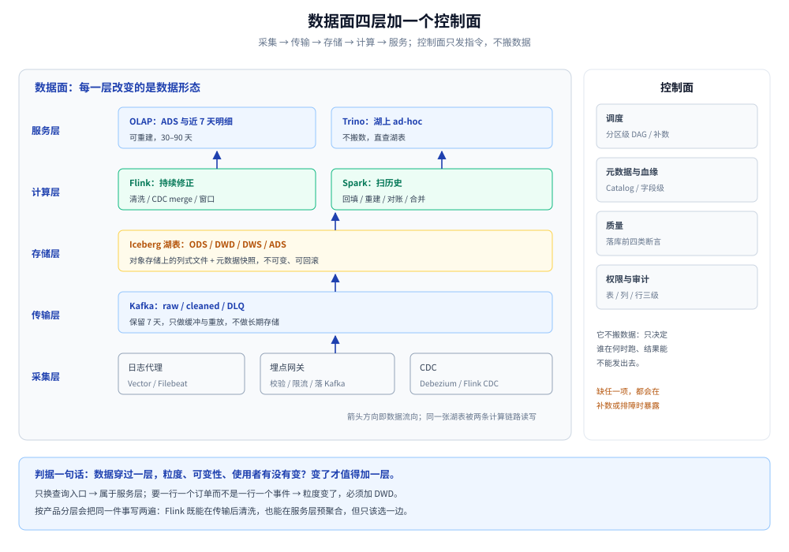
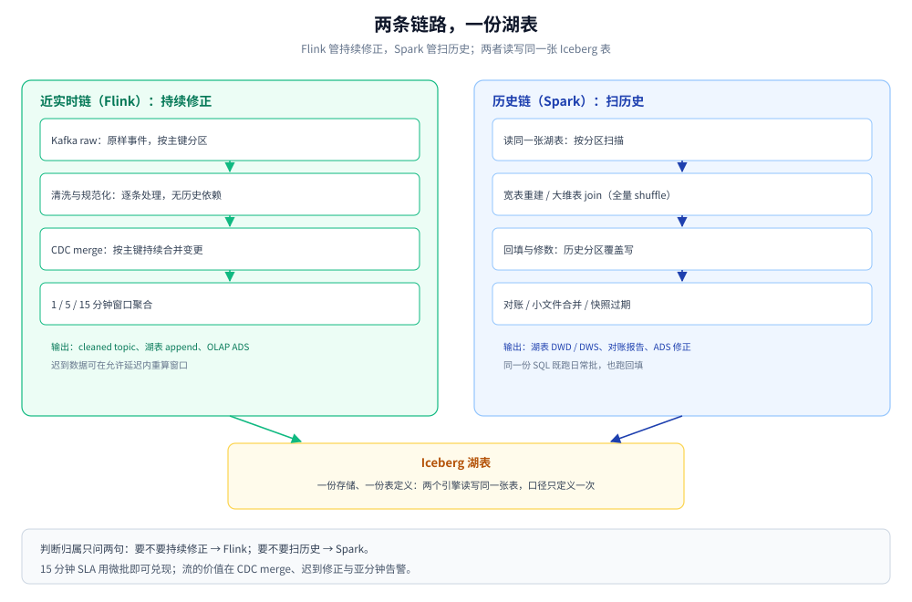
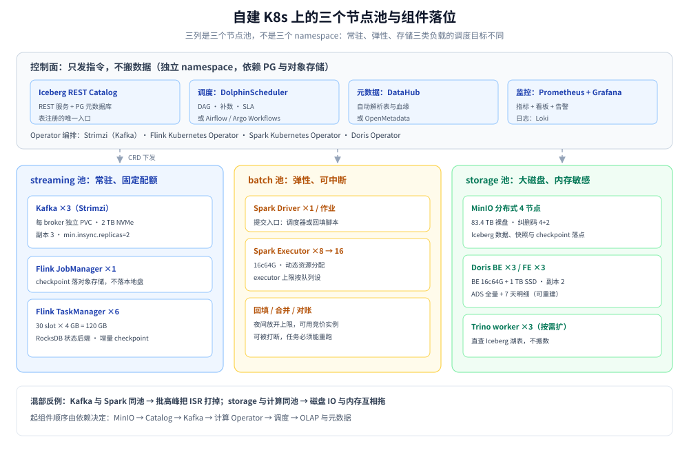

# 架构与选型

> 覆盖：本册的**总纲兼目录入口** —— 数据面四层加一个控制面为什么这样切、同一份事实的四份载体各答哪类查询、15 分钟时效下 Flink 与 Spark 的边界划在哪、八个组件的选型判据、自建 K8s 上的部署形态与端口，这套架构的代价与边界，以及**十五篇各自回答什么、按什么顺序读、一条埋点怎么穿过它们**。
>
> 不覆盖：各层的参数与实测见零件篇（采集、Kafka、湖表、建模、批、流、对账、OLAP、运维）；容量算式见 [容量规划与成本.md](容量规划与成本.md)；阶段实施见 [演进路线与实施计划.md](演进路线与实施计划.md)。组件本身的原理在 03 目录：Kafka 见 [Kafka/README.md](../../../03-数据与中间件/中间件/消息队列/Kafka/README.md)、CDC 见 [CDC/README.md](../../../03-数据与中间件/数据存储/数据同步/CDC/README.md)、列式库见 [ClickHouse/README.md](../../../03-数据与中间件/数据存储/列式数据库/ClickHouse/README.md)。
>
> 内容整理自个人学习笔记。量级坐标：日增原始数据 200 GB、峰值 10 万条/秒、时效 15 分钟、平台 1–2 人、自建 K8s。**集群规模未实测**；机制类判断（分区、checkpoint、快照、幂等写）在 Kafka / Flink / Spark+Iceberg 三个单容器里取真读数，偏差写在对应零件篇，完整清单见 `使用` 节的「实测边界」。

---

## 一、为什么按「数据形态的变化」分层，而不是按产品分层？

**本节要点**：分层只看一件事 —— 数据穿过这一层之后，它的**粒度、可变性、使用者**有没有变。变了才值得多一层，没变就是多余的跳数；按产品分层则会把同一件事在两处各写一遍。

**本册的一句话定位**：它回答的不是「大数据组件怎么选」，而是一份数据从产生到出现在看板上，中间要经过哪几个**必须改变形态的关口**，以及每个关口错了会怎样。

与常见资料的分水岭有三处：

| 常见写法 | 本册的写法 |
|---|---|
| 按组件罗列（Kafka / Flink / Spark / Doris 各一章） | 按数据形态分层（原始字节 → 事件流 → 不可变湖表 → 宽表 → 汇总） |
| 假设「实时」是目标，一律上流 | 先问时效是多少：**15 分钟用微批就够**，流的价值在 CDC merge 与迟到修正 |
| 只讲怎么搭起来 | 每一篇都写「错了长什么样」：重复计数、静默错位、小文件、口径打架 |

### 1.1 五层各自改变的是什么



图怎么读：从下往上是数据流 —— 采集侧把日志、埋点、业务库变更送进 Kafka；Flink 做清洗、CDC merge 与窗口聚合，一边写 cleaned topic，一边写湖表与 ADS；Spark 读同一张湖表做回填、重建、对账与小文件合并；OLAP 只存可重建的 ADS 与近期明细。右侧那一列是控制面（调度、元数据血缘、质量、权限），它不搬数据，只决定「谁在什么时候跑、结果能不能发出去」。图中不标吞吐，量级与算式见 [容量规划与成本.md](容量规划与成本.md)。

| 层 | 数据形态 | 谁写 | 谁读 | 保留策略 |
|---|---|---|---|---|
| 采集 | 原始字节，按源、不可变 | 日志代理 / CDC / 埋点网关 | 只写不读 | 先落对象存储，永久 |
| 传输 | 事件流，按分区有序 | 采集侧 | 流计算、入湖 | Kafka 7 天 |
| 存储 | 列式文件 + 元数据快照，不可变 | 流式入湖、批写 | 批、流、Trino、算法 | 热 90 天、温 1 年、冷 3 年 |
| 计算 | 中间结果，可丢弃 | 引擎自己 | 引擎自己 | 不保留，失败即重算 |
| 服务 | 宽表 / 汇总，可重刷 | 计算层 | BI、接口、告警 | 30–90 天，随时可从湖表重建 |

判据的用法：如果某个新需求「只是换了个查询入口」，那它属于服务层，不该在存储层再加一张表；如果它「要求一行一个订单而不是一行一个事件」，那是粒度变了，必须加一层 DWD。

### 1.2 一个控制面，四件事

| 能力 | 解决的问题 | 挂在哪一层 |
|---|---|---|
| 调度 | 谁在什么时候跑、失败了重试几次 | 跨层，任务粒度 = 一个分区 |
| 元数据与血缘 | 这张表从哪来、改口径会影响谁 | 跨层，表级 + 字段级 |
| 质量 | 这份数据能不能发出去 | 跨层，落库前拦截 |
| 权限与审计 | 谁能看哪一列 | 跨层，湖表与 OLAP 双侧 |

控制面不是「后期再加」的东西：调度粒度、表命名、血缘解析都决定了后面能不能做补数。到第 4 阶段才补的团队，通常要把 DAG 全部重拆一遍。

### 1.3 为什么不是「一个大引擎包打天下」

「一个引擎」在演示环境成立，在真实平台上会遇到三条硬边界：

- **资源形态不同**：常驻流作业要稳定的 CPU 与内存，批作业要能瞬间申请几百核再全释放；混在一个队列里，批会把流饿死。
- **失败语义不同**：流作业要 checkpoint 与状态恢复，批作业要幂等重跑；同一套调度语义塞两种失败模型，参数会互相污染。
- **人的分工不同**：流与批的排障路径几乎不重叠（背压 vs 数据倾斜），值班手册要么写两套，要么写一套谁都不满意的。

所以本方案接受「两套计算引擎」，但要求**一份存储、一份表定义**：Flink 与 Spark 读写同一张 Iceberg 表，口径只在一个地方定义。

### 1.4 同一份事实住四份载体，查询该走哪一份

**本节要点**：一份事实在平台里同时住四份载体，它们不是冗余备份，而是**各自面向一类读写模式**。查错载体不会报错 —— 要么慢到超时，要么数不对却看不出来。

| 载体 | 存的是 | 强在哪 | 短板 | 保留 |
|---|---|---|---|---|
| 源库（OLTP） | 唯一权威，不是副本 | 单行最新状态、事务一致 | 只有当前值，没有历史；扛不住分析查询 | 业务决定，通常永久 |
| raw 层（对象存储） | 未解析的原始字节（JSON / 日志原文） | 未经清洗，可无限重放 | 不能直接查，必须过引擎；体积最大 | 永久 |
| 湖表（Iceberg DWD / DWS） | 解析后的明细、宽表、拉链表 | 全历史、可快照回滚、多引擎同读 | 点查要过元数据与文件寻址，并发低 | 热 90 天、温 1 年、冷 3 年 |
| OLAP（ADS + 近期明细） | 聚合结果与近 90 天明细副本 | 高并发点查、毫秒级、能 join | 只覆盖保留期，不能当唯一事实源 | 30–90 天 |

先说清 Kafka 的位置：它不在四份载体里 —— 不存事实，只存最近 7 天的有序流与消费位点；但它是常被走错的第五个入口（⑩⑪），一并列入下表。

判据落到具体问题上：

| # | 你要回答的问题 | 读哪一份 | 为什么是它 / 走错会怎样 |
|---|---|---|---|
| ① | 这个订单**此刻**什么状态 | 源库 | 湖表里是 15 分钟前的快照，读它答「现在」必错 |
| ② | 今天已下单多少，1 分钟内要更新 | OLAP 的 ADS | 由 Flink 窗口直接写；读湖表要等落分区 |
| ③ | 昨天各渠道 GMV | ADS 或湖表 DWD | 两者**应该**一致；不一致先跑对账，别挑一个信 |
| ④ | 过去三年某用户的全部订单 | 湖表 DWD | OLAP 只留 90 天，跨保留期只有湖表有 |
| ⑤ | 这条事件原始报文字段长什么样 | raw 层原始字节 | 怀疑解析丢字段时，唯一能证伪的是原始字节 |
| ⑥ | 这份数据是哪次提交写的、能否退回上一版 | 湖表快照 + Catalog | 快照 ID、提交时间、manifest 清单都在元数据里 |
| ⑦ | 订单状态变更全过程（谁改的、何时改） | 湖表 CDC 明细 / 拉链表 | 源库只保留最终态，过程只在 CDC 链路里 |
| ⑧ | 临时 ad-hoc：上周某活动页按小时 UV | Trino 直查湖表 | 一次性问题不该为它建表搬数 |
| ⑨ | 20 个并发用户同时刷同一个大盘 | OLAP 的 ADS（预聚合结果） | 同一条 SQL 打到湖表，每人都要重扫文件 |
| ⑩ | 某分区消费到哪了、积压多少 | Kafka 消费组 lag | 位点不在任何「表」里，只在消费组元数据里 |
| ⑪ | 重放最近 3 天的流量重算 | Kafka | 保留期内，回放比重跑批快得多 |
| ⑫ | 重放 3 个月前的数据 | raw 层（对象存储） | Kafka 已过期（7 天），只能在对象存储上重放 |
| ⑬ | 报表数和业务库对不上 | 两侧都读 | 对账本身就要两个口径，见 [流批对账与数据质量.md](流批对账与数据质量.md) |
| ⑭ | 某指标三年来的历史峰值 | 湖表 DWS | ADS 早过了保留期，汇总已滚掉 |
| ⑮ | 2000 万行维表 join 明细、重建宽表 | Spark 扫湖表 | 这是批动作，放进 OLAP 会把在线查询的并发挤掉 |

一句话判据：**要「现在」→ 源库；要「原样」→ raw；要「全历史或可回滚」→ 湖表；要「并发和快」→ OLAP；要「流里的位点」→ Kafka。** 五个入口各答一类问题，没有哪一个能兼任 —— 硬用一个满足全部，结果是每种查询都差一点（选型上的对应取舍见 3.3）。

四份之间靠「可重建」保证一致，不靠同步写：raw → 湖表由 Flink 幂等写 + 每日对账；湖表 → OLAP 由 ADS 重建任务兜底；源库 → 湖表由 CDC 位点续传。所以 OLAP 丢数据不是事故（重建），raw 层丢数据才是。

---

## 二、15 分钟时效下，Flink 与 Spark 的边界划在哪？

**本节要点**：15 分钟 SLA **不需要**用流来兑现，微批足够；Flink 的价值在三件只有流能做的事上 —— CDC 持续 merge、窗口内迟到修正、亚分钟告警。判断一个任务归谁，只问两句话：**要不要持续修正？** 要 → Flink；**要不要扫历史？** 要 → Spark。

### 2.1 一张分工表

| 任务 | 引擎 | 触发 | 输出 | 判据 |
|---|---|---|---|---|
| 事件清洗与规范化 | Flink | 每条或 1 分钟微批 | Kafka cleaned + 湖表 append | 逐条、无历史依赖 |
| 业务库 CDC 入湖 | Flink | 持续 | DWD upsert | 需要按主键持续合并 |
| 1 / 5 / 15 分钟指标 | Flink | 滚动窗口 | OLAP ADS + DWS | 窗口内聚合，迟到可修正 |
| 维表关联（小维表） | Flink | 持续 | DWD | 维表能装进状态或走广播 |
| 维表关联（大维表） | Spark | T+1 或 15 分钟微批 | DWD | 需要全量 shuffle |
| 明细宽表重建 | Spark | T+1 | DWD | 要扫全历史 |
| 回填与修数 | Spark | 人工 / 调度 | 任意层 | 输入是历史分区 |
| 小文件合并、快照过期 | Spark | 每日低峰 | 湖表维护 | 扫元数据与文件清单 |
| 流批对账 | Spark | T+1 | 对账报告 | 两侧结果都要读 |

### 2.2 为什么「15 分钟」不等于「必须流」

设 SLA 是「15 分钟内看到上一刻的数据」。Spark 每 5 分钟跑一次微批，单批 2 GB，完全能在 3–5 分钟内跑完，端到端延迟 ≈ 5–10 分钟，够用；而且微批的失败重跑、补数、调试都比流简单。

真正必须上流的是这三件：

- **CDC 合并不适合微批**：5 分钟一批意味着同一行在 5 分钟内可能被改数十次，批里要先做「按主键取最后一条」的去重，写放大且窗口一错就乱序；流式 upsert 天然按主键合并。
- **迟到数据要在窗口内修正**：微批只能「下一批再补」，修正滞后一个批次；流可以在允许延迟内重算窗口。
- **亚分钟告警**：SLA 之外还有「3 分钟内发现异常」的需求，15 分钟窗口做不到。

⚠️ 反过来的两个反模式：用 Flink 每 15 分钟往湖里写一次小文件（小文件灾难，见 [数据湖与Iceberg表设计.md](数据湖与Iceberg表设计.md)）；用 Spark 微批做 CDC merge（每批都要重扫去重，延迟与成本双输）。

### 2.3 双引擎的数据路径



图怎么读：左边那条链是「持续修正」——Kafka 原样事件进 Flink，清洗后写 cleaned topic 与湖表 append；CDC 流进 Flink 做 upsert；窗口结果同时写 OLAP 的 ADS 和湖表的 DWS。右边那条链是「扫历史」——Spark 读同一张 Iceberg 表做宽表重建、回填、对账与小文件合并，结果写回湖表或 ADS。两条链在湖表处汇合，所以「一份存储」成立；在 ADS 处必须对账，因为两边都能写服务层。图中不出现任何吞吐读数，那是 [容量规划与成本.md](容量规划与成本.md) 的范围。

---

## 三、八个组件的选型判据是什么？

**本节要点**：选型不按「谁更流行」排，而按**换掉它的成本**排 —— 越靠下（存储、表格式）越难换，要在第一天就选对；越靠上（调度、OLAP）越容易换，可以先用最省事的。

### 3.1 消息与存储（换起来最贵）

| 组件 | 本方案 | 备选 | 选它的判据 | 什么时候换 |
|---|---|---|---|---|
| 消息队列 | Kafka 3 broker（KRaft） | Pulsar、RocketMQ | Flink / Spark / 生态工具链默认都先支持它 | 需要原生多租户与分层存储，且愿意多养一套 |
| 表格式 | Iceberg | Hudi、Paimon、Delta | 引擎中立、隐藏分区、快照回滚、增量读 | CDC 高频更新且要低延迟 merge → 评估 Hudi / Paimon |
| 对象存储 | MinIO（自建） | Ceph、商业对象存储 | S3 兼容 + K8s 原生部署，接口不会绑死 | 到 EB 级或多站点容灾 → Ceph 或商业产品 |

Iceberg 放在第一天：它不是「更快的 Parquet」，而是把**分区、快照、并发提交**从「目录约定」变成「元数据」——这三件事后期迁移要重写全部写入逻辑。代价是多一个 Catalog 与一次元数据提交，量级上可忽略。

### 3.2 计算引擎（换起来中等）

| 组件 | 本方案 | 备选 | 选它的判据 | 什么时候换 |
|---|---|---|---|---|
| 流引擎 | Flink on K8s | Spark Structured Streaming | 状态后端、checkpoint、事件时间与水位的成熟度 | 作业逻辑简单、团队已全是 Spark → 可退到微批 |
| 批引擎 | Spark on K8s | Flink batch、Trino | SQL 覆盖广、生态连接器多、调优资料多 | 全 Flink 团队，且批作业量很小 |

两套引擎的公共成本是「两套调优知识」，所以两条链都要有明确的**唯一 owner**，不要让同一个人同时值班两套。

### 3.3 服务与治理（换起来最便宜）

| 组件 | 本方案 | 备选 | 选它的判据 | 什么时候换 |
|---|---|---|---|---|
| OLAP | Doris 或 StarRocks（高并发聚合）+ Trino（湖上 ad-hoc） | ClickHouse | 看板要高并发点查与 join；ad-hoc 要直查湖表不搬数 | 明细日志为主、宽表 join 少 → ClickHouse |
| 调度 | DolphinScheduler 或 Airflow | Argo Workflows | 数据任务要 DAG、补数、依赖与 SLA | 纯 K8s 原生、无数据开发界面需求 → Argo |
| 元数据 | Iceberg REST Catalog + DataHub / OpenMetadata | Hive Metastore | 表格式原生、血缘要自动解析 | 已有 HMS 存量 → 先兼容，再迁 |

⚠️ OLAP 不要指望一个引擎全包：高并发点查、日志明细扫描、湖上联邦是三种访问形态，硬塞进一个引擎的结果通常是「每种都差一点」。三者可以并存，各自只服务一类查询。

---

## 四、自建 K8s 上怎么摆？

**本节要点**：自建 K8s 的第一原则不是「都上 Operator」，而是**按资源形态分节点池**：常驻流作业、弹性批作业、存储与 OLAP 三类负载的调度目标完全不同，混部会把它们互相拖死。

### 4.1 三个节点池

| 节点池 | 放什么 | 资源特征 | 调度策略 |
|---|---|---|---|
| streaming | Kafka broker、Flink JobManager/TaskManager | 常驻、稳定、本地盘 | 固定配额，禁止批任务抢占 |
| batch | Spark driver/executor、回填任务 | 弹性、可中断 | 优先级队列，低峰放开上限 |
| storage | MinIO、OLAP（BE / CN） | 大磁盘、内存敏感 | 与计算池隔离，避免磁盘 IO 争抢 |

### 4.2 组件与 Operator

| 组件 | 部署方式 | 关键参数 |
|---|---|---|
| Kafka | Strimzi | 3 broker、每 broker 独立 PVC、`min.insync.replicas=2` |
| MinIO | 分布式 4 节点（或外部对象存储） | 纠删码、版本控制关闭（靠 Iceberg 快照） |
| Flink | Flink Kubernetes Operator | checkpoint 到 S3、savepoint 到同一路径 |
| Spark | Spark Kubernetes Operator | 动态资源分配、executor 上限按队列 |
| OLAP | Doris/StarRocks Operator 或 StatefulSet | FE 3 + BE 3，副本 2 |
| 调度 | DolphinScheduler / Airflow | worker 与 batch 池绑定 |
| 元数据 | DataHub / OpenMetadata | 依赖 PG + 搜索后端，独立 namespace |



图怎么读：图中三列对应三个节点池，不是三个 namespace。streaming 列放 Kafka 与 Flink，它们要稳定配额；batch 列放 Spark 与回填任务，允许被打断；storage 列放 MinIO 与 OLAP，磁盘与内存不能和计算抢。顶上那条是控制面（调度、元数据、监控、Operator），它只发指令不搬数据。把 Kafka 和 Spark 混在同一池，是「批高峰把 ISR 打掉」的典型起因。

### 4.3 起组件的顺序

顺序由依赖决定，不由「哪个组件更重要」决定：

1. 对象存储（MinIO）——所有状态的落点；
2. Catalog（REST + 元数据库）——没有它，湖表无处注册；
3. Kafka——采集与流的入口；
4. Flink / Spark Operator——计算能力；
5. 调度与质量——把任务编排起来；
6. OLAP 与元数据平台——对外服务与可发现性。

反例：先起 Flink 再起对象存储，checkpoint 路径不存在，作业起来就失败；先起调度再起 Catalog，第一个建表任务就卡住。

---

## 五、这套架构的边界与代价是什么？

**本节要点**：这套架构不是「大数据」的默认答案，它只在四个条件同时成立时成立：量级够大、时效有分层、团队有平台人力、K8s 已具备。少一个条件，就该退回更小的方案。

### 5.1 什么时候不该用

| 条件 | 不满足时的替代 |
|---|---|
| 日增 < 10 GB | PostgreSQL / ClickHouse 单机 + 定时任务，够用三年 |
| 只要 T+1、无实时需求 | 对象存储 + Spark 批（去掉 Flink 与 OLAP 常驻） |
| 没有 K8s 运维能力 | 托管服务，或退回虚拟机 + YARN（少一层抽象） |
| 平台人力 < 1 人 | 只保留 Kafka + 湖 + 一个 OLAP，其余全用托管 |

### 5.2 四笔必须认的代价

- **组件多**：八个组件、六个控制面能力，任何一个升级都是变更窗口；这就是为什么要有「版本坐标」表（见 `使用` 节）。
- **两套引擎**：Flink 与 Spark 的调优知识不通用，人少时这是最大的隐性成本。
- **口径双写**：流写 ADS、批也写 ADS，不对账就一定会打架；对账不是可选项。
- **存储膨胀**：raw 层永久保留 + Iceberg 快照，逻辑数据 44 TB 时实际占用可能到 60 TB 以上，必须做生命周期。

### 5.3 可逆性

- **可逆**：换计算引擎 —— raw 层在，回放即可；换 OLAP —— ADS 可从湖表重建。
- **半可逆**：换表格式 —— 要重写所有写入与维护任务，历史数据可用 Spark 迁移。
- **不可逆**：不保留 raw 层。一旦原始数据被清洗后丢弃，任何口径修正都只能对「未来数据」生效。

### 5.4 本册不覆盖什么

- **只管分析型数据**：埋点、日志、业务库 CDC。不覆盖在线交易、缓存、搜索、消息中间件自身的高可用设计。
- **只管自建**：托管产品的参数与账单不在本册；需要对照时看 03 目录的选型篇。
- **不重复组件原理**：Kafka 的分区与副本、CDC 的日志解析、ClickHouse 的列存，各自由 03 的册解释；本册只写「在本架构里怎么用、用错会怎样」。
- **不写 ML 平台**：特征工程与训练平台是另一条线，本册只到「算法能直接读湖表」。

---

## 六、本册十五篇怎么分工，该按什么顺序读？

**本节要点**：十五篇不是十五份组件说明书，而是**一条链上的十二个关口，加两篇横切的存储篇与一篇总纲**；先看自己在链上的哪一段，再决定从哪篇进 —— 按角色进、按依赖进、按阶段进，三种进法读的是同一批内容。

### 6.1 十五篇各自回答什么

| 篇 | 回答的问题 | 关键内容 |
|---|---|---|
| **本篇**（架构与选型） | 分几层、同一份事实该读哪份副本、Flink 与 Spark 的边界在哪、八个组件怎么选 | 五层 + 控制面、四份载体判据、双引擎边界、选型表、K8s 节点池与端口、篇目分工 + 十步链路 |
| [容量规划与成本.md](容量规划与成本.md) | 要买多少机器、钱花在哪 | 四个输入推六项规格、成本结构、三条杠杆 |
| [数据采集与CDC.md](数据采集与CDC.md) | 数据怎么进来、schema 变了怎么办 | 日志代理、埋点网关、Debezium/Flink CDC、限流背压 |
| [Kafka集群与Topic设计.md](Kafka集群与Topic设计.md) | 分区、副本、保留、topic 怎么规划 | KRaft 拓扑、key 选择、三层 topic、死信与重放 |
| [数据湖与Iceberg表设计.md](数据湖与Iceberg表设计.md) | 表怎么存、怎么回填、小文件怎么办 | 分区/排序/分桶、快照与回滚、compaction、保留策略 |
| [存储全景.md](存储全景.md) | 数据落在哪、谁写、多久删、哪份能重建 | 五处落点、bucket 与路径模板、六个生命周期开关、备份与成本归属 |
| [存储结构设计.md](存储结构设计.md) | 建哪些库、哪些表、什么列与分区键 | 五库命名、13 张表 DDL、SCD2 拉链、topic 规格、排序键、主查询落点、字段文档 |
| [分层建模与指标口径.md](分层建模与指标口径.md) | ODS/DWD/DWS/ADS 各放什么、指标怎么定义 | 粒度、维度建模、SCD2、指标字典与口径版本 |
| [Spark批处理与调度.md](Spark批处理与调度.md) | 批任务怎么跑、怎么幂等、怎么补数 | Spark on K8s、微批、覆盖写、DAG 粒度、回填 |
| [Flink实时链路.md](Flink实时链路.md) | 流作业怎么不丢不重、状态怎么恢复 | checkpoint/savepoint、水位线、RocksDB、幂等 sink、反压 |
| [流批对账与数据质量.md](流批对账与数据质量.md) | 两条链路结果对不上怎么办 | 五类规则、对账口径、迟到修正、告警分级 |
| [OLAP查询服务.md](OLAP查询服务.md) | 查询引擎怎么选、慢查询怎么查 | Doris/StarRocks vs ClickHouse vs Trino、物化视图、资源组 |
| [K8s部署与运维.md](K8s部署与运维.md) | 组件怎么摆、故障怎么演练 | Operator 拓扑、资源队列、备份恢复、值班手册 |
| [元数据血缘与权限治理.md](元数据血缘与权限治理.md) | 表从哪来、谁能看哪一列 | Catalog、血缘、列级权限、脱敏、审计 |
| [演进路线与实施计划.md](演进路线与实施计划.md) | 先做什么、什么时候扩、怎么回退 | A–D 四阶段、里程碑、验收读数、回退方案 |

### 6.2 两条读序，以及按阶段的那条线

**按角色读**（同一套内容，三种进法）：

| 角色 | 读序 | 理由 |
|---|---|---|
| 架构 / 负责人 | 本篇 → 容量 → 演进路线 → 对账质量 | 先定边界与规模，再定节奏与验收 |
| 数据开发 | 存储结构设计 → 分层建模 → Spark 批 → Flink 流 → 对账质量 | 先把表建对，再定口径，然后写两条链路，最后验证 |
| 平台运维 | 存储全景 → Kafka → 湖表 → K8s 运维 → OLAP | 先知道数据落在哪，再保入口、存储与出口 |

**按依赖读**（前一篇的输出是后一篇的输入）：

```text
主干（先定边界、规模与节奏）：
架构与选型 ──> 容量规划与成本 ──> 演进路线与实施计划

数据面（前一篇的输出是后一篇的输入）：
采集与CDC ──> Kafka ──> Flink ─────────────┐
湖表与Iceberg ──> 分层建模 ──> Spark ──────┴──> 对账与质量 ──> OLAP

横向支撑（随时可查，不进链路）：
存储全景、存储结构设计（建表前后都要翻两次）、K8s 部署与运维、元数据血缘与权限治理
```

**按阶段读**是第三条线，但它已经落在时间轴上，不在本篇：A → B → C → D 四阶段各自交付什么、门槛怎么验、怎么回退，见 [演进路线与实施计划.md](演进路线与实施计划.md)。

### 6.3 一条埋点从 SDK 到看板走哪几步

**本节要点**：上两节讲的是分工与读序，这一节把十四篇零件串成**一次真实的穿透**。十步里每一步都归一篇管，定位「某一步出了问题该看哪篇」比背组件清单更快。

| # | 这一跳做什么 | 落在哪 | 错了长什么样 |
|---|---|---|---|
| ① | SDK 组装事件，进本地队列按批上报 | 客户端 | 进程被杀，队列里的批次直接丢，且无痕迹 |
| ② | 埋点网关：鉴权、schema 校验、按 app 限流 | [数据采集与CDC.md](数据采集与CDC.md) | 脏事件进主链路；或被刷量打挂入口 |
| ③ | 落 raw：`raw/dt=/hour=/app=` 下的原始字节 | [数据采集与CDC.md](数据采集与CDC.md) | 没有落地，后面任何解析错误都无法重放 |
| ④ | 投 Kafka `events.raw`，key 取 `user_id` | [Kafka集群与Topic设计.md](Kafka集群与Topic设计.md) | key 选错，同一用户的事件散在多个分区，顺序全乱 |
| ⑤ | Flink 清洗：解析、补维度、按 `event_id` 去重 | [Flink实时链路.md](Flink实时链路.md) | 去重窗口设错，曝光数虚高（重发批次被重复计） |
| ⑥ | Flink 写湖表 DWD，按 `dt` / `hour` 分区 | [数据湖与Iceberg表设计.md](数据湖与Iceberg表设计.md) / [存储结构设计.md](存储结构设计.md) | 分区粒度太细 + 每分钟提交一次，小文件灾难 |
| ⑦ | Flink 窗口聚合 1 / 5 / 15 分钟，DWS 写湖、ADS 写 OLAP | [Flink实时链路.md](Flink实时链路.md) / [OLAP查询服务.md](OLAP查询服务.md) | 只写 ADS 不写 DWS，指标口径变了无法回刷 |
| ⑧ | Spark T+1 重建明细宽表、合并小文件 | [Spark批处理与调度.md](Spark批处理与调度.md) | 跳过合并，查询文件数逐日膨胀 |
| ⑨ | 对账：ADS 与湖表 DWD 的聚合值比对 | [流批对账与数据质量.md](流批对账与数据质量.md) | 不做对账，两条链路各算各的，口径打架无人发现 |
| ⑩ | BI 读 ADS 出图 | [OLAP查询服务.md](OLAP查询服务.md) | 看板改成直查湖表，几个并发就把查询拖死 |

```text
主链：SDK → 埋点网关 → raw(对象存储) → Kafka events.raw → Flink 清洗 → 湖表 DWD
旁链：Flink 窗口聚合 → 湖表 DWS + OLAP ADS → BI 看板
日批：Spark T+1 读湖表 → 重建宽表 / 合并小文件；对账 = ADS 与 DWD 聚合值比对
```

⚠️ 三个常见误区：① 把「SDK 上报成功」当「数据已入库」——上报是异步批，网关限流时静默丢弃；② 只写 ADS、湖里不留明细——口径一改没有中间层可回刷，只能从 raw 重放（5.3 的不可逆那条更狠：连 raw 都不留）；③ 迟到数据不处理就按 `dt` 重跑——旧分区被重复写一遍，靠幂等兜，不靠人工。

---

## 使用：从零起一套的最小清单

**本节要点**：这一节只给「起得来」的最小集合与验收命令；参数怎么调在零件篇，资源怎么算在容量篇。

### 版本坐标与实测边界

版本以实际拉到的镜像与 chart 为准，落地前把这张表填实 —— **不要写「最新版」**，它三个月后就是错的。

| 组件 | 设计按 | 核对方式 |
|---|---|---|
| Kafka | 3.9.x（KRaft） | `kafka-topics.sh --describe` |
| Flink | 1.20.x / 2.x | `flink --version`、`flink list` |
| Spark | 3.5.x | `spark-submit --version` |
| Iceberg | 1.7+（实测 1.6.1） | `DESCRIBE FORMATTED` 看 `provider` |
| OLAP | Doris 2.x / StarRocks 3.x | `select version()` |
| MinIO | 稳定版 | `mc admin info` |

**已在单容器实测的范围**：Kafka 单 broker 的分区、消费组、保留与重放；Flink standalone 的 checkpoint、水位线、迟到数据；Spark local + Iceberg 的建表、静态/动态覆盖写、DDL 演进、小文件合并、快照回滚与过期；ClickHouse 单机的建表与查询耗时。

**未实测、只做设计或静态校验**：多 broker 集群与副本追赶；K8s 上的 Operator 实际调度；Doris / Trino 集群；MinIO 纠删码真实容量；真实规模压测（本机 16 GB 内存，`docker network create` 不可用，一律单容器内多进程）。所有「集群读数」在篇内都标为假设，不冒充实测。

### 端口与协议清单

下表是各组件的**默认端口**，本机只实测过 Kafka 单 broker 的 9092 与 ClickHouse 的 8123；其余按官方 chart 默认值填，落地前一律以 `kubectl get svc` 核对。

| 组件 | 端口 | 协议 | 用途 |
|---|---|---|---|
| Kafka broker | 9092 / 9093 | Kafka 协议 | 客户端生产消费 / KRaft controller 选举 |
| Flink JobManager | 8081 | HTTP REST | 提交作业、看 checkpoint 与背压 |
| Flink JobManager | 6123 / 6124 | RPC / blob | TaskManager 注册 / 分发 jar 与状态文件 |
| Spark Master | 7077 / 8080 | Spark RPC / HTTP | executor 注册 / Web UI |
| MinIO | 9000 / 9001 | S3 API / HTTP | 对象读写 / 控制台 |
| Iceberg REST Catalog | 8181 | HTTP REST | 建表、提交快照、加载表元数据 |
| Doris FE | 9030 / 8030 | MySQL 协议 / HTTP | SQL 入口（BI 与 JDBC 都走这里）/ Web UI |
| Doris BE | 8040 / 9060 | Thrift / HTTP | 内部 RPC / metrics 采集 |
| Trino | 8080 | HTTP | SQL 入口，ad-hoc 直查湖表 |
| ClickHouse | 8123 / 9000 | HTTP / native | SQL 入口 / 客户端与副本同步 |
| DolphinScheduler | 12345 / 25333 | HTTP API / RPC | 调度 API / master 与 worker 通信 |
| DataHub GMS | 8080 | HTTP REST | 元数据写入与血缘查询 |

⚠️ 默认端口有重复：**8080 出现三次**（Spark Master UI / Trino / DataHub GMS），**9000 出现两次**（MinIO 的 S3 API / ClickHouse 的 native 端口）。K8s 里各 Service 有独立 ClusterIP，本身不冲突 —— 真正会撞的是三处：`kubectl port-forward` 到本机时抢同一本地端口；改成 hostPort / hostNetwork 部署时直接冲突；值班手册只写「8080 挂了」时定位不到是谁。要改的趁在 chart values 里改，别等排障时才发现。

### 最小部署顺序

```bash
# 1. 命名空间与配额（三个池用 nodeSelector 区分，不靠 namespace）
kubectl create namespace data-platform
kubectl -n data-platform create quota streaming-quota --hard=cpu=32,memory=128Gi
kubectl -n data-platform create quota batch-quota    --hard=cpu=128,memory=512Gi

# 2. 对象存储：先建 bucket，再谈计算
mc mb local/lake && mc mb local/checkpoints
mc mb local/flink-savepoints

# 3. Catalog 与湖表仓库
#    warehouse = s3://lake/warehouse，REST 服务独立部署

# 4. Kafka（Strimzi）
kubectl -n data-platform apply -f kafka-cluster.yaml
kubectl -n data-platform wait kafka/platform --for=condition=Ready --timeout=10m

# 5. 计算与调度
helm install flink-operator ... && helm install spark-operator ...
```

### 四条验收命令

```bash
# Kafka：分区与 ISR 是否符合预期
kafka-topics.sh --bootstrap-server kafka:9092 --describe --topic events.raw

# Flink：作业在跑、checkpoint 有成功记录
flink list && flink savepoint <jobId> s3://flink-savepoints/

# 湖表：表能被两个引擎同时读到
spark-sql -e "SELECT count(*) FROM lake.db.dwd_event WHERE dt='2026-10-25'"
trino --execute "SELECT count(*) FROM iceberg.db.dwd_event WHERE dt='2026-10-25'"

# 服务层：ADS 有数且与湖表对得上（数值应一致）
mysql -h doris-fe -e "SELECT count(*) FROM ads.dau WHERE dt='2026-10-25'"
```

⚠️ 顺序错误最常见的两个症状：Flink 作业一直 `RESTARTING`（checkpoint 路径不可写）、Spark 建表报 `No such catalog`（Catalog 没起或 warehouse 路径错）。

---

## 延伸追问

- **为什么不用 Hive Metastore 作 Catalog？** → 它能用，但 Iceberg 的隐藏分区、分支与标签、并发提交在 HMS 上要么受限要么需要额外补丁；新起一套直接用 REST Catalog，HMS 只在有存量时做兼容。
- **Kafka 能不能直接对接 OLAP，省掉湖？** → 能省掉「明细回查」以外的链路，但 Kafka 只有 7 天、按分区有序、不支持按主键更新；超过保留期或要修正历史就无能为力。湖是长期事实来源，OLAP 是服务层。
- **15 分钟 SLA 下为什么还要 Flink？** → 不是为了 SLA，而是为了 CDC merge、窗口内迟到修正与亚分钟告警这三件微批做不好的事；如果这三件都不要，去掉 Flink 是合理简化。
- **raw 层为什么存原始 JSON 而不是直接存 Parquet？** → Parquet 会固化 schema 与类型；上游字段类型一变、解析规则一错，原始字节还在就能重放。raw 层是「唯一不可变的事实」。
- **K8s 上 Flink 用 session 集群还是 per-job？** → 小作业多、启动频繁用 session（省启动时间，但故障域共享）；大作业与需要独立资源的用 per-job（隔离好，启动慢）。
- **为什么 OLAP 不直接当唯一存储？** → 副本成本高、扩容要搬迁、明细保留 90 天以上不划算；且换 OLAP 时数据要重导。湖表是底，OLAP 是可重建的服务层。
- **为什么不用「一个引擎 + 一个存储」的单链路？** → 单链路在 15 分钟时效下技术上可行，代价是 CDC merge 与回填都挤进同一套语义；本方案选双引擎换「各自简单」，代价是两套运维。
- **阶段能不能跳？** → 可以跳过阶段 B 直接上 Flink，但前提是已经有一张被业务认可的表和一套质量规则；否则流会先跑起来，口径却没人认。

## 关联

- **上游/总纲**：[系统设计/README.md](../README.md) — 本目录的通用场景与专题系统地图
- **下游零件**：[容量规划与成本.md](容量规划与成本.md) — 本篇的量级假设如何变成分区数、slot 数与账单
- **下游零件**：[数据采集与CDC.md](数据采集与CDC.md) — 数据面的入口，CDC 为什么必须走流
- **下游零件**：[Kafka集群与Topic设计.md](Kafka集群与Topic设计.md) — 传输层的拓扑与 topic 分层
- **下游零件**：[数据湖与Iceberg表设计.md](数据湖与Iceberg表设计.md) — 存储层的分区、快照与小文件
- **下游零件**：[存储全景.md](存储全景.md) — 数据落在哪个 bucket、谁写、多久删、哪份能重建
- **下游零件**：[存储结构设计.md](存储结构设计.md) — 五个库、十三张表的 DDL、topic 规格与八条主查询的落点
- **下游零件**：[Flink实时链路.md](Flink实时链路.md) / [Spark批处理与调度.md](Spark批处理与调度.md) — 两条计算链路的落地细节
- **对照/互补**：[海量数据存储设计.md](../海量数据存储设计.md) — 按数据类型选存储的通用判据，本篇是它在「分析型数据」上的具体化
- **对照/互补**：[系统设计方法论.md](../系统设计方法论.md) — 量级估算与分层加手段的方法论
- **验证**：[全链路压测设计.md](../全链路压测设计.md) — 容量与瓶颈怎么用压测验证
- **组件原理**：[Kafka/README.md](../../../03-数据与中间件/中间件/消息队列/Kafka/README.md) — 消息队列的分区、副本与消费组机制
- **组件原理**：[CDC/README.md](../../../03-数据与中间件/数据存储/数据同步/CDC/README.md) — 日志解析、全量与增量一体化
- **组件原理**：[ClickHouse/README.md](../../../03-数据与中间件/数据存储/列式数据库/ClickHouse/README.md) — 列存与查询执行，OLAP 篇的机制侧
- **组件原理**：[资源调度选型对比.md](../../../03-数据与中间件/大数据组件/资源调度/资源调度选型对比.md) — 第四节「自建 K8s 上怎么摆」背后：YARN 的队列语义与 K8s 的声明式差别在哪
- **可观测**：[可观测性选型对比.md](../../../03-数据与中间件/中间件/可观测性/可观测性选型对比.md) — 平台的监控、日志与告警从哪来
