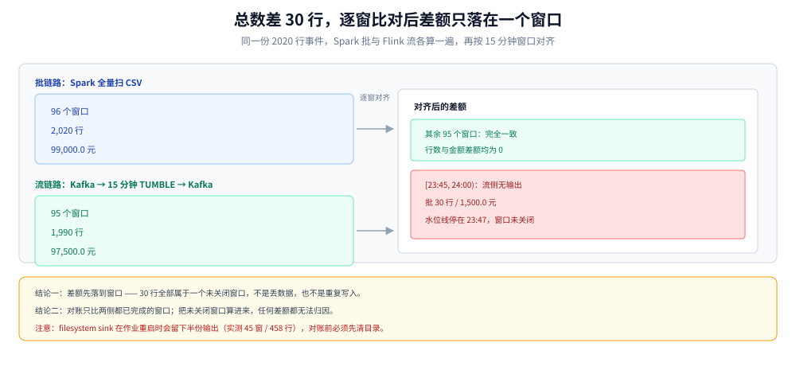

# 流批对账与数据质量

> 覆盖：流链路与批链路的结果对不上时怎么定位、对账有哪几类、差额的四种形状分别指向什么根因、质量规则放在哪一层、告警怎么分级。读数来自单容器 Spark 3.5.5 与 Flink 1.20.5 对同一份 2020 行事件的并行计算。
>
> 不覆盖：水位线与窗口关闭的机制见 [Flink实时链路.md](Flink实时链路.md)；口径本身怎么定义见 [分层建模与指标口径.md](分层建模与指标口径.md)；湖表写入与快照见 [数据湖与Iceberg表设计.md](数据湖与Iceberg表设计.md)。
>
> 内容整理自个人学习笔记，素材见 [素材清单](../../../素材清单.md)。**实测口径**：第 1.2 节、第 4.2 节、第 5.3 节的读数为本机真跑；集群级对账、Doris / Trino 侧校验未实测，见文末「校验口径」。

---

## 一、两条链路对不上，先比什么？

**本节要点**：先比**参与比较的数据范围**，再比数值。范围不一致时，任何差额都不是「误差」，而是范围差；把范围对齐之后剩下的差额才是问题。

### 1.1 对账的第一步不是比总数

总数对不上时最自然的反应是「流链路丢了多少」。这个反应会把人带到错误的方向，因为总数差至少有四种来源，只有一种是真丢数：

| 来源 | 表现 | 处理 |
|---|---|---|
| 范围不一致 | 一边算了未关闭的窗口、一边没算 | 先对齐窗口完成度，再比 |
| 口径不一致 | 同一指标两边 SQL 不同（去重、退款、时区） | 先对齐口径版本，再比 |
| 写入重复 | 差额是整数倍 | 查 sink 幂等与位点 |
| 真丢数 | 差额能落到具体主键或事件 | 查迟到丢弃、过滤条件、反压 |

判断顺序与上表顺序一致：**范围 → 口径 → 重复 → 丢数**。跳步的直接后果是把「少算了一个窗口」当成「丢了 1.5% 的数据」，然后去调上游限流。

### 1.2 实测：同一份数据，两条链路的差额只有一个窗口

同一份 2020 行事件（2,000 条 pay × 50.00、20 条 refund × −50.00，时间跨 2026-10-24 全天），分别跑两条链路：

```text
Spark 批（local[2]，window(ts, '15 minutes')，直接扫 CSV）
  → 96 个窗口，cnt 2,020，amt 99,000.0

Flink 流（Kafka source → 15 分钟 TUMBLE → Kafka sink，水位线延迟 5 秒）
  → 95 个窗口，cnt 1,990，amt 97,500.0
```

总数差 30 行、1,500 元。按窗口逐一对齐后：

| 窗口 | 批 | 流 | 差额 |
|---|---|---|---|
| 其余 95 个窗口 | 一致 | 一致 | 0 |
| `[23:45, 24:00)` | 30 行 / 1,500.0 | 无输出 | 30 行 / 1,500.0 |

差额全部落在一个窗口上，而这个窗口正是**最后一个还没关闭的窗口**：数据在 23:47 左右结束，水位线停在 23:47:xx，窗口 `[23:45, 24:00)` 要等到水位线越过 23:59:59 才关闭 —— 没有更晚的事件，它就一直开着。



图怎么读：左边是两条链路各自的总数（2,020 与 1,990），中间按窗口对齐后 95 个窗口完全相同，右边只剩 `[23:45,24:00)` 一个窗口有差额。要读出的是：**差额先定位到窗口，再决定是不是问题**；定位不到窗口的差额，才需要往重复与丢数方向查。

结论可以写成一条对账规则：**对账只比已关闭的窗口**。批链路算全量、流链路只算水位线已经越过的窗口，两边的窗口集合取交集，差额才有意义。这条规则在 [Flink实时链路.md](Flink实时链路.md) 第 2.2 节有水位线与窗口关闭的机制推导。

---

## 二、对账有哪几类？

**本节要点**：五类规则查的是不同的东西，任何一类都替代不了另一类；只做总数对账的团队，通常会在「总数对得上但明细错了」上翻车。

### 2.1 五类规则与各自的能力边界

| 规则 | 怎么比 | 能发现 | 发现不了 |
|---|---|---|---|
| 行数 | 按分区 / 窗口比 `COUNT(*)` | 整块缺失、任务没跑、重复写入 | 行数相同但内容错 |
| 主键集合 | 两边的 key 做 `EXCEPT` / 全外连接 | 多了哪些单、少了哪些单 | 值错了但 key 没变 |
| 度量汇总 | `SUM` / `MIN` / `MAX` 分组比 | 金额、数量级偏差 | 正负抵消掉的错误 |
| 口径一致性 | 同一指标在两条链路的 SQL 并列比 | 去重、退款、时区、状态机的差异 | 两边抄同一份 SQL 的错 |
| 新鲜度与时序 | 最大事件时间、窗口完成时间 | 延迟、卡住、时间倒流 | 内容错误 |

第五类最容易被忽略：一条链路结果全对，但比另一条晚 40 分钟，看板上就是两个数字。对账要同时报「值」和「窗口完成时间」，只比值会把延迟问题藏起来。

### 2.2 口径一致性为什么必须单列

同一份 2020 行，六种口径能得出六个不同的数（详见 [分层建模与指标口径.md](分层建模与指标口径.md) 第 4 节）：事件行数 2,020、去重订单 200、直接求和 99,000、按订单取最新一条 8,000、剔除有退款的订单 9,000。**这些数没有对错，只有口径对不对得上**。

所以对账的第一张表应该是「指标 → 口径版本 → 两条链路的实现位置」，而不是「今天流批差多少」。口径版本变了而对账脚本没变，第二天必然全红，而且红得毫无信息量。

---

## 三、为什么昨天对得上、今天对不上？

**本节要点**：对账结果突变，八成不是代码改了，而是**数据分布或环境**变了。按「先看时间、再看重复、再看口径、最后看 schema」的顺序排查。

### 3.1 迟到数据：窗口关得早，晚到的就被丢了

流链路的丢数大多发生在迟到上。同一个 6 条消息的实验，水位线延迟取 5 秒时 `numLateRecordsDropped = 2`，取 60 秒时是 0，而总数相同 —— **丢不丢取决于窗口什么时候关，不取决于乱序本身**。

落到生产上，迟到通常有三个来源：

| 来源 | 特征 | 处置 |
|---|---|---|
| 上游补推历史 | 某个时间段的事件成批晚到 | 加大水位线延迟，或改用 `allowLateness` + 侧输出 |
| 客户端时间不准 | 个别事件时间戳明显偏离 | 用上报时间兜底，或在入口修正时钟 |
| 分区之间进度差 | 某个分区的位点落后很多 | 按分区看滞后，不要只看总滞后 |

对账侧要能看到「丢了多少」：把 `numLateRecordsDropped` 和当日新增事件数放在同一张图上，丢弃数为 0 而差额不为 0，说明问题不在迟到。

### 3.2 重复写入：差额是整数倍

重复消费的特征是差额呈倍数关系：2 倍、10 倍，或正好等于某次重放的数据量。根因通常是 sink 不幂等：

- 从 savepoint 恢复后，位点回到检查点时刻，sink 已写入的部分被再写一遍；
- 批任务用 `INSERT INTO` 而不是覆盖写，重跑一次就多一份；
- 两条链路写同一张表，没有主键去重。

判据：**sink 是否按主键覆盖**。按主键 MERGE / upsert 的 sink，重复消费只会多花时间，不会多出行；`INSERT INTO` 的 sink，重放就是翻倍。见 [Spark批处理与调度.md](Spark批处理与调度.md) 第 3 节与 [Flink实时链路.md](Flink实时链路.md) 第 4.2 节。

### 3.3 口径漂移与 schema 演进

两类「代码没改但对不上」的常见原因：

| 原因 | 表现 | 定位方式 |
|---|---|---|
| 指标口径改了但只改了一边 | 差额稳定、每天都一样 | 比两边的 SQL 与指标字典版本 |
| 上游加了字段或改了类型 | 某列出现大量 NULL 或精度变化 | 比 schema 快照与空值率 |
| 时区或分区边界调整 | 每天固定时段差一小时 | 比对窗口边界与 `ts` 的时区 |

schema 变化在批侧通常直接报错，在流侧可能被 JSON 解析静默吞掉（字段缺失按 null 处理），所以**流侧的 schema 检查要单独做**，不能指望解析器报错。

---

## 四、差额怎么归因？

**本节要点**：差额的形状比差额的大小更有信息量。先按形状缩小范围，再按「窗口 → 主键 → 值」逐层下钻。

### 4.1 四种形状与对应根因

| 形状 | 典型读数 | 指向 |
|---|---|---|
| 整窗缺失 | 少 1 个窗口，其余全对 | 窗口未关闭、任务没跑完、调度漏跑 |
| 整数倍 | 差额是 2×、10× | 重复消费、重复写入、双写 |
| 与某类事件数量吻合 | 少 20 行、差额 ±1,000 | 某类事件被过滤或迟到丢弃 |
| 随机少量 | 每天差几行、位置不固定 | 上游重复、乱序、时钟 |

第四种最难查，也最不该用「允许误差」糊过去：随机少量差额往往意味着入口没有做去重，量级上来之后会变成整数倍。

### 4.2 归因顺序：窗口 → 主键 → 值

```text
第一步  按窗口 FULL OUTER JOIN，找出有差额的窗口集合
          ├─ 没有差额窗口 → 总数差异来自口径或时区，回到指标字典
          └─ 有差额窗口
第二步    在有差额的窗口里按主键 EXCEPT，找出多出/缺少的 key
          ├─ key 集合不同 → 丢数或重复，查迟到丢弃与 sink 幂等
          └─ key 集合相同
第三步      比同一 key 的度量值，定位到具体字段
          └─ 值不同 → 口径实现差异（去重键、金额符号、聚合方式）
```

这三步的实测版本在第 1.2 节：第一步就定位到 1 个窗口，第二步发现该窗口流侧根本没有输出 —— 归因结束，不需要再查主键与值。

---

## 五、数据质量规则放在哪一层？

**本节要点**：质量规则的位置决定它能不能拦住问题。入口拦格式与完整性，层间拦主键与关联，出口拦指标口径；三层都放，但每层只放它拦得住的那类。

### 5.1 三层落位

| 层 | 放什么规则 | 拦得住 | 拦不住 |
|---|---|---|---|
| ODS 入口 | 字段完整、类型可解析、时间在合理区间 | 脏数据进湖 | 语义错误 |
| DWD 层间 | 主键唯一、外键能关联、状态机合法 | 重复与孤儿行 | 业务口径错 |
| ADS 出口 | 指标波动、环比阈值、非空率 | 发布错数 | 明细错 |

把主键唯一放到出口检查，问题已经流到看板了；把指标波动放到入口检查，正常业务波动会天天报警。**规则的判据与所在层的职责必须匹配**。

### 5.2 规则怎么分级

| 级别 | 判据 | 动作 |
|---|---|---|
| 阻断 | 主键重复、金额为负、必填为空 | 任务失败，不出数，不发布 |
| 告警 | 行数波动超阈值、对账差额超阈值 | 出数但标记「待确认」，值班介入 |
| 记录 | 空值率、枚举值分布、延迟分位 | 入库，周期复盘 |

分级的关键是**阻断要少**。阻断规则一多，任务就会长期失败，最后所有人都学会忽略它。

### 5.3 告警分级与值班动作

| 级别 | 触发 | 首个动作 | 时限 |
|---|---|---|---|
| P1 | 当日核心指标差 > 5%，或 ADS 未产出 | 先保出数：用批链路结果覆盖 ADS，再查流 | 15 分钟响应 |
| P2 | 单窗口差额、非核心指标异常 | 按第 4.2 节三步归因 | 1 小时 |
| P3 | 空值率上升、延迟变大但未超 SLA | 记录，次日复盘 | 次工作日 |

P1 的第一步永远是「先让看板有正确的数」，而不是「先查根因」。批链路能覆盖流结果时，回退到批是成本最低的止损。

---

## 六、对账任务本身怎么跑才可信？

**本节要点**：对账脚本自己也会错。三条要求：不读同一份中间结果、只比已完成的时间范围、结果要留档。

- **不读同一份中间结果**：两条链路如果都读同一张 DWD 表，对账只能证明「同一份数据算两遍结果一样」，证明不了链路正确。至少一条要回到 ODS 或原始事件。
- **只比已完成的范围**：第 1.2 节的差额就是没对齐范围的产物。对账的时间窗口必须两边都已完成，批侧按分区完成、流侧按水位线越过的窗口。
- **结果留档**：每天一条对账记录（窗口、差额、归因结论），才能看出「差额是偶发还是趋势」。留在临时表里的对账结果，第二周就没人记得了。

---

## 使用：一份可落地的对账与质量 SQL

```sql
-- 1. 只比已关闭窗口：以两侧窗口集合的交集为准
WITH b AS (
  SELECT window_start, COUNT(*) AS cnt, SUM(amount) AS amt
  FROM batch_dwd_orders
  WHERE dt = '2026-10-24' AND window_start < '2026-10-24 23:45:00'
  GROUP BY window_start
), s AS (
  SELECT window_start, cnt, amt
  FROM stream_dws_orders_15m
  WHERE window_start < '2026-10-24 23:45:00'
)
SELECT COALESCE(b.window_start, s.window_start) AS window_start,
       b.cnt AS batch_cnt, s.cnt AS stream_cnt,
       b.amt - s.amt AS amt_diff
FROM b FULL OUTER JOIN s USING (window_start)
WHERE b.cnt IS NULL OR s.cnt IS NULL
   OR b.cnt <> s.cnt OR ABS(b.amt - s.amt) > 0.01
ORDER BY window_start;
```

```sql
-- 2. DWD 主键唯一：重复会让下游所有汇总同时翻倍
SELECT order_id, COUNT(*) AS n
FROM dwd_orders
WHERE dt = '2026-10-24'
GROUP BY order_id
HAVING COUNT(*) > 1
LIMIT 20;
```

```sql
-- 3. 行数波动：与近 7 日均值比，阈值按业务定，不要照抄
SELECT dt, cnt,
       ROUND(AVG(cnt) OVER (ORDER BY dt ROWS BETWEEN 7 PRECEDING AND 1 PRECEDING)) AS avg7,
       ROUND(cnt * 1.0 / AVG(cnt) OVER (ORDER BY dt ROWS BETWEEN 7 PRECEDING AND 1 PRECEDING), 2) AS ratio
FROM daily_row_count
WHERE dt >= '2026-10-18'
ORDER BY dt;
```

```sql
-- 4. 对账结果留档
CREATE TABLE IF NOT EXISTS recon_result (
  check_date   DATE,
  window_start TIMESTAMP,
  batch_cnt    BIGINT,
  stream_cnt   BIGINT,
  amt_diff     DECIMAL(18, 2),
  conclusion   STRING,
  checked_at   TIMESTAMP
) USING iceberg
PARTITIONED BY (check_date);
```

判据：第一条 SQL 的 `WHERE window_start < '2026-10-24 23:45:00'` 不是写死的业务规则，而是「两侧都已完成」的表达方式；生产上应换成按水位线动态计算的完成时间，并把该时间写进对账结果，方便回看。

---

## 校验口径

> ✅ 本篇读数的校验方式与范围（本机 Docker Desktop，2026-10-25）：

- **真跑并取到读数**：第 1.2 节的两链路窗口对账 —— Spark 3.5.5 `local[2]` 扫 CSV 得 96 窗 / 2,020 行 / 99,000.0；Flink 1.20.5（Kafka source + 15 分钟 TUMBLE + Kafka sink，水位线延迟 5 秒）得 95 窗 / 1,990 行 / 97,500.0；逐窗 diff 仅 `[23:45, 24:00)` 一窗，差额 30 行 / 1,500.0。
- **真跑并取到读数**：同一次实验中迟到丢弃为 0（2,020 条在一个水位线发射周期内处理完，文件末尾的 refund 未被判迟到），与第 3.1 节「丢不丢取决于窗口何时关闭」的结论一致。
- **真跑并取到读数**：一次失败运行（单 slot 被占用、作业 `RESTARTING`）在 `/tmp/out/recon1` 留下 45 窗 / 458 行的半份输出 —— 这是第 6 节「对账前先清目录」的现实依据。
- **示例未运行**：第 5 节与「使用」中的 4 段 SQL 面向 Doris / Spark 生产表名，本机没有对应表结构，只做了语法自检，未执行。
- **未实测**：Doris / Trino 侧的对账查询耗时；跨集群对账；百万行以上数据的两链路对账；`allowLateness` 与侧输出在真实迟到场景下的行为。
- **实测环境**：`apache/kafka:3.9.0`（KRaft 单节点）、`apache/flink:1.20-scala2.12`（1.20.5，单 TM / 1 slot）、`apache/spark:3.5.5-scala2.12-java17`（`local[2]`）。

| 依赖 | 实际版本 |
|---|---|
| Flink | 1.20.5（单容器） |
| Spark | 3.5.5（local[2]） |
| Kafka | 3.9.0（KRaft，单节点） |
| 事件数据 | 2,020 行（2,000 pay + 20 refund） |

## 延伸追问

- **两条链路口径都一样，还要对账吗？** → 要，但对的是「执行」而不是「定义」：同一条 SQL 在流批两种引擎上仍可能因时间语义、空值处理、浮点求和顺序产生差异，对账是唯一能发现这类差异的手段。
- **对账差额多大算正常？** → 0 才是正常。任何非零差额都应该能落到具体窗口或主键；落到「允许误差」的差额，说明归因还没做完。
- **为什么对账脚本不能和被对账的任务共用一张中间表？** → 共用表只能验证「同一份数据算两遍是否一致」，无法发现中间表本身的错误；对账的独立性来自数据来源独立。
- **流链路少一个窗口，一定要修吗？** → 看指标是否依赖该窗口。日报按整日汇总时，末窗未关会少算最后一小时；如果对账规则已限定为「只比已关闭窗口」，就不该报警，而应把「末窗未闭合」作为正常状态记录。
- **质量规则的阻断比例多少合适？** → 以「不阻断就没法用」为界。阻断规则长期误报会导致整条规则被忽略，比不设规则更糟。

## 关联

- **上游/总纲**：[README.md](README.md) — 本册的分层架构与篇目分工
- **上游机制**：[Flink实时链路.md](Flink实时链路.md) — 水位线、窗口关闭与 `numLateRecordsDropped` 的实测
- **上游口径**：[分层建模与指标口径.md](分层建模与指标口径.md) — 六种口径六个数字的来源
- **并列链路**：[Spark批处理与调度.md](Spark批处理与调度.md) — 批侧幂等写入与补数
- **下游出口**：[OLAP查询服务.md](OLAP查询服务.md) — 对账通过后的 ADS 发布与查询
- **存储基础**：[数据湖与Iceberg表设计.md](数据湖与Iceberg表设计.md) — 快照回滚与对账结果的留存
- **容量**：[容量规划与成本.md](容量规划与成本.md) — 对账与质量任务的资源占比
- **运维**：[K8s部署与运维.md](K8s部署与运维.md) — 对账任务失败时的调度与值班
