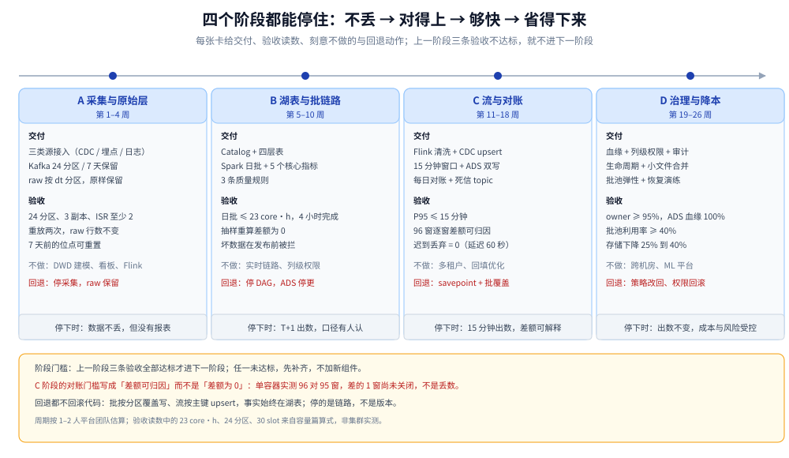
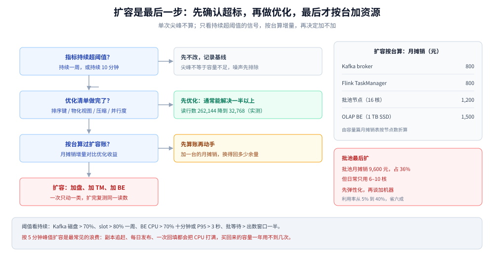

# 演进路线与实施计划

> 覆盖：这套平台按什么顺序建、每个阶段交付什么、验收拿哪几个读数、什么时候该扩、每个阶段怎么回退，以及哪些决定必须在第一天做对。
>
> 不覆盖：各组件怎么配见零件篇（[数据采集与CDC.md](数据采集与CDC.md)、[Kafka集群与Topic设计.md](Kafka集群与Topic设计.md)、[数据湖与Iceberg表设计.md](数据湖与Iceberg表设计.md)、[Flink实时链路.md](Flink实时链路.md)、[Spark批处理与调度.md](Spark批处理与调度.md)）；规格与成本见 [容量规划与成本.md](容量规划与成本.md)；架构边界的取舍见 [总体架构与选型.md](总体架构与选型.md)。
>
> 内容整理自个人学习笔记，素材见 [素材清单](../../../素材清单.md)。**实测口径**：本篇是计划篇，阶段划分与验收项是设计；引用的验收读数（对账 96 对 95 窗、checkpoint 10–147 ms、水位线丢弃计数、列级授权 497）来自本册其他篇的单容器实测，阶段本身未按周执行过，见文末「校验口径」。

---

## 一、为什么按阶段演进，而不是一次建全？

**本节要点**：一次建全会把「还不知道要什么」的部分也固化下来；分阶段的价值不在省时间，而在**每个阶段都能停在一个自洽的状态**，并且知道停下来的代价。

### 1.1 一次建全的三个具体代价

| 代价 | 现场表现 | 分阶段怎么避开 |
|---|---|---|
| 口径没定就上流 | 流跑起来了，ADS 没人认，改口径要重跑历史 | 先在批链路上把表与口径定下来 |
| 为峰值买机器 | 批池按峰值常驻，日常利用率 5% | 先小规格跑通，按利用率扩 |
| 治理补得太晚 | 补数、删表、改字段都要重拆 DAG | 命名、分区、提交入口第一天定 |

第三条最容易被低估：调度粒度、表命名、血缘采集入口都是**结构决定**，不是后期加一个产品能补的。到第 4 阶段才补的团队，通常要把 DAG 全部重拆一遍（见 [总体架构与选型.md](总体架构与选型.md) 第 1.2 节）。

### 1.2 每个阶段都要能停

四个阶段分别停在四种可用状态：**不丢**、**对得上**、**够快**、**省得下来**。任何阶段停下来，平台都还能对外出数，只是能力少一层。这是阶段划分的底线 —— 不能出现「停在中途就什么都出不来」的切法。

---

## 二、四个阶段的划分判据是什么？

**本节要点**：按「这一阶段新解决哪一类风险」切，不按组件切。A 解决「数据进不来」，B 解决「数不对」，C 解决「不够快」，D 解决「太贵、不可控」。

### 2.1 四阶段总表

| 阶段 | 周期 | 新解决的风险 | 一句话交付 | 停下来时的状态 |
|---|---|---|---|---|
| A 采集与原始层 | 第 1–4 周 | 数据丢失、无法回放 | 三类源进 Kafka，raw 层按天分区落湖 | 数据不丢，但没有可用报表 |
| B 湖表与批链路 | 第 5–10 周 | 口径不明、表不可信 | Catalog + 四层表 + 日批 + 5 个核心指标 | T+1 出数，口径有人认 |
| C 流与对账 | 第 11–18 周 | 时效不够、两条链路打架 | Flink 清洗与 CDC merge、15 分钟窗口、每日对账 | 15 分钟出数，差额可解释 |
| D 治理与降本 | 第 19–26 周 | 权限失控、成本失控 | 血缘、列级权限与审计、生命周期、弹性批池 | 出数不变，成本与风险受控 |

### 2.2 为什么 B 必须在 C 前面

很多人想先上 Flink，因为「实时」听起来是目标。但流作业的每一个参数都建立在「表长什么样、口径怎么算」之上：

- 窗口的 key 与粒度来自 DWD 的粒度设计，表没定就写窗口，改一次要重跑全部历史；
- 迟到修正要判断「这条记录该覆盖哪一行」，没有主键与口径定义就无法判断；
- 对账的基准来自批链路，批链路不存在时，流算得对不对没人知道。

**可以跳过 B 直接上 Flink 的唯一前提是**：已经有一张被业务认可的表和一套质量规则（可能来自更早的系统）。否则流会先跑起来，口径却没人认。



图怎么读：从左到右是时间轴，每张卡片的四行分别是交付物、验收读数、本阶段刻意不做的事、以及停下来时的回退动作。要读出的是：**每个阶段都有明确的「不做」和「回退」**，四张卡片都停得住；而不是一条只能往前冲的单行道。

---

## 三、每个阶段交付什么、怎么验收？

**本节要点**：每个阶段只认三条验收读数，全达标才进下一阶段。验收项必须是**能跑出来的数**，不是「已完成联调」。

### 3.1 A 阶段：打通一条链路（第 1–4 周）

**交付**：三类源接入（业务库 CDC、客户端埋点、服务日志），Kafka 24 分区 / 7 天保留，raw 层按 `dt` 分区落湖，原始 JSON 原样保留。

| 验收项 | 判据 | 读数来源 |
|---|---|---|
| 分区与副本 | 24 分区、3 副本、`min.insync.replicas=2` | `kafka-topics.sh --describe` |
| 重放幂等 | 同一小时数据重放两次，raw 行数不变 | 两次 `count(*)` 相等 |
| 保留期 | 7 天可回放，过期前能补 | 消费组重置到 7 天前 |

**刻意不做**：不做 DWD 建模、不做看板、不上 Flink。这一阶段唯一的目标是「数据进来且回得去」。

### 3.2 B 阶段：湖表与批链路（第 5–10 周）

**交付**：Iceberg REST Catalog、ODS/DWD/DWS/ADS 四层表、Spark 日批、5 个核心指标、3 条质量规则（空值率、主键唯一、金额非负）。

| 验收项 | 判据 | 读数来源 |
|---|---|---|
| 批计算量 | 日批 ≤ 23 core·h，4 小时窗口内完成 | Spark 历史服务器 |
| 结果一致 | ADS 与明细抽样重算，差额为 0 | 抽样 SQL |
| 质量拦截 | 三类坏数据在发布前被拦下 | 规则命中记录 |

23 core·h 来自 [容量规划与成本.md](容量规划与成本.md) 第 4.1 节：纯扫描 0.38 core·h，乘 40 倍开销系数与 1.5 倍宽表重建。**这一阶段先不追求快**，只追求「每天都能按时出且数对」。

### 3.3 C 阶段：流与对账（第 11–18 周）

**交付**：Flink 清洗、CDC upsert、15 分钟窗口聚合；ADS 由流与批双写；每日对账任务；死信 topic。

| 验收项 | 判据 | 读数来源 |
|---|---|---|
| 端到端时效 | P95 ≤ 15 分钟（15 分钟窗口 + 1 分钟处理预算） | 事件时间与写出时间的差值 |
| 逐窗对账 | 96 个窗口，差额只允许出现在未关闭窗口且可解释 | 对账 SQL 的逐窗 diff |
| 迟到丢弃 | `numLateRecordsDropped = 0` | Flink 算子指标 |

对账的验收要看**差额的形状**，不是只看总行数。单容器实测的样例：同一份 2,020 行事件跑批与流，得到 96 与 95 个窗口，差额集中在 `[23:45,24:00)` 一窗 30 行 / 1,500 —— 这不是丢数，是水位线没推过窗口末端，把延迟调到 60 秒后六个窗口全部计入（见 [流批对账与数据质量.md](流批对账与数据质量.md) 第 1 节）。**C 阶段的对账门槛应该写成「每个差额都能归因」，而不是「差额为 0」**，后者在跨天边界上永远做不到。

### 3.4 D 阶段：治理与降本（第 19–26 周）

**交付**：血缘采集、列级权限与脱敏视图、审计管道、生命周期与快照过期、小文件合并、批池弹性、恢复演练。

| 验收项 | 判据 | 读数来源 |
|---|---|---|
| 治理覆盖 | owner ≥ 95%、ADS 确认级血缘 100%、敏感列列级权限 100% | 元数据与权限系统 |
| 资源利用 | 批池平均利用率 ≥ 40% | 调度与监控 |
| 存储成本 | 生命周期后下降 25–40% | 对象存储账单 |
| 可恢复 | 四类演练全部达标 | 演练记录（见 [K8s部署与运维.md](K8s部署与运维.md) 第 5.2 节） |

批池利用率从 5% 提到 40% 能省六成，这是 [容量规划与成本.md](容量规划与成本.md) 第 8 节三条杠杆里回报最高的一条；存储下降 25–40% 来自生命周期与快照过期，代价是冷数据查询变慢。

---

## 四、什么时候该扩，什么时候该优化？

**本节要点**：扩容是最后一个手段，不是第一个。顺序固定为**先确认不是噪声 → 再做完优化清单 → 再算扩容账单 → 最后加资源**。跳过任何一步，都会买到用不上的容量。

### 4.1 五个扩容信号与阈值

| 信号 | 阈值 | 先做什么 | 什么时候才真扩 |
|---|---|---|---|
| Kafka 磁盘 | 使用率 > 70% | 降保留期、确认压缩生效 | 保留期已到业务下限 |
| Flink slot | 使用率 > 80% 持续一周 | 对齐并行度与分区数、优化 UDF | 并行度已与 24 分区对齐 |
| OLAP BE | CPU > 70% 持续 10 分钟，或 P95 > 3 s | 排序键、物化视图、资源组 | 优化后仍超阈值 |
| 批等待 | 等待时间 > 出数窗口的一半 | 提优先级、缩小单批数据量 | 回填排队开始影响 SLA |
| 对象存储 | 月增超预算或容量到 70% | 生命周期、小文件合并 | 物理容量不足 |

阈值都要求**持续**满足，单次尖峰不算：Kafka 磁盘在副本追赶时会短时冲高，BE 在每日发布时会短时打满，按 5 分钟峰值扩容是最常见的浪费。



图怎么读：左边是决策顺序，三道闸门任何一道答「否」都回到优化或观察；右边四个信号给出各自的阈值与「先做什么」。要读出的是：**扩容的判据不是 CPU 高，而是「优化已经做完了」**；同一张图也解释了为什么「先加机器再看」会让问题晚一个季度才暴露。

### 4.2 优化清单（扩之前必须走完）

| 优化 | 作用对象 | 典型收益 | 代价 |
|---|---|---|---|
| 排序键 / 分区裁剪 | OLAP 扫描行数 | 读行数从 262,144 降到 32,768（单容器实测） | 改表要重写数据 |
| 物化视图 / 预聚合 | 固定看板的聚合 | 47.68 MiB / 51 ms 降到 182 B / 2 ms（实测） | 只增量，不回填历史 |
| 压缩与保留 | Kafka 磁盘、对象存储 | 存储 25–40% | CPU 换 IO |
| 并行度对齐分区 | Flink slot 与吞吐 | 减少空闲 slot | 需要重提作业 |
| 小文件合并 | 查询 CPU 与元数据压力 | 文件数下降一个量级 | 占用批池窗口 |

前两条的数字来自 [OLAP查询服务.md](OLAP查询服务.md) 第 3 节的 ClickHouse 实测；它们说明**同一个问题在扩容前往往已经能解决一半以上**。

---

## 五、每个阶段怎么回退？

**本节要点**：回退方案在阶段开始前就要写好，判据是「回退后数据还在不在、多久能恢复出数」。四个阶段的回退都不需要回滚代码 —— 因为数据始终在湖表里。

### 5.1 四张回退卡

| 阶段 | 回退动作 | 数据影响 | 恢复出数时间 |
|---|---|---|---|
| A | 停采集任务，raw 层保留 | 无，已入湖的数据不动 | 分钟级 |
| B | 停批 DAG，ADS 停止更新 | 看板停在昨日 | 小时级（重跑即可） |
| C | 取消流作业并先打 savepoint，ADS 改由批覆盖写 | 时效退回 T+1，数据不丢 | 30 分钟内 |
| D | 生命周期策略改回、权限回滚到表级、关闭弹性批池 | 成本回升，无数据影响 | 小时级 |

### 5.2 回退为什么不需要回滚代码

因为写入是**幂等 + 覆盖**的：批链路按分区覆盖写，流链路按主键 upsert，两条链路都只依赖湖表这一份事实。所以「回退」停的是**某条链路**，不是某个版本 —— 停掉流之后，批仍然能把当天的分区写对，只是晚几个小时。

⚠️ 唯一不能靠回退弥补的是**没保留 raw 层**：一旦原始字节被清洗后丢弃，任何口径修正都只能对未来的数据生效（见 [总体架构与选型.md](总体架构与选型.md) 第 5.3 节）。raw 层不是「多存一份」，它是回退能力的物理前提。

---

## 六、哪些事必须第一天做、哪些可以以后补？

**本节要点**：判据是**改它的成本**。凡是会固化到历史数据里的决定（分区、主键、表格式、命名），第一天做对；凡是可重建、可替换的（OLAP、调度器、血缘展示），可以后补。

### 6.1 不可逆与可后补

| 决定 | 什么时候做 | 改的代价 |
|---|---|---|
| raw 层永久保留 | 第一天 | 不可逆，丢了就没有 |
| 表格式与 Catalog | 第一天 | 半可逆，要重写全部写入逻辑 |
| 分区键与业务主键 | 第一天 | 要重写历史分区 |
| 表命名与分层前缀 | 第一天 | 要重扫血缘与重指向 |
| 血缘采集入口 | B 阶段收口 | 后期补要重拆提交入口 |
| OLAP 引擎 | C 阶段选 | 可从湖表重建，换引擎只影响服务层 |
| 调度器 | B 阶段选 | DAG 可迁移，但要重测补数 |
| 血缘展示与列级权限 | D 阶段 | 可加在产品上，不改数据 |

### 6.2 一个常被推迟、但不能推迟的决定

**提交入口收口**：所有 Spark / Flink 作业走同一个提交网关。它看起来是「运维便利」，实际决定了三件事能不能做：血缘能不能采全、资源配额能不能生效、绕过网关的作业能不能被拒绝。等 D 阶段再收口，等于把已经散落在各处的提交脚本再找回来一遍。

---

## 使用：26 周落地清单

**本节要点**：把四阶段拆成可排期的动作，每两周一个检查点；每个检查点只回答「三条验收过没过」，不讨论新需求。

```text
周次     阶段   交付动作                                    检查点
1-4      A     对象存储 → Catalog → Kafka → 采集三类源     24 分区 / 重放幂等 / 7 天可回放
5-6      B     四层表 DDL + 日批骨架                        表能被 Spark 与 Trino 读到
7-8      B     DWD/DWS 逻辑 + 5 个指标                     抽样重算差额为 0
9-10     B     三条质量规则 + 调度依赖                      坏数据能拦住
11-13    C     Flink 清洗 + CDC upsert                      checkpoint 成功率 100%
14-15    C     15 分钟窗口 + ADS 双写                       P95 ≤ 15 分钟
16-18    C     每日对账 + 死信处理                          96 窗逐窗差额可归因
19-20    D     血缘采集 + owner 登记                        ADS 确认级血缘 100%
21-22    D     列级权限 + 脱敏视图 + 审计                   敏感列 100% 覆盖
23-24    D     生命周期 + 小文件合并 + 快照过期             存储下降 25–40%
25-26    D     批池弹性 + 四类恢复演练                       批池利用率 ≥ 40%，演练达标
```

### 阶段门槛与扩容单价

三个阶段门槛各一条命令即可判定，**不看截图、不看口头确认**：

```bash
# A → B：分区数、副本与 ISR 是否符合设计
kafka-topics.sh --bootstrap-server localhost:9092 --describe --topic events.raw

# B → C：湖表能被第二个引擎读到（说明 Catalog 与表定义没绑死）
trino --execute "SELECT count(*) FROM iceberg.db.dwd_event WHERE dt='2026-10-25'"

# C → D：作业在跑且 checkpoint 有成功记录
flink list && flink savepoint <jobId> s3://bdp-flink/savepoints/
```

扩容按台算账，单价取自 [容量规划与成本.md](容量规划与成本.md) 第 7 节的月摊销表折到单台：

| 扩容对象 | 单台月摊销（元） | 加一台买到什么 |
|---|---|---|
| Kafka broker | 800 | 多 8 个分区承载与一份副本 |
| Flink TaskManager | 800 | 多 4 个 slot（按 8c32G 分 4 slot） |
| 批池节点 | 1,200 | 多 16 核，但只在有任务时可回收 |
| OLAP BE | 1,500 | 多 1 TB SSD 与一份副本容量 |

---

## 校验口径

> ✅ 本篇是计划篇，校验范围与其余篇目不同：

- **设计项（非实测）**：第 2–6 节的阶段划分、周期、验收项、阈值与回退动作均为设计，未按 26 周真实执行；周期按 1–2 人平台团队估算，未在真实项目中校验。
- **引用实测（来自本册其他篇）**：对账 96 对 95 窗、差额 `[23:45,24:00)` 30 行 / 1,500（流批对账篇）；`numLateRecordsDropped` 在 60 秒延迟下为 0、checkpoint 耗时 10–147 ms（Flink 篇）；OLAP 排序键 32,768 / 262,144 行与预聚合 47.68 MiB → 182 B（OLAP 篇）；列级授权 497（治理篇）。
- **容量数字来源**：24 分区、30 slot、120 GB、19 GB 状态、46 GB checkpoint、23 core·h/天、5,900 core·h 回填，全部来自 [容量规划与成本.md](容量规划与成本.md) 的算式输出；月摊销 26,400 元同篇，单台数值为按节点数折算。
- **未实测**：Kafka 7 天回放的完整耗时、批池弹性后的实际利用率、生命周期策略的账单降幅、四类恢复演练的真实耗时、26 周排期在真实团队中的偏差。

| 依赖 | 实际版本 / 状态 |
|---|---|
| Kafka | 3.9.0（单容器，24 分区设计值） |
| Flink | 1.20.5（单容器，1 TM / 1 slot） |
| Spark | 3.5.5（local[2]） |
| Iceberg | 1.6.1（Spark 侧实测） |
| ClickHouse | 26.3.29.7（单容器） |
| 集群规模 | 未实测，全部为设计值 |

## 延伸追问

- **26 周能不能压缩到 12 周？** → 能压 B 与 C 的部分动作，但压不掉 A 的「重放幂等」与 C 的「逐窗对账」；这两项跳过，后面每次口径变更都要重新建立信任。
- **为什么把治理放在最后，而不是边做边补？** → 治理的**采集入口**必须在 B 阶段就留好，展示与列级权限可以后补；把入口和产品一起推迟到 D，才是真正的返工来源。
- **扩容阈值为什么都要求「持续」？** → 峰值是瞬时的：副本追赶、每日发布、一次回填都会打满 CPU；按 5 分钟峰值扩容，买回来的容量一年用不到几次。
- **如果只有 1 个人，阶段怎么改？** → 合并 B 与 C，先做批、把流推迟到有第二个 owner 时；一个人的团队同时值班流与批，两套排障路径会互相拖。
- **阶段之间能不能并行？** → 表设计与采集可以并行，流与批不能：批链路的结果是流的对账基准，先有基准再上流。
- **回退会不会丢当天的数据？** → 不会。回退停的是链路，湖表与 raw 层都在；当天的 ADS 可以用批覆盖写补回来，只是晚几个小时。
- **什么时候该拆第二个平台（多集群）？** → 出现硬隔离需求时（多租户计费、跨地域合规、单集群容量到上限），不是为了「性能」拆；拆开后的元数据同步成本通常被低估。

## 关联

- **上游/总纲**：[README.md](README.md) — 本册定位与篇目分工
- **上游**：[总体架构与选型.md](总体架构与选型.md) — 五层结构、双引擎边界与本篇阶段的由来
- **容量依据**：[容量规划与成本.md](容量规划与成本.md) — 分区、slot、core·h、checkpoint 与月摊销的算式
- **A 阶段**：[数据采集与CDC.md](数据采集与CDC.md) / [Kafka集群与Topic设计.md](Kafka集群与Topic设计.md)
- **B 阶段**：[数据湖与Iceberg表设计.md](数据湖与Iceberg表设计.md) / [分层建模与指标口径.md](分层建模与指标口径.md) / [Spark批处理与调度.md](Spark批处理与调度.md)
- **C 阶段**：[Flink实时链路.md](Flink实时链路.md) / [流批对账与数据质量.md](流批对账与数据质量.md)
- **D 阶段**：[OLAP查询服务.md](OLAP查询服务.md) / [K8s部署与运维.md](K8s部署与运维.md) / [元数据血缘与权限治理.md](元数据血缘与权限治理.md)
- **方法论**：[系统设计方法论.md](../系统设计方法论.md) — 「分层加手段、说清代价与兜底」的通用流程
