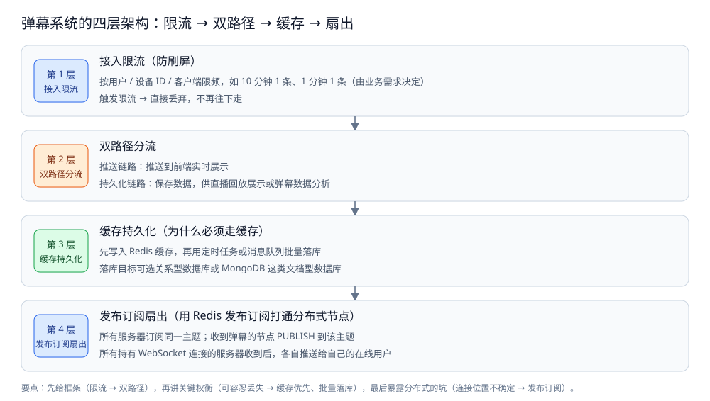

# 弹幕系统

> 本目录收**弹幕系统**这道系统设计题：一篇**总体设计** + 四篇零件篇 + 一篇存储横切篇。
> 本篇是目录导读，只给「这个系统有哪几个核心问题、有哪些零件、怎么读」三件事，
> 每个问题的解法在零件篇里；本目录不重述具体方案。
>
> 内容整理自个人学习笔记，并参考《大型网站技术架构：核心原理与案例分析》（李智慧）的伸缩性与可用性章节；参考资料与原始素材见 [素材清单](../../../素材清单.md)。

---

## 一、这个系统有哪几个核心问题？

**本节要点**：弹幕的难点不在「把一条文字广播出去」，而在量极大、可丢弃、连接位置不确定 —— 四层依次解决「谁能发、走哪两条路、存在哪、怎么扇出」，最后一层落在客户端。

| # | 问题 | 一句话 |
|---|---|---|
| ① | **接入限流（防刷屏）** | 弹幕生产成本极低、频率极高，第一步就按用户 / 设备 ID / 客户端限频，超限的**直接丢弃** |
| ② | **双路径分流** | 同一条弹幕拆成两条路：一条**实时推给在线观众**，一条**持久化供回放与分析** |
| ③ | **缓存优先 + 批量落库** | 每条都写库会把写 TPS 顶到查询 TPS，先写 Redis、再定时或经 MQ **批量落库** |
| ④ | **跨节点扇出** | 服务端分布式部署、WebSocket 连接落在哪台不确定，靠**发布订阅**把弹幕扇出到所有持有连接的节点 |
| ⑤ | **客户端渲染与同步** | 弹幕怎么分轨道、批量绘制、与播放器时钟对齐、seek 之后怎么把历史区间重拉回来 |

⭐ 这五个问题不是并列的选项，而是**一条链上的五道关**：先限流挡掉刷屏（①）→ 剩下的分成推送与落库两条路（②）→ 落库那条走缓存 + 批量（③）→ 推送那条靠发布订阅跨节点扇出（④）→ 最后到客户端分轨道渲染并与时钟对齐（⑤）。**四层各自解决什么、为什么这么分层**，见 [总体设计.md](总体设计.md) 第一节。



图怎么读：四层从上到下就是「先给框架、再讲权衡、最后暴露坑」——第 1 层按用户 / 设备 ID / 客户端限频（如 10 分钟 1 条），触发就**直接丢弃、不再往下走**；第 2 层把同一条弹幕分成推送链路与持久化链路两条路；第 3 层先写 Redis 再批量落库，因为弹幕可容忍少量丢失；第 4 层用发布订阅打通分布式节点：所有服务器订阅同一主题，收到弹幕的节点 PUBLISH，持有连接的节点各自推给自己的在线用户。

---

## 二、这套笔记有哪些零件？

**本节要点**：一篇总体设计先给出整体形态与三个核心取舍，四篇零件按「接入与推送 / 编排与落库 / Java 移植 / 客户端渲染」切开，最后一篇存储全景是横切收口。

| 篇 | 回答什么问题 | 关键词 |
|---|---|---|
| [总体设计.md](总体设计.md) | 整体分几层、三个核心取舍、一次弹幕走哪几步 | 整体形态 / 核心取舍 / 全链路 / 前提与边界 |
| [接入与推送.md](接入与推送.md) | 限流怎么做、连接侧怎么隔离、弹幕怎么推 | 数据面与限流 / 房间订阅 / 连接隔离 |
| [编排与落库.md](编排与落库.md) | 分布式节点怎么编排、批量落库怎么写 | 节点编排 / 批量落库 / BatchWriter |
| [Java实现.md](Java实现.md) | 同一套四层用 Java 怎么写 | 逐类型移植 / 原语对照 / 毒丸退出 |
| [弹幕渲染与同步.md](弹幕渲染与同步.md) | 客户端怎么渲染、怎么和播放器时钟对齐 | 轨道分配 / 批量绘制 / 时钟对齐 / seek 重拉 |
| [存储全景.md](存储全景.md) | 这个系统的数据都存哪 | 数据角色 / 载体 / 读写路径 / 与其它系统的差异 |

⭐ 前五篇是设计篇（总体设计 + 四零件）；其中 [Java实现.md](Java实现.md) 是把前两篇骨架**逐类型移植**的对照版；[存储全景.md](存储全景.md) 是横切篇（跨零件看"数据存哪"）。

### 2.1 四层分别落在哪篇

```text
接入与推送.md   → 第 1 层接入限流 + 第 4 层连接侧推送（数据面与限流、连接隔离、房间订阅）
编排与落库.md   → 第 2 层双路径分流 + 第 3 层缓存批量落库（节点编排、BatchWriter 批量落库）
Java实现.md     → 前两篇的 Java 逐类型移植（原语对照、毒丸退出与 poll 双重角色）
弹幕渲染与同步.md → 客户端：轨道分配、批量绘制、时钟对齐、seek 重拉
```

> 注意 **连接侧是推送链路的接缝**：「谁能连上」由 [接入与推送.md](接入与推送.md) 的连接隔离决定，「推给谁」由同篇的房间订阅决定，「怎么跨节点扇出」则由发布订阅兜住 —— 三者对不上，弹幕就会推给没有这个连接的机器。

---

## 三、按什么顺序读？

**本节要点**：先看**总体设计**（整体分几层、三个核心取舍、一次弹幕走哪几步），再读**接入与推送**（限流 + 连接侧），接着读**编排与落库**（分路 + 批量落库），然后读**客户端渲染**，Java实现 按需对照，最后用存储全景收口。

### 3.1 推荐顺序

```text
① 总体设计.md          ← 总体设计：整体形态、三个核心取舍、一次弹幕走哪几步
        ↓
② 接入与推送.md        ← 前两段骨架：数据面与限流、连接侧隔离与房间订阅
        ↓
③ 编排与落库.md        ← 后两段骨架：节点编排与批量落库
        ↓
④ 弹幕渲染与同步.md    ← 客户端：轨道分配、批量绘制、时钟对齐、seek 重拉
        ↓
⑤ Java实现.md          ← 对照移植：同一套四层的 Java 写法（可选）
        ↓
⑥ 存储全景.md          ← 横切收口：以上几篇的数据分别落在哪、怎么同步
```

**反过来也成立**：如果只关心客户端怎么把弹幕画到屏幕上、怎么对齐时钟，可以直接从 [弹幕渲染与同步.md](弹幕渲染与同步.md) 读起 —— 它不依赖服务端骨架。

### 3.2 依赖关系

| 本篇 | 建议先读 | 为什么 |
|---|---|---|
| [接入与推送.md](接入与推送.md) | [总体设计.md](总体设计.md) | 先有"四层各自解决什么"的地图，才知道限流与连接侧要挡什么 |
| [编排与落库.md](编排与落库.md) | [接入与推送.md](接入与推送.md) | 编排要接住推送侧的数据面，先有连接与订阅模型才谈分路与落库 |
| [Java实现.md](Java实现.md) | [接入与推送.md](接入与推送.md) + [编排与落库.md](编排与落库.md) | 它是前两篇的逐类型移植，先看 Go 骨架再对照 Java |
| [弹幕渲染与同步.md](弹幕渲染与同步.md) | 前三篇任意 | 客户端与服务端松耦合，理解链路后更能看清"哪里会丢、哪里要补" |
| [存储全景.md](存储全景.md) | 前五篇任意 | 它是横切收口，先理解零件再看数据落点更顺 |

⭐ 一条记忆线：**"谁能发"看限流，"发去哪"看双路径，"存在哪"看缓存与批量落库，"怎么到观众"看发布订阅** —— 四者对不上，用户看到的就是"刷屏卡住"或"回放缺词"。

### 3.3 三种常见的读错顺序

| 读法 | 后果 |
|---|---|
| 先读落库、后读限流 | 批量落库讲得通，但"为什么能在库前先丢一批"体会不到 —— 因为没先理解限流是第一道闸 |
| 只读服务端、跳过客户端渲染 | 发布订阅记住了，但"弹幕为什么会在屏幕上重叠 / 时钟错位"接不上 |
| 五篇各读一半 | 限流、分路、落库、扇出、渲染各一条线，在"一条弹幕的生命周期"上对不齐 |

---

## 四、与其它目录怎么分工？

**本节要点**：弹幕是**可丢弃的长连接扇出场景** —— 零件的原理在别处，本目录只讲「在这个场景里怎么用、代价落在哪」。

| 相关目录 | 分工 |
|---|---|
| [README.md](../IM系统/README.md) | 同为长连接 + 扇出场景，但 IM 消息**不能丢**、弹幕**可丢**，对照看取舍差在哪 |
| [README.md](../社交互动系统/README.md) | 那边的「计数 / 关系」是共享状态问题，与本篇的订阅与扇出是两类 |
| [发布订阅.md](../../../03-数据与中间件/数据存储/NoSQL/Redis/发布订阅.md) | 第 4 层跨节点推送依赖的机制；本篇只讲"怎么用它扇出"，不重讲原理 |
| [文件存储与上传架构.md](../文件存储与上传架构.md) | 同为场景设计题的姊妹篇，可对照读"分层推演"的写法 |
| [存储选型与组合.md](../存储选型与组合.md) | 通用判据（角色 / 同步 / 冷热）；本篇的 [存储全景.md](存储全景.md) 是它在弹幕上的落地 |
| [README.md](../README.md) | 系统设计分区导读，本目录是其下的一个主题目录 |

**本目录收什么、不收什么**：

| 收 | 不收（在哪） |
|---|---|
| 限流分层、双路径分流、缓存优先与批量落库的设计判据 | Redis / MySQL 本身的用法 → [03-数据与中间件/](../../../03-数据与中间件/) |
| 发布订阅跨节点扇出、连接侧隔离的取舍 | 发布订阅 / 长连接的原理 → [发布订阅.md](../../../03-数据与中间件/数据存储/NoSQL/Redis/发布订阅.md) |
| 客户端轨道分配、批量绘制、时钟对齐的工程判据 | 通用存储判据 → [存储选型与组合.md](../存储选型与组合.md) |

> 引用关系上，本目录与 IM 那篇**互引**：IM 篇讲"消息为什么不能丢"，到了需要展开"可丢场景怎么用最轻方案"时，就指向本目录。

## 延伸追问

- **弹幕和 IM，能不能合成一篇？** → 不建议。两者都是长连接 + 扇出，但取舍正好相反：IM 必须"落库 + ACK + 补拉"，弹幕可以"内存广播 + 异步归档"。合成一篇会把两种相反的代价结构混在一起讲。
- **这套笔记哪些是实测的？** → [接入与推送.md](接入与推送.md) 与 [编排与落库.md](编排与落库.md) 的 Go 骨架已编译校验并附 `go test` 实测；[Java实现.md](Java实现.md) 是逐类型移植的对照版；[弹幕渲染与同步.md](弹幕渲染与同步.md) 为客户端设计讲解，未做新的本机实测。
- **读完能回答的最小闭环是什么？** → "一条弹幕从发出到上屏"：限流 → 分成两条路 → 落库那条走缓存 + 批量、推送那条走发布订阅扇出 → 客户端分轨道渲染 —— 展开见 [总体设计.md](总体设计.md) 第四节。
- **为什么客户端也要单独一篇？** → 因为服务端把弹幕推对了，不等于用户看对了：屏幕一屏只放得下有限条、多条弹幕要分轨道、播放进度与弹幕时钟要对齐、跳转之后要重拉历史区间 —— 这些是服务端管不到的另一半。

## 关联

- [总体设计.md](总体设计.md) — 总体设计：整体形态 / 核心取舍 / 一次弹幕走哪几步 / 前提与边界。
- [接入与推送.md](接入与推送.md) — 前两段骨架：数据面与限流、连接侧隔离。
- [编排与落库.md](编排与落库.md) — 后两段骨架：节点编排与批量落库。
- [Java实现.md](Java实现.md) — 同一套四层的 Java 版。
- [弹幕渲染与同步.md](弹幕渲染与同步.md) — 客户端渲染与时间同步：轨道分配 / 批量绘制 / 时钟对齐 / seek 重拉。
- [存储全景.md](存储全景.md) — 横切篇：弹幕的数据都存哪、谁是权威源、怎么同步。
- [README.md](../IM系统/README.md) — 同为长连接扇出，但消息不可丢，对照看取舍。
- [文件存储与上传架构.md](../文件存储与上传架构.md) — 同为场景设计题的姊妹篇。
- [发布订阅.md](../../../03-数据与中间件/数据存储/NoSQL/Redis/发布订阅.md) — 第 4 层跨节点推送依赖的机制。
- [README.md](../README.md) — 系统设计分区导读，本目录是其下的一个主题目录。
- [存储选型与组合.md](../存储选型与组合.md) — 通用视角：数据角色、权威源与副本、冷热分层与多存储同步。

> 反向引用（本篇被下列文档引到）：[朋友圈设计.md](../社交互动系统/朋友圈设计.md)
