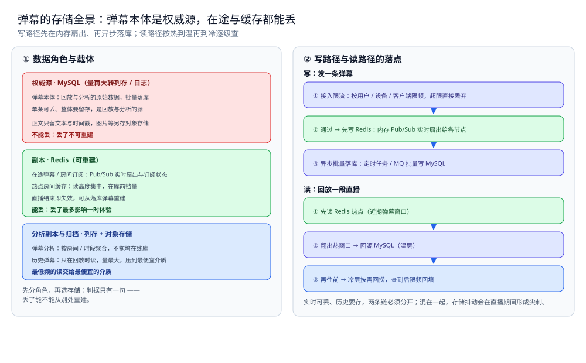
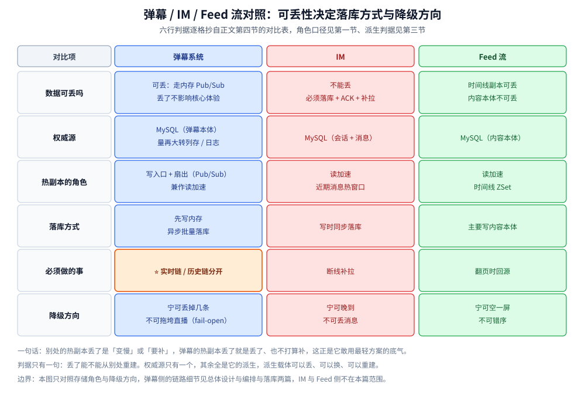

# 存储全景

> 弹幕系统的数据都存哪：弹幕本体是权威源，在途弹幕与缓存都可丢，
> 每份数据是什么角色、放哪个载体、怎么同步、哪些能丢哪些不能。
> 本篇只回答「这份数据放哪」——通用判据（角色 / 同步 / 冷热）见 [存储选型与组合.md](../../../03-数据与中间件/数据存储/存储架构与场景/存储选型与组合.md)，
> 本篇不重复判据，只把判据落到弹幕上。
>
> 内容整理自个人学习笔记，并参考《大型网站技术架构：核心原理与案例分析》（李智慧）的伸缩性与可用性章节；参考资料与原始素材见 [素材清单](../../../素材清单.md)。

---

## 一、弹幕系统里数据扮演哪几种角色？

**本节要点**：先分角色，再选存储。判据只有一句——**丢了能不能从别处重建**；不能重建的是权威源，能重建的是副本。

| 数据 | 角色 | 载体 | 理由 |
|---|---|---|---|
| 弹幕本体 | 权威源 | MySQL（量再大转列存 / 日志） | 回放与分析的原始数据，批量落库；单条可丢、整体要留存 |
| 在途弹幕 / 房间订阅 | 缓存 | Redis（Pub/Sub） | 实时扇出的一次性推送与订阅状态，直播结束即失效，丢了无妨 |
| 热点房间缓存 | 缓存 | Redis | 读高度集中，缓存在库前挡量；可从落库弹幕重建 |
| 历史弹幕 | 归档 / 冷数据 | 对象存储 + 列存文件 | 只在回放时读，量最大，用最便宜的介质 |
| 弹幕分析 | 分析副本 | 列存 | 按房间 / 时段聚合，不拖垮在线库；从弹幕本体派生 |

⭐ 判据：在途弹幕、房间订阅与热点缓存都是可重建的副本，丢了最多影响一时体验；真正要留的是落库的弹幕本体，它是回放与分析不可重建的源，所以缓存优先、批量落库、冷层兜底。

---

## 二、读和写的路径分别走哪条链？

**本节要点**：同一份数据在写路径和读路径上的落点不同 —— 写路径决定「谁先在内存扇出、谁异步落库」，读路径决定「先查热层、回源温层、下沉冷层」。

### 2.1 写路径

```text
发一条弹幕
│
├─ ① 接入限流：按用户 / 设备 ID / 客户端限频，超限直接丢弃（无存储落点）
├─ ② 通过 → 先写 Redis：内存 Pub/Sub 把弹幕扇出给订阅了该主题的节点
├─ ③ 订阅者各自推给自己的在线用户（下行帧落在网关内存）
└─ ④ 异步批量落库：定时任务 / MQ 批量写 MySQL（不每条写库）
```

> ⭐ 限流是"库前的闸"：被挡掉的弹幕根本不会产生存储写入；落库与推送是两条链，落库慢不会拖住推送。

### 2.2 读路径

```text
回放一段直播
│
├─ ① 先读 Redis 热点（近期弹幕窗口）
├─ ② 翻出热窗口 → 回源 MySQL（温层）
└─ ③ 再往前 → 冷层（对象存储 / 列存）按需回捞，查到后限频回填
```

> ⭐ 读路径按热 → 温 → 冷逐级查，不要把冷数据灌回热层；实时链可丢、历史链要存，两条链的容忍度不同。



图怎么读：左栏把五份数据按角色归到三层——权威源（弹幕本体）落 MySQL、红框，是回放与分析不可重建的源；副本（在途弹幕 / 房间订阅、热点房间缓存）落 Redis、绿框，直播结束即失效、可从落库弹幕重建；分析副本与归档（弹幕分析、历史弹幕）落列存 + 对象存储、蓝框，用最便宜的介质承载最低频的读。右栏是两条链的落点：写链「限流 → 先写 Redis 扇出 → 异步入队批量落库」，被限流挡掉的弹幕没有落点；读链「先 Redis 热点 → 回源 MySQL（温）→ 冷层回捞（冷）」，逐级向后。底部一行是本篇的口径基线：**实时可丢、历史要存，两条链必须分开**。

---

## 三、为什么这样分配？

**本节要点**：每个角色选中它的载体，都有结构上的理由，不是拍脑袋。

| 数据 | 为什么是它 |
|---|---|
| 弹幕本体落 MySQL | 需要持久（回放要能查）、需要按房间 + 时段有序读；但**必须批量落库**，否则写 TPS 会顶到查询 TPS |
| 在途弹幕放 Redis Pub/Sub | 一条弹幕要同时扇给所有持有连接的节点，配对连接位置不确定；它是**一次性广播**，丢了就丢了 |
| 热点房间缓存放 Redis | 大房间读高度集中、读远多于写；缓存在库前挡量，可从落库弹幕重建 |
| 历史弹幕下沉对象存储 | 访问频率随时间为长尾，只在回放时读；用最便宜的介质承载最低频的读 |
| 弹幕分析下沉列存 | 按房间 / 时段做聚合会拖垮在线库，而那些查询不影响实时链路 |

⭐ 一条贯穿全篇的判据：**权威源只有一个（MySQL），其余全是它的派生** —— 派生载体可以丢、可以换、可以重建，只要权威源在。

---

## 四、弹幕系统的特殊性在哪？

**本节要点**：弹幕与 IM / Feed 的最大差别是「**允许丢、且必须分两条链**」—— 实时链要低延迟、可丢，历史链要能落库、可回放；混在一条链上，落库抖动会直接变成直播期间的推送尖刺。

| 对比项 | 弹幕系统 | IM | Feed 流 |
|---|---|---|---|
| 数据可丢吗 | ✅ 可丢，走内存 Pub/Sub，丢了不影响核心体验 | ❌ 不能丢，必须落库 + ACK + 补拉 | ⚠️ 时间线副本可丢，内容本体不可丢 |
| 权威源 | MySQL（弹幕本体，量再大转列存 / 日志） | MySQL（会话 + 消息） | MySQL（内容本体） |
| 热副本的角色 | **写入口 + 扇出**（Pub/Sub）兼读加速 | 读加速（近期消息热窗口） | 读加速（时间线 ZSet） |
| 落库方式 | **先写内存、异步批量落库** | 写时同步落库 | 主要写内容本体 |
| 必须做的事 | ⭐ **实时链 / 历史链分开** | 断线补拉 | 翻页时回源 |
| 降级方向 | 宁可丢掉几条，不可拖垮直播（fail-open） | 宁可晚到，不可丢消息 | 宁可空一屏，不可错序 |

⭐ 一句话：别处的热副本丢了是"变慢"或"要补"，弹幕的热副本丢了**就是丢了、也不打算补** —— 这正是它敢用最轻方案（内存广播 + 异步归档）的底气。

### 4.1 三个系统并排看，差在哪几行？

上面那张表按系统并排摊成三列，行序与判据原样保留：



图怎么读：一列一个系统，六行的措辞逐格抄自上面的表。读这张图只抓正文第四节已经点明的两行——**最上面「数据可丢吗」与最下面「降级方向」**：弹幕可丢（内存 Pub/Sub，丢了不影响核心体验）所以降级是 fail-open；IM 不能丢（落库 + ACK + 补拉）所以宁可晚到；Feed 是混合态（时间线副本可丢、内容本体不可丢）所以宁可空一屏不可错序。中间四行是同一家族的另外四个侧面：权威源三家都在 MySQL，但装的东西不同（弹幕本体 / 会话 + 消息 / 内容本体）；热副本的角色只有弹幕是**写入口 + 扇出**兼读加速，另两家只做读加速；落库方式上弹幕先写内存再异步批量落库、IM 写时同步落库；「必须做的事」那行橙框就是本篇的题眼——弹幕必须把实时链与历史链分开，这条判据在第一节与第三节已经给出理由。

## 使用：一次完整链路的存储落点

**本节要点**：把「用户敲下回车」到「回放时重新看到这条弹幕」的全过程，标出每一步的存储落点。

| 步骤 | 数据 | 落在哪 |
|---|---|---|
| ① 输入并发送 | 弹幕正文 | 无持久化（客户端） |
| ② 接入限流 | 限频计数 | 无持久化（网关内存 / Redis 限流键） |
| ③ 通过限流 | 弹幕数据 | 分两条路：推送链 + 持久化链 |
| ④ 推送链 | 在途弹幕 | Redis Pub/Sub（副本，广播即弃） |
| ⑤ 各节点推送 | 下行帧 | 网关内存（WebSocket 连接） |
| ⑥ 客户端渲染 | 轨道 / 帧缓冲 | 无持久化（浏览器内存） |
| ⑦ 持久化链 | 待落库弹幕 | Redis / 内存队列（批量缓冲） |
| ⑧ 批量落库 | 弹幕本体 | MySQL（权威源，定时 / MQ 批量写） |
| ⑨ 回放取弹幕 | 历史弹幕 | Redis 热点 → MySQL（温）→ 冷层回捞 |
| ⑩ 弹幕分析 | 聚合指标 | 列存（分析副本，由弹幕本体派生） |

⭐ 三个关键落点：**弹幕本体在 MySQL（权威源）**；在途弹幕与房间订阅、热点缓存在 **Redis（可丢）**；历史弹幕与弹幕分析在**对象存储 + 列存**。

## 延伸追问

- **为什么弹幕不直接写库，而要先写 Redis？** → 弹幕量大、生产成本极低，每条写库会把写 TPS 顶到查询 TPS；先写 Redis 再批量落库，把"每条一写"换成"批量写"，代价是可能丢几条 —— 对弹幕可接受（见 [总体设计.md](总体设计.md) 2.1）。
- **弹幕丢了算事故吗？** → 不算。弹幕是娱乐性数据、不涉及经济损失，降级方向是**宁可丢掉几条、不可拖垮直播**（fail-open）；这与 IM 的"宁可晚到不可丢"正好相反。
- **为什么实时链和历史链必须分开？** → 两条链的容忍度完全不同：实时链要低延迟、可丢；历史链要能落库、可回放。混在一条链上，落库抖动会直接变成直播期间的推送尖刺。
- **发布订阅的消息需要持久化吗？** → 不需要。Pub/Sub 是一次性广播，订阅者不在线就收不到 —— 这正是"在途弹幕可丢"的体现；需要补的历史区间由回放链的存储负责（见 [发布订阅.md](../../../03-数据与中间件/数据存储/NoSQL/Redis/发布订阅.md)）。
- **热点房间缓存和弹幕本体都涉及 Redis，角色一样吗？** → 不一样：热点房间缓存是**读加速**，丢了只是变慢；在途弹幕是**写入口 + 扇出**，进库前一直是可丢的副本。判断依据仍是那句：丢了之后还能不能重建。

## 关联

- [存储选型与组合.md](../../../03-数据与中间件/数据存储/存储架构与场景/存储选型与组合.md) — 通用判据：五种角色、同步三路线、冷热三层 —— 本篇是它在弹幕上的落地。
- [总体设计.md](总体设计.md) — 四层设计的整体形态与三个核心取舍（限流 / 双路径 / 缓存 + 批量落库 / 跨节点扇出）解释了这些落点为什么这么分。
- [接入与推送.md](接入与推送.md) — 限流与连接侧隔离、房间订阅的落地骨架。
- [编排与落库.md](编排与落库.md) — 批量落库（BatchWriter）与节点编排。
- [弹幕渲染与同步.md](弹幕渲染与同步.md) — 客户端怎么消费这些数据、怎么对齐时钟。
- [数据同步方式选型对比.md](../../../03-数据与中间件/数据存储/数据同步/数据同步方式选型对比.md) — 通用篇的同步路线：CDC / 双写 / 定时全量怎么选。
- [发布订阅.md](../../../03-数据与中间件/数据存储/NoSQL/Redis/发布订阅.md) — 第 4 层跨节点扇出依赖的机制。
- [README.md](README.md) — 本目录导读：弹幕的五个问题与阅读顺序。
> 反向引用（本篇被下列文档引到）：[热点数据存储.md](../../../03-数据与中间件/数据存储/存储架构与场景/横切篇/热点数据存储.md)
