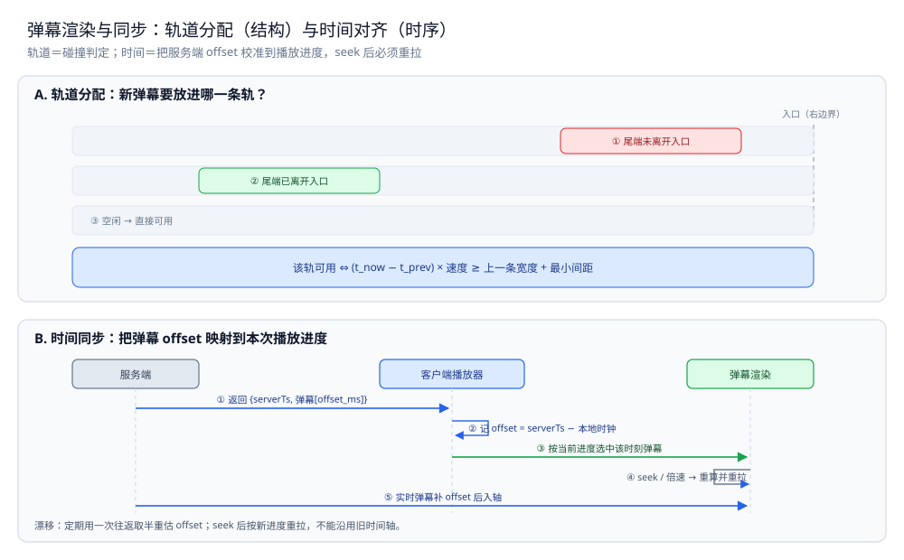

# 弹幕渲染与同步

> 补齐弹幕系统的**客户端一半**：轨道分配与碰撞避让、批量绘制与性能、时间同步（时间戳 + 播放进度对齐、时钟漂移、seek 后重拉）、历史弹幕按需拉取，以及本篇与服务端三篇（[README.md](README.md) / [接入与推送.md](接入与推送.md) / [编排与落库.md](编排与落库.md)）的边界。
>
> 内容整理自个人学习笔记，素材见 [素材清单](../../../素材清单.md)。

---

## 一、弹幕的轨道分配与碰撞避让怎么做？

**本节要点**：弹幕不是「来了就画」，而是先**决定放哪一条轨道**。轨道分配的本质是一次**碰撞判定**：只有当目标轨道上「上一条弹幕的尾巴已经让开」时，新弹幕才能进这条轨。

### 1.1 轨道模型

把屏幕纵向切成 N 条等高的**轨道（lane）**，每条轨道是弹幕的一条泳道：

```text
轨道 0  ──────────────────────────────
轨道 1  ──────────────────────────────
轨道 2  ──────────────────────────────   ← 弹幕在轨道内从右向左移动
...      每轨高度 = 字号 + 上下留白
轨道 N  ──────────────────────────────
```

- **轨道高度**固定（等于一行弹幕的字号 + 留白），所以「一个屏幕能同时显示的弹幕条数」= 轨道数，是个定值；
- **滚动弹幕**（从右到左）走普通轨道；**顶部 / 底部弹幕**是固定位置的「特殊轨道」，单独占位、不参与滚动轨道的分配；
- **不同弹幕可以共用一条轨**，只要在时间上错开（前一条已经走远，不会追上）。

### 1.2 碰撞判据：时间 + 宽度

一条弹幕进入轨道后，会占用这条轨道「一段时间」。判断新弹幕 A 能否进轨道 L，要同时满足**两个条件**：

```text
① 不追尾（与 L 上最后一条 B 相比）：
   (t_now − t_B) × 速度  ≥  宽度(B) + 最小间距

② 不越界（与前一条的右端相比）：
   B 的可视右端已经离开屏幕右边界（或进入屏幕内足够深）
```

直觉上就一句：**B 的「尾巴」必须已经离开了「入口」，A 才能跟在后面进**。这里有两个量随时在变：

- **速度**：所有弹幕**同一速度**（这样它们不会互相追上，只需要防追尾）；速度通常由「屏幕宽度 ÷ 目标穿越时间」决定，速度不同会让后发的弹幕追上先发的。
- **宽度**：由文本长度实时量出来（Canvas 用 `measureText`），宽弹幕占用轨道更久。

### 1.3 满屏时的取舍

当所有轨道都被占满，新的弹幕只有两个选择，且必须**主动选一个**：

| 选择 | 做法 | 代价 |
|---|---|---|
| **丢弃** | 新弹幕直接不显示 | 丢的是「最热的时刻」的弹幕，用户可能看不到自己发的 |
| **重叠** | 允许同一轨道再塞一条 | 视觉上两条弹幕叠在一起，可读性差 |
| **降采样 / 合并** | 按内容或用户合并（同一个人连发只留一条） | 实现复杂，但观感最稳 |

> ⭐ 与 [README.md](README.md) 的服务端结论一致：**弹幕是娱乐性数据，「满屏时丢」是可接受的**。但必须在**客户端也做一层丢弃/降采样**——服务端已经按房间限流了，但一条热门房间的扇出仍可能让单连接每秒收到远超屏幕能显示的条数。客户端的轨道分配，就是**最后一层「丢掉画不下的」**。

### 1.4 轨道的占用是「有期限」的，用完要还

每条轨道记的是「最后一条弹幕的占用信息」（见 1.2）。当这条弹幕**完全离开屏幕**后，它对轨道的占用就结束了，轨道回到空闲——所以轨道状态是**滚动回收**的，不是一直累积。释放的时机有两个：

- **按时间**：一条弹幕的存活时长 = `(屏幕宽 + 弹幕宽) ÷ 速度`，到点即释放；
- **按区间**：seek 或切房间时，整批轨道状态**重置**（见 3.3、4.2），避免沿用旧占用。

> ⚠️ 别让轨道状态无限增长：只保留「当前仍在屏幕上」的弹幕占用信息，否则判定会越来越慢。

---

## 二、弹幕一多为什么会掉帧？怎么画才不卡？

**本节要点**：掉帧的三个来源是**绘制开销、布局开销、内存压力**。用「批量 + 分层 + 对象池」三板斧把它们压下去；但**掉不掉帧取决于具体设备与弹幕量**，必须实测，不能拍脑袋。

### 2.1 卡顿的三个来源

| 来源 | 表现 | 根因 |
|---|---|---|
| **绘制开销** | 每帧对所有弹幕重画一遍 | 弹幕越多、每帧工作量越大 |
| **布局 / 样式开销** | DOM 弹幕每帧改 `left` 触发重排 | 浏览器要重新布局、重新合成 |
| **内存 / GC 压力** | 对象频繁创建销毁导致卡顿 | 每帧 new 一堆对象，GC 抖动 |

对弹幕场景，**用 DOM 逐条渲染是最容易踩坑的**：每条弹幕一个元素、每帧改位置，弹幕一多就会触发大量重排/重绘。所以主流做法是 **Canvas（或 WebGL）批量绘制**。

### 2.2 批量与分层绘制

- **画到 canvas 的位图**：把所有弹幕**画进一个 canvas**，每帧清屏重画，浏览器只合成一张位图，避免了大量 DOM 重排；
- **分层**：把「背景（视频画面）」「弹幕层」「UI 层（发送框等）」分成不同的层，**只有弹幕层每帧重画**，视频与 UI 不动；
- **离屏 / 纹理复用**：文本先渲染成一张小图（或纹理）缓存起来，下一帧只做贴图，不重复做文本排版（`fillText` 的排版是有成本的）。

> ⚠️ 具体「多少弹幕会掉帧、Canvas 比 DOM 快多少」**依赖设备和实现，必须实测**——本篇**不做实测、不给任何帧率数字**（本轮未运行任何渲染实验）。

### 2.3 对象池与渲染节流

| 手段 | 作用 |
|---|---|
| **对象池** | 弹幕对象复用，避免每帧 new / GC（这是 2.1 第三类卡顿的对策） |
| **渲染节流** | 渲染帧率与屏幕刷新率对齐（如 60Hz 就够），不做超出刷新率的额外重画 |
| **按需重绘** | 画面没变化时不重画（如暂停时），省电省 CPU |
| **文本宽度缓存** | 同一条弹幕只量一次宽度，别每帧都 `measureText` |

> ⭐ 一句话：**性能优化的顺序是「少画（分层 / 缓存）→ 便宜地画（批量 / 贴图）→ 少造垃圾（对象池）」**，而不是一上来就上 WebGL。

### 2.4 渲染循环和数据源要解耦

渲染是**每帧一次**的循环，而弹幕的来源有三条——**历史拉取**（第四节）、**实时推送**（[接入与推送.md](接入与推送.md)）、**本地发送后回显**。它们**不应该各自去改渲染**，而应统一**塞进一个「时间轴队列」**，渲染循环每帧只从队列里取「当前时刻该显示的」：

```text
历史 / 实时 / 本地回显  →  时间轴队列（按 offset_ms 排序、按 Seq 去重）
渲染循环（每帧）        →  取「未过期且该显示」的弹幕 → 分配轨道 → 绘制
```

> ⭐ 这样「数据怎么来」和「怎么画」彻底分开：新增一个数据源（比如「只看某人」的过滤），不用碰渲染代码。

---

## 三、客户端和服务端的时间怎么对齐？

**本节要点**：弹幕的**位置由时间决定**——一条弹幕在视频的第 12.5 秒出现，那就必须在**播放进度到 12.5 秒**时从入口进入。所以客户端必须有一条「**弹幕时间 → 播放进度**」的映射，并且要能扛住**时钟漂移**与**用户 seek**。

### 3.1 时间基准：用「视频进度」而不是「墙上时钟」

服务端给每条弹幕带上一个**相对视频的偏移量**（如 `offset_ms = 12500` 表示第 12.5 秒），客户端据此决定何时显示：

```text
弹幕的可显示时刻 = 该弹幕的 offset_ms
当前应显示的弹幕 = { m | m.offset_ms ≤ 当前播放进度 < m.offset_ms + 存活时长 }
```

> ⚠️ 注意：服务端的消息结构（见 [接入与推送.md](接入与推送.md) 的 `Msg{Room, UID, Text, Seq}`）里**只有 `Seq` 没有时间偏移**。要做客户端同步，必须**在 `Msg` 上补一个「视频时间戳」字段**（或者在落库表里存、由历史拉取接口返回）。这是**本篇与服务端三篇交界处最需要显式约定的契约**（见第五节）。

### 3.2 时钟漂移与偏移估计

如果只用「本地墙上时钟」对齐，会踩两个坑：

1. **本地时钟不准**：设备时钟可能和服务器差几秒；
2. **时钟会漂**：长时间的定时器累积误差。

解决办法是**用一次往返测出「本地时间 → 服务器时间」的偏移**，并在播放期间**以播放进度为准**：

```text
① 首次同步：客户端发一次请求带本地时间 t0，服务端回带服务器时间 ts
   估算 offset ≈ ts − (t0 + RTT/2)        （RTT 由请求往返测得）
② 播放期间：用「播放器的当前进度」做时间基准
   弹幕位置 = f(当前进度 − 弹幕的 offset_ms)
```

- **播放进度是权威**：因为弹幕绑的是视频时间，不是墙上时间；视频用播放器的时钟（它自己会校正），所以**以播放进度为准**比以墙上时钟为准更稳；
- **偏移要重估**：切后台、网络切换、长时间播放后，应重新做一次 ①②。

### 3.3 seek / 暂停 / 倍速后的重同步

这是最容易出 bug 的地方——**用户的进度可以任意跳，弹幕必须跟着跳**：

| 事件 | 客户端该做什么 |
|---|---|
| **seek（拖动进度条）** | **丢弃当前屏幕上的弹幕，按新进度重新取一批**（见第四节），不能继续沿旧时间轴播 |
| **暂停** | 弹幕**一起冻结**（位置不再推进），而不是继续滚 |
| **倍速** | 弹幕的推进速度要**乘上倍速**，否则会与视频不同步 |
| **切后台再回来** | 重新对齐进度，丢弃期间应显示但已过期的弹幕 |

> ⭐ 一句话：**弹幕的时间轴永远跟着播放进度走；任何让进度突变的事件，都要触发「重取 + 重排」。** 忽略这一点，seek 之后屏幕上会残留一批「上一段的弹幕」，非常明显。

### 3.4 为什么不能直接信「消息到达时刻」

如果客户端拿「消息到达的本地时刻」当弹幕时间，会得到两种错位：

- **网络抖动**：同一秒发的两条弹幕，到达时间可能差几百毫秒，画出来就一前一后；
- **时钟偏差**：设备时钟和服务器差几秒，弹幕会整体偏移。

> 所以**到达时刻只能用于「补漏」的判定，不能用于「定位」**——定位一律以服务端给的视频时间戳 + 播放进度为准（见 3.1、3.2）。



---

## 四、历史弹幕什么时候拉、拉多少？

**本节要点**：实时弹幕由服务端推送（见 [接入与推送.md](接入与推送.md)），但**历史弹幕要客户端主动拉**。原则是**按需、按区间拉**：用户看到哪一段，就只拉那一段。

### 4.1 进入房间

进入房间时，客户端需要「**从现在这一刻开始的弹幕**」：

```text
① 请求「当前进度 = 0 附近的一段」（如 [0s, 10s]）作为首屏
② 同时订阅实时推送，把新弹幕接到时间轴上
③ 播放推进时，若下一段还没拉，就预拉下一段（[10s, 20s]）
```

- **按区间分片拉取**：一次拉一个「时间段」，而不是一次拉全量（全量在热门视频上是巨大的）；
- **预拉阈值**：当播放进度接近已拉区间的尾部时，异步拉下一段，避免「播到了还没拉到」的空窗。

### 4.2 快进与回退

- **快进到未拉过的区间**：丢弃旧弹幕，按新进度**重新拉当前区间**；
- **回退到已拉过的区间**：可以直接用本地已缓存的那一段（如果有缓存），或重新拉（简单但多一次请求）；
- **拖动时不要每移动一像素就发一次请求**：应当**节流**，在用户**松手后**才发最终位置的拉取请求。

### 4.3 与实时链路的衔接

历史拉取与实时推送会出现**重叠区间**（拉历史时，实时推送也在来），必须**去重**：

| 去重依据 | 说明 |
|---|---|
| **`Seq`（服务端分配）** | 服务端在 [编排与落库.md](编排与落库.md) 的 `Node.Accept` 里**统一分配 `Seq`**，历史与实时同一份数据共享同一批 `Seq`，用它去重最可靠 |

> ⭐ 关键：**不要把「按文本 + 用户 + 时间」当去重键**——同一个人在同一秒可能发两条一样的弹幕（刷屏），会被误合。**用服务端分配的 `Seq`**（也见 [接入与推送.md](接入与推送.md)：`Seq` 是「补漏」的依据）。

### 4.4 拉取要有边界，也要能批量

- **区间有边界**：一次只拉一个固定的时间区间（如 10 秒），不要「拉到最后」；
- **请求可合并**：拖动进度条时应**节流**，只在松手后发一次请求（见 4.2）；
- **响应要能裁剪**：服务端返回的区间可能比请求的略大，客户端要**按当前进度裁掉过期的**再入队；
- **失败要能重试**：区间拉取失败时，下次预拉仍应覆盖这一段（拉取要幂等，按区间去重）。

> ⚠️ 拉取接口最好**同时返回该区间的 `Seq` 范围**（起止序号），这样「这一段到底拉全没有」是可判定的，而不是靠猜。

---

## 五、本篇和服务端三篇的边界在哪？

**本节要点**：服务端三篇管「**弹幕怎么进来、怎么扇出、怎么落库**」，本篇管「**弹幕到了客户端之后怎么画、怎么和时间对齐**」。两边的**交接契约只有两条：`Seq` 与「视频时间戳」**。

### 5.1 服务端三篇各管什么

| 篇 | 管什么 | 不管什么 |
|---|---|---|
| [README.md](README.md) | 四层设计总纲：限流、双路径、缓存落库、发布订阅扇出 | 客户端怎么画 |
| [接入与推送.md](接入与推送.md) | 数据面与线格式、第 1 层限流、`Publisher` 抽象、**连接侧**慢隔离（`Sub` / `Room`） | 客户端轨道与绘制 |
| [编排与落库.md](编排与落库.md) | `Node.Accept` 的四层编排顺序、`BatchWriter` 批量落库与背压 | 客户端时间轴 |

**本篇（客户端）**正好是这三篇的「消费端」：把服务端推来的消息，画到屏幕上、和时间对齐。

### 5.2 交界处的两条契约

| 契约 | 服务端负责 | 客户端负责 |
|---|---|---|
| **`Seq`** | 在入口**统一分配**（见 [编排与落库.md](编排与落库.md)：`m.Seq = seq`，广播层**不得改写**） | 用 `Seq` 做**去重**（历史 + 实时）与乱序重排 |
| **视频时间戳** | 需要**新增**：`Msg` 里补一个 `offset_ms`（见 [接入与推送.md](接入与推送.md) 的 `Msg` 结构） | 用 `offset_ms` 决定弹幕的显示时刻与轨道存活时间 |

> ⚠️ 这两条契约是本篇和服务端三篇之间**唯一需要双方对齐的接口**。`Seq` 三篇里已经就位；**视频时间戳在现有 `Msg` 结构里没有**——这是联调时第一个要补的字段。

### 5.3 最容易漏的联调点

- **弹幕「飘」起来不同步**：多半是客户端用了墙上时钟而非播放进度（见 3.2）；
- **seek 后残留旧弹幕**：没做「丢弃 + 重取」（见 3.3）；
- **历史与实时重复**：去重键没用 `Seq`，而是用了文本（见 4.3）；
- **服务端推得比屏幕能显示的多**：客户端缺少「满屏丢弃 / 降采样」（见 1.3）；
- **`Seq` 在多节点下不唯一**：`Bus` 的进程内自增在分布式下会撞号（见 [编排与落库.md](编排与落库.md) 第 115 行附近的注释），必须换成全局唯一发号器，否则客户端去重会把弹幕吃掉。

### 5.4 边界上要写清「谁分配 ID、谁负责去重」

联调出问题，八成是**两边都以为对方负责**。所以在边界上要白纸黑字写下来：

| 事项 | 归属 |
|---|---|
| 分配 `Seq` | 服务端入口（见 [编排与落库.md](编排与落库.md)） |
| 分配视频时间戳 | 服务端（需在 `Msg` 补字段，见 5.2） |
| 历史与实时去重 | 客户端（用 `Seq`，见 4.3） |
| 满屏丢弃 / 降采样 | 客户端（见 1.3） |
| 断线后补漏 | 服务端落库 + 客户端按 `Seq` 补齐 |

> ⭐ 一句话：**交界处的每一项都要有唯一的负责人**。没有归属的接口，就是下一个 bug 的入口。

---

## 使用：轨道分配与时间轴对齐的骨架

**本节要点**：把前几节压成两端骨架——**轨道分配 / 碰撞判定**（一）、**时间轴对齐与 seek 重取**（三、四）。客户端渲染用 TypeScript，便于对照主流前端栈。

> ⚠️ **未实测**：本轮**未在本机运行**下面两段代码，也**未做类型检查**（本轮不做新实测、不搭前端运行环境）。它们是**按语义补全的骨架片段**（省略 import 与类型定义），因此**不给任何帧率、耗时等读数**；凡涉及具体性能的地方都以「需实测」标注。

**第一段：轨道分配与碰撞判定**

```ts
// 一条待显示的弹幕：offsetMs 为相对视频的偏移，width 为文本渲染宽度。
interface Danmaku {
  id: number;
  text: string;
  offsetMs: number;
  width: number;
}

// Track 记录一条轨道上「最后一条弹幕」的信息，用于碰撞判定。
interface Track {
  lastOffsetMs: number; // 上一条进入本轨的时间偏移
  lastWidth: number;    // 上一条的宽度
}

// pickTrack 返回可用轨道下标；没有可用轨道返回 -1（调用方据此丢弃或降采样）。
// 判据（见 1.2）：新弹幕不能追上上一条，且上一条的尾巴要已离开入口。
// ⚠️ 未实测：未运行，speed / minGap 为示意参数。
function pickTrack(tracks: Track[], nowOffsetMs: number, width: number,
                   speed: number, minGap: number): number {
  for (let i = 0; i < tracks.length; i++) {
    const t = tracks[i];
    const elapsed = nowOffsetMs - t.lastOffsetMs;
    // 不追尾：上一条走过的距离，要足够放下它自己的宽度 + 最小间距
    if (elapsed * speed >= t.lastWidth + minGap) {
      return i;
    }
  }
  return -1; // 满屏：按 1.3 的取舍处理（丢弃 / 重叠 / 合并）
}
```

**第二段：时间轴对齐与 seek 重取**

```ts
// SyncClock 负责「弹幕时间 ↔ 播放进度」的映射（见第三节）。
// ⚠️ 未实测：未运行；真实实现还需处理切后台与网络切换后的重估。
class SyncClock {
  private baseOffsetMs = 0; // 播放进度与弹幕时间的对齐基准

  // calibrate 用一次往返估算本地与服务端的偏移（见 3.2）。
  // 具体要在真实网络下测 RTT 的稳定性，本骨架不假设任何数值。
  calibrate(serverTs: number, localTs: number, rttMs: number): void {
    const offset = serverTs - (localTs + rttMs / 2);
    this.baseOffsetMs = offset; // 实际还要做平滑 / 多次采样取中位数
  }

  // currentOffset 以「播放进度」为权威（见 3.2），而不是墙上时钟。
  currentOffset(playProgressMs: number, playbackRate: number): number {
    return playProgressMs * playbackRate + this.baseOffsetMs;
  }
}

// onSeek 处理 seek：丢弃旧弹幕并按新进度重取（见 3.3、4.2）。
// ⚠️ 未实测：未运行；这里只画调用顺序，不含真实的拉取与渲染。
function onSeek(newProgressMs: number): void {
  clearOnScreen();                       // ① 丢掉屏幕上的旧弹幕
  const range = fetchRange(newProgressMs); // ② 按新进度拉一个区间（见 4.x）
  resetTracks();                         // ③ 轨道状态清零，避免沿用旧占用
  enqueue(range);                        // ④ 把新区间的弹幕排入时间轴
}
```

---

## 延伸追问

- **为什么弹幕要「同一速度」？** → 只要速度相同，后发的**永远不会追上**先发的，碰撞判定就退化成「只要不追尾即可」，实现大幅简化。速度不同则要处理「追上前车怎么办」，得不偿失。
- **顶部 / 底部弹幕和滚动弹幕能共用轨道吗？** → 不能。滚动弹幕是**移动**的（要判追尾），顶部 / 底部是**固定位置停留**的（只判时间重叠）。两类占位规则不同，混在一起会互相干扰。
- **历史弹幕要不要本地缓存？** → 要，但要设**上限**（比如只缓存最近几分钟 / 几个区间）。缓存能省回退时的请求，但无上限地缓存热门房间的历史，会把客户端内存吃满。
- **服务端已限流，客户端还需要丢弃吗？** → 需要。服务端限的是「一个房间的总量」，但**单连接收到的量仍可能远超屏幕能显示的条数**（扇出是发给人人的）。客户端的轨道分配就是「按屏幕容量」再丢一层。
- **`Seq` 为什么不能用到达顺序代替？** → 因为**网络会乱序**，到达顺序不等于发送顺序；而且历史拉取与实时推送会重叠，必须有一个**全局唯一的单调序号**来排序与去重，这正是服务端分配 `Seq` 的用途。

## 关联

- [README.md](README.md) — 服务端总纲：四层设计（限流 / 双路径 / 缓存落库 / 发布订阅扇出）
- [接入与推送.md](接入与推送.md) — `Msg` 的线格式与 `Seq`、连接侧慢隔离：本篇的推送来源
- [编排与落库.md](编排与落库.md) — `Node.Accept` 统一分配 `Seq`、`BatchWriter` 落库：历史弹幕的持久化来源
- [Java实现.md](Java实现.md) — 同一套四层骨架的 Java 版（服务端）
- [README.md](../README.md) — 上层目录导读：三个专题系统怎么配合
- [README.md](../社交互动系统/README.md) — 同为高并发场景，可对照「读多写少」与「扇出」的不同处理
- [README.md](../../分布式/README.md) — 时间同步、发号器等零件相关的原理线
