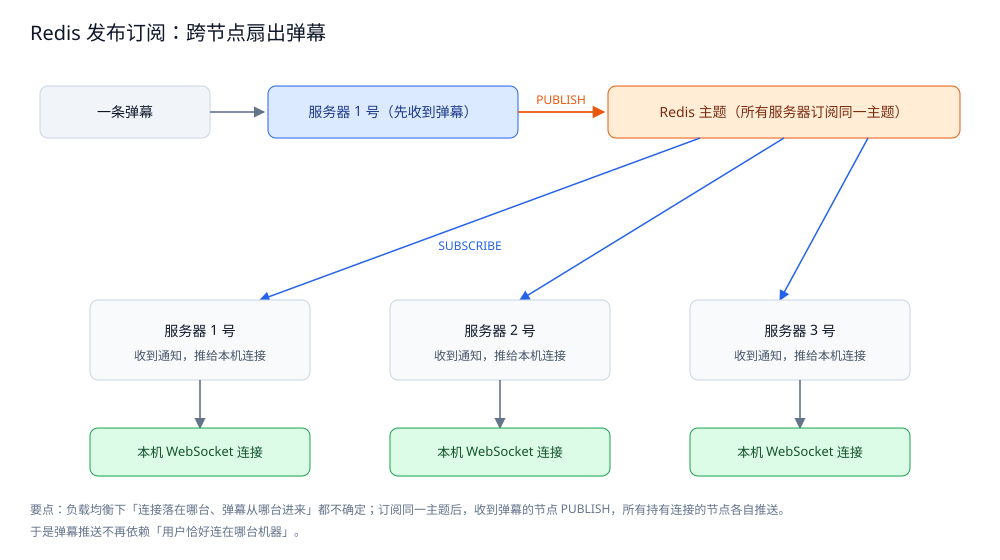

# 总体设计

> 本系统**整体方案**：分几层 / 几部分、各干什么、怎么配合、核心取舍在哪。
> **各部分的细节**在零件篇里；**数据落点**在存储全景里；**篇目清单与阅读顺序**在 README 里。
>
> 本目录收**弹幕系统**这道场景题：本篇是**总体设计**（整体形态 + 核心取舍 + 一次弹幕走哪几步），
> 篇目清单与阅读顺序见 [README.md](README.md)，数据落点见 [存储全景.md](存储全景.md)；四篇零件各自成篇 ——
> [接入与推送.md](接入与推送.md)（数据面与限流 / 连接侧隔离 / 房间订阅 / 跨节点推送抽象）、
> [编排与落库.md](编排与落库.md)（`Node.Accept` 四层编排 / `BatchWriter` 批量落库 / 四组实测）、
> [Java实现.md](Java实现.md)（同一套四层的 Java 逐类型移植）、
> [弹幕渲染与同步.md](弹幕渲染与同步.md)（轨道分配 / 批量绘制 / 时钟对齐 / seek 重拉）。
>
> 内容整理自个人学习笔记，并参考《大型网站技术架构：核心原理与案例分析》（李智慧）的伸缩性与可用性章节；参考资料与原始素材见 [素材清单](../../../素材清单.md)。
> **落地实现**：前两篇 Go 骨架（Go 1.26、`github.com/redis/go-redis/v9 v9.22.0`）已通过 `go build` / `go vet` / `gofmt -l` 校验，
> 正文表格为 `go test` 本机实测输出；跨机器那一维用**进程内 `Bus`** 顶替验证（只证逻辑、不证网络与多进程）。

---

## 一、系统的整体形态是什么？

**本节要点**：弹幕的整体形态是一条**先过滤、再分叉**的链 —— 第一步用最便宜的方式挡掉刷屏，剩下的同一条弹幕**一分为二**：一条走"立刻广播给所有人"的推送链，一条走"慢慢攒批落库"的持久化链。两条链的容忍度相反，所以从入口就分开。

一句话概括：**先用一道闸挡掉刷屏，再把同一条弹幕同时喂给推送链与持久化链。**


图怎么读：这张图是本目录共用的四层架构图，但这里要当**分层职责 + 两道闸**看，而不是只看"四层从上到下"的表面顺序。第 1 层是**入口闸**——按用户 / 设备 ID / 客户端限频，触发就**直接丢弃、不进入后面任何链路**，所以被挡掉的弹幕不占用后面三层任何资源；第 2 层是**分叉点**——同一条弹幕分成推送链路与持久化链路；第 3 层是**持久化链的下半个闸**——先写 Redis 再批量落库，队列满时**丢新的并计数**（这就是投递侧的背压）；第 4 层是**扇出网**——所有节点订阅同一主题，谁收到谁 PUBLISH，持有连接的节点各自推给自己那批在线用户。读这张图要抓住一件事：**两道闸（第 1 层入口限流、第 3 层队列满即丢）都是"主动放弃一部分数据"的设计**，这正是弹幕敢用最轻方案的前提。

按数据流，整个系统分**四层 + 客户端**，每一格只干一件事：

| 部分 | 干什么 | 关键判据 | 细节在哪 |
|---|---|---|---|
| **第 1 层 · 接入限流** | 把刷屏请求挡在所有后续链路之前 | 按用户 / 设备 ID / 客户端限频，超限**直接丢弃** | [接入与推送.md](接入与推送.md) 二 |
| **第 2 层 · 双路径分流** | 同一条弹幕拆成推送链与持久化链 | 两条链容忍度相反，**必须分开** | [编排与落库.md](编排与落库.md) 一 |
| **第 3 层 · 缓存优先 + 批量落库** | 先写 Redis，再攒批 + 定时落库 | 每条写库会把写 TPS 顶到查询 TPS | [编排与落库.md](编排与落库.md) 二 |
| **第 4 层 · 跨节点扇出** | 发布订阅把弹幕扇给所有持有连接的节点 | 连接位置不确定 → 不能只靠单机内存映射 | [接入与推送.md](接入与推送.md) 二、三 |
| **客户端** | 分轨道渲染、与播放器时钟对齐、seek 后重拉 | 弹幕位置**由时间决定**，不信"到达时刻" | [弹幕渲染与同步.md](弹幕渲染与同步.md) |

⭐ 顺序不是随便排的：**前一层把请求挡住了，后一层才不会被压垮** —— 实测：同一 uid 用"1 分钟 1 条"的窗口限流尝试发 1000 条，**只有 1 条放行**，其余 999 条在入口就被丢掉，不占后面三层任何一秒 CPU。

⭐ 一个容易忽略的对称：**入口限流（第 1 层）与队列满即丢（第 3 层）是同一件事的两端** —— 前者在"最贵资源之前"丢，后者在"内存将被吃干时"丢；两侧都把"丢弃数"当作必须上报的健康度指标。

---

## 二、核心取舍在哪？

**本节要点**：三个取舍决定了这套方案的长相 —— **允许丢换来吞吐、一条弹幕拆两条路、连接位置不确定只能靠发布订阅**。每个取舍都配本机实测；取舍的方向不是"谁更先进"，而是"**在哪一侧丢、丢多少可以接受**"。

### 2.1 取舍一：允许丢失，换吞吐与低延迟

弹幕是**娱乐性数据**：生产成本极低（用户只需编辑发送）、重要性低（**丢几条不影响业务**）。这条性质一路推导出三个设计动作：

```text
可容忍丢失
   ├─► 缓存优先：先写 Redis，不直接写库（读写性能远高于 MySQL）
   ├─► 批量落库：攒够 N 条或超过 T 时间才 flush，把"每条一写"换成"批量写"
   └─► 队列满即丢：非阻塞入队，队满丢新的并计数（不阻塞生产者）
```

**实测（批量落库的背压）**：队列容量 500、单批 100、入队 2000 条，只调出口耗时。

| 单批落库耗时 | 入队成功 | 丢弃 | 已落库 | 失败批次 |
|---|---|---|---|---|
| 0（不阻塞） | 500 | 1500 | 500 | 0 |
| 5ms | 600 | 1400 | 600 | 0 |

两行合起来的结论值得记住：**队列一满就开始丢，落库变快变慢都救不回来** —— 因为生产速度（纳秒级入队）远高于消费速度。真正能救的是**加大队列 + 加消费协程**，或反过来给入口限流（回到第 1 层）。

⭐ 一句话对照：**别处的热副本丢了是"变慢"或"要补"，弹幕的热副本丢了就是丢了、也不打算补** —— 这正是它敢用最轻方案（内存广播 + 异步归档）的底气。

> ⚠️ 这条取舍**只对娱乐性数据成立**：换成订单、余额、审计类数据，落库必须改成"落本地 WAL + 重试 + 告警"，降级方向也从"宁可丢"改成"宁可拒绝服务"。见 [编排与落库.md](编排与落库.md) 二。

### 2.2 取舍二：一条弹幕拆两条路

同一条弹幕走**两条独立的链**，各自的容忍度相反：

| 链 | 目的 | 载体 | 丢了会怎样 |
|---|---|---|---|
| **推送链** | 实时展示给在线观众 | 内存 Pub/Sub（广播即弃） | 只是没看到这一条，**不补** |
| **持久化链** | 供直播回放与弹幕分析 | 批量落库（Redis 缓冲 → MySQL / MongoDB） | 长尾回放缺几条，**可接受** |

为什么**必须分开**：如果混在一条链上，落库的抖动会顺着同一条路径**直接变成直播期间的推送尖刺** —— 而直播对延迟最敏感、对完整度最不敏感。

⭐ 关键：这两条链**互补而非冗余**。Pub/Sub **不保留消息**，节点订阅之前或断线期间错过的弹幕永久丢失 —— 所以"断线补拉"只能靠持久化链的 `Seq`：**推送链负责实时、持久化链负责兜底**。实测：topic 没有任何节点订阅时 `Unsubscribed = 1`，消息**静默消失、重连也补不回来**。

### 2.3 取舍三：连接位置不确定 —— 用发布订阅扇出

服务端是**分布式部署**、前面有负载均衡：一个请求落到哪台不确定，用户的 WebSocket 长连接建在哪台也不确定。**只靠单机内存维护连接映射，就会把弹幕推给没有这个连接的机器。**

**实测（有没有共享总线）**：A、B 两节点，用户在 B 上，弹幕从 A 进来。

| 场景 | A 节点 | B 节点 | 结论 |
|---|---|---|---|
| 只有单机内存映射 | 收到 100，投递 64 | **收到 0，投递 0** | B 上那个用户**永远看不到**弹幕 |
| 接入 Pub/Sub | 收到 100 | 收到 100 | 两端连接**各**收到 64 条 |
| topic 没有任何节点订阅 | — | — | `Unsubscribed=1`：消息**静默消失** |

解法就是**引入发布订阅**：所有服务器订阅同一主题 → 收到弹幕的节点 PUBLISH → 所有持有连接的节点各自推给自己的在线用户。**从此刻起，"用户连在哪台机器"和"弹幕打到哪台机器"无关。**



图怎么读：左半边是**问题** —— 分布式部署 + 负载均衡下，请求与 WebSocket 连接各自"落哪台不确定"，若只用单机内存映射，收到弹幕的机器推不到持有该连接的机器（实测里 B 节点"收到 0、投递 0"，用户在 B 上就永远看不到）；右半边是**解法** —— 所有节点订阅同一主题，收到弹幕的节点 `PUBLISH`，每个节点在自己的订阅回调里把弹幕推给本机该房间的连接。看图注意两点：**Subscribe 会独占一条 Redis 连接**（不能拿它去跑别的命令），**Pub/Sub 不保留消息**（发布时没人在订阅，这条就永久丢了）—— 所以它必须与持久化链配合。

**扇出的代价落在连接侧**：一个卡住的客户端（弱网、切后台）若不设上界，会把整房间的消息堆进自己的队列，**最终 OOM 的是服务端**。所以每个连接一个**有界缓冲** + **非阻塞投递**（队满就丢并计数）：

| 每连接缓冲 | 慢连接收到 | 慢连接丢弃 | 快连接收到 |
|---|---|---|---|
| 0 | 0 | 1000 | 1000 |
| 1 | 1 | 999 | 1000 |
| 8 | 8 | 992 | 1000 |
| 64 | 64 | 936 | 1000 |
| 1024 | 1000 | 0 | 1000 |

要点**不是"缓冲越大越好"**：快连接**始终**收到 1000 条，说明**慢连接的丢弃完全没有传染给别人** —— 这才是第 4 层真正要买的东西。缓冲取"能容忍卡顿多久"：`缓冲 / 每秒条数 = 可容忍的卡死秒数`。细节见 [接入与推送.md](接入与推送.md) 三、[编排与落库.md](编排与落库.md) 三。

---

## 三、各部分怎么配合？

**本节要点**：四层不是并列的模块，而是**同一个方法里的四步顺序**；两条链的分叉发生在其中一步，连接侧则是推送链的接缝。

### 3.1 一条弹幕在 `Node.Accept` 里的四步

```text
① 限流        limiter.Allow(uid)   ── 不过就 return false，调用方不要重试
② 分配 Seq    pub.Seq(topic)       ── 序号在入口统一分配，它是"补漏"的依据
③ Publish     pub.Publish(topic)   ── 扇出给所有节点；本机连接由订阅回调收到
④ Enqueue     bw.Enqueue(m)        ── 进批量缓冲、不直写 DB；bw 为 nil 时跳过
```

⭐ 顺序之外的重点是**③④ 是"两条路同时喂"**：真正的关键在于**任一侧阻塞时会不会拖累另一侧**，所以中间必须有队列，而**不是**靠调换 ③④ 的先后。若真要排序：先推后落 = 用户先看到、落库失败只影响回放；先落后推 = 保证"能看到的一定查得到"，但落库延迟叠加到用户感知上。

⭐ 还有一个必须守住的边界：**`Seq` 只在入口分配一次**。广播层若再分配一次，就会和持久化链里的序号对不上，客户端去重时会把弹幕直接吃掉。

### 3.2 两条链各自往哪走

| 分叉后 | 走什么 | 谁消费 | 落点 |
|---|---|---|---|
| 推送链 | `Publish` → 各节点订阅回调 → 本机 `Room.Broadcast` | 每个连接的写协程（真实项目里是 `ws.WriteMessage` 循环） | 网关内存（可丢） |
| 持久化链 | `Enqueue` → 有界队列 → `Run` 攒批 / 定时 flush → `Sink.Write` | 落库协程 | Redis 缓冲 → MySQL / MongoDB（权威源） |

两侧的**丢弃都要计数并暴露给监控**：推送侧是连接的 `Dropped`，持久化侧是 `BatchWriter` 的 `dropped`。**只报 QPS 不报丢弃率，等于把"用户看不到弹幕"这件事藏起来。**

### 3.3 连接侧是推送链的接缝

推送链要"推对"，得三件事同时成立、且口径一致：

| 环节 | 由谁决定 | 对不上的后果 |
|---|---|---|
| **谁能连上** | 连接侧的有界缓冲与隔离（[接入与推送.md](接入与推送.md) 三） | 慢连接拖垮整个房间 |
| **推给谁** | 房间订阅集合（`Room` 的 copy-on-write 快照） | 广播时持锁 → 推送延迟绑死在锁竞争上 |
| **怎么跨节点扇出** | 发布订阅（第 4 层） | 推给了没有这个连接的机器 |

> ⭐ 播报路径**只 Load 快照、遍历不持锁**：因为广播是"每秒上千次读、偶尔写"，所以用 copy-on-write，而不是"广播时持锁遍历 map"。代价是每次增删要复制整个切片，只适合"订阅者数量不大、变更不频繁"的房间。

---

## 四、一次完整弹幕走哪几步？

**本节要点**：把四层串成一条端到端链路，帮助定位"某一步该看哪一节"。服务端七步，客户端再现三步。

| # | 步骤 | 做什么 | 落点 |
|---|---|---|---|
| ① | 客户端发送 | 弹幕正文按线格式编码（`tab` 分隔，实测 48 字节 vs JSON 82 字节，省 1.7 倍） | [接入与推送.md](接入与推送.md) 二 |
| ② | 接入限流 | 按用户 / 设备 ID / 客户端限频，超限**直接丢弃** | [接入与推送.md](接入与推送.md) 二 |
| ③ | 分配 Seq | `INCR` 拿全局递增序号（补漏的依据） | [接入与推送.md](接入与推送.md) 二 |
| ④ | Publish 扇出 | 发布订阅把弹幕广播给所有节点 | [接入与推送.md](接入与推送.md) 二 |
| ⑤ | 各节点推本机连接 | 订阅回调里 `Room.Broadcast`，快连接 `sent++`、慢连接 `dropped++` | [接入与推送.md](接入与推送.md) 三 |
| ⑥ | 非阻塞入队 | `Enqueue` 进有界批量缓冲（队满丢新的并计数） | [编排与落库.md](编排与落库.md) 二 |
| ⑦ | 批量落库 | `Run` 攒够 N 条或超过 T 时间批量写；失败**不重试** | [编排与落库.md](编排与落库.md) 二 |
| ⑧ | 客户端分轨道渲染 | 按"上一条尾巴让开"决定放哪条轨道 | [弹幕渲染与同步.md](弹幕渲染与同步.md) 一 |
| ⑨ | 与播放进度对齐 | 用"视频进度"当时间基准，扛住漂移与 seek | [弹幕渲染与同步.md](弹幕渲染与同步.md) 三 |
| ⑩ | 断线 / seek 补拉 | 带已收到的最大 `Seq`（或目标时间区间）从持久化链补，再去重入轴 | [弹幕渲染与同步.md](弹幕渲染与同步.md) 四 |

```text
发送 → 限流 → 分配 Seq ─┬─ Publish（推送链）→ 各节点 Broadcast → 客户端分轨道渲染
                        │
                        └─ Enqueue（持久化链）→ 攒批 → 批量落库
断线 / seek：带最大 Seq 或时间区间从持久化链补拉 → 去重 → 重新入轴
```

⚠️ 三个常见误区：① 以为"推送成功了就不用落库" —— Pub/Sub 不保留消息，断线期间错过的只能靠落库补；② 以为"广播时要加锁保护订阅集合" —— 会持锁遍历，把推送延迟绑死在锁竞争上；③ 以为"慢连接丢的消息要补偿" —— 补偿会让过载连接把压力传染回存储层，正确做法是两头都明确"可以丢"并上报丢弃率。

---

## 五、这套方案的前提与边界是什么？

**本节要点**：这套"可丢 + 双链 + 发布订阅"的方案，成立的前提是数据本身可丢；跳出这个前提，答案要整个换掉。

| 场景 | 这套方案 | 为什么 |
|---|---|---|
| **娱乐性、可容忍丢失**（直播弹幕、礼物特效） | ✅ 适用 | 丢几条不影响业务，可用最轻的内存广播 |
| **量极大、生产成本极低** | ✅ 适用 | 生产远快于消费，必须靠背压与批量落库把成本摊薄 |
| **长连接 + 多节点扇出** | ✅ 适用 | 连接位置不确定，发布订阅是唯一不做连接的解法 |
| **消息不能丢**（IM / 订单通知） | ❌ 不适用 | 那是 [IM 系统](../IM系统/README.md) 的领域：必须"落库 + ACK + 补拉"，降级方向是"宁可晚到不可丢" |
| **需要审计 / 计费** | ❌ 不适用 | 不能静默丢弃；要改成"背压 + 入口限流"，宁可拒绝服务 |
| **客户端只要"看对了"** | ❌ 单靠服务端不够 | 轨道分配、时钟对齐、seek 重拉是服务端管不到的另一半，见 [弹幕渲染与同步.md](弹幕渲染与同步.md) |

依赖的外部条件：

- **长连接网关**：每个连接一条有界缓冲 + 一条写协程；`Close` 必须幂等（主动离开 / 心跳超时 / 连接断开三条路径都会走到）。
- **Redis 发布订阅**：`Subscribe` 独占一条连接（不能与普通命令共用），且**不保留消息**。
- **全局唯一 `Seq`**：多节点下必须用 `INCR` 或雪花，进程内自增只够跑通逻辑。
- **批量落库出口**：生产是 MySQL / MongoDB 的 batch insert；**失败不重试**是弹幕特有的选择。
- **限流的共享计数**：多节点部署时限流必须换成共享计数，否则 N 台各放一遍 = 实际限额是配置值的 N 倍。

> ⚠️ **读数口径**：本篇与本目录的表格均为 `go test` 在本机单进程、内存版 `Bus` 下的实测输出，只用于对比数量级与验证结构；**跨机器那一维未实测**（用进程内 `Bus` 顶替，只能证明逻辑、证明不了网络与多进程）。时序类数字受调度影响，多次运行会在区间内浮动（如批量落库入队数在 500~600 之间）。

---

## 使用：本方案的组件清单

**本节要点**：把上述方案落成组件，各自承担什么角色、以什么形态部署。

| 组件 | 承担什么 | 部署形态 | 数据角色 |
|---|---|---|---|
| **Redis** | 发布订阅（跨节点扇出）+ 热点房间缓存 + 落库缓冲 | 单实例起步；生产 Pub/Sub 与缓存分开部署/分片 | **副本** —— 广播即弃、可从落库弹幕重建 |
| **MySQL（或 MongoDB）** | 弹幕本体，供回放与分析 | 主从；**只能批量写**，不能每条一写 | **权威源** —— 回放与分析不可重建 |
| **对象存储 + 列存** | 历史弹幕归档 + 弹幕分析副本 | 对象存储 + 列存文件 | 归档 / 分析副本 —— 用最便宜介质 |
| **WebSocket 网关** | 持有长连接、房间订阅、有界缓冲与投递 | 多实例 + 负载均衡；每连接一条写协程 | 无（内存态，可丢） |
| **MQ（可选）** | 落库解耦 / 削峰（替代"定时任务批量写"） | 按量级选型；小规模可直接用定时任务 | 传输通道 |
| **Go 骨架** | 四层的示意实现（限流 / 扇出 / 连接隔离 / 批量落库） | 无状态服务，可水平扩 | 无（业务逻辑） |

⭐ 这套清单的判据只有一条：**权威源只有一个（MySQL 里的弹幕本体），其余全是它的派生** —— 派生载体可以丢、可以换、可以重建，只要权威源在。各角色的完整落点见 [存储全景.md](存储全景.md)。

## 延伸追问

- **弹幕该推还是拉？** → 小规模直接广播；大规模以「房间订阅 + 服务端推」为主，配合客户端按区间批量拉取做补偿。核心是**别让每个观众都去扫全量**（见 [弹幕渲染与同步.md](弹幕渲染与同步.md) 四）。
- **弹幕丢了算事故吗？** → 不算。弹幕不涉及经济损失，降级方向是 **fail-open（宁可丢掉几条、不可拖垮直播）**；这与 IM 的"宁可晚到不可丢"正好相反（见 5 的边界表）。
- **慢连接被丢弃的消息要不要补偿？** → 不要。补偿会让一个本已过载的连接把压力**传染回存储层**，反而放大故障面；正确做法是入口限流 + 投递侧非阻塞，并把丢弃率暴露到监控（见 2.3）。
- **`Node.Accept` 里"推送"和"落库"的先后能换吗？** → 语义上可以，但**关键不在这**：真正的关键在于"任一侧阻塞时会不会拖累另一侧"，所以中间必须有队列，而不是靠调用顺序（见 3.1）。
- **订阅关系为什么用 copy-on-write 快照？** → 因为广播**读远多于写**、且**遍历时不能持锁**；代价是每次增删要复制整个切片，只适合订阅者数量不大、变更不频繁的房间（见 3.3）。
- **跨机器那一维怎么证明真分布式下也对？** → **证明不了**。本目录用进程内 `Bus` 顶替，只能验证广播逻辑与连接隔离的算法，证明不了 Redis Pub/Sub 的真实语义（不保留消息、订阅独占连接）—— 这是明确标注的未实测边界。

## 关联

- [README.md](README.md) — 目录导读：核心问题 / 篇目清单 / 阅读顺序 / 目录分工。
- [存储全景.md](存储全景.md) — 横切篇：弹幕的数据都存哪、哪些能丢、怎么同步。
- [接入与推送.md](接入与推送.md) — 前两段骨架：数据面与限流、连接侧隔离与房间订阅、跨节点推送抽象。
- [编排与落库.md](编排与落库.md) — 后两段骨架：`Node.Accept` 四层编排、`BatchWriter` 批量落库、四组实测。
- [Java实现.md](Java实现.md) — 同一套四层的 Java 逐类型移植（原语对照 / 毒丸退出）。
- [弹幕渲染与同步.md](弹幕渲染与同步.md) — 客户端渲染与时间同步：轨道分配 / 批量绘制 / 时钟对齐 / seek 重拉。
- [总体设计.md](../IM系统/总体设计.md) — 同为长连接 + 扇出场景，但 IM 消息**不能丢**，对照看取舍差在哪。
- [总体设计.md](../秒杀系统/总体设计.md) — 另一类高并发场景（稀缺资源扣减）：同样有"入口限流 + 削峰"两道闸，可对照阅读。
- [文件存储与上传架构.md](../文件存储与上传架构.md) — 同为场景设计题的姊妹篇。
- [发布订阅.md](../../../03-数据与中间件/数据存储/NoSQL/Redis/发布订阅.md) — 第 4 层跨节点推送依赖的机制。
- [README.md](../README.md) — 系统设计分区导读，本目录是其下的一个主题目录。
- [存储选型与组合.md](../../../03-数据与中间件/数据存储/存储架构与场景/存储选型与组合.md) — 通用视角：数据角色、权威源与副本、冷热分层与多存储同步。
