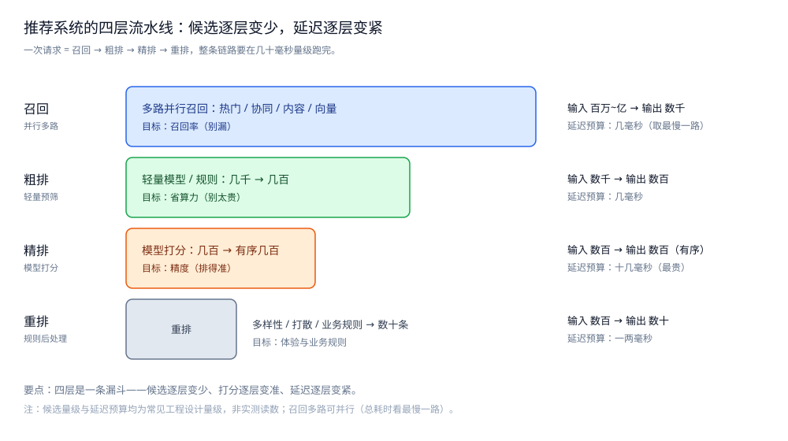

# 推荐系统

> 本目录收**推荐系统**这道系统设计题：一篇**总体设计** + 两篇零件篇 + 一篇存储横切篇。
> 本篇是目录导读，只给「这个系统有哪几个核心问题、有哪些零件、怎么读」三件事，
> 每个问题的解法在零件篇里；本目录不重述具体方案。
>
> 内容整理自个人学习笔记，素材见 [素材清单](../../../素材清单.md)。

---

## 一、这个系统有哪几个核心问题？

**本节要点**：推荐的工程难点不在「有一个好模型」，而在「**一次请求要在几十毫秒内，从几百万条内容里挑出用户会看的十几条**」—— 模型只是这条流水线里的一个算子，架构决定它有没有机会发挥作用。

| # | 问题 | 一句话 |
|---|---|---|
| ① | **分层流水线** | 召回 → 粗排 → 精排 → 重排，候选逐层变少、打分逐层变准、延迟逐层变紧 —— 为什么必须分层？ |
| ② | **在线 / 离线 / 近线三条链路** | 离线算得慢但样本全、在线算得快但只看当下、近线补上「来不及离线」的那段，之间靠什么交接？ |
| ③ | **特征** | 特征从哪来、存在哪、怎么保证训练与线上读到的口径一致（线上线下一致性）？ |
| ④ | **延迟预算与降级兜底** | 一次请求几十毫秒怎么切给四层？任意一层超时或报错，退到哪？ |

⭐ 四个问题互相咬合：分层的账（①）决定了延迟预算怎么切（④）；特征口径（③）决定了离线与在线能不能对齐（②）；而兜底（④）又必须**不依赖模型**，所以退路也得从特征与统计里出。**四层各自解决什么、为什么分层**，见 [总体设计.md](总体设计.md) 第一节。



图怎么读：四层是一条漏斗，每一格都写着「输入 → 输出」和延迟预算——召回（百万~亿 → 数千，多路并行、总耗时取最慢一路）→ 粗排（数千 → 数百，省算力）→ 精排（数百 → 有序数百，最贵，十几毫秒）→ 重排（数百 → 数十条，多样性 / 打散 / 业务规则）。**图中候选量级与延迟预算都是常见工程设计量级，不是实测读数**；要记的是那句趋势：候选逐层变少、打分逐层变准、延迟逐层变紧。

---

## 二、这套笔记有哪些零件？

**本节要点**：一篇总体设计先给出「四层漏斗 + 三条链路」的整体方案与三个核心取舍，两篇零件按「**先看分层怎么落**，再看**特征与兜底怎么保证可用**」切开，最后一篇存储全景是横切收口。

| 篇 | 回答什么问题 | 关键词 |
|---|---|---|
| [总体设计.md](总体设计.md) | 整体分几层、三个核心取舍、一次请求走哪几步 | 整体形态 / 核心取舍 / 全链路 / 前提与边界 |
| [召回与排序.md](召回与排序.md) | 四层漏斗逐层怎么落成服务：输入输出、延迟、服务化与超时降级 | 多路召回 / 粗排 / 精排 / 重排 / 降级 |
| [特征与冷启动.md](特征与冷启动.md) | 特征从哪来、怎么保证线上线下一致、冷启动与兜底怎么办 | 特征来源 / 一致性 / 冷启动 / 探索 / 兜底 |
| [存储全景.md](存储全景.md) | 这个系统的数据都存哪 | 数据角色 / 载体 / 读写路径 / 与其它系统的差异 |

⭐ 前两篇是设计篇（总体设计 + 零件）；[存储全景.md](存储全景.md) 是横切篇（跨零件看"数据存哪"）。

### 2.1 四层分别落在哪篇

```text
总体设计.md      → 整体形态 + 三个核心取舍 + 一次请求走哪几步
召回与排序.md    → 召回 / 粗排 / 精排 / 重排 逐层落成服务（输入输出、延迟、降级）
特征与冷启动.md  → 特征来源三分 + 线上线下一致性 + 冷启动 / 探索 / 兜底
```

> 注意 **特征是与两篇都相关的接缝**：召回与精排都要读特征，冷启动与兜底也建立在特征与统计之上 —— 所以「特征从哪来、怎么对上」只能放在 [特征与冷启动.md](特征与冷启动.md) 讲一次。

---

## 三、按什么顺序读？

**本节要点**：先看**总纲**（四层漏斗 + 三条链路的整体图），再读**召回与排序**（把漏斗逐层落成服务），最后读**特征与冷启动**（串起两条链路的特征、补上冷启动与兜底）；存储全景最后收口。

### 3.1 推荐顺序

```text
① 总体设计.md          ← 总体设计：整体形态 + 三个核心取舍 + 一次请求走哪几步
        ↓
② 召回与排序.md        ← 分层落地：每层的输入输出、延迟预算与超时降级
        ↓
③ 特征与冷启动.md      ← 特征与可用性：特征来源 / 线上线下一致 / 冷启动 / 兜底
        ↓
④ 存储全景.md          ← 横切收口：以上几篇的数据分别落在哪、怎么同步
```

**反过来也成立**：如果只关心"特征怎么保证线上线下一致、冷启动怎么兜底"，可以直接从 [特征与冷启动.md](特征与冷启动.md) 读起。

### 3.2 依赖关系

| 本篇 | 建议先读 | 为什么 |
|---|---|---|
| [召回与排序.md](召回与排序.md) | [总体设计.md](总体设计.md) | 先有"四层漏斗为什么分层"的整体图，才理解每层的输入输出与延迟上限 |
| [特征与冷启动.md](特征与冷启动.md) | [召回与排序.md](召回与排序.md) | 特征是为召回与精排服务的；先知道谁要读特征，才谈得上一致性 |
| [存储全景.md](存储全景.md) | 前两篇任意 | 它是横切收口，先理解零件再看数据落点更顺 |

⭐ 一条记忆线：**"为什么分层"看总纲，"每层怎么落"看召回与排序，"特征与兜底"看特征与冷启动** —— 只看模型不看链路，就会得到"离线很好、线上超时"。

### 3.3 三种常见的读错顺序

| 读法 | 后果 |
|---|---|
| 先读特征、后读分层 | 特征存储记住了，但"为什么精排要重、召回要轻"接不上 |
| 只读召回与排序、跳过特征 | 每层的输入输出讲得通，但"特征从哪来、怎么对上"无从谈起 |
| 三篇各读一半 | 分层、特征、兜底各一条线，在"一次请求的延迟预算"上对不齐 |

---

## 四、与其它目录怎么分工？

**本节要点**：推荐是**把分布式服务与数据链路拼成系统**的场景题 —— 模型数学在别处，本目录只讲「服务架构怎么分层、延迟怎么切、兜底怎么保」。

| 相关目录 | 分工 |
|---|---|
| [README.md](../Feed流系统/README.md) | 相邻读侧场景：Feed 流的排序、去重与时间线分页，和推荐的重排 / 排序是同一条问题 |
| [排行榜设计.md](../社交互动系统/排行榜设计.md) | 另一类「海量候选里挑前 N」：那边用分数排序，这里用模型打分 |
| [向量与AI搜索.md](../../../03-数据与中间件/数据存储/搜索与分析/Elasticsearch/向量与AI搜索.md) | 向量召回这一路依赖的向量检索机制；本目录只讲"怎么用它召回" |
| [README.md](../../../03-数据与中间件/数据存储/缓存/README.md) | 特征存储与候选缓存要面对的穿透、击穿与淘汰问题 |
| [存储选型与组合.md](../../../03-数据与中间件/数据存储/存储架构与场景/存储选型与组合.md) | 通用判据（角色 / 同步 / 冷热）；本篇的 [存储全景.md](存储全景.md) 是它在推荐上的落地 |
| [README.md](../README.md) | 系统设计分区导读，本目录是其下的一个主题目录 |

**本目录收什么、不收什么**：

| 收 | 不收（在哪） |
|---|---|
| 召回 → 粗排 → 精排 → 重排 的分层判据与延迟预算 | 模型结构 / 损失函数 / embedding 训练 → 算法侧 |
| 在线 / 离线 / 近线三条链路的交接与特征一致性 | 向量检索的索引机制 → [向量与AI搜索.md](../../../03-数据与中间件/数据存储/搜索与分析/Elasticsearch/向量与AI搜索.md) |
| 冷启动、探索与兜底的工程策略 | 通用存储判据 → [存储选型与组合.md](../../../03-数据与中间件/数据存储/存储架构与场景/存储选型与组合.md) |

## 延伸追问

- **推荐系统能不能只写一篇？** → 不建议。分层与特征是两个独立的代价结构：分层解决"候选量与延迟反向变化"，特征解决"训练与线上口径一致"。合成一篇会让读者以为"有了分层就不缺特征"。
- **这套笔记有实测数字吗？** → 本目录几篇提供的是**常见工程设计量级与延迟预算**，均非本机实测；正文凡涉及数字的均标注"设计量级 / 未压测"，不编造读数。
- **读完能回答的最小闭环是什么？** → "一次下拉刷新"：召回 → 粗排 → 精排 → 重排，各层读特征存储、按预算设上限、超了就降级 —— 展开见 [总体设计.md](总体设计.md) 第四节。
- **为什么延迟预算讲得这么细？** → 因为推荐是**被延迟反向约束**的系统：模型再准，超时也等于没跑；预算就是给四层划的"谁可以花多少时间"的界。

## 关联

- [总体设计.md](总体设计.md) — 总体设计：整体形态 / 核心取舍 / 一次请求走哪几步 / 前提与边界。
- [召回与排序.md](召回与排序.md) — 把四层漏斗逐层落成服务与延迟预算。
- [特征与冷启动.md](特征与冷启动.md) — 连接两条链路的特征，以及冷启动与兜底。
- [存储全景.md](存储全景.md) — 横切篇：推荐的数据都存哪、谁是权威源、怎么同步。
- [README.md](../Feed流系统/README.md) — 相邻场景：Feed 流的排序、去重与时间线分页。
- [排行榜设计.md](../社交互动系统/排行榜设计.md) — 另一类「海量候选里挑前 N」。
- [向量与AI搜索.md](../../../03-数据与中间件/数据存储/搜索与分析/Elasticsearch/向量与AI搜索.md) — 向量召回依赖的检索机制。
- [README.md](../../../03-数据与中间件/数据存储/缓存/README.md) — 特征存储与候选缓存的问题。
- [README.md](../README.md) — 系统设计分区导读，本目录是其下的一个主题目录。
- [存储选型与组合.md](../../../03-数据与中间件/数据存储/存储架构与场景/存储选型与组合.md) — 通用视角：数据角色、权威源与副本、冷热分层与多存储同步。
