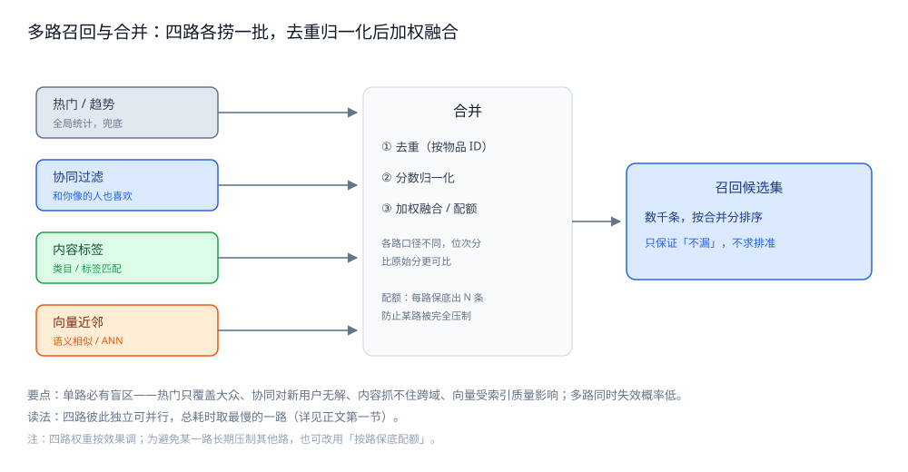
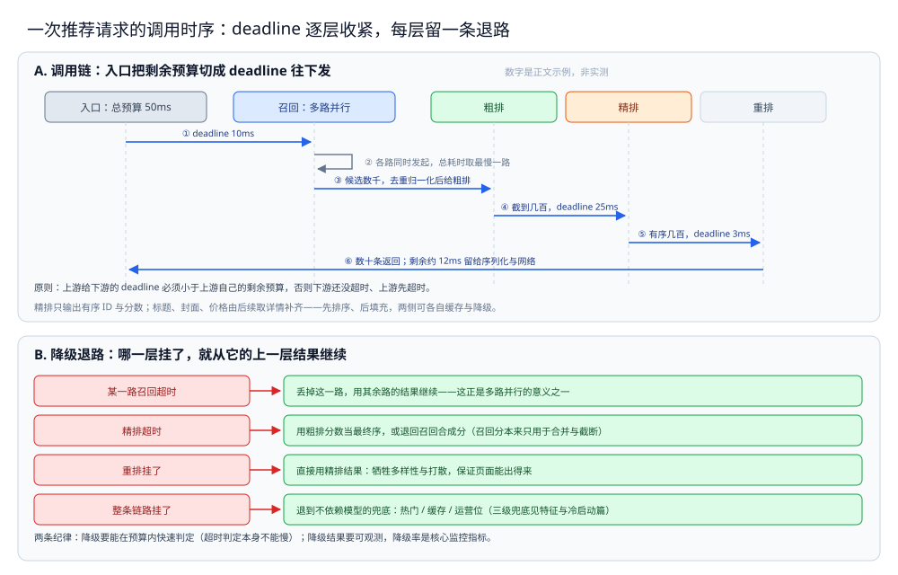

# 召回与排序

> 把「召回 → 粗排 → 精排 → 重排」四层漏斗逐层落成服务：每层解决什么、用什么手段、延迟预算怎么切、超时了怎么降级。
>
> 内容整理自个人学习笔记，素材见 [素材清单](../../../素材清单.md)。

---

## 一、召回为什么要多路并行？

**本节要点**：任何**单路召回都有盲区**——热门路只覆盖大众口味、协同路对新用户无解、内容路抓不住「看起来不像但就是喜欢」的长尾。所以召回是**多路并行各捞一批再合并**，目标是把「用户可能喜欢的」尽量圈进来，宁可多圈也不能漏。

### 1.1 四种典型召回与各自的边界

| 召回路径 | 靠什么捞 | 擅长 | 边界（漏在哪） |
|---|---|---|---|
| 热门 / 趋势 | 全局统计（点击、销量、时间衰减） | 冷启动、兜底、大众口味 | 千人一面，长尾内容永远出不来 |
| 协同过滤 | 「和你像的人也喜欢」的历史共现 | 兴趣相关性好 | 新用户 / 新物品没有共现数据；热门物品偏置 |
| 内容标签 | 物品的类目 / 标签 / 作者与你历史偏好的匹配 | 可解释、对新物品友好 | 只能匹配「已知标签」，抓不住跨域兴趣 |
| 向量近邻 | 用户向量与物品向量的相似度（ANN 检索） | 语义泛化、长尾 | 依赖向量质量与索引，召回可控性差、抖动 |

四路合起来才覆盖「热门兜底 + 相似用户 + 内容匹配 + 语义泛化」。每一路都可能在某一类用户上失效，但**多路同时失效的概率低得多**——这就是并行的价值。

### 1.2 多路结果怎么合并

合并要做三件事，缺一不可：

1. **去重**：同一物品可能被多路同时召回，按物品 ID 去重，避免同一个内容在列表里出现两次。
2. **分数归一化**：每一路的分数口径不同（热门是热度、协同是相似度、向量是余弦距离），不能直接加。常见做法是**按路内排名做归一化**（比如取 Top K 后折算成 0~1 的位次分），或统一转成「概率 / 权重」。
3. **加权融合**：给每路一个权重相加得到合并分，权重按效果调。也可以**按配额取**（每路保底出 N 条，防止某一路被完全压制）。



图怎么读：左边四个框是四路，彼此独立可以并行发起——热门 / 趋势（全局统计，兜底）、协同过滤（和你像的人也喜欢）、内容标签（类目 / 标签匹配）、向量近邻（语义相似 / ANN）；四路箭头汇进中间的「合并」，里面就是上面那三件事：① 去重（按物品 ID）、② 分数归一化（各路口径不同，位次分比原始分更可比）、③ 加权融合 / 配额（配额：每路保底出 N 条，防止某路被完全压制）。右边输出的是「召回候选集」，数千条，按合并分排序，只保证「不漏」，不求排准。总耗时取最慢的一路；单路必有盲区——热门只覆盖大众、协同对新用户无解、内容抓不住跨域、向量受索引质量影响，多路同时失效的概率才低。

### 1.3 召回率是第一指标

召回层**不看精度**。它把「用户其实会喜欢的」漏掉了，后面所有层都无法补救——精排再准，也只能在召回的候选里排序。所以召回的考核指标是**召回率 / 覆盖度**，代价是候选集偏大、混进不少无关内容，这正是留给粗排去砍的。

⭐ 一句话判据：**召回不怕多、只怕漏；合并只在「别让某一路淹没其他路」上做文章。**

---

## 二、粗排为什么存在？

**本节要点**：粗排不是「必须有」的一层，它是**算力与精度的折中**。精排模型重，对几千条候选逐条跑要花掉整个预算；粗排用轻量模型或规则先砍到几百条，让精排在它扛得住的量上工作。

### 2.1 算力这笔账

假设精排模型对一条候选要花 T 毫秒（含特征读取与推理）。候选从几千降到几百，耗时几乎是**线性下降**的。粗排自己也花时间，但只要「粗排的时间 + 精排省下的时间 > 0」就划算。当精排足够快时，这笔账就不成立——这是判断「要不要粗排」的唯一标准。

### 2.2 粗排用什么

| 手段 | 特点 | 适用 |
|---|---|---|
| 规则 / 启发式 | 便宜、可解释、无训练成本 | 冷启动、候选已不多、要快速上线 |
| 轻量模型 | 特征少、模型小、可批量打分 | 候选量大、精排偏重时的主力 |
| 双塔 / 向量打分 | 用召回侧的向量再算一次相似度 | 与向量召回共用算力，省一套模型 |

粗排的特征通常**复用召回/离线算好的粗粒度特征**，不引入需要实时拼接的重特征——省的就是特征读取的时间。

### 2.3 什么时候可以没有粗排

- 召回候选本来就不大（几千以内），精排能直接吃下；
- 精排模型足够轻（比如只有几十维特征的线性打分）；
- 延迟预算很宽（如离线批处理生成每日榜单，不在线排序）。

反过来，**候选到几万、精排又是深度模型时，粗排几乎是必须的**。所以它不是「教科书的一层」，而是可增可减的一层。

---

## 三、精排怎么打分、用哪些特征？

**本节要点**：精排对每条候选算一个**预估分**（点击率 / 转化率等），把候选排成有序列表。它耗时最多、用特征最多，是整条链路的「精度担当」，也是最容易拖长尾的一层。

### 3.1 打分 = 对候选逐条算预估分

精排的输入是「用户 + 一条候选 + 上下文」，输出是一个分数。因为要对几百条候选各算一次，它天然是**逐条累加**的过程——这也是它比召回慢、比召回难并行的原因。工程上会做**批推理**（把几百条攒成一批喂给模型）来摊薄算力，但总时长仍随候选数增长。

### 3.2 特征三类：用户 / 物品 / 上下文

| 特征类 | 例子 | 来源（详见特征篇） |
|---|---|---|
| 用户侧 | 长期画像、近期行为 | 离线算画像 + 近线补实时行为 |
| 物品侧 | 类目、热度、历史点击率 | 离线统计为主 |
| 上下文 | 当前时间、设备、来源页、本次会话行为 | 请求里带 + 实时读取 |

真正的打分往往还要**交叉特征**（用户类目偏好 × 物品类目）。这些特征的来源、拼接与一致性是另一篇的主题，见 [特征与冷启动.md](特征与冷启动.md)。

### 3.3 多目标怎么合成一个分

业务通常同时要「点得动」和「看得完 / 有转化 / 不反感」，于是有多个预估目标。「合成分」的常见做法是**加权求和**（点击率 × 权重 + 转化率 × 权重 …），权重按业务价值定。⚠️ 本节不展开模型如何同时学多个目标（那是算法侧的事），只强调**工程上最终落到一个可排序的分数**，前端只认分数。

### 3.4 打分与「展示」是两回事

精排输出的是「有序的 ID + 分数」，**不含最终要展示的标题、封面、价格**。这些物料由后续的**取详情**步骤补齐（批量查兜底缓存 / 存储）。把「打分」和「取物料」分开，好处是精排不必等物料、物料层可以单独缓存与降级——打分结果里只认 ID，取不到物料时才走另一条兜底。这也是为什么链路里常见「**先排序、后填充**」而不是边排边取。

### 3.5 精排的工程约束比模型更重要

模型侧关心「准不准」，工程侧关心三件事：**特征能不能在预算内取到**（取不到就得用默认值）、**候选能不能批处理**（逐条调模型开销大）、**单次推理能不能稳定**（抖动直接反映到用户可感知的延迟）。这三条决定了「同样的模型，工程实现不同，效果差很多」。

---

## 四、重排解决什么？

**本节要点**：精排只保证「**单条**内容各自多好」，不保证「**列表整体**好不好」。重排在这一层处理内容之间的关系与业务规则：多样性、打散、广告位与硬约束。

### 4.1 多样性：别整屏一个样

精排分数最高的那几条，很可能是同一个类目 / 同一个话题（因为它们彼此最像）。如果直接照单输出，用户看到的就是「一屏同质内容」。重排会**引入多样性约束**：控制同一类目在一屏里的占比上限，把不同类别的内容掺进来。

### 4.2 打散：同类间隔

比整屏同质更细的是**相邻位置**：连续几条不能是同一作者 / 同一类目 / 同一关键词，需要隔开一定位置。常见做法是**滑动窗口内去重**：每放一条，记录它的类目，往后 N 位内不再放同类。

### 4.3 业务规则：广告位与硬约束

重排是业务规则落地的地方，典型有：

- **广告 / 商业内容插位**：按固定位置或密度插入，且与自然内容做样式区分；
- **去重与去已读**：过滤用户最近看过 / 买过 / 已订阅的，避免重复推荐；
- **硬约束**：合规过滤、屏蔽词、地区限制、库存/可售状态；
- **运营干预**：置顶、强插某个运营位。

这些规则**都放在重排而不是精排**，是因为它们关心的是「位置与关系」，不是「单条内容的分数」；混进精排会污染打分逻辑。

---

## 五、每层的延迟预算与候选数量级

**本节要点**：漏斗的形态是**候选逐层变少、延迟逐层变紧**。预算表是本篇的核心参考，但⚠️ **下表是工程上常见的量级与设计目标，不是实测读数**，真实值必须以线上监控为准。

### 5.1 一个量级参考

| 层 | 输入量级 | 输出量级 | 典型延迟预算 | 能否并行 |
|---|---|---|---|---|
| 召回 | 全库（百万~亿） | 数千 | 几毫秒（取最慢一路） | ✅ 多路并行 |
| 粗排 | 数千 | 数百 | 几毫秒 | ❌ 逐条累加 |
| 精排 | 数百 | 数百（有序） | 十几毫秒 | ❌ 逐条累加（可批推理） |
| 重排 | 数百 | 数十 | 一两毫秒 | ❌ 顺序依赖 |

⭐ 读法：整条链路要在**几十毫秒**量级内跑完，所以越靠后越紧。召回允许相对宽松（它的多路可以一起跑，总时长看最慢那路），精排最贵要重点压，重排快但必须够用。

### 5.2 为什么召回能并行、精排只能串行

- **召回的每一路彼此独立**：热门路不需要知道向量路的结果，所以可以同时发起，总耗时 ≈ max(各路耗时) 而不是 sum。
- **粗排 / 精排要对同一条候选先后处理**：粗排的输出是精排的输入，天然有先后；同一层内对每条候选的打分可以批处理，但整体仍是「收齐 → 打下一层」的串行链。
- **重排依赖整个列表**：要判断「相邻是不是同类」，必须先有完整的有序列表，所以只能放最后。

### 5.3 量级是经验值，不是实测

⚠️ 上表的「几千 / 几百 / 几十」是行业里常见的**量级形态**，用于理解「每层砍一个数量级」；不同业务差别很大（信息流、短视频、电商的候选规模完全不同）。**本仓库本轮未做压测，任何具体延迟数字都应以线上为准。**

---

## 六、服务化与超时降级

**本节要点**：四层在工程上通常是**四个独立服务**（或至少独立模块），因为它们的算力需求、扩缩容节奏、发布频率都不同。拆分带来的代价是**网络调用与超时**，所以必须给每层设 deadline 并准备降级。

### 6.1 每层都是一个独立服务

| 层 | 为什么单独拆 |
|---|---|
| 召回 | 多路各自独立，可按路扩缩容；向量路还需要专门的 ANN 索引服务 |
| 粗排 | 算力与召回/精排不同，可独立扩容 |
| 精排 | GPU/CPU 密集，扩容节奏与在线服务不同，常独立部署 |
| 重排 | 轻量、规则频繁变更，可快速发布而不动模型 |

拆开的好处是**故障隔离与独立扩容**；代价是层与层之间是 RPC 调用，**多一跳就多一次超时风险**。

### 6.2 超时怎么设：给每层一个 deadline

原则：**上游给下游的 deadline，必须小于上游自己的剩余预算**，否则下游还没超时、上游先超时了。工程上用「请求级 deadline 逐层传递」：入口算好总预算，往下发时扣掉已用时间和返回余量。

```text
入口总预算 50ms
  → 调召回，deadline 10ms（扣掉下游返回余量）
      → 调精排，deadline 25ms
          → 调重排，deadline 3ms
  剩余 ~12ms 留给序列化与网络
```

⚠️ 上面的数字是**示例**，不是实测；真实预算由线上监控定。要点是**每层都有上限、且逐层收紧**。

### 6.3 降级：每一层都要有退路

降级不是「出错再说」，而是**上线前就设计好的退路**：

| 故障 | 降级动作 |
|---|---|
| 某一路召回超时 | 丢掉这一路，用其余路的结果继续（多路的意义之一） |
| 精排超时 | 用粗排分数当最终序，或退回召回合成分 |
| 重排挂了 | 直接用精排结果（牺牲多样性，保证页面能出） |
| 整条链路挂了 | 退到**不依赖模型的兜底**（热门 / 缓存 / 运营位），见 [特征与冷启动.md](特征与冷启动.md) 的兜底一节 |

⭐ 两条纪律：**降级要能在预算内快速判定**（超时判定本身不能慢）；**降级结果要可观测**（降级率是核心监控指标，悄悄降级比报错更危险）。



图 A 是 6.2 那张预算表的时序形态：入口总预算 50ms，① 调召回时给 deadline 10ms（各路同时发起，总耗时取最慢一路），③ 候选数千，去重归一化后给粗排，④ 截到几百，deadline 25ms，⑤ 有序几百，deadline 3ms，⑥ 数十条返回；剩余约 12ms 留给序列化与网络——**图上的数字是正文示例，不是实测**。读法是那句原则：上游给下游的 deadline 必须小于上游自己的剩余预算。图 B 是 6.3 的四条退路，每一行左边是故障、右边是退路：某一路召回超时只丢这一路，精排超时用粗排分数当最终序或退回召回合成分，重排挂了就直接用精排结果（牺牲多样性保证页面出得来），整条链路挂了才退到不依赖模型的热门 / 缓存 / 运营位。

---

## 使用：一次请求的分层骨架

> ⚠️ 下面是 Go 骨架片段，**省略了 import、类型定义、错误包装与真正的模型推理**；**本轮未实测**，只用于展示「分层 + 超时 + 降级」的结构，不代表可运行程序。

### 第一段：带 deadline 的分层入口

```go
// Rank 编排一次推荐：召回并行 → 粗排 → 精排 → 重排，每层带独立超时。
// ⚠️ 未实测：仅示意编排与预算传递，模型/召回实现从略。
func Rank(ctx context.Context, req *Request) ([]Item, error) {
	// ① 召回：多路并行，任一路失败只丢该路（降级到其余路）。
	cands := recallAll(ctx, req) // 内部用 errgroup 并发，每路带自己的 timeout

	// ② 粗排：几千 → 几百。超时则退到召回合成分。
	rough := coarseRank(ctx, cands)
	if len(rough) == 0 {
		rough = topByRecallScore(cands, 300) // 降级：按召回分截断
	}

	// ③ 精排：几百 → 有序几百。超时则用粗排分。
	scored := fineRank(ctx, rough)
	if len(scored) == 0 {
		return rerank(ctx, rough), nil // 降级：跳过精排直接重排
	}

	// ④ 重排：多样性 / 打散 / 业务规则 → 最终几十条。
	return rerank(ctx, scored), nil
}
```

### 第二段：多路召回（并发 + 单路降级）

```go
// recallAll 并发跑多路召回，任一路超时/报错只丢该路。
// ⚠️ 未实测：示意「并发 + 隔离」；各路实现与合并权重从略。
func recallAll(ctx context.Context, req *Request) []Candidate {
	var mu sync.Mutex
	var out []Candidate
	var wg sync.WaitGroup

	for _, ch := range channels { // 热门 / 协同 / 内容 / 向量
		wg.Add(1)
		go func(ch RecallChannel) {
			defer wg.Done()
			// 每路独立超时：一路慢不拖垮整体（总耗时看最慢的存活路）。
			c, cancel := context.WithTimeout(ctx, ch.Budget)
			defer cancel()
			items, err := ch.Fetch(c, req)
			if err != nil {
				metrics.RecallFailed(ch.Name) // 单路降级：记录并跳过
				return
			}
			mu.Lock()
			out = append(out, items...)
			mu.Unlock()
		}(ch)
	}
	wg.Wait()
	return mergeAndDedup(out) // 去重 + 分数归一化 + 加权
}
```

### 第三段：重排的多样性与打散（规则骨架）

```go
// rerank 在精排结果上做多样性 + 相邻打散 + 业务规则。
// ⚠️ 未实测：示意规则顺序；具体阈值应按业务调。
func rerank(ctx context.Context, scored []Scored) []Item {
	out := make([]Item, 0, outputSize)
	recentCat := make([]string, 0, window) // 滑动窗口内的类目

	for _, s := range scored {
		it := s.Item
		if blocked(it) { // 硬约束：合规 / 已读 / 不可售
			continue
		}
		// 相邻打散：窗口内已有同类目则跳过，等后面更合适的。
		if contains(recentCat, it.Category) {
			continue
		}
		out = append(out, it)
		recentCat = push(recentCat, it.Category) // 只保留最近 window 个
		if len(out) >= outputSize {
			break
		}
	}
	return insertAds(ctx, out) // 业务规则：按密度插广告位
}
```

---

## 延伸追问

- **多路召回的权重怎么定？** → 先按业务经验给初值，再用线上效果（点击 / 转化 / 停留）做 A/B 调整；也可以用「按配额取」代替纯加权，避免某一路长期压制其他路。
- **召回的分数和精排的分数口径不同，怎么衔接？** → 召回分只用于「合并与截断」，不直接当最终序；进精排后一切以精排分为准。如果精排被降级跳过，才退回用召回合成分排序。
- **粗排会不会把真正的好内容误杀？** → 会，这是分层的固有代价。缓解手段是「**粗排多留、精排再砍**」（宁可粗排输出多一些，也别在这层砍太狠），以及让粗排复用精排的部分特征以提升相关性。
- **重排的多样性怎么量化？** → 常见指标是列表内的**类目 / 作者分布熵**或「前 N 条的类目去重率」，作为 A/B 的对照指标之一，而不是拍脑袋。
- **为什么精排要做批推理？** → 对几百条候选逐条调模型，网络与调度开销占比高；攒成一批可以摊薄这部分开销。但它不改变「总时长随候选数增长」的性质，砍候选量仍是最有效的手段。

## 关联

- [总体设计.md](总体设计.md) — 本组总体设计：四层漏斗与三条链路的整体形态、三个核心取舍。
- [特征与冷启动.md](特征与冷启动.md) — 本组零件篇：精排用到的特征从哪来，以及冷启动与兜底。
- [README.md](../README.md) — 系统设计总目录。
- [排行榜设计.md](../社交互动系统/排行榜设计.md) — 「海量候选取前 N」的另一种解法：那边用 ZSET 分数排序，这里用模型打分，都面对排序结构与分页。
- [README.md](../Feed流系统/README.md) — 相邻场景：Feed 流的排序与去重，与本篇的重排（多样性 / 打散 / 去重）是同一类读侧问题。
- [向量与AI搜索.md](../../../03-数据与中间件/数据存储/搜索与分析/Elasticsearch/向量与AI搜索.md) — 向量召回这一路背后的向量检索与 ANN 索引机制。
- [向量索引与GraphRAG.md](../../../03-数据与中间件/数据存储/图数据库/Neo4j/向量索引与GraphRAG.md) — 图上的近邻检索，作为「协同关系 / 语义近邻」这类召回的另一种实现参考。
- [README.md](../../../03-数据与中间件/数据存储/缓存/README.md) — 召回结果缓存与特征缓存要面对的穿透、击穿与淘汰。
