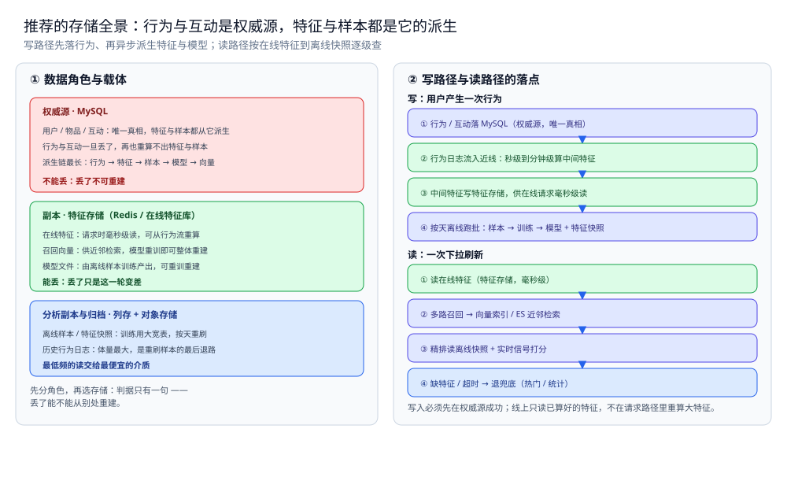

# 存储全景

> 推荐系统的数据都存哪：行为与互动是权威源，特征、样本、模型与向量都是它的派生，
> 每份数据是什么角色、放哪个载体、怎么同步、哪些能丢哪些不能。
> 本篇只回答「这份数据放哪」——通用判据（角色 / 同步 / 冷热）见 [存储选型与组合.md](../存储选型与组合.md)，
> 本篇不重复判据，只把判据落到推荐上。
>
> 内容整理自个人学习笔记，素材见 [素材清单](../../../素材清单.md)。

---

## 一、推荐系统里数据扮演哪几种角色？

**本节要点**：先分角色，再选存储。判据只有一句——**丢了能不能从别处重建**；不能重建的是权威源，能重建的是副本。

| 数据 | 角色 | 载体 | 理由 |
|---|---|---|---|
| 用户 / 物品 / 互动 | 权威源 | MySQL | 唯一真相；特征、样本、向量全由它派生，丢了不可重建 |
| 在线特征 | 缓存 | Redis / 特征存储 | 请求时毫秒级读取；可从权威源与行为流重算 |
| 模型文件 | 副本 | 对象存储 / 版本仓库 | 由离线样本训练产出，可重训重建；不进在线库 |
| 离线样本 / 特征快照 | 分析副本 | 列存 / 对象存储（Parquet） | 训练用大宽表，按天重刷；全可由行为派生 |
| 召回向量 | 检索副本 | 向量索引 / ES | 供近邻检索；模型重训即可整体重建 |
| 历史样本与行为日志 | 归档 / 冷数据 | 对象存储 + 列存文件 | 体量最大、罕见读出；是重刷样本与模型的最后退路 |

⭐ 判据：问「这份数据丢了能不能重建」—— 用户、物品、互动是权威源，丢了重建不出来；在线特征、模型、离线样本、召回向量全是它们的派生副本，都能重算，所以可丢、可重刷。

---

## 二、读和写的路径分别走哪条链？

**本节要点**：同一份数据在写路径和读路径上的落点不同 —— 写路径决定「谁先落权威源、谁异步派生特征与模型」，读路径决定「先读在线特征、再走向量检索与离线快照」。

### 2.1 写路径

```text
用户产生一次行为
│
├─ ① 行为 / 互动落 MySQL（权威源，唯一真相）
├─ ② 行为日志流入近线：秒级到分钟级算中间特征
├─ ③ 中间特征写特征存储，供在线请求毫秒级读
└─ ④ 按天离线跑批：样本 → 训练 → 模型 + 特征快照
```

> ⭐ 写入必须先在权威源成功：行为与互动是唯一真相；特征、样本、模型、向量都是它的派生，可丢、可重刷。

### 2.2 读路径

```text
一次下拉刷新
│
├─ ① 读在线特征（特征存储，毫秒级）
├─ ② 多路召回 → 向量索引 / ES 近邻检索
├─ ③ 精排读离线特征快照 + 实时信号打分
└─ ④ 缺特征 / 超时 → 退兜底（热门 / 统计），不在请求路径重算大特征
```

> ⭐ 读路径按在线特征（热）→ 离线快照（温）→ 历史日志（冷）逐级查；线上只读已算好的特征，重算都留在离线与近线。



图怎么读：左栏把六份数据按角色归到三层——权威源（用户 / 物品 / 互动）落 MySQL、红框，是特征与样本不可重建的源；副本（在线特征、召回向量、模型文件）落特征存储 / 向量索引 / 对象存储、绿框，可由行为流重算或模型重训重建；分析副本与归档（离线样本 / 特征快照、历史行为日志）落列存 + 对象存储、蓝框，用最便宜的介质承载最大体量。右栏是两条链的落点：写链「行为落 MySQL → 近线算中间特征 → 写特征存储 → 按天离线跑批出模型与快照」，只有第一步产生权威真相；读链「读在线特征 → 走向量检索召回 → 精排读离线快照 → 缺特征就退兜底」。底部一行是本篇的口径基线：**写入必须先在权威源成功，线上只读已算好的特征**。

---

## 三、为什么这样分配？

**本节要点**：每个角色选中它的载体，都有结构上的理由，不是拍脑袋。

| 数据 | 为什么是它 |
|---|---|
| 用户 / 物品 / 互动落 MySQL | 唯一真相、需要可追溯，且被反复派生（特征、样本、向量都从它算） |
| 在线特征放 Redis / 特征存储 | 请求时毫秒级读、读远多于写、可容忍丢失（能重算） |
| 模型文件放对象存储 / 版本仓 | 由离线样本训练产出，体积可控、需要版本与回滚，不必进在线库 |
| 离线样本 / 特征快照落列存 | 训练要扫大宽表的少数列，按列读、按天重刷；放进在线库会拖垮线上 |
| 召回向量放向量索引 / ES | 需要近邻检索（ANN），关系库不擅长；模型重训即可整体重建 |
| 历史日志下沉对象存储 | 体量最大、罕见读出，是重刷样本与模型的最后退路 |

⭐ 一条贯穿全篇的判据：**权威源只有一个（用户 / 物品 / 互动），其余全是它的派生** —— 派生载体可以丢、可以换、可以重建，只要权威源在。

---

## 四、推荐系统的特殊性在哪？

**本节要点**：推荐与 Feed / 秒杀的最大差别是「**派生链最长**」—— 别处数据只是内容或库存的一两层副本，推荐有「行为 → 特征 → 样本 → 模型 → 向量」一整条流水线，于是最怕的不是丢副本，而是**上下游口径对不上**。

| 对比项 | 推荐系统 | Feed 流 | 秒杀系统 |
|---|---|---|---|
| 数据可丢吗 | ✅ 特征 / 样本 / 模型 / 向量都可丢、可重刷 | ⚠️ 时间线副本可丢，内容本体不可丢 | ✅ 预扣可丢，但账要对上 |
| 权威源 | MySQL（用户 / 物品 / 互动） | MySQL（内容本体） | MySQL（订单 + 库存） |
| 热副本的角色 | 读加速（在线特征） | 读加速（时间线 ZSet） | 写入口 + 读加速 |
| 派生链长度 | ⭐ **最长**：行为 → 特征 → 样本 → 模型 → 向量 | 短：内容 → 时间线 | 短：库存 → 预扣 |
| 必须做的事 | ⭐ **线上线下一致性**（训练与线上读同一口径） | 翻页时回源 | 对账 |
| 降级方向 | 退到不依赖模型的兜底（热门 / 编辑精选） | 宁可空一屏，不可错序 | 宁可不卖，不可超卖 |

⭐ 一句话：别处的派生链只有一环，推荐有**一整条流水线** —— 所以它最怕的不是"丢一份副本"，而是**特征穿越、线上线下不一致**这类口径问题；副本丢了重刷即可，口径错了模型就是错的。

## 使用：一次完整链路的存储落点

**本节要点**：把「用户下拉刷新」到「模型与向量更新」的全过程，标出每一步的存储落点。

| 步骤 | 数据 | 落在哪 |
|---|---|---|
| ① 用户下拉刷新 | 请求 | 无持久化（客户端 / 网关） |
| ② 取在线特征 | 用户 / 上下文特征 | 特征存储（Redis / 在线特征库） |
| ③ 多路召回 | 候选 ID | 向量索引 / ES（检索副本）+ 规则 |
| ④ 粗排 / 精排打分 | 候选 + 特征 | 无持久化（内存计算） |
| ⑤ 重排 / 打散 | 最终列表 | 无持久化 |
| ⑥ 返回结果 | 卡片列表 | 无持久化（候选结果可缓存） |
| ⑦ 用户发生行为 | 点击 / 曝光 | MySQL（权威源）+ 实时日志 |
| ⑧ 近线算中间特征 | 实时特征 | 特征存储（秒级到分钟级写入） |
| ⑨ 离线跑批 | 样本 / 特征快照 | 列存 / 对象存储（Parquet） |
| ⑩ 模型训练 | 模型文件 | 对象存储 / 版本仓库（可重建） |
| ⑪ 重建召回向量 | 向量索引 | 向量索引 / ES（整体重建） |
| ⑫ 历史留存 | 行为日志 | 对象存储 + 列存（冷数据） |

⭐ 三个关键落点：**用户 / 物品 / 互动在 MySQL（权威源）**；在线特征在**特征存储（可丢、可重算）**；样本、模型与向量都是它的**派生副本**，可重刷可重建。

## 延伸追问

- **为什么推荐不用一个"万能大表"存所有数据？** → 因为同一次请求要毫秒级读特征、离线要按天扫全量日志 —— 两种访问模式差了几个数量级，只能拆到不同载体（见本篇第三节）。
- **在线特征丢了算事故吗？** → 不算。在线特征能从权威源与行为流重算，丢了只是"这一轮推荐变差"；降级方向是**退到不依赖模型的兜底**（见 [特征与冷启动.md](特征与冷启动.md)）。
- **为什么召回向量单独一份、不在 MySQL 里？** → 向量召回需要近邻检索（ANN），MySQL 不擅长；它是**检索副本**，模型重训即可整体重建（见 [向量与AI搜索.md](../../../03-数据与中间件/数据存储/搜索与分析/Elasticsearch/向量与AI搜索.md)）。
- **离线样本为什么要落 Parquet / 列存？** → 训练要扫大宽表的少数列，列存按列读、压缩率高；放进行存关系库会既慢又贵。它是**分析副本**，按天重刷。
- **推荐最怕丢的是哪一份数据？** → 不是特征、也不是向量，而是**行为与互动**（权威源）—— 丢了就再也重算不出特征与样本；所以它必须落 MySQL 并被实时备份。

## 关联

- [存储选型与组合.md](../存储选型与组合.md) — 通用判据：五种角色、同步三路线、冷热三层 —— 本篇是它在推荐上的落地。
- [总体设计.md](总体设计.md) — 四层漏斗与在线 / 离线 / 近线三条链路的整体形态，解释了这些落点为什么这么分。
- [召回与排序.md](召回与排序.md) — 召回与精排分别读哪些特征、延迟怎么切。
- [特征与冷启动.md](特征与冷启动.md) — 特征来源三分、线上线下一致性、冷启动与兜底。
- [数据同步方式选型对比.md](../../../03-数据与中间件/数据存储/数据同步/数据同步方式选型对比.md) — 通用篇的同步路线：CDC / 双写 / 定时全量怎么选。
- [向量与AI搜索.md](../../../03-数据与中间件/数据存储/搜索与分析/Elasticsearch/向量与AI搜索.md) — 召回向量这一路依赖的检索机制。
- [README.md](README.md) — 本目录导读：推荐的四个问题与阅读顺序。
