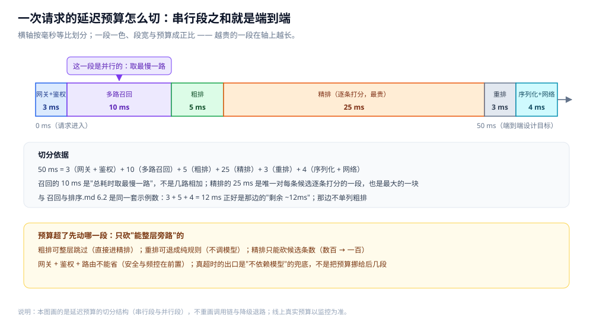

# 总体设计

> 覆盖：**推荐系统**这道系统设计题的**整体方案** —— 分几层 / 几部分、各干什么、怎么配合、核心取舍在哪、
> 一次完整请求走哪几步、这套方案的前提与边界，以及落地时的组件清单、延迟预算、成本与效果口径、兜底与降级路径。
>
> 不覆盖：**各部分的细节**在零件篇里，**数据落点**在 [存储全景.md](存储全景.md) 里，**篇目清单与阅读顺序**在 [README.md](README.md) 里；
> 两篇零件各自成篇 ——
> [召回与排序.md](召回与排序.md)（多路召回 / 粗排 / 精排 / 重排 / 候选量级与延迟预算 / 降级）、
> [特征与冷启动.md](特征与冷启动.md)（特征三分与一致性 / 冷启动 / 探索利用 / 评估 / 兜底）。
>
> 内容整理自个人学习笔记，素材见 [素材清单](../../../素材清单.md)。
>
> 📎 **未实测口径**：本目录的候选量级、延迟预算、召回率等数字**未做本机实测**，均为**常见工程设计量级**或方法示意，不是实测读数。唯一的例外是两处确定性算例——[召回与排序.md](召回与排序.md) 4.4 的打散逐位推演、[特征与冷启动.md](特征与冷启动.md) 2.5 的窗口取值对照，已在 `golang:1.26-alpine`（go1.26.8）容器里连跑 3 轮且输出逐字节一致；它们跑的是正文自造的示意样本，算的是规则与窗口，不构成量级实测。
> 第 7.2 节的延迟预算表给的是**设计目标示例**（每段都标了它在 [召回与排序.md](召回与排序.md) 6.2 里的对应口径），第 7.3 / 7.4 节给的是**成本去向与判据**，两者都不是实测读数。

---

## 一、系统的整体形态是什么？

**本节要点**：推荐整体是一条**漏斗 + 一套供给**——候选从百万级被四层逐层砍到几十条（在线漏斗），支撑它的则是离线 / 近线 / 在线三条链路通过特征存储完成的特征供给。模型只是精排里的一个算子。

一句话概括：**先把"候选量与延迟反向变化"这条性质落成四层漏斗，再用离线 / 近线 / 在线三条链路把特征喂进漏斗。**

🔗 同型不重画：这张四层流水线图的图片行只在 [README.md](README.md) 第一节保留 —— [推荐四层流水线.svg](images/推荐四层流水线.svg)

图怎么读：这张图是本目录共用的四层流水线图，但这里要当**漏斗纵切面**看——横轴是候选量级、纵轴是延迟预算，两者反向变化：越往下候选越少、留给它的时间越短。召回（百万~亿 → 数千，多路并行、总耗时取最慢一路）在漏斗最上口，只求"别漏"；粗排（数千 → 数百）是省钱的一层；精排（数百 → 有序数百）最贵、吃掉大半延迟预算；重排（数百 → 数十）做多样性、打散与业务规则。⚠️ **图中候选量级与预算数字都是常见工程设计量级，不是实测读数**；要记的是那句形态——**每层砍一个数量级**。

按角色，整个系统分**四层在线漏斗 + 三条链路 + 一层特征交接**：

| 部分 | 干什么 | 关键判据 | 细节在哪 |
|---|---|---|---|
| **召回** | 从全库捞出几千条候选 | 要的是**召回率**（别漏），不是精度 | [召回与排序.md](召回与排序.md) |
| **粗排** | 把候选从几千砍到几百 | 「省钱的那一层」，精排够快时可省 | [召回与排序.md](召回与排序.md) |
| **精排** | 给几百条候选打分排序 | 特征最多、模型最重、**延迟预算大多被它吃掉** | [召回与排序.md](召回与排序.md) |
| **重排** | 排序之外还要"像人排的" | 多样性 / 打散 / 业务规则 | [召回与排序.md](召回与排序.md) |
| **离线链路** | 按天 / 小时出模型与统计特征 | 可以很慢，但结果要能**沉淀** | [特征与冷启动.md](特征与冷启动.md) |
| **近线链路** | 补"来不及离线"的那一段 | 消费实时流，秒~分钟级写特征 | [特征与冷启动.md](特征与冷启动.md) |
| **在线链路** | 一次请求里跑完四层漏斗 | 只读**已算好的特征** + 一点当下信号 | [召回与排序.md](召回与排序.md) |
| **特征存储** | 离线 / 近线写、在线读的交接面 | 训练口径必须与线上读到的一致 | [特征与冷启动.md](特征与冷启动.md) |

⭐ 顺序不是随便排的：**能并行的放前面，必须串行的尽早砍量**——召回多路彼此独立、可并行，所以放最前、用"取最慢一路"当总耗时；粗排精排要逐条评估、天然串行，只能往后放并先压缩条数。

---

## 二、核心取舍在哪？

**本节要点**：三个取舍决定了这套方案的长相——**分层把重模型只留给小候选、在线 / 离线分离靠特征存储交接、延迟预算反向约束每层并强制兜底**。取舍的方向不是"谁更先进"，而是"**把成本放在哪一层、把确定性留在哪里**"。

### 2.1 取舍一：分层 —— 重模型只留给几百条候选

推荐面对的是全库百万~亿级候选，一个大模型对全集逐条跑不动。分层的意义就是**把最贵的模型只留给已经被砍到几百条的候选**：

```text
全库（百万~亿）
   └─► 召回（多路并行，各捞一批）──► 数千    ── 只求别漏，召回率优先
          └─► 粗排（轻量模型 / 规则）──► 数百  ── 省钱的一层，可省
                 └─► 精排（重模型逐条打分）──► 有序数百 ── 精度优先
                        └─► 重排（打散 / 规则）──► 数十 ── 体验优先
```

⭐ 别把账算反了：**不是"模型越强整条链越好"**，而是"**每一层只解决上一层筛完剩下的问题**"。粗排之所以存在，是因为"让重模型对几千条逐条跑"不划算；如果精排足够轻，粗排可以没有。细节见 [召回与排序.md](召回与排序.md)。

🔗 这棵"逐层砍量"的树与本篇第一节那张漏斗图讲的是同一件事，候选量级与延迟预算的口径也一致（均为常见工程设计量级、非实测读数），同型不重画：[推荐四层流水线.svg](images/推荐四层流水线.svg)

### 2.2 取舍二：在线 / 离线分离，靠特征存储交接

算得慢但样本全的部分（训练模型、算画像、算统计）放**离线**；算得快但只看当下的部分（一次请求里跑四层漏斗）放**在线**；两者**不直接调用**，而是通过**特征存储**交接——离线把算好的写进去，在线在请求时读出来：

| 链路 | 节奏 | 特点 | 产出 |
|---|---|---|---|
| **离线** | 按天 / 小时 | 可以很慢，结果要能沉淀 | 模型文件 + 特征 |
| **近线** | 秒 ~ 分钟 | 补"来不及离线"的快速变化特征 | 中间结果写特征存储 |
| **在线** | 一次请求内 | 只读已算好的特征 + 当下信号 | 最终列表 |

⭐ 这条分离换来的是**扩展性**（离线可以慢、可以重算，不影响线上 RT），代价是**线上线下一致性**：训练时用的特征和线上打分时读到的特征必须同一口径，否则模型学到的东西错位。这是推荐系统里最容易被忽视、又最难补的坑，展开在 [特征与冷启动.md](特征与冷启动.md)。

### 2.3 取舍三：延迟预算反向约束每层，并强制"不依赖模型"的兜底

推荐是**被延迟反向约束**的系统：模型再准，超时也等于没跑。所以要把"整条链路几十毫秒"切成每层的上限，并约定**超了就走降级**：

```text
总预算 = 网关 + 召回(取最慢一路) + 粗排 + 精排 + 重排 + 序列化/网络
                            ↑ 可并行      ↑ 逐条累加，靠砍条数压时间
```

⭐ 两条纪律：**能量化的延迟都要设上限**（没有上限就一定会偷偷超）；**越靠后的层越要短**（它面对的候选最少，却最容易拖长尾巴）。⚠️ 这里的预算是**设计目标**而非实测值，真实预算必须以线上监控为准。而**兜底必须不依赖模型**——任意一层超时或报错，都要能退到热门 / 编辑精选 / 兜底缓存，保证页面出得来。展开见 [召回与排序.md](召回与排序.md) 与 [特征与冷启动.md](特征与冷启动.md) 的兜底一节。

🔗 这条预算等式怎么按段相加、超上限先砍哪一段，已画在本篇 7.2 的 [一次请求的延迟预算切分.svg](images/一次请求的延迟预算切分.svg)；"哪一层挂了就从上一层的结果继续"四格对照与逐层收紧的 deadline，见 [召回与排序.md](召回与排序.md) 6.3 的 [一次请求调用链与降级退路.svg](images/一次请求调用链与降级退路.svg)，同型不重画。

---

## 三、各部分怎么配合？

**本节要点**：四层在线漏斗的输入来自特征存储，特征存储的输入来自离线与近线；**特征是与四层都相关的接缝**，特征存储则是三条链路的交接面。

### 3.1 一条依赖链

```text
离线（训练 / 画像 / 统计）┐
                          ├─► 特征存储（离线 / 近线写）──► 在线四层漏斗 ──► 前端
近线（实时流中间结果）    ┘                                    │
                                                              └─ 召回查向量索引 / 精排读特征
```

🔗 这条依赖链的形态图本目录已有两张同型图，本篇不重画：三条链路怎么写进特征存储、在线怎么只读已算好的特征，见 [在线离线特征链路.svg](images/在线离线特征链路.svg)（图片行落在 [特征与冷启动.md](特征与冷启动.md) 的 1.3 节）；每个角色的存储落点与读写两条链，见 [推荐存储角色与读写路径.svg](images/推荐存储角色与读写路径.svg)（图片行落在 [存储全景.md](存储全景.md) 的第 2 节）。

### 3.2 接缝在哪

| 接缝 | 谁与谁 | 要求 |
|---|---|---|
| **特征** | 召回 / 精排 ↔ 特征存储 | 训练与线上**同一口径**（线上线下一致性） |
| **延迟预算** | 在线四层之间 | 每层设上限、超了降级，且**总耗时取并行最慢一路** |
| **兜底** | 任意一层 ↔ 前端 | 退到**不依赖模型**的结果（热门 / 编辑精选 / 兜底缓存） |
| **向量召回** | 召回 ↔ 向量索引 | 依赖向量检索机制，见 [向量与AI搜索.md](../../../03-数据与中间件/数据存储/搜索与分析/Elasticsearch/向量与AI搜索.md) |

### 3.3 与相邻系统怎么分工

| 相邻 | 关系 |
|---|---|
| [README.md](../Feed流系统/README.md) | Feed 流的排序、去重与时间线分页，与推荐的重排 / 排序是**同一条读侧问题** |
| [排行榜设计.md](../社交互动系统/排行榜设计.md) | 另一类"海量候选里挑前 N"：那边用分数排序，这里用**模型打分** |

### 3.4 本篇与目录内零件篇怎么分工

**本节要点**：同一批知识不重复讲——本篇只回答「四层为什么这么分、三条链路怎么交接、延迟怎么切、兜底怎么保」，每层的服务落法与特征细节一律落在零件篇。

| 想回答的问题 | 看哪篇 |
|---|---|
| 整体分几层、三个取舍、一次请求走哪几步、延迟怎么切、成本怎么落 | 本篇 |
| 召回有哪几路、粗排精排重排各怎么服务化、每层的输入输出与超时降级怎么写 | [召回与排序.md](召回与排序.md) |
| 特征从哪来、怎么保证训练与线上同口径、冷启动与探索怎么做 | [特征与冷启动.md](特征与冷启动.md) |
| 特征、模型、日志、索引这些数据分别存在哪、谁是权威源、怎么同步 | [存储全景.md](存储全景.md) |

⭐ 一条判据：**本篇出现的每个机制，都要能在零件篇里找到完整落点**；反过来，零件篇里"这份数据最后落在哪、能不能重算"的问题一律回链到 [存储全景.md](存储全景.md)。本篇与特征篇的切口最需要说清：**本篇只判断"特征是一份要交接的共享依赖"，特征的来源三分、一致性校验与冷启动策略在特征篇**。

---

## 四、一次完整请求走哪几步？

**本节要点**：把一次下拉刷新串成端到端链路，帮助定位"某一步该看哪一节"。

| # | 步骤 | 做什么 | 落点 |
|---|---|---|---|
| ① | 前端请求 | 携带用户 / 上下文（会话、位置、设备） | [召回与排序.md](召回与排序.md) |
| ② | 多路召回 | 热门 / 协同 / 向量……**并行**各捞一批，合并成候选集 | [召回与排序.md](召回与排序.md) |
| ③ | 粗排 | 轻量模型把候选从数千砍到数百 | [召回与排序.md](召回与排序.md) |
| ④ | 精排 | 读特征、重模型逐条打分，排成有序列表 | [召回与排序.md](召回与排序.md)、[特征与冷启动.md](特征与冷启动.md) |
| ⑤ | 重排 | 多样性 / 打散 / 广告插入等业务规则 | [召回与排序.md](召回与排序.md) |
| ⑥ | 返回前端 | 序列化输出几条，前端渲染首屏卡片 | — |
| ⑦ | 超时 / 报错 | 任意一层降级到**不依赖模型**的兜底（热门 / 精选 / 缓存） | [特征与冷启动.md](特征与冷启动.md) |

```text
请求 → 多路召回（并行，取最慢一路）→ 粗排 → 精排（读特征）→ 重排 → 返回
                                          └─ 任一层超时 ──► 兜底（热门 / 精选 / 缓存）
特征：离线 / 近线 ──► 特征存储 ──► 召回 / 精排读取
```

🔗 这七步的时序形态与每层挂掉时的退路，本目录已有同型图，本篇不重画：调用链与降级退路见 [一次请求调用链与降级退路.svg](images/一次请求调用链与降级退路.svg)，四路召回怎么合并成候选集见 [多路召回与合并.svg](images/多路召回与合并.svg)——两张图的图片行都落在 [召回与排序.md](召回与排序.md) 的 1.2 与 6.2、6.3 小节。

⚠️ 三个常见误区：① 以为"有一个好模型就够了"——模型只是精排里的一个算子，架构决定它有没有机会发挥作用；② 以为"离线很好就等于线上很好"——训练与线上特征口径不一致，模型会错位；③ 以为"降级就是随便返回空"——兜底必须能出页面，所以退路不能依赖模型。

---

## 五、这套方案的前提与边界是什么？

**本节要点**：这套"分层漏斗 + 离线 / 近线 / 在线分离 + 延迟预算兜底"的方案，成立的前提是"候选远多于可展示位、且延迟被强约束"；跳出这个前提，答案要整个换掉。

| 场景 | 这套方案 | 为什么 |
|---|---|---|
| **候选远多于可展示位**（信息流、视频、商品） | ✅ 适用 | 靠漏斗逐层砍量，把重模型留给小候选 |
| **延迟被强约束**（首屏卡片、几十毫秒） | ✅ 适用 | 预算反向约束每层，超时降级 |
| **特征在线离线可分离** | ✅ 适用 | 算得慢的沉淀成特征，算得快的只看当下 |
| **只有几十条候选** | ❌ 不适用 | 无需四层漏斗，直接打分排序即可 |
| **完全不能容忍降级**（如强一致计费） | ❌ 不适用 | 兜底是"返回次优结果"，与强一致目标冲突 |
| **模型数学 / embedding 训练** | ❌ 不在本篇 | 属于算法侧，本目录只讲**服务架构** |

依赖的外部条件：

- **特征存储**：离线 / 近线写、在线读；要保证训练与线上**同一口径**（线上线下一致性）。
- **向量索引**：向量召回这一路依赖它，见 [向量与AI搜索.md](../../../03-数据与中间件/数据存储/搜索与分析/Elasticsearch/向量与AI搜索.md)。
- **在线服务化**：四层各自可超时、可降级，任一层失败不挂住整个请求。
- **兜底数据**：热门 / 编辑精选 / 兜底缓存必须**独立于模型**，模型挂了也能出页面。

> ⚠️ **读数口径**：本目录的候选量级、延迟预算、召回率等数字**未做本机实测**——正文与图里的这类数字都是**常见工程设计量级**或方法示意，不是实测读数。要记的是结构与趋势，不是具体数值。两处确定性算例（[召回与排序.md](召回与排序.md) 4.4、[特征与冷启动.md](特征与冷启动.md) 2.5）例外，它们在 `golang:1.26-alpine` 容器里真跑过，但输入是正文自造的示意样本，只用于验证规则与窗口的推算结果。

---

## 六、应用场景

**本节要点**：同一套「四层漏斗 + 三条链路 + 预算兜底」落在不同业务形态上，**改的是候选从哪来、延迟被压到多紧、兜底要保证什么**；档位一变，最吃力的那一层就换位置。

| 档位 | 候选从哪来（量级） | 相对本篇默认形态，关键差异在哪 | 落到哪篇 |
|---|---|---|---|
| **信息流（图文 / 混合）** | 内容池 + 关注关系 | **重排的多样性与打散最重**——同题材连出会掉留存，打散规则是体验主线 | [召回与排序.md](召回与排序.md) |
| **电商（商品）** | 商品池，先受库存 / 地域 / 合规约束 | 召回前要先做**可售与合规过滤**，再谈相关性；重排要合并广告位与频控 | [召回与排序.md](召回与排序.md) |
| **短视频** | 内容池最大、消费信号最密 | **完播 / 停留类信号的实时性要求最高**，近线链路压力最大 | [特征与冷启动.md](特征与冷启动.md) |
| **搜索兜底（无结果时）** | 由查询词触发推荐 | 推荐退居**兜底位**：要保证与查询语义不冲突，宁缺毋滥 | [召回与排序.md](召回与排序.md) |
| **新用户 / 新内容（冷启动）** | 没有行为数据 | 只能走**探索与兜底**，不能指望模型；这一档的评价口径也不同 | [特征与冷启动.md](特征与冷启动.md) |
| **广告 / 强业务位** | 候选受预算与频控约束 | 重排要合并**业务规则**（预算 / 频控 / 多样性），排序目标从"看得久"变成"算得清" | [召回与排序.md](召回与排序.md) |

⭐ 判据：**档位只改"候选从哪来"和"哪一层最吃力"，不改四层结构**——无论哪种形态，都必须有一层把候选砍到重模型扛得住的量，也必须有一条不依赖模型的兜底。真正的结构分叉只有两处：**召回侧重**（相关性 / 向量 / 协同，见 [召回与排序.md](召回与排序.md)）和**特征时效**（要不要近线，见 [特征与冷启动.md](特征与冷启动.md)）。

---

## 七、具体使用

**本节要点**：把整体方案落成可对照的四张清单——组件角色与部署形态（7.1）、延迟预算表（7.2）、成本与效果（7.3）、兜底、降级与冷启动边界（7.4）。**7.2 的数字是设计目标示例，7.3 / 7.4 给的是去向与判据，都不是实测读数。**

### 7.1 组件角色与部署形态

**本节要点**：把上述方案落成组件，各自承担什么角色、以什么形态部署。

| 组件 | 承担什么 | 部署形态 | 数据角色 |
|---|---|---|---|
| **特征存储**（Redis / 特征库） | 离线 / 近线写、在线读的特征交接面 | 分在线 / 离线两套；在线要低延迟、可接受最终一致 | 派生副本（可从日志重算） |
| **向量索引**（ES 等） | 向量召回这一路 | 与其它召回路径并行；离线构建、在线查询 | 索引副本（可从内容本体重建） |
| **模型服务** | 精排打分（也可含粗排） | 独立服务、可水平扩；**必须有超时** | 无（业务逻辑） |
| **在线服务** | 四层漏斗编排、延迟预算与降级 | 无状态、可水平扩 | 无 |
| **离线计算** | 训练模型、算画像与统计 | 按天 / 小时调度 | 产出模型文件与特征 |
| **日志 / 消息流** | 行为日志与实时流（喂离线与近线） | 采集 → 消息流 → 离线 / 近线 | 权威源（分析不可重建） |

⭐ 这套清单的判据只有一条：**在线只读"已算好的"、离线负责"算得慢的"**——两侧靠特征存储交接。各角色的完整落点见 [存储全景.md](存储全景.md)。

### 7.2 延迟预算表

**本节要点**：预算不是平均分给四层，而是按「每层砍掉多少量」来切的——**能并行的段放宽、串行逐条打分的段最贵**。右列的「设计目标示例」与 [召回与排序.md](召回与排序.md) 6.2 的 deadline 是**同一套示例数字**（入口 50ms / 召回 10ms / 精排 25ms / 重排 3ms）；中列写清每一段在 6.2 里落在哪。

| 段 | 在 [召回与排序.md](召回与排序.md) 6.2 里的口径 | 设计目标示例 | 超上限时先动哪里 |
|---|---|---|---|
| 网关 + 鉴权 + 路由 | 含在「剩余 ~12ms」里 | 3 ms | 不可省（安全与频控在前置） |
| 多路召回（并行，取最慢一路） | deadline **10 ms** | 10 ms | 先砍路数（向量路 → 协同路） |
| 粗排 | 6.2 未单列，含在剩余里 | 5 ms | 整层旁路，直接进精排 |
| 精排 | deadline **25 ms** | 25 ms | 砍候选条数（数百 → 一百） |
| 重排 | deadline **3 ms** | 3 ms | 退成纯规则，不调模型 |
| 序列化 + 网络 | 含在「剩余 ~12ms」里 | 4 ms | 减返回条数 |
| **端到端合计** | **入口总预算 50 ms** | **50 ms** | — |



⭐ 图怎么读：横轴按毫秒等比划分，**段宽与预算成正比**——精排那一段最长，因为它要对每条候选逐条打分，是唯一"串行累加"的段；召回那一段标了「并行」，它的耗时是**取最慢一路**而不是几路相加。图下半两张表是这张图的判断部分：一张写清 `50 ms` 怎么加出来，一张写清超了先砍谁。⚠️ 表里的 ms 是**设计目标示例（未实测）**，与 [召回与排序.md](召回与排序.md) 6.2 是**同一套示例数字**——那边把网关与序列化都压进「剩余 ~12ms」、也不单列粗排（`3 + 5 + 4 = 12 ms` 正好对上），本篇只是把它们拆开单列；真值以线上监控为准。

⭐ 一条口径说明：第一节说精排"吃掉大半延迟预算"，那是**结构口径**——它是唯一对每条候选逐条打分、耗时随候选条数线性增长的一段，所以它是四层里最大的一块；但**它到底占多少随业务差异很大**，所以本节给的是可以逐段相加的**设计目标示例**，不是固定比例，也不是线上监控读数。

### 7.3 成本与效果：算力花在哪、用什么验证

**本节要点**：成本只有四个去处——召回扩容、特征时效、精排模型、规则与重排；**每个去处都在买一件不同的东西，且边际收益递减**，所以"加钱"之前先问"要买的是召回率、新鲜度还是精度"。

| 钱花在哪 | 买到什么 | 主要成本项 | 怎么验证 |
|---|---|---|---|
| **召回扩容**（向量索引 / 倒排 / 召回路数） | 召回率（别漏） | 内存与副本数、索引离线重建的时间 | 离线评估召回率 + 线上 A/B |
| **特征时效**（加近线链路） | 新鲜度（快变信号） | 流计算资源、特征存储的写放大 | A/B；**先确认线上线下同口径**，否则测不出 |
| **精排模型变重** | 精度（排得准） | GPU 或大内存，且延迟直接上升 | A/B（离线指标涨 ≠ 线上涨） |
| **粗排 / 重排加规则** | 体验与业务约束 | 便宜（CPU 为主） | A/B + 人工审核 |

⭐ 三个判读：① **边际收益递减**——召回的最后一公里和精排的最后一点精度都很贵，先补短板再加钱；② **成本与延迟耦合**——精排模型一变重，7.2 的预算就要重切，不是"加机器就能推平"；③ **只有 A/B 能当裁判**——离线指标（AUC、召回率）涨了不等于线上涨，因为线上面对的是**被召回砍过的候选分布**，还有延迟与降级的约束。⚠️ 本表不给任何具体成本数字（GPU 单价、内存量、带宽），这类数字随硬件与业务差异太大，**未实测**。

### 7.4 兜底、降级与冷启动的边界

**本节要点**：降级不是"返回空"，而是**退到一条不依赖模型、且与正常路径可比的路径**；冷启动与兜底的边界只有一条判据——**能不能在预算内拿到可用特征**。

| 情形 | 退到哪 | 判据 / 前提 |
|---|---|---|
| 精排超时 / 报错 | 用粗排分数兜底排序 | 粗排分数必须与精排**同向可比**，否则排序会翻 |
| 某一路召回超时 / 挂掉 | 丢掉这一路，其余路照常合并 | 每路要有**独立超时**；总耗时取**剩余路**的最慢一路 |
| 特征存储读不到 | 退到只用"当下信号 + 静态属性"的轻量打分 | 兜底路径**不得依赖特征存储** |
| 整条链都挂了 | 热门 / 编辑精选 / 兜底缓存 | 兜底数据**独立于模型**、可预热、有单独缓存 |
| 新用户 / 新内容 | 探索位 + 兜底 | 判据是"预算内**拿不到可用特征**"，拿不到就走兜底，不硬跑模型 |
| 需要保证页面出得来 | 任意一层失败都不挂住整个请求 | 每层可独立超时、可降级，这是分层设计的附带收益 |

⭐ **三条边界**：① **特征与冷启动的边界**——有行为数据走特征，没有的走兜底与探索；② **兜底与模型的边界**——兜底路径里**不能有模型调用**，否则模型挂了兜底也挂；③ **降级与口径的边界**——退回去用的分数必须和正常路径**同向可比**，否则"降级"变成"排错"。特征的来源三分、一致性校验与冷启动策略展开在 [特征与冷启动.md](特征与冷启动.md)。

🔗 本表六行的退路顺序已有两张同型图，本篇不重画：三级退路怎么一级比一级简单、一级比一级不依赖实时计算，见 [特征与冷启动.md](特征与冷启动.md) 6.3 的 [三级兜底退路与探索闭环.svg](images/三级兜底退路与探索闭环.svg)；某一路召回超时 / 精排超时 / 重排挂了 / 整条链路挂了各退到哪一档，见 [召回与排序.md](召回与排序.md) 6.3 的 [一次请求调用链与降级退路.svg](images/一次请求调用链与降级退路.svg)。

---

## 延伸追问

- **为什么不直接用一个大模型一次排完？** → 因为召回面对的是百万~亿级候选，模型对全集逐条跑不动；分层的意义就是**把重模型只留给已经被砍到几百条的候选**（见 2.1）。
- **粗排能不能省掉？** → 当精排模型足够轻、几百到几千条也能在预算内跑完时可以省；省不掉的是"**必须有一层把候选砍到精排扛得住的量**"，这层叫召回或粗排都行。
- **离线与在线为什么一定要用同一套特征口径？** → 训练时用的特征和线上打分时读到的特征如果不一致，模型学到的东西就错位了，这叫**线上线下一致性**问题，展开在 [特征与冷启动.md](特征与冷启动.md)。
- **推荐服务挂了会怎样？** → 必须能退到一个**不需要模型**的结果（热门 / 编辑精选 / 兜底缓存），保证页面能出来（见 2.3）。
- **在线延迟预算为什么越靠后的层越短？** → 因为越靠后候选越少、留给它的时间越紧；把时间花在候选最多、可并行的召回上才是"取最慢一路"，而串行的每层必须尽早砍量（见 2.3）。
- **四层的延迟预算具体怎么切？** → 按"每层砍多少量"切，不按平均分：网关 + 鉴权 `3 ms`、多路召回 `10 ms`（并行，取最慢一路）、粗排 `5 ms`、精排 `25 ms`、重排 `3 ms`、序列化 + 网络 `4 ms`，端到端 `50 ms`；这套数与 [召回与排序.md](召回与排序.md) 6.2 的 deadline 是**同一套示例数字**（见 7.2）。
- **预算超了先动哪一层？** → 从**能整层旁路**的开始：粗排可整层跳过、重排可退成纯规则、精排只能砍候选条数；网关与鉴权不能省。真正的出口是**不依赖模型的兜底**，而不是把预算挪给后面几段（见 7.2 与 7.4）。
- **成本（GPU / 内存 / 带宽）该往哪一层加？** → 先问要买什么：召回扩容买召回率、近线链路买新鲜度、精排变重买精度。三者**边际收益递减**，而且精排一变重就要重切延迟预算；效果只有 **A/B** 能当裁判，离线指标涨不等于线上涨（见 7.3）。
- **冷启动和兜底的边界在哪？** → 判据只有一条：**能不能在预算内拿到可用特征**。拿不到就走探索与兜底，别硬跑模型；而兜底路径里**不能有模型调用**，否则模型挂了兜底一起挂（见 7.4）。

## 关联

- **上游/总纲**：[README.md](README.md) — 目录导读：核心问题 / 篇目清单 / 阅读顺序 / 目录分工。
- **对照/互补**：[存储全景.md](存储全景.md) — 横切篇：推荐的数据都存哪、谁是权威源、怎么同步。
- **下游机制**：[召回与排序.md](召回与排序.md) — 零件篇：把四层漏斗逐层落成服务与延迟预算。
- **下游机制**：[特征与冷启动.md](特征与冷启动.md) — 零件篇：连接两条链路的特征，以及冷启动与兜底。
- **对照/互补**：[总体设计.md](../Feed流系统/总体设计.md) — 相邻读侧场景：Feed 流的排序、去重与时间线分页，与推荐的重排 / 排序同源。
- **对照/互补**：[排行榜设计.md](../社交互动系统/排行榜设计.md) — 另一类「海量候选里挑前 N」的问题：那边用分数排序，这里用模型打分。
- **上游/总纲**：[向量与AI搜索.md](../../../03-数据与中间件/数据存储/搜索与分析/Elasticsearch/向量与AI搜索.md) — 向量召回这一路依赖的向量检索机制。
- **下游机制**：[README.md](../../../03-数据与中间件/数据存储/缓存/README.md) — 特征存储与候选缓存要面对的穿透、击穿与淘汰问题。
- **上游/总纲**：[README.md](../README.md) — 系统设计分区导读，本目录是其下的一个主题目录。
- **上游/总纲**：[存储选型与组合.md](../../../03-数据与中间件/数据存储/存储架构与场景/存储选型与组合.md) — 通用视角：数据角色、权威源与副本、冷热分层与多存储同步。
