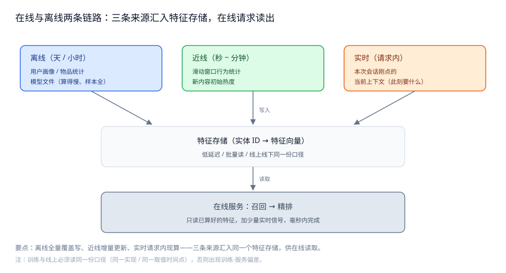
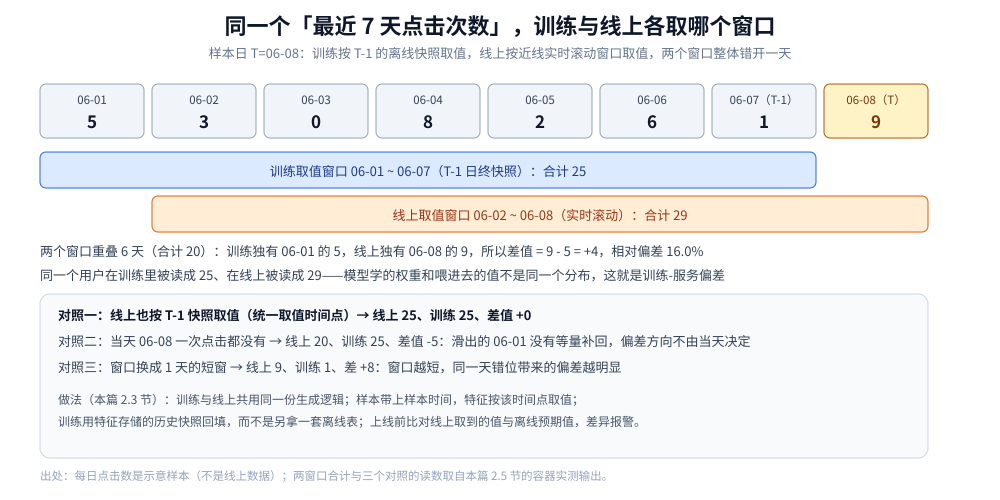
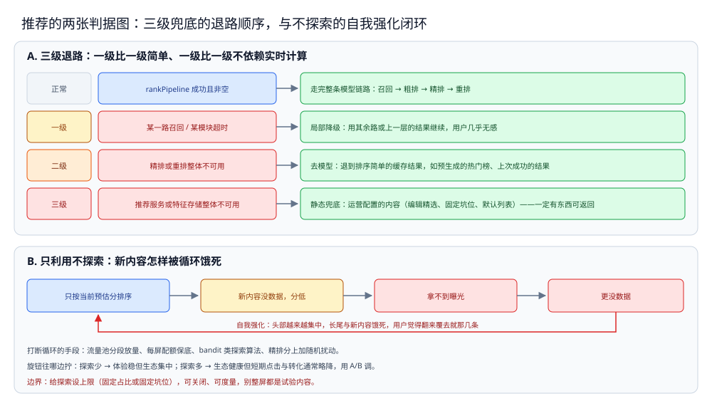

# 特征与冷启动

> 串起推荐系统的两条链路：特征从哪来（离线 / 近线 / 实时）、线上线下怎么保持一致、新用户与新内容怎么起步、效果怎么评估，以及推荐服务挂了返回什么。
>
> 内容整理自个人学习笔记，素材见 [素材清单](../../../素材清单.md)。

---

## 一、特征从哪来：离线 / 近线 / 实时怎么分？

**本节要点**：特征是推荐模型的输入，但它**不是现成的**——要从日志里算出来。不同的特征**变化速度差别极大**（用户长期兴趣几天才变，会话内的点击一秒就变），用一个链路算所有特征既慢又浪费，于是拆成离线、近线、实时三条。

### 1.1 三分法

| 链路 | 时间尺度 | 典型产出 | 典型延迟 |
|---|---|---|---|
| 离线 | 天 / 小时 | 用户长期画像、物品统计、共现表、模型文件 | 小时级 ~ 天级 |
| 近线 | 秒 ~ 分钟 | 滑动窗口内的行为统计、刚上线内容的初始热度 | 秒级 ~ 分钟级 |
| 实时 | 请求内 | 本次会话刚点击的、当前上下文 | 毫秒级（随请求算） |

一句话记忆：**离线算「这个人是谁」，近线算「他最近在干嘛」，实时算「他此刻要什么」。**

### 1.2 为什么不能只留一条

- **只留离线**：新行为要等下一次离线才生效，用户刚点过的同类内容推不出来，体验钝。
- **只留实时**：请求内只能算很轻的统计，长期画像（几百维兴趣）在毫秒内根本算不动。
- **只留近线**：覆盖不了需要全量历史、长周期统计的特征（如年度购买偏好）。

三条链路是**按变化速度分工**，不是互相替代。越快的链路越贵（要实时消费消息、要低延迟存储），所以只把真正需要的特征放到快链路上。

### 1.3 三条链路最终汇到「特征存储」

三条链路算完的特征，都要写进一个**统一的地方**供在线读取——这是本篇第二节要讲的特征存储。离线全量覆盖写、近线增量更新写、实时则是「请求时现算 + 少量写回」。它们如何不打架（一致性），是第二节的主题。



图怎么读：左边三条来源按变化速度分工——离线（天 / 小时）产用户画像、物品统计、模型文件，算得慢、样本全；近线（秒 ~ 分钟）产滑动窗口行为统计、新内容初始热度；实时（请求内）拿本次会话刚点的、当前上下文（此刻要什么）。三条箭头都「写入」中间那个**特征存储（实体 ID → 特征向量）**，它标着低延迟 / 批量读 / 线上线下同一份口径；右边「读取」的是在线服务：召回 → 精排，只读已算好的特征，加少量实时信号，毫秒内完成。底下两行是本节要落到第二节的两个点：三条链路的写法不同（离线全量覆盖写、近线增量更新、实时请求内现算）汇入同一个存储，而训练与线上必须读同一份口径（同一实现 / 同一取值时间点），否则出现训练-服务偏差。

---

## 二、特征存储与线上线下一致性怎么保证？

**本节要点**：特征存储是一个「**实体 ID → 特征向量**」的低延迟 KV，专用在线的特征读取。它最大的坑是**线上线下一致性**：训练模型时看到的特征值，和线上打分时读到的特征值，必须是同一份口径，否则模型学的和用的就不是一回事。

### 2.1 特征存储是什么

可以把它理解成一个为推荐特征定制的 KV：key 是实体（用户 ID / 物品 ID / 某组合），value 是一组特征值，要求**低延迟、高吞吐、批量读**（精排一次要取几百条物品的特征）。它和普通缓存的关键区别是：**它是特征的「权威来源」**，而不是某个数据库的临时副本。

### 2.2 训练和线上读的必须是同一份口径

举一个会出问题的例子：训练时对「用户最近 7 天点击次数」这个特征，是按 `T-1` 的离线快照算的；线上打分时，这个特征却是近线实时更新的「最近 7 天」。同样是「7 天点击」，一个是昨天的、一个是此刻的，**分布不同**，模型在线上就会偏。

这问题的名字叫**训练-服务偏差**（training-serving skew）。它的根源不是代码 bug，而是**两条链路各算各的**。

### 2.3 一致性怎么做

| 手段 | 做法 |
|---|---|
| 同一份生成逻辑 | 特征的**计算代码只有一份**（离线、近线共用），避免两处实现算出两个值 |
| 统一口径与时间点 | 训练样本带上「样本时间」，特征按该时间点取值；线上也按请求时间取同一语义的值 |
| 特征回填 | 训练时用**特征存储的历史快照**回填，而不是用另一套离线表和线上对不上 |
| 版本与校验 | 特征有版本号；上线前比对线上取到的值与离线预期值，差异报警 |
| 缺省值约定 | 取不到时用**明确的默认值**（如 0 / 均值），且训练时也用同一默认值 |

⭐ 一句话判据：**「同样的输入，离线算一次、线上算一次，应该得到同一个值」**——做不到时，要么统一实现，要么统一取值时间点，别指望模型自己消化偏差。

### 2.4 特征的时效与读取失败

特征存储也可能读不到（实例刚扩容、key 过期、下游超时）。要提前约定：

- **可降级为默认值**：缺某个特征不阻塞整条链路，用默认值继续打分；
- **不让「读特征」成为唯一瓶颈**：批量读、超时设短、失败即退默认；
- **监控命中率**：特征命中率骤降通常意味着上游写挂了，要报警。

### 2.5 同一个「最近 7 天」，两个窗口差多少

2.2 讲的是定性结论，这里把它的例子摊开算一遍，看错位有多大。某用户 6 月 1 日至 8 日的每日点击数（**示意样本，不是线上数据**）：

| 日期 | 06-01 | 06-02 | 06-03 | 06-04 | 06-05 | 06-06 | 06-07 | 06-08 |
|---|---|---|---|---|---|---|---|---|
| 当日点击 | 5 | 3 | 0 | 8 | 2 | 6 | 1 | 9 |

样本日取 `T = 06-08`。训练侧按 2.2 说的 `T-1` 离线快照取值，窗口是 `06-01 ~ 06-07`；线上侧是近线实时滚动的「最近 7 天」，请求发生在 06-08 当天，窗口是 `06-02 ~ 06-08`。容器实测（`golang:1.26-alpine` / `go1.26.8`，脚本 `.workbuddy/tmp/round495/w4s3_skew.go`，连跑 3 轮输出逐字节一致）：

```text
训练窗口 06-01~06-07 值=25
线上窗口 06-02~06-08 值=29
差值=+4 相对偏差=16.0%
训练独有 06-01=5 线上独有 06-08=9 重叠 6 天合计=20
统一取值点后 线上=25 差值=+0
当天无新增时 线上=20 训练=25 差值=-5
近线1天窗 线上(06-08)=9 训练(06-07)=1 差值=+8
```

四个读法：① 两个窗口**重叠 6 天**（合计 20），只差「滑出的一天」和「滑入的一天」，本例 9 - 5 = **+4**，相对偏差 16.0%；② 偏差方向**不由当天有没有新增决定**：即使 06-08 一次点击都没有，线上仍是 20、比训练少 5，因为 06-01 那 5 次已经滑出窗口，所以不能指望「今天没新增就一致」；③ **窗口越短，错位越明显**：换成 1 天短窗就是 9 对 1、差 +8，这也是把实时特征放进短窗口时要额外小心口径的原因；④ 把线上也改成按 `T-1` 快照取值，差值立刻归零——这正是 2.3 表里「统一口径与时间点」那一行的作用：**错位是时间点问题，不是数据缺失问题**。



图怎么读：最上一行是 2.5 表格里的每日点击数，`06-07` 是 `T-1`、`06-08` 是样本日 `T`（黄格）。中间两条横带就是两个取值窗口：蓝带 `06-01 ~ 06-07` 合计 25（训练侧），橙带 `06-02 ~ 06-08` 合计 29（线上侧），橙带整体右移一格，这个「错开一天」就是 2.2 说的两条链路各算各的。下面三行是三个对照读数：统一取值点后差值归零、当天无新增仍差 -5、换成 1 天短窗差 +8；最后两行是 2.3 表里的做法——共用一份生成逻辑、样本带时间点、按该时点用历史快照回填、上线前比对取值并报警。

---

## 三、用户与物品的冷启动怎么破？

**本节要点**：冷启动是「**没有历史数据时怎么给出像样的推荐**」，分两种：新**用户**（没有行为）和新**物品**（没有统计）。它们的本质都是「缺特征」，解法也都是**用替代信号顶上**。

### 3.1 用户冷启动

新用户没有任何行为，个性化无从谈起。常见手段：

| 手段 | 说明 |
|---|---|
| 注册 / 引导采集 | 让用户选几个感兴趣的标签，把「问卷」当作初始行为 |
| 上下文兜底 | 用来源页、设备、地区、时间等上下文给一个粗推荐 |
| 热门与趋势 | 先推大众都爱的，保证不出错 |
| 快速试探 | 前几次请求里主动探索，尽快积累行为（见第四节） |

核心思路：**从「千人一面」快速过渡到「千人千面」**，过渡期越短越好。

### 3.2 物品冷启动

新内容没有历史点击，协同过滤和统计特征都为空。常见手段：

| 手段 | 说明 |
|---|---|
| 内容特征 | 用类目 / 标签 / 文本 / 向量，把它挂到「相似老物品」的邻域里 |
| 给出初始曝光 | 给一个新内容流量池，让它先跑出一批行为数据 |
| 上架者画像 | 用作者 / 店铺的历史表现作为新内容的先验 |
| 降权保护期 | 初期不参与强竞争，避免一上线就被热门内容挤没 |

与用户冷启动对称：**没有行为时，用「内容本身的属性 + 相似物的表现」当替身**。

### 3.3 冷启动的共同点

两种冷启动都在做同一件事：**用不依赖历史的信号，先给一个还算合理的推荐，并在过程中尽快收集真实反馈。**所以冷启动不是一次性动作，而是「兜底推荐 + 快速试探」的组合，和第四节的探索与利用是连贯的。

---

## 四、新内容怎么扶持：探索与利用

**本节要点**：如果永远只推「历史上表现最好的」，新内容永远没有曝光、永远拿不到数据，系统会**收敛到少数头部内容**（马太效应）。探索（exploration）就是**主动把一部分流量分给不确定的内容**，用短期的不最优换长期的信息与生态。

### 4.1 只利用不探索会怎样

模型只按当前预估分排序，预估分又依赖历史数据；没有数据的新内容预估分低 → 不给曝光 → 更没数据。这是个**自我强化的循环**，结果是头部内容越来越集中、长尾与新内容饿死，用户也会觉得「翻来覆去就那几条」。

### 4.2 探索的几种做法

| 做法 | 思路 | 特点 |
|---|---|---|
| 流量池 / 分段放量 | 新内容先进小流量池，数据达标再逐级放大 | 简单、可控，是冷启动的常用手段 |
| 配额保底 | 每屏固定留几个位置给新内容 / 长尾 | 保证曝光，但可能牺牲体验 |
| 探索算法（如 bandit 类） | 按「不确定性」分配探索量，效果好则加磅 | 更精细，工程更复杂 |
| 随机扰动 | 在精排分上加一点噪声，让低分内容也有机会 | 最轻，但控制力弱 |

探索量是可调的旋钮：**探索少 → 生态集中、体验稳；探索多 → 生态健康、短期指标可能略降**。这个旋钮要用 A/B 来调。

### 4.3 探索的代价与边界

探索**是有成本的**——把流量分给不确定的内容，短期点击 / 转化通常不如全利用策略。所以工程上要：

- **给探索设上限**（如固定占比、固定坑位），不让它侵蚀主流量；
- **算清长期账**：探索的价值体现在「内容生态更丰富、长期留存更好」，不能只看当天指标；
- **保护兜底**：探索失败时用户仍要有内容可看，别整屏都是试验内容。

---

## 五、效果怎么评估：指标与 A/B

**本节要点**：推荐效果**不能离线说了算**。离线指标只能筛掉明显差的方案，真正的判断要靠线上 A/B。⚠️ 本节只讲**方法**，不写任何具体指标数值——没有实测就不编造数值。

### 5.1 离线指标与它们的天花板

离线用历史日志评估模型（如排序相关性、预估分与真实行为的吻合度）。它的优点是快、便宜、可复现，适合**快速筛方案**。但它的天花板很明显：

- **只能反映过去**，学不出历史里没出现过的内容；
- **看不到用户反馈**：用户是被推荐影响的，离线数据里没有「如果当时推别的会怎样」；
- **和线上目标不一致**：离线指标好，不等于线上点击 / 留存好。

所以离线是**守门员**（筛掉坏方案），不是**裁判**（决定好坏）。

### 5.2 在线指标

线上实验看的是**真实用户行为**，通常分两类：

| 类别 | 看什么 |
|---|---|
| 短期行为 | 点击、播放 / 阅读完成、转化、停留时长 |
| 长期与生态 | 次日 / 7 日留存、内容多样性、创作者活跃、内容新鲜度 |

短期指标容易「讨好」，比如全推标题党点击率会涨但她留存会掉——所以**必须同时盯生态与长期指标**。

### 5.3 A/B 实验的工程要求

要让 A/B 的结论可信，工程上至少要保证：

1. **流量随机且一致**：按用户（或会话）稳定分流，同一个人稳定落在同一组，避免同一用户忽冷忽热；
2. **样本量够**：结论要显著，样本不足时不看差异；
3. **单变量**：一次只改一个变量（召回权重 / 模型 / 重排规则），否则说不清是谁的功劳；
4. **观测周期够**：至少覆盖一个完整的行为周期（含周末），别用一小时下结论；
5. **可回滚**：实验出问题能秒级关掉，回到对照组。

### 5.4 别只看一个指标

⭐ 判据：**任何「单指标大涨」的方案都要警惕它是不是在透支别的指标**。常见组合是「点击涨、留存跌」「短期涨、多样性跌」。评估一套推荐，看的是一组指标的共同变化，不是某一个数的涨跌。⚠️ 具体阈值与显著性判断以线上实验平台为准，本篇不写数值。

---

## 六、兜底：推荐服务挂了返回什么？

**本节要点**：兜底是**推荐系统可用性的最后一层**。前面几节讲的是「怎么推得好」，这一节讲「**推不了的时候，页面还得能出来**」。兜底不是出错后临时想，而是上线前就设计好的三级退路。

### 6.1 兜底是分层的

对应 [召回与排序.md](召回与排序.md) 的分层链路，兜底也分层：**哪一层挂了，就从它的上一层结果继续**。缺一路召回不影响全局；精排挂了退粗排；整条链路挂了退到不依赖模型的结果。

### 6.2 三级兜底

| 级别 | 触发 | 返回什么 |
|---|---|---|
| 一级（局部降级） | 某一路召回 / 某模块超时 | 用其余路 / 上一层的结果继续，用户几乎无感 |
| 二级（去模型） | 精排或重排整体不可用 | 退到**排序简单的缓存结果**（如预生成的热门榜、上次成功的结果） |
| 三级（静态兜底） | 推荐服务或特征存储整体不可用 | 返回**静态 / 运营配置的内容**（编辑精选、固定坑位、默认列表） |

三级兜底的关键是**一级比一级简单、一级比一级不依赖实时计算**——这是「永远有东西可返回」的保证。

### 6.3 兜底要可观测

兜底最危险的不是降级本身，而是**降级了却没人知道**。所以：

- **降级率要作为核心指标**上报（哪一层、什么原因、降了多久）；
- **静默降级 = 事故**：用户看到的是「还能用」，但推荐质量可能已经掉光；
- **兜底结果也要打标**（哪些是兜底来的），方便回放与复盘。



图 A 把 6.2 的三级表画成退路阶梯：`rankPipeline` 成功且非空才走完整条模型链路；一级（某一路召回 / 某模块超时）用其余路或上一层结果继续，用户几乎无感；二级（精排或重排整体不可用）去模型，退到排序简单的缓存结果如预生成的热门榜、上次成功的结果；三级（推荐服务或特征存储整体不可用）返回运营配置的静态内容——**一级比一级简单、一级比一级不依赖实时计算**，这就是「一定有东西可返回」的保证。图 B 是第四节 4.1 那个闭环：只按当前预估分排序 → 新内容没数据、分低 → 拿不到曝光 → 更没数据，循环自我强化；打断它的手段（流量池分段放量、每屏配额保底、bandit 类探索、精排分加随机扰动）都要**设上限、可关闭、可度量**，别整屏都是试验内容。

---

## 使用：特征读取与兜底的骨架

> ⚠️ 下面是 Go 骨架片段，**省略了 import、类型定义、错误包装与真实模型推理**；**本轮未实测**，只用于展示「批量读特征 + 缺省值 + 兜底」的结构，不代表可运行程序。

### 第一段：批量读特征，缺省即退默认值

```go
// loadFeatures 批量取一批物品的特征；单个 key 缺失不阻塞整批。
// ⚠️ 未实测：示意「批量读 + 缺省值」；特征存储客户端实现从略。
func loadFeatures(ctx context.Context, ids []int64) map[int64]Feature {
	c, cancel := context.WithTimeout(ctx, featureBudget) // 读特征超时要短
	defer cancel()

	got, err := store.MGet(c, "item", ids)
	if err != nil {
		metrics.FeatureMiss("item", len(ids)) // 整批失败：命中率骤降要报警
		return map[int64]Feature{}
	}
	out := make(map[int64]Feature, len(ids))
	for _, id := range ids {
		f, ok := got[id]
		if !ok {
			f = DefaultFeature() // 缺省约定：训练与线上用同一个默认值
			metrics.FeatureMiss("item", 1)
		}
		out[id] = f
	}
	return out
}
```

### 第二段：三级兜底（局部 → 去模型 → 静态）

```go
// Serve 体现三级兜底：任一层失败都往上退，最终一定返回「非空列表」。
// ⚠️ 未实测：示意降级顺序；真实降级条件由线上配置。
func Serve(ctx context.Context, req *Request) []Item {
	items, err := rankPipeline(ctx, req) // 召回→粗排→精排→重排
	if err == nil && len(items) > 0 {
		return items
	}

	// 二级兜底：退到「预生成 / 缓存」的排序结果（不依赖实时模型）。
	if cached := precomputedTop(ctx, req.Scene); len(cached) > 0 {
		metrics.Degrade("precomputed") // 静默降级要打点
		return cached
	}

	// 三级兜底：静态 / 运营配置的内容，保证「一定有东西可返回」。
	metrics.Degrade("static")
	return staticFallback(req.Scene)
}
```

### 第三段：探索配额（别让新内容饿死）

```go
// mixExplore 在最终列表中留固定比例的坑位给新内容 / 长尾。
// ⚠️ 未实测：示意配额混排；挑选策略与比例由 A/B 决定。
func mixExplore(ranked []Item, pool []Item, ratio float64) []Item {
	quota := int(float64(len(ranked)) * ratio) // 探索上限：不侵蚀主流量
	out := make([]Item, 0, len(ranked))
	pi := 0
	for i, it := range ranked {
		// 每隔若干位插一条探索内容，直到用完配额。
		if quota > 0 && i%everyN == 0 && pi < len(pool) {
			out = append(out, pool[pi])
			pi++
			quota--
			continue
		}
		out = append(out, it)
	}
	return out
}
```

---

## 延伸追问

- **特征存储和普通缓存有什么区别？** → 普通缓存是「数据库的临时副本，丢了能从源库重建」；特征存储是特征的**权威来源**，很多特征算完只写在这里，丢了就要重算。所以它要更强的持久化与更严的监控。
- **实时特征真的必要吗？** → 看业务。会话内的即时行为（刚点了什么）对短视频 / 电商这类强交互场景价值大；对长周期的内容偏好，近线分钟级通常就够。**先算清「快链路值不值这个复杂度」，再上**。
- **冷启动期怎么衡量「过渡得好不好」？** → 看新用户的早期行为指标（首次点击、次日留存）随曝光次数的上升速度——上升越快，说明越早从「千人一面」切到「千人千面」。
- **探索会不会伤害用户体验？** → 会，所以探索要**设上限、可关闭、可度量**。目标不是「多探测」，而是「用可控的少量流量换长期的信息与生态」。
- **兜底返回的热门会不会很枯燥？** → 会，但兜底的目标是**可用性而非最优**：先保证页面出得来，再谈好不好。兜底只是十几毫秒内的应急，理想情况下它极少被触发。

## 关联

- [总体设计.md](总体设计.md) — 本组总体设计：四层流水线与三条链路的整体形态、三个核心取舍。
- [召回与排序.md](召回与排序.md) — 本组零件篇：特征被哪一层消费，以及「哪一层挂了从哪一层兜」。
- [README.md](../README.md) — 系统设计总目录。
- [排行榜设计.md](../社交互动系统/排行榜设计.md) — 兜底用的「预生成热门榜」正是那边讲的 ZSET 榜单；「第 X 名可复现」的思路也来自快照。
- [README.md](../../../03-数据与中间件/数据存储/缓存/README.md) — 特征缓存与兜底缓存共享同一批问题：穿透、击穿、雪崩与淘汰策略。
- [向量索引与GraphRAG.md](../../../03-数据与中间件/数据存储/图数据库/Neo4j/向量索引与GraphRAG.md) — 用「关系邻域」做冷启动的另一种信号来源参考。
> 反向引用（本篇被下列文档引到）：[存储全景.md](存储全景.md)
