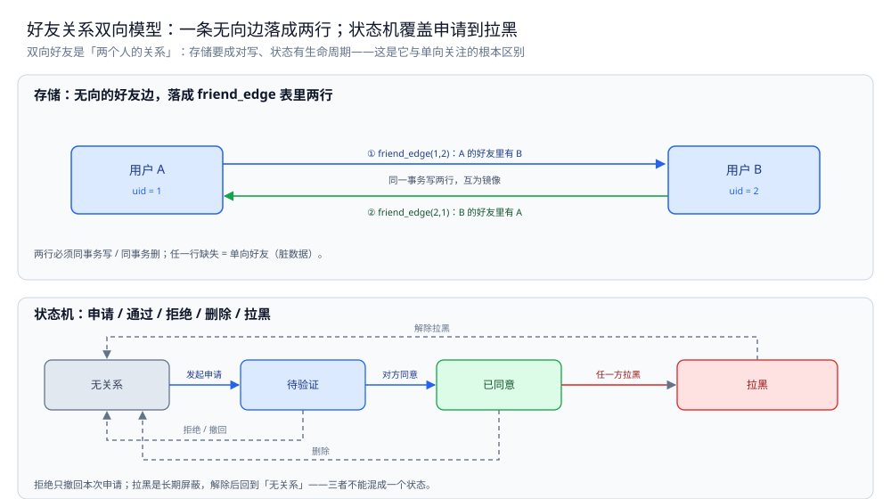
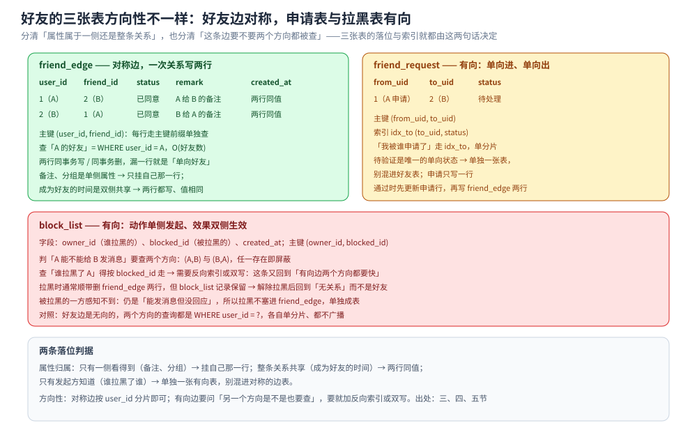
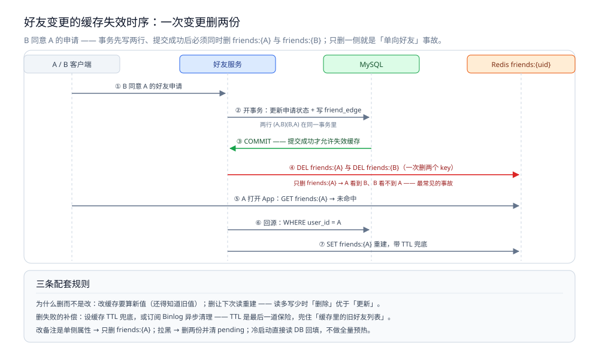

# 好友关系设计

> 讲**双向好友**关系：申请 / 通过 / 拒绝 / 删除 / 拉黑 / 备注的状态与状态机、关系存储（一行双向 vs 双行双索引）、分片与方向性查询、好友列表缓存与失效，以及它与**单向关注**的区别。
>
> 内容整理自个人学习笔记，素材见 [素材清单](../../../素材清单.md)。

---

## 一、双向好友和单向关注，模型差在哪？

**本节要点**：关注是**一条有向边**（A → B，与 B → A 无关），好友是**一条无向边**（A—B，一旦成立两个方向都成立）。这条差别决定了**存储、状态机、查询**三件事全都不同。

### 1.1 一条有向边 vs 一条无向边

| | 单向关注 | 双向好友 |
|---|---|---|
| 语义 | A 关注 B，B 可以没关注 A | A 与 B 互为好友，对称 |
| 边 | 有向边 A → B | 无向边 A—B（落库通常拆成两条有向边） |
| 状态 | 有 / 无 | **有中间状态**：申请中、已同意、已拉黑 |
| 「反向」 | 「谁关注了我」（粉丝） | 同一个好友列表（对称） |
| 典型上限 | 关注可上万 | 好友通常几千（微信 5000） |

> ⭐ 核心差别只有一句：**关注是「一个人对另一个人」的声明，好友是「两个人之间的关系」**。前者可以单方面成立，后者必须双方都点了头。

### 1.2 「互为好友」为什么不能靠一条边加标志位

新手常见写法：存一行 `(a, b)` 再加个 `mutual = true` 表示「互为好友」。这样写有两个问题：

1. **查询要拆条件**：查「A 的好友」得写 `WHERE a=? OR b=?`，两边都要走索引，等于**一条记录服务两个方向**，索引利用不充分。
2. **中间状态没法表达**：A 申请了、B 还没同意时，「申请中」是**单向**的（A → B），而「已同意」是**双向**的。一行加标志位表达不了「方向不对称的中间态」。

所以实践上常见的两种正解是：**要么存两条有向边**（A→B、B→A），**要么存一行无向边但配两个方向的组合索引**。见第三节展开。

### 1.3 关系存储与分片的通用手法另见别篇

好友的「**一行还是两行、分片键选谁、两个方向要不要各存一份**」这套存储与分片手法，和关注关系是**同一套**——它由「关系是有向边」这个共性决定，与「单向还是双向」无关。

> 本文**不重复**那部分：关系存储的**双索引 vs Redis SET 选型**、**分片键只优化一个方向**、**推拉结合与大 V** 都在 [关注粉丝设计.md](关注粉丝设计.md)。本文只讲**双向好友特有的三件事**：状态机（二）、成对写的一致性（三、四）、对称缓存的失效（六）。

---

## 二、好友关系要经过哪些状态、怎么转移？

**本节要点**：双向好友是**有生命周期**的关系，不是「有 / 无」两态。把状态和合法转移写清楚，才能保证「不会出现只有一边是好友」这种脏数据。

### 2.1 状态清单

| 状态 | 含义 | 关系是双向的吗 |
|---|---|---|
| **无关系** | 从未申请，或已删除 / 已解除拉黑 | — |
| **待验证** | A 申请加 B，B 还没处理 | 否，单向（A → B） |
| **已同意** | B 通过了申请，互为好友 | 是，双向 |
| **拉黑** | 任一方把对方拉黑 | 是，双向屏蔽 |

> 注意：**「待验证」是唯一一个单向状态**——所以它天然适合单独存一张申请表（见 3.3），而不是混进好友关系表。

### 2.2 合法转移表

```text
起始        事件              结果        谁触发
──────────────────────────────────────────────────────
无关系      发起申请           待验证      A
待验证      对方同意           已同意      B
待验证      对方拒绝           无关系      B
待验证      申请人撤回         无关系      A
已同意      任一方删除         无关系      A 或 B
无关系      任一方拉黑         拉黑        A 或 B
已同意      任一方拉黑         拉黑        A 或 B
拉黑        拉黑方解除         无关系     拉黑方
```

两条硬规则：

- **已同意 → 无关系，两行必须同事务删**，否则会出现「A 的好友里有 B，B 的好友里没有 A」的脏数据。
- **拉黑是单向动作、双向效果**：A 拉黑 B，结果是 A 与 B 互相都加不上、看不到对方，但**「谁拉黑了谁」这一信息只对 A 可见**（B 不应知道被谁拉黑）。

### 2.3 拒绝、删除、拉黑的区别

这三者都「让关系回到无关系」，但语义完全不同，**不能混成一个状态**：

| 动作 | 发生的状态 | 对方可见吗 | 能否立刻再申请 |
|---|---|---|---|
| **拒绝** | 待验证 | 可见（申请被拒） | 通常要冷却一段时间 |
| **删除** | 已同意 | 不可见（悄悄删） | 可以再申请 |
| **拉黑** | 任意 | **被拉黑方感知不到** | 拉黑期间不可申请 |

> ⚠️ 拉黑的设计要点是**信息不对称**：被拉黑的一方，看到的应该仍然是「能发消息但没回应」，而不是「你已被拉黑」——否则拉黑就没意义了。这一点会直接影响接口的返回值与前端展示。

🔗 上面 2.1 的状态清单与 2.2 的转移表本篇不单独画图，图形形态只在第三节末保留一处宿主（按单一来源原则）：[好友关系双向模型.svg](images/好友关系双向模型.svg) —— 它的下半正是这张转移表（无关系 →待验证→ 已同意，拒绝 / 撤回 / 删除回到无关系，拉黑与解除拉黑各落在哪），上半则是「一条无向边落成两行」的双行落位；至于三张表怎么按方向性落位，见第四节末尾的 [好友三张表的方向性与属性落位.svg](images/好友三张表的方向性与属性落位.svg)。

---

## 三、一份好友关系怎么存？一行双向还是双行双索引？

**本节要点**：两种存法各有取舍——**一行双向省空间、写简单，但查询要拆两个方向**；**双行双索引查得快，但写要成对写、放大一倍**。选哪个取决于「查好友列表多不多、写关系多不多」。

### 3.1 一行双向：写省、查麻烦

```sql
-- 归一化：始终 user_a < user_b，一行代表一条无向边。
CREATE TABLE friendship (
  user_a     BIGINT NOT NULL,
  user_b     BIGINT NOT NULL,   -- 约定 user_a < user_b
  status     TINYINT NOT NULL,
  created_at DATETIME NOT NULL,
  PRIMARY KEY (user_a, user_b),
  KEY idx_b (user_b, user_a)    -- 查「对方是 user_b 时」的关系
);
```

- **写省**：一条关系一行，删也一行。
- **查麻烦**：查「A 的好友」要 `WHERE user_a=? OR user_b=?`，**`OR` 会让优化器可能走两次索引再合并**；为了都走索引，往往要配合 `UNION`。

```sql
SELECT user_b FROM friendship WHERE user_a = ? AND status = ?
UNION
SELECT user_a FROM friendship WHERE user_b = ? AND status = ?;
```

### 3.2 双行双索引：查省、写翻倍

```sql
-- 有向化：一次「互为好友」写两行，每行都能走主键前缀单独查。
CREATE TABLE friend_edge (
  user_id    BIGINT NOT NULL,
  friend_id  BIGINT NOT NULL,
  status     TINYINT NOT NULL,
  remark     VARCHAR(64),        -- 备注：只属于 user_id 这一侧
  created_at DATETIME NOT NULL,
  PRIMARY KEY (user_id, friend_id)
);
```

- **查省**：查「A 的好友」就是 `WHERE user_id=?`，**单分片 + 主键前缀**，两个方向各查各的，简单直接。
- **写翻倍**：加好友要在一个事务里插两行；删好友要在一个事务里删两行。
- **额外好处**：`remark`（备注）这种**只属于一侧**的属性，天然有地方放——A 给 B 的备注，只写在 `(A, B)` 这一行上。

| 选型 | 适合 | 代价 |
|---|---|---|
| **一行双向** | 关系写多、读少；或两个方向查询量都小 | 查询要 `UNION`，索引利用不充分 |
| **双行双索引**（主流） | 好友列表读多（每次进 App 都要拉） | 写放大 2 倍；**两行必须同事务**保证一致 |

> ⭐ 主流选择是**双行双索引**：好友列表是**打开 App 就要拉**的读操作，比「加好友」这个低频写要频繁得多。用写放大换读简单，划算。

🔗 「一行双向 / 双行双索引」与「按关注方分 4 片后谁单片命中、谁必须广播」的通用形态对照，存储侧已画成同型图（本篇只补双向好友特有的三张表落位，见第四节配图），同型不重画：[关系数据的存储形态.svg](../../../03-数据与中间件/数据存储/存储架构与场景/形态篇/images/关系数据的存储形态.svg)

### 3.3 申请中的关系单独放 pending 表

「待验证」是单向的（A → B），语义和「已是好友」不同，所以**单独一张申请表**，别混进好友表：

```sql
CREATE TABLE friend_request (
  from_uid   BIGINT NOT NULL,
  to_uid     BIGINT NOT NULL,
  status     TINYINT NOT NULL,     -- 待处理 / 已通过 / 已拒绝 / 已撤回
  created_at DATETIME NOT NULL,
  PRIMARY KEY (from_uid, to_uid),
  KEY idx_to (to_uid, status)      -- 查「我被谁申请了」：按接收方查待处理
);
```

- 申请**只写一行**（单向进，单向出），于是「我被谁申请了」走 `idx_to`，是单分片查询；
- 通过时，**先更新申请行状态，再在 `friend_edge` 写两行**——两步最好在同一事务或同一幂等流程里，避免「申请通过了但好友没写全」。



图怎么读：上半把一条无向好友边落成 `friend_edge` 两行——(1,2) 表示 A 的好友里有 B，(2,1) 表示 B 的好友里有 A，同一事务写、互为镜像；任一行缺失就是「单向好友」脏数据。下半是状态机：无关系 →（发起申请）→ 待验证 →（对方同意）→ 已同意；拒绝 / 撤回、删除都回到无关系；任一方拉黑进「拉黑」，解除拉黑后回到的是「无关系」而不是好友——三者不能混成一个状态。

---

## 四、备注、拉黑、分组这些「边上的属性」存哪？

**本节要点**：好友关系不是光秃秃的一条边，还挂着**备注、分组、拉黑标记**等属性。关键是分清**哪些属性属于「一侧」、哪些属于「整条关系」**。

### 4.1 属性挂在边上

| 属性 | 属于哪一侧 | 存哪 |
|---|---|---|
| 备注（我给对方的名字） | **单侧**（A 给 B 的备注只有 A 看得到） | 挂在 `friend_edge` 的 `(A, B)` 行 |
| 分组（家人 / 同事） | **单侧** | 同上，或单开一张分组表 |
| 拉黑标记 | **单侧触发、双向生效** | 通常单独一张黑名单表 |
| 成为好友的时间 | **双侧共享**（同一条关系） | 两行都有，值相同 |

> ⚠️ 备注这种「单侧属性」是**用双行双索引存储的一个额外理由**：一行双向的存法里，A 和 B 的备注挤在同一行，反而要再加字段区分「谁的备注」。

### 4.2 拉黑是单向还是双向

拉黑的**动作是单向**（A 拉黑 B），**效果是双向**（互相看不到、加不上）。所以它不该塞进 `friend_edge`，而应单独一张表：

```sql
CREATE TABLE block_list (
  owner_id   BIGINT NOT NULL,   -- 谁拉黑的
  blocked_id BIGINT NOT NULL,   -- 被拉黑的
  created_at DATETIME NOT NULL,
  PRIMARY KEY (owner_id, blocked_id)
);
```

- 判断「A 能不能给 B 发消息」要查两个方向：`(A,B)` 或 `(B,A)` 任一存在即屏蔽；
- 拉黑时，**通常会顺带解除好友关系**（删两行 edge），但**拉黑记录保留**，这样解除拉黑后回到「无关系」而不是「好友」。



图怎么读：三块面板一套字段。绿色那块是 `friend_edge` 双行双索引的落位 —— 一条关系两行互为镜像（`(1,2)` 与 `(2,1)`），主键 `(user_id, friend_id)` 让两个方向各自走主键前缀单独查，所以「查 A 的好友」永远是 `WHERE user_id = A`、命中 A 自己的那一片、不广播；`remark` 这种单侧属性挂在**发起方那一行**（A 给 B 的备注写在 `(1,2)` 上），而「成为好友的时间」是双侧共享，两行都写、值相同。黄色 `friend_request` 与红色 `block_list` 都是**有向**表：申请只写一行（`idx_to (to_uid, status)` 服务「我被谁申请了」），拉黑按 `owner_id → blocked_id` 记，判「能不能发消息」要把 `(A,B)`、`(B,A)` 两个方向都查一遍，而「谁拉黑了我」只能按 `blocked_id` 查 —— 所以要反向索引或双写，这条又回到 [关注粉丝设计.md](关注粉丝设计.md) 那个「有向边两个方向都要快」的老问题。底带把两条判据并排列出：属性看「只有一侧看得到吗」，边看「另一个方向是不是也要查」。

### 4.3 好友上限与冷热

- **好友上限**（如 5000）：让「好友列表」的读聚合有界——列表最多 5000 条，缓存与全量拉取的最坏情况都是确定的。这正是很多产品给关系设上限的原因之一。
- **冷热分离**：活跃好友（常聊）放 Redis，全量好友在 DB。列表页先读热点，翻到底再回源。

> ⭐ 一句话：**给关系设上限，是给下游留出「确定的最坏情况」**——没有上限的列表，缓存大小、全量拉取、遍历成本全都不可控。

---

## 五、分片之后，好友列表查询会不会广播？

**本节要点**：好友关系一定按 `user_id` 分片（这是好友列表的唯一方向性），而**双行双索引正好让「查谁的好友」都变成 `WHERE user_id=?` 的单分片查询**——这是双行存法在分片场景下最大的收益。

### 5.1 按 user_id 分片

```text
friend_edge 按 user_id 分片：
  user_id = ? 的所有好友边 → 全落在同一个分片
查「A 的好友列表」：A % N → 命中一片，主键前缀扫描，O(好友数)
```

对比关注关系里「查粉丝必须广播所有分片」的痛点：**好友是双向对称的，我查「我的好友」和对方查「好友里有谁」用的是同一个 `user_id` 维度**，所以只要按 `user_id` 分片，两个方向都不广播。

### 5.2 方向性查询与双写

| 查询 | 命中方式 |
|---|---|
| 查「A 的好友列表」 | `WHERE user_id = A` → 单分片（A 的分片） |
| 查「A 与 B 是不是好友」 | `WHERE user_id = A AND friend_id = B` → 单分片、主键点查 |
| 查「谁拉黑了 A」 | `block_list` 需要按 `blocked_id` 建反向索引（拉黑表**是有向的**） |

> ⚠️ 注意：**好友边是无向的（所以两行同分片无压力），但拉黑边是有向的**——查「谁拉黑了我」要按 `blocked_id` 查，所以 `block_list` 需要**反向索引或双写**，这条又回到了「有向关系两个方向都要快」的老问题。

### 5.3 扩容再平衡

- 分片数变化时，`user_id % N` 的映射会全变，**所有用户的好友边都要重分布**；
- 缓解办法同关系链的通用手法：**一致性哈希**（扩容只搬一部分）、或**预分片**（先分足够多片，扩容时搬整片而非重算取模）。
- 由于两行是按同一个 `user_id` 维度存的，**搬迁时「A 的两行」会一起搬**，不会出现「A 的好友边一半在旧片、一半在新片」的中间态。

---

## 六、好友列表缓存怎么会失效？

**本节要点**：好友列表是「打开 App 就拉」的热数据，必须缓存；但它是**双向关系**，一次加好友要同时失效**两个人**的缓存，这是它和「单向关注」缓存最大的不同。

### 6.1 缓存结构

```text
friends:{uid}        Redis SET 或 ZSET，成员是好友 uid
                     用 ZSET 时按「成为好友的时间」做分数，方便按时间排序
pending:{uid}        待处理申请列表（进 App 的红点）
```

- 用 **SET**：只做「是不是好友」「共同好友」的集合运算（`SINTER`）；
- 用 **ZSET**：还要「按加好友时间排序」，分页时按分数游标翻页（游标分页写法见 [排行榜设计.md](排行榜设计.md)）。

### 6.2 增删改的失效

**关键点：一次关系变更，要失效两个方向的缓存。**

| 操作 | 要失效的缓存 |
|---|---|
| 加好友（A 与 B 成为好友） | 删 `friends:A` 和 `friends:B` 两份 |
| 删好友 | 同样删两份 |
| 改备注 | 只影响 A 这一侧 → 只删 `friends:A`（若备注存在缓存里） |
| 拉黑 | 删两份，并清 `pending` |

> ⚠️ 最常见的事故是**只失效了一侧的缓存**：A 立刻看到 B 是好友，B 那边缓存里还没有 A。用户视角就是「单向好友」，非常明显。

### 6.3 与 DB 的一致性

缓存的失效策略建议用**「先更新 DB，再删缓存（Cache-Aside + 删除）」**：

```text
1. 事务里写 DB（friend_edge 两行 + 更新申请状态）
2. 事务提交后，删 friends:A 与 friends:B
3. 读时缓存未命中 → 从 DB 重建
```

- **为什么删而不是改**：改缓存要算新值（还得知道旧值），删缓存让下次读重建，更简单也更稳（读多写少时「删除」优于「更新」）。
- **删失败的补偿**：DB 提交后删缓存可能失败（网络抖动），所以要**设置缓存 TTL 兜底**，或订阅 Binlog 异步清理——**TTL 是最后一道保险**，能兜住「缓存里的旧好友列表」。
- **冷启动**：缓存为空时直接读 DB 并回填，别用「全量预热」（好友数据量太大，预热不值当）。



图怎么读：① B 同意 A 的好友申请 → ② 开一个事务，更新申请状态并写 `friend_edge` 两行 (A,B)(B,A) → ③ COMMIT 提交成功后才允许失效缓存 → ④ 一次 `DEL friends:{A}` 与 `DEL friends:{B}`，两个 key 一起删。红色那步是本节说的最常见事故：只删 `friends:{A}`，就会 A 看到 B、B 看不到 A——用户视角的「单向好友」。之后 A 打开 App 读到未命中，回源 `WHERE user_id = A` 再 `SET friends:{A}` 重建、带 TTL 兜底。底部三条配套规则：删而不是改（改要算新值）、删失败靠 TTL / Binlog 补偿、改备注是单侧属性只删 `friends:{A}`。

---

## 使用：好友状态机与存储的 Go 骨架

**本节要点**：把前几节压成三段骨架——**状态机转移校验**（二）、**双行同事务写 / 删**（三）、**双边缓存失效**（六）。

> ⚠️ **未实测**：本轮**未在本机运行**这三段代码，原因是本机未启动 MySQL 与 Redis 实例，且本轮不做新实测。下面为**按语义补全的可编译骨架片段**（省略 import、类型定义与错误包装），因此**不给任何性能或正确性读数**。

**第一段：状态机转移校验**

```go
// RelState 是好友关系状态；单向的「待验证」用单独的申请表表达，这里只列双向状态。
type RelState int

const (
	StateNone    RelState = iota // 无关系
	StateFriend                  // 已同意（双向）
	StateBlocked                 // 拉黑（双向屏蔽）
)

// Action 是用户动作。
type Action string

const (
	ActAccept   Action = "accept"   // 同意申请
	ActDelete   Action = "delete"   // 删除好友
	ActBlock    Action = "block"    // 拉黑
	ActUnblock  Action = "unblock"  // 解除拉黑
)

// next 给出合法转移；非法组合返回 (原状态, false)。
// ⚠️ 未实测：纯函数，本轮未运行单测。
func next(cur RelState, act Action) (RelState, bool) {
	switch {
	case cur == StateNone && act == ActBlock:
		return StateBlocked, true
	case cur == StateFriend && act == ActDelete:
		return StateNone, true
	case cur == StateFriend && act == ActBlock:
		return StateBlocked, true
	case cur == StateBlocked && act == ActUnblock:
		return StateNone, true
	default:
		return cur, false // 其余组合非法（如未申请就 accept）
	}
}
```

**第二段：双行同事务写 / 删**

```go
// BecomesFriend 把「A 与 B 成为好友」写成两行，必须同事务。
// ⚠️ 未实测：未接真实 MySQL，仅示意事务边界（见 3.2）。
func BecomesFriend(ctx context.Context, db *sql.DB, a, b int64) error {
	tx, err := db.BeginTx(ctx, nil)
	if err != nil {
		return err
	}
	defer tx.Rollback() // 任一步失败就整体回滚，避免「单向好友」

	rows := [][2]int64{{a, b}, {b, a}}
	for _, r := range rows {
		if _, err := tx.ExecContext(ctx,
			"INSERT IGNORE INTO friend_edge(user_id, friend_id, status) VALUES(?,?,?)",
			r[0], r[1], StateFriend); err != nil {
			return err
		}
	}
	return tx.Commit()
}

// RemovesFriend 对称删除两行（见 2.2 硬规则：两行必须同事务删）。
// ⚠️ 未实测：同上。
func RemovesFriend(ctx context.Context, db *sql.DB, a, b int64) error {
	tx, err := db.BeginTx(ctx, nil)
	if err != nil {
		return err
	}
	defer tx.Rollback()
	for _, r := range [][2]int64{{a, b}, {b, a}} {
		if _, err := tx.ExecContext(ctx,
			"DELETE FROM friend_edge WHERE user_id=? AND friend_id=?", r[0], r[1]); err != nil {
			return err
		}
	}
	return tx.Commit()
}
```

**第三段：双边缓存失效**

```go
// InvalidateFriendCache 删掉两个人的好友列表缓存（见 6.2）。
// ⚠️ 关键点：一次关系变更必须失效两个方向，只删一侧会立刻表现为「单向好友」。
// ⚠️ 未实测：未接 Redis，仅示意调用点；真实实现应排在 DB 事务提交之后。
func InvalidateFriendCache(ctx context.Context, rdb *redis.Client, a, b int64) error {
	keys := []string{
		"friends:" + strconv.FormatInt(a, 10),
		"friends:" + strconv.FormatInt(b, 10),
	}
	return rdb.Del(ctx, keys...).Err()
}
```

---

## 延伸追问

- **为什么不复用关注表来存好友？** → 关注是**有向边**、无中间状态；好友是**无向边**、有申请 / 通过 / 拉黑的生命周期。硬塞进一张表，要么加一堆「方向 + 状态」的字段把索引搞复杂，要么让两个方向的语义互相污染。**分开存更简单**。
- **「好友申请」要不要单独一张表？** → 要。申请是**单向**的，还要表达「待处理 / 已拒绝 / 已撤回」，语义与「已是好友」不同。合成一张表会让「查我被谁申请了」和「查我的好友」互相加索引负担。
- **通过申请时，能否直接写两行、不更新申请表？** → 不行。申请表里的「待处理」不更新，就会一直挂在对方的红点里。**要么同事务更新，要么用幂等流程**：先标记申请已通过，再写两行；重复执行也不出错。
- **拉黑要不要顺带删好友？** → 通常要。否则「已拉黑」和「仍互为好友」两个状态同时存在，查询逻辑会打架。**拉黑时删两行 edge、保留 block_list 记录**，解除拉黑后回到「无关系」。
- **备注为什么不能放关系表的主键里？** → 备注是**单侧属性**（A 给 B 的备注只有 A 看得到），放双行存法的 `(A, B)` 行上正好；若用一行双向存法，就得再区分「谁的备注」，徒增字段。

## 关联

- [关注粉丝设计.md](关注粉丝设计.md) — 单向关注 / 粉丝：关系存储、双索引、分片键、推拉与大 V（**本篇不重复**）
- [朋友圈设计.md](朋友圈设计.md) — 好友关系的下游使用方：谁看得见谁的动态
- [评论点赞设计.md](评论点赞设计.md) — 同一类「计数」问题：好友数、未处理申请数都要用计数位维护
- [README.md](README.md) — 本目录导读：互动层的四类数据形态与三步骨架
- [README.md](../README.md) — 上层目录导读：三个专题系统怎么配合
- [README.md](../弹幕系统/README.md) — 同为高并发场景，可对照「热点键」与「扇出」的处理
- [README.md](../../分布式/README.md) — 一致性哈希、分布式 ID 等零件的原理线
> 反向引用（本篇被下列文档引到）：[关系数据存储.md](../../../03-数据与中间件/数据存储/存储架构与场景/形态篇/关系数据存储.md)、[存储全景.md](存储全景.md)、[总体设计.md](总体设计.md)
