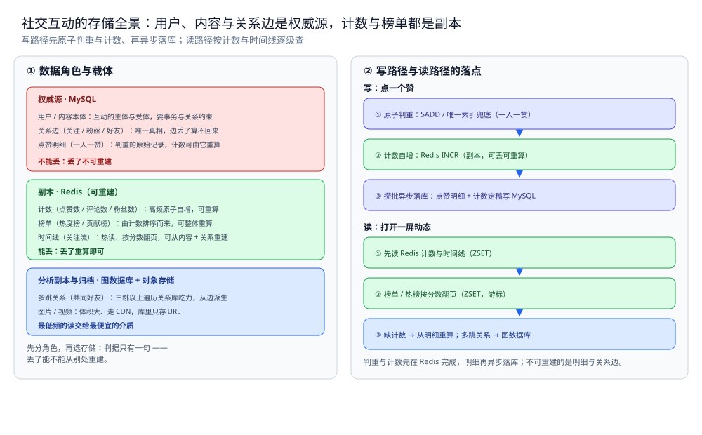

# 存储全景

> 社交互动系统的数据都存哪：用户、内容本体与关系边是权威源，计数、榜单与时间线都是可重建的副本，
> 每份数据是什么角色、放哪个载体、怎么同步、哪些能丢哪些不能。
> 本篇只回答「这份数据放哪」——通用判据（角色 / 同步 / 冷热）见 [存储选型与组合.md](../../../03-数据与中间件/数据存储/存储架构与场景/存储选型与组合.md)，
> 本篇不重复判据，只把判据落到社交互动上。
>
> 内容整理自个人学习笔记；参考资料与原始素材见 [素材清单](../../../素材清单.md)。

---

## 一、社交互动系统里数据扮演哪几种角色？

**本节要点**：先分角色，再选存储。判据只有一句——**丢了能不能从别处重建**；不能重建的是权威源，能重建的是副本。

| 数据 | 角色 | 载体 | 理由 |
|---|---|---|---|
| 用户（uid / 昵称 / 头像） | 权威源 | MySQL | 互动的主体，丢了不可重建，要事务与关系约束 |
| 内容本体（帖子 / 评论正文） | 权威源 | MySQL（或文档库） | 互动的受体，要持久、按 ID 点查 |
| 关系边（关注 / 粉丝 / 好友） | 权威源 | MySQL 邻接表 | 用户之间的边，是唯一真相；边丢了算不回来 |
| 点赞明细（一人一赞） | 权威源 | MySQL（唯一索引兜底） | 判重的原始记录，计数可由它逐条重算 |
| 点赞数 / 评论数 / 粉丝数 | 副本 | Redis 计数器（定期落库） | 高频原子自增；可从明细与关系重算 |
| 榜单（热度榜 / 贡献榜） | 副本 | Redis ZSET | 由计数排序而来，可整体重算 |
| 时间线（关注流） | 副本 | Redis ZSET | 高频读、按分数翻页；可从内容 + 关系重建 |
| 图片 / 视频 | 归档 / 静态资源 | 对象存储 + CDN | 体积大、走 CDN 分发，库里只存 URL |
| 多跳关系（共同好友，按需） | 副本 | 图数据库 | 三跳以上遍历关系库吃力；从关系边派生 |

⭐ 判据：用户、内容、关系边、点赞明细不能重建，是权威源；计数、榜单、时间线、多跳关系都是从它们重算出来的副本，可丢。这就是为什么「点赞数」不能当成「点赞记录的一次查询」去 `COUNT(*)`，而要当成一份可重建的计数副本单独承载（见 [评论点赞设计.md](评论点赞设计.md)）。

---

## 二、读和写的路径分别走哪条链？

**本节要点**：同一份数据在写路径和读路径上的落点不同 —— 写路径决定「谁先原子判重与计数、谁异步落库」，读路径决定「先读计数与时间线、再回源明细与关系」。

### 2.1 写路径

```text
点一个赞
│
├─ ① 原子判重：SADD（Redis）/ DB 唯一索引兜底（一人一赞）
├─ ② 计数自增：Redis INCR / HINCRBY（副本，可丢可重算）
├─ ③ 攒批异步落库：点赞明细 + 计数定稿批量写 MySQL
└─ ④ 若是关系动作：写关系边（MySQL 邻接表，同一事务成对写）
```

> ⭐ 判重与计数先在 Redis 完成（低延迟），明细与关系边再异步落进权威源；真正不可重建的是明细与关系边，计数丢了从它们重算。

### 2.2 读路径

```text
打开一屏动态
│
├─ ① 先读 Redis 计数与时间线（ZSET）
├─ ② 榜单 / 热榜按分数翻页（ZSET + 游标）
└─ ③ 缺计数 → 从明细重算；多跳关系 → 图数据库按需回捞
```

> ⭐ 读路径按 Redis（热）→ MySQL（温）→ 图数据库（冷，多跳）逐级查；计数与榜单都是可读加速的副本，回源永远以明细与关系边为准。



图怎么读：左栏把九份数据按角色归到三层——权威源（用户 / 内容本体、关系边、点赞明细）落 MySQL、红框，是互动主体、受体与边的唯一真相；副本（计数、榜单、时间线）落 Redis、绿框，高频原子自增或按序翻页，都能从明细与关系重算；分析副本与归档（多跳关系、图片 / 视频）落图数据库 + 对象存储、蓝框，用最便宜的合适介质承载最低频的读。右栏是两条链的落点：写链「原子判重 → 计数自增 → 攒批异步落库」，只有第三步把真相写进权威源；读链「先读计数与时间线 → 榜单按分数翻页 → 缺计数从明细重算 / 多跳关系回图数据库」。底部一行是本篇的口径基线：**判重与计数先在 Redis 完成，不可重建的只有明细与关系边**。

---

## 三、为什么这样分配？

**本节要点**：每个角色选中它的载体，都有结构上的理由，不是拍脑袋。

| 数据 | 为什么是它 |
|---|---|
| 用户 / 内容本体落 MySQL | 需要事务与关系约束、要可持久、按 ID 点查 |
| 关系边落 MySQL 邻接表 | 边是唯一真相、两个方向都要能查；丢了无法从别处算出 |
| 点赞明细落 MySQL（唯一索引） | 判重要一条一条留痕，计数可由它逐条重算；唯一索引是最后一道防重复 |
| 计数放 Redis 计数器 | 读极高频期望 O(1)、写必须原子；可容忍丢失，定期落库 |
| 榜单放 Redis ZSET | 要按分数范围读且有序、高频改分；可由计数整体重算 |
| 时间线放 Redis ZSET | 高频读、按分数游标翻页；可从内容 + 关注关系重建 |
| 多跳关系放图数据库 | 三跳以上遍历用关系库吃力；它是派生副本，可按需重建 |
| 图片 / 视频走对象存储 + CDN | 大文件不适合进关系库，CDN 承担分发压力 |

⭐ 一条贯穿全篇的判据：**权威源只有明细、关系与内容，其余全是它们的派生** —— 派生载体可以丢、可以换、可以重建，只要权威源在。

---

## 四、社交互动系统的特殊性在哪？

**本节要点**：社交互动与秒杀 / Feed 的最大差别是「**同一份热点状态被极高频地读、也极高频地写**」—— 它没有"扣减"这种零和操作，痛点是**计数与排序**，而且**四种数据形态的代价结构完全不同**。

| 对比项 | 社交互动系统 | 秒杀系统 | Feed 流 |
|---|---|---|---|
| 数据可丢吗 | ✅ 计数 / 榜单 / 时间线可丢，回源明细与关系重算 | ✅ 预扣可丢，但账要对上 | ⚠️ 时间线副本可丢，内容本体不可丢 |
| 权威源 | MySQL（明细 + 关系边 + 内容本体） | MySQL（订单 + 库存） | MySQL（内容本体） |
| 核心难点 | ⭐ **计数与排序**（四种形态各一套代价结构） | 热点行高频原子写（扣减） | 推拉扇出与翻页一致性 |
| 热副本的角色 | 读加速 + **原子写入口**（计数 / ZSET） | 写入口 + 读加速 | 读加速 |
| 必须做的事 | 原子判重 + 异步落库 + 分片键取舍 | 对账 | 翻页时回源 |
| 降级方向 | 计数可降级重算，页面必须能出来 | 宁可不卖，不可超卖 | 宁可空一屏，不可错序 |

⭐ 一句话：秒杀与 Feed 各自只有**一种**主形态（扣减 / 时间线），社交互动同时有**四种**（计数器 / 有序集合 / 关系图 / 内容）—— 所以它不是"一套方案走到底"，而是**按数据形态分而治之**。

## 使用：一次完整链路的存储落点

**本节要点**：把「用户点一个赞」到「一屏动态刷新出来」的全过程，标出每一步的存储落点。

| 步骤 | 数据 | 落在哪 |
|---|---|---|
| ① 点击点赞 | 点赞动作 | 无持久化（客户端） |
| ② 原子判重 | 一人一赞 | Redis `SADD`（DB 唯一索引兜底） |
| ③ 计数自增 | 点赞数 | Redis `INCR`（副本，可重算） |
| ④ 攒批异步落库 | 点赞明细 | MySQL（权威源，唯一索引） |
| ⑤ 计数定稿 | 点赞数快照 | MySQL（定期落库） |
| ⑥ 关系动作 | 关注 / 好友边 | MySQL 邻接表（成对写，同事务） |
| ⑦ 打开一屏动态 | 计数 | Redis（热读） |
| ⑧ 翻页 | 时间线 | Redis ZSET（游标） |
| ⑨ 榜单 | 热度 / 贡献 | Redis ZSET（按分数取段） |
| ⑩ 缺计数 → 重算 | 明细 | 回源 MySQL（权威源） |
| ⑪ 共同好友 | 多跳关系 | 图数据库（按需回捞，冷） |
| ⑫ 图片 / 视频 | 静态资源 | 对象存储 + CDN（库里只存 URL） |

⭐ 三个关键落点：**点赞明细与关系边在 MySQL（权威源）**；计数、榜单、时间线在 **Redis（可丢、可重算）**；多跳关系在**图数据库（按需派生）**。

## 延伸追问

- **为什么点赞数不直接 `COUNT(*)` 算？** → 那是一次 O(k) 的全量扫描，热点内容会被读放大拖垮；计数是一份可 O(1) 读写的**状态副本**，从明细重算只是兜底（见 [评论点赞设计.md](评论点赞设计.md)）。
- **计数丢了算事故吗？** → 不算。计数能从点赞明细与关系边重算，丢了只是"数字暂时不准"；降级方向是**回源重算**，而不是把明细也一起丢。
- **为什么榜单与时间线都放 ZSET，却不放同一张表？** → 两者都"按分数有序"，但**生命周期与更新频率不同**：榜单靠 `ZINCRBY` 高频改分、时间线靠写入定序——分开承载才能各自选分片与淘汰策略。
- **多跳关系为什么要单独一份图数据库？** → 三跳以上的遍历在关系库里要么多次 JOIN、要么全表扫；图数据库为"边遍历"而建。它是**派生副本**，从关系边可重建（见 [关注粉丝设计.md](关注粉丝设计.md)）。
- **社交互动最怕丢的是哪一份数据？** → 不是计数、也不是榜单，而是**关系边与点赞明细**（权威源）—— 边丢了"谁关注谁"算不回来，明细丢了计数就再也对不上。

## 关联

- [存储选型与组合.md](../../../03-数据与中间件/数据存储/存储架构与场景/存储选型与组合.md) — 通用判据：五种角色、同步三路线、冷热三层 —— 本篇是它在社交互动上的落地。
- [总体设计.md](总体设计.md) — 要素分析、四类数据形态与三步骨架的整体形态，解释了这些落点为什么这么分。
- [评论点赞设计.md](评论点赞设计.md) — 计数、判重与异步落库的详细判据。
- [排行榜设计.md](排行榜设计.md) — 榜单为什么用 ZSET、深分页与持久化怎么处理。
- [关注粉丝设计.md](关注粉丝设计.md) — 关系边的存储与分片、推拉结合。
- [好友关系设计.md](好友关系设计.md) — 双向好友的状态机与缓存一致性。
- [数据同步方式选型对比.md](../../../03-数据与中间件/数据存储/数据同步/数据同步方式选型对比.md) — 通用篇的同步路线：CDC / 双写 / 定时全量怎么选。
- [README.md](README.md) — 本目录导读：社交互动的四类数据形态与阅读顺序。
