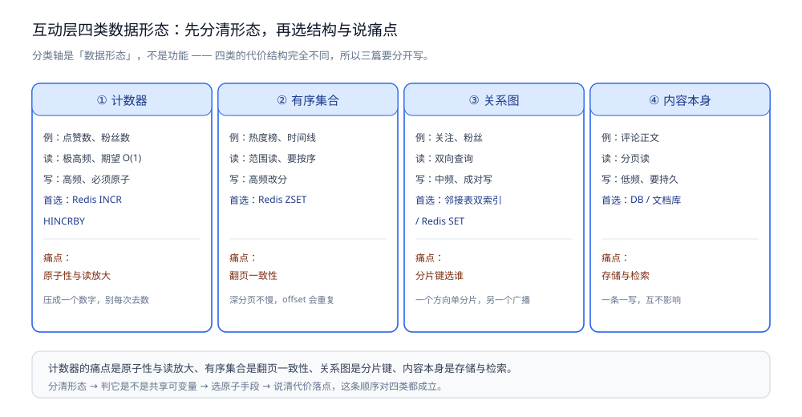

# 总体设计

> 本系统**整体方案**：分几层 / 几部分、各干什么、怎么配合、核心取舍在哪。
> **各部分的细节**在零件篇里；**数据落点**在存储全景里；**篇目清单与阅读顺序**在 README 里。
>
> 本目录收**社交互动系统**这道场景题：本篇是**总体设计**（整体形态 + 核心取舍 + 一次互动走哪几步），
> 篇目清单与阅读顺序见 [README.md](README.md)，数据落点见 [存储全景.md](存储全景.md)；各篇零件分别成篇 ——
> [评论点赞设计.md](评论点赞设计.md)（计数 / 去重 / 缓存 / 异步写 / 热 key）、
> [排行榜设计.md](排行榜设计.md)（ZSET / 分页 / 实时更新 / 持久化）、
> [关注粉丝设计.md](关注粉丝设计.md)（关系存储 / 分片 / 推拉结合 / 大 V）、
> [好友关系设计.md](好友关系设计.md)（双向好友：状态机 / 存储 / 分片 / 缓存一致性）；
> 另有 feed 视角的 [朋友圈设计.md](朋友圈设计.md)（要素分析 / ER 表设计 / 数据分层 / 推拉方式）与
> 其可运行骨架 [朋友圈骨架.md](朋友圈骨架.md)（Go 与 Java，附三组实测）。
>
> 内容整理自个人学习笔记；参考资料与原始素材见 [素材清单](../../../素材清单.md)。
> **落地实现**：各篇实验全部在本机 Docker 环境跑通（Redis 7.4.11 / MySQL 8.0.46），代码为 Go；
> 正文所有 `text` 块都是本机真实运行结果。

---

## 一、系统的整体形态是什么？

**本节要点**：社交互动系统的整体形态是一张**「数据形态 → 原子手段 → 代价落点」的三段式**——先把互动数据按"被多少人同时读、同时改"分成四类形态，再对每类选一种原子手段，最后把代价落在异步 / 推拉 / 分片上。**分类轴不是功能，而是数据形态**。

一句话概括：**先按"每份数据被多少人同时读、同时改"判它的数据形态，再决定用哪种原子手段、把代价落在哪一侧。**



图怎么读：这张图是本目录共用的四类数据形态图，但这里要当**"形态 → 结构 → 痛点"的三段式地图**看，而不是只看四格并列。每一格其实写着一个三段：**形态**（计数器 / 有序集合 / 关系图 / 内容本身）→ **首选结构**（`INCR` / `ZSET` / 邻接表双索引 / DB）→ **痛点**（原子性与读放大 / 翻页一致性 / 分片键选谁 / 存储与检索）。读这张图的关键是**先看"痛点"列**：痛点决定后面选什么手段、把代价落在哪 —— 四格痛点完全不同，这正是它们必须分开成篇、不能拿一套方案硬套的原因。

整个系统绕不开四类**基础对象**与两类**派生数据**，再按数据形态归成四类：

| 类别 | 例子 | 数据形态 | 首选结构 | 细节在哪 |
|---|---|---|---|---|
| **① 用户** | uid、昵称、头像 | （主体，非互动数据） | DB | [朋友圈设计.md](朋友圈设计.md) |
| **② 内容** | 帖子 / 视频 / 商品 | 内容本身 | DB / 文档库 | [评论点赞设计.md](评论点赞设计.md) |
| **③ 互动** | 点赞、评论 | 计数器 + 内容本身 | Redis `INCR` / `HINCRBY` + DB | [评论点赞设计.md](评论点赞设计.md) |
| **④ 关系** | 关注 / 粉丝 / 好友 | 关系图 | 邻接表（双索引）/ Redis `SET` | [关注粉丝设计.md](关注粉丝设计.md)、[好友关系设计.md](好友关系设计.md) |
| **⑤ 派生·计数** | 点赞数、评论数、粉丝数 | 计数器 | Redis 计数器 + 异步落库 | [评论点赞设计.md](评论点赞设计.md) |
| **⑥ 派生·榜单** | 热度榜、贡献榜 | 有序集合 | Redis `ZSET` | [排行榜设计.md](排行榜设计.md) |

⭐ 关键动作是**把 ⑤⑥ 从 ③④ 里分出来** —— 很多人一上来就把"点赞数"当成"点赞记录的一个查询"，于是掉进 [评论点赞设计.md](评论点赞设计.md) 第一节那个 O(k) 的坑。**能压成一个数字的，就不要每次去数。**

再加 feed 视角两篇（[朋友圈设计.md](朋友圈设计.md) + [朋友圈骨架.md](朋友圈骨架.md)），换一个面看同一批数据的分发方式。

---

## 二、核心取舍在哪？

**本节要点**：三个取舍决定了这套方案的长相——**派生数据从源数据里分出来、原子手段只选能覆盖竞争边界的那一档、代价落在哪一侧**。前两个保证"不会错"，第三个决定"划不划算"；出错的分水岭往往在第三个。

### 2.1 取舍一：把派生数据从源数据里分出来

同一个东西，是"每次去数"还是"压成一个数字"，代价差一个数量级。判据只有一句：**这份数据是不是"能压成一个数字"**。

```text
点赞记录（源数据，③）          → 每次数一遍 → O(k)，k = 记录条数
   └─► 点赞数（派生·计数，⑤） → 一个 INCR   → O(1)
榜单（派生·榜单，⑥）          → 对计数排序  → 由 ⑤ 排出来，不再扫全量
```

⭐ 一句话：**能压成一个数字的，就不要每次去数**。这也是"计数本身就是「可 O(1) 读写的状态」，而不是缓存一个查询结果"的由来（见 [评论点赞设计.md](评论点赞设计.md) 1.3）。

### 2.2 取舍二：原子手段只选覆盖竞争边界的那一档

判清形态后，第二步是选**原子手段**。三档从快到慢，选哪一档取决于"竞争边界"在一条命令内、一段脚本内，还是必须落到 DB：

| 档 | 手段 | 用在什么边界 | 代价 |
|---|---|---|---|
| **快** | Redis **单命令**（`INCR` / `SADD` / `ZINCRBY`） | 竞争边界就在**一条命令**内（自带原子性） | 最低 |
| **中** | Redis **Lua 脚本** | 多条命令要**一起原子**（如"判重 + 计数"） | 一段脚本的往返 |
| **慢** | DB **条件更新 / 唯一索引**（`UPDATE ... WHERE stock > 0`、`INSERT IGNORE`） | 落库侧的**最终防线** | 一次库写 |

⭐ 一条纪律：**别提了原子却留着竞态窗口**——"哪一步是原子的、哪一步不是"必须说清；单命令能覆盖的边界就别上 Lua，Lua 能覆盖的就别落到 DB（见 2.3）。

### 2.3 取舍三：代价落在哪一侧 —— 异步 / 推拉 / 分片

第三步最见功力：方案对了，还要把代价放在**划算**的一侧。三个典型取舍：

- **异步**：把 fsync 摊薄。**实测**（2000 条批量落库）**13.7s → 136ms**，代价是攒批窗口内的丢失窗口。
- **推 / 拉**：写放大 vs 读放大，比的是「粉丝数 × 发帖频次」与「关注数 × 读频次」；两侧谁大，就压谁。
- **分片**：单分片快 vs 广播慢，比的是「哪类查询高频」；分片键只优化一个方向，另一个方向**必须广播**。

```text
同日实测：攒批落库（异步）把 2000 条从 13.7s 压到 136ms
反例实测：单实例拆热 key 成 8 份 —— 173ms vs 174ms，零收益
```

⭐ 一句反面教训：**"我用了 Redis / MQ / 分片"不是答案，把它们各自的代价说出来才是**。本目录各篇的每一个 `text` 块，都是为了给"代价"这句话提供本机读数 —— 比如单实例拆热 key 的**零收益**（见 [评论点赞设计.md](评论点赞设计.md) 第四节）。

---

## 三、各部分怎么配合？

**本节要点**：四类形态不是并列的模块，而是**同一条"形态 → 原子 → 代价"链路的不同入口**；`评论正文与计数同在一篇`、`单向关注 → 双向好友`是两个接缝，feed 两篇是换视角的另一个面。

### 3.1 一条三段式依赖链

```text
判数据形态 ──► 选原子手段 ──► 定代价落点
（计数 / 有序集合 / 关系 / 内容）   （单命令 / Lua / DB）   （异步 / 推拉 / 分片）
      ↑                                  ↑                        ↑
   决定结构                           决定"不会错"            决定"划不划算"
```

### 3.2 四类形态与篇目怎么对应

| 形态 | 篇目 | 内容 |
|---|---|---|
| 计数器 | [评论点赞设计.md](评论点赞设计.md) | 计数 / 去重 / 异步写 / 热 key |
| 有序集合 | [排行榜设计.md](排行榜设计.md) | ZSET / 分页 / 实时更新 / 持久化 |
| 关系图 | [关注粉丝设计.md](关注粉丝设计.md) + [好友关系设计.md](好友关系设计.md) | 关系存储 / 分片 / 推拉 / 双向好友 |
| 内容本身 | [评论点赞设计.md](评论点赞设计.md) | 评论正文的存储与分页读 |
| feed 视角 | [朋友圈设计.md](朋友圈设计.md) + [朋友圈骨架.md](朋友圈骨架.md) | 推拉分层 / ER 表 / 可运行骨架 |

> 注意 **评论正文与计数同在一篇**：一条评论既是「内容本身」、又牵动「评论数」这个计数器，所以 [评论点赞设计.md](评论点赞设计.md) 一篇覆盖两种形态。**关系图也有两道台阶**：单向关注（[关注粉丝设计.md](关注粉丝设计.md)）→ 双向好友（[好友关系设计.md](好友关系设计.md)），多一层状态机。

### 3.3 落地顺序

| 步骤 | 说什么 | 别说成什么 |
|---|---|---|
| 1 | 先列**数据形态**（计数 / 有序集合 / 关系 / 内容） | ❌ 别上来就报组件清单 |
| 2 | 对每类说**痛点**（原子性 / 分页一致性 / 分片键 / 存储） | ❌ 别只说"我用 Redis" |
| 3 | 给**手段**并说清**原子边界**（哪一步是原子的、哪一步不是） | ❌ 别提了原子却留着竞态窗口 |
| 4 | 说**代价落点**（异步丢多少、推拉谁吃亏、分片谁广播） | ❌ 别把取舍说成"没缺点" |
| 5 | 补**兜底**（对账、监控热 key、降级） | ❌ 别假设"上面都成功了" |

---

## 四、一次完整互动走哪几步？

**本节要点**：把四类形态串成端到端链路，帮助定位"某一步该看哪一节"。以「点赞一条评论」为例（其余互动同构）。

| # | 步骤 | 做什么 | 落点 |
|---|---|---|---|
| ① | 用户点赞 | 请求带 uid + 评论 id | [评论点赞设计.md](评论点赞设计.md) |
| ② | 判重（去重） | `SADD` 原子判"一人一赞"，DB 唯一索引兜底 | [评论点赞设计.md](评论点赞设计.md) 二 |
| ③ | 计数 +1 | `INCR` 原子加一（计数是状态，不是缓存查询） | [评论点赞设计.md](评论点赞设计.md) 一 |
| ④ | 热度榜改分 | `ZINCRBY` O(log N) 改分，改完立刻改名次 | [排行榜设计.md](排行榜设计.md) 三 |
| ⑤ | 异步落库 | 攒批落库（实测 2000 条 13.7s → 136ms），窗口内可丢 | [评论点赞设计.md](评论点赞设计.md) 三 |
| ⑥ | 敏感断言走 Lua | "判重 + 计数"要一起原子时用一段脚本覆盖 | [评论点赞设计.md](评论点赞设计.md) |
| ⑦ | 关注 / 粉丝 | 关系双索引；分片键只优化一个方向，另一个方向广播 | [关注粉丝设计.md](关注粉丝设计.md) |
| ⑧ | feed 分发 | 按「粉丝数 × 发帖频次」与「关注数 × 读频次」选推或拉 | [关注粉丝设计.md](关注粉丝设计.md)、[朋友圈设计.md](朋友圈设计.md) |

```text
点赞：判重(SADD) → 计数(INCR) → 改分(ZINCRBY) → 异步落库
关注：双向索引写（一个方向单分片、另一个方向广播）→ 按阈值选推 / 拉 → feed 分发
兜底：对账（异步窗口）/ 监控热 key / 降级（DB 条件更新兜住原子性）
```

⚠️ 三个常见误区：① 把"点赞数"当成"点赞记录的一个查询"（O(k) 坑，见 2.1）；② 提了原子却留着竞态窗口（"哪一步是原子的"没说清，见 2.2）；③ 把取舍说成"没缺点"（不提异步丢多少、分片谁广播，见 2.3）。

---

## 五、这套方案的前提与边界是什么？

**本节要点**：这套"四类形态 + 原子手段 + 代价落点"的方案，成立的前提是"数据能被按形态归并、且存在一条命令级的原子手段"；跳出这个前提，答案要整个换掉。

| 场景 | 这套方案 | 为什么 |
|---|---|---|
| **高并发读 + 高并发写 + 强共享状态** | ✅ 适用 | 互动层是这三件事同时出现的少数场景 |
| **数据能按形态归并**（计数 / 榜单 / 关系 / 内容） | ✅ 适用 | 分类轴是形态，不是功能；同类共用手段 |
| **存在一条命令级的原子手段** | ✅ 适用 | Redis 单命令 / Lua / DB 条件更新覆盖竞争边界 |
| **稀缺资源扣减**（库存、订单） | ❌ 不在本目录 | 那是 [秒杀系统](../秒杀系统/README.md) 的领域：核心是"扣减"，互动层没有扣减 |
| **通用 Feed 的存储与分页** | ❌ 不在本目录 | 在 [README.md](../Feed流系统/README.md)；本目录从**互动数据**这侧切入 |
| **只想堆组件清单** | ❌ 不是本题考法 | 考的是"每份数据被多少人同时读写"与"代价放在哪一侧"，见 3.3 |

依赖的外部条件：

- **Redis**：计数器（`INCR` / `HINCRBY`）、榜单（`ZSET`）、判重名单（`SADD`）、关系（`SET`）都常驻内存，最终靠**淘汰与过期**兜底。
- **DB（MySQL 等）**：条件更新 / 唯一索引是落库侧的**最终防线**；计数与关系都要能对账。
- **异步落库通道**：攒批摊薄 fsync，代价是窗口内的丢失窗口，需要**对账**补上。
- **分片键**：只优化一个查询方向，另一个方向必须广播 —— 选键前先判"哪类查询高频"。

> ⚠️ **读数口径**：本目录各篇的 `text` 块均为本机 Docker 实测（Redis 7.4.11 / MySQL 8.0.46）；时序类数字受调度影响，取多次运行的趋势而非单点。

---

## 使用：本方案的组件清单

**本节要点**：把上述方案落成组件，各自承担什么角色、以什么形态部署。

| 组件 | 承担什么 | 部署形态 | 数据角色 |
|---|---|---|---|
| **MySQL**（或文档库） | 用户 / 内容 / 互动记录 / 关系边；唯一索引兜底去重 | 主从；互动正文低频写 | **权威源** —— 互动记录与内容不可重建 |
| **Redis** | 计数器 / `ZSET` 榜单 / `SADD` 判重名单 / 关系 `SET` | 单实例起步；热 key 先判节点是否饱和再谈拆 | **派生副本** —— 可从落库数据重建 |
| **异步落库** | 攒批把 N 次提交摊成 1 次 | 定时 / MQ 批量写 | 传输 + 缓冲 |
| **计算节点** | 榜单聚合、feed 分发（推 / 拉） | 无状态、可水平扩 | 无（业务逻辑） |
| **缓存淘汰策略** | 计数、榜单、判重名单的过期与淘汰 | 随 Redis 配置 | 兜底 |

⭐ 这套清单的判据只有一条：**权威源在 DB（互动记录 / 内容 / 关系边），Redis 里的计数 / 榜单 / 名单全是它的派生** —— 派生载体可以丢、可以重建，只要权威源在。各角色的完整落点见 [存储全景.md](存储全景.md)。

## 延伸追问

- **为什么把互动层单独拎出来做场景题？** → 因为它是「高并发读 + 高并发写 + 强共享状态」三件事**同时**出现的少数场景。普通业务要么读多写少（缓存解决），要么写多读少（队列解决），互动层两个都多，逼着你把原子性、削峰、分片全走一遍。
- **互动层和秒杀，是同一套题吗？** → 手段相通、痛点不同。秒杀的核心是「稀缺资源扣减」（见 [总体设计.md](../秒杀系统/总体设计.md)），互动层没有"扣减"；互动层的「计数与排序」秒杀里也没有。两套场景共用原子判定、异步、分片这些**手段**，所以是并列的两个目录，不是同一篇的子节。
- **如果只让讲一个最容易被忽略的点？** → **热 key 的收益不在"拆"，在"拆到哪"**。本机实测：单实例上把一个热 key 拆成 8 份，最快值与不拆**完全相同**（173ms vs 174ms）—— 这个反直觉结论，正是「真想过」与「背结论」的分水岭（见 2.3）。
- **和 [朋友圈设计.md](朋友圈设计.md) 什么关系？** → 那篇是 **feed 视角**（内容怎么分发到人、推拉怎么分层）；本目录主篇是 **互动数据视角**（计数 / 榜单 / 关系怎么存）。两篇的"推拉"是同一组概念的两个应用面。
- **为什么这几篇要分开写、不能合成一篇？** → 因为四类形态的**代价结构完全不同**：计数器的痛点是原子性与读放大、有序集合的痛点是翻页一致性、关系图的痛点是分片键选谁、内容本身的痛点是存储与检索。合成一篇会把四种代价混在一起讲（见 一）。

## 关联

- [README.md](README.md) — 目录导读：核心问题 / 篇目清单 / 阅读顺序 / 目录分工。
- [存储全景.md](存储全景.md) — 横切篇：社交互动的数据都存哪、谁是权威源、怎么同步。
- [评论点赞设计.md](评论点赞设计.md) — 计数 / 去重 / 缓存 / 异步写 / 热 key。
- [排行榜设计.md](排行榜设计.md) — ZSET / 分页 / 实时更新 / 持久化。
- [关注粉丝设计.md](关注粉丝设计.md) — 关系存储 / 分片 / 推拉结合 / 大 V。
- [好友关系设计.md](好友关系设计.md) — 双向好友：状态机 / 存储 / 分片 / 缓存一致性。
- [总体设计.md](../秒杀系统/总体设计.md) — 另一类高并发场景（稀缺资源扣减），手段相通、痛点不同。
- [朋友圈设计.md](朋友圈设计.md) — feed 的推拉分层与要素分析，与本目录的"推拉"互为应用面。
- [朋友圈骨架.md](朋友圈骨架.md) — 朋友圈的 Go / Java 骨架与三组实测（写放大 / 读放大 / 分页稳定性）。
- [缓存淘汰算法.md](../../../03-数据与中间件/数据存储/缓存/缓存淘汰算法.md) — 计数器、榜单、判重名单都常驻内存，最终靠淘汰与过期兜底。
- [数据类型.md](../../../03-数据与中间件/数据存储/NoSQL/Redis/数据类型.md) — 本目录用到的 `INCR` / `SADD` / `ZSET` 基础用法。
- [底层结构.md](../../../03-数据与中间件/数据存储/NoSQL/Redis/底层结构.md) — 这几条命令背后的结构：listpack / 跳表 / 渐进式 rehash。
- [限流算法.md](../../分布式/服务治理/限流算法.md) — 点赞 / 关注接口的限流，重点是"按用户"而非"按 IP"。
- [README.md](../Feed流系统/README.md) — 通用 Feed 的工程零件，与本目录的 feed 视角互为应用面。
- [存储选型与组合.md](../../../03-数据与中间件/数据存储/存储架构与场景/存储选型与组合.md) — 通用视角：数据角色、权威源与副本、冷热分层与多存储同步。
