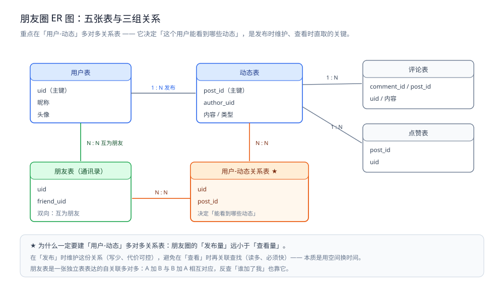
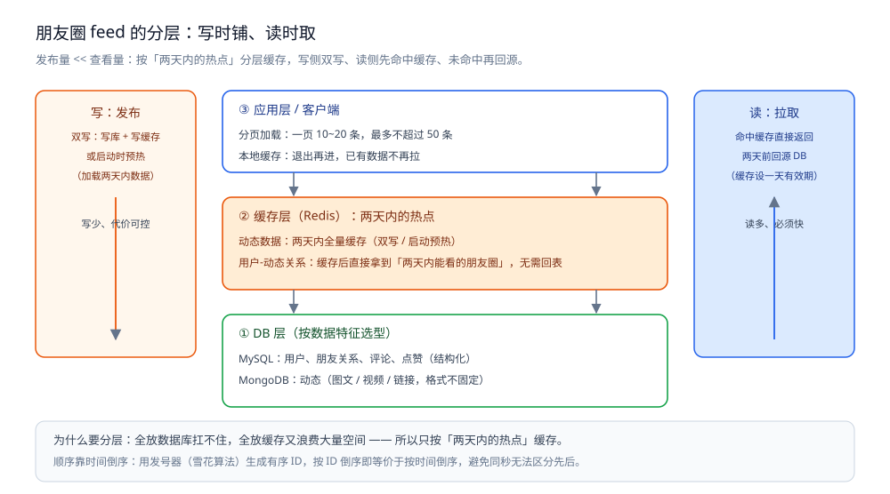

# 朋友圈设计

> 场景题：设计一个朋友圈 —— 从**要素分析、表设计与数据分层**到 feed 的**推 / 拉 / 推拉结合**的完整推导。
> 本篇是**场景设计篇（总纲）**，把结论讲清楚；可运行的 Go / Java 骨架与三组实测另见 [朋友圈骨架.md](朋友圈骨架.md)。
>
> 内容整理自个人学习笔记，并参考《大型网站技术架构：核心原理与案例分析》（李智慧）的伸缩性与可用性章节；参考资料与原始素材见 [素材清单](../../../素材清单.md)。

---

## 一、场景题：怎么设计一个朋友圈？

**本节要点**：场景题**没有标准答案**，核心是**应变能力和思考过程**——

> **要的不是「标准的微信朋友圈方案」**，
> **而是你自己的思路：为什么这么设计、设计时有哪些考量。**
>
> **结论离谱不行，但有思路、有取舍、能讲清理由，就是好设计。**

### 1.1 第一步：要素分析（先想清楚"有什么"）

划出**三类核心信息**：

| 要素 | 说明 |
|---|---|
| **① 朋友与用户** | 朋友圈一定涉及"人" |
| **② 图文、视频等信息** | 即朋友圈的**条目 / 动态** |
| **③ 评论与点赞** | 针对动态产生的互动 |

> **注意**：一时想不到所有细节是**正常的**——
> 实际开发也一样，**先定大方向，后续开发中遇到问题再迭代**，
> 不会一开始就设计得极其细致。

### 1.2 第二步：分析朋友圈的三个特点

| 特点 | 内容 |
|---|---|
| **① 数据展示范围固定** | 展示**自己通讯录里所有朋友 + 自己**发的动态 |
| **② 数据展示顺序固定** | **按时间倒序**——最新的在最上面 |
| **③ 热点数据** | 用户通常只看**一小时以内**的，最多**一天以内**。<br>→ **保守设计为"两天内的热点数据"**；<br>后续可根据**数据打点**再决定是两小时、一天还是两天 |

> 关于第 ③ 点要**主动承认这是拍脑袋**：
> "先按两天设计，后续根据打点数据调整"——**这种诚实的表达反而加分**。

### 1.3 第三步：ER 图与表设计

| 表 | 关系 | 说明 |
|---|---|---|
| **用户表** | — | 用户主体信息 |
| **朋友表（通讯录表）** | **用户 ↔ 朋友：多对多** | A 加 B、B 加 A 是**相互**的，本质是用户与自己的关系（用独立表表达） |
| **动态表** | **用户 → 动态：一对多** | 一个用户可发多条动态 |
| **用户-动态关系表** | **用户 ↔ 动态：多对多** | **决定"这个用户能看到哪些动态"** |
| **评论表 / 点赞表** | **动态 → 评论/点赞：一对多** | 无特殊逻辑 |

**⭐ 为什么一定要建"用户-动态"多对多关系表？（这是本题最重要的设计思考）**

> **朋友圈的「发布量」远小于「查看量」。**
>
> 举例：100 个人里，可能 **90 个人只是在看、点赞、评论，只有 10 个人在发布**。
>
> **所以**：
> - **在「发布」时维护这份多对多关系**（写少，代价可控）；
> - **避免在「查看」时再去关联查找**（读多，必须快）。
>
> **如果不这样设计**，查看时要先查朋友关系 → 再查这些朋友发的动态，
> **每次查询都要多绕几步**；而查看的频次是发布的好几倍。
>
> **本质：用空间换时间**——发布时多存一份关系（消耗空间），
> 换来查询时**可以直接从关系表命中**（不消耗额外的关联开销）。



图怎么读：五张表三组关系——用户与动态是 1 : N 的发布关系；用户与用户经朋友表（通讯录表）构成 N : N「互为朋友」；★ 标记的橙色表就是本题的题眼「用户-动态关系表」（uid + post_id），它决定「能看到哪些动态」，在发布时维护、查看时直取；评论表、点赞表对动态表各挂 1 : N。「发布量 << 查看量 → 用空间换时间」落成的正是这张橙色表。

### 1.4 第四步：数据分层与缓存设计

**三层结构**：

#### 第 1 层：DB（按数据特征选型）

| 数据 | 存储 | 理由 |
|---|---|---|
| 用户、朋友关系、评论、点赞 | **MySQL（关系型）** | 这些是**结构化数据**，每行字段一致 |
| 动态（图文/图片/视频/链接） | **MongoDB（文档型）** | 动态的**格式不固定**（可能纯文字、可能图文、可能视频），<br>用文档型更合适 |

> （**都用 MySQL 存也可以**，只是选型上文档型更贴合动态数据特征。）

**为什么需要缓存层（讲清动机，比讲方案更重要）**：

> 如果不区分热点数据——**全放数据库扛不住**；
> **全放缓存又浪费大量缓存空间、成本上升**。
> 所以要**按热点范围缓存**。

#### 第 2 层：缓存（Redis），缓存两类数据

| 缓存内容 | 策略 |
|---|---|
| **动态数据** | **两天内的动态全量缓存**。<br>新增数据用**双写**（写库 + 写缓存）；<br>或**应用启动时预热**（把两天内的数据全量加载进缓存） |
| **用户-动态多对多关系** | 缓存这份关系 → **直接就能拿到"我两天内能看的朋友圈"**，<br>无需回表关联 |

**两天之前的数据**：

> 需要时**回源 DB**，再放进缓存，**设置一天的有效期**；
> 过期后从缓存移除，下次加载再回源。

#### 第 3 层：应用层 / 客户端

| 设计 | 说明 |
|---|---|
| **分页加载** | 一次加载一页，**每页 10~20 条**，最多不超过 50 条 |
| **应用本地缓存** | 用户退出朋友圈再进来时，**本地已有数据就不用再拉** |



图怎么读：左侧橙色写路径、右侧蓝色读路径夹着三层——底层 DB 按数据特征选型（MySQL 存结构化：用户、朋友关系、评论、点赞；MongoDB 存格式不固定的动态：图文 / 视频 / 链接）；中层 Redis 只缓存「两天内的热点」：动态全量缓存（双写或启动预热），用户-动态关系也缓存，拿到就能直接得到「两天内能看的朋友圈」，无需回表；上层应用 / 客户端分页一次 10~20 条、最多不超过 50 条，退出再进时本地已有数据不再拉。两天前的数据回源 DB 后再放进缓存、设置一天的有效期。

### 1.5 落地顺序（三步走）

```text
① 要素与特点分析  → 人 / 动态 / 互动，范围固定、时间倒序、热点两天
② 表设计（ER 图） → 用户、朋友（多对多）、动态（一对多）、用户-动态（多对多）
                    ★ 重点讲清"为什么要在发布时维护多对多关系"
③ 数据分层与缓存  → MySQL 存结构化 / MongoDB 存动态 / Redis 缓存动态与关系
                    / 应用层分页 + 本地缓存
```

> **最值钱的是第 ② 步里那个"发布量 << 查看量 → 空间换时间"的判断**，
> 以及第 ③ 步里"为什么要区分热点数据"的动机说明。

---

## 延伸追问

- **朋友关系为什么要多对多，不能一对多吗？** → 一对多会出现**重复条目**（A 加 B、B 加 A 各存一条），
  而且**反查"谁加了我**"很麻烦；多对多关系表天然解决双向问题。
- **删除好友怎么办？** → 删关系表记录，同时按需清理相关缓存（**注意缓存与 DB 的一致性**）。
- **大 V 发一条动态要写给几千万人吗？** → **不能**（写扩散爆炸）。
  这类**读扩散**场景要改成 **Pull 模式**（拉取时聚合），
  或**混合模式**（普通用户写扩散、大 V 读扩散）——**这是本题最好的加分回答**。
- **怎么保证动态的顺序？** → 用**发号器（雪花算法）** 生成有序 ID，
  按 ID 倒序即等价于按时间倒序（**避免同一秒内时间戳无法区分先后**）。

## 关联

- [朋友圈骨架.md](朋友圈骨架.md) — 发号器 + 关系图 / 写扩散 / 读扩散 / 混合模式的 Go 与 Java 骨架，附三组实测
- [README.md](README.md) — 社交互动系统目录导读：评论点赞 / 排行榜 / 关注粉丝（互动数据视角）
- [关注粉丝设计.md](关注粉丝设计.md) — 关系链的存储与分片，推拉在「关注型」关系下的代价结构
- [README.md](../弹幕系统/README.md) — 同为扇出型场景题，可对照推导思路
> 反向引用（本篇被下列文档引到）：[应用与场景.md](../../../03-数据与中间件/数据存储/NoSQL/MongoDB/应用与场景.md)、[缓存应用场景.md](../../../03-数据与中间件/数据存储/缓存/缓存应用场景.md)、[写扩散与读扩散.md](../Feed流系统/写扩散与读扩散.md)、[总体设计.md](../Feed流系统/总体设计.md)、[排序与去重.md](../Feed流系统/排序与去重.md)、[时间线存储与分页.md](../Feed流系统/时间线存储与分页.md)、[好友关系设计.md](好友关系设计.md)、[总体设计.md](总体设计.md)、[优惠券系统设计.md](../秒杀系统/优惠券系统设计.md)、[商品详情页设计.md](../秒杀系统/商品详情页设计.md)、[总体设计.md](../秒杀系统/总体设计.md)、[统计页提速.md](../统计页提速.md)
