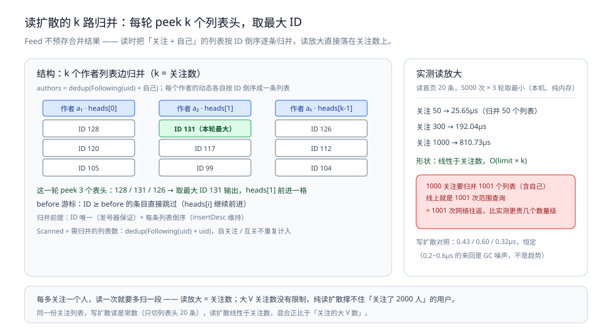
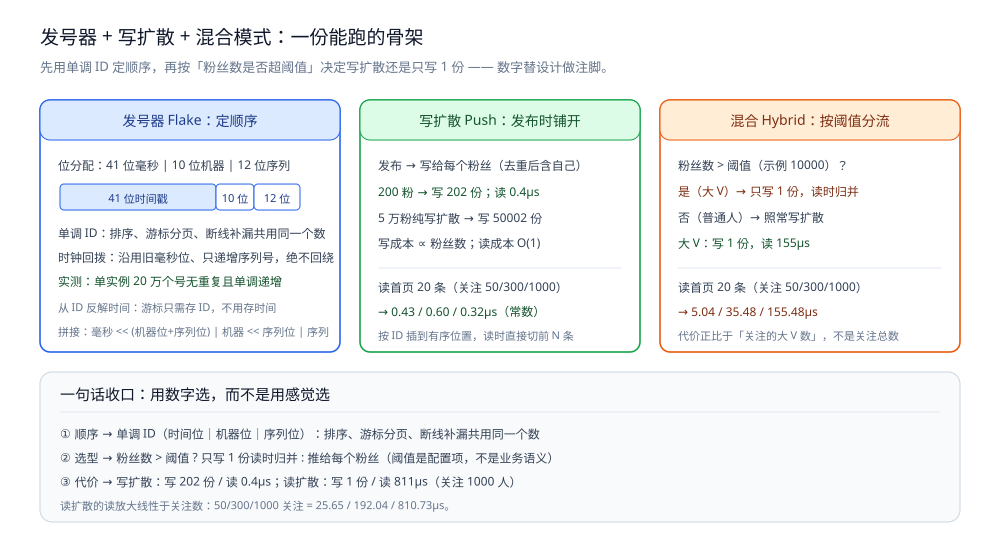
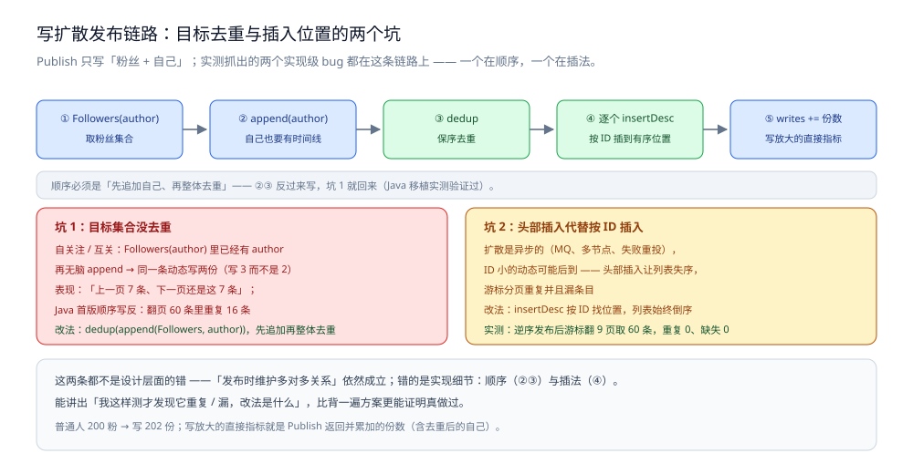

# 朋友圈骨架

> 把 [朋友圈设计.md](朋友圈设计.md) 的四步推导落成可运行骨架：**发号器 + 关系图**、**写扩散 / 读扩散两条路径**、**混合模式**，以及**写放大 / 读放大 / 游标分页稳定性**三组实测。
>
> 内容整理自个人学习笔记，并参考《大型网站技术架构：核心原理与案例分析》（李智慧）的伸缩性与可用性章节；参考资料与原始素材见 [素材清单](../../../素材清单.md)。
>
> 文中提到的「正文」均指 [朋友圈设计.md](朋友圈设计.md)（场景设计篇）的对应小节。

---

## 一、骨架总览与校验口径是什么？

**本节要点**：先把「正文哪句话 → 落成哪个类型 → 实测出什么代价」对齐，并锁定校验口径与「纯内存骨架只反映算法复杂度、不反映线上延迟」这个前提。

> 正文给了 ER 图和数据分层，但两句最值钱的话——**"发布时维护多对多关系（空间换时间**）"
> **和"大 V 不能写扩散"**——只有落成代码才看得出各自的代价。
> 这一节就把它们写成两份能跑的文件，并把**写放大、读放大、游标分页稳定性**实测出来。
>
> **校验口径**：`go build` / `go vet` / `gofmt -l` 全部通过（go 1.26，纯标准库，无第三方依赖）。
>
> ⚠️ **这是纯内存骨架**：`map[int64][]Post` 顶替的是 MySQL/Redis 的位置，
> 所以**测出来的是"算法复杂度"，不是"线上延迟"**——真实系统里读扩散那 1001 次查询
> 是 1001 次网络往返，比这里测到的还要贵几个数量级。
> 单机、单进程，**没有验证过分库分表、缓存一致性与故障恢复**。
>
> `Graph` / `PushTimeline` / `PullTimeline` 三个类型是语言无关的——
> **下面「Java 版骨架」把它们逐类型搬了一遍并重新实测**，写放大与分页稳定性的数字两边完全一致。

**正文每一步的落点**：

| 正文的那句话 | 落点类型 | 实测出来的代价 |
|---|---|---|
| "按 ID 倒序即等价于按时间倒序" | `Flake.Next` | 单实例 20 万个号无重复且单调 |
| "朋友是多对多" | `Graph`（following + followers 两份反向索引） | — |
| "发布量 << 查看量 → 空间换时间" | `PushTimeline`（写扩散） | 200 粉写 **202** 份，读 **0.4µs** |
| "大 V 发一条要写给几千万人吗？→ 不能" | `PullTimeline`（读扩散） | 写 **1** 份，读 **811µs**（关注 1000 人时） |
| "混合模式（普通用户写扩散、大 V 读扩散）" | `HybridTimeline` + 粉丝数阈值 | 大 V 写 **1** 份，读 **155µs** |

## 二、发号器、关系图与两条扩散路径怎么写？

**本节要点**：用单调发号器（时间位｜机器位｜序列位）定顺序；写扩散在发布时按粉丝数铺开，读扩散在读时按关注数归并。

```go
package moments

import (
	"sort"
	"sync"
	"time"
)

// Flake 是正文追问里"怎么保证动态顺序"的答案：**带时间戳的单调 ID**。
//
// 为什么不能用 created_at 排序：同一毫秒内多人并发发布，时间戳相同，
// 分页时"上一页最后一条"和"下一页第一条"就会重复或漏掉。
// 用单调递增 ID 排序 = 天然唯一 + 天然有序，游标分页才有稳定边界。
type Flake struct {
	mu   sync.Mutex
	last int64
	seq  int64
}

// 位分配：41 位毫秒时间戳 | 10 位机器号 | 12 位序列号（够用 24 年 × 1024 台 × 每毫秒 4096 条）
const (
	nodeBits = 10
	seqBits  = 12
	maxSeq   = 1<<seqBits - 1
)

func (f *Flake) Next(node int64) int64 {
	f.mu.Lock()
	defer f.mu.Unlock()

	ms := time.Now().UnixMilli()
	switch {
	case ms > f.last:
		f.seq = 0
	case f.seq < maxSeq:
		// 同一毫秒继续取号。**ms < f.last 就是时钟回拨**（NTP 校时、虚机迁移）：
		// 这里沿用上一次的毫秒位、只递增序列号，宁可"看起来慢一毫秒"也不让 ID 倒退。
		ms = f.last
		f.seq++
	default:
		// 序列号用满 → 等到下一毫秒，**绝不回绕**（回绕必然产生重复 ID）
		for ms <= f.last {
			ms = time.Now().UnixMilli()
		}
		f.seq = 0
	}
	f.last = ms // ⚠️ 必须在这里统一写回：漏掉这一步，下一毫秒的首个号会和上一个重复
	return ms<<(nodeBits+seqBits) | (node&((1<<nodeBits)-1))<<seqBits | f.seq
}

// Time 从 ID 反解出毫秒时间戳：游标里只存 ID，前端展示时间靠它。
func Time(id int64) time.Time {
	return time.UnixMilli(id >> (nodeBits + seqBits))
}

// Post 是一条动态。
type Post struct {
	ID     int64
	Author int64
	Text   string
}
```

接着把关注关系建模成图：正反两份索引，分别回答"我能看到谁"和"我发一条要写多少份"。

```go
// Graph 是关注关系。正文说"朋友是多对多"，这里用两份反向索引表达：
// following 决定"我能看到谁"，followers 决定"我发一条要写多少份"。
type Graph struct {
	mu        sync.RWMutex
	following map[int64]map[int64]bool
	followers map[int64]map[int64]bool
}

func NewGraph() *Graph {
	return &Graph{following: map[int64]map[int64]bool{}, followers: map[int64]map[int64]bool{}}
}

func (g *Graph) Follow(from, to int64) {
	g.mu.Lock()
	defer g.mu.Unlock()
	if g.following[from] == nil {
		g.following[from] = map[int64]bool{}
	}
	if g.followers[to] == nil {
		g.followers[to] = map[int64]bool{}
	}
	g.following[from][to] = true
	g.followers[to][from] = true
}

// Unfollow 删关系。⚠️ 正文追问"删好友怎么办"：
// 光删关系表**不够**，已经写进对方时间线（写扩散）的动态必须一并处理，
// 否则"删了好友还能看到对方动态"。这里的做法是重建该用户时间线。
func (g *Graph) Unfollow(from, to int64) {
	g.mu.Lock()
	defer g.mu.Unlock()
	delete(g.following[from], to)
	delete(g.followers[to], from)
}

func (g *Graph) Following(u int64) []int64 {
	g.mu.RLock()
	defer g.mu.RUnlock()
	out := make([]int64, 0, len(g.following[u]))
	for v := range g.following[u] {
		out = append(out, v)
	}
	sort.Slice(out, func(i, j int) bool { return out[i] > out[j] }) // 大 ID = 新，方便后面归并
	return out
}

func (g *Graph) Followers(u int64) []int64 {
	g.mu.RLock()
	defer g.mu.RUnlock()
	out := make([]int64, 0, len(g.followers[u]))
	for v := range g.followers[u] {
		out = append(out, v)
	}
	return out
}
```

下面是写扩散（Push）：发布时就把动态塞进每个粉丝的时间线，用空间换读时间。

```go
// PushTimeline 是**写扩散**：发布时就把动态塞进每个粉丝的时间线。
// 对应正文那句"发布量 << 查看量，所以发布时多存一份关系，用空间换时间"。
type PushTimeline struct {
	mu   sync.RWMutex
	feed map[int64][]Post // key = 用户 ID，值已按 ID 倒序
	// writes 统计"这条动态实际落了几份"——写放大的直接指标
	writes int64
}

func NewPushTimeline() *PushTimeline {
	return &PushTimeline{feed: map[int64][]Post{}}
}

// dedup 对目标集合去重。★ 一个很容易踩到的真实 bug：
//
//	作者关注了自己（互关场景下的自引用）时，Followers(author) 里已经有 author，
//	再无脑 append(author) 就把同一条动态写两份 → 时间线里出现重复条目，
//	游标翻页时表现为"上一页 7 条、下一页还是这 7 条"。
//
// 结论：**写扩散 / 读归并之前，先对目标集合去重。**
func dedup(ids []int64) []int64 {
	seen := make(map[int64]bool, len(ids))
	out := make([]int64, 0, len(ids))
	for _, id := range ids {
		if seen[id] {
			continue
		}
		seen[id] = true
		out = append(out, id)
	}
	return out
}

// insertDesc 把一条动态插入**倒序**列表的正确位置。
//
// ⚠️ 不能无脑头部插入：生产上扩散是异步的（MQ、多节点、失败重投），
// 更早的动态可能后到，头部插入会让列表失序 → 游标分页重复或漏条目。
func insertDesc(list []Post, p Post) []Post {
	i := 0
	for i < len(list) && list[i].ID > p.ID {
		i++
	}
	list = append(list, Post{})
	copy(list[i+1:], list[i:])
	list[i] = p
	return list
}

// Publish 往作者所有粉丝（含自己）的时间线插一条，返回实际写的份数。
func (t *PushTimeline) Publish(p Post, g *Graph) int {
	targets := dedup(append(g.Followers(p.Author), p.Author))
	t.mu.Lock()
	defer t.mu.Unlock()
	for _, u := range targets {
		// 按 ID 插入有序位置：列表始终倒序，读的时候直接切前 N 条，**零排序成本**
		t.feed[u] = insertDesc(t.feed[u], p)
	}
	t.writes += int64(len(targets))
	return len(targets)
}

// Feed 是**读路径**：只切一段，不做任何聚合。
func (t *PushTimeline) Feed(uid int64, before int64, limit int) []Post {
	t.mu.RLock()
	defer t.mu.RUnlock()
	list := t.feed[uid]
	out := make([]Post, 0, limit)
	for _, p := range list {
		if before != 0 && p.ID >= before { // before = 上一页最后一条的 ID（游标）
			continue
		}
		out = append(out, p)
		if len(out) == limit {
			break
		}
	}
	return out
}

// Writes 返回写扩散累计落库份数。
func (t *PushTimeline) Writes() int64 {
	t.mu.RLock()
	defer t.mu.RUnlock()
	return t.writes
}
```

再看读扩散（Pull）：发布只写一份，代价落在读的时候把关注对象的列表归并起来。

```go
// PullTimeline 是**读扩散**：只存"我发的动态"，读的时候把关注对象的列表归并。
type PullTimeline struct {
	mu    sync.RWMutex
	posts map[int64][]Post // key = 作者 ID
}

func NewPullTimeline() *PullTimeline { return &PullTimeline{posts: map[int64][]Post{}} }

// Publish 只写一份——这就是读扩散唯一的优势。
func (t *PullTimeline) Publish(p Post) int {
	t.mu.Lock()
	defer t.mu.Unlock()
	t.posts[p.Author] = insertDesc(t.posts[p.Author], p)
	return 1
}

// Feed 归并 k 个有序列表取前 limit 条（k = 关注数）。
//
// 每多关注一个人，读一次就要多扫一段：**读放大 = 关注数**。
// 大 V 关注数没有限制，所以纯读扩散撑不住"关注了 2000 人"的用户。
func (t *PullTimeline) Feed(uid int64, g *Graph, before int64, limit int) []Post {
	authors := dedup(append(g.Following(uid), uid)) // 去重同 PushTimeline.Publish
	t.mu.RLock()
	defer t.mu.RUnlock()

	heads := make([]int, len(authors)) // 每个列表的消费位置
	out := make([]Post, 0, limit)
	for len(out) < limit {
		best, bestID := -1, int64(0)
		for i, a := range authors {
			list := t.posts[a]
			if heads[i] >= len(list) {
				continue
			}
			id := list[heads[i]].ID
			if before != 0 && id >= before {
				heads[i]++
				continue
			}
			if id > bestID {
				best, bestID = i, id
			}
		}
		if best == -1 {
			break
		}
		out = append(out, t.posts[authors[best]][heads[best]])
		heads[best]++
	}
	return out
}

// Scanned 返回读一次需要 peek 的列表数（读扩散的读放大指标）。
func (t *PullTimeline) Scanned(uid int64, g *Graph) int {
	return len(dedup(append(g.Following(uid), uid)))
}
```



图怎么读：Feed 不预存合并结果 —— 读时把「关注 + 自己」的列表按 ID 倒序逐条归并。每个作者的列表各自倒序，`Feed` 每一轮 peek `heads[i]` 指向的 k 个列表头、取最大 ID 输出一条，例如图中这一轮 peek 3 个表头 128 / 131 / 126，取 131 输出并把 heads[1] 前进一格；`before` 游标把 ID ≥ before 的条目直接跳过。右侧是第五节的读数：关注 50 / 300 / 1000 → 25.65 / 192.04 / 810.73µs，**线性于关注数**；换算到线上，1000 关注要归并 1001 个列表（含自己），就是 1001 次范围查询和 1001 次网络往返，比纯内存实测还要贵几个数量级。

## 三、混合模式怎么落地？

**本节要点**：混合模式按「粉丝数是否超阈值」分流 —— 普通用户走写扩散、大 V 只写 1 份、读时再把两路结果归并。

```go
package moments

import "sync"

// HybridTimeline 是正文那句最好的加分回答的落地形态：
//
//	普通用户 → 写扩散（发布时推给粉丝）
//	大 V     → 读扩散（读时再聚合，避免一条动态写几千万份）
//
// 判断依据只有一个：**粉丝数是否超过阈值**。这个阈值必须是配置项，
// 因为它取决于"单条动态最多愿意写多少份"这个成本上限，而不是业务语义。
type HybridTimeline struct {
	mu        sync.RWMutex
	threshold int64 // 粉丝数 > threshold 视为大 V
	push      *PushTimeline
	pull      *PullTimeline
	bigV      map[int64]bool
}

func NewHybrid(push *PushTimeline, pull *PullTimeline, threshold int64) *HybridTimeline {
	return &HybridTimeline{push: push, pull: pull, threshold: threshold, bigV: map[int64]bool{}}
}

// IsBigV 判定 + 登记。**生产上这个判定结果要缓存**（粉丝数是低频变化的值）。
func (h *HybridTimeline) IsBigV(uid int64, followers int) bool {
	h.mu.Lock()
	defer h.mu.Unlock()
	big := int64(followers) > h.threshold
	if big {
		h.bigV[uid] = true
	}
	return big
}

// Publish 返回这条动态实际写了多少份（写放大的直接指标）。
//
// ★ 注意：大 V 也要**同时**写进 push——但只写给自己的"订阅缓存"是没意义的，
//
//	所以这里大 V 只写一份到 pull，读的时候由粉丝侧聚合。
func (h *HybridTimeline) Publish(p Post, g *Graph) int {
	if h.IsBigV(p.Author, len(g.Followers(p.Author))) {
		h.pull.Publish(p)
		return 1
	}
	return h.push.Publish(p, g)
}

// Feed 把"自己 + 关注的普通人"的写扩散结果，和"关注的大 V"的读扩散结果归并。
//
// 分页游标沿用同一条规则：**ID 倒序 + before 游标**，两路数据都是有序的，
// 所以归并代价是 O(limit × 大V数)，而不是 O(总动态数)。
func (h *HybridTimeline) Feed(uid int64, g *Graph, before int64, limit int) []Post {
	merged := h.push.Feed(uid, before, limit)

	h.mu.RLock()
	bigFollowed := make([]int64, 0, 4)
	for _, v := range g.Following(uid) {
		if h.bigV[v] {
			bigFollowed = append(bigFollowed, v)
		}
	}
	h.mu.RUnlock()

	// 逐个大 V 取其最新 limit 条，再与 merged 归并
	for _, v := range bigFollowed {
		for _, p := range h.pull.postsOf(v) {
			if before != 0 && p.ID >= before {
				continue
			}
			merged = insertSorted(merged, p, limit)
		}
	}
	return merged
}

// postsOf 取某个作者自己的动态列表（读扩散用）。
func (t *PullTimeline) postsOf(author int64) []Post {
	t.mu.RLock()
	defer t.mu.RUnlock()
	return t.posts[author]
}

// insertSorted 插入倒序列表并截断到 limit（归并路径需要控制结果长度）。
func insertSorted(list []Post, p Post, limit int) []Post {
	list = insertDesc(list, p)
	if len(list) > limit {
		list = list[:limit]
	}
	return list
}
```



图怎么读：左栏是发号器 —— 位分配 41 位毫秒 | 10 位机器 | 12 位序列，时钟回拨沿用旧毫秒位、只递增序列号，实测单实例 20 万个号无重复且单调递增。中栏写扩散：200 粉 → 写 202 份、读 0.4µs，5 万粉纯写扩散 → 写 50002 份，读首页是常数。右栏混合按「粉丝数 > 阈值（示例 10000）」分流：大 V 只写 1 份、读 155µs，代价正比于「关注的大 V 数」。底部收口是三句话：① 顺序用单调 ID；② 选型看粉丝数是否超阈值；③ 代价用数字选，而不是用感觉选。

## 四、写放大：「空间换时间」到底换掉了多少空间？

**本节要点**：写放大的直接读数 —— 200 粉写 202 份、5 万粉纯写扩散写 50002 份、混合模式下 5 万粉只写 1 份。

一人发一条动态，实际写多少份：

| 模式 | 普通人（200 粉） | 大 V（50000 粉） |
|---|---|---|
| 纯写扩散 | 202 | **50002** |
| 纯读扩散 | 1 | 1 |
| 混合（阈值 10000） | 202 | **1** |

> 50002 这个数字就是正文那句"**不能**（写扩散爆炸）"的量化的形态：
> 把粉丝数换成 1000 万，一次发布就是 1000 万次写，
> 而**发一条动态的用户体验和刷 100 页的时间线相比，前者是低频操作**——
> 低频侧花代价、高频侧省代价，这才是"空间换时间"的判断依据。
> 混合模式买的正是这一点：**普通用户照写（202 份），大 V 只写 1 份**。

## 五、读放大：刷一次首页要付多少钱？

**本节要点**：读放大随关注数变化 —— 写扩散恒定、读扩散线性于关注数、混合介于两者且正比于「关注的大 V 数」。

读首页 20 条，5000 次 × 3 轮取最小（本机、纯内存）：

| 关注数 | 写扩散 | 读扩散 | 混合 | 读扩散需归并的列表数 |
|---|---|---|---|---|
| 50 | 0.43µs | 25.65µs | 5.04µs | 50 |
| 300 | 0.60µs | 192.04µs | 35.48µs | 300 |
| 1000 | 0.32µs | 810.73µs | 155.48µs | 1000 |

> 三列的形状比数值更重要：
> - **写扩散是常数**（只切列表头 20 条，与关注数无关；这一列 0.2~0.6µs 之间的来回是 GC 噪声，不是趋势）；
> - **读扩散线性于关注数**（每取一条要 peek 全部 k 个列表头 → `O(limit × k)`），1000 关注时约 0.8ms；
> - **混合介于两者之间**，代价正比于"**关注的大 V 数**"而不是"关注总数"。
>
> 换算到线上：读扩散那 1001 个列表在 MySQL 上就是 1001 次范围查询 = 1001 次网络往返，
> 比这里测到的 0.8ms 还要贵几个数量级——**所以正文说"查看的频次是发布的好几倍，必须快"**。

## 六、游标分页与发号器稳定吗？

**本节要点**：游标分页与发号器的稳定性读数，以及两个由实测抓出的实现级 bug（目标集合没去重、头部插入代替按 ID 插入）。

| 场景 | 实测结果 |
|---|---|
| **逆序发布**（ID 小的最后才到，模拟异步扩散晚到）后按 ID 游标翻 9 页取 60 条 | 重复 **0** 条、缺失 **0** 条 |
| 作者自关注（互关）时发 1 条 | 写 **2** 份（未去重时是 3 份），自己时间线里同一条出现 **1** 次 |
| 单实例连续取 200000 个号 | 全部唯一且**单调递增**，其中 199947 个落在同一毫秒内（靠序列号区分） |
| 单实例一次取 4195 个（超过每毫秒 4096 的容量） | 无重复，多出的部分在等下一毫秒（耗时 1ms） |
| **时钟回拨 5 秒**（把 last 抬到未来） | 下一个 ID 仍然更大：毫秒位沿用旧值、只递增序列号 |
| 8 个协程并发取号 | 无重复 |
| 从 ID 反解时间 | 首个 ID 解出 2026-09-24T14:56:55 → **游标只需存 ID，不用存时间** |

**两个被抓出来的实现级 bug**（值得主动讲出来）：

1. **目标集合没去重**：`Followers(author)` 里可能已经有 author 自己（自关注/互关），
   再 `append(author)` 就把同一条动态写两份 → 表现是"上一页 7 条、下一页还是这 7 条"。
2. **用头部插入代替按 ID 插入**：只要发布链路是异步的（MQ、多节点、失败重投），
   ID 小的动态可能后到，头部插入就让列表失序 → 游标分页重复**并且**漏条目。

> 这两条都**不是**设计层面的错——正文"发布时维护多对多关系"完全成立，
> 错的是实现细节。**能讲出"我这样测才发现它重复/漏，改法是什么"，比背一遍方案更能证明真做过。**



图怎么读：上方是 `Publish` 的正确链路 —— `Followers(author)` 取粉丝集合 → `append(author)` 把自己也追加进去 → `dedup` 保序去重 → 逐个目标 `insertDesc` 按 ID 插到有序位置，顺序必须是「先追加自己、再整体去重」。坑 1（红）就是顺序写反或没去重：自关注/互关时同一条动态写两份，表现是「上一页 7 条、下一页还是这 7 条」，Java 首版翻页 60 条里重复 16 条；坑 2（黄）是头部插入代替按 ID 插入：扩散是异步的（MQ、多节点、失败重投），ID 小的动态可能后到，头部插入让列表失序 → 游标分页重复并且漏条目，改成 `insertDesc` 后实测逆序发布翻 9 页取 60 条，重复 0、缺失 0。

## 七、Java 版骨架为什么会让两个 bug 自己重现？

**本节要点**：把三个类型逐类型移植到 Java 重新实测，验证「答案语言无关」，并让同一批实现级 bug 重现一遍。

> **校验口径**：`MomentsDesign.java` 用 IDEA 自带的 JBR 编译并运行过——
> `javac -Xlint:all -encoding UTF-8` **无 error 无 warning**，修好顺序后跑了 4 次（下面给区间）。
> 纯 JDK、无第三方依赖。⚠️ 时间是本机绝对值，**只用来和 Go 侧对形状，不当线上延迟用**。

**跑法**：

```bash
cd "$TEMP/verify-java/moments"
JBR="<IDEA 安装目录>/jbr/bin"    # IDEA 自带的 JBR 17，路径按自己的安装位置替换
"$JBR/javac.exe" -Xlint:all -encoding UTF-8 -d out MomentsDesign.java
"$JBR/java.exe" -Dfile.encoding=UTF-8 -Dstdout.encoding=UTF-8 -cp out MomentsDesign
```

**容器与原语对照**：

| Go | Java | 备注 |
|---|---|---|
| `map[int64][]Post` | `HashMap<Long, List<Post>>` | 键值语义完全一致 |
| 按 ID 插入倒序（`append` + `copy`） | `ArrayList.add(index, e)` | 底层都是 arraycopy，**成本同量级** |
| `sort.Slice` 倒序 | `List.sort(Collections.reverseOrder())` | — |
| `dedup`（map + 保序切片） | `new ArrayList<>(new LinkedHashSet<>(ids))` | ⚠️ 必须 `LinkedHashSet`，用 `HashSet` 顺序就散了 |
| `sync.RWMutex` + map | `synchronized` 方法 | 骨架阶段够用；真上量要换分片锁/Caffeine |
| `time.Now().UnixMilli()` | `System.currentTimeMillis()` | 时钟回拨问题**两边一模一样** |

**片段一：发号器（位结构与回拨处理和 Go 版逐行对应）**

```java
		synchronized long next(long node) {
			long ms = System.currentTimeMillis();
			if (ms > last) {
				seq = 0;
			} else if (seq < MAX_SEQ) {
				// 同一毫秒继续取号。ms < last 就是**时钟回拨**：
				// 沿用上一次的毫秒位、只递增序列号，宁可"看起来慢一毫秒"也不让 ID 倒退。
				ms = last;
				seq++;
			} else {
				// 序列号用满 → 等到下一毫秒，**绝不回绕**（回绕必然产生重复 ID）
				while (ms <= last) {
					ms = System.currentTimeMillis();
				}
				seq = 0;
			}
			last = ms; // ⚠️ 必须在这里统一写回：漏掉这步，下一毫秒首个号会和上一个重复
			return (ms << (NODE_BITS + SEQ_BITS)) | ((node & ((1L << NODE_BITS) - 1)) << SEQ_BITS) | seq;
		}
```

**片段二：写扩散的目标集合——★ 顺序写反，正文那个 bug 就自己回来了**

```java
		synchronized int publish(Post p, Graph g) {
			// ★ 顺序必须是"先追加自己、再整体去重"（和 Go 版 dedup(append(...)) 一致）：
			// 反过来先 dedup 再 add，作者本人若已在粉丝集合里就会被写两份。
			List<Long> withSelf = new ArrayList<>(g.followers(p.author()));
			withSelf.add(p.author()); // 自己的时间线也要有
			List<Long> targets = dedup(withSelf);
			for (long u : targets) {
				// 列表始终倒序，读的时候直接切前 N 条，**零排序成本**
				insertDesc(feed.computeIfAbsent(u, k -> new ArrayList<>()), p);
			}
			writes += targets.size();
			return targets.size();
		}
```

> **这不是纸上推演**：移植第一版我就是写成"先 `dedup` 再 `add(author)`"，
> 结果测试直接复现了 Go 版抓出的那两个现象——
> 自关注时**写 3 份而不是 2 份**、游标翻页 60 条里**重复 16 条**。
> 换句话说：**这个 bug 属于逻辑，不属于语言**，换 Java 一样中招。改回顺序后两边数字立刻对齐。

**片段三：读扩散的 k 路归并**

```java
		/**
		 * 归并 k 个有序列表取前 limit 条（k = 关注数）。
		 * 每多关注一个人，读一次就要多扫一段：**读放大 = 关注数**。
		 */
		synchronized List<Post> feed(long uid, Graph g, long before, int limit) {
			List<Long> withSelf = new ArrayList<>(g.following(uid));
			withSelf.add(uid);
			List<Long> authors = dedup(withSelf);
			List<Post> out = new ArrayList<>(limit);
			int[] heads = new int[authors.size()]; // 每个列表的消费位置
			while (out.size() < limit) {
				int best = -1;
				long bestId = 0;
				for (int i = 0; i < authors.size(); i++) {
					List<Post> list = posts.getOrDefault(authors.get(i), Collections.emptyList());
					if (heads[i] >= list.size()) {
						continue;
					}
					long id = list.get(heads[i]).id();
					if (before != 0 && id >= before) {
						heads[i]++;
						continue;
					}
					if (id > bestId) {
						best = i;
						bestId = id;
					}
				}
				if (best == -1) {
					break;
				}
				out.add(posts.get(authors.get(best)).get(heads[best]));
				heads[best]++;
			}
			return out;
		}
```

**Java 侧实测**（与 Go 侧同参数；时间取 4 次区间）：

| 实验 | Go | Java | 结论 |
|---|---|---|---|
| 写放大：普通人 200 粉 / 大 V 50000 粉 | 202 / 混合 1；纯写扩散 50002 | **202 / 混合 1；纯写扩散 50002** | ✅ 逐格相同 |
| 读首页 20 条（关注 50 / 300 / 1000 人）· 写扩散 | 0.43 / 0.60 / 0.32 µs | 0.87~1.74 / 0.14~0.25 / 0.13~0.14 µs | ✅ 都是**常数**，抖动是 GC 噪声 |
| 同上 · 读扩散 | 25.65 / 192.04 / 810.73 µs | 18~27 / 130~211 / **541~754** µs | ✅ 都**线性于关注数**，斜率同量级 |
| 同上 · 混合 | 5.04 / 35.48 / 155.48 µs | 2.4~3.9 / 11~15 / **41~51** µs | ⚠️ 形状同（正比于"关注的大 V 数"），但 Java 侧快 2.5~3.8 倍，见下面第 3 点 |
| 逆序发布后按 ID 游标翻页 | 9 页取完 60 条，重复 0 缺失 0 | **9 页 / 60 条 / 重复 0 / 缺失 0** | ✅ 相同 |
| 自关注去重 | 写 2 份，同一条出现 1 次 | **写 2 份，出现 1 次** | ✅ 相同 |
| 单实例取 200000 个号 | 全部唯一且单调，199947 个同毫秒 | **全部唯一且单调，199847~199885 个同毫秒** | ✅ 相同 |
| 一次取 4195 个（超单毫秒 4096 容量） | 无重复，耗时 1ms | **无重复，耗时 1ms** | ✅ 相同 |
| 时钟回拨 5 秒 | ID 仍递增 | **ID 仍递增** | ✅ 相同 |
| 8 个并发体取号 | 无重复 | 8 个**内核线程**并发取号无重复 | ✅ 相同 |

**三点只有真移植一遍才说得出的话**：

1. **这类设计题的答案是语言无关的**：写扩散/读扩散/混合三档的数字在两边逐格对齐，
   说明正文那套"发布低频、查看高频 → 用空间换时间"的判断**不依赖 Go 的协程或通道**。
2. **移植是最好的一致性检查**：把 Go 实现换成 Java 时，
   任何"顺序、边界、去重"上的隐患都会以同样的错误现象重现一遍
   （我这里就是翻页重复 16 条）。**比 review 代码有效得多。**
3. **两边的差异集中在"归并那一步怎么插"**：
   Go 版 `insertSorted` 每次 `append(list, Post{})` 都可能触发整块重分配（列表已到 cap 时），
   Java 版 `ArrayList.add(index, e)` 是在已有数组上做 arraycopy ——
   混合模式那一列 Java 快 2.5~3.8 倍，**大概率就是这个来源（我没有逐项 profile，只做了形状对照）**。
   另外"每次读都重算关注列表"两边都做了，生产上这个判定结果必须缓存
   （粉丝数是低频变化值）——**这条正文讲过，两边的数字替它做了注脚**。

## 八、一句话怎么收口？

**本节要点**：用一句话把顺序、选型、代价三条收口 —— 用数字选，而不是用感觉选。

```text
① 顺序  → 单调 ID（时间位|机器位|序列位）：排序、游标分页、断线补漏共用同一个数
② 选型  → 粉丝数 > 阈值 ? 只写 1 份读时归并 : 推给每个粉丝（阈值是配置项，不是业务语义）
③ 代价  → 写扩散：写 202 份 / 读 0.4µs；读扩散：写 1 份 / 读 811µs —— 用数字选，而不是用感觉选
```

---

## 延伸追问

- **为什么用「发号器」而不是数据库自增主键？** → 动态要按时间倒序、同一秒内也要能分先后；单调递增的 ID（时间位｜机器位｜序列位）让「排序、游标分页、断线补漏」共用同一个数。
- **写扩散的「202 份」是哪来的？** → 200 个粉丝 + 自己等少量目标，实测「200 粉写 202 份、读 0.4µs」；读扩散则是「写 1 份、读 811µs」—— 数量级差距就是选型依据。
- **内存骨架测出的数字搬到线上还成立吗？** → 只反映**算法复杂度**，不反映线上延迟：读扩散那 1001 次查询在真实系统里是 1001 次网络往返，比本机测到的还要贵几个数量级。
- **Java 版与 Go 版为什么会有倍数差？** → 差异集中在归并那一步怎么插：Go 的 `append` 可能整块重分配、Java 的 `ArrayList.add(index,e)` 是 arraycopy，混合模式一列 Java 快 2.5~3.8 倍（只做形状对照，未逐项 profile）。

## 关联

- [朋友圈设计.md](朋友圈设计.md) — 场景设计篇（总纲）：要素分析、ER 表设计、数据分层与缓存
- [分布式ID.md](../../分布式/理论/分布式ID.md) — 发号器与单调 ID 的选型
- [缓存问题与方案.md](../../../03-数据与中间件/数据存储/缓存/缓存问题与方案.md) — 时间线缓存的穿透 / 击穿 / 雪崩
- [深分页与索引变更.md](../../../03-数据与中间件/数据存储/关系型/MySQL/深分页与索引变更.md) — feed 查询依赖的索引与分页优化
