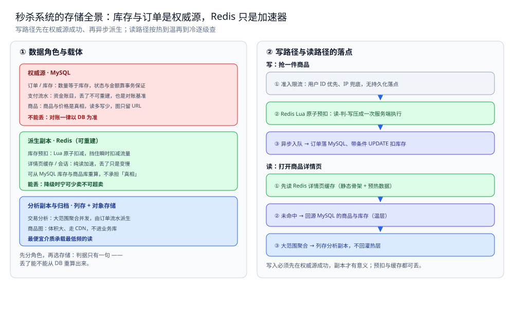

# 存储全景

> 秒杀系统的数据都存哪：库存与订单是权威源，Redis 里的预扣与缓存只是加速器，
> 每份数据是什么角色、放哪个载体、怎么同步、哪些能丢哪些不能。
> 本篇只回答「这份数据放哪」——通用判据（角色 / 同步 / 冷热）见 [存储选型与组合.md](../存储选型与组合.md)，
> 本篇不重复判据，只把判据落到秒杀上。
>
> 内容整理自个人学习笔记，并参考《大型网站技术架构：核心原理与案例分析》（李智慧）的伸缩性与可用性章节；参考资料与原始素材见 [素材清单](../../../素材清单.md)。

---

## 一、秒杀系统里数据扮演哪几种角色？

**本节要点**：先分角色，再选存储。判据只有一句——**丢了能不能从别处重建**；不能重建的是权威源，能重建的是副本。

| 数据 | 角色 | 载体 | 理由 |
|---|---|---|---|
| 订单 | 权威源 | MySQL | 唯一真相，数量等于库存、要可追溯不能丢；状态与金额靠事务保证 |
| 库存 | 权威源 | MySQL | 扣减的最终依据；Redis 的预扣只是副本，对账一律以 DB 为准 |
| 支付流水 | 权威源 | MySQL | 资金账目，丢了不可重建；也是与第三方对账的基准 |
| 商品 | 权威源 | MySQL | 商品与价格是真相、读多写少；商品图另存对象存储，库里只留 URL |
| 库存预扣 | 缓存 | Redis（Lua 原子扣减） | 高频原子扣减放内存；丢了能从 MySQL 库存重算，不承担「真相」 |
| 详情页缓存 / 会话 | 缓存 | Redis | 纯读加速；可从商品库与会话源重建，丢了只是变慢 |
| 交易分析 | 分析副本 | 列存（如 ClickHouse） | 大范围聚合并发，不能拖垮在线库；由订单流水派生 |
| 商品图 | 归档 / 静态资源 | 对象存储 + CDN | 体积大、走 CDN 分发，不进业务库 |

⭐ 判据：问「这份数据丢了能不能重建」—— 订单、库存、支付流水重建不出来，所以是权威源，必须落 MySQL 并由事务兜底；Redis 里的预扣与缓存都能从 MySQL 重算，所以可丢、可降级，只是加速器。

---

## 二、读和写的路径分别走哪条链？

**本节要点**：同一份数据在写路径和读路径上的落点不同 —— 写路径决定「谁先落库、谁异步派生」，读路径决定「先查热层、回源温层、下沉冷层」。

### 2.1 写路径

```text
抢一件商品
│
├─ ① 准入限流：用户 ID 优先、IP 兜底，无持久化落点
├─ ② Redis Lua 原子预扣：把「读-判-写」压成一次服务端执行
├─ ③ 抢到的异步入队（NATS JetStream），消费者按自己的节奏取
├─ ④ 消费者落库：订单写 MySQL（权威源，幂等键去重）
└─ ⑤ 带条件 UPDATE 扣库存：同一行的行锁决定吞吐上限
```

> ⭐ 写入必须先在权威源成功，副本才有意义：只有 ④⑤ 落进 MySQL，这笔交易才算数；②的预扣在落库前一直是**可丢的副本**。

### 2.2 读路径

```text
打开商品详情页
│
├─ ① 先读 Redis 详情页缓存（静态骨架 + 预热数据）
├─ ② 未命中 → 回源 MySQL 的商品与库存（温层）
└─ ③ 大范围聚合 → 列存分析副本，查到不回灌热层
```

> ⭐ 读路径按热 → 温 → 冷逐级查；商品详情页是「读多写少、可静态化」的典型，缓存的收益远大于它带来的维护成本。



图怎么读：左栏把八份数据按角色归到三层——权威源（订单 / 库存 / 支付流水 / 商品）落 MySQL、红框，不能丢，对账一律以 DB 为准；派生副本（库存预扣、详情页缓存 / 会话）落 Redis、绿框，可从 MySQL 库存与商品库重算，降级方向是**宁可少卖不可超卖**；分析副本与归档（交易分析、商品图）落列存 + 对象存储、蓝框，用最便宜的介质承载最低频的读。右栏是两条链的落点：写链「限流 → Redis Lua 原子预扣 → 异步入队 → 订单落 MySQL + 带条件 UPDATE 扣库存」，前两步都不产生持久化真相；读链「先 Redis → 回源 MySQL（温）→ 列存（冷）」，逐级向后。底部一行是本篇的口径基线：**写入必须先在权威源成功，预扣与缓存都可丢**。

---

## 三、为什么这样分配？

**本节要点**：每个角色选中它的载体，都有结构上的理由，不是拍脑袋。

| 数据 | 为什么是它 |
|---|---|
| 订单 / 库存 / 支付流水落 MySQL | 需要事务（订单与库存扣减要一起生效）、需要可追溯、需要参与资金对账 |
| 库存预扣放 Redis | 高频原子扣减、读远多于写、可容忍丢失 —— 但**丢了对账口径必须一致** |
| 详情页缓存放 Redis | 读多写少、可静态化；热点商品读洪峰远大于写 |
| 交易分析下沉列存 | 大范围聚合并发，放在在线库会拖垮扣减 |
| 商品图走对象存储 + CDN | 大文件不适合放进关系库，CDN 承担分发压力 |

⭐ 一条贯穿全篇的判据：**权威源只有一个（MySQL），其余全是它的派生** —— 派生载体可以丢、可以换、可以重建，只要权威源在。

---

## 四、秒杀系统的特殊性在哪？

**本节要点**：秒杀与 IM / Feed 的最大差别是「**热点行被高频写**」—— 别处的热层主要是读加速，秒杀的热层同时是**写入口**，于是多了一件别处没有的事：**对账**。

| 对比项 | 秒杀系统 | IM | Feed 流 |
|---|---|---|---|
| 热副本的角色 | **写入口 + 读加速**（Redis 预扣） | 读加速（近期消息热窗口） | 读加速（时间线 ZSet） |
| 热副本可丢吗 | ✅ 可丢，但丢了要能重算并**回到不超卖的状态** | ✅ 可丢，按 lastSeq 补拉 | ✅ 可丢，翻页时回源 |
| 权威源的写压力 | ⚠️ **热点行高频原子写** | 逐条写入（消息落库） | 主要写内容本体 |
| 必须做的事 | ⭐ **对账**：Redis 剩余 + 已下单 == DB 库存 + 订单 | 断线补拉 | 翻页时回源 |
| 降级方向 | 宁可不卖，不可超卖（fail-closed） | 宁可晚到，不可丢消息 | 宁可空一屏，不可错序 |

⭐ 一句话：别处的热副本丢了只是"变慢"，秒杀的热副本丢了要**账能对上** —— 所以它是这几个场景里唯一一个**必须有对账**的。

## 使用：一次完整链路的存储落点

**本节要点**：把「用户点下秒杀按钮」到「账目对上」的全过程，标出每一步的存储落点。

| 步骤 | 数据 | 落在哪 |
|---|---|---|
| ① 点击秒杀 | 前端按钮置灰 / 倒计时 | 无持久化（客户端） |
| ② 网关准入 | 限流计数 / 答题结果 | 无持久化（网关内存 / Redis 限流键） |
| ③ 原子预扣 | 库存预扣 | Redis（副本，Lua 一次执行） |
| ④ 抢到 → 入队 | 下单请求 | 消息队列（NATS JetStream，FileStorage） |
| ⑤ 消费落库 | 订单 | MySQL（权威源） |
| ⑥ 扣库存 | 库存行 | MySQL（权威源，看 RowsAffected） |
| ⑦ 幂等去重 | 去重键（requestId / 订单号） | Redis SET NX（带 TTL） |
| ⑧ 超时未付 | 订单状态 → 归还库存 | MySQL（同事务 + 幂等标记） |
| ⑨ 对账 | Redis 剩余 / DB 库存 / 订单 | 定时比对，不一致**先告警不自动改** |
| ⑩ 读详情页 | 页面数据 | Redis 缓存 → 回源 MySQL（温） |
| ⑪ 支付回调 | 支付流水 | MySQL（权威源） |
| ⑫ 交易分析 | 聚合指标 | 列存（分析副本，由订单流水派生） |

⭐ 三个关键落点：**库存与订单在 MySQL（权威源）**；预扣与缓存**在 Redis（可丢，但对账口径要一致）**；商品图与冷数据在**对象存储**。

## 延伸追问

- **为什么库存不直接以 Redis 为准？** → 因为 Redis 可能丢，且单位容量成本远高于磁盘。库存的唯一真相是 MySQL 的库存行，Redis 的预扣只是副本；**两者对不上时一律以 DB 为准**。
- **Redis 预扣丢了算事故吗？** → 只要 DB 库存行没被扣，丢了预扣只等于"还没卖出" —— 所以降级方向是**宁可少卖不可超卖**（fail-closed），而不是放开超卖去补量。
- **为什么订单不直接写 Redis？** → 订单要可追溯、不能丢、要按状态机流转并参与资金对账 —— 只有持久化 + 事务能满足（见 [订单系统设计.md](订单系统设计.md)）。Redis 只适合放能重算的东西。
- **交易分析为什么要单独一份列存？** → 大范围聚合并发会拖垮在线库，而那些查询不影响扣减正确性；它由订单流水派生，属**分析副本**，丢了可重建。
- **商品详情页缓存和库存预扣都放 Redis，为什么角色不同？** → 详情页缓存是**读加速**，丢了只是变慢；库存预扣是**写入口**，丢了要能回到"不超卖"的状态 —— 判断依据仍是那句：丢了之后还对不对得上账。

## 关联

- [存储选型与组合.md](../存储选型与组合.md) — 通用判据：五种角色、同步三路线、冷热三层 —— 本篇是它在秒杀上的落地。
- [总体设计.md](总体设计.md) — 2.3 的「同一行」瓶颈、3.3 的兜底与对账，解释了这些落点为什么这么分。
- [库存系统设计.md](库存系统设计.md) — 扣减一致性 / 防超卖 / 缓存与 DB 同步 / 分布式锁的详细判据。
- [订单系统设计.md](订单系统设计.md) — 订单状态机、幂等、超时关单为什么必须落在 MySQL。
- [支付系统设计.md](支付系统设计.md) — 支付流水为什么要可追溯、对账口径怎么定。
- [商品详情页设计.md](商品详情页设计.md) — 读侧的多级缓存 / 击穿与穿透 / 静态化与 CDN。
- [数据同步方式选型对比.md](../../../03-数据与中间件/数据存储/数据同步/数据同步方式选型对比.md) — 通用篇的同步路线：CDC / 双写 / 定时全量怎么选。
- [README.md](README.md) — 本目录导读：秒杀的七个问题点与阅读顺序。
